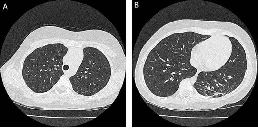

# Chapter 452: Bronchiectasis

*Oren J. Lakser*

<!-- p.3363 -->
Bronchiectasis is characterized by irreversible abnormal dilation and anatomic distortion of the bronchial tree and represents the common end stage of many nonspecific and unrelated antecedent events. Its incidence has been decreasing overall in industrialized countries, but it persists as a problem in lower- and middle-income countries and among some ethnic groups in industrialized nations (particularly in aboriginal children). Females are afflicted more frequently than males.

**PATHOPHYSIOLOGY AND PATHOGENESIS** In industrialized nations, cystic fibrosis (see Chapter 454) is the most common cause of clinically significant bronchiectasis. Other conditions associated with bronchiectasis include primary ciliary dyskinesia (see Chapter 455), postinfectious conditions, especially pertussis, measles, and tuberculosis, immune deficiency syndromes (especially humoral immunity), foreign body aspiration, and aspiration of gastric contents (Table 452.1). Bronchiectasis has also been associated with severe asthma in children. It can also be congenital, as in **Williams-Campbell syndrome**, in which there is an absence of annular bronchial cartilage, and **Marnier-Kuhn syndrome** (congenital tracheobronchomegaly), in which there is a connective tissue disorder. Other disease entities associated with bronchiectasis are **yellow nail syndrome** (pleural effu sion, lymphedema, discolored nails) and **right middle lobe syndrome**. Right middle lobe syndrome is mostly associated with other general ized causes of bronchiectasis, including asthma, cystic fibrosis, primary ciliary dyskinesia, severe pneumonia, aspiration pneumonia, foreign bodies, and immune-deficient states.

Three basic mechanisms are involved in the pathogenesis of bron chiectasis. **Obstruction** can occur because of tumor, foreign body, impacted mucus because of poor mucociliary clearance, external compression, bronchial webs, and atresia. **Infections** caused by *Bor detella pertussis,* measles, rubella, togavirus, respiratory syncytial virus, adenovirus, and *Mycobacterium tuberculosis* induce chronic inflammation, progressive bronchial wall damage, and dilation. More recently, nontypeable *Haemophilus influenzae* seems to be a common cause of infection in adults and children with bronchiectasis. *Strep tococcus pneumoniae* and *Moraxella catarrhalis* are more common in children with bronchiectasis than in adult patients. **Chronic inflam mation** similarly contributes to the mechanism by which obstruction leads to bronchiectasis. Both inadequate and exaggerated/dysregulated immune responses may play a role in the development of bronchiecta sis. Activation of toll-like receptors results in the activation of nuclear factor κB and the release of proinflammatory cytokines interleukin (IL)-1β, IL-8, and tumor necrosis factor-α. IL-8 is a chemoattractant for neutrophils, which are the main inflammatory cell involved in the pathogenesis of bronchiectasis. Once activated, neutrophils produce neutrophil elastase and matrix metalloproteinase (MMP)-8 and MMP- 9. IL-6, IL-8, and tumor necrosis factor-α are elevated in the airways of patients with bronchiectasis. Eosinophils are also elevated in the air ways of indigenous children with bronchiectasis, which promotes neu trophil recruitment, goblet cell hyperplasia, and airway destruction. There is an increase in proinflammatory cytotoxic T lymphocytes in the peripheral blood of children with bronchiectasis. The mechanism by which bronchiectasis occurs in congenital forms is likely related to abnormal cartilage formation. The common thread in the pathogenesis of bronchiectasis consists of difficulty clearing secretions and recurrent infections with a “vicious cycle” of infection and inflammation result ing in airway injury and remodeling. This cycle results in a spectrum of pediatric suppurative lung disorders: protracted bacterial bronchitis (PBB), chronic suppurative lung disease (CSLD), and bronchiectasis. CSLD patients suffer from symptoms of bronchiectasis without its

radiographic features. In early stages, bronchiectasis consists primarily of bronchiolar wall thickening and destruction of elastin resulting in bronchial dilatation. In later stages, the bronchial walls develop carti lage destruction with associated pulmonary artery/arteriole vascular remodeling, resulting in pulmonary hypertension.

Bronchiectasis can manifest in any combination of three pathologic forms, best defined by high-resolution CT (HRCT) scan (Fig. 452.1). In **cylindrical** bronchiectasis, the bronchial outlines are regular, but there is diffuse dilation of the bronchial unit. The bronchial lumen ends abruptly because of mucous plugging. In **varicose** bronchiecta sis, the degree of dilation is greater, and local constrictions cause an irregularity of outline resembling that of varicose veins. There may also be small sacculations. In **saccular** (cystic) bronchiectasis, bronchial dilation progresses and results in ballooning of bronchi that end in fluid- or mucus-filled sacs. This is the most severe form of bronchiec tasis. The following definitions have been proposed: **prebronchiectasis** (chronic or recurrent endobronchial infection with nonspecific HRCT changes; may be reversible), **HRCT bronchiectasis** (clinical symptoms with HRCT evidence of bronchial dilation; may persist, progress, or improve and resolve), and **established bronchiectasis** (like the previ ous but with no resolution within 2 years). Early diagnosis and aggres sive therapy are important to prevent the development of established bronchiectasis.

**CLINICAL MANIFESTATIONS** The most common complaints in patients with bronchiectasis are chronic wet cough and/or production of copious purulent sputum. Younger children may swallow the sputum. In particular, wet or pro ductive cough failing to respond to 4 weeks of oral antibiotics is predic tive of the presence of chest CT–defined bronchiectasis. Hemoptysis is seen with some frequency. Fever can occur with infectious exac erbations. Anorexia and poor weight gain may occur as time passes. Physical examination typically reveals crackles localized to the affected area, but wheezing and digital clubbing may also occur. In severe cases, dyspnea and hypoxemia can occur. Pulmonary function studies may demonstrate an obstructive, restrictive, or mixed pattern. Typically, impaired diffusion capacity is a late finding.

*Oren J. Lakser*

in Children

#### **Table 452.1** Conditions That Predispose to Bronchiectasis

| Category / Parameter | Clinical Details & Findings |
| --- | --- |
| **PROXIMAL AIRWAY NARROWING** | Airway wall compression (i.e., vascular ring, adenopathy impinging; on airways); Airway intraluminal obstruction (e.g., inhaled foreign body, granulation; tissue)`; Airway stenosis and malacia (tracheal, bronchial) |
| **AIRWAY INJURY** | Bronchiolitis obliterans (e.g., postviral, after lung transplantation); Recurrent pneumonitis or pneumonia (e.g., pneumococcal pneumonia,; aspiration pneumonia, tuberculosis, B. pertussis) |
| **ALTERED PULMONARY HOST DEFENSES** | Cystic fibrosis; Primary ciliary dyskinesia; Impaired cough (e.g., neuromuscular weakness conditions) |
| **ALTERED IMMUNE STATES** | Primary abnormalities (e.g., agammaglobulinemia,; hypogammaglobulinemia, common variable immune deficiency,; hyper IgE, hyper IgM, neutrophil dysfunction, gain-of-function; STAT1 variants); Secondary abnormalities (e.g., HIV infection, immunosuppressive; agents) |
| **OTHER** | Systemic pseudohypoaldosteronism; Epithelial sodium channel variants (SCNN1A, SCNN1B); Allergic bronchopulmonary aspergillosis; Plastic bronchitis; Right middle lobe syndrome; From Redding GJ. Bronchiectasis in children. Pediatr Clin North Am. 2009;56:157–171,; Box 1. |

<!-- p.3364 -->
**DIAGNOSIS** Conditions that can be associated with bronchiectasis should be ruled out by appropriate investigations (e.g., sweat test, immunologic workup). Chest radiographs of patients with bronchiectasis tend to be nonspecific. Typical findings can include increase in size and loss of definition of bronchovascular markings, crowding of bronchi, and loss of lung volume. In more severe forms, cystic spaces, occasion ally with air-fluid levels and honeycombing, may occur. Compensa tory overinflation of the unaffected lung may be seen. Thin-section

HRCT scanning and multidetector CT scanning are the gold standards because they have excellent sensitivity and specificity. CT provides fur ther information on disease location, presence of mediastinal lesions, and the extent of segmental involvement. The main features of bron chiectasis in CT scans include (1) increased bronchoarterial ratio and *signet-ring* appearance; (2) bronchial wall thickening; (3) mucous plug ging; (4) lack of bronchial tapering to the lung periphery—“tramlines”; (5) bronchial structures in the lung periphery; and (6) air trapping (mosaic perfusion), most obvious on expiration. The lower lobes (left > right) are more commonly affected. Early in the course, tree-in-bud appearance can also be seen. These CT findings are used to define the bronchiectasis as *cylindrical* (“tram lines,” “signet ring appearance”), *varicose* (bronchi with “beaded contour”), *cystic* (cysts in “strings and clusters”), or mixed forms (Fig. 452.2).

**TREATMENT** The initial therapy for patients with bronchiectasis is medical and aims at decreasing airway obstruction and controlling infection. Airway clearance techniques (e.g., gravity-assisted drainage, active cycle of breathing, positive expiratory pressure [PEP], acapella, high-frequency chest wall oscillation), antibiotics, and bronchodilators are essential. Two to four weeks of parenteral antibiotics (in hospital or at home) is often necessary to manage more severe acute exacerbations adequately. Exacerbations can be defined as the presence of one major criteria (wet cough enduring longer than 72 hours, increased cough frequency over 72 hours) *plus* one laboratory criteria (C-reactive protein >3 mg/L, serum IL-6 >2 ng/L, serum amyloid A >5 mg/L, elevated neutrophil percentage), two major criteria, or one major criterion *plus* two minor criteria (change in sputum color, breathlessness, chest pain, crackles/ crepitations, wheeze). The presence of dyspnea (increased work of breathing) and/or hypoxemia should be considered a severe exacerba tion, irrespective of duration.

Antibiotic choice is dictated by the identification and sensitivity of organisms found on deep throat, sputum (induced or spontane ous), or bronchoalveolar lavage fluid cultures. The most common organisms found in children with bronchiectasis include *H. influ enzae* non–type b*, S. pneumoniae*, *M. catarrhalis*, *Mycoplasma pneu moniae, Pseudomonas aeruginosa,* and *Staphylococcus aureus*. Viruses (most commonly human rhinovirus) are often found in children with bronchiectasis suffering from an exacerbation. A 14-day course of amoxicillin/clavulanic acid (22.5 mg/kg/dose twice daily) has been particularly successful at treating most pulmonary exacerbations. Azithromycin (5 mg/kg/day) is a reasonable alternative in those with penicillin allergy. For those experiencing frequent exacerbations of more than three per year, long-term prophylactic macrolide antibiot ics (which also have immunomodulatory and antiinflammatory prop erties) or nebulized antibiotics (e.g., tobramycin, colistin, aztreonam, ciprofloxacin) may be beneficial (reduced exacerbations and hospi talizations, improved lung function) but may also increase antibiotic

A

C

B

D

**Fig. 452.1** High-resolution chest CT scans (A and B) and bronchos copy images (C and D) in a child with bronchiectasis. (C and D) Bron choscopy findings. Images from a chest high-resolution computed to mography (cHRCT) scan (A and B) in a 10-yr-old girl who presented with a chronic wet cough. The child was treated with a 2-wk course of IV an tibiotics (after failing oral antibiotic treatment). The scan was reported as having no evidence of bronchiectasis by pediatric radiologists. At bronchoscopy thick mucus was seen in the trachea (C) and the right lower lobe (D). The case highlights the need to consider the diagnosis of bronchiectasis on the basis of history, examination findings, and us ing the pediatric cutoff (bronchoarterial ratio >0.8) for defining bron chiectasis on the cHRCT scan. (From Goyal V, Grimwood K, Marchant J, et al. Pediatric bronchiectasis: no longer an orphan disease. Pediatr Pulmonol. 2016;51:450–469.)

A B C D

**Fig. 452.2** Bronchiectasis. A, Axial CT image demonstrates a beaded appearance of dilated bronchi (arrow) in the right upper lobe, consistent with varicoid bronchiectasis. B, Coronal reformation CT image shows multiple foci of cystic bronchiectasis, with a few air-fluid levels (arrow). Also note par aseptal emphysema, most marked at the right apex. C, Bronchiectatic form of chronic atypical mycobacterial infection. Axial CT scan shows exten sive bronchiectasis, bronchial wall thickening, and centrilobular nodules, most severe in the middle lobe and lingula. D, Allergic bronchopulmonary aspergillosis. Coronal reformation CT image demonstrates impacted bronchi in the left upper lobe (arrow) producing a “gloved finger” appearance. (From Boiselle PM. Airway. In: Haaga JR, Boll DT, eds. CT and MRI of the Whole Body, 6th ed. Philadelphia: Elsevier; 2017: Figs 40-30, 32-34.)

<!-- p.3366 -->
