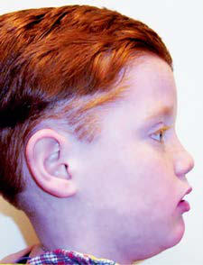
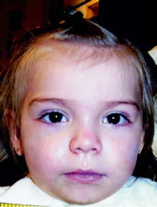

# Chapter 468: Chronic Respiratory Insufficiency

<!-- p.3443 -->
no significant sequelae ensue. When the second to fifth ribs are absent anteriorly, lung herniation and significant abnormal respiration ensue. The lung is soft and nontender and may be easily reducible on examina tion. Complicating sequelae include severe lung restriction (secondary to scoliosis), cor pulmonale, and congestive heart failure. Symptoms are often minimal but can cause dyspnea. Respiratory distress is rare in infancy.

**DIAGNOSIS** Chest radiographs demonstrate the deformation and absence of ribs with secondary scoliosis. Most rib abnormalities are discovered as inci dental findings on a chest film.

**TREATMENT** If symptoms are severe enough to cause clinical compromise or signifi cant lung herniation, then homologous rib grafting can be performed. Rib-expanding procedures are also of great value. A modified Nuss procedure has been used to correct associated chest wall anomalies with rib abnormalities. Adolescent girls with congenital rib anomalies may require cosmetic breast surgery.

*Visit Elsevier eBooks+ at eBooks.Health.Elsevier.com** for Bibliography.*

## 468.1  Chronic Respiratory Failure and Long- Term Mechanical Ventilation

*Denise M. Goodman and Steven O. Lestrud*

Care has improved for the growing population of children with chronic respiratory failure requiring invasive (ventilation through a tracheostomy) and noninvasive (mask ventilation) ventilation, including those with predisposing conditions such as acute respira tory failure, prematurity, and neuromuscular disease. Although it is difficult to determine the prevalence of chronic ventilation, esti mates range from approximately 4-6/100,000 children, or 3,000- 4,000 children nationally who receive home ventilation. There may be roughly three times more children receiving mask ventilation than invasive mechanical ventilation. The conditions leading to the need for home ventilation are diverse. About 65% of children have a pri mary neurologic indication, including neuromuscular weakness or abnormal ventilatory control, and ∼30% have chronic lung disease (Table 468.1).

Patients with primarily pulmonary indications have a greater like lihood of ultimately being weaned from the need for ventilation than do those with neuromuscular or central nervous system disease. Mor tality for patients requiring chronic ventilation is ∼12–34%, depend ing on underlying disease. The lower mortality range is for children with neonatal lung disease, with the higher value for children with complex congenital heart disease. Approximately 12–40% of children are eventually weaned from ventilation and decannulated, reflecting the underlying cause for which ventilation is required. This can usu ally be accomplished within the first 5 years of life. Nonetheless, the care of these children can be challenging. One study reported that

Ventilation

#### **Table 468.1** Indications for Long-Term Mechanical

| Category / Parameter | Clinical Details & Findings |
| --- | --- |
| **PULMONARY/ALVEOLAR** | Bronchopulmonary dysplasia (BPD); Severe acquired lung disease, such as after pediatric acute; respiratory distress syndrome (PARDS); Pulmonary fibrosis syndromes |
| **AIRWAY** | Severe tracheomalacia; Severe bronchomalacia; Obstructive sleep apnea (OSA); Storage diseases |
| **CHEST** | Kyphoscoliosis; Skeletal dysplasias; Obesity |
| **NEUROMUSCULAR** | Spinal muscular atrophy; Spinal cord injury; Diaphragmatic dysfunction; Mitochondrial diseases |
| **CENTRAL NERVOUS SYSTEM (CNS)** | Congenital central hypoventilation syndrome (CCHS); Rapid-onset obesity with hypothalamic dysregulation, hypoventilation,; and autonomic dysfunction (ROHHAD); Severe ischemic brain injury; Myelomeningocele with Arnold-Chiari type II malformation; Acquired hypoventilation syndromes |

up to 40% of chronically ventilated children are readmitted within the first year of discharge, usually within the first 3 months. Chil dren requiring long-term mechanical ventilation (LMV) benefit from comprehensive care coordination incorporating generalists, special ists, home nursing, therapies, and a durable medical equipment (DME) resource.

**MODALITIES FOR RESPIRATORY SUPPORT** The goals of home mechanical ventilation are to maintain adequate oxygenation and ventilation, minimizing metabolic demands of chronic respiratory failure to ensure adequate somatic growth and optimal developmental gains.

**Invasive Positive Pressure Ventilation** The term *invasive* designates ventilation through a tracheostomy. Some devices are suitable for both noninvasive positive pressure ventilation (NPPV) and invasive ventilation, whereas other devices are suitable for only one approach. The ideal home ventilator is lightweight, por table, and quiet. All home ventilators differ from hospital-based ven tilators in that air movement is affected either by a piston or turbine that is electrically controlled. This contrasts with hospital ventilators, which are often gas-driven. A home ventilator should be able to pro vide continuous flow and have a wide range of settings (particularly for pressure, volume, pressure support, and rate) that allows ventilatory support from infancy to adulthood. Battery power for the ventilator, both internal and external, should be sufficient to permit unrestricted portability in the home and community. The equipment must also be impervious to electromagnetic interference and must be relatively easy to understand and troubleshoot.

Although families and care teams may at first resist placement, a **tracheostomy** has several advantages. It provides a secure and stable airway, a standardized interface for attaching the ventilator circuit to the patient, and the ability to easily remove airway secretions and deliver inhaled medications. Pediatric tracheostomy tubes typically have a single lumen and may have an inflatable cuff. Tracheostomy tubes with and without cuff inflation should be sized to control the

<!-- p.3445 -->
air leak around the tube and promote adequate gas exchange, yet allow enough space around the tube to facilitate vocalization and prevent tracheal irritation and erosion from the tube. The child’s caregivers need to learn stoma care, elective and emergent trache ostomy changes, proper securing of the tube, suctioning of secre tions, and recognition of emergencies such as tube obstruction or decannulation.

**Optimal Ventilator Support** Factors such as underlying neuromuscular disease; medications such as sedatives, analgesics, steroids, and muscle relaxants; and prolonged immobility, as well as use of mechanical ventilation, may decondition the respiratory muscles and the diaphragm, resulting in muscle weak ness. Consequently, it is important to avoid 24 hour a day patient syn chrony with ventilation and titrate the amount of ventilator support to prevent fatigue yet facilitate spontaneous breathing. While assessing ventilator needs, frequent evaluation of gas exchange is needed and can usually be done noninvasively. Ventilator settings should be stable for a given period, dictated by the severity of pulmonary disease, before discharge home.

**OTHER MANAGEMENT CONSIDERATIONS Airway Clearance** One of the most important considerations is maintenance of airway patency. Adequate removal of secretions may minimize intercur rent pulmonary infections. In turn, infections may cause a transient increase in secretions, requiring an escalation of clearance strategies. If the child has an adequate cough, then periodic suctioning may be all that is needed. Some children, however, need additional help mobi lizing and clearing secretions. This becomes particularly important in children with neuromuscular disease, for whom regularly scheduled clearance therapies are an imperative. **Vest therapy** (high-frequency chest wall oscillation) uses an inflatable vest that encircles the chest. Air inflates and deflates the vest with phasic pulses against the chest wall, loosening secretions. This device still requires a preserved and strong enough cough to expel secretions. The **cough assist** device provides more active airway clearance, delivering a forceful positive pressure adjunct during inspiration and active negative pressure dur ing expiration. Thus the cough is more effective because of the rapid pressure changes. The cough assist can be used with an artificial airway or mask. Controls will set the inspiratory and expiratory pressures and periods.

**Inhalation Medications** Clearance of secretions may be promoted with delivery of hypertonic (3% saline) nebulizations. These are often timed to cough-assist ses sions to maximize the clearance benefits of both. Children requiring ventilation also commonly need bronchodilators.

**Mucolytics and Anticholinergics** Some patients may need additional interventions as a result of excess secretions. Anticholinergic drugs, principally glycopyrrolate, are often effective, but must be dosed carefully to avoid thickening secre tions excessively, which can lead to inspissated secretions and lifethreatening plugging of the airway. Oral secretions are sometimes amenable to localized injection of botulinum toxin or select surgical ligation of salivary ducts. It is also wise to ensure that the patient is ade quately hydrated, as dehydration may produce thick tenacious secre tions. At times a mucolytic may be used. Hypertonic saline is the most common mucolytic, but a number of other agents have been tried, such as dornase alfa and *N*-acetylcysteine.

**Monitoring** A patient who is ventilated in the home must be electronically and/or physically monitored at all times. Infants and young children, children who are cognitively impaired, and children who are completely trache ostomy dependent for airway patency because of suprastomal obstruc tion must be under direct observation of the caregivers at all times.

Caregivers should also closely monitor children whose pulmonary sta tus is fragile or fluctuant. Continuous monitoring of O2 saturation and heart rate is recommended during sleep and either continuous or inter mittent monitoring during the daytime, depending on patient stability. Patients with congenital central hypoventilation syndrome (CCHS) or pulmonary hypertension are particularly vulnerable to episodes of hypoxemia and/or hypercarbia, and those with pulmonary hyperten sion are particularly susceptible to rapid drops in O2 saturation.

**Supplemental Oxygen** Supplemental oxygen may be delivered from a tank or concentrator. Whether on room air or oxygen at baseline, even mild intercurrent infections may lead to an increase in oxygen requirement. In these situations, the child should be evaluated in person rather than over the phone to ensure that a more serious illness is not developing.

**Physical, Occupational, and Speech Therapy** The technology needed to support physical well-being should not overshadow the inherent needs common to all children—to play, grow, develop, and interact. Ongoing physical therapy, occupational therapy, and speech therapy can help a child reach full potential, and many achieve complete catch-up development. Early intervention programs and access to play groups are important factors to attaining cognitive and social milestones. When typical development is not attainable, therapies can improve mobilization and muscle strength. Core trunk and abdominal strength is particularly important for pulmonary reha bilitation and essential for successful weaning off ventilation. Other important skills include oromotor skills for feeding and communica tion. Evaluation of swallow is a key component of therapy for children with chronic respiratory failure. Sign language is frequently used for communication because of delayed speech or hearing loss. Audiology specialists should be involved in the assessment of hearing because there is a higher incidence of hearing loss in patients undergoing longterm ventilation.

**PREPARING FOR DISCHARGE** A number of threads need to come together for a safe and effective dis charge, including medical stability, family education, financial support (insurance or a state waiver program), availability of a DME company, and, when appropriate, home private-duty nursing. A poor outcome may occur with any of the many medical or process factors or fam ily factors, including not only education but also home readiness and psychosocial supports. A standardized discharge process can ensure that all details are addressed, minimizing length of stay and improving safety. An awake and attentive trained caregiver should be in the home of a child with invasive ventilation at all times; this expectation may differ for those receiving NPPV depending on clinical circumstance. For those receiving invasive ventilation, the caregiver may be a nurse, but nursing resources are often scarce, so many programs require two trained family caregivers. The training given to the family includes tra cheostomy stoma care, suctioning, equipment expertise, administra tion of medications, and facility with other devices, such as gastrostomy tubes. In addition, the family is instructed in emergency preparedness, including what to do for acute changes in clinical status, desaturation, or airway obstruction or decannulation. Cardiopulmonary resuscita tion training is essential. Parents also need to be able to travel portably with the child and equipment. A standardized emergency bag contain ing critical tracheostomy and ventilator supplies should accompany the child at all times. Other preparations center around home readi ness, including accessibility (number of stairs, if any), members of the household, assuring no smoking in the home, and notification of utility companies such as the electric or heating company to ensure the home is serviced quickly in the event of power interruption. The family must also have a functioning telephone to ensure adequate accessibility and communication between the family and care team. For those going home with invasive mechanical ventilation, both a primary and backup ventilator may be needed, as well as batteries, a self-inflating bag and mask, suctioning equipment, supplemental oxygen, and appropri ate monitoring, including a pulse oximeter. The use of high-fidelity

<!-- p.3446 -->
simulation as a means to rehearse skills is increasing. Family training often culminates in an autonomous 24-hour stay *in the hospital* dur ing which time one caregiver must continuously remain awake, and all cares, including ventilator checks, suctioning, tracheostomy tube changes, medications, and the like, are provided by the family.

**CARE BY THE GENERAL PEDIATRICIAN** See Chapter 468.4.

**Nutrition** Ventilated patients may have nutritional needs that are equal to, greater than, or lesser than those of comparably aged well children. Growth should be tracked at each well child and subspecialty visit. Excessive growth is as harmful as inadequate growth, and excess calories may lead to increased carbon dioxide (CO2) production. Anthropometry or measured energy expenditure may be needed to assure a more precise prescription of nutritional support. Many children with tracheosto mies have oral aversion and/or dyscoordination of swallowing, with resultant risk for aspiration. In these children a gastrostomy tube may ensure adequate nutrition in the interim, while ongoing speech therapy promotes oral feeding.

**Infections** Tracheitis (see Chapter 433.2), bronchiolitis (see Chapter 439), and pneumonia (see Chapter 449) are common in patients with chronic respiratory failure. Infections may be caused by community-acquired viruses (adenovirus, influenza, respiratory syncytial virus, parainflu enza, rhinovirus) or community- or hospital-acquired bacteria. Com mon pathogens are gram-negative, highly antimicrobial-resistant pathogens that may cause further deterioration in pulmonary function. Bacterial infection is most likely in the presence of fever, deteriorating lung function (hypoxia, hypercarbia, tachypnea, and retractions), leu kocytosis, and mucopurulent sputum. The presence of leukocytes and organisms on Gram stain of tracheal aspirate, along with the visualiza tion of new infiltrates on radiographs, may be consistent with bacterial infection.

Infection must be distinguished from tracheal *colonization* of bac teria, which is asymptomatic and associated with normal amounts of clear tracheal secretions. Colonization may also be distinguished from infection in that colonization usually has few, if any, white blood cells on Gram stain of tracheal secretions. If infection is suspected, it must be treated with antibiotics, based on the culture and sensi tivities of organisms recovered from the tracheal aspirate. At times an inhaled antibiotic such as tobramycin might avert progression of infection. Antibiotics should be used judiciously to prevent further colonization with drug-resistant organisms. However, some patients who have recurrent infections may benefit from prophylaxis with inhaled antibiotics. Clinical decisions will be based on the child’s appearance, any increased need for ventilation or supplemental oxy gen, and consultation with the subspecialist. A final caveat is that if a respiratory viral panel is desired, this must be obtained from nasal secretions similar to a well child; tracheal aspirate does not provide an appropriate specimen.

**CARE BY THE SUBSPECIALTY TEAM Weaning Off of the Ventilator** Typically, the ventilator settings are reduced, minimizing ventilator parameters to achieve physiologic respiratory rates and 6-8 mL/kg tidal volumes. Subsequent maneuvers will evaluate the patient free breathing, initially with simple observed transition times of 5-10 min utes, extending time off as clinically indicated. This can be done in the outpatient setting during visits with the pulmonologist or other sub specialist responsible for ventilator management. Additional factors that reflect tolerance of increased work of breathing, including weight gain, energy levels, general behavior, and sleep patterns, are also monitored carefully. When the child has completely weaned off venti lator support while awake and is only on the ventilator approximately 6 hours nightly during sleep, a polysomnogram study performed off the ventilator may be considered before complete liberation from the

mechanical ventilation device. Successful liberation from mechani cal ventilation, if it occurs, often takes place between the ages of 2 and 5 years. One thought is that with ambulation and development of core strength, respiratory reserve improves, facilitating weaning. Even so, residual lung disease is common. Children with a history of bronchopulmonary dysplasia (BPD) and previous ventilator depen dence often have significant airway obstruction on pulmonary func tion testing.

**PSYCHOSOCIAL CONSIDERATIONS** Caring for a child on long-term ventilatory support in the home is a complex, physically demanding, emotionally taxing, and expensive process for the family. It changes the family routines, priorities, and overall lifestyle and may adversely affect relationships both within the family and with extended family and friends. Practical considerations include loss of spontaneity in family outings, sleep disturbance, extra expenses, having strangers in the house providing care, and adhering to medical regimens and follow-up visits. Intangible stresses are also prominent, including disruption in the usual parent–child caregiving roles and stresses between parent partners and with other children. The loss of normality, sense of isolation, and concerns regarding what is best for the child are additional sources of distress. All of these stresses are exacerbated by challenges in securing reliable home private-duty nurse resources; this issue may delay hospital discharge and complicate postdischarge care, at times even leading to readmission because of lack of adequate support. For children with a life-limiting condition, there is the additional need to periodically revisit the child’s current medical state, sense of well-being, and trajectory of illness, as critical decisions will eventually arise regarding end-of-life care. The general pediatri cian can often be a familiar and comfortable safe place to explore these issues, as parents may be conflicted in wanting to be a “good” parent while feeling guilty about their own needs and vulnerabilities. Finally, families may find transportation to frequent outpatient visits difficult; telemedicine may offer an alternative for select situations.

**ADULT TRANSITION** There are a growing number of children surviving into adulthood who require chronic ventilation. There are little empiric data regarding this transition, including identifying patients for whom transition is appro priate, implementing a standardized transition process, partnering with adult pulmonologists, or replicating in an adult environment the care coordination provided by the pediatric care team. The pulmonary team ideally initiates ongoing discussions regarding self-care respon sibilities and transitioning of medical care to adult providers with the adolescent and his or her parents when the patient reaches the early teens. Discussion about self-care should take into consideration real istic expectations about the adolescent’s physical and cognitive capa bilities. The actual transition of care occurs for most young adults at age 18-21 years and includes referral to an internist and an adult pul monologist. Transition of medical care also includes transition from pediatric to adult support services for funding sources and nursing care. Ideally, an outpatient visit that includes current and future adult medical providers together is completed to facilitate communication and formally transition care.

*Visit Elsevier eBooks+ at eBooks.Health.Elsevier.com** for Bibliography.*

## 468.2  Congenital Central Hypoventilation Syndrome Amy Zhou, Susan M. Slattery, Casey M. Rand, and Debra E. Weese-Mayer

CCHS is a clinically complex *neurocristopathy* that includes a vari able severity of respiratory and autonomic dysregulation, as well as Hirschsprung disease and neural crest tumors in a subset of patients. In the **classic** CCHS presentation, symptoms of alveolar hypoventi lation manifest in the newborn period and during sleep only—with

<!-- p.3447 -->

<!-- p.3448 -->
diminished tidal volume and a typically monotonous respiratory rate leading to cyanosis and hypercarbia. In more **severe** cases of CCHS, the hypoventilation manifests during wakefulness and sleep. In the **later-onset** cases of CCHS **(LO-CCHS)**, onset of overt symptoms is delayed until 1 month of age or older (often into childhood and adulthood). Hypoventilation is typically during sleep only and usu ally milder in LO-CCHS. CCHS and LO-CCHS are further char acterized by partial to complete failure of peripheral and central chemoreceptors to properly respond to hypercarbia and hypoxemia during wakefulness and sleep, coupled with physiologic and/or ana tomic autonomic nervous system (ANS) dysregulation (ANSD). Physiologic dysregulation may include all organ systems affected by the ANS, specifically the respiratory, cardiac, sudomotor, vasomo tor, ophthalmologic, neurologic, and enteric systems (Table 468.2). The anatomic or structural ANSD includes Hirschsprung disease and tumors of neural crest origin (neuroblastoma, ganglioneuroma, or ganglioneuroblastoma).

**GENETICS** The *PHOX2B* gene is the disease-defining gene for CCHS. *PHOX2B* encodes a highly conserved homeodomain transcription factor, is essential to the embryologic development of the ANS from the neural crest, and is expressed in key regions and systems that explain much

of the CCHS phenotype. Individuals with CCHS are *heterozygous* for either a **polyalanine repeat expansion pathogenic variant (PARPV)** in exon 3 of the *PHOX2B* gene (normal number of alanines is 20 with normal genotype 20/20), such that individuals with CCHS have 24- 33 alanines on the affected allele (genotype range is 20/24-20/33), or a **nonpolyalanine repeat expansion pathogenic variant (NPARPV)** resulting from a missense, nonsense, frameshift, stop codon, in-frame indels (in-frame insertions, deletions, or duplications), full exon/gene deletions, or splice-site pathologic genetic variant. Approximately 90–92% of cases of CCHS have PARPVs and the remaining 8–10% of cases have NPARPVs (Table 468.3).

Stepwise clinical *PHOX2B* testing for probands with the CCHS phe notype is advised. **Step 1**: *PHOX2B* screening test (fragment analysis), then if negative; **Step 2**: *PHOX2B* sequencing test, then if negative; **Step 3**: *PHOX2B* multiplex ligation-dependent probe amplification (MLPA) test to minimize the risk of false-negative findings, minimize the expense and need for more than one blood sample, and expedite confirmation of the diagnosis.

Genetic counseling is essential for family planning and for delivery room preparation in anticipation of a CCHS birth and ensuring ade quate ventilation for the mother during pregnancy. *PHOX2B* testing is also advised for both parents of a child with CCHS to anticipate the risk of recurrence in subsequent pregnancies (if mosaic) and to deter mine if a parent has yet-undiagnosed LO-CCHS. Fragment analysis *PHOX2B* testing (also known as the *screening test*) will best identify low-level somatic mosaicism. Prenatal testing for a *PHOX2B* variant is clinically available (www.genetests.org) for families with a known *PHOX2B* gene variant.

**Ventilator Dependence and Control of Breathing** Patients with CCHS have deficient CO2 sensitivity during wakefulness *and* sleep such that they do not respond with a normal increase in ventilation in either state, nor do they arouse in response to hyper carbia and/or hypoxemia during sleep. During wakefulness, a subset of patients may respond sufficiently to avoid significant hypercarbia, but most individuals with CCHS have hypoventilation that is severe enough that hypercarbia is apparent in the resting *awake* state. Chil dren with CCHS also have altered sensitivity to hypoxia while awake and asleep. A key feature of CCHS is the *lack* of respiratory distress or sense of asphyxia with physiologic compromise (hypercarbia and/ or hypoxemia). This lack of responsiveness to hypercarbia and/or hypoxemia, which can result in respiratory failure, does not consis tently improve with advancing age. A subset of older children with CCHS may show an increase in ventilation (specifically an increase in respiratory rate rather than an increase in tidal volume) when they are exercised at various work rates. This response is possibly second ary to neural reflexes from rhythmic limb movements, although an increase in minute ventilation is often insufficient to avoid physiologic compromise.

The greater the number of extra alanines, the more likely the need for continuous ventilatory support, at least among the most com mon *PHOX2B* PARPV genotypes (20/25, 20/26, 20/27). Although *PHOX2B* genotype seems to anticipate the severity of hypoventi lation, it does not correlate with exogenous ventilatory challenge responses. Infants and young children as a group have reasonable ventilatory response slopes while awake, but this advantage seems to vanish by school age.

**Hirschsprung Disease (see Chapter 378.4****)** Overall, 20% of children with CCHS also have Hirschsprung dis ease (HSCR), known as *Haddad syndrome,* and any infant or child with CCHS who presents with constipation should undergo rectal biopsy to screen for the absence of ganglion cells. The frequency of Hirschsprung disease seems to increase with the longer polyalanine repeat tracts (genotypes 20/27-20/33) and in those with NPARPVs. Even in cases without frank HSCR disease, individuals with CCHS may display symptoms of gastrointestinal abnormalities such as severe constipation and abnormal esophageal motility, suggesting ganglion cell dysfunction.

#### **Table 468.2** Clinical Manifestations of CCHS

| Category / Parameter | Clinical Details & Findings |
| --- | --- |
| **CLINICAL MANIFESTATIONS** | Ophthalmologic; Decreased/absent pupillary light response; Anisocoria; Strabismus; Lack of convergent gaze; Marcus Gunn jaw winking; Respiratory; Alveolar hypoventilation; Absent perception of dyspnea; Cardiovascular; Bradycardia; Prolonged sinus pauses (>3 seconds); Transient asystole; Decreased heart rate variability; Low normal daytime blood pressure; Orthostatic hypotension; Nondipping blood pressure circadian; pattern; Decreased BP response to exercise; Syncope; Gastrointestinal; Hirschsprung disease (20%); Constipation; Esophageal dysmotility; Endocrine; Hyperinsulinism; Hypoglycemia; Hyperglycemia; Neurologic; Decreased anxiety; Decreased pain perception; Seizures; Neurocognitive deficits; Skin; Sporadic profuse sweating; Tumors; Neuroblastoma; Ganglioneuroma; Ganglioneuroblastoma; Others; Decreased baseline body temperature; Poor heat tolerance; CCHS, Congenital central hypoventilation syndrome; BP, blood pressure; GI,; gastrointestinal.; From Bishara J, Keens TG, Perez IA. The genetics of congenital central hypoventilation; syndrome: clinical implications. App Clin Genetics. 2018;11:135–144, Table 1. Originally; published by and used with permission from Dove Medical Press Ltd. |

<!-- p.3449 -->
**Tumors of Neural Crest Origin (see Chapter 547****)** Tumors of neural crest origin are more frequent in patients with NPARPVs (50%) than in those with PARPVs (1%). These extracranial tumors are more often neuroblastomas in individuals with NPARPVs, but ganglioneuromas and ganglioneuroblastomas occur in a small sub set of patients.

**Cardiac Asystoles** Transient, abrupt, and prolonged sinus pauses have been identified in patients with CCHS, necessitating implantation of cardiac pacemakers when the pauses are ≥3 seconds. Among patients with the most com mon *PHOX2B* genotypes, 19% of those with the 20/26 genotype and 83% of those with the 20/27 genotype have cardiac pauses of 3 seconds or longer. The risk for sinus pauses among children with NPARPVs is unknown at present.

Heart rate variability is characteristically decreased in CCHS, likely because of reduced cardiac baroreflex sensitivity and blunted

sympathetic response. One report demonstrated a genotypephenotype relationship for heart rate variability during exog enous ventilatory response testing, prompting assessment of risk for sinus pauses. Introduction of 72-hour Holter recordings every 12 months, at a minimum, has allowed for early identification of these abrupt sinus pauses, permitting timely cardiac pacemaker implantation.

**Autonomic Nervous System Dysregulation** A higher number of polyalanine repeats on the affected allele among patients with a PARPV is associated with an increased number of physiologic symptoms of ANSD. In addition, there is a spectrum of physiologic ANSD symptoms, including decreased heart rate vari ability, esophageal/gastric/colonic dysmotility, decreased pupillary response to light, reduced basal body temperature, altered distribution and amount of diaphoresis, altered vasomotor tone, and altered pain and anxiety perception.

#### **Table 468.3** Congenital Central Hypoventilation Syndrome–Related Symptoms by PARPV vs NPARPV and PARPV Genotype

| Category / Parameter | Clinical Details & Findings |
| --- | --- |
| **20/27** | Respiratory (hypoventilation); Asleep only; Awake with; exertion and; eating and; asleep; Awake and; asleep; Awake and asleep; Awake and asleep; Cardiac arrhythmia:; Abrupt sinus pauses ≥3 seconds; warranting cardiac pacemaker; Variable:; None with; childhood; onset; a; subset; will have; prolonged; sinus; pauses in; adulthood; 19%; >80%; None with childhood onset to date; Hirschsprung disease; <0.1%; 20–30%; 30%; 80–90%; 95–100% severe; long segment; disease (i.e.,; entire colon; and some small; intestine); Severe constipation; ∼50+%; ~50+%; Esophageal dysmotility/dysphagia; First year of life; First year of life; Neural crest; tumors; Neuroblastoma; 0%; 0%; See footnote 2; 50%; Ganglioneuroblastoma; 0%; 0%; 0%; <5%; Ganglioneuroma; 0%; 0%; 0%; <5%; ANSD: Pupillary response to light; Normal; response; Midsize; pupils with; attenuated; response to; light; Small pupils at; rest; nearly; absent; response to; light; Large pupils at rest; negligible response to; light; ANSD, Autonomic nervous system dysregulation; NPARPV, nonpolyalanine repeat expansion pathogenic variant (i.e., missense, nonsense, frameshift, stop codon, splice site); PARPV,; polyalanine repeat expansion pathogenic variant.; 1. Genotype 20/24 would be considered a susceptibility allele (needs another factor to manifest) or a low- or variable-penetrance allele with features that can be triggered by; pharmacologic agents (a pharmaco-genetic phenomenon) or a gene × environment interaction (without main effects).; 2. Generally 0%; however, an infant with the 20/33 genotype had metastatic neuroblastoma (12).; From Weese-Mayer DE, Rand CM, Khaytin I, et al. Congenital central hypoventilation syndrome. Updated 2021 Jan 28. In: Adam MP, Ardinger HH, Pagon RA, et al., eds.; GeneReviews [Internet]. Seattle (WA): University of Washington, Seattle; 1993-2021. Available from https://www.ncbi.nlm.nih.gov/books/NBK1427/. Table 2, pp. 7–8. |

<!-- p.3450 -->
**Characteristic Facial Morphology** Characteristic facial features have been described for children with CCHS. Using facial photogrammetry, five features were used to cor rectly predict 86% of CCHS cases and 82% of controls in a matched case control study. A typical CCHS face is characterized by an upper and midface that is short relative to its width, resulting in a character istic broad, flat, boxlike appearance (Fig. 468.1). The lateral one third of the upper lip vermillion border is overturned so it is flesh-colored instead of pink. Results also suggest that male CCHS patients are more strongly affected than females.

**Neuropathology** Brain imaging studies and functional MRI (fMRI) responses have identified structural anomalies in CCHS cases that may contribute to the observed respiratory and autonomic phenotypes. These find ings may be primarily the result of *PHOX2B* variant–induced failure of neurogenesis in the human embryo, but a significant contribution from postnatal hypoxic, hypercarbic, or perfusion damage cannot be excluded. The neuroanatomic defects in CCHS are likely the result of focal *PHOX2B* (mis)expression coupled with sequelae of recur rent hypoxemia/hypercarbia in the subset of suboptimally managed patients. The following regions pertinent to respiratory control in the pons and medulla of the brainstem show *PHOX2B* expression: locus coeruleus, dorsal respiratory group, nucleus ambiguus, and parafacial respiratory group, among other areas. Physiologic evidence suggests that the respiratory failure in these children is mostly based on defects in central mechanisms, but peripheral mechanisms (mainly carotid bodies) may also be important.

**CLINICAL MANIFESTATIONS** Patients with CCHS usually present with symptoms in the first few hours after birth. Most children are the products of uneventful pregnancies and are term infants with appropriate weight for gestational age. Vari able Apgar scores have been reported. The affected infants do not show signs of respiratory distress, but their shallow respirations and respira tory pauses (apnea) usually evolve to respiratory failure with apparent cyanosis in the first days of life. In neonates with CCHS, Paco2 accumu lates during sleep to very high levels, sometimes >90 mm Hg, and may decline to normal levels after the infants awaken. This problem becomes most apparent when multiple attempts at extubation fail in an intubated neonate who appears well with ventilatory support but develops respi ratory failure without respiratory distress after removal of the support. However, more *severely* affected infants with CCHS hypoventilate awake

and asleep; thus the previously described difference in Paco2 between states may not be apparent. Often, the respiratory rate is higher in rapid eye movement (REM) sleep than in non-REM sleep in individu als with CCHS, and in general, respiratory rates are higher in infants and children with CCHS than similarly aged peers with intact control of breathing.

**LO-CCHS** should be suspected in infants, children, and adults who have unexplained centrally mediated hypoventilation and/or seizures or cyanosis, especially subsequent to the use of anesthetic agents and/ or sedation, acute respiratory illness or recurrent severe respiratory ill ness with difficulty weaning from ventilator support (and failed extu bations), and potentially obstructive sleep apnea (OSA) unresponsive to traditional intervention. These individuals may have other evidence of chronic hypoventilation, including pulmonary hypertension, poly cythemia, elevated bicarbonate concentration, difficulty concentrating, and mild unexplained neurocognitive impairment. A heightened level of suspicion has led to increasing numbers of older children and adults diagnosed with LO-CCHS receiving proper treatment. This later pre sentation reflects the variable penetrance of a subset of *PHOX2B* vari ants and the potential role of an exogenous cofactor in unmasking the hypoventilation phenotype.

In addition to treatment for the alveolar hypoventilation, children with CCHS require comprehensive physiologic evaluation during sleep and wakefulness, including age-appropriate activities of daily living such as eating, as their hypoxemia and hypercarbia from insufficient artificial ventilation may go unnoticed. It is necessary to provide coor dinated care to optimally manage associated multisystem abnormali ties such as Hirschsprung disease, tumors of neural crest origin, and symptoms of physiologic ANSD, including cardiac asystole, among other findings (details provided in American Thoracic Society [ATS] 2010 Statement on CCHS) (Table 468.4).

**DIFFERENTIAL DIAGNOSIS** Testing should be performed to rule out primary neuromuscular, lung, and cardiac disease as well as an identifiable brainstem lesion that could account for the symptoms characteristic of CCHS (Table 468.5). The availability of clinical *PHOX2B* genetic testing allows for early and definitive diagnosis of CCHS (see Table 468.3). Because individual subfeatures of CCHS mimic many treatable and/or genetic diseases, the following disorders should also be considered: altered airway or intrathoracic anatomy (diagnosis made with bronchoscopy and chest CT), diaphragm dysfunction (diagnosis made with diaphragm fluo roscopy), a structural hindbrain or brainstem abnormality (diagno sis made with MRI of the brain and brainstem), Möbius syndrome (diagnosis made with MRI of the brain and brainstem and neurologic examination), and specific metabolic diseases, such as Leigh syndrome, pyruvate dehydrogenase deficiency, and discrete carnitine deficiency. However, profound hypercarbia without respiratory distress during sleep will quickly lead the clinician to consider the diagnosis of CCHS or LO-CCHS.

**MANAGEMENT Supported Ventilation: Diaphragm Pacing** Depending on the severity of the hypoventilation, the individual with CCHS can have various options for artificial ventilation: positive pressure ventilation (noninvasive via mask or invasive via tracheos tomy) or negative pressure ventilation (pneumosuit, chest cuirass, or diaphragm pacing). Chronic mechanical ventilation is addressed in Chapters 468.1 and 468.4. Diaphragm pacing offers another mode of supported ventilation, involving bilateral thoracoscopic implantation of electrodes beneath the phrenic nerves, with connecting wires to subcutaneously implanted receivers. The external transmitter, which is much smaller and lighter in weight than a ventilator, sends a sig nal to flat, donut-shaped antennae that are placed on the skin over the subcutaneously implanted receivers. A signal travels from the exter nal transmitter to the phrenic nerve to stimulate contraction of the diaphragm. A tracheostomy is typically required, because the pacers induce a negative pressure on inspiration as a result of the contraction of the diaphragm being unopposed by pharyngeal dilatation, resulting

B A

**Fig. 468.1** Characteristic CCHS facies. Photographs of representative CCHS. These two children with CCHS both have the representative fa cies. The female with CCHS (A) has a PHOX2B genotype of 20/25, and the male with CCHS (B) has a 20/27 genotype. Note the decreases in sloping of the forehead, upper face height, upper facial inclination, nasolabial angle, upper and lower lip heights, and the inferior inflec tion of the lateral vermillion border of the upper lip. (Modified from Todd ES, Weinberg SM, Berry-Kravis EM, et  al. Facial phenotype in children and young adults with PHOX2B-determined congenital cen tral hypoventilation syndrome: quantitative pattern of dysmorphology. Pediatr Res. 2006;59:39–45, Fig. 2A and 2C.)

<!-- p.3451 -->
in airway obstruction with paced breaths. Individuals with CCHS who are ventilator-dependent for 24 hours a day are ideal candidates for diaphragm pacing to provide increased ambulatory freedom (without the ventilator tether) while they are awake; however, they still require mechanical ventilator support while they are asleep. This balance between awake pacing and asleep mechanical ventilation allows for a rest from phrenic nerve stimulation at night. In addition, a growing but still limited number of children and adults who require artificial

ventilatory support only during sleep are now using diaphragm pacing. This is likely because of the introduction of thoracoscopic diaphragm pacer implantation and shortened postoperative recovery time. How ever, in the absence of a tracheostomy, diaphragm pacing during sleep may cause airway obstruction at varied levels of the airway, depending on the specific patient. The potential for these obstructions needs to be carefully considered before diaphragm pacer implantation, and cer tainly before tracheal decannulation.

**Monitoring in the Home** Home monitoring for individuals with CCHS and LO-CCHS is *dis tinctly different* from and more conservative than that for other chil dren requiring long-term ventilation, because CCHS individuals lack innate ventilatory and arousal responses to hypoxemia and hypercar bia. In the event of physiologic compromise, other non-CCHS children will show clinical signs of respiratory distress. By contrast, for children and adults with CCHS and LO-CCHS, the only means of determin ing adequate ventilation and oxygenation is with objective measures from a pulse oximeter, end-tidal CO2 monitor, and close supervision of these values by a highly trained registered nurse (RN) in the home and at school. While awake, patients with CCHS themselves are unable to sense or adequately respond to a respiratory challenge that may occur with ensuing respiratory illness, increased exertion, or even the simple activity of eating. At a minimum, it is essential that individu als with CCHS have continuous monitoring with pulse oximetry and end-tidal CO2 with RN supervision during all sleep time, but ideally 24 hours a day. These recommendations apply to all CCHS and LO- CCHS patients regardless of the nature of their artificial ventilatory support, but especially those with diaphragm pacers, as only the most recent transmitter has mechanical dysfunction alarms intrinsic to the diaphragm pacer device.

**Noninvasive Ventilatory Support Equipment** Supplemental oxygen with positive pressure support can be admin istered by nasal cannula, pillows, nasal mask, or full-face mask via an actual ventilator, but this is suitable only for highly cooperative children with milder hypoventilation during sleep only. Long-term use of mask ventilation in infants and young children may result in

Hypoventilation Syndrome

#### **Table 468.5** Differential Diagnoses of Congenital Central

| Category / Parameter | Clinical Details & Findings |
| --- | --- |
| **METABOLIC** | Mitochondrial defects (e.g., Leigh disease); Pyruvate dehydrogenase deficiency; Hypothyroidism |
| **NEUROLOGIC** | Structural central nervous system abnormalities (e.g., Arnold Chiari; malformation, Möbius syndrome); Vascular injury (e.g., central nervous system [CNS] hemorrhage,; infarct); Trauma; Tumor |
| **PULMONARY** | Primary lung disease; Respiratory muscle weakness (e.g., diaphragm paralysis, congenital; myopathy, myasthenia gravis) |
| **GENETIC** | Prader-Willi syndrome; Familial dysautonomia and other neuropathies |
| **OTHER** | Sedative drugs; Rapid-onset obesity, hypothalamic dysregulation hypoventilation,; autonomic dysregulation (ROHHAD); Modified from Healy F, Marcus CL. Congenital central hypoventilation syndrome in; children. Pediatr Respir Rev. 2011;12:253–263, Table 1. |

#### **Table 468.4** Recommended Evaluations in Patients with CCHS

| Category / Parameter | Clinical Details & Findings |
| --- | --- |
| **PHOX2B GENOTYPE** | Pulmonary; Comprehensive physiologic; testing during sleep and; wakefulness, including; continuous pulse oximetry,; cardiorespiratory monitoring,; capnography, and; polysomnography; <3 yr of age: every 6 mo; ≥3 yr: annually; All PHOX2B PARM and NPARM; Cardiovascular; Ambulatory cardiac monitoring; (≥72 hr), blood pressure, and; echocardiogram; Annually; All PHOX2B PARM and NPARM; Gastrointestinal; Barium enema or anorectal; manometry; confirmation by; rectal biopsy; At initial diagnosis and; subsequently if symptoms; appear; 20/26-20/33 PARM and NPARM; Neurodevelopmental; Comprehensive neurocognitive; tests; <3 yr of age: every 6 mo; ≥3 yr: annually; All PHOX2B PARM and NPARM; Oncologic; Chest radiograph, abdominal; ultrasound, and urine; catecholamines (homovanillic; acid and vanillylmandelic acid); 0-6 yr of age: every 3 mo; 6-10 yr of age: every 6 mo; >10 yr of age: per oncologist; recommendation; 20/28-20/33 PARM and NPARM; Ophthalmologic; Comprehensive ocular testing by; an ophthalmologist; Annually; All PHOX2B PARM and NPARM; NPARM, Nonpolyalanine repeat expansion mutation; PARM, polyalanine repeat expansion mutation; PHOX2B, paired-like homeobox 2B.; Data from the 2010 American Thoracic Society Statement on CCHS Am J Respir Crit Care Med. 2010;181:626–644.; From Kasi AS, Li H, Harford KL, et al. Congenital central hypoventilation syndrome: optimizing care with a multidisciplinary approach. J Multidisp Healthcare. 2022;15:455–469, Table 1.; Originally published by and used with permission from Dove Medical Press Ltd. |

<!-- p.3452 -->
midface dysplasia or pressure wounds. Mask ventilation does not offer the stable airway provided by a tracheostomy with mechanical ventilation, especially in the rapidly developing infant and young child.

**Positive Pressure Ventilators** Ideally, a ventilator intended for home use is lightweight and small, quiet so it does not interfere with activities of daily living or sleep, is able to entrain room air, preferably has continuous flow, and has a wide range of settings (particularly for pressure support, pressure, volume, and rate) that allows ventilatory support from infancy to adulthood. Battery power for the ventilator, both internal and external, should be sufficient to permit unrestricted portability in the home and com munity. The equipment must also be impervious to electromagnetic interference and must be relatively easy to understand and trouble shoot. Children who are chronically ventilated via positive pressure ventilation will require surgical placement of a tracheostomy tube. The tracheostomy tube provides stable access to the airway, a standardized interface for attaching the ventilator circuit to the patient, and the abil ity to easily remove airway secretions or deliver inhaled medications. Pediatric tracheostomy tubes typically have a single lumen and may have an inflatable tight-to-the-shaft cuff. Tracheostomy tubes with and without cuff inflation should be sized to control the air leak around the tube and promote adequate gas exchange yet allow enough space around the tube to facilitate vocalization and prevent tracheal irritation and erosion from the tube.

**Optimizing Neurocognitive Performance** Impaired oxygen delivery to the brain, whether acute or chronic, can have detrimental effects on neurocognitive development. The ATS statement on CCHS recommends positive pressure ventilation via tra cheostomy in the first several years of life to ensure optimal oxygen ation and ventilation. The method of choice for respiratory support in later years will depend on a variety of factors, including severity of dis ease, patient age, level of patient and family cooperation, and availabil ity and quality of home healthcare, among other factors. The level of oxygen stability obtained with each modality varies. Thus the method of respiratory assistance, especially in infancy and early childhood, is likely to play a factor in neurocognitive outcome.

Past literature has indicated reduced neurocognitive performance in school-age children with CCHS, with mean full scale intellectual quotient (IQ) values one standard deviation below the normal IQ of 100. Even in preschool years, children with CCHS and the 20/26 and 20/27 *PHOX2B* genotypes demonstrate reduced neurocogni tive performance compared to children with the 20/25 genotype. In these cases, *PHOX2B* genotype is clearly associated with both men tal and motor outcomes. An association is also found between IQ and CCHS-related features such as severe cyanotic breath holding spells, sinus pauses, seizures, and severity of hypoventilation. One study reported a negative correlation between neurocognitive per formance scores and length of polyalanine expansion, suggesting that both the specific gene variant and ventilatory method may influence neurocognitive outcome. Findings from a neurocognition study in preschool-age children suggest the potential for excellent neurocog nitive outcome in some patients with CCHS. Neurodevelopmental monitoring would be most beneficial beginning in early infancy and followed closely with advancing age.

Efforts are underway to evaluate and characterize the CCHS phe notype longitudinally through the International CCHS Registry (htt ps://clinicaltrials.gov/show/NCT03088020) (Northwestern Univer sity). Delineating markers of disease progression and understanding the clinical manifestations of CCHS with advancing age will provide more accurate guidelines to healthcare providers, allowing physicians, families, and patients to better anticipate healthcare needs of affected individuals and for use as biomarkers for future pharmacologic inter vention studies.

*Visit Elsevier eBooks+ at eBooks.Health.Elsevier.com** for Bibliography.*

## 468.3  Rapid-Onset Obesity with Hypothalamic Dysfunction, Hypoventilation, and Autonomic Dysregulation Sarah F. Barclay, Ilya Khaytin, Amy Zhou, Casey M. Rand, and Debra E. Weese-Mayer

Rapid-onset obesity with hypothalamic dysfunction, hypoventilation, and autonomic dysregulation (ROHHAD) is a rare, poorly understood disorder with childhood onset, the first sign of which is sudden, rapid, and extreme weight gain in a previously healthy child. The acronym describes the presenting symptoms and the typical order in which they will manifest or unfold, as the condition evolves over months to years. Despite its rarity, *ROHHAD must be considered whenever rapid-onset obesity is observed in a child, because in the absence of appropriate treat ment, a high mortality rate is associated with the severe central hypoven tilation that will invariably develop.*

The diagnosis is initially considered after the observation of rapidonset obesity (15-20 lb gain) after age 1.5 years, accompanied by at least one additional sign of hypothalamic dysfunction (HD). *Central hypoventilation may not be present at the time of rapid weight gain but will develop over time, and artificial ventilatory support will be required at least during sleep, if not 24 hours a day.* Signs of autonomic nervous system dysregulation typically occur after the weight gain, HD, and hypoventilation have been identified. Additionally, approximately 40% of ROHHAD patients will have or develop a tumor of neural crest ori gin, typically ganglioneuroma or ganglioneuroblastoma (a small num ber of neuroblastomas have been identified).

ROHHAD is distinct from LO-CCHS (see Chapter 468.2). ROHHAD is primarily distinguished from LO-CCHS by the presence of obesity and other signs of HD and by the absence of a CCHS-related pathogenic *PHOX2B* variant.

**CLINICAL MANIFESTATIONS** Children with ROHHAD initially appear healthy, with an unremark able medical history. The *initial* symptoms present between ages 18 months and 7 years. Typically, the first symptom observed is **rapid- onset obesity**, with weight gain of 15-30 lb in 6-12 months. The growth charts from a representative child followed longitudinally illustrate the characteristic accelerated increase in weight and body mass index (BMI) (Fig. 468.2). This is considered one sign of HD in these patients.

The second common sign of HD, seen in most ROHHAD patients, is **disordered water balance**, including hypernatremia and hyponatremia and both adipsia and polydipsia. **Growth hormone (GH) deficiency** is also observed in most patients. In some, this manifests clinically as slowed growth rate and short stature, whereas in others a failed GH stimulation test is the only manifestation. **Hyperprolactinemia** is observed near universally in patients with ROHHAD. Other symptoms of HD, occurring in >25–50% of ROHHAD patients, include **poor thermoregulation**, **central hypothyroidism**, **central adrenal insuf ficiency**, and **delayed or precocious puberty**. The number of hypo thalamic abnormalities that will be observed and the sequential order in which they will appear are variable, and some symptoms may not manifest for months to 1-2 years after the initial diagnosis. However, all ROHHAD patients will present with at least one of these signs of HD beyond the rapid-onset weight gain.

**Sleep-disordered breathing (SDB)** is one of the key symptoms of ROHHAD, often manifesting as one of the most severe features of the phenotype, with the greatest potential for severe morbidity and death. More than half of ROHHAD patients have initial **obstructive sleep apnea (OSA)**; although SDB is known to be associated with obesity and OSA is often seen in obese individuals, over time, when the ROHHAD phenotype unfolds, SDB will evolve beyond what could potentially be explained as obesity related. All ROHHAD patients will eventually develop **central alveolar hypoventilation**, requiring artificial ventila tion as life support, even when the upper airway obstruction is relieved as an intervention for OSA. About half of ROHHAD patients will require artificial ventilation only during sleep, whereas half will require

<!-- p.3453 -->

<!-- p.3454 -->
0 5 10 Age (years)

15 0

50

100

150

BMI (%ile)

0

20

40

60

80

Weight (kg)

**Fig. 468.2** Growth curves of weight and body mass index (BMI) from an individual child with ROHHAD. Weight and BMI percentiles for a child with ROHHAD from the time of diagnosis until age 14.3 yr, dem onstrating the rapid onset of obesity. Weight and BMI percentiles were calculated using published CDC growth charts and methods. Solid lines in weight graph represent 3rd, 50th, and 97th percentiles. Dots and open squares are individual measurements for the child.

continuous artificial ventilation (during sleep and wakefulness). Up to 50% of children with ROHHAD will have a cardiorespiratory arrest before their hypoventilation is identified and treated. Unfortunately, many ROHHAD patients die from cardiorespiratory arrest because of unrecognized or inadequately managed hypoventilation. Thus if a ROHHAD diagnosis is suspected, it is crucial that a comprehensive respiratory physiology evaluation be performed, including overnight polysomnography and awake physiologic recording in activities of daily living and followed serially long after the hypoventilation is iden tified and intervention provided.

All ROHHAD patients have symptoms of **autonomic nervous system (ANS) dysregulation (ANSD)**; the specific symptoms and the order and timing of their appearance will vary among patients. The most common manifestations of ANSD in ROHHAD are ophthalmologic, including **pupillary dysfunction**, **strabismus**, and **alacrima**. Many ROHHAD patients will have **gastrointesti nal dysmotility**, presenting as either chronic constipation or, less commonly, chronic diarrhea. Other signs of ANSD include **altered sweating**, **decreased body temperature**, **decreased sensitivity to pain**, and **cold hands and feet** indicating altered vasomotor tone. **Bradycardia** is observed in some ROHHAD patients, typically related to **extreme hypothermia**.

**Neural crest tumors** are observed in ∼40% of ROHHAD patients, most frequently ganglioneuromas and ganglioneuroblastomas of the chest or abdomen; rarely a neuroblastoma has been reported. These tumors can occur at any age, so proactive imaging evaluation through out childhood and adolescence to identify the tumors is essential.

Patients do not always have behavioral or psychologic disorders if artificial ventilation is optimized. For those who do, however, the disorders can be quite severe, including anxiety, depression, rage, lethargy, irritability, aggressiveness, psychosis, and obsessivecompulsive disorder. Developmental disorders described include neurocognitive delay, developmental regression, attention-deficit/ hyperactivity disorder, and pervasive developmental disorder. These disorders are most likely accentuated by poorly managed

hypoventilation because the majority of ROHHAD patients have no behavioral issues and a normal IQ.

**Seizures** have been reported in some ROHHAD patients, likely caused by episodes of hypoxemia, when hypoventilation either has not yet been diagnosed or has been inadequately managed.

**DIAGNOSIS** The diagnostic criteria for ROHHAD include rapid-onset obesity after 1.5 years of age; central hypoventilation beginning after age 1.5 years; ≥1 of the following signs of HD: disordered water balance, hyperpro lactinemia, failed GH stimulation test, central hypothyroidism, cor ticotropin deficiency, and altered onset of puberty; and features of autonomic dysregulation. Additionally, it must be *confirmed* that no CCHS-related *PHOX2B* pathogenic variant is present to rule out a diagnosis of CCHS or LO-CCHS.

Because no single diagnostic test is currently available for ROHHAD, the diagnosis must be based on observation of the clinical presenta tion and therefore requires expert consultation in multiple pediatric subspecialties, including respiratory physiology, endocrinology, auto nomic medicine, cardiology, oncology, nutrition, critical care, sleep, and psychiatry, with orchestration by the child’s pediatrician. When a child with rapid-onset obesity is seen by a general pediatrician or family physician, the steep trajectory of weight gain should signal prompt con sideration of a ROHHAD diagnosis, with immediate referral to a center with expertise in this unique constellation of symptoms. Early recogni tion is critical for a positive outcome in children with ROHHAD. *If alveolar hypoventilation is not identified and aggressively managed, car diorespiratory arrest can occur and has proved fatal in many cases.*

A **characteristic set of facial features** has been described for CCHS, which, using facial photogrammetry, is able to identify 86% of geneti cally confirmed CCHS cases (see Chapter 468.2). Although such formal evaluation of ROHHAD facies has not been completed, a pre liminary report indicates that ROHHAD patients have similar facial mapping characteristics to CCHS patients, especially the characteristic **“lip trait,”** in which the lateral one third of the upper vermillion bor der is flesh-colored instead of pink (Fig. 468.3). This is distinct from the general lip changes observed with increasing BMI in a study of adolescent females, which include fuller-looking lips and downturned corners of the mouth.

Initial evaluations should include overnight polysomnography to identify OSA or central hypoventilation, awake comprehensive physi ologic recording in age-appropriate activities of daily living, cardiac evaluation to assess for cor pulmonale and rhythm disturbance, endo crine function evaluation, screening for neural crest tumors (chest radiograph, abdominopelvic ultrasound, or meta-iodobenzylguani dine [MIBG] scan), and a behavioral and psychological evaluation, especially if any behavioral, psychologic, or developmental disorders are seen or suspected. Brain imaging should be performed to rule out intracranial lesions that may account for the observed hypothalamicpituitary abnormalities (using the hypothalamic-pituitary protocol). If the criteria are met and a ROHHAD diagnosis is made, successful management requires ongoing teamwork among the various subspe cialists, with a pediatrician team leader to orchestrate all testing, the family, and the child to provide optimized integrated care for the child.

**MANAGEMENT** There is currently no cure for ROHHAD. Rather, treatment consists of early identification, meticulous monitoring, and anticipatory along with symptomatic management of the various phenotypic features as they develop (“unfold”). Comprehensive initial evaluations should determine the nature and severity of hypoventilation, HD, and ANSD, and appropriate interventions should be implemented in a timesensitive manner. Obesity in ROHHAD is very difficult to control, but in consultation with a nutritionist and endocrinologist, the trajec tory of advancing weight gain can be diminished with moderate exer cise and calorie restriction, leading to improved BMI with advancing age. Specific signs of HD and ANSD should be evaluated by a pedi atric endocrinologist and expert in pediatric autonomic medicine, respectively, and treated as necessary longitudinally as the phenotype

<!-- p.3455 -->
“unfolds” and “refolds.” Such treatments or management strategies may include hormone replacement; regimented fluid intake; ophthal mologic assessment and treatment; longitudinal monitoring of periph eral, core, and ambient temperature; and management of constipation with stool softeners. Disordered water balance to prevent dehydration should be addressed, as well as regulation of heart rate, because brady cardia is seen in some patients (usually with decreased core tempera ture), though cardiac pacemakers are rarely indicated.

Neural crest tumors should be assessed and resected by a pediatric surgeon together with a pediatric oncologist, because the sheer size of these benign tumors creates serious compromise to surrounding tis sues. If no tumor is identified initially, screening should continue every 6 months until adulthood, because a malignant neuroblastoma has been identified in an adolescent ROHHAD patient.

Most critical is the management of hypoventilation. Initial inter vention for OSA will likely involve surgical relief of the upper airway obstruction. This will usually unveil central hypoventilation, and initia tion of supported ventilation will be required. If no central hypoven tilation is identified, the patient should continue to be vigilantly monitored by a respiratory physiologist because all ROHHAD patients will eventually develop central hypoventilation requiring artificial ven tilation during sleep at a minimum. Individuals with ROHHAD have attenuated to absent physiologic responsiveness to hypoxemia/hyper carbia, and they lack behavioral awareness of hypoxemia/hypercarbia. Optimal oxygenation and ventilation can then be maintained using a mechanical ventilator with mask initially then, if necessary, by tra cheostomy to secure the airway and optimize ventilation. This should be accompanied by highly trained home nursing and continuous

monitoring with oximetry and capnography during sleep, with spot checks during wakefulness. The goal should be to maintain hemoglo bin saturation values of ≥95% and end-tidal CO2 values of 35-45 mm Hg, with vigilant evaluation for awake hypoventilation necessitating artificial ventilation up to 24 hours a day as necessary.

Given that the ROHHAD phenotype evolves with advancing age, ongoing care requires regularly scheduled evaluation of all the systems involved to identify and treat further symptoms as they appear. Com prehensive evaluation should ideally occur at a Center of Excellence for ROHHAD and should include respiratory physiology assessment both asleep and awake (in varied levels of age-appropriate exertion, concentra tional tasks, quiet play, and eating), screening of chest and abdomen for neural crest tumors in the adrenals or along the sympathetic chain, evalu ation of the hypothalamic-pituitary axis with hormonal replacement as necessary, age-appropriate noninvasive evaluation of ANS dysregulation, comprehensive cardiac evaluation for sequelae of recurrent hypoxemia and/or bradycardia, and neurocognitive testing. These evaluations should initially occur at 2- to 3-month intervals, but this schedule may be altered with advancing age, depending on each patient’s clinical condition.

With proper and meticulous management, the ROHHAD pheno type has been observed to “refold,” with the possibility of achieving weight control, eventually recovering spontaneous awake breathing, and improvement of other autonomic measures. Without proper man agement, oxygen deprivation can lead to irreversible deterioration in patients. However, with prompt diagnosis and aggressive management, including careful attention to the child’s airway, breathing, and circula tion, complications can be minimized and the prognosis can be quite favorable, although long-term outcome remains the focus of an inter national registry (https://clinicaltrials.gov/show/NCT03135730).

**Paraneoplastic/Autoimmune Hypothesis* Paraneoplastic syndromes* are rare disorders caused by a neoplasm trig gering an altered immune response that aberrantly attacks and destroys neurons, leading to the nervous system symptoms. An autoimmune or paraneoplastic basis for ROHHAD has been suggested based on neural crest tumors occurring in 40% of ROHHAD patients and reports of encephalitis seen on autopsy. The evidence so far is conflicting, with some reports supporting the autoimmune hypothesis, whereas others do not. Further, the onset of ROHHAD symptoms often precedes iden tification of a neural crest tumor in ROHHAD patients, and in many cases, neural crest tumors have not been discovered with MRI or even an autopsy. Of note, with excision of the identified neural crest tumor there has not been consistent “recovery” from ROHHAD. Rather, the ROHHAD phenotype continues to “unfold.”

**DIFFERENTIAL DIAGNOSIS Congenital central hypoventilation syndrome** is a rare pediatric dis order of the ANS and respiratory control. CCHS is caused by patho genic variants in the *PHOX2B* gene, which plays an important role in the differentiation and development of the ANS from neural crest progenitor cells (see Chapter 468.2). The hallmark feature of CCHS is life-threatening hypoventilation while sleeping (and, in some cases, also while awake). CCHS patients require artificial ventilatory life support, typically by tracheostomy and mechanical ventilator. Unlike ROHHAD, however, CCHS usually presents in the newborn period, although lateronset CCHS has been diagnosed after 1 month of age, in later child hood, in adolescence, and even in adulthood. CCHS also presents with other symptoms of ANS dysregulation, including altered heart rate reg ulation, vasomotor tone, and temperature regulation, ophthalmologic manifestations, and reduced gastrointestinal motility. However, CCHS patients *are not* obese and only rarely have isolated measures of HD. When hypoventilation is observed, a simple blood test can confirm a CCHS diagnosis by looking for pathogenic *PHOX2B* variants.

**Prader-Willi syndrome** (PWS) shares childhood obesity as one of the most prominent features with ROHHAD. PWS is caused by chro mosomal abnormalities at chromosome 15q11-q13, specifically by a lack of the paternal contribution at this region (from genomic deletion, uniparental disomy, or imprinting error), whereas methylation differ ences, loss of heterozygosity, and pathogenic variants in this region

A

B

**Fig. 468.3** Characteristic CCHS “lip trait” shown in a child with ROHHAD. Shown here is the mouth of a child with ROHHAD at age 4 (A) and 11 (B) years. The lateral one third of the upper vermillion border is flesh-colored instead of pink. This is not a characteristic feature of obese faces in general (the upper lip is neural crest in origin).

<!-- p.3456 -->
have been ruled out in a ROHHAD cohort. Infants with PWS pres ent with neonatal hypotonia and failure to thrive (malnutrition). Later, children with PWS develop extreme hyperphagia and obesity. Other major symptoms of PWS include intellectual impairment, maladaptive behaviors, short stature caused by GH insufficiency, hypogonadism, and SDB. In addition, many PWS patients show signs of ANS dysregu lation, including altered temperature perception and regulation, stra bismus, and high pain threshold.

ROHHAD should also be distinguished from other **obesity-related genetic disorders**. Smith-Magenis syndrome, Carpenter syndrome, and 16p11.2 deletion syndrome present with obesity. However, all of them are additionally marked by early developmental delay, unlike ROHHAD, which has normal neurodevelopment in the absence of cardiorespiratory arrest. Therefore testing for genetic causes of obesity should be undertaken in obese children whose phenotype does not appear to match that of ROHHAD.

*Visit Elsevier eBooks+ at eBooks.Health.Elsevier.com** for Bibliography.*

## 468.4  Long-Term Ventilation and Technology Support: Indications, Principles, Decision-Making, Pragmatics, and Home Provision Robert J. Graham

**INDICATIONS, GOALS, AND DECISION-MAKING** The decision to implement LMV has many challenges from a diver sity of underlying pathophysiology, uncertain disease trajectories, the development of new condition-specific therapies, personal experi ences, and values held by providers, patients, parents, and the broader community, variability in resources, and lack of standards. Although optimizing gas exchange (i.e., oxygenation and CO2 removal), mitigat ing the impact of intercurrent respiratory infections, and supporting neuromuscular-skeletal limitations, growth, and development remain among the primary objectives, LMV represents a tool for the compre hensive care of children with complex needs.

LMV has a role within the broad spectrum of palliative care. It is used proactively to attenuate cumulative morbidities (respiratory and cardiac) associated with progressive neuromuscular conditions, such as Duchenne muscular dystrophy. LMV is also used reactively when acute illness (e.g., acute respiratory distress syndrome or an acute flac cid myelitis) does not resolve. In infants with premature lung disease or complex airway anomalies, LMV may be implemented as a temporary measure, as these conditions may improve with maturity or surgical interventions. LMV can also represent a bridge to lung transplant for those with intrinsic pulmonary or pulmonary vascular disease. More commonly, LMV has become a destination therapy to optimize symp tom management and prolong life in complex conditions. Etiologies of the chronic respiratory failure include but are not limited to congenital anomalies (e.g., complex cardiac conditions, central nervous system disorders, interruptions in aerodigestive morphogenesis, and skeletal dysplasias), acquired central neurologic injuries from perinatal, infec tious, traumatic, and hypoxic-ischemic events, metabolic disorders, or progressive neuromuscular conditions. Progress in other areas of med icine, such as gene-targeted therapy in spinal muscular atrophy and myotubular myopathy, may alter the LMV decision-making landscape as families foresee the prospect of improvement.

**NONINVASIVE AND TRANSTRACHEAL SUPPORTS** The essential modalities for LMV include negative pressure, nonin vasive positive pressure ventilation (NIPPV with either continuous or biphasic support provided through an occlusive mask interface), or transtracheal positive pressure. Considerations for a given child or young adult should include but are not limited to anatomic fac tors, physiologic goals, long-term care goals, comfort, tolerability/

compliance, and safety (mobility/portability, monitoring, device avail ability and backup, training capacity).

*Negative pressure* devices, such as the cuirass ventilator, do not require any interface with the face or trachea and are more *natural* from a mechanical perspective. The need for oxygen supplementation is not addressed directly through such a device. *NIPPV* can address dynamic upper airway obstruction and can augment respiratory mechanics and gas exchange. This modality may, however, have limitations if upper airway obstruction is severe or fixed or the need for oxygen supple mentation is high. Masks, prongs, and pillows of varying sizes are avail able for nasal, oral, combination, and full interface, including those for infants. A mouthpiece interface has also been demonstrated to be effec tive and feasible. The choice of continuous positive airway pressure (CPAP) versus biphasic positive airway pressure (BiPAP) is dependent on the underlying pathophysiology. Conceptually, CPAP can overcome a dynamic upper airway obstruction and allow for spontaneous venti lation, while BiPAP is more versatile in compensating for upper airway obstruction and supporting lung recruitment and gas exchange. CPAP is limited to management of mild OSA. In addition, BiPAP may allow for home escalation for the management of intercurrent illness with oversight of the medical team. Although NIPPV can be maintained 24 hours a day, efficacy of ventilation, difficult airway considerations (i.e., whether the child can anatomically be intubated), developmental needs, implications for midface hypoplasia, and secretion clearance are among factors that affect the decision to pursue tracheostomy place ment and invasive LMV.

*Transtracheal* LMV provides the most secure and effective respira tory support. Fixed and dynamic upper airway obstruction is bypassed with tracheostomy tube placement. Secretions are more readily cleared from the lower airway. Positive pressure and oxygen delivery via a tra cheostomy tube more consistently address primary impairments in gas exchange (within limits) as well as mechanical disadvantages from neuromuscular insufficiency and restrictive disease. When possible, placement of a tracheostomy tube in a child should be coordinated at an institution with pediatric expertise, including in long-term trache ostomy care, because the short-term morbidities and, potentially, mor tality are not insignificant.

Individuals using NIPPV are at risk for pressure ulcerations on the face and on the scalp. Proper fit of the interface must be assured because a tighter fit is not necessarily commensurate with better support. Alter nating masks on a regular basis may alleviate pressure on a given site. Additional nonadhesive dressings can also be used to facilitate the mask seal and minimize skin breakdown. For those with a tracheos tomy tube in place, care of tracheostomy ties and regular assessment of the stoma are required. Moisture-wicking dressings can attenuate risk of maceration, but their use should be balanced against the value of exposure to air for drying. Stomal assessment should include evalua tion for granulation, fissures, and traction created by additional torque from ventilator tubing, which should be maintained midline and with out weight displacement on the tracheostomy tube itself. Any areas of integument interruption are potential niduses for infection and of great concern for immunocompromised hosts.

**AUGMENTED SECRETION CLEARANCE** See Chapter 468.1.

**AERODIGESTIVE AND COMMUNICATION CONSIDERATIONS** Assessment of swallowing and speaking capacity should be part of an assessment for LMV and may help guide the modality. Implementation of noninvasive or transtracheal supports will not further impair either of these functions. Rather, the underlying condition is the primary determinant. This consideration is most notable in children or young adults with neurologic injury or neuromuscular conditions. Decisionmaking around placement of a transabdominal gastric or gastrojejunal enteral feeding tube, if not already in place, should coincide with deci sions around LMV. Nasogastric tubes, it should be appreciated, may impair the NIPPV mask seal and cause laryngeal irritation in the long term. Antireflux surgery (i.e., fundoplication) should also be discussed

<!-- p.3457 -->

<!-- p.3458 -->
at this time as providers consider ongoing implications of esophageal reflux, aerophagia, and challenges maintaining jejunostomy tubes.

Use of NIPPV must be approached cautiously in those with impaired swallowing, as positive pressure will increase the risk of macroaspira tion and microaspiration. Individuals using NIPPV can eat and drink while on support with risk versus benefit determination and assessment of impact on quality of life. Aerophagia on NIPPV is also problem atic, regardless of bulbar function and swallowing capacity; abdominal distention is uncomfortable, contributes to satiety and vomiting risk, and further impairs respiratory mechanics with decreased functional residual capacity and increased inspiratory workload. If a gastrostomy is present, active evacuation of swallowed air and use of passive *venting* tubes can be helpful.

Children with swallowing capacity can continue to eat and drink by mouth with a tracheostomy tube in place on LMV. The presence of a cuffed tracheostomy tube does not prevent aspiration if swallow ing is impaired. Speaking may be facilitated by LMV, as settings can be increased or a speaking valve used to increased airflow across the vocal cords. Regardless, multidisciplinary care with a speech-language pathologist, feeding specialist, and augmented communication services can be helpful for many children and their families using LMV. Condi tioned aversions to oral stimulation can be challenging for infants, but developmental gains should not be impeded by LMV.

**GAS EXCHANGE AND VENTILATOR STRATEGIES** Pressure- or volume-regulated modes, spontaneous or controlled set tings, and mixed modes are all feasible for NIPPV and transtracheal supports with new devices. The appropriate support should coincide with oxygenation and ventilation goals on a case-by-case basis. Consid eration, however, should be given to the site of care and contingencies for presentation to acute cure during intercurrent illness or emergency. Providers should assess limitations in oxygen supplementation outside of the hospital; measured or estimated delivered fractional inspired oxygen (Fio2) will inform families and providers of capacity when add ing oxygen in liters/minute flow to the ventilator circuit; dilution can have a dramatic effect, and achieving Fio2 >0.60 may be difficult when oxygen is added to a home ventilator circuit. Safety allowances should also account for the duration of portable oxygen provision, which is based upon liter flow and tank/reservoir volume.

Monitoring of CO2 in the homecare setting is not usual, although portable end-tidal CO2 devices are available. Conditions such as CCHS warrant vigilance, and parameters for implementation, or titration, of mechanical ventilation should be discussed with families. Recognition that significant and indolent hypercapnia can precede hypoxia is nec essary, and long-term effects on cerebral and pulmonary vasculature should be considered. In the absence of direct CO2 monitoring, peri odic measurement of serum bicarbonate may be helpful to assess for renal compensation for altered CO2 clearance; however, interpretation may be altered in the presence of diuretic therapy, metabolic disease, or ketogenic diets.

**CARDIOPULMONARY INTERACTIONS** Closely linked to the gas-exchange goals are considerations for cardio pulmonary interactions. Although there are subtle implications for sys temic venous return of any form of positive pressure ventilation, LMV can be used to decrease transmural myocardial load and to optimize right ventricular afterload through lung recruitment and pulmonary vas cular reactivity. The prolonged survival of young males with Duchenne muscular dystrophy is in part the result of consistent respiratory support to optimize lung health and to attenuate myocardial dysfunction. Pri mary or secondary pulmonary hypertension, whether overt or indolent, requires consideration of oxygenation and ventilation goals. Echocardio grams are not required for all children or young adults with LMV, but this modality may be helpful to guide management in cohorts with con genital heart lesions, cardiomyopathies, severe obstructive pulmonary disease, significant central dysregulation, and on a case-by-case basis.

When considering gas-exchange goals and cardiopulmonary inter actions, providers must also consider daytime and nocturnal differ ences. Neuromuscular-derived hypoventilation is more prominent at

night, as is upper airway obstructive disease; the latter is more impor tant for those using noninvasive LMV. Daytime support provision must account for increased oxygen consumption and demand based on variable activity and stressors, including environmental temperature. Providers and families must factor in mobility, behavioral tolerance, and quality of life.

**CHEST WALL/THORACIC CONFIGURATION** Positive pressure through LMV in early childhood for children with neuromuscular conditions and/or restrictive lung disease is also used to improve thoracic compliance and configuration. Lung inflation can be used to attenuate the impact of thoracic asphyxiation as well as progres sive parasol chest deformation in diaphragm-dependent conditions, such spinal muscular atrophy. This use has implications for atelectasis and secretion inspissation, associated pulmonary vasoconstriction, and cumulative restrictive or asymmetric pulmonary mechanics.

**NUTRITION AND WEIGHT GAIN** See Chapter 468.1.

**DEVELOPMENTAL CONSIDERATIONS** Decisions regarding the LMV modality, noninvasive or transtracheal, requires consideration of development as well. Beyond safety factors, tolerance of interventions, availability of appropriate-sized interfaces, and portability, there remains substantial subjectivity with respect to perspective on the implication for social interactions (i.e., devices covering the face versus a device in the neck). Although there are no published series, long-term or near-continuous NIV also has implica tions for midface hypoplasia and potentially compounds upper airway obstructive symptoms, as is evident by images of *BiPAP faces*. Swallow ing and speech capacity primarily reflect the child’s underlying condi tion and conditioned aversions rather than the LMV itself.

**PROJECTED INTERVENTIONS AND NEEDS** The trajectory and management of the underlying disease, as well as symptom management, are the primary drivers in determining the need and duration of LMV. Stakeholders should also consider future interventions, specifically surgical procedures. LMV, noninvasive or transtracheal, can be used to optimize perioperative standing and facil itate recovery and provision of opiate-based analgesia that could alter respiratory drive. The maintenance of a tracheostomy tube in antici pation of sequential surgeries (e.g., spinal instrumentation, craniofa cial and airway reconstruction, or serial cardiac interventions) may be required for practical reasons but also minimizes the need for repeated intubation.

**PREPARING FOR THE LIVED EXPERIENCE OF LMV AND OTHER TECHNOLOGY SUPPORTS** Emotional challenges are associated with the integration of technol ogy supports into “routine” care and assuming an altered role as a par ent and care provider. Addressing practical needs, however, can help attenuate some of the anxiety and allow families to focus on, or revisit, the global goals of care, quality of life, and the role of technology. The family will need to consider each of the following implications.

**Financial** (e.g., insurance, subsidies, alternative funding, and paren tal employment): Independent of personal resources, the majority of families with children requiring technology assistance report some degree of financial burden. These costs arise from the direct outlay for equipment and medications, lost work time or need to discontinue/ change vocations, home adaptations, and other indirect costs. Access ing a financial counselor or case manager may help identify and navi gate through local, state/regional, and government/federal resources. Additional considerations should also be paid to personal trusts, wills, and estate planning, as all of these have implications for long-term ben efits and financial supports for the individual with special healthcare needs.

**Equipment and supplies:** Ideally, the equipment intended for use at home will be tested before discharge to home. Testing ensures proper function and any tolerance. Electrical compatibility with the home

<!-- p.3459 -->
service should be confirmed. Delivery of backup devices (e.g., tracheos tomy tubes, including a smaller size for contingency planning; batteries for ventilators; and portable oxygen tanks as a supplement to electric oxygen concentrators) and emergency supplies (e.g., self-inflating respiratory bags, epinephrine for those who have allergy histories, or prophylactic antiepileptic medication for those prone to breakthrough seizures) should be confirmed. Medication supplies and refills should be sufficient to allow for the scheduling of follow-up visits. Providers responsible for recertification or reordering should be identified.

**Training:** Standards for training and demonstration of competency vary among institutions and across providers. Families and their medi cal teams should come to an agreement on minimum safety prepara tion and the number of responsible parties available to assist in the home. Hospital-based training around ventilator use and troubleshoot ing, central-line care, tracheostomy tube exchanges and suctioning, wound care, and other interventions could include basic life support classes and one-on-one sessions with nurses, respiratory therapists, or other staff, with hands-on or mannequin simulation. Assumption of full care by families while in the hospital can be informative for all stakeholders and reassuring to families; supported replication of the demands of homecare before discharge is ideal.

**Augmented staff:** Home nursing, hospice, personal care assistants, extended family, and friends represent additional resources for the child and their family. Allowances vary based on the child’s age, inde pendence, medical condition, technology dependence, goals of care, and other factors. These individuals may require additional training, but augmenting numbers of proficient homecare providers is crucial for safety and consistency of care. When considering homecare pro vision, families should consider the type of personnel and how addi tional supports would allow the child to attend school, the parent to work or maintain the household, continue care when the parent is sick or incapacitated, or assist with other children. The challenges of estab lishing, training, and maintaining a home staff require time and toler ance, recognizing that the child’s safety is the priority.

**Monitoring:** Conceptually, monitoring is used to detect early physi ologic changes, determine adequacy of LMV, and minimize cumula tive morbidities or risk of mortality. Continuous direct observation is not practical, or often desirable, in the community setting. Recom mendations for monitoring children and young adults on LMV vary based on underlying vulnerability, care setting, activity (e.g., home, long-term care facility, school, or in transport via car), and adjuvant supports (e.g., home nursing or personal care assistant). Pulse oxim etry can be used intermittently or on a continuous basis, with oxygen and heart rate parameters determined on a case-by-case basis. Typi cally, capnography is not available except in cases of central hypoven tilation syndromes but can complement oximetry. Internal ventilator alarm settings for both NIPPV and transtracheal ventilators are used to monitor high- and low-pressure parameters and minute ventilation. Stakeholders must acknowledge, however, that internal alarms may be insufficient in the setting of a large mask or peritracheal leak or in the event of a device malfunction.

The child’s individual risks and the environmental circumstances drive the balance of extrinsic monitoring (e.g., pulse oximetry and heart rate) and intrinsic device alarms. There are also pragmatic con siderations of signal-to-noise when determining monitoring param eters; recurrent false alarms will desensitize providers and may disturb a child’s sleep; conversely, wide alarm parameters circumvent early warning systems with significant consequences. Alarm fatigue, as experienced by hospital-based providers, should be discussed, as it can be of great consequence where the resources are not as robust. Simple audio and video monitors (i.e., video cameras) can be used to augment surveillance and may help families in their activities of daily living.

**Adaptations to the homecare setting:** Modifications to the home may be required to ease care and optimize safety. Ramps for wheelchair access will permit ingress and egress. Lift systems can minimize physi cal burden and injury risk to providers. Doorways can be expanded to permit access to multiple rooms. Alternative bath and toileting accom modations may be needed. Electrical system upgrades with grounding

and increased amperage are often required for equipment demand and safety.

**Transportation:** Discharge planning for a child or young adult with technology dependence should include transportation to school, com munity programs, routine family activities, and scheduled or urgent medical services. Proximity (rural or urban), the child’s mobility, weather, and the need for monitoring en route are other considerations. Adaptive car seats or car beds can be purchased. Personal vehicles may need expensive modifications, including lifts and power inverters. Allowances may also be required for one person to drive while another (i.e., nurse, parent, or care assistant) tends to the child. If traveling long distances, perhaps on vacation, advanced planning might include iden tification of hospitals along the route and reciprocal equipment compa nies to assist with unexpected supply needs.

**Air transportation:** If a family anticipates travel by plane, contin gencies should be made for oxygen support at altitude, recognizing that most commercial airlines pressurize their cabins to the equivalent of 7,000-8,000 feet. Portable oxygen sources may have less liter flow capacity than stationary or home devices; there is also a need to dif ferentiate continuous versus on-demand flow options. Space and lim ited supplies inflight should be considerations. Power wheelchairs are prone to damage when placed in cargo holds, and ground crews likely require explicit instructions. Providers may need to write letters for airport security and airlines for excess baggage, electronic equipment, medication, and fluid allowance. Families can also consider sending additional supplies to the final destination in advance.

**Environmental stressors:** Extreme temperatures, heat or cold, vari ability in humidity, and other environmental variables can greatly affect the well-being of a child with underlying cardiorespiratory insuf ficiency or other special healthcare needs. Home adaptations to per mit climate control for the child’s room may be required. Families may consider prewarming, or cooling, vehicles for routine excursions, and limitations on day-to-day activities are warranted at times. Augmented hydration needs should be reviewed with medical providers, along with routine sunscreen and preventive measures.

Preparation for transition to the homecare setting may include a period of quiescence, depending on the circumstances and family pref erences. Establishing a period of stability, when there has been no need to alter supports, may minimize unplanned readmissions.

**Community Resources** The transition from the acute care or rehabilitation facility to homec are setting is often much anticipated and welcomed. This step can also be frightening and overwhelming, whether it represents the first time home or a return after an acute illness or planned surgery. Hospitalbased providers can partner with families to alleviate some anxiety and to avoid potential pitfalls through proactive engagement. Hand-off to outpatient and community stakeholders can include the following:

**The community medical practice:** Updates on problem lists, pro jected follow-up, medication and equipment needs, routine health maintenance and preventive measures (e.g., immunizations), special considerations for nutrition, identification of specialty providers and follow-up schedules, and case-specific risks.

**First responders:** Confirmation that the family has the capacity to call emergency services, outreach to police and ambulance services to outline baseline needs, special condition-specific interventions or pre cautions, identification of equipment that may need to be taken with the child in the event of an emergency, determination of emergency destination (i.e., local hospital or referral center), and clarification of resuscitation status and life-sustaining therapies.

**Therapy programs:** Physical, occupational, speech-language/feed ing, and other therapists benefit from hospital-based assessments and outlines of expectations, restrictions, and uncertainties.

**Educational programs/schools/day habilitation:** Integration into community services requires evaluation of developmental needs and potential adaptive settings, equipment, services, staffing, and transpor tation for all ages.

**Power and water:** Alerting local housing, social, power, and water authorities to medical necessities can facilitate prioritization of service

<!-- p.3460 -->
restoration during natural disasters or other interruptions and identify programs to defray incurred costs with increased technology-driven electrical usage (e.g., home ventilators, oxygen concentrators, and cli mate control).

Families may find additional resources through faith-based insti tutions, nonprofit and advocacy groups (e.g., Kiwanis, Shriners, Boy Scouts), and condition-specific entities, such as the Muscular Dystro phy Association. Outreach to other families with similar circumstances can also be helpful with the caveat that their recommendations reflect their own goals and lived experience with special healthcare needs.

**Subacute Care** Local resources for medical services should be identified in advance. This begins with the primary care and first responders but extends to local and regional hospitals. It is important to determine the range of services available and to identify specific providers who would famil iarize themselves with a given case. The child with technology depen dence will experience intercurrent illnesses or unexpected accidents that require evaluation, but may not always necessitate transport to tertiary care or referral centers. Individual care plans can be developed in conjunction with the family and local providers and may include thresholds for transfer.

Families should also consider bringing home equipment and sup plies when presenting to urgent and acute care settings. Devices such as pediatric NIPPV masks and cough-assist machines or compounded medications may not be available at every facility. Short-term evalua tions may become protracted, and lack of routine care provision may compound the immediate issues.

**Emergency and Acute Care** Providers and families should acknowledge that children with spe cial healthcare needs (CSHCN) and LMV are at risk for repeated hospitalization. Progression of underlying illnesses (e.g., heart fail ure), planned surgical interventions (e.g., spinal instrumentation, bronchoscopy surveillance, tendon releases), or superimposed acute illnesses (e.g., pneumonia, gastroenteritis, appendicitis, recurrent seizures) may necessitate readmission. Those children who are tech nology dependent have a higher likelihood of requiring critical care services because of the nature of their needs and their vulnerabil ity. Preventable equipment-related issues may be obviated through the planning described previously. Once hospitalized, CSHCN are at greater risk of medical error and incur more interventions when com pared with otherwise healthy children. Parents should be encouraged to develop a medical passport and reference list of providers to facili tate communication and consistency of care. Referencing established care guidelines and, again, developing individualized care plans may be helpful.

**Quality of Life** CSHCN of increasing complexity and technology dependence are thriving in the homecare setting as a result of advances in medical care, shared decision-making, community services, and most notably, exten sive, vigilant, and proactive care efforts by their families. Adaptations allow for participation in all aspects of family, school, and community activities. Although individual trajectory and subsequent needs may be difficult to predict, all stakeholders should acknowledge the impact of chronic care on the family unit and health-related quality of life. The evolution of a medical home for this cohort of children will require provisions for family mental health, sibling supports, respite, and other measures to optimize outcomes.

**TRANSITIONING FROM ACUTE CARE TO REHABILITATION OR COMMUNITY SETTING** Disposition of children and young adults with LMV will vary based on their relative stability, local support services, and goals of care. A proac tive, flexible, comprehensive care model is required to assure safe and effective provision. The impacts of care needs on the child and family are inextricably linked.

**ROUTINE HEALTH MAINTENANCE Airway Evaluation** There is no standard for regular airway assessment for children with LMV, specifically those with transtracheal support, but annual evalu ation should represent the minimum. Office-based transtracheal tube endoscopy can facilitate assessment of tube upsizing for linear growth, presence of granulation tissue, airway inflammation, and general mucosal integrity. Formal diagnostic laryngoscopy and bronchos copy under general anesthesia are required to assess for suprastomal and laryngeal-level pathology along with the rare acquired tracheaesophageal fistulae. Independent of routine evaluation, recurrent or unexpected tracheal bleeding may warrant evaluation for a tracheavascular fistula via CT angiogram and bronchoscopy.

**Bacterial Colonization** Chronic respiratory failure lends itself to airway bacterial colonization because of alterations in secretion clearance, aerodigestive interac tions, the presence of artificial airways with the development of bio films, and other factors. Hydrophilic and gram-negative bacteria (e.g., *Pseudomonas, Serratia,* and *Stenotrophomonas*) are common. There is no standard of care for determining pathogenicity versus colonization. Use of systemic or inhaled antibacterial agents to decrease coloniza tion load, frequency of tracheostomy tube exchanges to reduce biofilm accumulation, utility of viral screening, and threshold for treatment of an acute lower airway process or tracheitis is provider and case depen dent. Providers should appreciate that recurrent empiric antibacterial treatment may select for resistant bacterial strains and has implications for enteric bacterial colonization.

**Dental Care** Routine daily and office-based dental care should follow standard rec ommendations for all children. Extrapolation from the acute care set ting and general population would suggest that oropharyngeal care and minimization of bacterial overgrowth would affect the risk of superim posed respiratory illness in LMV and long-term cardiovascular out comes, respectively. Special consideration with respect to aspiration risk, developmental tolerance, and prophylaxis and procedural seda tion for intervention may require engagement of specialty providers.

**Immunizations** No immunizations are specifically indicated for individuals receiving LMV. Routine provision is recommended, including seasonal vaccina tions for viral pathogens. Expansion of exposure precautions, as expe rienced during the COVID-19 pandemic, also remain essential.

**Radiography, Laboratory, Polysomnography, and Pulmonary Function Testing** There are no recommendations for routine chest radiography, standard or cross-sectional, in the context of LMV. The cumulative radiation exposure would need to be considered. Gas exchange adequacy can often be assessed noninvasively. Venous, capillary, or arterial punc ture for determining resting and long-term oxygenation and ventila tion status may be of limited utility and validity, as intercurrent illness, technique with tourniquet, and associated agitation will alter results. Condition-specific (e.g., muscular dystrophy) recommendations for polysomnography, spirometry, or pulmonary function testing have been established and may be extrapolated with some validity. Regular assessment may also be helpful when gauging disease trajectory, LMV titration, safety parameters, and weaning potential.

**LONG-TERM MECHANICAL VENTILATION WEANING AND TRACHEAL DECANNULATION** Reassessment of the role of LMV should be part of routine and family-centered care. Determination should include but is not lim ited to the factors described earlier with open discussion of goals of care, developmental appropriateness, physiologic and anatomic con sideration, growth implications, new treatments, and contingencies. As there are currently no definitive conditioning regimens or LMV

<!-- p.3461 -->
weaning strategies, providers can determine the value of time off ver sus decreased level of supports as well as pragmatic considerations for the child and family. Continuity of care, however, holds implicit value. Monitoring provision may need to be increased during weaning.

If tracheal decannulation is required, a formal diagnostic laryn goscopy and bronchoscopy should be considered to rule out granu lation (suprastomal and infrastomal) and dynamic airway collapse that may prohibit immediate tracheostomy tube removal. If positive pressure or oxygen supplementation will still be required after decan nulation, determination of the child’s tolerance of noninvasive ventila tion or other interventions (e.g., cough assist) should be determined in advance. Desensitization may be required.

Ultimately, LMV has an increasing role in the support of children and young adults with chronic respiratory failure. Decision-making about any technology supports can be challenging from an emotional, practical, and ethical perspective. As families and other stakeholders explore options, the goal at these consequential junctures should be to align expectations, hopes, and potential lived experiences. Everyone should acknowledge the uncertainties and the potential to withhold, withdraw, and regularly reassess, even in the community setting. As this population of CSHCN and technology dependence ages, transition from pediatric to adult services should also be anticipated.

*Visit Elsevier eBooks+ at eBooks.Health.Elsevier.com** for Bibliography.*

<!-- p.3462 -->
