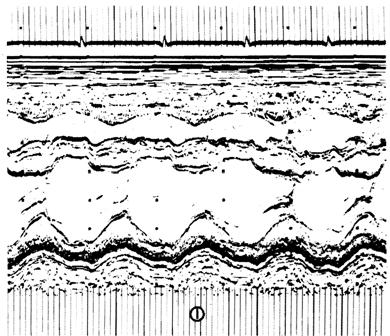
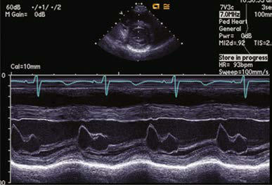

# Chapter 472: Laboratory Cardiac Evaluation

*Daniel Bernstein*

<!-- p.3480 -->
varying the position of the head, or it can be decreased by lightly com pressing the jugular venous system in the neck. These simple maneu vers are sufficient to differentiate a venous hum from the murmurs produced by organic cardiovascular disease, particularly a PDA.

The lack of significance of an innocent murmur should be dis cussed with the child’s parents. It is important to offer complete reassurance because lingering doubts about the importance of a cardiac murmur may have profound effects on child-rearing prac tices, most often in the form of overprotectiveness. An underlying fear that a cardiac abnormality is present may negatively affect a child’s self-image and development. The physician should explain that an innocent murmur is simply a “noise” and does not indicate the presence of a cardiac defect. When asked, “Will it go away?” the best response is to state that because the murmur has no clini cal significance, it does not matter whether it “goes away.” Parents should be warned that the intensity of the murmur might increase during febrile illnesses, a time when, typically, another physician may examine the child (e.g., in the emergency department). With growth, however, innocent murmurs are less well heard and often disappear completely. If there is a suspicion of structural heart disease, additional studies are indicated to rule out a congenital heart defect. However, “routine” electrocardiographic, chest radio graphic, and echocardiographic examinations should be avoided in well children with a clearly innocent murmur.

*Visit Elsevier eBooks+ at eBooks.Health.Elsevier.com** for Bibliography.*

100

80

60

40

20

0

10

8

6

4

2

0

25

20

15

10

5

0

0 0.2 0.4 0.6 0.8 0.1 0.3 0.5 0.7

Tricuspid valve closes

Right atrial (venous) pressure

Ventricular

volume (mL)

Left heart pressure mm Hg Blood flow (L/min) Right heart

pressure mm Hg

Time (sec)

Tricuspid valve opens

Pulmonary arterial pressure

Right ventricular pressure

Pulmonic valve opens

Pulmonic valve closes

Flow Volume

Mitral valve closes

Atrial sound

Aortic valve opens

Aortic valve closes

Aortic pressure

Left ventricular pressure

Aortic closure

Pulmonic closure

Opening snap

Mitral valve opens

Left atrial pressure

Atrial

Systole

Isovolumic Contraction

Rapid Ejection

Isovolumic

Relaxation

Reduced Ejection

Rapid Filling

of Ventricle

Reduced Filling

of Ventricle

(Diastasis)

P

Q S

R

T P

1 4 2 3 4

a

c v

100

90

80

70

60

50

**Fig. 471.4** Idealized diagram of the temporal events of a cardiac cy cle (the Wiggers diagram).

## 472.1  Radiologic Cardiac Assessment Daniel Bernstein

Despite the widespread easy access to advanced imaging techniques, such as echocardiography, computed tomography (CT) scan, and magnetic resonance imaging (MRI), the chest x-ray film remains a highly valuable diagnostic tool and is often the first imaging study performed in a child suspected of having a cardiac defect. It can provide important informa tion about cardiac size and shape, pulmonary blood flow (vascularity), pulmonary edema, and associated lung and thoracic anomalies that may be associated with congenital syndromes (e.g., skeletal dysplasias, extra or deficient number of ribs, abnormal vertebrae, diaphragmatic hernia, previous cardiac surgery). Combined with a careful physical examina tion, the chest radiograph can help the clinician to establish a diagnosis of congenital heart disease (CHD), as opposed to pulmonary disease, and to narrow the differential diagnosis to specific categories of CHD (e.g., left-to-right shunt lesions vs obstructive lesions).

The most frequently used measurement of cardiac size is the maxi mal width of the cardiac shadow in a posteroanterior (PA) chest film taken mid-inspiration. A vertical line is drawn down the middle of the sternal shadow, and perpendicular lines are drawn from the ster nal line to the extreme right and left borders of the heart; the sum of the lengths of these lines is the **maximal cardiac width**. The **maximal chest width** is obtained by drawing a horizontal line between the right and left inner borders of the rib cage at the level of the top of the right diaphragm. When the maximal cardiac width is more than half the maximal chest width (cardiothoracic ratio >50%), the heart is usually enlarged. Cardiac size should be evaluated only when the film is taken during inspiration with the patient in an upright position, which can be difficult to achieve in younger patients. A diagnosis of “cardiac enlarge ment” on expiratory or prone films is a common cause of unnecessary referrals and laboratory studies.

The **cardiothoracic ratio** is a less useful index of cardiac enlarge ment in infants than in older children because the horizontal position of the heart may increase the ratio to about 60% in the absence of true enlargement. Furthermore, the thymus may overlap not only the base of the heart but also virtually the entire mediastinum, thus obscuring the true cardiac silhouette.

A *lateral* chest radiograph may be helpful in infants and in older children with pectus excavatum or other conditions that result in a nar row anteroposterior (AP) chest dimension. The heart may appear small in the lateral view and suggest that the apparent enlargement in the PA projection was caused by either the thymus (anterior mediastinum only) or flattening of the cardiac chambers as a result of a structural chest abnormality.

In the PA view, the left border of the cardiac shadow consists of three convex shadows produced, from above downward, by the aortic knob, the main and left pulmonary arteries, and the left ventricle (Fig. 472.1). In cases of moderate to marked left atrial enlargement, the atrium may be visualized between the pulmonary artery and the left ventricle. The right ventricular outflow tract (RVOT) does not contribute to the shad ows formed by the left border of the heart. The aortic knob is not as easily seen in infants and children as in adults. The side of the aortic arch (left or right) can often be inferred as being opposite the side of the midline from which the air-filled trachea is visualized. This obser vation is important because a right-sided aortic arch is often present in

*Daniel Bernstein*

<!-- p.3482 -->
S V C

RA

RPA LPA PA

RV

LA

Branches of

aorta

Aorta

Aorta

LA

PA

RV

RA

S V C

PA view

Lateral view

Right heart

Right heart

Left heart

Left heart

Outflow

tract

Pulmonary

veins

LPA

**Fig. 472.1** Idealized diagrams showing normal position of the cardiac chambers and great blood vessels. IVC, Inferior vena cava; LA, left atri um; LPA, left pulmonary artery; LV, left ventricle; PA, pulmonary artery; RA, right atrium; RPA, right pulmonary artery; RV, right ventricle; SVC, superior vena cava. (Adapted and redrawn from Dotter CT, Steinberg I. Angiocardiographic interpretation. Radiology. 1949;153:513.)

cyanotic CHD, particularly in tetralogy of Fallot. Three structures con tribute to the right border of the cardiac silhouette. In the view from above, they are the superior vena cava, the ascending aorta, and the right atrium.

**Enlargement** of cardiac chambers (i.e., increased chamber volume) or major arteries and veins results in prominence of the areas in which these structures are normally outlined on the chest radiograph. In contrast, the electrocardiogram is a more sensitive and accurate index of **ventricular hypertrophy**, which is a thickening of the ventricular wall and may or may not be associated with dilation of the affected cardiac chamber.

The chest radiograph is also an important tool for assessing the degree of pulmonary vascularity. **Pulmonary overcirculation** is usu ally associated with left-to-right shunt lesions, whereas **pulmonary undercirculation** is associated with obstruction of the RVOT in cya notic lesions. The esophagus is closely related to the great vessels, and a barium esophagogram can help delineate these structures in the initial evaluation of suspected vascular rings, although this has largely been supplanted by CT.

Echocardiographic examination best defines the morphologic fea tures of intracardiac chambers, cardiac valves, and intracardiac shunts. CT is used as an adjunct to echocardiogram to evaluate extracardiac vascular morphology. MRI is used most often to provide a more quan titative assessment of inflammation as well as ventricular volumes, car diac function, and shunt and regurgitant fractions than is possible with echocardiogram.

## 472.2  Electrocardiography Daniel Bernstein

**DEVELOPMENTAL CHANGES** The marked changes that occur in cardiac physiology and cham ber dominance during the perinatal transition (see Chapter 470) are

reflected in the evolution of the electrocardiogram (ECG) during the neonatal period. Because vascular resistance in the pulmonary and systemic circulations is nearly equal in a term fetus, the intrauterine work of the heart results in an equal mass of both the right and left ven tricles. After birth, systemic vascular resistance (SVR) rises when the placental circulation is eliminated, and pulmonary vascular resistance (PVR) falls when the lungs expand. These changes are reflected in the ECG over the first few weeks of life as the right ventricular (RV) wall begins to thin.

The ECG demonstrates these anatomic and hemodynamic features principally by changes in QRS and T-wave morphologic features. Typi cally, pediatric ECGs include several additional leads rarely used in adults, such as V3R and V4R, which are mirror images of leads V3 and V4 and are important in the evaluation of **right ventricular hypertro phy** (RVH). On occasion, lead V1 is inappropriately positioned too far leftward to reflect RV forces accurately. This problem is present particularly in premature infants, in whom the electrocardiographic electrode gel may produce contact among all the precordial leads. An additional lead used in children is V7, located more laterally than V6 and useful for assessing left-sided forces.

During the first postnatal days of life, right axis deviation, large R waves, and upright T waves in the right precordial leads (V3R or V4R and V1) are the norm (Fig. 472.2). As PVR decreases in the first few days after birth, the right precordial T waves become negative. In the great majority of cases, this change occurs within the first 48 hours of postnatal life. Upright T waves that persist in leads V3R, V4R, or V1 beyond 1 week of life are an abnormal finding indicating RVH or RV strain, even in the absence of QRS voltage criteria. The T wave in V1 should never be positive before 6 years of age; however, it may remain negative into adolescence or early adulthood. This finding represents one of the most important yet subtle differences between pediatric and adult ECGs and is a common source of error when adult cardiologists interpret pediatric ECGs.

In a newborn the mean **QRS frontal-plane axis** normally lies in the range of +110 to +180 degrees, reflecting the codominance of the fetal right and left ventricles. The right-sided chest leads reveal a larger positive **(R)** than negative **(S)** wave and may do so for months because the right ventricle remains relatively thick throughout early infancy. Left-sided leads (V5 and V6) also reflect right-sided dominance in the early neonatal period, when the R:S ratio in these leads may be <1. A dominant R wave in V5 and V6, reflecting left ventricular (LV) forces, quickly becomes evident within the first few days of life (Fig. 472.3). As the child matures, the QRS axis gradually shifts leftward and the RV forces slowly regress. Leads V1, V3R, and V4R display a prominent R wave until 6 months to 8 years of age. Most children have an R:S ratio >1 in lead V4R until age 4 years. The T waves are inverted in leads V4R, V1, V2, and V3 during infancy and may remain so into the middle of the second decade of life and beyond. The processes of RV thinning and LV growth are best reflected in the QRS-T pattern over the right precordial leads. The diagnosis of RVH or left ventricular hypertrophy (LVH) in a pediatric patient can be made only with an understanding of the nor mal developmental physiology of these chambers at various ages until adulthood is reached. As the left ventricle becomes dominant, the ECG evolves to the characteristic pattern of older children (Fig. 472.4) and adults (Fig. 472.5).

**Ventricular hypertrophy** usually results in increased voltage in the R and S waves in the chest leads. The height of these deflections is governed by the proximity of the specific electrode to the surface of the heart; by the sequence of electrical activation through the ven tricles, which can result in variable degrees of cancellation of right vs left forces; and by hypertrophy of the myocardium.

The diagnosis of **pathologic RVH** is difficult in the first week of post natal life because physiologic RVH is a normal finding. Serial tracings are often necessary to determine whether marked right axis deviation and potentially abnormal right precordial forces or T waves, or both, will persist beyond the neonatal period (Fig. 472.6). In contrast, an adult ECG pattern (see Fig. 472.5) seen in a neonate suggests LVH. The exception is a premature infant, who may display a more “mature” ECG than a full-term infant (Fig. 472.7) as a result of lower PVR secondary

<!-- p.3483 -->
V5 II V2

aVL

aVR

**Fig. 472.2** Normal ECG from a 5-day-old, term-gestation infant. The frontal plane QRS axis is 150 degrees. There is prominent voltage in the precordial leads and a suggestion of right ventricular preponderance but not right ventricular hypertrophy. The QRS duration is 60 ms. (From Gering LE, Knilans TK, Surawicz B, et al. Normal electrocardiograms in the fetus, infants, and children. In: Surawicz B, Knilans TK. Chou’s Electrocardiography in Clinical Practice, 6th ed. Philadelphia: Saunders; 2008: Fig. 28.2, p. 651).

V5 II V2

aVL

aVR

**Fig. 472.3** Normal ECG from a healthy 8-mo-old infant. The frontal plane QRS axis is 60 degrees. There is less evidence of right ventricular pre ponderance than in the newborn tracing, with a smaller R wave in lead V1 and smaller S wave in lead V6. (From Gering LE, Knilans TK, Surawicz B, et al. Normal electrocardiograms in the fetus, infants, and children. In: Surawicz B, Knilans TK. Chou’s Electrocardiography in Clinical Practice, 6th ed. Philadelphia: Saunders; 2008: Fig. 28.3, p. 652).

to underdevelopment of the medial muscular layer of the pulmonary arterioles. Some premature infants display a pattern of generalized low voltage across the precordium.

The ECG should always be evaluated systematically to avoid over looking a minor but important abnormality. One approach is to begin with an assessment of rate and rhythm, followed by a calculation of the mean frontal-plane QRS axis, measurements of segment inter vals, assessment of voltages, and lastly assessment of ST and T-wave abnormalities.

**RATE AND RHYTHM** A brief rhythm strip should be examined to assess whether a P wave always precedes each QRS complex. Using the full 12-lead ECG, the P-wave axis should then be estimated as an indication of whether the rhythm is originating from the **sinus node**. If the atria are situated

normally in the chest, the P-wave axis should be oriented downward and to the left (i.e., should be upright in leads I and aVF and inverted in lead aVR). With atrial inversion **(situs inversus)**, the P wave may be inverted in lead I. Inverted P waves in leads II and aVF are seen in low atrial, nodal, or junctional rhythms. The absence of P waves indicates a rhythm originating more distally in the conduction system. In this case, the morphologic features of the QRS complexes are important in differentiating a **junctional** (usually a narrow QRS complex) from a **ventricular** (usually a wide QRS complex) rhythm.

**P WAVES** Tall (>2.5 mm), narrow, and spiked P waves are indicative of **right atrial enlargement** and are seen in pulmonary stenosis, Ebstein anomaly of the tricuspid valve, tricuspid atresia, and sometimes cor pulmonale. These abnormal waves are most obvious in leads II, V3R,

<!-- p.3484 -->
and V1 (Fig. 472.8A). Similar waves are sometimes seen in thyrotoxi cosis. **Broad P waves**, commonly **bifid** and sometimes **biphasic**, are indicative of **left atrial enlargement** (Fig. 472.8B). They are seen in some patients with large left-to-right shunts (ventricular septal defect [VSD], patent ductus arteriosus) and with severe mitral stenosis or mitral regurgitation. Left atrial enlargement, however, is one of the most common false-positive readings generated by computerized ECG machines. Flat P waves may be encountered in patients with hyperkalemia.

**QRS COMPLEX Right Ventricular Hypertrophy** For the most accurate assessment of ventricular hypertrophy, pedi atric ECGs should include the right precordial leads V3R and V4R. The diagnosis of RVH depends on demonstration of the following changes (see Fig. 472.6): (1) a qR pattern in the RV surface leads; (2) a positive T wave in leads V3R-V4R and V1-V3 between ages 6 days and 6 years; (3) a monophasic R wave in V3R, V4R, or V1; (4) an rsR′ pattern in the right precordial leads with the second R wave

V5 II V2

aVL

aVR

**Fig. 472.4** Normal ECG from a healthy 3-yr-old child. The frontal plane QRS axis is 60 degrees. The R/S ratio in lead V1 is less than 1, and there is no appreciable S wave in lead V6. The R wave in lead V6 is more prominent than that of the infant, suggesting more left ventricular preponderance but not left ventricular hypertrophy. (From Gering LE, Knilans TK, Surawicz B, et al. Normal electrocardiograms in the fetus, infants, and children. In: Surawicz B, Knilans TK. Chou’s Electrocardiography in Clinical Practice, 6th ed. Philadelphia: Saunders; 2008: Fig. 28.4, p. 652).

V5

V5

V3 V6 aVF

aVL

aVR

**Fig. 472.5** Electrocardiogram of a normal 17-yr-old, a member of the school’s track team. At this age the ECG should be similar to that in a normal adult: the dominant wave in V1 should be the S wave and there is a normal R-wave progression, growing taller across the precordium from right to left. The heart rate is slow at 43 bpm (sinus bradycardia), which can be typical of a performance athlete. Note that all precordial lead T waves are positive, except for V1. This R-wave progression pattern in a young infant, where there should be right ventricular dominance, would indicate the presence of left ventricular hypertrophy.

<!-- p.3485 -->
taller than the first; (5) age-corrected increased voltage of the R wave in leads V3R-V4R or the S wave in leads V6-V7, or both; (6) marked right axis deviation (>120 degrees in patients beyond the newborn period); and (7) complete reversal of the normal adult precordial RS pattern. At least two of these changes should be present to support a diagnosis of RVH.

Abnormal ventricular loading can be characterized as either pressure overload (as a result of RVOT obstruction, as in pulmonic stenosis) or volume overload (as a result of a left-to-right shunt as in atrial septal defect [ASD], semilunar valve regurgitation, or dilated cardiomyopa thy). These two types of abnormal loads result in distinct electrocar diographic patterns. The **pressure overload pattern** is characterized by tall, pure R waves in the right precordial leads. In older children, the T waves in these leads are initially upright and later become inverted. In infants and children <6 years, the T waves in V3R-V4R and V1 are

abnormally upright. The **volume overload pattern** (typically seen in patients with ASD) is characterized by an rsR′ pattern (Fig. 472.9) and a slightly increased QRS duration (which is known as a *minor right ventricular conduction delay* rather than a true bundle branch block). Patients with mild to moderate pulmonary stenosis may also exhibit an rsR′ pattern in the right precordial leads.

**Left Ventricular Hypertrophy** The following features indicate the presence of LVH (Fig. 472.10): (1) increased voltage (for age) of the S wave in V3R and V1 or the R wave in V6-V7, or both. In older children and adults, the criteria for LVH **(Sokolow index)** is a combination of S wave in V1 or V2 plus R wave in V5 or V6 ≥35 mm and (2) a deep Q wave in the left precordial leads. Remember that an infant with an ECG that would be considered “nor mal” for an older child may in fact have LVH; therefore reference to

V5 II V2

aVL

aVR

**Fig. 472.6** Electrocardiogram of an infant with right ventricular hypertrophy (tetralogy of Fallot). Note the tall R waves in the right precordial leads (V1-V2) and deep S waves in V6. The R-wave progression (taller in the right precordial leads vs the left) is counter to the normal pattern.

V5

V3R

aVL

aVR

**Fig. 472.7** Normal ECG from an 8-day-old, 28-wk-gestation premature infant. The frontal plane QRS axis is 150 degrees, there is a monophasic R wave in lead V1, and the R/S ratio is less than 1 in lead V6. This illustrates relative right ventricular preponderance without right ventricular hypertro phy. The QRS duration is less than 40 ms. (From Gering LE, Knilans TK, Surawicz B, Tavel ME. Normal electrocardiograms in the fetus, infants, and children. In: Surawicz B, Knilans TK. Chou’s Electrocardiography in Clinical Practice, 6th ed. Philadelphia: Saunders; 2008: Fig. 28.1, p. 650).

<!-- p.3486 -->
RAE A

B LAE

**Fig. 472.8** Atrial enlargement. A, Peaked narrow P waves in lead II characteristic of right atrial enlargement (RAE). B, Wide, bifid, M-shaped P waves in lead II and biphasic p waves in lead V1 typical of left atrial enlargement (LAE).

V5 II V2

V3R

V6 aVF

aVL

aVR

**Fig. 472.9** Electrocardiogram showing a minor right ventricular conduction delay characterized by an RsR′ pattern in V1. Note that the QRS dura tion is not prolonged (60 msec) as it would be if this were a right bundle branch block (RBBB).

V5 II

V2

aVL

aVR

**Fig. 472.10** Electrocardiogram showing left ventricular hypertrophy (LVH) in a 12-yr-old child with aortic stenosis. Note the deep S waves in V1-V3 and tall R in V5-V6. In addition, T-wave inversion is present in lead V6, a sign of left ventricular strain.

<!-- p.3487 -->
standard voltages for age is always important. Further evidence for LVH includes depression of the ST segments and inversion of the T waves in the left precordial leads (V5, V6, and V7), known as a **left ven tricular strain** pattern—these findings suggest the presence of more severe hypertrophy.

**Bundle Branch Block** A complete **right bundle branch block** (RBBB; prolonged QRS com plex, which is usually upright with an rSR′ in lead V1; wide S wave in lead V6) may be congenital or may be acquired after surgery for CHD, especially when a right ventriculotomy has been performed, as in repair of the tetralogy of Fallot. **Left bundle branch block** (LBBB; prolonged QRS complex, which is usually upright with an rSR′ in lead V6; wide S wave in lead V1) is less common in children; this pattern is often seen in adults with cardiomyopathy, but much less in children with cardiomyopathy. LBBB may be seen after surgery on the aortic or mitral valve caused by surgical injury to one of the left-sided con duction bundles. Alternatively, a bundle branch block pattern may be indicative of a bypass tract associated with one of the preexcitation syn dromes (see Chapter 484).

**P-R AND Q-T INTERVALS** The duration of the P-R interval shortens with increasing heart rate; assessment of this interval should be based on age- and rate-corrected nomograms. A long P-R interval is diagnostic of a **first-degree heart block**, the cause of which may be congenital, postoperative (after open heart surgery), inflammatory (myocarditis, pericarditis, Lyme dis ease, rheumatic fever), or pharmacologic (digitalis, calcium channel blockers).

The duration of the Q-T interval varies with the cardiac rate; a cor rected Q-T interval (Q-Tc) can be calculated by dividing the measured Q-T interval by the square root of the preceding R-R interval. A nor mal Q-Tc should be <0.45. It is often lengthened with hypokalemia and hypocalcemia; in the former, a U wave may be noted at the end of the T wave (Fig. 472.11). A significant number of medications can also lengthen the Q-T interval, so a careful history of medication exposure is important in evaluating a patient with a borderline or long QT inter val. A congenitally prolonged Q-T interval may also be seen in children with one of the long QT syndromes (Fig. 472.12). These patients are at high risk for ventricular arrhythmias, including a dangerous form of ventricular tachycardia known as **torsades de pointes**, and sudden death (see Chapter 484.5).

**ST SEGMENT AND T-WAVE ABNORMALITIES** Coronary ischemia, leading to typical ST and T-wave abnormalities seen in adults, is rare in children. A slight elevation of the ST segment is often seen in normal teenagers, especially males, and is attributed to **early repolarization** of the heart (Fig. 472.13). It can sometimes be dif ficult to distinguish between ischemic ST segment changes and benign early repolarization; however, the following characteristics suggest early repolarization: (1) ST elevation limited to the lateral leads (V5- V6), (2) a characteristic notch at the J point (junction between the end of the QRS and the beginning of the ST segment), and (3) a concave rather than convex ST segment. Lack of any concerning symptoms is also critical. Early repolarization often resolves with exercise-induced tachycardia. In pericarditis, irritation of the epicardium may cause elevation of the ST segment, followed by abnormal T-wave inversion as healing progresses.

Depression of the ST segment may also occur in coronary ischemia or in any condition that produces myocardial injury, including severe anemia, carbon monoxide poisoning, glycogen storage disease of the heart, myocardial tumors, and mucopolysaccharidoses. An aberrant origin of the left coronary artery from the pulmonary artery may lead to changes indistinguishable from those of acute myocardial infarc tion in adults. ECG findings of ischemia may be seen in patients with Kawasaki disease who have developed coronary artery aneurysms (see Chapters 208 and 493.1). Similar changes may occur in patients with other rare abnormalities of the coronary arteries and in those with car diomyopathy, even in the presence of normal coronary arteries. These patterns are often misread in young infants because of the unfamiliar ity of pediatricians with this “infarct” pattern, and thus a high index of suspicion must be maintained in infants with dilated cardiomyopathy or with symptoms compatible with coronary ischemia (e.g., inconsol able crying).

Lead 1 Lead 2 Lead 3 AVR AVL AVF

V4R V1 V3 1 2 V6 /

**Fig. 472.11** Electrocardiogram in hypokalemia. Serum potassium, 2.7 mEq/L; serum calcium, 4.8 mEq/L at the time of the tracing. Note the wid

**Fig. 472.12** Prolonged Q-T interval in a patient with long QT syn drome.

<!-- p.3488 -->
T-wave inversion may occur in myocarditis and pericarditis, or it may be a sign of either RVH or LVH and ventricular strain. Hypothy roidism may produce flat or inverted T waves in association with gen eralized low voltage. In hyperkalemia, the T waves are usually of high

voltage and are tent shaped (Fig. 472.14), although tall T waves can be an early sign of myocardial infarction.

*Visit Elsevier eBooks+ at eBooks.Health.Elsevier.com** for Bibliography.*

V5 II

V2

aVL

aVR

**Fig. 472.13** Early repolarization seen in the mid-precordial to lateral leads (V2-V5) in a teenage boy. These minor ST segment elevations, with typi cal concave slope and combined with a high J point, suggest this is a benign variant and not true ischemia.

V1 V3 V6 V4R

**Fig. 472.14** Electrocardiogram in hyperkalemia. Serum potassium, 6.5 mEq/L. Note the tall, tent-shaped T waves, especially in leads 1, 2, and V6.

<!-- p.3489 -->

<!-- p.3490 -->

## 472.3  Hematologic Data in Cardiovascular Evaluation Daniel Bernstein

In acyanotic infants with large left-to-right shunts, the onset of heart failure often coincides with the nadir of the normal physiologic anemia of infancy. Increasing the hematocrit in these patients to >40% may decrease shunt volume and result in an improvement in symptoms; however, this form of treatment is generally reserved for infants who are not otherwise surgical candidates (extremely premature infants or others in whom surgery is delayed for other reasons). In these select infants, regular evaluation of the hematocrit and booster transfusions when appropriate may be helpful in improving growth.

**Polycythemia** is frequently noted in chronically *cyanotic* patients with right-to-left shunts. Patients with severe polycythemia, rarely seen in this age of early surgical repair, are in a delicate balance between the risks of intravascular thrombosis and a bleeding diathesis. The prepara tion of cyanotic, polycythemic patients for elective noncardiac surgery, such as dental extraction, includes evaluation and treatment of abnor mal coagulation.

Because of the high viscosity of polycythemic blood (hematocrit >65%), patients with unrepaired cyanotic CHD are at risk for the devel opment of **vascular thromboses**, especially of cerebral veins. Dehydra tion increases the risk of thrombosis, and thus adequate fluid intake must be maintained during hot weather or intercurrent gastrointestinal illnesses. Diuretics should be used with caution in these patients and may need to be decreased if fluid intake is a concern. Polycythemic infants with concomitant **iron deficiency** are at even greater risk for cerebrovascular accidents, thought to be the result of the decreased deformability of microcytic red blood cells. Iron therapy may reduce this risk, but surgical repair of the cardiac anomaly is the best therapy.

Severely cyanotic patients who are inoperable should have periodic determinations of hemoglobin and hematocrit. Increasing polycythe mia is often associated with headache, fatigue, dyspnea, or a combina tion of these conditions. Partial exchange transfusion may be required to treat symptomatic (most often headache or chest pain) individuals whose hematocrit has risen to the 65–70% level. This procedure is not without risk, especially in patients with an extreme elevation in pulmo nary vascular resistance. Because these patients do not tolerate wide fluctuations in circulating blood volume, blood should be replaced with fresh-frozen plasma or albumin.

## 472.4  Echocardiography Daniel Bernstein

**Transthoracic echocardiography** (TTE) has replaced cardiac catheter ization for the *diagnosis* of most forms of CHD. The echocardiographic examination can be used to evaluate cardiac structures in congenital heart lesions using two-dimensional (2D) and three-dimensional (3D) imaging, estimate intracardiac pressures and gradients across stenotic valves and vessels using **echo-Doppler** and color flow Doppler, quan titate cardiac contractile function (both systolic and diastolic), deter mine the direction of flow across a defect, examine the integrity of the coronary arteries, and detect the presence of vegetations from endocar ditis, pericardial fluid, cardiac tumors, and chamber thrombi.

Echocardiography may also be used to assist in the performance of interventional procedures, including pericardiocentesis, balloon atrial septostomy (see Chapter 480.2), ASD or VSD closure, transcatheter valve implantation, and endocardial biopsy. **Transesophageal echo cardiography** (TEE) is used routinely to monitor ventricular function in patients during surgical procedures and can provide an immediate assessment of the results of surgical repair of congenital heart lesions. A complete TTE examination usually entails a combination of M-mode and 2D and 3D imaging, as well as pulsed, continuous, and color Dop pler flow studies. Doppler tissue imaging provides a more quantitative assessment of ventricular systolic and diastolic function.

**M-MODE ECHOCARDIOGRAPHY** M-mode echocardiography displays a one-dimensional slice of car diac structure varying over time (Fig. 472.15). It is used mostly for the measurement of cardiac dimensions (wall thickness and chamber size) and cardiac function (fractional shortening, wall thickening). M-mode echocardiography is also useful for assessing the motion of intracar diac structures: the opening and closing of valves and movement of free walls and septa (Fig. 472.16). The most frequently used index of cardiac function in children is **percent fractional shortening** (%FS), which contrasts to adults, where **ejection fraction** is the most common functional measurement. %FS is calculated as (LVED − LVES)/LVED, where LVED is left ventricular dimension at end diastole and LVES is left ventricular dimension at end systole. Normal fractional shorten ing is approximately 28–42%. Other M-mode indices of cardiac func tion include the mean velocity of fiber shortening (mean VCF), systolic time intervals (LVPEP = LV preejection period, LVET = LV ejection time), and isovolemic contraction time. M-mode assessments of car diac function are more susceptible to errors because of differences in wall motion between different segments of the heart (more frequently seen in adults with ischemic heart disease, but which can be seen in

Dd Ds

CW

RVED

S

LVED

A

B

1

RV LV APM

PPM

AMC Aorta

PMC LA

Septum

2 1 3

Dec. aorta

**Fig. 472.15** M-mode echocardiogram. A, Diagram of a sagittal sec tion of a heart showing the structures traversed by the echo beam as it is moved superiorly to positions (1), (2), and (3). B, Echocardiogram from transducer position (1); this view is the best one for measuring cardiac dimensions and fractional shortening. Fractional shortening is calculated as (LVED − LVES)/LVED. AMC, Anterior mitral cusp; APM, anterior papillary muscle; Dec. aorta, descending aorta; LA, left atrium; LV, left ventricle; PMC, posterior mitral cusp; PPM, posterior papillary muscle; RV, right ventricle. CW, Chest wall; Ds, LV dimension in systole; LVED, LV dimension at end diastole (Dd); RVED, RV dimension at end diastole.

<!-- p.3491 -->
children with congenital and acquired heart disease, especially after surgical repair).

**TWO-DIMENSIONAL ECHOCARDIOGRAPHY** Two-dimensional echocardiography provides a real-time image of cardiac structures. The contracting heart is imaged using several standard views, including parasternal long axis (Fig. 472.17), para sternal short axis (Fig. 472.18), apical four-chamber (Fig. 472.19), subcostal (Fig. 472.20), and suprasternal (Fig. 472.21), each of which emphasizes specific structures. Two-dimensional echocardiography

has replaced cardiac angiography for the preoperative diagnosis and follow-up of the vast majority of congenital heart lesions. However, when information from the cardiac examination or other studies is not consistent with the echocardiogram, or in very complex defects, cardiac catheterization remains an important tool to confirm the ana tomic diagnosis and evaluate the degree of physiologic derangement. MRI is an extremely valuable adjunct to provide a better quantifica tion of ventricular size and function. Cardiac CT is another modality that is valuable to assess cardiac and adjacent vascular structures.

**DOPPLER ECHOCARDIOGRAPHY** Doppler echocardiography displays blood flow based on the change in frequency imparted to sound waves by the movement of

A

RV IVS LV

RV

Ao

LA B

**Fig. 472.16** M-mode echocardiograms. The small figure at the top of each panel shows the 2D parasternal short-axis echocardiogram image from which the M-modes are derived. The cursor can be seen midway through the image, indicating the one-dimensional line through which the M-mode is being sampled. A, M-mode echocardiogram of a normal mitral valve. Arrow shows the opening of the anterior leaflet in early diastole (see ECG tracing earlier for reference). B, M-mode echocar diogram of a normal aortic valve. The opening and closing of the aortic leaflets in systole are outlined by the two arrows. Ao, Aorta; IVS, inter ventricular septum; LV, left ventricle; RV, right ventricle.

RV

Ao

LA

**Fig. 472.17** Normal parasternal long-axis echocardiographic win dow. The transducer is angulated slightly posteriorly, imaging the left- sided cardiac structures. If the transducer were to be angulated more anteriorly, the right ventricular structures would be imaged. The mitral valve leaflets can be seen in the partially open position in early diastole (arrows). The closed aortic valve leaflets can be seen just below the label Ao (aorta). LA, Left atrium; LV, left ventricle; RV, right ventricle.

A

RV

RA

RPA LPA

MPA

TV

PV

AV

RV

B

**Fig. 472.18** Normal parasternal short-axis echocardiographic win dows. A, With the transducer angled superiorly and rightward, the aor tic valve (AV) is imaged, surrounded by both inflow and outflow por tions of the right ventricle (RV). B, With the transducer angled inferiorly and leftward, the left ventricular chamber is imaged along with a cross- sectional view of the mitral valve (arrows). LPA, Left pulmonary artery; MPA, main pulmonary artery; PV, pulmonary valve; RA, right atrium; RPA, right pulmonary artery; TV, tricuspid valve. LV, left ventricle; RV, right ventricle.

RV

RA

LA

**Fig. 472.19** Normal apical four-chamber echocardiographic window showing all four cardiac chambers and both atrioventricular valves opened in diastole. LA, Left atrium; LV, left ventricle; RA, right atrium; RV, right ventricle.

<!-- p.3492 -->
erythrocytes. The speed and direction of blood flow in the line of the echo beam change the transducer’s reference frequency. This frequency change can be translated into volumetric flow (L/min) data for estimating systemic or pulmonary blood flow and into pressure (mm Hg) data for estimating gradients across valves or across septal defects or vascular communications such as shunts. Color Doppler permits highly accurate assessment of the presence and direction of intracardiac shunts and allows identification of small or multiple left-to-right or right-to-left shunts (Fig. 472.22). The severity of valvular insufficiency can be evaluated qualitatively

with both pulsed and color Doppler (Fig. 472.23). Alterations in venous Doppler flow patterns can be used to detect abnormalities of systemic and pulmonary veins, and alterations of atrioventricu lar valve Doppler flow patterns can be used to assess ventricular

RV

RA

Ao

SVC

**Fig. 472.20** Normal subcostal echocardiographic window showing the left ventricular outflow tract. The right-sided structures are not fully imaged in this view. Ao, Ascending aorta; LV, left ventricle; RA, right atrium; RV, right ventricle; SVC, superior vena cava.

A

BrA

DescAo

LSCA AsAo LCA

RLPV

LA

LLPV

Ao

B

**Fig. 472.21** A, Normal suprasternal echocardiographic window showing the aortic arch and its major branches. B, Normal high par asternal window showing color Doppler imaging of normal pulmonary venous return to the left atrium (LA) of both right (RLPV) and left (LLPV) lower pulmonary veins. AsAo, Ascending aorta; BrA, brachiocephalic artery; DescAo, descending aorta; LCA, left carotid artery; LSCA, left subclavian artery.

A

AO

MPA

LPA

RPA

B

**Fig. 472.22** Color and pulsed Doppler evaluation of pulmonary arterial flow. A, Color Doppler evaluation of a parasternal short-axis view showing normal flow through the pulmonary valve to the main and branch pulmonary arteries. The color of the Doppler flow is blue, indicating that the flow is moving away from the transducer (which is located at the top of the figure, at the apex of the triangular ultrasound window). Note that the color assigned to the Doppler signal does not indicate the oxygen saturation of the blood. B, Pulsed-wave Doppler flow pattern through the pulmonary valve showing a low velocity of flow (<1.5 m/sec), indicating the absence of a pressure gradient across the valve. The envelope of the flow signal is below the line, indicating that the flow is moving away from the transducer. AO, Aorta; LPA, left pulmonary artery; MPA, main pulmonary artery; RPA, right pulmonary artery.

**Fig. 472.23** Doppler evaluation of a patient who had previously undergone repair of tetralogy of Fallot and who has mild pulmonary stenosis and moderate pulmonary regurgitation. The tracing shows the to-and-fro flow across the pulmonary valve, with the signal below the line representing forward flow in systole (see ECG tracing for reference) and the signal above the line representing regurgitation during diastole.

<!-- p.3493 -->
diastolic functional abnormalities, particularly the **E/A ratio**, the ratio of peak velocity flow in diastole (i.e., the ratio of the early diastole E wave to the peak velocity flow in late diastole caused by atrial contraction).

M-mode, 2D, and Doppler echocardiographic methods of assess ing LV systolic and diastolic function (e.g., end-systolic wall stress, dobutamine stress echocardiography, Doppler tissue imaging) have proved useful in the serial assessment of patients at risk for the development of both systolic and diastolic ventricular dysfunction and ventricular dyssynchrony (where the coordination of left and right ventricular contraction is abnormal). Such patients include those with cardiomyopathies, those receiving anthracycline drugs for cancer chemotherapy, those at risk for iron overload, and those being monitored for rejection or coronary artery disease after heart transplantation.

**THREE-DIMENSIONAL ECHOCARDIOGRAPHY** Real-time 3D echocardiographic reconstruction is most valuable for the detailed assessment of cardiac morphology (Fig. 472.24). Details of valve structure, the size and location of septal defects, abnormali ties of the ventricular myocardium, and details of the great vessels, which may not be as readily apparent using 2D imaging, can often be appreciated on 3D echocardiography. Reconstruction of the view that the surgeon will encounter in the operating room makes this technique a valuable adjunct for preoperative imaging.

**TRANSESOPHAGEAL ECHOCARDIOGRAPHY** TEE is a sensitive imaging technique that produces a clearer view of smaller lesions such as vegetations in endocarditis, especially in larger patients. It is useful in visualizing posteriorly located struc tures such as the atria, aortic root, and atrioventricular valves. TEE is useful as an intraoperative technique for monitoring car diac function during both cardiac and noncardiac surgery and for screening for residual cardiac defects after the patient is initially weaned from cardiopulmonary bypass but before being discon nected from the bypass circuit. This technique has been especially helpful in evaluating the degree of residual regurgitation or stenosis after valve repairs and in searching for small muscular VSDs that may have been missed during the closure of larger defects. It is always preferable to make the diagnosis of **excessive valve regur gitation** while the patient is still in the operating room, so that the repair can be revised or the valve replaced, rather than after surgery, when the patient is already in the postoperative care unit. However, hemodynamic measurements made while the chest is open and the patient is still under anesthesia may be different from those made under more normal conditions, as when the patient is ready to be discharged from the hospital.

**FETAL ECHOCARDIOGRAPHY** Fetal echocardiography can be used to evaluate cardiac structures and function or disturbances in cardiac rhythm (Fig. 472.25). Obste tricians may detect a possible heart defect when screening during routine obstetric ultrasonography (e.g., cardiac four-chamber view) or may refer the patient because of unexplained hydrops fetalis, a family history of CHD, or a maternal condition associated with fetal cardiac pathology, such as gestational diabetes, drug use, or infec tion. Fetal echocardiography can diagnose most significant congen ital heart lesions as early as 17-19 weeks of gestation; accuracy at this early stage is limited, however, and families should understand that these studies cannot totally eliminate the possibility of CHD. Serial fetal echocardiograms have also demonstrated the impor tance of flow disturbance in the pathogenesis of CHD; such studies can show the intrauterine progression of a moderate lesion, such as aortic stenosis, into a more severe lesion, such as **hypoplastic left heart syndrome** (HLHS). M-mode echocardiography can diagnose rhythm disturbances in the fetus and can determine the success of antiarrhythmic therapy administered to the mother. A screening fetal echocardiogram is recommended for women with a previous child or first-degree relative with CHD, for those who are at higher risk of having a child with cardiac disease (e.g., insulin-dependent diabetes, women exposed to teratogenic drugs during early preg nancy), and in any fetus in whom a chromosomal abnormality is suspected or confirmed.

Early detection provides the opportunity to counsel and educate the parents about the severity of the cardiac lesion and potential therapeutic or palliative care options. Referral to a high-risk peri natal service is then performed for further ultrasound screening for associated anomalies of other organs and potential amniocentesis or sequencing of cell-free DNA in maternal blood for karyotyping. For fetuses with ductal dependent lesions, delivery can be planned at a tertiary care center, enhancing safety by avoiding the require ment for postnatal transport of an unstable infant. For fetuses with complex CHD at high risk for complications immediately at birth (e.g., HLHS with intact atrial septum), delivery can be arranged with an operating room and surgeon standing by. In utero treat ment of CHD is an experimental procedure, with the most common procedure being aortic balloon valvuloplasty for HLHS.

*Visit Elsevier eBooks+ at eBooks.Health.Elsevier.com** for Bibliography.*

AV MV

**Fig. 472.24** Three-dimensional echocardiogram showing a short-axis view of the left ventricle. AV, Aortic valve; MV, mitral valve. (Courtesy Dr. Norman Silverman, Stanford University, Stanford, CA.)

LA

RA

**Fig. 472.25** Normal four-chamber view echocardiogram on a fetus at 20 wk of gestation. The foramen ovale (arrow) can be seen between the right and left atria. LA, Left atrium; LV, left ventricle; RA, right atrium; RV, right ventricle.

<!-- p.3494 -->

<!-- p.3495 -->

## 472.5  Exercise Testing Daniel Bernstein

The normal cardiorespiratory system adapts to the extensive demands of exercise with a several-fold increase in oxygen con sumption and cardiac output. Because of the large reserve capacity for exercise, significant abnormalities in cardiovascular perfor mance may be present without symptoms at rest or during ordinary activities. When patients are evaluated in a resting state, signifi cant abnormalities in cardiac function may not be appreciated, or if detected, their implications for quality of life may not be recog nized. Permission for children with cardiovascular disease to par ticipate in various forms of physical activity is frequently based on totally subjective criteria. As the importance of aerobic exercise is increasingly recognized, even for children with complex congenital heart lesions, exercise testing can provide a quantitative evaluation of the child’s ability to participate safely in both competitive and noncompetitive sports. Exercise testing can also play an important role in evaluating symptoms and quantitating the severity of car diac abnormalities. In children with coronary artery abnormalities (e.g., Kawasaki disease or COVID-19 with coronary aneurysms), exercise testing can detect ischemia that might otherwise be overlooked.

In older children, exercise studies are generally performed on a graded treadmill apparatus with timed intervals of increasing grade and speed. In younger children, exercise studies are often per formed on a bicycle ergometer. Many laboratories have the capac ity to measure both cardiac and pulmonary function noninvasively during exercise. This allows measurement of both resting and maxi mal oxygen consumption (Vo2max) and the point at which anaerobic threshold is reached, which are important indicators of cardiovas cular fitness.

As a child grows, the capacity for muscle work is enhanced with increased body size and skeletal muscle mass. All indices of cardio pulmonary function do not increase in a uniform manner. A major response to exercise is an increase in cardiac output, principally achieved through an increase in heart rate, but stroke volume (SV), systemic venous return, and pulse pressure are also increased. SVR is greatly decreased as the blood vessels in working muscle dilate in response to increasing metabolic demands. As the child becomes older and larger, the response of the heart rate to exercise remains prominent, but cardiac output increases because of growing car diac volume capacity and thus SV. Responses to dynamic exercise are not dependent solely on age. For any given body surface area, boys have a larger SV than size-matched girls. This increase is also mediated by posture. Augmentation of SV with upright, dynamic exercise is facilitated by the pumping action of working muscles, which overcomes the static effect of gravity and increases systemic venous return.

Dynamic exercise testing defines not only endurance and exer cise capacity but also the effect of such exercise on myocardial blood flow and cardiac rhythm. Significant ST segment depression or elevation reflects abnormalities in myocardial perfusion, such as might occur during exercise in children with extremely hypertro phied left ventricles. The **exercise ECG** is considered abnormal if the ST segment depression is >2 mm and extends for at least 0.06 seconds after the J point (onset of the ST segment) in conjunction with a horizontal-, upward-, or downward-sloping ST segment. A decrease in blood pressure before maximal exercise is reached is regarded as a risk indicator in patients with hypertrophic cardio myopathy. Provocation of rhythm disturbances during an exercise study is an important method of evaluating select patients with known or suspected rhythm disorders. The effect of pharmacologic management can also be tested in this manner.

*Visit Elsevier eBooks+ at eBooks.Health.Elsevier.com** for Bibliography.*

## 472.6  Cardiac Imaging Studies Daniel Bernstein

**Magnetic resonance imaging (MRI)** and **magnetic resonance angi ography (MRA)** are extremely helpful in the diagnosis and management of patients with CHD and inflammatory lesions (Table 472.1). These techniques produce tomographic images of the heart in any projection (Fig. 472.26 and Fig. 472.27), with excellent contrast resolution of fat, myo cardium, and lung, as well as moving blood from blood vessel walls. MRI is useful in evaluating areas that are less well visualized by echocardiog raphy, such as distal branch pulmonary artery anatomy and anomalies in systemic and pulmonary venous return.

MRA allows the acquisition of images in several tomographic planes. Within each plane, images are obtained at different phases of the cardiac cycle. Thus when displayed in a dynamic “cine” format, changes in wall thickening, chamber volume, and valve function can be displayed and analyzed. Blood flow velocity and blood flow vol ume can be calculated. MRA is an excellent technique for following patients serially after repair of complex CHD, such as tetralogy of Fallot. In these patients, MRA can be used to assess RV volume and mass and to quantify the amount of regurgitation through either the pulmonary or tricuspid valve. Other MRI techniques, such as myocardial delayed enhancement and tissue T1 weighting, can be used to quantify areas of myocardial scar in patients with cardiomy opathy or in patients after CHD repair, especially tetralogy of Fallot. **Magnetic resonance spectroscopy**, predominantly a research tool at present, provides a means of demonstrating relative concentra tions of high-energy metabolites (adenosine triphosphate, adenos ine diphosphate, inorganic phosphate, and phosphocreatine) within regions of the working myocardium.

Computer processing of MRA images allows the noninvasive visu alization of the cardiovascular system from inside of the heart or ves sels, a technique known as *fly-through imaging.* These images allow the cardiologist to image the interiors of various cardiovascular structures (Fig. 472.28). These techniques are especially helpful in imaging com plex peripheral arterial stenoses.

**CT scanning** can be used to perform rapid, respiration-gated cardiac imaging in children with resolutions down to 0.5 mm. Three-dimensional reconstruction of CT images is especially useful in evaluating branch pul monary arteries, anomalies in systemic and pulmonary venous return, and great vessel anomalies such as coarctation of the aorta (Fig. 472.29).

**Radionuclide angiography** may be used to detect and quantify shunts and to analyze the distribution of blood flow to each lung. This technique is particularly useful in quantifying the volume of blood flow distribution between the two lungs in patients with abnormalities of the pulmonary vascular tree or to quantify the suc cess of balloon angioplasty and intravascular stenting procedures. Gated blood pool scanning can be used to calculate hemodynamic measurements, quantify valvular regurgitation, and detect regional wall motion abnormalities. Thallium imaging can be performed to evaluate cardiac muscle perfusion. These methods can be used at the bedside of seriously ill children and can be performed serially, with minimal discomfort and low radiation exposure.

*Visit Elsevier eBooks+ at eBooks.Health.Elsevier.com** for Bibliography.*

## 472.7  Diagnostic and Interventional Cardiac Catheterization Daniel Bernstein

The catheterization laboratory, once the site for initial diagnosis of CHD, has become the center of high-technology interventional proce dures, allowing for the nonsurgical repair or palliation of heart defects that once required open heart surgery. Some centers have developed

<!-- p.3496 -->

<!-- p.3497 -->

<!-- p.3498 -->
hybrid catheterization laboratories, combining standard fluoroscopic imaging with an operating suite, allowing combined approaches to treat complex congenital heart lesions.

**DIAGNOSTIC CARDIAC CATHETERIZATION** Diagnostic catheterization is still performed (1) to assist in the initial diagnosis of some complex congenital heart lesions (e.g., tetralogy of Fallot with pulmonary atresia and major aortopulmonary collateral arteries, pulmonary atresia with intact ventricular septum and coro nary sinusoids, HLHS with mitral stenosis); (2) in cases in which other imaging studies are equivocal; (3) in patients for whom hemodynamic assessment is critical (to determine the size of a left-to-right shunt in borderline cases or to determine the presence or absence of pulmo nary vascular disease in an older patient with a left-to-right shunt); (4) between stages of repair of complex CHD (e.g., hypoplastic left or right heart syndromes); (5) for long-term surveillance of patients with

complex CHD (e.g., after Fontan palliation for single ventricles); (6) for myocardial biopsy in the diagnosis of cardiomyopathy or in screening for cardiac rejection after cardiac transplantation; and (7) for electro physiologic study in the evaluation of cardiac arrhythmias (see Chapter 484). Cardiac catheterization should be performed with the patient in as close to a basal state as possible. Conscious sedation or low-level anes thesia is routine. If a deeper level of general anesthesia is required, care ful choice of an anesthetic agent is warranted to avoid depression of cardiovascular function and subsequent distortion of the calculations of cardiac output, PVR and SVR, and shunt ratios.

Cardiac catheterization in critically ill infants with CHD should be performed in a center where a pediatric cardiovascular surgical team is available in the event that an operation is required immediately afterward. The complication rate of cardiac catheterization is great est in critically ill infants; they must be studied in a thermally neutral

#### **Table 472.1** Cardiac MRI Assessment of Myocardial Inflammation

| Category / Parameter | Clinical Details & Findings |
| --- | --- |
| **KEY MRI FINDING** | Infection; Infectious agents can induce cardiac injury by directly; infecting cardiomyocytes or through cellular or; humoral immune activation; Viral: Enteroviruses, coronaviruses, adenoviruses,; parvovirus B19, Herpesviridae 6, CMV, EBV, HIV,; influenza; SARS-CoV-2 can infect cardiomyocytes; by binding to the ACE2 receptor, although immune; dysregulation is likely a more prominent mechanism; of myocardial injury; Bacterial: Borrelia burgdorferi (Lyme disease),; Treponema pallidum, group A streptococcus (likely; postinfectious); Protozoal: Trypanosoma cruzi (Chagas disease),; Toxoplasma gondii; Parasitic: Echinococcus granulosus, Trichinella spiralis |
| **Viral myocarditis: Linear subepicardial or midwall LGE, commonly** | involving the basal inferolateral wall, basal anterior septum,; mid-inferolateral wall, and basal to mid-inferior wall, with; corresponding T2 hyperintensity or high T2 |
| **Chagas disease: LGE present in up to 70% of patients, most** | commonly at the left ventricular apex, apical inferior and lateral; wall, and basal to mid-inferolateral wall; LGE is usually midwall or; subepicardial and, less commonly, subendocardial or transmural; with apical aneurysms |
| **Bacterial and parasitic myocarditis: Limited data on MRI findings** | with no specific pattern |
| **COVID-19: Findings may be similar to non-COVID viral** | myocarditis, although some studies have indicated a higher; prevalence of diffuse myocardial edema, with global elevation of; T1 and T2 mapping values; Postvaccination; mRNA COVID-19 vaccines: Proposed mechanisms; include immune activation and dysregulation and; molecular mimicry between viral spike protein and; an unknown cardiac protein |
| **mRNA COVID-19 vaccination: There are currently limited MRI** | data, mostly from case series to date; MRI findings appear; to be typical for viral myocarditis, although the severity and; extent of MRI abnormalities reported have been relatively mild;; axillary lymphadenopathy ipsilateral to the vaccination site may; be present and may be a useful clue, particularly if a history of; recent vaccine administration is not provided; Systemic disease; Several systemic diseases are associated with; myocardial inflammation:; Vasculitides: EGPA, Kawasaki disease; Connective tissue disorders: Systemic sclerosis, SLE,; rheumatoid arthritis, dermatomyositis; Granulomatous disease: Sarcoidosis |
| **EGPA: MRI findings include patchy midwall and subepicardial LGE** | with corresponding T2 hyperintensity and subendocardial apical; LGE with or without apical thrombus; concomitant pulmonary; opacities might be present |
| **SLE: Patchy or linear midwall and subepicardial LGE in one** | third of patients; elevated T1 and T2 value decrease after; antiinflammatory treatment; higher prevalence of pericardial; and pleural effusion and thickening than in other causes of; myocarditis |
| **Sarcoidosis: Patchy and nodular LGE with associated high T2,** | most common at the basal septum and basal inferolateral; segment; associated findings include mediastinal and hilar; lymphadenopathy and pulmonary opacities; Drug related; Hypersensitivity reactions: Penicillin, cephalosporins,; benzodiazepines, tricyclic antidepressants; Toxic reactions: Anthracyclines, amphetamines,; cyclophosphamide; Immune activation or dysregulation: ICI-related; myocarditis |
| **ICI-related myocarditis: Diffusely elevated T1 and T2 values in** | 78% and 43% of patients, respectively; in one study, only 48% of; patients met both T1 and T2 modified Lake Louise criteria; LGE; present in 48% of patients, most commonly subepicardial or; midmyocardial, and predominating in the basal and mid-inferior; and inferolateral segments; Other; Hypereosinophilic syndrome, cocaine, postradiation; injury, thyrotoxicosis, giant cell myocarditis |
| **Hypereosinophilic syndrome: Similar MRI findings to EGPA, with** | higher prevalence of subendocardial LGE |
| **Giant cell myocarditis: MRI appearance is similar to cardiac** | sarcoidosis, although LGE tends to be more extensive and right; ventricular involvement more common; ACE2, Angiotensin-converting enzyme 2; CMV, cytomegalovirus; EBV, Epstein-Barr virus; EGPA, eosinophilic granulomatosis with polyangiitis; ICI, immune checkpoint inhibitor; LGE,; late gadolinium enhancement; SLE, systemic lupus erythematosus.; From Sanchez Tijmes F, Thavendiranathan P, Udell JA, et al. Cardiac MRI assessment of nonischemic myocardial inflammation: state of the art review and update on myocarditis; associated with COVID-19 vaccination. Radiol Cardiothorac Imaging. 2021;3(6):e210252, Table 1. |

<!-- p.3499 -->
environment and monitored closely for hypothermia, hypoglycemia, acidosis, or excessive blood loss.

Catheterization may be limited to the right-sided cardiac struc tures, the left-sided structures, or both the right and left sides of the heart. The catheter is passed into the heart under fluoroscopic guid ance through a percutaneous entry point in a femoral or jugular vein. In infants and in a number of older children, the left side of the heart can be accessed by passing the catheter across a patent foramen ovale to the left atrium and left ventricle. If the foramen is closed, the left

side of the heart can be catheterized by passing the catheter retrograde via a percutaneous entry site in the femoral artery or, if necessary, via a transatrial septal puncture. The catheter can also be manipulated through abnormal intracardiac defects (ASD, VSD). Blood samples are obtained for measuring oxygen saturation in each cardiac chamber or blood vessel, allowing the calculation of shunt volumes. Pressures are measured for gradients across septal defects or valves and for calculat ing valve areas. Radiopaque contrast is injected to delineate cardiac and vascular structures. A catheter with a thermosensor tip (Swan-Ganz catheter) can be used to measure cardiac output by thermodilution. Specialized catheters can be used to measure more sophisticated indi ces of cardiac function; those with pressure-transducer tips can mea sure the first derivative of LV pressure (dP/dt). Conductance catheters can be used to generate pressure-volume loops, from which indices of both contractility (end-systolic elastance) and relaxation can be

**Fig. 472.28** Fly-through CT imaging in a patient with an aberrant right subclavian artery. Compression of the trachea by the aberrant ar tery can be visualized.

RV LA

AO

LCA

MPA

BV

**Fig. 472.26** Normal sagittal MRI. AO, Aorta; BV, brachiocephalic vein; LA, left atrium; LCA, left coronary artery; LV, left ventricle; MPA, main pulmonary artery; RV, right ventricle. (From Bisset GS III. Cardiac and great vessel anatomy. In: El-Khoury GY, Bergman RA, Montgomery WJ, eds. Sectional Anatomy by MRI/CT. New York: Churchill Living stone; 1990.)

**Fig 472.27**  Cardiac magnetic resonance imaging (CMRI) findings in a patient with mRNA vaccine-associated myocarditis. Patient presented to hospital 2 days after the second COVID-19 mRNA vaccine with chest pain. Troponin T was elevated at 105 ng/L (normal < 15 ng/L). A, CMRI demon strated normal left ventricular function. B, T1 mapping suggested myocardial edema in the inferoseptum and inferior segments (arrows) with corre sponding nonischemic scar on late gadolinium enhancement imaging (C, *arrows*). *(From Crosier R, Kafil TS, Paterson DI. Imaging for Cardiovascular Complications of COVID-19: Cardiac Manifestations in Context. Can J Cardiol. 2023;39:779–792. Fig. 7.)*

<!-- p.3500 -->
derived, although these are almost exclusively used in research studies. Complete hemodynamics can be calculated, including cardiac output, intracardiac left-to-right and right-to-left shunts, and SVR and PVR. Figure 472.30 depicts normal circulatory dynamics.

**THERMODILUTION MEASUREMENT OF CARDIAC OUTPUT** The thermodilution method for measuring cardiac output is per formed with a flow-directed, thermistor-tipped Swan-Ganz catheter. A known change in the heat content of the blood is induced at one point in the circulation (usually the right atrium or inferior vena cava) by injecting room-temperature saline, and the resultant change in temperature is detected at a point downstream (usually the pul monary artery). This method is used to measure cardiac output in the catheterization laboratory in patients without shunts. Monitor ing cardiac output by the thermodilution method can occasionally be useful in managing critically ill infants and children in an intensive care setting after cardiac surgery or in the presence of shock. In this case, a triple-lumen catheter is used for both cardiac output determi nation and measurement of pulmonary artery and pulmonary capil lary wedge pressures.

**ANGIOCARDIOGRAPHY** The major blood vessels and individual cardiac chambers may be visualized by selective injection of contrast material into specific chambers or great vessels. **Fluoroscopy** is used to visualize the catheter as it passes through the various heart chambers. After the cardiac catheter is properly placed in the chamber to be studied, contrast medium is injected with a power injector and cineangio grams are exposed. Modern catheterization labs use digital imaging technology, allowing for a significant reduction in radiation expo sure. **Biplane cineangiocardiography** allows detailed evaluation of specific cardiac chambers and blood vessels in two planes simul taneously with the injection of a single bolus of contrast material. Various angled views (e.g., left anterior oblique, cranial angulation) are used to display specific anatomic features optimally in individ ual lesions.

Rapid injection of contrast medium under pressure into the cir culation is not without risk, and each injection should be carefully planned. Contrast agents consist of hypertonic solutions, with some containing organic iodides, which can cause complications, includ ing nausea, a generalized burning sensation, central nervous system symptoms, renal insufficiency, and allergic reactions. For patients with known renal insufficiency who require angiography, there are protocols to protect the kidneys involving prehydration and medications. Hypertonicity of the contrast medium may result in transient myocardial depression and a drop in blood pressure, fol lowed soon afterward by tachycardia, an increase in cardiac output, and a shift of interstitial fluid into the circulation. This shift can transiently increase the symptoms of heart failure in critically ill patients.

**INTERVENTIONAL CARDIAC CATHETERIZATION** Catheter treatment is the standard of practice for most cases of iso lated pulmonary or aortic valve stenosis and for recoarctation of the aorta. A special catheter with a sausage-shaped balloon at the distal end is passed through the obstructed valve. Rapid filling of the bal loon with a mixture of contrast material and saline solution results in tearing of the stenotic valve tissue, usually at the site of inap propriately fused raphe. Valvular pulmonary stenosis can be treated successfully by **balloon angioplasty**; in most patients, angioplasty has replaced surgical repair as the initial procedure of choice. The clinical results of this procedure are similar to those obtained by open heart surgery, but without the need for sternotomy or pro longed hospitalization. **Balloon valvuloplasty** for aortic stenosis has also yielded excellent results, although, as with surgery, aortic stenosis often recurs as the child grows, and multiple procedures may thus be required. One complication of both valvuloplasty and surgery is the creation of **valvular insufficiency**. This complication has more serious implications when it occurs on the aortic vs the pulmonary side of the circulation because regurgitation is less well tolerated at systemic arterial pressures.

DAo

LA

MPA

RPA

RAA

AAo

**Fig. 472.29** Three-dimensional reconstruction of CT images from a neonate with severe coarctation of the aorta. The patent ductus arterio sus can be seen toward the left leading from the main pulmonary artery to the descending aorta. The tortuous and narrow coarctated segment is just to the right of the ductus. The transverse aorta is hypoplastic as well. AAo, Ascending aorta; DAo, descending aorta; LA, left atrium; MPA, main pulmonary artery; RAA, right atrial appendage; RPA, right pulmonary artery. (Courtesy Dr. Paul Pitlick, Stanford University, Stan ford, CA.)

O2 consumption 160 mL/min O2 consumption 200 mL/min/M2 O2 capacity        200 mL/L Right Side Left Side

Pressures

(mm Hg)

Pressures

(mm Hg)

Vena cava Pulmonary vein

Atrium

Atrium

Ventricle

Ventricle

Pulmonary artery

Aorta

“Pulmonary capillaries”

75%

75%

75%

75%

95%

95%

95%

95%

M = 3 M = 8

25 3 100 8

25 10 100 60

M = 8

Pulmonary flow

L/min/M2

Systemic flow

L/min/M2

Pulmonary resistance

mm Hg/L/min/M2 Systemic resistance

mm Hg/L/min/M2

5 5

2 16

0

0

Shunt L/min/M2

B.S.A. – 0.8 m2

L         R

R         L

O2 % saturation

O2 content

mL/L (

(

M = 16

M = 83

**Fig. 472.30** Diagram of normal circulatory dynamics with pressure readings, oxygen content, and percent saturation. B.S.A., body surface area. (Modified from Nadas AS, Fyler DC. Pediatric Cardiology, 3rd ed. Philadelphia: Saunders; 1972.)

<!-- p.3501 -->
Balloon angioplasty is the procedure of choice for patients with restenosis of **coarctation of the aorta** after earlier surgery. It remains controversial whether angioplasty is the best procedure for native (unoperated) coarctation of the aorta in the infant because of greater recurrence risk and reports of late aneurysm formation, and most centers still refer primary coarctation in infants and young children for surgical repair. However, in older patients with previ ously undiagnosed coarctation, especially those with decreased LV function, primary angioplasty with stent placement may be con sidered. Other applications of the balloon angioplasty technique include amelioration of mitral stenosis, dilation of surgical conduits (e.g., RV-PA conduits), relief of branch pulmonary artery (PA) nar rowing, dilation of systemic or pulmonary venous obstructions, and the pioneering balloon atrial septostomy **(Rashkind procedure)** for transposition of the great arteries (see Chapter 480.2).

Interventional catheterization techniques are being adapted for use in the fetus with lesions such as aortic stenosis to prevent their progression to more complex lesions such as HLHS. In these pro cedures, after administration of appropriate anesthesia, a needle is passed through the maternal abdominal wall, the uterine wall, and the fetal chest wall and directly into the fetal left ventricle (see Fig. 480.13). A coronary angioplasty balloon catheter is passed through the needle and across the stenotic aortic valve, which is then dilated. With the restoration of normal LV blood flow, it is hoped that nor mal LV growth potential is restored. Midterm results with this technique in a growing number of patients continue to show mixed results, with good ventricular growth leading to a two-ventricle cir culation in approximately 25% of highly preselected patients.

In patients with branch pulmonary artery stenoses, **intravascular stents** are delivered over a balloon catheter and expanded within the vessel lumen (Fig. 472.31). Once placed, the stents can often be dilated to successively greater sizes as the patient grows, although their use in younger infants and children is limited by the extent they can be further expanded.

Closure of a small patent ductus arteriosus (PDA) is routinely achieved with catheter-delivered **coils** (see Fig. 475.11), whereas a larger PDA can be closed with a variety of sandwich-type devices. Closure of anomalous vascular connections (coronary fistu las, venovenous collaterals in cyanotic heart lesions) can also be achieved using coils. Secundum ASDs are now routinely closed with a double disk occluder (e.g., **Amplatzer**) device (see Fig. 475.3). Versions of these devices are currently in clinical trials for closure of surgically difficult-to-reach muscular VSDs and for the more common perimembranous VSD. Catheter-delivered devices may also be used as an adjunct to complex surgical repairs (e.g., dilation or stenting of branch pulmonary artery or pulmonary vein stenosis). High-risk patients undergoing the Fontan operation (see Fig. 479.9) often have a small fenestration created between the right and left sides of the circulation to serve as a “pop-off valve” for high right-sided pressure in the early surgical period. Patients with these “fenestrated Fontans” are usually candidates for subsequent closure of the fenestration with a catheter-delivered device.

One of the greatest advances in interventional catheterization over the past decade has been **transcatheter valve implantation**. Typically, a porcine valve is sewn into an expandable stent (commer cially available), which is then collapsed around a balloon catheter. The device is positioned across a stenotic or insufficient pulmonary or aortic valve and the balloon inflated, expanding both the stent and the tissue valve. The balloon catheter is then removed, leaving the new valve in place, well anchored by the stent to the walls of the main pulmonary artery or aorta. At this time, the most com mon application in children is replacement of the **pulmonary valve** (Melody or Harmony Valve) in patients who have had prior surgery for tetralogy of Fallot (usually because of residual pulmonary insuf ficiency) (Fig. 472.32). In older adults, the most common applica tion is replacement of a stenotic aortic valve (transcatheter aortic valve replacement or TAVR). Stent valves have even been placed in the tricuspid position in children with tricuspid insufficiency. For older patients with mitral and tricuspid valve insufficiency, a clip device (Mitraclip) can be delivered by catheter to create a doubleorifice valve, reducing the amount of insufficiency.

*Visit Elsevier eBooks+ at eBooks.Health.Elsevier.com** for Bibliography.*

**Fig. 472.32** Illustration of implantation of a Melody stent-valve de livered to the pulmonary position by a catheter inserted into the right femoral vein. (Copyright Medtronic 2017, used with permission.)

Stent

**Fig. 472.31** Descending aortic angiogram showing intravascular stent placed in the descending aorta for treatment of recurrent coarcta tion of the aorta.

<!-- p.3502 -->
