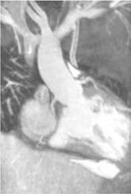

# Chapter 480: Cyanotic Congenital Heart Disease: Lesions Associated with Increased Pulmonary Blood Flow

<!-- p.3571 -->

## 480.1  d-Transposition of the Great Arteries Daniel Bernstein

d-Transposition of the great arteries or vessels (d-TGA or d-TGV) accounts for approximately 5% of all congenital heart disease. In this anomaly, the systemic veins return, as normal, to the right atrium and the pulmonary veins return to the left atrium. The connections between the atria and ventricles are also normal (i.e., **atrioventricu lar concordance**). The aorta arises from the right ventricle and the pulmonary artery from the left ventricle (Fig. 480.1). In normally related great vessels (i.e., in the normal heart) the aorta is poste rior and to the right of the pulmonary artery. Whereas in d-TGA the aorta is anterior and to the right of the pulmonary artery (the *d* indicates a dextropositioned aorta, *transposition* indicates that the aorta arises from the right ventricle and the pulmonary artery from the left ventricle). Desaturated blood returning from the body to the right side of the heart goes inappropriately out via the aorta and back to the body again, whereas oxygenated pulmonary venous blood returning to the left side of the heart is returned directly to the lungs. Thus the systemic and pulmonary circulations exist as two parallel circuits. Survival in the immediate newborn period is provided by the foramen ovale and the ductus arteriosus, which per mit some mixture of oxygenated and deoxygenated blood. Approxi mately 50% of patients with d-TGA also have a ventricular septal defect (VSD), which usually provides for better mixing. The clini cal findings and hemodynamics vary in relation to the presence or absence of associated defects (e.g., VSD or pulmonary stenosis). d-TGA is more common in infants of diabetic mothers and in males (a ratio of 3:1). When accompanied by other cardiac defects such as pulmonic stenosis or right aortic arch, d-TGA can be associated with deletion of chromosome 22q11.2 (**DiGeorge syndrome**; see Chapter 473).

## 480.2  d-Transposition of the Great Arteries with Intact Ventricular Septum Daniel Bernstein

d-TGA with an intact ventricular septum is also referred to as **simple TGA** or **isolated TGA**. Before birth, oxygenation in the upper and lower body fetal circulation is only slightly abnormal, given that oxy genated blood enters the heart from the placenta, umbilical vein, and inferior vena cava. After birth, once the ductus arteriosus begins to close, the minimal mixing of systemic and pulmonary blood by the patent foramen ovale is usually insufficient and severe hypoxemia ensues, generally within the first few days of life.

**CLINICAL MANIFESTATIONS** Cyanosis and tachypnea are most often recognized within the first hours or days of postnatal life. Untreated, most of these infants would not survive the neonatal period. Hypoxemia is usually moderate to severe, depending on the degree of atrial-level shunting and whether the ductus is partially open or totally closed. This condition is a medi cal emergency, and only early diagnosis and appropriate intervention can avert the development of prolonged severe hypoxemia and acido sis, which lead to death. Physical findings, other than cyanosis, may be remarkably nonspecific. The precordial impulse may be normal, or a parasternal heave may be present. The second heart sound (S2) is usu ally single and loud, although it may be split. Murmurs may be absent, or a soft systolic ejection murmur may be noted at the mid-left sternal border.

**DIAGNOSIS** The electrocardiogram (ECG) is usually normal, showing the expected neonatal right-sided dominant pattern. Chest radiographs may show mild cardiomegaly and a narrow mediastinum (the clas sic “egg-shaped heart”). In the early newborn period, the pulmonary blood flow is generally normal. As pulmonary vascular resistance (PVR) drops during the first several weeks of postnatal life, evidence of increased pulmonary blood flow becomes apparent. Arterial blood partial pressure of oxygen (Pao2) is low and does not rise appreciably after the patient breathes 100% oxygen (hyperoxia test), although this test may not be totally reliable. Echocardiography is diagnostic and confirms the transposed ventricular-arterial connections (Fig. 480.2). The size of the interatrial communication and the ductus arteriosus can be visualized and the degree of mixing assessed by pulsed and color Doppler examination. The presence of any associated lesion, such as left ventricular outflow tract obstruction or a VSD, can also be assessed. The origins of the coronary arteries can be imaged, although echocardiography is not as accurate as catheterization for

E C D A B

MPA Ao

MPA

Ao

Ao

PA

LA

RV

RV

**Fig. 480.1** d-Looped transposition of the great arteries (TGA). A, Diagram of d-TGA, with the main pulmonary artery (MPA) arising from the left ventricle (LV) and the aorta (Ao) arising from the right ventricle (RV). The degree of cyanosis is variable and depends on the presence of intracardiac shunts such as an atrial septal defect or a ventricular septal defect (VSD) to get oxygenated blood into the systemic circulation. LA, Left atrium; PA, pulmonary artery; RA, right atrium. B and C, Oblique reformatted images from a 3D steady-state free-precession sequence show (B) the Ao arising from the anterior RV with a subaortic conus (arrow), and (C) the MPA arising from the posterior LV. D, The Ao and MPA have a parallel “back-to-front” arrangement. E, This parallel back-to-front arrangement contributes to the narrow mediastinum and “egg on a string” appearance seen on chest radiography. This patient has a large VSD with increased pulmonary blood flow. (From Frost JL, Krishnamurthy R, Sena L. Cardiac imaging. In: Walters MM, Robertson RL, eds. Pediatric Radiology: The Requisites, 4th ed. Philadelphia: Elsevier; 2017, Fig 3-20, p. 75.)

<!-- p.3572 -->
this purpose. Cardiac catheterization may be performed in patients for whom noninvasive imaging is diagnostically inconclusive, where an unusual coronary artery anomaly is suspected, or in patients who require emergency **balloon atrial septostomy (i.e., the Rashkind procedure)**. Catheterization will show right ventricular pressure to be at a systemic level because this ventricle is supporting the systemic circulation. The blood in the left ventricle (LV) and pulmonary artery has a higher oxygen saturation than that in the aorta. Depending on the age at catheterization, LV and pulmonary artery pressure can vary from a systemic level to <50% of systemic-level pressure. Right ven triculography demonstrates the anterior and rightward aorta origi nating from the right ventricle (RV), as well as the intact ventricular septum. Left ventriculography shows that the pulmonary artery arises exclusively from the LV.

**Anomalous coronary arteries** are noted in 10–15% of patients and can be defined by an aortic root injection or by selective coronary arteriography.

**TREATMENT** When transposition is suspected, an infusion of prostaglandin E1 (PGE1, 0.05-0.1 μg/kg/min) should be initiated immediately to maintain patency of the ductus arteriosus and improve oxygenation. Because of the risk of apnea associated with prostaglandin infusion, an individual skilled in neonatal endotracheal intubation should be avail able. Hypothermia intensifies the metabolic acidosis resulting from hypoxemia, and thus the patient should be kept warm. Prompt correc tion of acidosis and hypoglycemia is essential.

Infants who remain severely hypoxic or acidotic despite prostaglan din infusion should undergo **Rashkind balloon atrial septostomy** (Fig. 480.3). A Rashkind atrial septostomy is also usually performed in patients in whom any significant delay in surgery is expected. If surgery is planned during the first 2 weeks of life and the patient is stable, cath eterization and atrial septostomy may often be avoided.

A successful Rashkind atrial septostomy should result in a rise in Pao2 to 35-50 mm Hg and elimination of any pressure gradient across the atrial septum. Some patients with TGA and VSD (see Chapter 480.3) may require balloon atrial septostomy because of poor mixing, even though the VSD is large. Others may benefit from decompression of the left atrium to alleviate the symptoms of increased pulmonary blood flow and left-sided heart failure.

The **arterial switch (Jatene) procedure** is the surgical treatment of choice for neonates with d-TGA and an intact ventricular septum and is usually performed within the first 2 weeks of life. The reason for this time frame is that as PVR declines after birth, pressure in the LV (con nected to the pulmonary vascular bed) also declines. This pressure

drop results in a decrease in LV mass over the first few weeks of life. If the arterial switch operation is attempted after LV pressure (and mass) has declined too far, the LV will be unable to generate adequate pressure to pump blood to the high-pressure systemic circulation. The arterial switch operation involves dividing the aorta and pulmonary artery just above the sinuses and reanastomosing them in their correct anatomic positions. The coronary arteries are removed from the old aortic root along with a button of aortic wall and reimplanted in the old pulmonary root (now called the **neoaorta**). By using a button of great vessel tissue, the surgeon avoids having to suture directly onto the coronary artery (Fig. 480.4); this is the major innovation that has allowed the arterial switch to replace previous atrial switch operations for d-TGA. Rarely, a two-stage arterial switch procedure, with initial placement of a pulmonary artery band, may be used in patients pre senting late who already have had a reduction in LV muscle mass and pressure. The arterial switch procedure has a survival rate of >95% for uncomplicated d-TGA. It restores the normal physiologic rela tionships of systemic and pulmonary arterial blood flow and elimi nates the long-term complications of the previously used atrial switch procedure.

Previous operations for d-TGA consisted of some form of **atrial switch procedure** (**Mustard** or **Senning** operation). These procedures produced excellent early survival (85–90%) but had significant longterm morbidities. Atrial switch procedures reverse blood flow at the atrial level by creating an interatrial baffle that directs systemic venous blood returning from the venae cavae to the left atrium, where it will enter the LV, the pulmonary artery, and the lungs. The same baffle also permits oxygenated pulmonary venous blood to cross over to the right atrium, RV, and aorta. Atrial switch procedures involve significant atrial surgery and have been associated with the late development of atrial conduction disturbances, sick sinus syndrome with bradyarrhythmia and tachyarrhythmia, atrial flutter, sudden death, superior or inferior vena cava syndrome, edema, ascites, and protein-losing enteropathy. The atrial switch procedure also leaves the RV as the systemic pumping chamber, and this “systemic” RV often begins to fail in young adult hood. Atrial switch operations are currently reserved for patients whose anatomy is such that they are not candidates for the arterial switch procedure.

RA

RPA

PA

LPA

RV

**Fig. 480.2** Subcostal four-chamber 2D echocardiographic demon stration of d-transposition of the great arteries. The pulmonary artery (PA) can be seen arising directly from the left ventricle (LV). The immedi ate bifurcation of this great vessel into the branch pulmonary arteries differentiates it from the aorta, which branches more distally from the heart. LPA, Left pulmonary artery; RA, right atrium; RPA, right pulmo nary artery; RV, right ventricle.

A B

C D **Fig. 480.3**  Rashkind balloon atrial septostomy. Four frames from a continuous cineangiogram show the creation of an atrial septal defect in a hypoxemic newborn infant with transposition of the great arteries and an intact ventricular septum. A, Balloon inflated in the left atrium. B, The catheter is jerked suddenly so that the balloon ruptures the fora men ovale. C, Balloon in the inferior vena cava. D, Catheter advanced to the right atrium to deflate the balloon. The time from A to C is <1 sec.

<!-- p.3573 -->

## 480.3  Transposition of the Great Arteries with Ventricular Septal Defect Daniel Bernstein

If the VSD associated with d-TGA is small, the clinical manifestations, laboratory findings, and treatment are similar to those described previ ously for transposition with an intact ventricular septum. A harsh sys tolic murmur is audible at the lower left sternal border, resulting from flow through the defect. Many of these small defects eventually close spontaneously and may not need to be addressed at the time of surgery.

When the VSD is large and not restrictive to ventricular ejection, sig nificant mixing of oxygenated and deoxygenated blood usually occurs and clinical manifestations of cardiac failure are seen. The degree of cyanosis may be subtle and sometimes may not be recognized until an oxygen saturation measurement is performed. The murmur is holo systolic and generally indistinguishable from that produced by a large VSD in patients with normally related great arteries. The heart is usu ally significantly enlarged.

Cardiomegaly, a narrow mediastinal waist, and increased pulmonary vascularity are demonstrated on the chest radiograph. The ECG find ings can be variable. It can show prominent P waves and isolated RV hypertrophy or biventricular hypertrophy. Occasionally, dominance of the LV is present. Usually, the QRS axis is to the right, but it can be normal or even to the left. The diagnosis is confirmed by echocardiog raphy, and the extent of pulmonary blood flow can also be estimated by the degree of enlargement of the left atrium and ventricle. In equivocal cases, the diagnosis can be confirmed by cardiac catheterization. Right and left ventriculography indicate the presence of arterial transposi tion and demonstrate the site and size of the VSD. Systolic pressure is equal in the two ventricles, the aorta, and the pulmonary artery. Left atrial pressure may be much higher than right atrial pressure, a finding indicative of a restrictive communication at the atrial level. At the time of cardiac catheterization, Rashkind balloon atrial septostomy may be performed to decompress the left atrium, even when adequate mixing is occurring at the ventricular level.

Surgical treatment is advised soon after diagnosis because heart fail ure and failure to thrive are difficult to manage and pulmonary vascular

disease can develop unusually rapidly in these patients. Preoperative management with diuretics and other anticongestive therapies (includ ing elective intubation and positive pressure ventilation) stabilize the patient before surgery.

Patients with d-TGA and a VSD without pulmonic stenosis can be treated with an arterial switch procedure combined with VSD closure. In these patients, the arterial switch operation can be safely performed after the first 2 weeks of life because the VSD results in equal pressure in both ventricles and prevents regression of LV muscle mass. At major centers, however, there is no reason to delay repair, as results are excel lent when the surgery is performed in the neonatal period.

## 480.4  l-Transposition of the Great Arteries (Corrected Transposition) Daniel Bernstein

In l-transposition of the great arteries (l-TGA), both the atrioventric ular and the ventriculoarterial relationships are discordant: the right atrium is connected to an LV and the left atrium to an RV, which is also known as **ventricular inversion**. The great arteries are also transposed, with the aorta arising from the RV and the pulmonary artery from the LV. In contrast to d-TGA, the aorta arises to the left of the pulmonary artery (thus the designation *l* for levo-transposition). The aorta may be anterior to the pulmonary artery, although often they are nearly side by side.

The physiology of l-TGA is quite different from that of d-TGA. Desaturated systemic venous blood returns via the vena cavae to a nor mal right atrium, from which it passes through a bicuspid atrioventric ular (mitral) valve into a right-sided ventricle that has the architecture and smooth wall morphologic features of the normal LV (Fig. 480.5). Because transposition is also present, however, the desaturated blood ejected from this LV enters the transposed pulmonary artery and flows into the lungs, as it would in the normal circulation. Oxygenated pul monary venous blood returns to a normal left atrium, passes through a tricuspid atrioventricular valve into a left-sided ventricle, which has the trabeculated morphologic features of a normal RV, and is then ejected into the transposed aorta. The double inversion of the atrioven tricular and ventriculoarterial relationships result in desaturated right atrial blood appropriately flowing to the lungs and oxygenated pulmo nary venous blood appropriately flowing to the aorta. The circulation is thus physiologically “corrected.” Without other defects, the hemody namics would be almost normal. In most patients, however, associated anomalies coexist: VSD, Ebstein-like abnormalities of the left-sided atrioventricular (tricuspid) valve, pulmonary valvular or subvalvular stenosis (or both), and atrioventricular conduction disturbances (com plete heart block, accessory pathways such as Wolff-Parkinson-White syndrome).

**CLINICAL MANIFESTATIONS** Symptoms and signs are widely variable and are usually determined by the associated lesions. If there is a VSD and pulmonary outflow is unobstructed, the clinical signs are similar to those of an isolated VSD. If l-TGA is associated with pulmonary stenosis and a VSD, the clinical signs are more similar to those of tetralogy of Fallot.

**DIAGNOSIS** The chest radiograph may suggest the abnormal position of the great arteries; the ascending aorta occupies the upper left border of the cardiac silhouette and has a straight profile. The ECG, in addition to any atrioventricular conduction disturbances, may show abnormal P waves; absent Q waves in V6; abnormal Q waves in leads III, aVR, aVF, and V1; and upright T waves across the precordium. The echocardio gram is diagnostic. The characteristic echocardiographic features of the RV (moderator band, coarser trabeculations, tricuspid valve that sits more inferiorly compared with the bicuspid mitral valve, and a smooth muscular conus or infundibulum separating the atrioventricular valve

A

Aorta

Pulmonary a.

R. coronary a.

Aorta

L. coronary a.

B

Pulmonary a. L. coronary a.

R. coronary a.

C

Pulmonary a.

R. coronary a. L. coronary a.

**Fig. 480.4** Method for translocating the coronary arteries in the arte rial switch (Jatene) procedure. A, The aorta (anterior) and the pulmo nary artery (posterior) have been transected to allow visualization of the left and right coronary arteries. The coronaries have been excised from their respective sinuses, including a large flap (button) of arterial wall. Equivalent segments of the wall of the pulmonary artery (which will be come the neoaorta) are also removed. B, The aortocoronary buttons are sutured into the proximal portion of the neoaorta. With this technique all sutures are placed in the button of aortic wall rather than directly on the coronary arteries. C, Completed anastomosis of the left and right coronary arteries to the neoaorta. (Adapted from Castañeda AR, Jonas RA, Mayer JE Jr, et al. Cardiac Surgery of the Neonate and Infant. Phila delphia: Saunders; 1994.)

<!-- p.3574 -->
from the semilunar valve) allow the echocardiographer to determine the presence of **atrioventricular discordance** (right atrium connected to LV; left atrium to RV) and ventriculoarterial discordance (RV con nected to aorta; LV to pulmonary artery).

Surgical treatment of the associated anomalies, most often the VSD, is complicated by the position of the bundle of His, which can be injured at surgery and result in heart block. Identification of the usual course of the bundle in corrected transposition (running superior to the defect) has been accomplished by mapping the conduction system so that the surgeon can avoid the bundle of His during repair. Even without surgical injury, patients with l-TGA are at risk for developing heart block as they grow older.

Because simple surgical correction leaves the RV as the systemic pumping chamber, and thus vulnerable to late ventricular failure, surgeons have become more aggressive about trying operations that use the LV as the systemic pumping chamber. This is accomplished by performing an atrial switch operation (see Chapter 480.3) to reroute the systemic and pulmonary venous returns in combination with an arterial switch operation to reroute the ventricular outflows **(double switch procedure)**. The long-term benefit of this approach in preserv ing systemic ventricular function is still under investigation.

*Visit Elsevier eBooks+ at eBooks.Health.Elsevier.com** for Bibliography.*

## 480.5  Double-Outlet Right Ventricle Without Pulmonary Stenosis Daniel Bernstein

In double-outlet RV without pulmonary stenosis, both the aorta and the pulmonary artery arise from the RV (see Chapter 479.5). The only outlet from the LV is through a VSD. In the absence of obstruction

to pulmonary blood flow, clinical manifestations are similar to those of an uncomplicated VSD with a large left-to-right shunt, although mild systemic desaturation may result from mixing of oxygenated and deoxygenated blood in the RV. The ECG usually shows biventricular hypertrophy. Echocardiography is diagnostic and shows the right ven tricular origin of both great arteries, their anteroposterior relationship, and the relationship of the VSD to each of the great arteries. Surgical correction is dependent on these relationships. If the VSD is subaor tic, it is accomplished by creation of an intracardiac tunnel. Blood is then ejected from the LV via the VSD into the aorta. If the VSD is sub pulmonic, an arterial switch may be performed in combination with an intracardiac tunnel. If pulmonary blood flow is excessive enough to cause congestive heart failure, pulmonary arterial banding may be required in infancy, followed by surgical correction when the child is bigger. When associated pulmonary stenosis is present, cyanosis is more marked, pulmonary blood flow is decreased, and clinical presen tation may be similar to that of tetralogy of Fallot.

## 480.6  Double-Outlet Right Ventricle with Malposition of the Great Arteries (Taussig-Bing Anomaly) Daniel Bernstein

In double-outlet RV with malposed great arteries, the VSD is usually directly subpulmonic and the aorta distant from the LV. Sometimes both the pulmonary and the aortic valve may be located close to the VSD (**doubly committed** VSD) and sometimes neither is (**doubly uncommitted** VSD). The term *malposition* is used instead of *transpo sition* because both great arteries arise from the RV. Aortic obstruc tive lesions are common, including valvular and subvalvular aortic stenosis, coarctation of the aorta, and interruption of the aortic arch. Because pulmonary blood flow is unobstructed, patients experience cardiac failure early in infancy and are at risk for the development of pulmonary vascular disease and cyanosis. If aortic obstructive lesions are a component, patients can present with poor systemic output and cardiovascular collapse, particularly after the ductus arteriosus begins to close. Cardiomegaly is usual, and a parasternal systolic ejection mur mur is audible, sometimes preceded by an ejection click and loud clo sure of the pulmonary valve. The ECG shows right axis deviation and right, left, or biventricular hypertrophy. The chest radiograph shows cardiomegaly and prominence of the pulmonary vasculature. The ana tomic features of the anomaly and associated abnormalities are usu ally demonstrated by echocardiography, augmented if necessary by either cardiac catheterization, MRI, or CT. Palliation may be achieved by corrective surgery or pulmonary arterial banding in early infancy and surgical correction at a later age, which may be accomplished by an arterial switch procedure (see Chapter 480.2) combined with an intracardiac baffle or some modification of the Rastelli procedure (see Chapter 479.5).

## 480.7  Total Anomalous Pulmonary Venous Return Daniel Bernstein

Abnormal development of the pulmonary veins may result in either partial or complete anomalous drainage into the systemic venous cir culation. Partial anomalous pulmonary venous return (PAPVR) is usually an acyanotic lesion (see Chapter 475.4). Total anomalous pul monary venous return (TAPVR) is associated with total mixing of sys temic venous and pulmonary venous blood flow within the heart and thus produces cyanosis.

In TAPVR, there is no direct pulmonary venous connection into the left atrium (Fig. 480.6). The pulmonary veins may drain **above** the dia phragm: into the right atrium directly, into the coronary sinus, or into the superior vena cava by a “vertical vein”; or they may drain **below** the

60

85

100

60

60

85

RV

**Fig. 480.5** Physiology of l-transposition or corrected transposition of the great arteries (l-TGA) with a ventricular septal defect and pulmonic stenosis (VSD + PS). Circled numbers represent oxygen saturation val ues. Right atrial (mixed venous) oxygen saturation is decreased second ary to systemic hypoxemia. Blood from the right atrium flows through the mitral valve into the “inverted” left ventricle (LV). The left ventricle is, however, attached to the transposed pulmonary artery. Therefore despite the anomalies, desaturated blood still winds up in the pulmo nary circulation. Saturated blood returns to the left atrium, traverses the tricuspid valve into the “inverted” right ventricle (RV), and is pumped into the transposed aorta. This circulation would be totally “corrected” were it not for the frequent association of other congenital anomalies, in this case, VSD + PS. Because of the stenotic pulmonary valve, some left ventricular blood flow crosses the VSD and into the right ventricle and the ascending aorta, and systemic desaturation results.

<!-- p.3575 -->

<!-- p.3576 -->
diaphragm and join into a “descending vein” that enters the inferior vena cava or one of its major tributaries, often through the ductus veno sus. This latter form of anomalous venous drainage is most often asso ciated with *obstruction* to venous flow, usually as the ductus venosus

closes soon after birth, although **supracardiac** anomalous veins may also become obstructed. Occasionally, the drainage may be **mixed**, with some veins draining above and others below the diaphragm.

All forms of TAPVR involve mixing of oxygenated and deoxygen ated blood before or at the level of the right atrium **(total mixing lesion)**. This mixed right atrial blood either passes into the RV and pulmonary artery or passes through an atrial septal defect (ASD) or patent foramen ovale into the left atrium, which will be the only source of oxygenated systemic blood flow. The right atrium and ventricle and the pulmonary artery are generally enlarged, whereas the left atrium and ventricle may be normal or small. The clinical manifestations of TAPVR depend on the presence or absence of *obstruction* of the venous channels (Table 480.1). If pulmonary venous return is obstructed, severe pulmonary congestion and pulmonary hypertension develop; rapid deterioration occurs without surgical intervention. *Obstructed TAPVR is a pediatric cardiac surgical emergency because prostaglandin therapy is usually not effective.*

**CLINICAL MANIFESTATIONS** Two major clinical patterns of TAPVR are seen, depending on the pres ence or absence of obstruction. Those neonates with severe obstruction to pulmonary venous return, most prevalent in the **infracardiac** group (see Table 480.1), present with severe cyanosis and respiratory distress. Murmurs may not be present. These infants are severely ill and fail to respond to mechanical ventilation. Rapid diagnosis and surgical cor rection are necessary for survival. In contrast, those with mild or no obstruction to pulmonary venous return are usually characterized by the development of heart failure as the PVR falls, with mild to moder ate degrees of desaturation. Systolic murmurs may be audible along the left sternal border, and a gallop rhythm may be present. Some infants may have mild obstruction in the neonatal period and develop worsen ing obstruction as time passes.

**DIAGNOSIS** The ECG demonstrates RV hypertrophy (usually a qR pattern in V3R and V1, and P waves are frequently tall and spiked). In neonates with marked pulmonary venous obstruction, the chest radiograph dem onstrates a very dramatic perihilar pattern of pulmonary edema and a small heart (Fig. 480.7A). This appearance can sometimes be con fused with primary pulmonary disease, and the differential diagnosis includes persistent pulmonary hypertension of the newborn, respira tory distress syndrome, pneumonia, pulmonary lymphangiectasia, and other heart defects (hypoplastic left heart syndrome). In older children, if the anomalous pulmonary veins enter the innominate vein and per sistent left superior vena cava (see Fig. 480.7B), a large supracardiac shadow can be seen, which together with the normal cardiac shadow forms a *snowman* appearance. In most cases without obstruction, the heart is enlarged, the pulmonary artery and RV are prominent, and pulmonary vascularity is increased.

The echocardiogram demonstrates a large RV and usually iden tifies the pattern of abnormal pulmonary venous connections

A

B

C

**Fig. 480.6** A, Subcostal view demonstrating total anomalous pulmo nary drainage to the coronary sinus. Note the dilated coronary sinus in both images. The echocardiogram also demonstrates an associated confluence that connects to the coronary sinus. B, Suprasternal view demonstrating total anomalous pulmonary venous drainage to a left vertical vein. Note the direction of flow in the vertical vein that differen tiates it from a left superior vena cava. C, Total anomalous pulmonary venous drainage below the diaphragm. The specimen shows the pul monary veins as they enter the confluence, whereas the echocardio gram demonstrates the descending veins as they enter the liver. Note that the direction of flow is away from the heart. AO, Aorta; CS, coro nary sinus; DA, descending aorta; DV, descending vein; LVV, left vertical vein; PA, pulmonary artery; PV, pulmonary vein; PVC, pulmonary venous confluence; RA, right atrium. (From Webb GD, Smallhorn, JF, Therrien J, et al. Congenital heart disease in the adult and pediatric patient. In: Zipes DP, Libby P, Bonow RO, et al., eds. Braunwald’s Heart Disease, 11th ed. Philadelphia: Elsevier; 2019: Fig. 75-32, p. 1553.)

#### **Table 480.1** Total Anomalous Pulmonary Venous Return

| Category / Parameter | Clinical Details & Findings |
| --- | --- |
| **Supracardiac (50)** | Left superior vena cava (40); 40; Right superior vena cava (10); 75 |
| **Cardiac (25)** | Coronary sinus (20); 10; Right atrium (5); 5 |
| **Infracardiac (20)** | 95–100 |

<!-- p.3577 -->
(see Fig. 480.6). The demonstration of any vein with Doppler flow away from the heart is pathognomonic of TAPVR because nor mal venous flow is usually toward the heart. Shunting occurs from right to left at the atrial level. The size of the left atrium and LV can be measured and the presence of any associated cardiac defects determined.

Echocardiography should be adequate to demonstrate TAPVR in most cases; however, if there is question about the drainage of one or more pulmonary veins, cardiac catheterization, MRI, or CTA is per formed. Catheterization shows that the oxygen saturation of blood in both atria, both ventricles, and the aorta is similar, indicative of a **total mixing lesion**. An increase in systemic venous saturation occurs at the site of entry of the abnormal pulmonary venous channel, either above or below the diaphragm. In older patients without pulmonary venous obstruction, pulmonary arterial and RV pressure may be only

moderately elevated, but in infants with pulmonary venous obstruc tion, pulmonary hypertension is usual. Selective pulmonary arteriog raphy shows the anatomy of the pulmonary veins and their point of entry into the systemic venous circulation.

Fetal diagnosis of TAPVR is feasible in many, but not all, cases, with the main ultrasonographic signs being ventricular disproportion, increased area behind the left atrium, and the finding of a vertical vein. Color Doppler is key to making this diagnosis. Prenatal diagnosis can be helpful in planning for urgent surgical treatment after birth.

**TREATMENT** Surgical correction of TAPVR is performed during early infancy, with emergent repair performed for those patients with venous obstruction. If surgery cannot be performed urgently, extracorpo real membrane oxygenation (ECMO) may be required to maintain oxygenation. Surgically, the pulmonary venous confluence is anas tomosed directly to the left atrium, the ASD is closed, and any con nection to the systemic venous circuit is interrupted. Early results are generally good, even for critically ill neonates. The postoperative period may be complicated by pulmonary artery hypertensive crises. In some patients, especially those in whom the diagnosis is delayed or the obstruction is severe, recurrent stenosis and development of pulmonary venoocclusive disease may occur. Attempts have been made to treat recurrent stenosis with surgery, balloon angioplasty, stents, and antiproliferative chemotherapy. The long-term prognosis in patients with recurrent obstruction is poor. In those with aggres sive venoocclusive disease, **heart-lung transplantation** may be the only option (see Chapter 492.2).

*Visit Elsevier eBooks+ at eBooks.Health.Elsevier.com** for Bibliography.*

## 480.8  Truncus Arteriosus Daniel Bernstein

In truncus arteriosus, a single arterial trunk (truncus arteriosus) arises from the heart and supplies the systemic, pulmonary, and coronary circulations. A VSD is always present, with the truncus overriding the defect and receiving blood from both the RV and the LV (Fig. 480.8). The number of truncal valve cusps varies from two to as many as six, and the valve may be stenotic, regurgitant, or both. The pulmonary arteries can arise together from the posterior left side of the persistent truncus arteriosus and then divide into left and right pulmonary arter ies **(type I)**. In types II and III truncus arteriosus, no main pulmonary artery is present, and the right and left pulmonary arteries arise from separate orifices on the posterior **(type II)** or lateral **(type III)** aspects of the truncus arteriosus. *Type IV truncus* is a term no longer used because, in this case, there is no identifiable connection between the heart and pulmonary arteries, and pulmonary blood flow is derived from **major aortopulmonary collateral arteries (MAPCAs)** arising from the transverse or descending aorta; this is essentially a form of pulmonary atresia (see Chapter 479.2).

Both ventricles are at systemic pressure, and both eject blood into the truncus. When PVR is relatively high immediately after birth, pulmonary blood flow may be normal; as PVR drops in the first few weeks of life, blood flow to the lungs is greatly increased and heart fail ure ensues. Truncus arteriosus is a **total mixing lesion** with complete admixture of pulmonary and systemic venous return. Because of the large volume of pulmonary blood flow, clinical cyanosis is usually mild. If the lesion is left untreated, PVR eventually increases, pulmonary blood flow decreases, and cyanosis becomes more prominent (**Eisen menger physiology**; see Chapter 482.2).

**CLINICAL MANIFESTATIONS** The clinical signs of truncus arteriosus vary with age and depend on the level of PVR. In the immediate newborn period, signs of heart fail ure are usually absent; a murmur and minimal cyanosis may be the only initial findings. If unrepaired, during the next 1-2 months of life,

B

A

**Fig. 480.7** Chest radiographs of total anomalous pulmonary venous return (TAPVR). A, A newborn with TAPVR to a descending vein (below the diaphragm) with obstruction, showing marked pulmonary venous congestion and normal heart size. B, TAPVR to the left superior vena cava (preoperative image). Arrows point to the supracardiac shadow, which produces the “snowman” or figure 8 configuration. Cardiomega ly and increased pulmonary vascularity are evident.

60

85

95

85

70

100

**Fig. 480.8** Physiology of truncus arteriosus. Circled numbers rep resent oxygen saturation values. Right atrial (mixed venous) oxygen saturation is decreased secondary to systemic hypoxemia. Desaturated blood enters the right atrium, flows through the tricuspid valve into the right ventricle, and is ejected into the truncus. Saturated blood re turning from the left atrium enters the left ventricle and is also ejected into the truncus. The common aortopulmonary trunk gives rise to the ascending aorta and to the main or branch pulmonary arteries. Oxy gen saturation in the aorta and pulmonary arteries is usually the same (definition of a total mixing lesion). As pulmonary vascular resistance decreases in the first few weeks of life, pulmonary blood flow increases dramatically, and mild cyanosis and congestive heart failure result.

<!-- p.3578 -->

<!-- p.3579 -->
pulmonary blood flow begins to become torrential and the clinical picture is dominated by heart failure, with still mild cyanosis. Runoff of blood from the truncus to the pulmonary circulation may result in a wide pulse pressure and bounding pulses. These findings will be further exaggerated if truncal valve insufficiency is present. The heart is usually enlarged, and the precordium is hyperdynamic. S2 is loud and single. A systolic ejection murmur, sometimes accompanied by a thrill, is generally audible along the left sternal border. The murmur is frequently preceded by an early systolic ejection click caused by the abnormal truncal valve. In the presence of truncal valve insufficiency, a medium- to high-pitched early diastolic decrescendo murmur is heard at the mid-left sternal border. An apical mid-diastolic rumbling mur mur caused by increased flow through the mitral valve is often audible with the bell of the stethoscope, especially as heart failure develops. Truncus arteriosus is a conotruncal malformation and may be associ ated with **DiGeorge syndrome**, linked to a deletion of a large region of **chromosome 22q11** (see Chapter 473).

**DIAGNOSIS** The ECG shows right, left, or combined ventricular hypertrophy. The chest radiograph also shows considerable variation. Cardiac enlarge ment will develop over the first several weeks of life and is a result of the prominence of both ventricles. The truncus may produce a prominent shadow that follows the normal course of the ascending aorta and aor tic knob; the aortic arch is right sided in 50% of patients. Sometimes a high bulge left of the aortic knob is produced by the main or left pulmo nary artery. Pulmonary vascularity is increased after the first few weeks of life. Echocardiography is diagnostic and demonstrates the large trun cal artery overriding the VSD and the pattern of origin of the branch pulmonary arteries (Fig. 480.9). Associated anomalies such as an inter rupted aortic arch may be noted. Pulsed and color Doppler studies are used to evaluate truncal valve regurgitation. If required, cardiac catheterization shows a left-to-right shunt at the ventricular level, with right-to-left shunting into the truncus. Systolic pressure in both ven tricles and the truncus is similar. Angiography reveals the large truncus arteriosus and better defines the origin of the pulmonary arteries.

**TREATMENT** Most centers perform routine neonatal repair shortly after diagnosis. If surgery is delayed and PVR falls over the first several weeks of life, heart failure symptoms will worsen. Anticongestive medications can be used to better prepare these patients for surgery; however, delay of surgery much beyond this time period may increase the likelihood of developing pulmonary vascular disease. At surgery, the VSD is closed, the pulmonary arteries are separated from the truncus, and continu ity is established between the RV and the pulmonary arteries with a

homograft conduit. Immediate surgical results are excellent, but these conduits will develop either regurgitation or stenosis over time and must be replaced, often several times, as the child grows. If regurgita tion is the primary problem, patients can now be treated with a trans catheter stent-valve (see Chapter 479.1)

**PROGNOSIS AND COMPLICATIONS** Surgical results have been excellent, and many patients with repaired truncus are now entering mid-adulthood, with several centers report ing 30- and 40-year-old survivors. The need to replace the RV-topulmonary artery conduit as the child grows means that these patients will need to undergo multiple operations by the time they reach adult hood. The development of transcatheter stent-valves may reduce this in the future (see Chapter 472). When truncus arteriosus is associated with DiGeorge syndrome, the associated endocrine, immunologic, cra niofacial, and airway abnormalities may complicate recovery.

*Visit Elsevier eBooks+ at eBooks.Health.Elsevier.com** for Bibliography.*

## 480.9  Single Ventricle (Double-Inlet Ventricle, Univentricular Heart) Daniel Bernstein

With a single ventricle, both atria empty through a common atrioven tricular valve or through two separate valves into a single ventricular chamber, with total mixing of systemic and pulmonary venous return. This chamber may have left, right, or indeterminate (both right and left) ventricular morphologic characteristics. The aorta and pulmonary artery both arise from this single chamber, although one of the great vessels may originate from a rudimentary outflow chamber. The aorta may be posterior, anterior (malposition), or side-by-side with the pul monary artery and either to the right or to the left. Pulmonary stenosis or atresia is common.

**CLINICAL MANIFESTATIONS** The clinical picture is variable and depends on the associated intracar diac anomalies. If pulmonary outflow is obstructed, the findings are usually similar to those of tetralogy of Fallot: marked cyanosis with out heart failure. If pulmonary outflow is unobstructed, the findings are similar to those of transposition with VSD: minimal cyanosis with increasing heart failure.

In patients with **pulmonary stenosis**, cyanosis is present in early infancy. Cardiomegaly is mild or moderate, a left parasternal lift is pal pable, and a systolic thrill is common. The systolic ejection murmur is usually loud; an ejection click may be audible, and S2 is single and loud. In patients with **unobstructed pulmonary flow**, as PVR drops, torrential pulmonary blood flow develops, and these patients present with tachypnea, dyspnea, failure to thrive, and recurrent pulmonary infections. Cyanosis is only mild or moderate. Cardiomegaly is gener ally marked, and a left parasternal lift is palpable. A systolic ejection murmur is present but is not usually loud or harsh, and S2 is loud and closely split. A third heart sound (S3) is common and may be fol lowed by a short mid-diastolic rumbling murmur caused by increased flow through the atrioventricular valves. The eventual development of pulmonary vascular disease reduces pulmonary blood flow so that the cyanosis increases and signs of cardiac failure appear to improve (**Eisenmenger physiology**; see Chapter 482.2).

**DIAGNOSIS** ECG findings are nonspecific. P waves are normal, spiked, or bifid. The precordial lead pattern suggests right ventricular hypertrophy, combined ventricular hypertrophy, or sometimes left ventricular dominance. The initial QRS forces are usually to the left and anterior. Radiographic examination confirms the degree of cardiomegaly. If present, a rudimentary outflow chamber may produce a bulge on the upper left border of the cardiac silhouette in the posteroanterior projec tion. In the absence of pulmonary stenosis, pulmonary vasculature is

TR

Ao LPA

**Fig. 480.9** Subcostal 2D echocardiographic demonstration of trun cus arteriosus. The large truncal valve can be seen overriding the ven tricular septal defect. In this case, only the left pulmonary artery (LPA) arises from the truncus (TR). The pulmonary arteries are discontinuous, and the right pulmonary artery arises from the descending aorta via the ductus arteriosus (not shown). Ao, Aorta; LV, left ventricle; RV, right ventricle.

<!-- p.3580 -->

<!-- p.3581 -->
increased, whereas in the presence of pulmonary stenosis, pulmonary vasculature is diminished. Echocardiography will confirm the absence or near-absence of the ventricular septum and can usually determine whether the single ventricle has right, left, or mixed morphologic fea tures. The presence of a rudimentary outflow chamber under one of the great vessels can be identified, and pulsed Doppler can be used to determine whether flow through this communication (known as a **bul boventricular foramen**) is obstructed.

If cardiac catheterization is performed, the pressure in the single ventricular chamber is at systemic level; however, a gradient may be demonstrated across the entrance to the rudimentary outflow cham ber. Pressure measurements and angiography demonstrate whether pulmonary stenosis is present.

**TREATMENT** If pulmonary stenosis is severe, a **Blalock-Taussig aortopulmonary shunt** is performed to provide a reliable source of pulmonary blood flow (see Chapter 479.1). If pulmonary blood flow is unrestricted, pulmonary arterial banding is used to control heart failure and pre vent progressive pulmonary vascular disease. The **bidirectional Glenn shunt** is usually performed at 2-4 months of age, followed by a **modified Fontan operation** (cavopulmonary isolation procedure; see Chapter 479.4) at 2-3 years. If subaortic stenosis is present because of a restrictive connection to a rudimentary outflow chamber (*restrictive* bulboventricular foramen), surgical relief can be provided by anasto mosing the proximal pulmonary artery to the side of the ascending aorta **(Damus-Stansel-Kaye operation)**.

**PROGNOSIS AND COMPLICATIONS** Unoperated, some patients succumb during infancy from heart fail ure. Others may survive to adolescence and early adult life but finally succumb to the effects of chronic hypoxemia or, in the absence of pul monary stenosis, to the effects of pulmonary vascular disease. Patients with moderate pulmonary stenosis have the best prognosis because pulmonary blood flow, though restricted, is still adequate. Surgical pal liation, eventually leading to Fontan-type circulatory physiology (see Chapter 479.4), has very good short- and intermediate-term results.

## 480.10  Hypoplastic Left Heart Syndrome Daniel Bernstein

The term *hypoplastic left heart syndrome* (HLHS) is used to describe a related group of anomalies that include various degrees of underdevel opment of the left side of the heart: stenosis or atresia of the aortic and mitral valves and hypoplasia of the left ventricular cavity and ascend ing aorta. HLHS categories are based on anatomic characteristics: (1) mitral and aortic atresia (MA-AA), (2) mitral stenosis with aortic atresia (MS-AA), and (3) mitral and aortic stenosis (MS-AS). The LV may be only moderately hypoplastic, very small and nonfunctional, or totally atretic. The LV cavity may be slitlike, miniaturized, or small and thick walled with endocardial fibroelastosis. In patients with MS- AA, there may be anomalous connections between the ventricle and the coronary arteries, which some reports associate with an increased postoperative risk.

The etiology of HLHS may be the result of poor left-sided fetal blood flow (no flow–no grow hypothesis). Alternatively, there may be intrin sic defects of myogenic and endocardial programming affecting differ entiation, proliferation, maturation, and apoptosis. Although no single gene is associated with all patients, multiple genes *(GJA1, NKX2-5, SAP130, PCDHA, Notch 1*, *MY46)* and pathways (transforming growth factor beta [TGF-β], Wnt) have been implicated.

In the immediate neonatal period, the RV maintains both the pul monary circulation and the systemic circulation via the ductus arte riosus (Fig. 480.10). Pulmonary venous blood passes through an ASD (which may or may not be restrictive) or dilated foramen ovale from the left to the right side of the heart, where it mixes with systemic venous blood (total mixing lesion). Minimal (mitral stenosis subtypes)

or no (mitral atresia subtype) blood enters the hypoplastic LV. All the RV blood is ejected into the main pulmonary artery, where it then sup plies both the descending and the ascending aorta (retrograde flow) via the ductus arteriosus. The major hemodynamic abnormalities are inadequate maintenance of the systemic circulation and, depending on the size of the atrial-level communication, either pulmonary venous hypertension (restrictive foramen ovale) or pulmonary overcirculation (moderate or large ASD).

**CLINICAL MANIFESTATIONS** Although cyanosis may not always be obvious in the first 48 hours of life, a grayish-blue skin color is soon apparent and denotes a mix of cya nosis and poor perfusion. The condition is diagnosed in most infants in the first few hours or days of life. Once the ductus arteriosus begins to close, signs of poor systemic perfusion and shock predominate. All the peripheral pulses may be weak or absent. A palpable RV parasternal lift may be present along with a nondescript systolic murmur.

This lesion may be isolated or associated in 5–15% of patients with known genetic syndromes, such as Turner syndrome; trisomy 13, 18, or 21; Jacobsen syndrome (11q deletion); Holt-Oram syndrome; and Rubinstein-Taybi syndrome. In these circumstances, noncardiac

RV

RC

Ascending aorta

AD

LC

PV PA

Aorta

RA

**Fig. 458.10** Hypoplastic left heart with aortic hypoplasia, aortic valve atresia, and a hypoplastic mitral valve and left ventricle. AD, Anterior descending; LC, left circumflex; LV, left ventricle; PA, pulmonary artery; PV, pulmonary vein; RA, right atrium; RC, right coronary artery; RV, right ventricle. (From Webb GD, Smallhorn, JF, Therrien J, et al. Congenital heart disease in the adult and pediatric patient. In: Zipes DP, Libby P, Bonow RO, et al., eds. Braunwald’s Heart Disease, 11th ed. Philadel phia: Elsevier; 2019: Fig. 75-28, p. 1548. Adapted from historical il lustrations in Neufeld HN, Adams P Jr, Edwards JE, et al. Diagnosis of aortic atresia by retrograde aortography. Circulation. 1962;25:278; and Edwards JE, Dry TJ, Parker RL, et al. An Atlas of Congenital Anomalies of the Heart and Great Vessels. Springfield: Charles C. Thomas; 1954.)

<!-- p.3582 -->
manifestations of the syndrome may be evident and influence the clinical outcomes. Occasionally, HLHS is familial and inherited as an autosomal recessive or dominant trait; there are also families with con stellations of different severities of left-sided obstructive lesions, rang ing from bicuspid aortic valve, to coarctation of the aorta, to Shone complex, to HLHS.

**DIAGNOSIS** On chest radiograph, the heart is variable in size in the first days of life, but cardiomegaly develops rapidly and is associated with increased pul monary vascularity. The initial ECG may show only the normal neona tal pattern of RV dominance, but later, P waves become prominent and RV hypertrophy is usual with reduced LV forces. The echocardiogram is diagnostic and demonstrates hypoplasia or atresia of the mitral valve and aortic root, a variably small left atrium and LV, and a large right atrium and RV (Fig. 480.11). The size of the atrial communication, by which pulmonary venous blood leaves the left atrium, is assessed by pulsed and color flow Doppler studies. The small ascending aorta and transverse aortic arch are identified; a discrete coarctation of the aorta in the juxtaductal area may be present, although in the presence of a large ductus, it may be difficult to identify. Doppler echocardiography demonstrates whether the mitral and aortic valves are severely stenotic or totally atretic. The presence of left ventricular–to–coronary sinusoi dal connections can be identified. The diagnosis of HLHS can usually be made without the need for cardiac catheterization. If catheteriza tion is necessary, the hypoplastic ascending aorta is demonstrated by angiography.

**TREATMENT** Surgical therapy for HLHS is associated with improved survival rates, reported as high as 90–95% for the first-stage palliation in experienced centers. The first-stage repair is designed to construct a reliable source of systemic blood flow arising from the single RV using a combination of aortic and pulmonary arterial tissue and to limit pulmonary blood flow to avoid heart failure and prevent the development of pulmonary vascular disease. The surgical procedure typically used is the **Norwood procedure** (Fig. 480.12) or the **Sano procedure**. Primary heart trans plantation, previously advocated by a few centers, is much less com mon because of the substantially improved survival rates with standard surgery and the limited supply of donor organs in this age-group.

Preoperative medical management includes maintaining ductus arteriosus patency with PGE1 (0.05-0.1 μg/kg/min) to support sys temic blood flow, avoiding excess pulmonary blood flow, and main taining adequate flow from the left to the right atrium. Correction of acidosis and hypoglycemia and prevention of hypothermia are also key components. Excessive pulmonary blood flow, which worsens as the PVR begins to fall, can lead to both respiratory distress and systemic

hypoperfusion. This can be prevented through managing ventilator set tings to keep the Pco2 in the 45-50 mm Hg range and avoiding supple mental oxygen (which acts as a pulmonary vasodilator) if the system arterial O2 saturation is in the 70-80 mm Hg range. If the atrial septum is restrictive, a Rashkind balloon atrial septostomy, septal balloon dila tion, or rarely, a blade septostomy of the atrial septum may be indicated.

The Norwood or Sano procedure is usually performed in three stages. **Stage I** (see Fig. 480.12), usually performed in the first week of life, includes an atrial septectomy and transection and ligation of the distal main pulmonary artery; the proximal pulmonary artery is then connected to the transversely opened hypoplastic aortic arch to form a “neoaorta,” extending through the coarcted segment of the juxtaductal aortic arch. In the Norwood operation, a synthetic aortopulmonary (Blalock-Taussig) shunt connects the aorta to the main pulmonary artery to provide controlled pulmonary blood flow. In the Sano modi fication, an RV–to–pulmonary artery conduit is used instead of an aortopulmonary shunt to provide pulmonary blood flow, temporarily creating a double-outlet RV. The operative risk for these first-stage pro cedures has improved dramatically in the past 2 decades, and the best reported results demonstrate a 90–95% survival rate. After the first stage, the patient’s oxygen saturation usually ranges from 75% to 85% because of the continued admixture of oxygenated and deoxygenated blood in the right atrium. In the past, there was a high interstage mortality rate in infants discharged from the hospital between stages I and II. This has largely been prevented by performing careful interstage surveillance in home monitoring programs run by pediatric cardiac centers.

**Stage II** consists of a Glenn shunt anastomosis to connect the supe rior vena cava to the pulmonary arteries (see Chapter 480.4) at 2-6 months of age. **Stage III**, usually performed at 2-3 years, consists of a modified Fontan procedure (cavopulmonary isolation) to connect the inferior vena cava to the pulmonary arteries via either an intraatrial or external baffle. After stage III, all systemic venous return enters the pulmonary circulation directly. Pulmonary venous flow enters the left atrium and is directed across the atrial septum to the tricuspid valve and subsequently to the right (now the systemic) ventricle. Blood leaves the RV via the neoaorta, which supplies the systemic circulation. The old aortic root now attached to the neoaorta provides coronary blood flow. The risks associated with stages II and III are less than those of stage I; interstage mortality (usually between stages I and II) has been dramatically reduced with the use of home monitoring programs and interstage close follow-up. The short- and long-term benefits of using the Norwood vs the Sano procedure remain to be demonstrated.

An alternative therapeutic approach, initially developed for highrisk standard surgical candidates, is to perform a **hybrid procedure** for the first stage. This involves performing a Rashkind balloon atrial septostomy, cardiac catheter laboratory placement of a stent in the duc tus arteriosus, and open chest surgical placement of bilateral pulmo nary artery bands. After the hybrid procedure, patients can be weaned off prostaglandin and discharged from the hospital. However, after a hybrid procedure, patients need to undergo a more extensive secondstage procedure involving construction of a neoaorta and removal of the pulmonary artery bands.

Another alternative therapy is **cardiac transplantation**, either in the immediate neonatal period, thereby obviating stage I of the Nor wood procedure, or after a successful stage I Norwood procedure is performed as a bridge to transplantation. After transplantation, patients usually have normal cardiac function and no symptoms of heart failure; however, these patients have the chronic risk of organ rejection and lifelong immunosuppressive therapy (see Chapter 492.1). The combination of donor shortage and improved results with stan dard surgical and hybrid procedures has caused most centers to stop recommending transplantation except when associated lesions make the Norwood operation an exceptionally high-risk procedure (e.g., sig nificant coronary artery anomalies) or for patients who develop poor ventricular function at some time after the standard surgical approach.

**PROGNOSIS AND COMPLICATIONS** Untreated patients most often succumb during the first few months of life, usually during the first or second week. Up to 30% of infants with HLHS

LA

RA

RV

**Fig. 480.11** Subcostal 2D echocardiographic diagnosis of hypoplas tic left heart syndrome. The small left ventricular chamber can be seen, the apex of which (arrowhead) does not form the apex of the heart. The atrial septum can be seen bowing from the left to the right, indicating that the communication between the two atria is pressure restrictive. LA, Left atrium; LV, left ventricle; RA, right atrium; RV, right ventricle.

<!-- p.3583 -->
have evidence of either a major or a minor central nervous system abnor mality. Other dysmorphic features may be found in up to 40% of patients. Thus careful preoperative evaluation (genetic, neurologic, ophthalmologic) should be performed in patients being considered for surgical therapy.

Intermediate-term follow-up after completion of all three stages of the Norwood procedure demonstrates generally good exercise capac ity and long-term complications equivalent to other patients who have had the Fontan palliation (see Chapter 479.4). Some studies show that patients with HLHS have a higher risk of neurodevelopmental

problems than those with other complex congenital heart lesions. Whether the poor neurodevelopmental outcome is the result of geneti cally associated central nervous system malformations, alteration of prenatal circulation dynamics or prenatal central nervous system injury, complications of bypass surgery, or poor preoperative and/or postoperative perfusion is unknown. Whether a specific HLHS sub type, specifically MS-AA with ventricular-coronary connections, is associated with increased postoperative mortality is still unclear, as studies have shown contradictory results.

A

B

C

D

E

F

Inferior vena cava

Aorta

Main pulmonary a.

Homograft

**Fig. 480.12** Norwood procedure, one of the two current techniques for first-stage palliation of hypoplastic left heart syndrome. A, Incisions used for the procedure incorporate a cuff of arterial wall allograft. The distal divided main pulmonary artery may be closed by direct suture or with a patch. B, Dimensions of the cuff of the arterial wall allograft. C, The arterial wall allograft is used to supplement the anastomosis between the proximal di vided main pulmonary artery and the ascending aorta, aortic arch, and proximal descending aorta. D and E, The procedure is completed by an atrial septectomy and a 3.5-mm modified right Blalock shunt. F, When the ascending aorta is particularly small, an alternative procedure involves place ment of a complete tube of arterial allograft. The tiny ascending aorta may be left in situ, as indicated, or implanted into the side of the neoaorta. (From Castañeda AR, Jonas RA, Mayer JE Jr, et al. Single-ventricle tricuspid atresia. In: Cardiac Surgery of the Neonate and Infant. Philadelphia: Saunders; 1994.)

<!-- p.3584 -->
**PREVENTION** Serial fetal echocardiographic studies demonstrate that in some fetuses, HLHS may be a progressive in utero lesion, beginning with simple valvar aortic stenosis in mid-gestation. The decreased flow through the stenotic aortic valve reduces flow through the LV during development, resulting in gradual ventricular chamber hypoplasia. The potential for preventing this hypoplasia has been demonstrated by performing in utero aortic balloon valvuloplasty in mid-gestation fetuses (Fig. 480.13). Early results are encouraging, although even if the aortic valve is successfully opened, adequate ventricular growth occurs in only ∼50% of patients. At present, this procedure is regarded as experimental.

Because of the high mortality of HLHS with an intact or restrictive atrial septum, in utero attempts to improve atrial mixing with either fetal atrial septoplasty or atrial stent placement are undergoing clinical investigation.

*Visit Elsevier eBooks+ at eBooks.Health.Elsevier.com** for Bibliography.*

## 480.11  Abnormal Positions of the Heart and the Heterotaxy Syndromes (Asplenia, Polysplenia)

*Daniel Bernstein*

Classification and diagnosis of abnormal cardiac position are best performed through a *segmental* approach, with the position of the viscera and atria defined first, then the ventricles, followed by the great vessels (Fig. 480.14). Determination of **visceroatrial situs** can be made by radiographic demonstration of the position of the abdominal organs and the tracheal bifurcation for recognition of the right and left bronchi and by echocardiography. The atrial situs is usually similar to the situs of the viscera and lungs. In **situs soli tus** the viscera are in their normal positions (stomach and spleen on the left, liver on the right), the three-lobed right lung is on the right, and the two-lobed left lung on the left; the right atrium is on the right, and the left atrium is on the left. When the abdominal

organs and lung lobation are reversed, an arrangement known as **situs inversus** occurs: the left atrium is on the right and the right atrium on the left. If the visceroatrial situs cannot be readily deter mined, a condition known as **situs indeterminus** or **heterotaxia** exists. The two major heterotaxy syndromes are **asplenia syndrome** (right isomerism or bilateral right-sidedness), which is associated with a centrally located liver, absent spleen, and two morphologic right lungs (Figs. 480.15 and 480.16), and **polysplenia syndrome** (left isomerism or bilateral left-sidedness), which is associated with multiple small spleens, absence of the intrahepatic portion of the inferior vena cava, and two morphologic left lungs (Figs. 480.17 and 480.18). The heterotaxia syndromes are usually associated with severe congenital heart lesions: ASD, VSD, atrioventricular sep tal defect, hypoplasia of one of the ventricles, pulmonary stenosis or atresia, and anomalous systemic venous or pulmonary venous return (Table 480.2).

Human heterotaxia syndromes may be related to disorders in both motile and primary cilia function and in utero left-right axis devel opment. Genes involved in heterotaxy syndromes, including *NODAL* (known asymmetric gene), and those influenced by *NODAL* such as the TGF-β superfamily *(LEFTY2)* and *Pitx2,* have been implicated in the

Uterine wall

Fetal chest wall

Fetal LV

**Fig. 480.13** Fetal treatment of critical aortic stenosis to prevent development of hypoplastic left heart syndrome. Fetal ultrasound showing insertion of a needle (arrowheads) via the maternal abdomi nal wall, through the uterus and the fetal chest wall, and into the fetal left ventricle (LV). A balloon catheter is next inserted via the nee dle into the left ventricular chamber and across the stenotic aortic valve. The balloon is inflated to dilate the valve, and the catheter and needle are removed. (Courtesy Dr. Stanton Perry, Stanford University, Stanford, CA.)

A Situs solitus

Stomach

Liver

Heart

LA

LA LA

LA RA

RA RA

RA

Lung

Spleen

B Situs inversus totalis

C Left isomerism

(polysplenia)

D Right isomerism

(asplenia)

**Fig. 480.14** Variations in thoracoabdominal situs in congenital heart disease. A, Situs solitus: On the right side there is a three-lobed lung, a right atrium (with superior and inferior vena cava entering), and the liver; on the left side there is a two-lobed lung, a left atrium (with pul monary veins entering), the stomach, and the spleen. B, Situs inversus totalis: All the structures are mirror-image reversed: On the right side there is a two-lobed lung, a left atrium, the stomach, and the spleen; on the left side there is a three-lobed lung, a right atrium, and the liver. C, Left isomerism (polysplenia): There are two left sides: On the right side there is a two-lobed lung and a structure that resembles the left atrium; on the left side there is also a two-lobed lung and a structure that resembles the left atrium; there is usually a midline liver and stom ach and multiple small spleens. D, Right isomerism (asplenia): There are two right sides: On the right side there is a three-lobed lung and a structure that resembles the right atrium; on the left side there is also a three-lobed lung and a structure that resembles the right atrium; there is usually a midline liver and stomach and an absent spleen. (Adapted from Fliegauf M, Benzing T, Omran H. When cilia go bad: cilia defects and ciliopathies. Nat Rev Mol Cell Biol. 2007;8:880–893, Fig. 2.)

<!-- p.3585 -->

<!-- p.3586 -->
a

S

S S

S S S

A

B

**Fig. 480.18** Left isomerism with polysplenia. Contrast-enhanced computed tomography scan of a male with primary ciliary dyskinesia demonstrates features of left isomerism with polysplenia. A, Note bi lateral superior vena cavae at the level of the aortic arch (a). The right superior vena cava is enhanced after intravenous contrast material ad ministration through a right antecubital vein. Left-sided superior vena cava indicated by arrow. B, Upper abdomen image demonstrates left upper quadrant splenules (S). (From Kennedy MP, Omran H, Leigh MW, et al. Congenital heart disease and other heterotaxic defects in a large cohort of patients with primary ciliary dyskinesia. Circulation. 2007;11:2814–2821, Fig. 3.)

S

Liver Liver

Apex

DAo

**Fig. 480.15** X-ray from asplenic male neonate with right isomerism. The liver is transverse, the stomach (S) is on the right, and the heart is midline, but the base to apex axis points to the left. DAo, Descending aorta. (Modified from Perloff JK, Marelli AJ. Perloff’s Clinical Recogni tion of Congenital Heart Disease, 6th ed. Philadelphia: Saunders; 2012: Fig. 3-31, p. 32.)

R L

A

R L

S

C

C C

A

B

**Fig. 480.16** Right isomerism with asplenia. Noncontrast-enhanced CT scan of a female with primary ciliary dyskinesia demonstrates fea tures of right isomerism with asplenia. A, Large azygous vein arch is noted, which compensates for the inferior vena cava interruption. B, CT scan through the upper abdomen demonstrates midline liver (L), dex trogastria (s), and absent spleen. Bilateral renal cysts (C) are also noted. (From Chmura K, Chan ED, Noone PG, Zariwala M, Winn RA, Knowles MR, Iseman MD, Gardner EM. A middle-aged woman with recurrent respiratory infections. Respiration. 2005;72(4):427–430.)

A B

**Fig. 480.17** A, Coronal T1-weighted MRI of a patient with heterotaxy syndrome (polysplenia) demonstrates a bilateral hyparterial bronchial branching pattern (arrows) and left upper quadrant spleens. B, More posterior coronal T1-weighted MRI shows left azygos-hemiazygos con tinuation to the left superior vena cava and right thoracic aorta. (From Applegate KE, Goske MJ, Pierce G, Murphy D. Situs revisited: imaging of the heterotaxy syndrome. Radiographics. 1999;19:837–852, Fig. 4.)

<!-- p.3587 -->
development of heterotaxia syndromes (Fig. 480.19 and Table 480.3). Diagnostic gene panels are available to identify a possible genetic basis.

The next segment is localization of the **ventricles**, which depends on the direction of development of the embryonic cardiac loop. Ini tial protrusion of the loop to the right **(d-loop**) carries the future RV anteriorly and to the right, whereas the LV remains posterior and on the left (the normal relationship). With situs solitus, a d-loop yields normal atrioventricular connections (right atrium connecting to RV, left atrium to LV). Protrusion of the loop to the left **(l-loop)** carries the future RV to the left and the LV to the right. In this case, in the presence of situs solitus, the right atrium connects with the LV and the left atrium with the RV **(ventricular inversion)**.

The final segment is that of the **great vessels**. With each type of cardiac loop, the ventricular-arterial relationships may be regarded as either normal (RV to pulmonary artery, LV to aorta); transposed (RV to aorta, LV to pulmonary artery); or in the event of a double-outlet ventricle, either normally related or **malposed**. A further classifica tion can be based on the position of the aorta (normally to the right and posterior) relative to the pulmonary artery. In transposition, the

aorta is usually anterior and either to the right of the pulmonary artery **(d-transposition)** or to the left **(l-transposition)**.

These segmental relationships can usually be determined by echo cardiographic studies demonstrating both atrioventricular and ven triculoarterial relationships. The clinical manifestations of these syndromes of abnormal cardiac position are determined primarily by their associated cardiovascular anomalies.

**Dextrocardia** occurs when the heart is in the right side of the chest. **Levocardia** (the normal situation) is present when the heart is in the left side of the chest. Dextrocardia without associated situs inversus or levocardia in the presence of situs inversus is most often compli cated by other severe cardiac malformations. Surveys of older children and adults indicate that dextrocardia with situs inversus and normally related great arteries (“mirror-image” dextrocardia) is often associated with a functionally normal heart, although congenital heart disease of a less severe nature is common.

Anatomic or functional abnormalities of the lungs, diaphragm, and thoracic cage may result in displacement of the heart to the right **(dextroposition)**. In this case, however, the cardiac apex is pointed

#### **Table 480.2** Comparison of Cardiosplenic Heterotaxy Syndromes

| Category / Parameter | Clinical Details & Findings |
| --- | --- |
| **POLYSPLENIA (LEFT ISOMERISM)** | Spleen; Absent; Multiple; Sidedness (isomerism); Bilateral right; Bilateral left; Lungs; Bilateral trilobar with eparterial bronchi; Bilateral bilobar with hyparterial bronchi; Sex; Male (65%); Female ≥ male; Right-sided stomach; Yes; Less common; Symmetric liver; Yes; Yes; Partial intestinal rotation or malrotation; Yes; Yes; Risk for midgut volvulus; Yes; Yes; Dextrocardia (%); 30–40; 30–40; Pulmonary blood flow; Decreased (usually); Increased (usually); Severe cyanosis; Yes; No; Transposition of great arteries (%); 60–75; 15; Total anomalous pulmonary venous return (%); 70–80; Rare; Common atrioventricular valve (%); 80–90; 20–40; Single ventricle (%); 40–50; 10–15; Absent inferior vena cava with azygos; continuation; No; Characteristic; Bilateral superior venae cavae; Yes; Yes; Other common defects; PA, PS, right-sided aortic arch; Partial anomalous pulmonary venous return,; ventricular septal defect, double-outlet right; ventricle; Risk of pneumococcal sepsis; Yes; Yes; Howell-Jolly and Heinz bodies, pitted; erythrocytes; Yes; No; Risk of nosocomial infection; Yes; Yes; Absent gallbladder; biliary atresia; No; Yes; PA, Pulmonary atresia; PS, pulmonary stenosis. |

<!-- p.3588 -->
Stages

breaking of LR symmetry at early embryonic stages

transmission  of asymmetric signals

from the node

to LPM

asymmetric gene expression in the left

LPM

LR asymmetric morphogenesis of the

internal organs

Phenotypes Genes with human variants The embryonic LR development pathway

PCD, SI or HTX

CRPT2, SI, TGA, DEX HTX, SI, TGA, CHD, VACTERL association

HTX HTX

GDF1

nucleus

left LPM

(organ primordia)

right LPM

HTX

HTX, ASD NKX2-5

ZIC3 MEGF8

DNAI1, DNAAF3,  BNAH5, TXNDC3, DNAH11, DNAI2, DNAAF2, DNAAF1, CCDC39, CCDC40, DNAL1, CCDC103, HEATR2, LRRC6, CCDC114, ZMYND10, ARMC4, DYX1C1, D21ORF59, SPAG1 CCDC151 First:

Second:

Third:

Fourth:

Right Left

Nodal

PKD2

Nodal flow

pit cells

SHH

NVPs

crown cells

RA

LRD

Notch

crown cells

[Ca2+]

GDF1 NODAL UVRAG, GALNT11 NEK2, ROCK2, TGFBR2 EPB41L5 NPHP4 NEK8

C1ORF88 CCDC11

ARL2BP BBS2, BBS8, LZTFL1 PKD2 CEP290 INVS, NPHP3, ANKS6

HES7

NPHP, SI or HTX oculo-renal form of JSRD, SI

SI, HTX, CHD SI, cystic kidneys and liver fibrosis; DORV

SCDO4, SI RP, SI BBS, SI PKD2, SI or HTX

HTX and holoprosencephaly HTX, DEX, TGA, DORV, AVSD RHPD2, HTX

HTX, pulmonary valve atresia RI HTX, TGA, DORV HTX DEX, PS

TGA and mental retardation

TGA

HTX

DEX, CHD

LI, CHD

HTX, pulmonary valve atresia

DEX HTX, AVSD DEX, TGA, PS, abdominal SI, bilateral keratoconus and sensorineural hearing loss

Pitx2

SHROOM3

CRELD1

GATA4

LEFTY2

NODAL

CITED2

SESN1

FOXH1

MED13L

NUP188

SMAD2 ACVR2B CFC1

CFC1 ActRIIB

Smad2

FoxH1

Nodal

Lefty2

AIK4

Lefty1

**Fig. 480.19** Pathway of left-right (LR) development in the mouse embryo, list of genes associated with human LR asymmetry disorders, and correspond ing phenotypes in humans. LRD-containing monocilia generate leftward nodal flow, and polycystin 2–containing cilia sense nodal flow and initiate an asym metric calcium signal, which induces nodal expression around the node. Nodal signaling is involved in asymmetric morphogenesis by inducing expression of the nodal-responsive genes (NODAL, LEFTY2, and PITX2) in the left lateral plate mesoderm (LPM) and expression of LEFTY1 at the midline. Pathogenic variants of genes associated with ciliopathies and nodal signal transduction pathway have been identified in human LR asymmetry disorders. Full arrows indicate a direct positive effect on gene expression, dotted arrows indicate an indirect effect, and lines indicate inhibition. ASD, Atrial septal defect; AVSD, atrioventricular septal defects; BBS, Bardet-Biedl syndrome; CHD, congenital heart disease; CRPT2, Carpenter syndrome 2; DEX, dextrocardia; DORV, double-outlet right ventricle; HTX, heterotaxy; JSRD, Joubert syndrome–related disorders; LI, left isomerism; NPHP, nephronophthisis; NVPs, nodal vesicu lar parcels; PCD, primary ciliary dyskinesia; PKD2, polycystic kidney disease 2; PS, pulmonary stenosis; RA, retinoic acid; RHPD2, renal-hepatic-pancreatic dysplasia 2; RI, right isomerism; RP, retinitis pigmentosa; SCDO4, spondylocostal dysostosis 4; SHH, sonic hedgehog; SI, situs inversus; TGA, transposition of the great arteries. (From Deng H, Xia H, Deng S. Genetic basis of human left-right asymmetry disorders. Expert Rev Mol Med. 2014;16:e19, Fig 1.)

#### **Table 480.3** Ciliopathies with Heterotaxy Defects

| Category / Parameter | Clinical Details & Findings |
| --- | --- |
| **CARDIAC DEFECTS** | Primary ciliary; dyskinesia; Bronchiectasis, sinusitis,; otitis media, infertility,; situs defects; AK7, ARMC4, C21orf59, CCDC103, CCDC114, CCDC151, |
| **RSPH9, SPAG1, TTC25, ZMYND10** | Dextrocardia; heterotaxy; spectrum heart defects in; ∼12%; heterotaxy not thought; to occur with genes associated; with central pair or radial spoke; Meckel-Gruber; syndrome; Renal cysts, CNS anomalies; (encephalocele),; polydactyly, hepatic; fibrosis, congenital heart; defects |
| **KIF14, TMEM107** | Situs inversus; heterotaxy; HLHS; Joubert and related; syndromes; Hypoplasia of the; cerebellar vermis (molar; tooth sign), dysregulated; breathing pattern,; retinal dystrophy, renal; anomalies |
| **PDE60, POC18, B9D2, B9D1** | Laterality defects; heart defects,; including septal defects, aortic; valve anomalies, coarctation;; in some cases, associated with; features of OFD |

<!-- p.3590 -->
