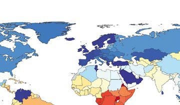

# Chapter 487: Rheumatic Heart Disease

*Michael R. Carr and Stanford T. Shulman PERICARDIUM*

<!-- p.3647 -->
Rheumatic involvement of the cardiac valves is the most important sequela of **acute rheumatic fever (ARF)**, and the second most com mon major manifestation after arthritis (see Chapter 229.1). The defi nitions of three subgroups of rheumatic heart disease (RHD) are noted in Table 487.1. The valvular lesions begin as small verrucae composed of fibrin and blood cells along the borders of one or more of the heart valves. The mitral valve is affected most often, followed in frequency by the aortic valve. Isolated aortic valve disease is rare and generally seen with concomitant mitral valve involvement. Right-sided heart manifes tations are rarer and are virtually only associated with left-sided valve disease. As the inflammation subsides, the verrucae tend to disappear and leave scar tissue. With repeated attacks of rheumatic fever, new verrucae form near the previous ones and the mural endocardium and chordae tendineae become involved. A single episode of **acute rheu matic carditis** often results in complete healing of the valvular lesions, whereas *repeated* episodes, especially involving previously affected valves, result in chronic **RHD**, which is the rationale for secondary pro phylaxis. The prevalence of RHD ranges from 3 to 4 cases per 100,000 population in nonendemic countries to >1,000 cases per 100,000 in endemic countries (Fig. 487.1). On a global scale, the sequelae of RHD is significant, with up to 300,000 deaths per year related to the disease process, as well as an exponential degree of related comorbidity.

The diagnosis of ARF requires the fulfillment of the **Jones criteria** (see Chapter 229.1), with carditis being a major criterion. The diagnosis of RHD was once only based on cardiac auscultatory findings of mitral or aortic valve involvement, which was insensitive for early valve involve ment/injury. This was based on valvulitis being seen more frequently in ARF compared with pericarditis or myocarditis, both of which lack more readily apparent physical examination findings. Screening large, high-risk populations with echocardiography demonstrated a substantially greater number of patients with RHD than those detected by auscultation alone. Because access to echocardiography is often available, the current ver sion of the Jones criteria focused on the concept of **subclinical carditis (SCC)** detected by echocardiography (see Table 487.1). SCC is defined as echocardiographic evidence of mitral or aortic valvulitis in the absence of auscultatory findings and not consistent with physiologic mitral or aor tic insufficiency (Table 487.2). Echocardiography with Doppler should be performed for all cases of confirmed or suspected ARF (Table 487.3). Additional recommendations are that echocardiography should be per formed in moderate- to high-risk patient populations if ARF is considered likely and that echocardiography can be used to exclude cardiac findings consistent with ARF in patients with cardiac murmurs thought to be sug gestive of rheumatic carditis. Additionally, serial echocardiography should be considered in patients with diagnosed or suspected ARF even if there is no evidence of valvulitis by echocardiography at diagnosis. The echo cardiographic finding of SCC fulfills the major criterion for carditis. The category of latent RHD is another approach to include patients with mild asymptomatic valve changes not typically detected on physical exam but identified by screening high-risk populations with echocardiography (see Table 487.1).

**PATTERNS OF VALVULAR DISEASE Mitral Insufficiency** Mitral insufficiency is the result of structural changes that may include some loss of valvular substance and/or changes to the subvalvular appa ratus, including elongation of the chordae, both of which can lead to valve dysfunction. During ARF with severe cardiac involvement, heart failure is caused by a combination of mitral insufficiency coupled with a pan carditis involving the pericardium and myocardium in addition to the endocardium/valve. Because of the increased volume load from the mitral

insufficiency and the inflammatory process, the left ventricle dilates. The left atrium also enlarges to accommodate the regurgitant volume. Increased left atrial pressure results in pulmonary congestion and symptoms of leftsided heart failure. Spontaneous improvement often occurs with time, even in patients in whom mitral insufficiency is severe at the onset. The resultant chronic lesion is most often mild or moderate in severity, and the patient is often asymptomatic. More than half of patients with acute mitral insufficiency no longer have an audible mitral insufficiency murmur 1 year later, although they still may demonstrate insufficiency on echocardiogra phy. In patients with severe chronic mitral insufficiency, pulmonary artery pressure (PAP) becomes elevated, the right ventricle and atrium become enlarged, and right-sided heart failure subsequently develops.

**Clinical Manifestations** Physical signs of mitral insufficiency depend on its severity. With mild disease, signs of heart failure are not present, the precordium is quiet, and auscultation reveals a high-pitched **holosystolic murmur** at the apex that radiates to the axilla. With severe mitral insufficiency, signs of acute or chronic heart failure may be noted. The heart is enlarged, with a heaving apical left ventricular (LV) impulse and often an apical sys tolic **thrill**. The second heart sound (S2) may be accentuated if pulmo nary hypertension is present. A third heart sound or **gallop** is generally prominent. A holosystolic murmur is heard at the apex with radiation to the axilla. A short mid-diastolic rumbling murmur is caused by increased blood flow across the mitral valve as a result of the signifi cant insufficiency. Therefore auscultation of a diastolic murmur, often referred to as **relative mitral stenosis (Carey-Coombs murmur)**, does not necessarily mean that true mitral stenosis is present. The latter lesion takes many years to develop and is characterized by a diastolic murmur of greater length, usually with presystolic accentuation.

The electrocardiogram and chest radiographs are normal if the mitral insufficiency is mild. With more severe insufficiency, the ECG shows a prominent, longer duration and often bifid P waves, signs of LV hyper trophy, and associated right ventricular (RV) hypertrophy if pulmonary hypertension is present. On chest radiograph, prominence of the left atrium and ventricle can be seen, the former of which is better seen on lateral projections. Congestion of the perihilar vessels, a sign of pulmonary venous hypertension, may also be evident. Calcification of the mitral valve is rare in children. Echocardiography in the acute phase may demonstrate enlargement of the left atrium and ventricle. LV systolic function can be impaired if there is also a component of myocardial inflammation. Mitral annular dilation, chordal elongation, and at times, evidence of chordal rupture resulting in a flail leaflet may be noted. The leaflet tips demonstrate a nodular appearance, and prolapse of the anterior mitral valve leaflet tip (much more often than the posterior leaflet) is seen. Doppler evaluation demonstrates the severity of the mitral regurgitation. Chronic mitral insuf ficiency from RHD is characterized on echocardiography by leaflet and chordal thickening, chordal fusion, and restricted leaflet motion. These changes often lead to stenosis, but poor coaptation of the abnormal leaflets can also lead to variable degrees of regurgitation. Cardiac catheterization and left ventriculography are considered only if diagnostic questions are not completely resolved by noninvasive assessment or in rare cases with a concern for significantly elevated PAP.

**Complications** Severe mitral insufficiency may result in cardiac failure that may be pre cipitated by progression of the rheumatic process, recurrent episodes of ARF, the onset of **atrial fibrillation (AF)** or other arrhythmias, or infective endocarditis. The effects of chronic mitral insufficiency may become manifest after many years and include LV and RV failure and atrial and ventricular arrhythmias.

**Treatment** In patients with mild mitral insufficiency, **prophylaxis** against recurrences of rheumatic fever is all that is required in addition to the typical treat ment for ARF (Table 487.4). For more significant insufficiency, cortico steroids are added in the acute phase. Treatment of complicating heart failure (see Chapter 491), arrhythmias (see Chapter 484), and infective endocarditis (see Chapter 486) is described elsewhere. Afterload-reducing

*Michael R. Carr and Stanford T. Shulman*

<!-- p.3648 -->
agents—angiotensin-converting enzyme (ACE) inhibitors or angiotensin receptor blockers (ARBs)—may reduce the regurgitant volume, attenu ate pathologic compensatory mechanisms, and preserve LV function, but these have not been proven to alter the natural history of the disease pro cess. Diuretics may also provide some symptomatic and clinical benefit in select cases. In rare cases, phosphodiesterase inhibitors such as milri none may be used in the acute stage because of their inotropic, lusitropic, and systemic vascular dilating effects. Surgical treatment is indicated for patients who, despite adequate medical therapy, have persistent heart fail ure, dyspnea with moderate activity, and progressive cardiomegaly, often with pulmonary hypertension. Although annuloplasty and other forms of mitral valve repair provide good results in some children and adolescents, mitral valve replacement may be required, which can be more complicated in younger children. In patients with a prosthetic mitral valve replacement, prophylaxis against bacterial endocarditis is warranted for dental proce dures, as the routine antibiotics taken by these patients for rheumatic fever prophylaxis are insufficient to prevent endocarditis. Additionally, current recommendations suggest selecting a different class of antibiotic for such procedures, rather than increasing the dose of the antibiotic taken for rheumatic fever prophylaxis. Lastly, it is important to remember that all

attempts should be made at maximizing medical management of severe mitral insufficiency during the acute phase of the disease process, before considering surgical intervention, because surgery carries a poorer prog nosis and an increased risk for reoperation when performed during the acute phase.

**Mitral Stenosis** Mitral stenosis of rheumatic origin results from fibrosis of the mitral ring, commissural adhesions, and contracture of the valve leaflets, chordae, and papillary muscles over time. This is a chronic process and often takes ≥10 years for the lesion to become fully established, although the process may occasionally be accelerated. In the developed world, rheumatic mitral stenosis is seldom encountered before adolescence and is not usually rec ognized until adult life. Significant mitral stenosis results in increased left atrial pressure and subsequent enlargement and hypertrophy of the left atrium, pulmonary venous hypertension, increased pulmonary vascular resistance, and eventually overt pulmonary hypertension (Fig. 487.2). RV hypertrophy and right atrial dilation ensue and are followed by RV dila tion, tricuspid regurgitation, and clinical signs of right-sided heart failure.

**Clinical Manifestations** Generally, the correlation between symptoms and the severity of obstruction is good. Patients with mild stenosis are asymptomatic. More severe degrees of obstruction are associated with exercise intol erance and dyspnea. Critical lesions can result in orthopnea, paroxys mal nocturnal dyspnea, and overt pulmonary edema, as well as atrial arrhythmias. When pulmonary hypertension has developed, RV dila tion may result in functional tricuspid insufficiency, hepatomegaly, ascites, and edema. Hemoptysis caused by rupture of bronchial or pleurohilar veins and, occasionally, pulmonary infarction may occur.

Jugular venous pressure is increased in severe disease with heart failure, tricuspid valve disease/regurgitation, or severe pulmonary hypertension. In mild disease, the heart size is normal; however, moderate cardiomegaly is typical with severe mitral stenosis. Cardiac enlargement can be massive when AF and heart failure supervene. A parasternal RV lift is palpable when PAP is high. The principal auscultatory findings are a loud first heart sound, an opening snap of the mitral valve, and a long, low-pitched, rum bling mitral diastolic murmur with presystolic accentuation at the apex. The mitral diastolic murmur may be virtually absent in patients who are in significant heart failure from the elevated LV filling pressures. A holo systolic murmur secondary to tricuspid insufficiency may be audible at the left lower sternal border. In the presence of pulmonary hypertension, the pulmonic component of S2 is accentuated. An early diastolic murmur may

17 200 400 600 800 1k 1.2k 1.4k **Fig. 487.1**  Prevalence of rheumatic heart disease global map showing prevalence/100,000 population in 2017 by country. *(From the Institute for Health Metrics and Evaluation Global Burden of Disease 2019, Non-communicable disease data. Seattle: University of Washington IHME. https://www.healthdata.org/research-analysis/gbd**.)*

#### **Table 487.1** Proposed RHD Definitions

| Category / Parameter | Clinical Details & Findings |
| --- | --- |
| **General** | Latent RDH; All cases of RHD diagnosed through; echocardiographic screening, to include; previously unrecognized clinical RHD and; subclinical RHD.; Clinical RDH; All cases of RHD that have clinical signs or; symptoms, including pathologic heart; murmur* diagnosed either through; echocardiographic screening or clinical; evaluation. Clinical RHD is typically more; advanced than subclinical RHD.; Subclinical RDH; All cases of RHD that do not have clinical signs or; symptoms, including heart murmur.* Subclinical; RHD is only diagnosed by echocardiography; and is typically less advanced than clinical RHD.; *Detection of a pathologic heart murmur without echocardiography has been shown to; be poorly sensitive and specific in echocardiographic screening studies for RHD.; RHD, Rheumatic heart disease.; Modified from Beaton A, Engelman D, Mirabel M. Echocardiographic screening for; rheumatic heart disease. In: Dougherty S, Carapetis J, Zühlke, Wilson N, eds. Acute; Rheumatic Fever and Rheumatic Heart Disease. Philadelphia: Elsevier; 2021: Table 13.1. |

<!-- p.3649 -->
be caused by associated rheumatic aortic insufficiency or pulmonary val vular insufficiency secondary to pulmonary hypertension.

ECGs and chest radiographs are normal if the stenosis is mild; as the severity increases, prominent and notched P waves and varying degrees of RV hypertrophy become evident. AF or other atrial arrhythmias are com mon late manifestations. Moderate to severe lesions are associated with radiographic signs of left atrial enlargement and prominence of the pul monary artery and right-sided heart chambers; calcifications may be noted in the region of the mitral valve (see Fig. 487.2). Severe stenosis is associ ated with a redistribution of pulmonary blood flow so that the apices of the lung have greater perfusion (the reverse of normal). Lastly, horizontal lines in the lower lung periphery, called *Kerley B lines,* may be evident.

Echocardiography demonstrates thickening of the mitral valve and chordal apparatus, as well as restricted motion of the valve (Fig. 487.3). The typical “elbow” or “dog leg” appearance of the anterior leaflet of the mitral valve can aid in the distinction of a rheumatic valve from the various forms of congenital mitral stenosis. Left atrial dilation is common; color Dop pler flow across the mitral valve shows a narrow jet with flow acceleration, and variable degrees of tricuspid insufficiency can be seen from left atrial hypertension. Doppler can estimate the transmitral pressure gradient but can underestimate the gradient if there is LV dysfunction. Estimates of the RV/PAP can be made by echocardiographic assessment of the tricuspid and pulmonary insufficiency, as well as changes in the RV size and func tion and the systolic septal position. Cardiac catheterization quantitates

the diastolic gradient across the mitral valve well, allows for the calculation of cross-sectional valve area in older children, and assesses the degree of left atrial hypertension and PAP elevation.

**Treatment** Intervention is indicated in patients with clinical signs and hemody namic evidence of severe obstruction, but before the onset of severe manifestations. Pharmacologic therapy (diuretics and β blockers)

Valvulitis

#### **Table 487.2** Echocardiographic Findings in Rheumatic

| Category / Parameter | Clinical Details & Findings |
| --- | --- |
| **REGURGITATION*** | 1.	 Seen in at least two views; 2.	 Jet length ≥2 cm in at least; one view; 3.	 Peak velocity >3 meters/sec; 4.	 Pan-systolic jet in at least one; envelope; 1.	 Seen in at least two views; 2.	 Jet length ≥1 cm in at least; one view; 3.	 Peak velocity >3 meters/sec; 4.	 Pan-diastolic jet in at least; one envelope; *All four criteria need to be met.; Adapted from Gewitz MH, Baltimore RS, Tani LY, et al., On behalf of the American Heart; Association Committee on Rheumatic Fever, Endocarditis and Kawasaki Disease of the; Council on Cardiovascular Disease in the Young. Revision of the Jones criteria for the; diagnosis of acute rheumatic fever in the era of Doppler echocardiography: a scientific; statement from the American Heart Association. Circulation. 2015;131:1806–1818. |

Rheumatic Vasculitis

#### **Table 487.3** Morphologic Findings in Echocardiogram in

| Category / Parameter | Clinical Details & Findings |
| --- | --- |
| **ACUTE MITRAL VALVE CHANGES** | Annular dilation; Chordal elongation; Chordal rupture resulting in flail leaflet with severe mitral; regurgitation; Anterior (or, less commonly, posterior) leaflet tip prolapse; Beading/nodularity of leaflet tips |
| **CARDITIS** | Leaflet thickening; Chordal thickening and fusion; Restricted leaflet motion; Calcification |
| **CARDITIS** | Irregular or focal leaflet thickening; Coaptation defect; Restricted leaflet motion; Leaflet prolapse; From Kumar RK, Antunes MJ, Beaton A, et al. Contemporary diagnosis and; management of rheumatic heart disease: implications for closing the gap: a scientific; statement from the American Heart Association. Circulation. 2020;142(2):e337–e357,; Supplemental Table 2. |

Prophylaxis According to International Guidelines

#### **Table 487.4** Recommended Durations of Secondary

| Category / Parameter | Clinical Details & Findings |
| --- | --- |
| **DURATION RECOMMENDED** | American (AHA); ARF with carditis and residual heart; disease: until age 40 yr or for 10 yr after; last ARF (whichever is longer); lifetime; prophylaxis may be needed; ARF with carditis but no residual heart; disease: until age 21 yr or for 10 yr after; last ARF (whichever is longer); ARF without carditis: until age 21 yr or for; 5 yr after last ARF (whichever is longer); WHO Expert; Consultation Geneva; (2004); Lifelong if severe valvular disease or after; valve surgery; For 10 yr after last ARF or until age 25 yr; in patients with a previous diagnosis of; carditis; For 5 yr after last ARF or until age 18 yr in; patients without proven carditis; AHA, American Heart Association; ARF, acute rheumatic fever; RHD, rheumatic heart; disease; WHO, World Health Organization.; Modified from Kumar RK, Antunes MJ, Beaton A, et al. Contemporary diagnosis and; management of rheumatic heart disease: implications for closing the gap: a scientific; statement from the American Heart Association. Circulation. 2020;142(2):e337–e357,; Table 2. |

**Fig. 487.2** Chest x-ray from an 8-yr-old child with advanced juvenile mitral valve stenosis. Severe pulmonary venous hypertension is shown by the prominent upper lobe vasculature, interstitial edema, and vis ible interlobar fissure (black arrow). The left heart border is straight ened, indicating enlargement of the main pulmonary artery and left atrial appendage (white arrow). (From Kumar RK, Antunes MJ, Beaton A, et al. Contemporary diagnosis and management of rheumatic heart disease: implications for closing the gap: a scientific statement from the American Heart Association. Circulation. 2020;142(2):e337–e357, Supplemental Fig. 3.)

<!-- p.3650 -->
can be attempted but is generally used only for symptom control and much less often in children. However, it should not be considered adequate treatment in severe, symptomatic disease. Surgical valvot omy or balloon catheter mitral valvuloplasty generally yields good results (see Fig. 487.3); mitral valve replacement is avoided unless absolutely necessary. Balloon valvuloplasty is indicated for symptom atic, stenotic, pliable, noncalcified valves in patients without signifi cant atrial arrhythmias or thrombi. Unfortunately, neither surgical nor interventional options may exist in areas of the world with high disease burden.

**Aortic Insufficiency** In *acute* rheumatic aortic insufficiency, poor coaptation of the leaflets or leaflet prolapse is seen. *Chronic* rheumatic aortic insufficiency leads to sclerosis of the valve and results in distortion and retraction of the cusps. In both settings, regurgitation of blood leads to LV volume over load with dilation and hypertrophy of the left ventricle as it attempts to compensate for the excessive volume load. Concomitant mitral annu lar dilation accompanying LV dilation can further exacerbate mitral valve disease, specifically regurgitation. Combined mitral and aortic insufficiency in the acute phase of ARF is much more common than aortic involvement alone. However, in cases of isolated significant aor tic insufficiency, RHD should not be discounted, even given the rare nature of this finding.

**Clinical Manifestations** Symptoms are unusual except in severe aortic insufficiency or in the presence of significant concomitant mitral valve involvement or myo cardial dysfunction. The large stroke volume and forceful LV contrac tions may result in palpitations. Sweating and heat intolerance are related to excessive vasodilation. Dyspnea on exertion can progress to orthopnea and pulmonary edema; angina may be precipitated by heavy

exercise. Nocturnal attacks with sweating, tachycardia, chest pain, and hypertension may occur.

The pulse pressure is wide with bounding peripheral pulses (**water ham mer** or **Corrigan pulse**). Systolic blood pressure is elevated, and diastolic pressure is lowered. In severe aortic insufficiency, the heart is enlarged, with an LV apical heave. A diastolic thrill may be present. The typical murmur begins immediately with S2 and continues until late in diastole. The murmur is heard over the upper left and mid-left sternal border with radiation to the apex and upper right sternal border. Characteristically, it has a high-pitched blowing quality and is easily audible in full expiration with the diaphragm of the stethoscope placed firmly on the chest and the patient leaning forward. An aortic systolic ejection murmur is frequently heard because of the increased stroke volume. An apical presystolic mur mur **(Austin Flint murmur)** resembling that of mitral stenosis is some times heard and is caused by the large regurgitant aortic flow in diastole preventing the mitral valve from opening fully.

Chest radiographs demonstrate enlargement of the left ventricle and aorta. The ECG may be normal, but in advanced cases it reveals signs of LV hypertrophy with a strain pattern and prominent P waves. Echo cardiography shows a dilated left ventricle and diastolic mitral valve flutter or oscillations caused by aortic regurgitant flow hitting the valve leaflets. The aortic valve may demonstrate irregular or focal thickening, decreased systolic excursion, a coaptation defect, and leaflet prolapse. Doppler evaluation demonstrates the degree of aortic insufficiency. Car diac magnetic resonance imaging/angiography (cMRI/MRA) can be useful in quantitating regurgitant volume and in assessing LV size and systolic function. Cardiac catheterization is generally only necessary when echocardiographic or axial imaging data are equivocal.

**Prognosis and Treatment** Mild and moderate degrees of aortic insufficiency are well tolerated. Unlike mitral insufficiency, aortic insufficiency does not generally regress. Patients with combined lesions during the episode of ARF may have only aortic involvement 1-2 years later. Treatment consists of ACE inhibitors or ARBs and prophylaxis against ARF recurrence. Surgical intervention, which is typically aortic valve repair but occasionally can involve aortic valve prosthetic (biologic or mechanical) replacement, should be done well in advance of the onset of heart failure, pulmonary edema, and angina or when signs of decreasing myocardial performance become evident, as manifested by increasing LV dimensions and decreasing systolic function on echocardiography. Surgery is considered when early symptoms are present, significant ST-T wave changes are seen on the ECG, or evidence of decreasing LV ejection fraction is noted.

**Tricuspid Valve Disease** Primary tricuspid valve involvement is rare during both the acute and chronic stages of rheumatic fever. Tricuspid insufficiency is more com mon secondary to RV dilation, resulting from significant left-sided cardiac lesions. The clinical signs of tricuspid insufficiency include prominent pulsations of the jugular veins, systolic pulsations of the liver, and a blowing holosystolic murmur at the lower left sternal border that increases in intensity during inspiration. Concomitant signs of mitral or aortic valve disease, with or without AF, are common. In these cases, signs of tricuspid insufficiency often decrease or even disappear when heart failure produced by the left-sided valvular lesions is successfully treated. Tricuspid valvuloplasty may be required in very rare cases.

**Pulmonary Valve Disease** Pulmonary insufficiency secondary to ARF is rare and usually occurs on a functional basis secondary to pulmonary hypertension and is a late finding with severe mitral stenosis. The murmur **(Graham Steell murmur)** is similar to that of aortic insufficiency, but peripheral arte rial signs (bounding pulses) are absent. The correct diagnosis is con firmed by two-dimensional echocardiography and Doppler studies demonstrating nonphysiologic pulmonary insufficiency, evidence of pulmonary hypertension, and the presence of mitral valve disease. Sur gical intervention on the pulmonary valve is highly unusual.

*Visit Elsevier eBooks+ at eBooks.Health.Elsevier.com** for Bibliography.*

AO

LAA AL

PL

AO

AL

PL

AO

AL

PL

AL

PL

LAA

AO

A C

B D

PRE POST

**Fig. 487.3** Balloon mitral valvotomy. Real-time three-dimensional transesophageal echocardiographic images obtained before, dur ing, and after balloon mitral valvotomy in a patient with mitral ste nosis. A and B illustrate the stenotic mitral orifice as seen from the left atrium (A) and from the left ventricle (B) immediately prior to the procedure. C and D, obtained immediately after the procedure, show the commissure splitting and the larger mitral valve orifice. AL, anterior leaflet; AO, aorta; LAA, left atrial appendix; PL, posterior leaflet. (From Salcedo EE, Carroll JD. Imaging guidance of transcath eter valve procedures. In Otto CM, Bonow RO (eds). Valvular Heart Disease: A Companion to Braunwald’s Heart Disease. Philadelphia: Elsevier, 2013. Fig 16.11.)

<!-- p.3651 -->
