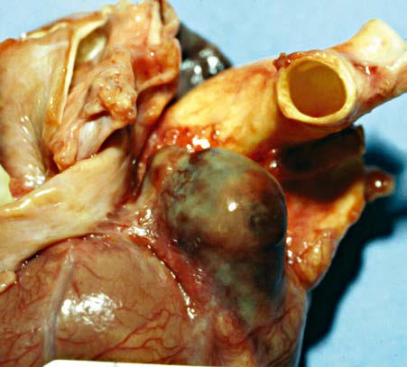

# Chapter 493: Diseases of the Blood Vessels (aneurysms and Fistulas)

<!-- p.3690 -->
because of the risk of infection from the diseased contralateral lung. Patients are selected according to many of the same criteria as for heart transplant recipients (see Chapter 492.1).

Posttransplant immunosuppression is usually achieved with a triple-drug regimen, combining a CNI (cyclosporine or tacrolimus) with an antiproliferative agent (MMF or azathioprine) and predni sone. Most patients receive induction therapy with an antithymo cyte or anti–T-cell preparation. Unlike patients with isolated heart transplants, patients with lung or heart-lung transplants cannot be weaned totally off steroids. Prophylaxis against *P. jiroveci* infection is achieved with trimethoprim-sulfamethoxazole or aerosolized pentamidine. Ganciclovir and CMV immune globulin prophylaxis are used as in heart transplant recipients (see Chapter 492.1). Anti fungal medications are used in the perioperative and posttransplant periods in patients who have pretransplant colonization.

Pulmonary rejection is common in lung or heart-lung trans plant recipients, whereas heart rejection is encountered much less often than in patients with isolated heart transplants. Acute cel lular rejection (ACR) occurs in approximately 10–30% of patients in the first year after transplant depending on the recipient’s age. Younger recipients have a lower incidence of ACR. Antibodymediated rejection (AMR) and chronic lung allograph dysfunction (CLAD) are other forms of rejection. Symptoms of lung rejection may include fever and fatigue, although many episodes are mini mally symptomatic. Signs of rejection could include changes in lung function testing and radiographic findings. Surveillance for acute rejection is performed by monitoring pulmonary function (forced vital capacity; forced expiratory volume in 1 second [FEV1]; forced expiratory flow, midexpiratory phase [FEF25–75%]), systemic arterial oxygen tension, chest radiographs, chest CT, transbronchial biopsy, and open lung biopsy. The gold standard for ACR is tissue diag nosis, generally performed with transbronchial biopsies. AMR is diagnosed based on findings of donor-specific antibodies and tis sue biopsy often associated with graft dysfunction. CLAD is a form of chronic rejection. It can present as an obstructive lung disease in the form of obliterative bronchiolitis. CLAD can also present with significant pulmonary fibrosis in the form of restrictive allograft dysfunction (RAD). In heart-lung transplant recipients, hearts are assessed for rejection similar to the approach described in Chapter 492.1. Actuarial survival rates after lung or heart-lung transplantation in children are currently 75–80% at 1 year and 50% at 5 years after transplant; improved patient selection and postoperative manage ment are continually improving these survival statistics from prior eras. In the analysis of survival at 5 years conditional on survival at 12 months, rates significantly improve for both lung and heartlung regardless of underlying condition. One year conditional sur vival rates at 5 years for both are roughly 70%. Some groups, such as patients with CHD in the absence of Eisenmenger syndrome, have particularly poor outcomes with transplant. Graft failure and infection are the leading cause of early death, whereas a form of chronic rejection in the form of CLAD or RAD accounts for almost 50% of cases of late mortality. Other causes of early mor bidity and mortality include technical complications, multior gan failure, primary graft dysfunction, and cardiovascular causes. Additional late complications include the development of late graft failure, malignancies, infection, and other side effects of chronic immunosuppression.

Postoperative indices of cardiopulmonary function and exercise capacity show significant improvement. Problems of donor availability are even more severe with lung transplantation than with isolated heart transplantation. However, significant advances in ex vivo lung perfu sion have great potential to expand the number of organs available for transplantation.

*Visit Elsevier eBooks+ at eBooks.Health.Elsevier.com** for Bibliography.*

Section **8 Diseases of the Peripheral Vascular System**

## 493.1  Aneurysms

*Daniel Bernstein*

See also Chapter 208.

Aneurysms of the coronaries and occasionally the systemic arteries may complicate Kawasaki disease and are the leading cause of mor bidity in this disease (Figs. 493.1 and 493.2). Persistent moderate to large aneurysms carry several risks: embolism and thromboembolism (a clot developing in the aneurysm because of stagnant blood flow and obstructing flow and/or breaking off and traveling more distally down the coronary, resulting in myocardial ischemia/infarction) and stenosis (the distal end of the aneurysm tends to become narrowed over time, limiting downstream coronary blood flow). Management includes anticoagulation to prevent thrombosis and β blockers to reduce myo cardial oxygen requirements (see Chapter 210).

COVID-19–associated multisystem inflammatory syndrome in chil dren (MIS-C) typically occurs a few weeks after active SARS-CoV-2 infec tion and can cause coronary artery dilation and aneurysms, in addition to other significant cardiac manifestations (ventricular dysfunction, arrhyth mias, and conduction abnormalities; see Chapters 311 and 449.1).

Other than in Kawasaki disease and MIS-C, aneurysms are not com mon in children and occur most frequently in the aorta in association with coarctation of the aorta, patent ductus arteriosus, Ehlers-Danlos syndrome type IV (vascular ecchymotic form), hyper-IgE syndrome, Marfan syndrome, and the four forms of Loeys-Dietz syndrome (see Chapter 641). Aneurysms may be seen in the arterial tortuosity syn drome and the multisystem smooth muscle dysfunction syndrome (MSMDS) (see Chapter 493.4). MSMDS is characterized by con genital mydriasis, patent ductus arteriosus, aortic and other arterial aneurysms, as well as moyamoya-like cerebrovascular disease and pul monary hypertension. The affected gene is *ACTA2*. Aneurysms may also occur secondary to an infected embolus; infection contiguous to a blood vessel; trauma; congenital abnormalities of vessel structure, especially the medial wall; and arteritis, including polyarteritis nodosa, Behçet syndrome, and Takayasu arteritis (see Chapter 210.2).

## 493.2  Arteriovenous Fistulas Daniel Bernstein

Arteriovenous fistulas may be limited and small or may be large and extensive, producing systemic complications (see Chapters 554 and 691). The most common sites in infants and children are within the

<!-- p.3692 -->

<!-- p.3693 -->
A

B

Ao

**Fig. 493.1** Two-dimensional echocardiograms comparing a normal left main coronary artery (arrow in A) with a giant coronary artery aneurysm (outlined by cross marks in B) in a patient with Kawasaki disease. Ao, Aorta.

Ao

**Fig. 493.2** Pathologic specimen showing giant aneurysm of left main coronary artery (arrow). Ao, Ascending aorta.

cranium, in the liver, in the lung, in the extremities, and in vessels in or near the thoracic wall. These fistulas, although usually **con genital**, may follow trauma or may be a manifestation of hereditary hemorrhagic telangiectasia (Osler-Weber-Rendu disease). Femoral arteriovenous fistulas are a rare complication of percutaneous fem oral catheterization.

**CLINICAL MANIFESTATIONS** Clinical symptoms occur only in association with large arterio venous communications when arterial blood flows into a lowpressure venous system without the resistance of the capillary bed; local venous pressure is increased, and arterial flow distal to the fistula is decreased. Systemic arterial resistance falls because of the runoff of blood through the fistula. Compensatory mechanisms include tachycardia and increased stroke volume so that cardiac output rises. Total blood volume is also increased. In large fistulas, left ventricular dilation, a widened pulse pressure, and high-output heart failure can occur. CT, MRI, or injection of contrast material into an artery proximal to the fistula confirms the diagnosis.

Large intracranial arteriovenous fistulas most often occur in newborn infants in association with a **vein of Galen malformation**. The large intracranial left-to-right shunt results in heart failure sec ondary to the demand for high cardiac output. Patients with smaller communications may not have cardiovascular manifestations but may later be disposed to hydrocephalus (see Chapter 631.9) or sei zures. The diagnosis can often be made by auscultation of a contin uous murmur over the cranium. Older children with more diffuse intracranial arteriovenous malformations may be recognized on the basis of intracranial calcification and high cardiac output without cardiac failure.

**Coronary** arteriovenous fistulas can develop between a coronary artery and any of the cardiac chambers **(coronary cameral fistula)** or great vessels. These fistulas can result in steal of blood away from the heart muscle downstream of the fistula resulting in ischemia and, in rare cases, can even cause obstruction of ventricular inflow caused by physical interference with atrioventricular valve function.

**Hepatic** arteriovenous fistulas may be generalized or localized in the liver and may be hemangioendotheliomas or cavernous heman giomas. The fistula may be located between the hepatic artery and the ductus venosus or portal vein. Congenital hemorrhagic telangiectasia may also be present. Large arteriovenous fistulas are associated with increased cardiac output and heart failure. Hepatomegaly is usual, and systolic or continuous murmurs may be audible over the liver.

**Peripheral** arteriovenous fistulas generally involve the extremi ties and can be associated with disfigurement, swelling of the extremity, and visible hemangiomas. Their presence can be compli cated by breathing difficulties if located near the upper airways and causing obstruction. Because only a small minority results in large arterial runoff, cardiac failure is uncommon.

**TREATMENT** Medical management of heart failure is initially helpful in neonates with these conditions; with time, the size of the shunt may dimin ish and symptoms spontaneously regress. Hemangiomas of the liver often eventually disappear completely. Large liver hemangiomas have been treated with corticosteroids, β blockers, ε-aminocaproic acid, interferon, local compression, embolization, or local irra diation; the beneficial effects of these management options are not firmly established because individual patients display marked variation in clinical course without treatment. **Transcatheter clo sure** is becoming the treatment of choice for many patients with a symptomatic arteriovenous fistula. Embolic agents that have been used include detachable balloons, steel (Gianturco) coils, plugs, and liquid tissue adhesives (cyanoacrylate). Often, multiple procedures are necessary before flow is significantly reduced. **Gamma knife radiosurgery** has been used successfully in patients with cerebral arteriovenous malformations. Surgical removal of a large fistula may be attempted in patients with severe cardiac failure and lack of improvement with medical treatment. Surgical treatment may be contraindicated or unsuccessful when the lesion is extensive and diffuse or is located in a position where adjoining tissue may be injured during the surgery or related procedures. β-Adrenergic blockers such as propranolol have dramatically changed the treat ment for cutaneous hemangiomas, with excellent results.

*Visit Elsevier eBooks+ at eBooks.Health.Elsevier.com** for Bibliography.*

<!-- p.3694 -->

## 493.3  Generalized Arterial Calcification of Infancy (Idiopathic Infantile Arterial Calcification) Robert M. Kliegman

Generalized arterial calcification of infancy (GACI) is a rare and often lethal autosomal recessive disorder characterized by

**Fig. 493.3** Lateral radiograph of the neonate showing calcification of the descending aorta and its bifurcation (arrows). (From Karthikeyan G. Generalized arterial calcification of infancy. J Pediatr. 2013;162:1074, Fig 3.)

**Fig. 493.4** Ultrasonography of abdominal aorta showing calcification of descending aorta and its branches (arrows). (From Karthikeyan G. Gen eralized arterial calcification of infancy. J Pediatr. 2013;162:1074, Fig. 1.)

calcification of muscular arteries with fibrotic myointimal pro liferation and subsequent vascular stenosis leading to tissue isch emia, poor function, or infarction. Diffuse arterial calcification may begin in utero, leading to hydrops fetalis; in the neonate, diffuse arterial calcification leads to respiratory distress and heart failure or myocardial infarction (coronary, pulmonary arteries), hypertension (renal arteries), and poor femoral pulses (aorta, femo ral arteries).

Pathogenic variants in the ectonucleotide pyrophosphatase 1 gene (*ENPP1*) are noted in 75% of patients. Serum calcium, phosphate, and alkaline phosphatase levels are normal; the vascular calcification may be seen on plain x-ray films (Fig. 493.3), ultrasonography (Fig. 493.4), or CT scans (Fig. 493.5), which may reveal calcifications not visible on plain films.

A subset of patients with GACI have monoallelic or biallelic pathogenic variants in the adenosine triphosphate–binding cas sette subfamily C number 6 gene (*ABCC6*), which is responsible for **pseudoxanthoma elasticum** (PXE). PXE, an autosomal recessive disorder, is classically associated with a later onset of ectopic min eralization of elastic fibers in the skin, eyes, joints, and arteries. In addition, some surviving infants with *ENPP1* variant develop PXE symptoms involving the skin and retina (angioid streaking).

Infants with GACI have been treated with bisphosphonates with variable success. In addition, some survivors with the *ENPP1* variant have developed hypophosphatemic-hyperphosphaturic rickets.

In the absence of stroke or encephalomalacia, most survivors are developmentally normal. In some survivors the vascular calcifi cation resolves and is replaced by fibrosis. The differential diagnosis includes Singleton-Merten syndrome (aortic calcification, dental anomalies, osteopenia), hypervitaminosis D, hyperparathyroid ism, congenital syphilis (aortitis), twin-twin transfusion syndrome (recipient), and idiopathic iliac artery calcification of infancy.

**ARTERIAL CALCIFICATIONS CAUSED BY DEFICIENCY OF CD73** This rare autosomal recessive disorder, caused by pathogenic variants in the 5-exonucleotidase CD73 *(NT5E)*, results in joint and arterial (lower-extremity) calcification in adults. Patients present with inter mittent claudication and joint pain. Onset is probably before adult hood, since patients may be undiagnosed with nonspecific findings during adolescence.

## 493.4  Arterial Tortuosity Robert M. Kliegman

Arterial tortuosity may be seen in many different diseases and genes (Table 493.1). These disorders are usually recognized by their phe notype, and all may present during childhood. Tortuosity is best defined by magnetic resonance angiography (Fig. 493.6). When present, it often increases the risk for early cardiovascular morbid ity for patients with Marfan or Loeys-Dietz syndrome.

**Arterial tortuosity syndrome** is another genetic arteriopathy caused by pathogenic variants in the *SCL2A10* gene. It has many fea tures of other connective tissue diseases, including hyperextensible and soft velvety skin, high-arched palate, micrognathia, abdominal hernias, and joint hypermobility. The prognosis for patients with arterial tortuosity syndrome is quite variable, but the presence of vascular stenosis is associated with a poorer prognosis.

*Visit Elsevier eBooks+ at eBooks.Health.Elsevier.com** for Bibliography.*

<!-- p.3695 -->

<!-- p.3696 -->
ITA

RCA

LM

MPA

SCA

LtRA

LtPA

CA

SMA

LtCIA

LtRA

SA AA

RtPA

ETT

LtPA

SMA

Rt CIA

CIA

EIA

**Fig. 493.5** Coronal maximum intensity projection (MIP) CT scans demonstrate an endotracheal tube (ETT) and extensive vascular calcifications. PA, Pulmonary artery; SA, splenic artery; RA, renal artery; CIA, common iliac artery; BA, brachial artery; CA, celiac axis; SMA, superior mesenteric artery; SCA, subclavian artery. (From Bolster F, Ali Z, Southall P, et al. Generalized arterial calcification of infancy—findings at post-mortem computed tomography and autopsy. Forensic Sci Int. 2015;254:e7–e12, Fig 3.)

Disease and Arterial Tortuosity

#### **Table 493.1** Genetic Disorders Associated with Aortic

| Category / Parameter | Clinical Details & Findings |
| --- | --- |
| **TGFBR1** | Loeys-Dietz syndrome, FTAAD |
| **TGFBR2** | Loeys-Dietz syndrome, FTAAD |
| **FBN1** | Marfan syndrome |
| **SMAD3** | Osteoarthritis-aneurysm; syndrome, FTAAD |
| **SLC2A10** | Arterial tortuosity syndrome |
| **FBLN4/EFEMP2** | Cutis laxa |
| **ATP7A** | Occipital horn syndrome,; Menkes syndrome; Monosomy X/mosaic monosomy; Turner syndrome |
| **FTAAD** | Familial aortic aneurysm and; dissection |
| **ACTA2** | Multisystem smooth muscle; dysfunction syndrome; FTAAD, Familial thoracic aortic aneurysm and dissection.; Adapted from Morris SA. Arterial tortuosity in genetic arteriopathies. Curr Opin Cardiol.; 2015;30:587–590, Table 1, p. 590. |

A B

**Fig. 493.6** Examples of vertebral artery tortuosity in Marfan syndrome with FBN1 pathogenic variant (A) and Loeys-Dietz syndrome with a TGFBR2 mutation (B). (From Morris SA. Arterial tortuosity in genetic arteriopathies. Curr Opin Cardiol. 2015;30:587–593, Fig 1.)

<!-- p.3697 -->
