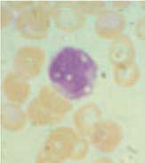
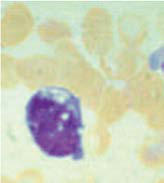

# Chapter 498: Pearson Syndrome

*Courtney D. Thornburg*

<!-- p.3725 -->
then be doubled, used on alternate days, and tapered still further while maintaining the hemoglobin level at ≥9 g/dL. The target main tenance dose should not exceed 0.5 mg/kg/day or 1 mg/kg every other day. In some patients, very small amounts of prednisone, as low as 2.5 mg twice a week, may be sufficient to sustain adequate erythropoiesis. Scheduled surveillance examinations and testing for corticosteroid side effects should be pursued in all patients, regard less of dose. Appropriate *Pneumocystis jiroveci* prophylaxis should be considered after the first month of high-dose steroids and con tinued until the patient is on low-dose alternate-day therapy. In the setting of illness, stress steroids should be considered for children on chronic corticosteroids. Many children with DBA stop taking corticosteroids, usually because of unacceptable side effects (i.e., cushingoid features, pathologic fractures, cataracts) or the evolu tion of corticosteroid refractoriness.

Chronic red cell transfusions are required in approximately 35% of patients, including patients who are never steroid respon sive (30%), are steroid refractory (15%), or cannot be weaned to acceptable low dose (50%). Transfusions are given at intervals of 3-5 weeks to maintain a hemoglobin level >8 g/dL. Some younger children may require hemoglobin >9 g/dL to sustain normal growth and activities. Appropriate screening and ultimately the initia tion of chelation therapy are required for transfusion-related iron overload.

L-leucine (700 mg/m2 orally three times per day) has been eval uated in a phase I/II trial patients with DBA 2 years of age and older. In 43 evaluable patients, 16% had erythroid response, 36% had increase in weight, and 44% had an increase in linear growth velocity.

Spontaneous remission of anemia with independence from ste roid or red cell transfusion therapy has been reported. The like lihood of remission is 25% by age 25 years, with most of these patients experiencing remission during the first decade. Mild mac rocytic anemia and increased erythrocyte ADA levels persist in these circumstances.

**Hematopoietic stem cell transplantation** (HSCT) can be cura tive. Indications for HSCT include steroid resistance or unaccept able toxicity and transfusion dependence as well as significant complications of chronic red cell transfusions including iron over load and alloimmunizations. HLA-matched sibling HSCT is rec ommended for transfusion-dependent children with DBA. One recommendation is for HSCT between ages 3 and 9 years, and some advocate HSCT at a younger age to avoid iron overload and allo sensitization from chronic red cell transfusions. It is important that sibling donors be carefully screened, including genotype if known, to ensure that the donor does not carry the pathologic genetic vari ant. Overall, outcomes are improving for matched-sibling and alter native donor HSCT.

**PROGNOSIS** DBA has been identified as a **cancer predisposition syndrome** because of the higher risk of myelodysplastic syndrome, acute myeloid leukemia, colon carcinoma, osteogenic sarcoma, and female genital cancers. Patients are at risk for iron overload-related endocrine abnormalities (diabetes, hypogonadism), especially if transfused. Patients who have undergone HSCT are at risk of asso ciated late effects (see Chapters 179, 180, and 181). The overall actuarial survival of all patients with DBA is approximately 75% at age 40 years, with approximately 87% for those maintained on corticosteroids and approximately 57% for transfusion-dependent patients. Of reported deaths, 67% were treatment related and 22% were DBA related (malignancy and severe aplastic anemia).

Treatment outcome and survival data are collected through the Diamond-Blackfan Anemia Registry (https://www.dbar.org).

*Visit Elsevier eBooks+ at eBooks.Health.Elsevier.com** for Bibliography.*

Pearson syndrome (PS) is a rare multisystem mitochondrial disorder that presents with a hypoplastic anemia that may be initially confused with Diamond-Blackfan syndrome (anemia) or transient erythroblas topenia of childhood (see Chapter 499). The marrow failure usually appears in the neonatal period and is characterized by a *sideroblastic macrocytic anemia* and, occasionally, neutropenia and thrombocy topenia. There are vacuolated erythroblasts and myeloblasts in the bone marrow (Fig. 498.1). PS is considered a unique variant of con genital sideroblastic anemia because the marrow also contains ringed sideroblasts. The hemoglobin F level is elevated. There is multiorgan involvement manifested by failure to thrive and symptoms of exocrine pancreas dysfunction, liver and renal tubular defects, malabsorption, and myopathy. Endocrine dysfunction (type 1 diabetes, adrenal insuf ficiency, hypoparathyroidism, and hypothyroidism) has also been reported. Children that survive early childhood typically develop **Kearns-Sayre syndrome**, an early-onset, mitochondrial disorder with lactic acidosis, progressive external ophthalmoplegia (impaired eye movement and ptosis), pigmentary retinitis, deafness, cerebellar ataxia, and heart block. Pearson syndrome is caused by a large heteroplasmic **mitochondrial DNA (mtDNA) deletion** (see Chapter 108) that pre dominates in the hematopoietic lineage. Subsequently, there is hetero geneity in different tissues and between patients, accounting for the variable clinical picture. The proportion of deleted mtDNA in the bone marrow correlates with the severity of the hematologic disease, and a reduction in the percentage of deleted mtDNA over time may be asso ciated with spontaneous improvement of red blood cell hypoprolifera tion. PS may be misdiagnosed as Diamond-Blackfan anemia (DBA) based on the overlapping features, including severe anemia starting at a young age. Evaluation for mtDNA deletion differentiates PS from DBA (see Chapter 497).

Therapy for the hematologic manifestations of the disease includes red cell transfusions to correct anemia and granulocyte colonystimulating factor in the setting of severe neutropenia. The hemato logic manifestations may spontaneously resolve within the first few years of life and stem cell transplantation may be considered for per sistent cytopenias.

*Visit Elsevier eBooks+ at eBooks.Health.Elsevier.com** for Bibliography.*

*Courtney D. Thornburg*

**Fig. 498.1** Bone marrow morphology in Pearson syndrome. Left, Vacuoles in myeloid precursor. Center, Vacuoles in erythroid precursor. Right, Ringed sideroblast. (From Shimamura A, Alter BP. Pathophysi ology and management of inherited bone marrow failure syndromes. Blood Rev 2010;24:101–122; Fig 14.)

<!-- p.3727 -->
