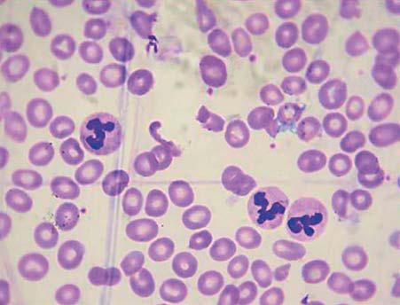

# Chapter 503: Megaloblastic Anemias

*Courtney D. Thornburg*

<!-- p.3739 -->
*Megaloblastic anemia* describes a group of disorders that are caused by impaired DNA synthesis. Red blood cells (RBCs) are larger than normal at every developmental stage, and there is maturational asyn chrony between the nucleus and cytoplasm of erythrocytes. The delayed nuclear development becomes increasingly evident as cell divi sions proceed. Myeloid and platelet precursors are also affected, and giant metamyelocytes and neutrophil bands are often present in the bone marrow. *There is often an associated thrombocytopenia and leuko penia*. The peripheral blood smear is notable for large, often oval RBCs with increased mean corpuscular volume (Fig. 503.1). Neutrophils are characteristically hypersegmented, with many having more than five lobes (see Fig. 503.1). Most cases of childhood megaloblastic anemia result from a deficiency of folic acid or vitamin B12 (cobalamin), vita mins essential for DNA synthesis (Table 503.1). Rarely, these anemias may be caused by inborn errors of metabolism. Megaloblastic anemias resulting from malnutrition are relatively uncommon in the United States but are important worldwide (see Chapters 62, 64, and 496).

## 503.1  Folic Acid Deficiency Courtney D. Thornburg

Folates are essential for DNA replication and cellular proliferation. Humans cannot synthesize folate and must depend on dietary sources, including green vegetables, fruits, and animal organs (e.g., liver, kid ney). Folates are heat labile and water soluble; consequently, boiling or heating folate sources leads to decreased amounts of the vitamin. Naturally occurring folates are in a polyglutamated form that is less efficiently absorbed than the monoglutamate species (i.e., folic acid). Dietary folate polyglutamates are hydrolyzed to simple folates that are absorbed primarily in the proximal small intestine by a specific carrier-mediated system. Folates travel in the bloodstream and are taken up in cells, primarily in the form of unconjugated methyltetra hydrofolate, which is subsequently reconjugated (polyglutamated) in the cell. There is an active enterohepatic circulation. Although rare,

megaloblastic anemia because of folate deficiency has its peak inci dence at 4-7 months of age, somewhat earlier than iron-deficiency ane mia, although both conditions may be present concomitantly in infants with poor nutrition.

**ETIOLOGY** Folic acid deficiency can result from inadequate folate intake, decreased folate absorption, or acquired and congenital disorders of folate metab olism or transport (Table 503.2).

**Inadequate Folate Intake** In the United States, anemia caused by insufficient folate intake usu ally occurs in the context of increased vitamin requirements associated with pregnancy, periods of accelerated growth, and chronic hemo lysis (see Chapter 67.6). Folate requirements greatly increase during pregnancy, in part to meet fetal needs, and deficiencies are common in mothers, particularly those who are poor or malnourished. Folate supplementation is recommended from the start of pregnancy to pre vent neural tube defects and to meet the needs of the developing fetus. Folate-deficient mothers generally do not give birth to infants with clinical folate deficiency because there is selective transfer of folate

*Courtney D. Thornburg*

**Fig. 503.1** Peripheral blood film shows hypersegmented neutrophils (green arrowheads), macrocytes (blue arrowheads), and a teardrop- shaped red blood cell (red arrowhead). (From Bawaskar HS, Bawaskar P, Bawaskar PH, Parekh PB. Tropical megaloblastic anemia. Lancet 2019;393:2261–2262.)

#### **Table 503.1** Causes of Red Blood Cell Macrocytosis

| Category / Parameter | Clinical Details & Findings |
| --- | --- |
| **MEGALOBLASTIC ANEMIA** | Cobalamin (vitamin B12); deficiency; Folate deficiency; Antifolate drugs (e.g.,; methotrexate); Cytotoxic drugs (e.g.,; hydroxyurea, 5-FU); Immunosuppressive drugs (e.g.,; azathioprine); Thiamine-responsive anemia; Hereditary orotic aciduria; Megaloblastic changes,; including hypersegmented; neutrophils; Macrocytosis can become severe; Mild reticulocytopenia; Pancytopenia (when the megalo; blastic process is severe) |
| **DISORDERS OF ERYTHROID PRODUCTION** | Aplastic anemia, PRCA, Blackfan-; Diamond anemia; Some sideroblastic anemias; CDA, non-CDA dyserythropoiesis,; Fanconi anemia; Myelodysplasia, myeloproliferative; diseases; Nonmegaloblastic; Some disorders feature; dyserythropoiesis and; sometimes hyposegmented; neutrophils; Macrocytosis can often be severe; (e.g., aplastic processes); Reticulocytopenia (often severe) |
| **RETICULOCYTOSIS** | Chronic hemolytic anemia; Nonmegaloblastic; no hyperseg; mented neutrophils |
| **DRUGS AND TOXINS** | Alcohol abuse; Some antiviral drugs (e.g.,; nucleoside RT inhibitors); Some anticonvulsant drugs; Mechanism of macrocytosis is; often unknown; No hypersegmented neutrophils |
| **NONHEMATOLOGIC DISEASES** | Chronic liver diseases; Hypothyroidism; Copper deficiency; Nonmegaloblastic; no hyperseg; mented neutrophils; Macrocytes are rarely oval |
| **ARTIFACTS** | RBC clumping by cold; agglutinins; some warm RBC; antibodies; Severe hyperglycemia; Hyponatremia; Nonmegaloblastic; no hyperseg; mented neutrophils; Disparity between high MCV and; normal morphologic examina; tion; CDA, Congenital dyserythropoietic anemia; MCV, mean corpuscular volume; PRCA, pure; red cell aplasia; RBC, red blood cell; RT, reverse transcriptase; 5-FU, 5-fluorouracil.; From Orkin SH, Fisher DE, Ginsburg D, et al., eds. Nathan and Oski’s Hematology and; Oncology of Infancy and Childhood, 8th ed. Philadelphia: Elsevier, 2015; Table 10-3. |

<!-- p.3740 -->
to the fetus via placental folate receptors. Rapid growth after birth increases demands for folic acid, and infants who are premature or ill and those with certain hemolytic disorders will have particularly high folate requirements. Human breast milk, infant formulas, and pasteur ized cow’s milk provide adequate amounts of folic acid. *Goat’s milk is*

*folate deficient, and supplementation must be given when it is the child’s main food source.* Unless supplemented, powdered milk may also be a poor source of folic acid.

**Malnutrition** is the most common cause of folate deficiency in older children. In addition, children with chronic hemolytic anemias, infec tions, or malabsorption are at increased risk due to increased demand. Because body stores of folate are limited, deficiency can develop quickly in malnourished individuals. On a folate-free diet, megaloblastic ane mia will occur after 2-3 months.

**Decreased Folate Absorption Malabsorption** caused by chronic diarrheal states or diffuse inflam matory disease can lead to folate deficiency. In both situations, some of the decreased folate absorption may be caused by impaired folate con jugase activity. Chronic diarrhea also interferes with the enterohepatic circulation of folate, thereby enhancing folate losses because of rapid intestinal passage. Megaloblastic anemia caused by folic acid deficiency can occur in celiac disease or chronic infectious enteritis and in associ ation with enteroenteric fistulas. Previous intestinal surgery is another potential cause of decreased folate absorption.

Certain anticonvulsant drugs (e.g., phenytoin, phenobarbital) can impair folic acid absorption, and many patients treated with these drugs have low serum levels. Frank megaloblastic anemia is rare and readily responds to folic acid therapy, even when administration of the offending drug is continued. Alcohol overuse also is associated with folate malabsorption.

**Congenital Abnormalities in Folate Transport and Metabolism** Inborn errors of folate transport or metabolism are rare but can be life threatening. Those associated with megaloblastic anemia include hereditary folate malabsorption and certain extremely uncommon enzyme deficiencies.

**Hereditary folate malabsorption (HFM)** is an autosomal reces sive disorder caused by loss-of-function pathogenic variants in the *SLC46A1* gene encoding the protein-coupled folate transporter. HFM is associated with an inability to absorb folic acid, 5-tetrahydrofolate, 5-methyltetrahydrofolate, or 5-formyltetrahydrofolate (folinic acid). It can become apparent at 2-6 months of age with megaloblastic ane mia and other deficits, including infections and diarrhea. Neurologic abnormalities attributable to folate deficiency in the central nervous system (CNS) include seizures, developmental delay, and intellectual disability. Folate transport is impaired both in the intestine and at the brain’s choroid plexus. Serum and cerebrospinal fluid (CSF) folate levels are very low, with a loss of the normal 3:1 ratio of CSF to serum folate.

Treatment for HFM involves parenteral (intramuscular) folate or high-dose oral 5-formyltetrahydrofolate (5-formylTHF), folinic acid, leucovorin, or the active isomer of 5-formylTHF (Isovorin or Fusilev) targeting normal or near normal trough levels in the CSF to ameliorate both the megaloblastic anemia and neurologic complications of folate deficiency.

**Functional methionine synthase deficiency** may result from patho logic genetic variants affecting the function of methionine synthase reductase or methionine synthase. These disorders are autosomal reces sive and characterized not only by megaloblastic anemia but also by cerebral atrophy, nystagmus, blindness, and altered muscle tone. Both respond to hydroxocobalamin (OHCbl) plus betaine with variable clini cal success. **Dihydrofolate reductase (DHFR) deficiency** is extremely rare and is associated with homozygous pathologic genetic variants in the *DHFR* gene. Clinical symptoms include megaloblastic anemia and neurologic manifestations. Although **methylenetetrahydrofolate reductase (MTHFR) deficiency** is the most common inborn error of folate metabolism, and severe cases can produce several neurologic and vascular complications, there is *no* associated megaloblastic anemia.

Children

#### **Table 503.2** Causes of Folate Deficiency* in Adults and

| Category / Parameter | Clinical Details & Findings |
| --- | --- |
| **INADEQUATE NUTRITION** | Poor diet†; Poor food preparation methods; Exclusive feeding with goat’s milk |
| **DEFECTS IN ABSORPTION** | Gastric achlorhydria§; Diseases of the upper small intestine; Tropical sprue; Celiac disease; Dermatitis herpetiformis; Inflammatory bowel disease; Oral pancreatic replacement therapy§; Hereditary folate malabsorption |
| **INCREASED REQUIREMENTS OR LOSSES** | Pregnancy; Lactation§; Prematurity§,‖; Chronic hemolytic anemia§; Dialysis; Hyperthyroidism§; Lesch-Nyhan syndrome |
| **DISORDERS OF TRANSPORT** | Cerebral folate deficiency (genetic or acquired)¶ |
| **DISORDERS OF CELLULAR METABOLISM** | Drugs inhibiting folate metabolism; Antifolates (e.g., methotrexate); Pyrimethamine§; trimethoprim§; Sulfasalazine§; Valproic acid§,#; Inherited defects; Methylenetetrahydrofolate reductase (MTHFR) deficiency; Disorders of intracellular cobalamin metabolism; Dihydrofolate reductase deficiency; Methylenetetrahydrofolate dehydrogenase, cyclohydrolase, and; formyltetrahydrofolate synthetase 1 (MTHFD1) deficiency; Others |
| **MULTIFACTORIAL OR UNCERTAIN MECHANISMS** | Alcohol use disorder‡; Anticonvulsants§; Oral contraceptives§; *Folate deficiency is often multifactorial.; †Relative dietary insufficiency (i.e., intake that is adequate under usual circumstances) is; a particularly important cofactor that can convert borderline folate deficiency to clini; cally overt deficiency when other conditions coexist, such as increased requirements; for folate or mild malabsorption.; §Megaloblastic anemia rarely results unless other limitations of folate status coexist.; ‖Neonatal stores are low in premature infants.; ¶Cerebral folate deficiency can occur on a genetic basis or an autoimmune basis;; megaloblastic anemia does not occur because folate deficiency appears not to exist; outside the central nervous system.; #Disrupts mitochondrial folate metabolism in utero.; ‡Poor intake is often associated with alcoholism in adults.; From Orkin SH, Fisher DE, Ginsburg D, et al., eds. Nathan and Oski’s Hematology and; Oncology of Infancy and Childhood, 8th ed. Philadelphia: Elsevier, 2015; Box 10-2. |

<!-- p.3741 -->
**Drug-Induced Abnormalities in Folate Metabolism** Several drugs have anti–folic acid activity as their primary pharmaco logic effect and regularly produce megaloblastic anemia. *Methotrexate* binds to dihydrofolate reductase and prevents formation of tetrahydro folate, the active form of folate. *Pyrimethamine,* used in the therapy of toxoplasmosis, and *trimethoprim,* used for treatment of various infec tions, can induce folic acid deficiency and occasionally megaloblastic anemia. Therapy with folinic acid (5-formyltetrahydrofolate) is usually beneficial.

**CLINICAL MANIFESTATIONS** In addition to the clinical features associated with anemia, folatedeficient infants and children may manifest irritability, chronic diar rhea, and poor weight gain. Hemorrhages from thrombocytopenia may occur in advanced cases. HFM and other rare etiologies of folate deficiency may be further associated with hypogammaglobulinemia, severe infections, failure to thrive, neurologic abnormalities, and cog nitive delays.

**LABORATORY FINDINGS** The anemia is macrocytic (mean corpuscular volume >100 fL). Varia tions in RBC shape and size are common (see Chapter 496, Fig. 496.4B). The reticulocyte count is low, and nucleated RBCs with megaloblastic morphology are often seen in the peripheral blood. Neutropenia and thrombocytopenia may be present, particularly in patients with longstanding and severe deficiencies. The neutrophils are large, some with *hypersegmented nuclei* (see Fig. 503.1). The bone marrow is hypercel lular because of erythroid hyperplasia, and megaloblastic changes are prominent. Large, abnormal neutrophilic forms (giant metamyelo cytes) with cytoplasmic vacuolation are also seen.

*Levels of RBC folate are a better indicator of chronic deficiency than serum folic acid levels.* The normal RBC folate level is 150-600 ng/mL of packed cells. Levels of iron and vitamin B12 in serum usually are normal or elevated. Serum activity of lactate dehydrogenase, a marker of ineffective erythropoiesis, is markedly elevated.

**TREATMENT** When the diagnosis of folate deficiency is established, folic acid may be administered orally or parenterally at 0.5-1.0 mg/day. If the specific diagnosis is in doubt, smaller doses of folate (0.1 mg/day) may be used for 1 week as a diagnostic test because a hematologic response can be expected within 72 hours. Doses of folate >0.1 mg can correct the ane mia of vitamin B12 deficiency but might aggravate any associated neu rologic abnormalities. In most medical settings in developed countries, this therapeutic trial to distinguish the different causes of megaloblastic anemia is rarely necessary because vitamin B12 and folate blood levels are usually readily available. Folic acid therapy (0.5-1.0 mg/day) should be continued for 3-4 weeks until a definite hematologic response has occurred. Maintenance therapy with a multivitamin (containing 0.2 mg of folate) is adequate. Parenteral or high doses of specific folate for mulations are required in the setting of HFM. Transfusions are indi cated only when the anemia is severe, or the child is very ill.

*Visit Elsevier eBooks+ at eBooks.Health.Elsevier.com** for Bibliography.*

## 503.2  Vitamin B12 (Cobalamin) Deficiency Courtney D. Thornburg

*Vitamin B**12**,* a generic term encompassing all biologically active cobal amins, is a water-soluble vitamin with a central, functional cobalt atom and a planar corrin ring. Methylcobalamin and adenosyl cobalamin are the metabolically active derivatives, serving as cofactors in two essential metabolic reactions: methylation of homocysteine to methionine (via methionine synthase) and conversion of methyl-malonyl-coenzyme A (CoA) to succinyl CoA (via l-methyl-malonyl-CoA mutase). The

products and by-products of these enzymatic reactions are critical to DNA, RNA, and protein synthesis.

**Cobalamin** (Cbl) is synthesized *exclusively* by microorganisms, and humans must rely on dietary sources (animal products, including meat, eggs, fish, and milk) for their needs (see Chapter 67.7). Unlike folate, older children and adults have sufficient vitamin B12 stores to last 3-5 years. In young infants born to mothers with low vitamin B12 stores, clinical signs of Cbl deficiency can become apparent in the first 6-18 months of life.

**METABOLISM** Under normal circumstances, cobalamin is released from food protein in the stomach through peptic digestion. Cbl then binds to *haptocorrin* (HC), a salivary glycoprotein. This complex moves into the duodenum, where HC is digested by pancreatic proteases and Cbl is liberated. Cbl then binds to *intrinsic factor* (IF), another glycoprotein that is produced by gastric parietal cells. The Cbl-IF complex subsequently enters mucosal cells of the distal ileum by receptor-mediated endocytosis. Through a complex series of protein interactions, Cbl is taken up into the blood stream and taken up into cells. Cobalamins are processed in the cytoplasm to a common intermediate that can be allocated to the methylcobalamin and adenosyl cobalamin synthesis pathways to meet cellular needs.

**ETIOLOGY** Vitamin B12 deficiency can result from inadequate dietary intake of Cbl, lack of IF, impaired intestinal absorption of IF-Cbl, inactivation, or absence of vitamin B12 transport protein (see Table 503.1).

**Inadequate Vitamin B****12**** Intake** Vitamin B12 deficiency in infants is most often nutritional, resulting from low Cbl levels in the breast milk of B12-deficient mothers. Associ ated **megaloblastic anemia** often appears during the first year of life. Maternal deficiency may be caused by **pernicious anemia** or gastroin testinal disorders such as *Helicobacter pylori* infection, celiac disease, Crohn disease, or pancreatic insufficiency. Previous gastric bypass sur gery, treatment with proton pump inhibitors, and inadequate intake from a strict unsupplemented vegetarian diet have also been impli cated. Fortunately, because of active placental Cbl transport in utero, most children of B12-deficient mothers maintain Cbl levels sufficient to support adequate prenatal development. Such infants are born with low B12 stores, the depletion of which is associated with a gradual onset of clinical manifestations. *Vitamin B**12 replacement often results in rapid improvement, but the longer the deficient period, the greater the likelihood of permanent disabilities.* Neonatal screening programs may detect maternal-neonatal nutritional B12 deficiency because of an increase in propionyl carnitine, but there is higher sensitivity using a measurement of methylmalonic acid. In high-income countries, dietary deficiency during childhood or adolescence is infrequent but can result from strict vegetarian or vegan diet. Daily requirements range from 0.4-2.4 μg.

**Impaired Vitamin B****12**** Absorption** Gastric surgery or medications that impair gastric acid secretion may result in IF deficiency, leading to decreased vitamin B12 absorption. Pancreatic insufficiency can also lead to Cbl deficiency because of impaired cleavage and IF complex formation. Patients with neonatal necrotizing enterocolitis, inflammatory bowel disease, celiac disease, or surgical removal of the terminal ileum may also have impaired absorption of vitamin B12. An overgrowth of intestinal bacteria within diverticula or duplications of the small intestine can cause vitamin B12 deficiency by consumption of (or competition for) the vitamin or by splitting of its complex with IF. In these cases, *hematologic response can follow appropriate antibiotic therapy.* In endemic areas, when the fish tapeworm *Diphyllobothrium latum* infests the upper small intestine, similar mechanisms may be operative. When megaloblastic anemia occurs in such situations, the serum vitamin B12 level is low, and the gastric fluid contains IF.

<!-- p.3742 -->

<!-- p.3743 -->
**Hereditary intrinsic factor deficiency (HIFD)** is a rare autosomal recessive disorder caused by a variety of pathologic genetic variants in the *IF* gene that produce a lack of gastric IF or a functionally abnormal IF. HIFD differs from typical adult pernicious anemia in that gastric acid is secreted normally and the stomach is histologically normal. It is not associated with antibodies or endocrine abnormalities. Unlike Imerslund-Grasbeck syndrome, described next, HIFD is only occa sionally associated with proteinuria. Symptoms become prominent at an early age (6-24 months), consistent with exhaustion of vitamin B12 stores acquired in utero. As the anemia becomes severe, weakness, irri tability, anorexia, and listlessness occur. The tongue is smooth, red, and painful. Neurologic manifestations include ataxia, paresthesias, hypo reflexia, Babinski responses, and clonus. Oral vitamin B12 is usually *ineffective*, and lifelong intramuscular (IM) or intranasal Cbl should be used to bypass the absorption defect. The natural form, OHCbl, is believed to be more effective than the synthetic form, cyanocobalamin (CNCbl).

**Imerslund-Grasbeck syndrome** is a rare, recessively inherited pedi atric disorder resulting in selective vitamin B12 malabsorption in the ileum and consequent vitamin B12 deficiency. It usually becomes clini cally apparent within the first 6 years of life. In addition to megaloblastic anemia, the patient may also have neurologic defects (e.g., hypotonia, developmental delay, brain atrophy, movement disorders, dementia) and/or proteinuria. Patients carry pathologic variants in genes *CUBN* or *AMN*, which encode proteins that form the cubam receptor for the ileal IF-Cbl complex. Because CUBN is also a key receptor for protein reabsorption in the kidney, impaired expression at this site results in associated proteinuria. The disease can be fatal if it remains untreated. Early diagnosis and treatment with IM or intranasal Cbl will reverse the hematologic and neurologic abnormalities. Proteinuria does not respond to therapy.

Classic pernicious anemia (autoimmune gastritis) usually occurs in older adults but can rarely affect children. This disorder **(juvenile per nicious anemia)** usually presents during adolescence. In such cases, the disease is associated with various detectable antibodies, including those against IF and the hydrogen-potassium adenosine triphospha tase proton pump in gastric parietal cells. These children can have additional immunologic abnormalities, cutaneous candidiasis, hypo parathyroidism, and other endocrine deficiencies; atrophy of the gas tric mucosa and achlorhydria may occur. IM or intranasal vitamin B12 should be administered regularly.

**Absence of Vitamin B****12****Transport Protein Transcobalamin** Transcobalamin (TC) deficiency is a rare cause of megaloblastic ane mia. A congenital deficiency is inherited as an autosomal recessive condition resulting in a failure to absorb and transport vitamin B12. Most patients lack TC, but some have functionally defective forms. This disorder usually manifests in the first weeks of life. Characteris tically, there is failure to thrive, diarrhea, vomiting, glossitis, neuro logic abnormalities, and megaloblastic anemia. The diagnosis can be difficult given that total serum vitamin B12 levels are often normal because approximately 80% of serum Cbl is bound to HC. The diagno sis is suggested by the presence of severe megaloblastic anemia in the face of normal folate levels and no evidence of another inborn error of metabolism. Plasma homocysteine and methylmalonic acid levels are elevated. A definitive diagnosis is made by measuring plasma TC. The serum vitamin B12 levels must be kept high to force enough Cbl into cells and allow normal function using high-dose oral supplemen tation or IM or intranasal treatment. Symptoms and laboratory studies should be monitored, and doses adjusted as needed.

**Disorders of Intracellular Cobalamin Metabolism** Disorders of intracellular cobalamin metabolism are associated with pathologic genetic variants in genes associated with lettered comple mentation groups. These include *MMACHC (cblC)*, *MMADHC* (*cblD*combined and *cblD* homocystinuria), *MTRR (cblE), LMBRD1 (cblF), MTR (cblG), ABCD4 (cblJ), THAP11* (*cblX*-like), *ZNF143* (*cblX*-like), or *HCFC1* (*cblX*, which can show a cblC complementation class). The

disorders present at a range of ages starting in utero and have a variable clinical presentation including complications of methylmalonic acide mia, homocystinuria, and megaloblastic anemia. Patients require care with a metabolic specialist to guide treatment with OHCbl, avoidance of agents that can cause metabolic decompensation, and surveillance for complications.

Vitamin B12 deficiency may develop by inactivation of vitamin B12. This most often occurs in adolescents who chronically use “Whippets,” which contain nitrous oxide, as a recreational agent to get high. Con versely, patients with underlying vitamin B12 deficiency may have an exacerbation after nitrous oxide anesthesia.

**CLINICAL MANIFESTATIONS** Children with Cbl deficiency often present with nonspecific manifesta tions such as weakness, lethargy, feeding difficulties, failure to thrive, and irritability. Other common findings include pallor, glossitis, vomit ing, diarrhea, and icterus. Hyperpigmentation is another feature that may mimic Addison disease. Neurologic symptoms can include par esthesia, sensory deficits, hypotonia, seizures, developmental delay, developmental regression, neuropsychiatric changes, and brain/spine MRI changes. Neurologic problems from vitamin B12 deficiency may occur in the *absence* of any hematologic abnormalities. Thrombotic microangiopathy is a rare manifestation.

**LABORATORY FINDINGS** The hematologic manifestations of folate and Cbl deficiency are identi cal. The anemia resulting from Cbl deficiency is macrocytic, with prom inent macro-ovalocytosis of the RBCs (see Chapter 496, Fig. 496.2, and Fig. 503.1). The neutrophils may be large and hypersegmented (see Fig. 503.1). In advanced cases, neutropenia and thrombocytopenia can occur, simulating aplastic anemia or leukemia. Macrocytosis may not always be present. Serum vitamin B12 levels are low, and the serum concentrations of methylmalonic acid and homocysteine are elevated. Concentrations of serum iron and serum folic acid are normal or ele vated. Serum lactate dehydrogenase activity is markedly increased, a reflection of ineffective erythropoiesis. Moderate elevations of serum bilirubin levels (2-3 mg/dL) also may be found. Excessive excretion of methylmalonic acid in the urine (normal: 0-3.5 mg/24 hr) is a reliable and sensitive index of vitamin B12 deficiency and is especially helpful when the serum vitamin B12 level is in the low-normal range.

**DIAGNOSIS** A comprehensive medical history is essential to the clinical recognition of possible Cbl deficiency. Information regarding clinical symptoms, dietary history, diseases, surgeries, or medications and drugs is likely to provide important clues. The physical examination may reveal relevant findings such as irritability, pallor, pigmentation or specific neurologic symptoms. Screening laboratory findings offer important informa tion, but more focused testing will be required to confirm a diagnosis of vitamin B12 deficiency and its cause. Cbl deficiency is usually identi fied by measuring total or TC-bound vitamin B12 in the blood. Although an extremely low level is generally diagnostic, this may not be the case because false negatives and false positives are reportedly common using currently available assays. As a result, it is wise not to discount vitamin B12 deficiency, particularly in the face of clinical symptoms, macrocytic anemia, an abnormal blood smear, and a normal folate level. In untreated patients, methylmalonic acid and total homocysteine levels are often help ful because they are greatly elevated in the majority of those with clinical signs of B12 deficiency. Excessive urinary methylmalonic acid excretion is also a sensitive test of B12 deficiency. Although modest increases occur with renal failure, elevated methylmalonic acid is otherwise quite specific for B12 deficiency. Notably, however, serum homocysteine is also elevated in folate deficiency, homocystinuria, and renal failure.

If vitamin B12 deficiency has been confirmed and there is no evi dence of inadequate dietary intake or, in the case of an infant, inad equate maternal B12, malabsorption should be investigated. Anti-IF antibodies and anti–parietal cell antibodies are useful for the diagnosis of pernicious anemia. Measurement of IF and testing from more spe cialized laboratories may be required for less common disorders.

<!-- p.3745 -->
