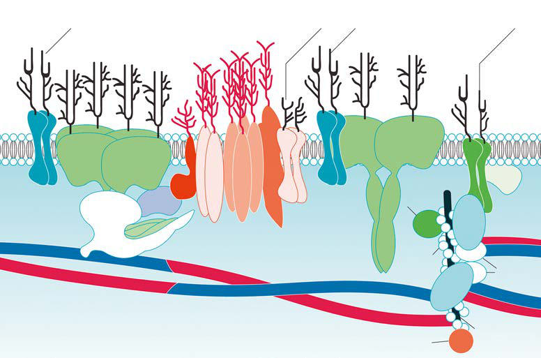
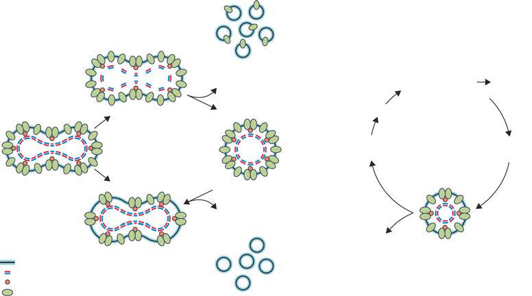

# Chapter 507: Hereditary Spherocytosis

*Stephanie Prozora and Patrick G. Gallagher*

<!-- p.3760 -->
↑ RDW (caused by ↑ reticulocyte count) Abnormal RBC morphology ↑ Indirect bilirubin (normal direct bilirubin) ↓ Serum haptoglobin level ↑ Urinary urobilinogen level Hemoglobinuria (+ dipstick test result for blood; no RBCs in urine) ↑ LDH level

#### **Table 506.3** Clinical and Laboratory Features Suggestive of Hemolytic Anemia

| Category / Parameter | Clinical Details & Findings |
| --- | --- |
| **General** | Pallor; Icterus; Splenomegaly; Gallstones; History of neonatal icterus; Positive family history of anemia, splenectomy, cholecystectomy; ↑ Reticulocyte count; LDH, Lactate dehydrogenase; RBC, red blood cell; RDW, red cell distribution width.; From Kliegman RM, Lye PS, Bordini BJ, et al., eds. Nelson Pediatric Symptom-Based Diagnosis. Philadelphia: Elsevier, 2018: 674; Table 37.12. |

on Red Blood Cell Shape

#### **Table 506.4** Hemolytic Anemias: Diagnostic Clues Based

| Category / Parameter | Clinical Details & Findings |
| --- | --- |
| **General** | Sickle cells: sickle cell disease; Target cells: hemoglobinopathies (HbC, HbS, thalassemia), liver; disease; Schistocytes/burr cells/helmet cells/RBC fragments: microangiopathic; hemolytic anemia (DIC, HUS, TTP); Spherocytes: hereditary spherocytosis, autoimmune hemolytic anemia; Cigar-shaped cells: hereditary elliptocytosis; “Bite” cells: G6PD deficiency; Poikilocytosis, microcytosis, fragmented erythrocytes, elliptocytes:; hereditary pyropoikilocytosis; DIC, Disseminated intravascular coagulation; G6PD, glucose-6-phosphate dehy; drogenase; HbC, hemoglobin C; HbS, sickle hemoglobin; HUS, hemolytic-uremic; syndrome; RBC, red blood cell; TTP, thrombotic thrombocytopenia purpura.; From Kliegman RM, Lye PS, Bordini BJ, et al., eds. Nelson Pediatric Symptom-Based; Diagnosis. Philadelphia: Elsevier, 2018: 674; Table 37.13. |

Hereditary spherocytosis (HS) is a common cause of inherited hemolytic anemia, with a prevalence of approximately 1 in 2,000- 5,000 persons. Described in patients of all ethnic groups, it is the most common inherited abnormality of the erythrocyte associated with inherited hemolytic anemia in persons of Northern European origin. HS is marked by wide variability in the associated clinical, laboratory, and genetic manifestations. Symptomatology ranges from asymptomatic patients with well-compensated anemia to severely affected patients with hemolytic anemia requiring regular blood transfusions.

**ETIOLOGY** The pathophysiology underlying HS is twofold: an intrinsic defect of the erythrocyte membrane and an intact spleen that selectively retains, damages, and removes abnormal HS erythrocytes. Quali tative or quantitative defects of key membrane proteins lead to a multistep process of accelerated HS erythrocyte destruction.

*Stephanie Prozora and Patrick G. Gallagher*

Abnormalities of ankyrin or spectrin are the most common molec ular defects (Table 507.1). Defects in these membrane proteins result in uncoupling of the “vertical” interactions of the lipid bilayer with the underlying membrane skeleton with subsequent release of membrane microvesicles. The loss of membrane surface area with out a proportional loss of cell volume causes decreased erythrocyte deformability. This impairs cell passage from the splenic cords to the splenic sinuses, leading to the trapping and premature destruc tion of HS erythrocytes by the spleen (Figs. 507.1 and 507.2). Splenectomy markedly improves erythrocyte life span and may be indicated in some patients with HS.

**CLINICAL MANIFESTATIONS** Hereditary spherocytosis is usually transmitted as an autosomal domi nant trait. However, as many as 25% of patients have no previous fam ily history, representing either recessive inheritance or de novo gene variants.

In the neonatal period, HS is a significant cause of hemolysis and can manifest as anemia and/or hyperbilirubinemia severe enough to require phototherapy, transfusion, or exchange transfusions. Hemolysis may be more prominent in the newborn because hemo globin F binds 2,3-diphosphoglycerate poorly, and the increased level of free 2,3-diphosphoglycerate destabilizes interactions among spectrin, actin, and protein 4.1 in the red blood cell (RBC) mem brane (see Fig. 507.1). The need for transfusions in infancy is not indicative of more severe disease later in life because infants are typically slow to mount an adequate reticulocyte response for the first few months after birth.

Disease severity varies and can be used to clinically classify HS (Table 507.2). Mild cases (20–30% of all HS) are asymptomatic into adulthood and have well-compensated mild anemia where reticulocyte production and erythrocyte destruction are essentially balanced. Cases of moderate or “typical” HS (60–70%) have partially compensated hemolytic anemia with reticulocytosis, frequently with symptoms of fatigue, pallor, and intermittent jaundice. Splenomegaly is common after infancy, and it is present in almost all HS patients by young adult hood. Severe cases of HS (3–5%) have life-threatening anemia and are transfusion dependent.

Bilirubin gallstone formation is a function of age; they can form as early as 4-5 years of age and are present in most adult HS patients.

HS patients are susceptible to **aplastic crises** primarily as a result of parvovirus B19 infection, hypoplastic crises associated with other infections, and megaloblastic crises due to folate deficiency (Fig. 507.3). During these crises, high RBC turnover in the setting of erythroid mar row failure can result in profound anemia (hematocrit <10%), highoutput heart failure, cardiovascular collapse, and death. Leukocyte and platelet counts may also fall.

Rare complications associated with HS include splenic seques tration crisis, gout, cardiomyopathy, priapism, leg ulcers, and neurologic or muscular abnormalities, including spinocerebellar degeneration.

<!-- p.3762 -->
β-Spectrin *SPTB* Nonsense Missense Insertion/deletion

α-Spectrin *SPTA1* Splicing Nonsense Missense

#### **Table 507.1** Common Gene Pathogenic Variants in Hereditary Spherocytosis

| Category / Parameter | Clinical Details & Findings |
| --- | --- |
| **DISEASE SEVERITY** | Ankyrin-1 |
| **ANK1** | Frameshift; Nonsense; Splicing; Missense; Insertion/deletion; Promoter region; 50–67%; 5–10% in Japan; Mostly dominant,; rare recessive; Mild to moderate; Band 3 |
| **AE1 (SLC4A1)** | Missense; Nonsense; 15–20%; Dominant; Mild to moderate; 15–20%; Dominant; Mild to moderate; <5%; Recessive; Severe; Protein 4.2 |
| **EPB42** | Missense; Nonsense; Splicing; Deletion; <5%; 45–50% in Japan; Recessive; Mild to moderate; Modified from Bolton-Maggs PHB, Langer JC, Iolascon A, et al. Guidelines for the diagnosis and management of hereditary spherocytosis–2011 update. Br J Haematol. 2011;156:37–; 49. |

**Fig. 507.1** A simplified cross-section of the red blood cell (erythrocyte) membrane. The lipid bilayer forms the equator of the cross-section with its polar heads (small circles) turned outward. 4.1R, protein; 4.2, protein 4.2; LW, Landsteiner-Wiener glycopro tein; Rh, Rhesus polypeptide; RhAG, Rh-associated glycoprotein. (From Perrotta S, Gallagher PG, Mohandas N. Hereditary spherocytosis. Lancet 2008;372:1411–1426.)

Glycophorin A

Band 3 Band 3

CD47

4.2 Ankyrin-1

α spectrin

β spectrin

Rh RhAG LW

Band 3 Band 3

Dematin

p55

4.1R

4.1R

Actin

Tropomodulin

Adducin

Tropomyosin

Glycophorin A Glycophorin C/D Glycophorin B

**DIAGNOSIS** Typically, there is evidence of hemolytic anemia with reticulocyto sis and indirect hyperbilirubinemia. The mean corpuscular volume (MCV) of HS erythrocytes is low normal or even slightly decreased and the mean corpuscular hemoglobin concentration (MCHC) is usually increased (>35 g/dL). An MCHC > 35.4 g/dL combined with an RBC distribution width (RDW) <14% has been suggested as a screening test for HS. Erythroid cells on peripheral blood smear vary in size and include spherocytes and polychromatophilic

reticulocytes. Spherocytes are smaller in diameter, hyperchromic due to elevated hemoglobin concentration from cellular dehydra tion, and lacking in central pallor (Fig. 507.4). Numbers of sphe rocytes are variable, with increased numbers likely reflecting the severity of disease. Other markers of hemolysis include decreased haptoglobin and elevated lactic dehydrogenase.

The diagnosis of HS can be established from a positive family history and the presence of typical clinical and laboratory features of the disease: splenomegaly, spherocytes on the blood smear,

<!-- p.3763 -->

**Fig. 507.2** Pathophysiologic effects of hereditary spherocytosis. (From Perrotta S, Gallagher PG, Mohandas N. Hereditary spherocytosis. Lancet 2008;372:1411–1426.)

Spectrin, ankyrin, or protein 4.2 deficiency

Band-3 deficiency Lipid bilayer Spectrin Ankyrin Band 3

Tail of osmotic

fragility curve

Reduced surface-to-volume ratio

Reduced cellular

deformability

Erythrostasis

Splenic trapping

Further loss of membrane **Splenic conditioning**

Low pH High macrophage contact

Low glucose concentration High oxidants concentration

Hemolysis Release of microvesicles

Release of microvesicles

reticulocytosis, and an elevated MCHC. If these are present, no additional testing is necessary to confirm the diagnosis clinically. If the diagnosis is less certain, additional testing can be performed. Binding of fluorescently labeled eosin-5-maleimide (EMA) to band 3 and other membrane proteins is decreased in HS erythro cytes. This flow cytometry–based screening test is easy to perform and has good diagnostic sensitivity and specificity. In the classic incubated osmotic fragility test, HS erythrocytes are incubated in progressive dilutions of sodium chloride causing the cells to swell and lyse, with spherocytes lysing at a lower dilution due to their lower surface area to volume ratio*.* This test detects the presence of spherocytes in the blood, but it is not specific to HS and may be abnormal in other anemias with prominent spherocytosis. Osmotic fragility testing has poor sensitivity and may miss cases of mild HS where the numbers of spherocytes are few. Other assays such as the cryohemolysis test, the acidified glycerol lysis test, and the osmotic gradient ektacytometry have been used for diagnosis of HS, but they are not available in many laboratories. Genetic diagnosis is widely available on a commercial basis. The precise role of molecular testing in HS diagnosis and management is evolving. Some experts suggest molecular testing before splenectomy to verify the diagno sis of HS.

Diagnosis in the neonatal period requires a high index of sus picion as the disease presents differently than in older children, particularly in de novo and recessively inherited cases where fam ily history is not available for guidance. Jaundice is frequently observed, and kernicterus can occur. Hemolytic anemia may be severe enough to require blood transfusion. In fact, HS is the lead ing cause of Coombs-negative hemolytic anemia, requiring trans fusion in the first months of life. Splenomegaly is uncommon in neonates.

**DIFFERENTIAL DIAGNOSIS** The differential diagnosis for spherocytosis on peripheral blood smear includes isoimmune and autoimmune hemolysis. Isoimmune hemolytic disease of the newborn, particularly when there is a result of ABO incompatibility, closely mimics the appearance of HS. The detection of antibody on an infant's RBCs using a direct anti globulin (Coombs) test should establish the diagnosis of immune hemolysis. Autoimmune hemolytic anemias also are characterized by spherocytosis, but there will typically be evidence of previously

normal values for hemoglobin, hematocrit, and reticulocyte count. Rare causes of spherocytosis include thermal injury, hemolytic transfusion reaction, clostridial sepsis, severe hypophosphatemia, Wilson disease, and snake, bee, or wasp envenomation, which all may manifest as transient spherocytic hemolytic anemia.

**TREATMENT General Supportive Care** Infants born to a parent with known HS should be monitored care fully because hyperbilirubinemia may peak several days after birth. Parents should be advised of the risk of neonatal anemia and jaun dice and the potential need for transfusion, phototherapy, and/or exchange transfusion to treat anemia or hyperbilirubinemia. A sub set of infants will be transfusion-dependent until development of adequate erythropoiesis to compensate for the ongoing hemolysis, usually between 6-12 months of age. Transfusion dependence after this time is rare and is most likely due to recessive HS.

Once the baseline level of disease severity is reached, an annual visit to the hematologist usually is sufficient follow-up. Growth should be monitored, and exercise tolerance and spleen size docu mented. Vaccinations should be up to date. Screening for gallblad der disease should begin at ∼4 years of age, repeated every 3-5 years, or as indicated clinically. Documentation of parvovirus B19 susceptibility or immunity should be obtained in newly diagnosed patients. Similarly, HIV and hepatitis serology should be docu mented in patients who have received transfusions. Folic acid sup plementation is recommended in cases of moderate and severe HS due to the demands of brisk erythropoiesis. Parents should receive anticipatory guidance regarding the risk of aplastic crisis secondary to parvovirus infection and hypoplastic crises with other infections. Parents and patients should be informed of an increased risk for gallstone development.

**Guidelines for Splenectomy** Because spherocytes are destroyed almost exclusively in the spleen, splenectomy is curative in most patients because hemolysis, anemia, hyperbilirubinemia, and the incidence of gallstones are significantly lessened, if not completely eradicated, after splenectomy. Thus sple nectomy became routine in the care of HS patients. However, sple nectomy is associated with *short-term* risks, related to the operative procedure itself, and *long-term* risks, particularly increased lifelong

<!-- p.3764 -->
risk for sepsis, often caused by encapsulated bacteria. This risk is not eliminated but reduced with the requisite preoperative and postoperative vaccination against pneumococcus, meningococcus, and *Haemophilus influenzae* type b*.* In addition, there are increasing

concerns regarding the emergence of penicillin-resistant pneumo cocci, as well as increased risk for cardiovascular diseases including thrombosis, pulmonary hypertension, and atherosclerosis, which have tempered the practice of routine splenectomy in HS.

↓ Spectrin ↓ Spectrin and ankyrin ↓ Band 3 and protein

↓ Spectrin ↓ Spectrin and ankyrin ↓ Band 3 and protein

↓↓ Spectrin ↓↓ Spectrin and

#### **Table 507.2** Clinical and Laboratory Classification of Hereditary Spherocytosis

| Category / Parameter | Clinical Details & Findings |
| --- | --- |
| **SPHEROCYTOSIS*** | Inheritance; —; Autosomal dominant; Autosomal dominant,; de novo variant; Autosomal dominant,; de novo variant; Autosomal recessive; Proportion of heredi; tary spherocytosis; cases; —; ~20–30%; ~60–70%; ~10%; <5%; Hemoglobin (Hb, g/; dL)†; 11.5-16‡; 10.5-15; 8-12; 6-8; <6; Reticulocytes (%)†; 0.5-1.5; 1.5-6; ≥6; ≥10; ≥10; Bilirubin (mg/dL)†,//; 0-1; 0.5-2; ≥2; ≥2; ≥3; Peripheral smear*; Normal; Mild spherocytosis; Spherocytosis; Spherocytosis; Spherocytosis ±; poikilocytosis; Osmotic fragility; (fresh); Normal; Normal or slightly; increased; Increased; Increased; Greatly increased; Osmotic fragility; (incubated); Normal; Usually increased; Increased; Increased; Greatly increased; MCHC (g/dL)§; 32-36; 34-37; 34-38; 35-39 |
| **RDW (%)§** | 11-14; 12-19; 16-23; 20-30; Hb/MCHC*; 0.38-0.41; 0.35-0.40; 0.29-0.33; 0.18-0.28; Hb/RDW§; 0.95-1.05; 0.7-1.0; 0.48-0.74; 0.16-0.35; Serum transferrin; receptor (nmol/L)§; 18-25; 30-65; 80-125; 100-150; Erythropoietin (mlU/; mL)§; 7-16; 9-30; 25-90; 30-300; Membrane protein; patterns (SDS- |
| **PAGE)¶** | —; “Normal”#; Slight ↓ spectrin; Slight ↓ spectrin and; ankyrin; Slight ↓ band 3 and; 4.2; Absent protein 4.2; and ↓ CD47; 4.2; Absent protein 4.2; and ↓ CD47; 4.2; ankyrin; ↓↓ Band 3 and protein; 4.2**; Transfusions; —; No; Sometimes required; in infancy or with; aplastic crisis; Occasionally with; crises; Regular*; Splenectomy; —; Rarely, partial sple; nectomy††; Sometimes; consider; partial splenectomy; Usually (6-9 yr); Yes (>3 yr); *Patients with severe disease are transfusion dependent by definition. Values are in untransfused patients or at nadir before transfusion.; †Data modified from Eber SW, Armbrust R, Schröter W. Variable clinical severity of hereditary spherocytosis: relation to erythrocytic spectrin concentration, osmotic fragility and; autohemolysis. J Pediatr. 1990;177:409–416.; ‡Varies with age.; §Ranges shown encompass the majority of individuals in each category. From Rocha S, Costa E, Rocha-Pereira P, et al. Complementary markers for the clinical severity classification of; hereditary spherocytosis in unsplenectomized patients. Blood Cells Mol Dis. 2011;46:166–170.; //Multiply by 17.1 to convert to μmol/L.; ¶Indicates common patterns observed on SDS gels. Decreased spectrin alone is seen in α-spectrin or β-spectrin defects. Decreased spectrin and ankyrin arc observed with ankyrin; defects. Decreased band 3 and protein 4.2 occur with band 3 defects. Absent protein 4.2 and decreased CD47 occur with protein 4.2 defects.; #Patients with mild spherocytosis who appear normal probably have small deficits (10–15%) that cannot be distinguished from normal findings on SDS gels.; **Rare patients with severe spherocytosis who are homozygous or compound heterozygous for band 3 defects.; ††Consider in adolescents and adults who require a cholecystectomy or have disfiguring chronic jaundice.; CD, cluster of differentiation; MCHC, Mean corpuscular hemoglobin concentration; RDW, red cell distribution width (measure of variation in shape); SDS-PAGE, sodium dodecyl; sulfate–polyacrylamide gel electrophoresis; ↓, decreased.; From Orkin SH, Fisher DE, Ginsburg D, et al., eds. Nathan and Oski's Hematology and Oncology of Infancy and Childhood. 8th ed. Philadelphia: Elsevier, 2015:518; Table 16.3. |

<!-- p.3765 -->
When considering splenectomy, the patient and the parents, together with their healthcare providers, should review and consider the risks and benefits. Individual-specific factors may confer additional risk after a splenectomy; time and distance from medical care in case of febrile illness and residence in or travel to areas where parasitic dis eases such as malaria or babesiosis occur should be considered.

Most experts recommend splenectomy for patients with severe HS and believe it should be strongly considered for patients with mod erate HS and frequent hypoplastic or aplastic crises, poor growth, or cardiomegaly. It is generally not recommended for patients with mild HS. When splenectomy is indicated, it should be performed after the age of 6 years, if possible, to avoid the heightened risk of postsplenec tomy sepsis in younger children. The laparoscopic approach has less surgical morbidity and has become the technique of choice. Partial or subtotal splenectomy (removal of 85–95% of spleen volume) has been shown to decrease the hemolytic rate while preserving *some* splenic phagocytic function, although the decrease in hemolysis is less than that achievable with total splenectomy. Partial splenectomy is most attractive in children with severe HS requiring frequent transfusion early in childhood.

In children undergoing splenectomy, a concomitant cholecystec tomy should be performed if there are gallstones. It is controversial whether to perform a concomitant splenectomy in less-severely ill patients who are undergoing cholecystectomy for gallstone dis ease. Postsplenectomy thrombocytosis is commonly observed but requires no treatment and usually resolves spontaneously. The

patient should remain current on their vaccinations, as should household and frequent contacts. Prophylactic antibiotics are typically prescribed at least until the patient is 5 years of age or at least 2 years postsplenectomy. Folate supplementation should be continued if the hemoglobin level and reticulocyte count do not normalize.

Splenectomy failure may occur in cases of accessory spleen, acci dental autotransplantation of splenic tissue into peritoneum at time of surgery, inaccurate diagnosis, or another co-inherited hemolytic ane mia. Clues include return of hemolysis and disappearance of Howell- Jolly bodies on peripheral blood smear. The diagnosis can be made by radionucleotide studies.

*Visit Elsevier eBooks+ at eBooks.Health.Elsevier.com** for Bibliography.*

C

A

E

B

D

F

**Fig. 507.4** Morphology of abnormal red cells. A, Hereditary sphero cytosis. B, Hereditary elliptocytosis. C, Hereditary pyropoikilocytosis. D, Hereditary stomatocytosis. E, Acanthocytosis. F, Fragmentation he molysis.

400

200

20

10

20

10

5

30

10

0 0 0 0 0 4 8 12 16

Days After Onset of Crisis

20 24 28

**Hemoglobin**

**Hemoglobin**

**Reticulocytes**

**WBC** ×** 10**−**3**

**Platelets** ×** 10**−**3**

**Platelets**

**Retics**

**WBC**

**Fig. 507.3** Parvovirus-induced aplastic crisis. Progression of the changes in blood count is shown for a patient with hereditary spherocy tosis and infection with parvovirus. Note that the fall in baseline reticu locytosis is associated with a rapid fall in hemoglobin. White blood cells (WBC) and platelets are also affected; Retics, reticulocytes. (Adapted from Nathan DG, Orkin SH, Ginsburg D, et  al., eds. Hematology of Infancy and Childhood, 6th ed. Philadelphia: Saunders, 2003.)

<!-- p.3766 -->
