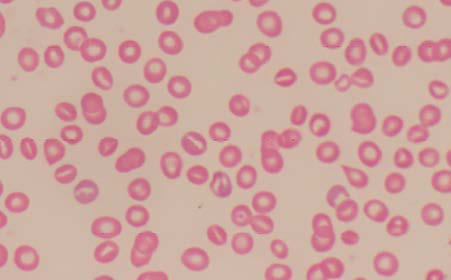
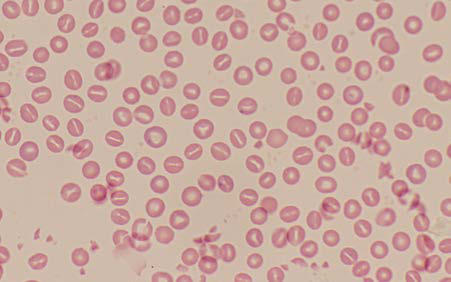

# Chapter 509: Hereditary Stomatocytosis Syndromes

*Stephanie Prozora and Patrick G. Gallagher*

<!-- p.3768 -->
**Southeast Asian ovalocytosis (SAO)** is a disorder characterized by the presence of ovalocytes (less elongated and plumper than ellipto cytes), some with one or two transverse ridges on peripheral smear. SAO is found in individuals from New Guinea, Malaysia, Indonesia, and the Philippines. Unlike HE and HPP, SAO is due to a variant in a transmembrane protein, band 3, affecting vertical skeletal interactions and leading to increased red cell rigidity. These changes may lead to protection from malaria, particularly cerebral malaria.

**ETIOLOGY** Various molecular defects have been described in HE. HE is inherited as an autosomal dominant disorder with occasional de novo cases. Most commonly, there are missense pathogenic variants of α- or βspectrin that interfere with the formation of spectrin heterodimers into tetramers, the primary structural unit of the membrane skeleton (see Fig. 507.1). Erythrocytes carrying many of these spectrin patho genic variants are resistant to malaria in vitro, hypothesized to explain the increased prevalence of HE in malaria-endemic areas. Less com monly, elliptocytosis results from pathogenic variants in protein 4.1 or glycophorin C, proteins of the junctional complex that link spectrin tetramers to the actin cytoskeleton. These defects in horizontal mem brane skeleton protein interactions leave the cell susceptible to shear ing forces, leading to the characteristic elliptical deformation of the cell and potentially membrane fragmentation.

In HPP, two abnormal spectrin alleles are inherited. Frequently, an HPP patient inherits an abnormal spectrin allele carrying a self-association site missense variant from one parent, who has mild or asymptomatic HE, and a production-defective allele that leads to quantitative deficiency of spectrin from the other parent, who is otherwise clinically well.

SAO is an autosomal dominant disorder associated with an inframe, nine amino acid deletion in band 3.

**CLINICAL MANIFESTATIONS** Most HE patients do not have clinically significant hemolysis (see Fig. 507.4B). HE may be an incidental finding on a blood film examina tion for an unrelated indication. The diagnosis of HE is established by the findings on the peripheral blood smear, the autosomal dominant inheritance pattern, and the absence of other causes of elliptocytosis. The differential diagnosis for other causes of elliptocytosis includes deficiencies of iron, folic acid, and vitamin B12, thalassemia, myelodys plastic syndromes, and pyruvate kinase deficiency.

Interestingly, elliptocytes are not always present on the periph eral blood smear in the first few months of life. Even in hemolytic HE, which may lead to neonatal jaundice and anemia, the peripheral blood smear typically shows bizarre poikilocytes and pyknocytes with rare to no elliptocytes. Hemolysis and anemia are aggravated in the newborn period because of the increased presence of hemoglobin F, which binds poorly to 2,3-diphosphoglycerate. The increased free 2,3-diphosphoglycerate tends to destabilize the spectrin–actin–protein 4.1 complex, leading to membrane instability (see Fig. 507.1). The usual features of a chronic hemolytic process due to hemolytic HE manifest as anemia, jaundice, and splenomegaly. Cholelithiasis may occur in later childhood and aplastic crises have been reported. HPP is characterized by extreme microcytosis (mean corpuscular volume [MCV], 50-65 fL/ cell), extraordinary variation in cell size and shape, and microsphero cytosis with occasional elliptocytosis (see Fig. 507.4C). Hemolysis is chronic and significant.

SAO is associated with neonatal hyperbilirubinemia, but it is associ ated with little to no hemolysis later in life.

**LABORATORY FINDINGS** Examination of the peripheral blood smear is essential to establish the diagnosis of HE (see Fig. 507.4*B*). HE elliptocytes are normochromic and normocytic with varying degrees of elongation. Because some HE patients may present with relatively low numbers of elliptocytes, there is no cutoff percentage that is useful diagnostically. In hemolytic HE, other abnormal RBC shapes may be present, depending on the sever ity of hemolysis, including spherocytes, pyknocytes, and other poikilo cytes. In HPP, microspherocytes, red cell fragments, and occasional

elliptocytes are seen. SAO is suggested when ovalocytes, which in con trast to elliptocytes are less elongated, are observed.

Reticulocyte levels and other markers of hemolysis, such as total bilirubin, lactate dehydrogenase, and haptoglobin, are helpful in estab lishing the severity of hemolysis, if present. In hemolytic HE and HPP, additional testing may include the eosin-5-maleimide (EMA) binding test, which detects binding to band 3 by flow cytometry, or incubated osmotic fragility testing. In cases of chronic hemolysis, splenomegaly and cholelithiasis can be assessed with abdominal ultrasound.

**TREATMENT** If the presentation is that of typical HE (i.e., an isolated peripheral blood smear abnormality without clinically evident hemolysis), no treatment is necessary. For chronic HE and HPP, red blood cell transfusions are occasionally required. Splenectomy decreases the hemolysis and should be considered using criteria similar to that of hereditary spherocytosis. If hemolysis continues after splenectomy, patients should receive folic acid to prevent secondary folic acid deficiency. SAO does not require treatment beyond the newborn period.

*Visit Elsevier eBooks+ at eBooks.Health.Elsevier.com** for Bibliography.*

The hereditary stomatocytosis syndromes are a group of heteroge neous, dominantly inherited disorders in which alterations in red cell cation permeability lead to alterations in intracellular water content (Table 509.1). A net increase in sodium and potassium ions allows water to enter the erythrocyte, creating stomatocytes or hydrocytes, whereas a net loss of sodium and potassium ions leads to water loss, creating dehydrated red cells, or xerocytes (Fig. 509.1).

**HEREDITARY XEROCYTOSIS Pathophysiology** Hereditary xerocytosis, the most common type of the hereditary stomatocytosis syndromes, is a dominant disorder of erythrocyte dehydration. The underlying defect is most commonly a missense variant in *PIEZO1*, a mechanosensory transduction protein, associ ated with delayed channel inactivation. In a few patients, pathogenic variants in the Gardos channel, important in erythrocyte dehydra tion in sickle cell disease, have been observed. Typically, there is a net loss of intracellular potassium that is not accompanied by a compensatory increase in sodium. Subsequently, the gradual loss of intracellular water leads to erythrocyte dehydration. Hereditary xerocytosis may be associated with a syndrome of hydrops fetalis with perinatal anemia and ascites. These findings are transient and remain unexplained.

**Clinical Features** Affected patients exhibit a mild compensated macrocytic hemolytic anemia with variable degrees of splenomegaly and intermittent jaun dice. The mean corpuscular hemoglobin concentration (MCHC) and mean cell volume (MCV) are elevated, and erythrocyte osmotic fragil ity is decreased, as are potassium concentration and total monovalent cation content. There are small numbers of stomatocytes, target cells, and contracted red blood cells (RBCs) with hemoglobin puddled to the side on peripheral blood smear. Treatment is supportive, similar

*Stephanie Prozora and Patrick G. Gallagher*

<!-- p.3770 -->

#### **Table 509.1** Features of Hereditary Stomatocytosis-Xerocytosis Syndromes

| Category / Parameter | Clinical Details & Findings |
| --- | --- |
| **HYPERKALEMIA** | Hemolysis; Severe; Mild to moderate; Mild to moderate; Mild (neonatal; only); Moderate; Mild or none; Anemia; Moderate to severe; Mild to moderate; Mild to moderate to; completely; compensated; Mild (neonatal; only); Mild to; moderate to; completely; compensated; None; Blood smear; Stomatocytes; ±; spherocytes; Stomatocytes; ±; spherocytes; Stomatocytes,; sometimes with; curved or offset; stoma; ±; spherocytes; ± target; cells; Rounded; elliptocytes,; some with a; double central; clearing and; a theta (θ); shape; ±; stomatocytes; Target cells;; sometimes; small; numbers of; echinocytes or; stomatocytes; Target cells; few; stomatocytes |
| **MCV** | Increased; Normal to; increased; Normal to; increased; High normal to; increased; Normal to; increased |
| **MCHC** | Decreased; Normal to; decreased; Normal to; increased; Normal to; increased; Normal to; increased; Unincubated; osmotic fragility; Very increased; Variable; Variable; Unknown; Decreased; to very; decreased; Slightly; decreased; RBC Na+; (5-12 mEq/L)*; 60-150; 30-60; 15-100; Normal; 5-30; 10-30 |
| **RBC K+** | (90-105 mEq/L)*; 20-55; 40-85; 30-100; Normal; 60-90; 75-100; RBC Na+ + K+; (95-110 mEq/L)*; 110-170; 115-145; 70-130; Normal; 70-100; 85-110; RBC passive; membrane; leak*†; 20-40; ~3-10; 1-6; 2-4; 2-4; 1-2; Cold hemolysis; No; Unknown; Yes; Yes; No; No; Pseudohyperkalemia Sometimes; Unknown; Yes; Unknown; Sometimes; Yes; Perinatal ascites; No; Unknown; No; No; Sometimes; No; Stomatin; markedly; decreased; Yes; No; No (type 1); Yes (type 2); No; No; No; Effect of; splenectomy; on hemolysis; Some benefit; Some benefit; Minimal or no effect; No significant; hemolysis; No effect; No significant; hemolysis; Thromboembolism; risk after; splenectomy; Yes; Unknown; ?Yes; Unknown; Yes; Unknown; Genetics; Autosomal; dominant; Autosomal; dominant; Autosomal; dominant; Autosomal; dominant; Autosomal; dominant; Autosomal; dominant; Defective gene(s) |
| **KHAG** | Band 3 (SLC4A1); Type 1: Band 3 |
| **(SLC4A1)** | Type 2: Glut 1 |
| **(SLC2A1)** | Band 3 (SLC4A1); in-frame dele; tion |
| **PIEZO1, ABCR6** | *Based on a relatively small number of measurements reported in the literature.; †Times normal. Defined as the ouabain- and bumetanide-resistant 86Rb+ influx at 37°C, and expressed as the ratio of patient residual leak to normal residual leak (normal: 0.06-0.10 mmol/L; RBC/hr).; MCHC, Mean corpuscular hemoglobin concentration; MCV, mean cell volume; RBC, red blood cell.; From Orkin SH, Fisher DE, Ginsburg D, et al., eds. Nathan and Oski's Hematology and Oncology of Infancy and Childhood, 8th ed. Philadelphia: Elsevier, 2015: 561; Table 16.12. |

<!-- p.3771 -->
to other disorders with congenital hemolytic anemia. Because of the apparent predisposition to major thromboses postsplenectomy, *sple nectomy is not recommended in hereditary xerocytosis and related dis orders.* Another unusual manifestation of hereditary xerocytosis is the propensity for iron overload, independent of transfusion history. Thus iron indices should be monitored at regular intervals.

**HEREDITARY HYDROCYTOSIS Pathophysiology** Hereditary hydrocytosis is a very rare, dominant disorder associated with large, swollen stomatocytic erythrocytes. The principal defect is an increase in Na+ and K+ permeability, leading to markedly increased intracellular sodium and water content. The molecular defect is unknown in most cases. In a subset of cases, missense variants in the Rh-associated glycoprotein (RhAG) have been identified.

**Clinical Features** Hereditary hydrocytosis is the most clinically severe disorder of altered erythrocyte volume regulation. It is characterized by moderate to severe hemolysis and macrocytosis (110-150 fL), with a low MCHC (24–30%), elevated erythrocyte sodium concentration, reduced potas sium concentration, increased total Na+ and K+ content, and increased erythrocyte osmotic fragility. There are large numbers (10–30%) of sto matocytes on peripheral blood smear. Patients typically develop jaun dice, splenomegaly, and cholelithiasis.

Treatment is supportive. RBC transfusions are occasionally required. Patients should be followed for evidence of hematologic decompensation during acute illness. Interval ultrasonography to detect cholelithiasis should be obtained. When there is significant hemolysis, folate should be prescribed daily. Similar to hereditary xerocytosis, significant postsplenectomy major thromboses have been observed; thus splenectomy is not recommended in hereditary hydrocytosis.

**INTERMEDIATE SYNDROMES AND OTHER VARIANTS** Hereditary xerocytosis and hereditary hydrocytosis are at the extremes of disorders with alterations in erythrocyte permeability. Patients with intermediate defects have been described with vary ing degrees of hemolysis and anemia. One of these intermediate syndromes is **cryohydrocytosis** in which affected patients typically suffer from mild anemia associated with stomatocytes, spherocytes, and sphero-stomatocytes on peripheral blood smear. Cryohydro cytosis erythrocytes are deficient in band 3 and demonstrate a sig nificant cation leak upon cooling to low temperature (*kyros* = cold). This disorder is due to missense variants in band 3 that likely con vert band 3 from an anion exchanger to a nonselective cation leak channel.

**Rh deficiency syndrome,** also known as Rhnull syndrome, is mild to moderate hemolytic anemia associated with markedly decreased (Rhmod) or absent (Rhnull) Rh antigens on the erythrocyte membrane. Rhnull erythrocytes, which lack all Rh antigens, LW, and Fy5 antigens and have decreased reduced expression of Ss, U, and Duclos antigens, are dehydrated with decreased cell cation and water content. Findings on blood smear include reticulocytes, stomatocytes, and spherocytes. In response to immunization during pregnancy or after blood trans fusion, Rhnull patients produce antibodies varying in specificity from reacting to anti-e or anti-C to reacting with all erythrocytes tested, an antibody called “anti-total Rh.”

**Familial deficiency of high-density lipoproteins (Tangier disease)** is a rare recessive disorder that results from pathogenic variants in the cholesterol and phospholipid transport protein ABCA1, which lead to perturbations of cellular cholesterol transport and result in the accu mulation of cholesterol esters in many tissues. Hematologic manifesta tions include a mild to moderate stomatocytic hemolytic anemia and thrombocytopenia. Affected patients can also have large orange tonsils, hepatosplenomegaly, lymphadenopathy, cloudy corneas, peripheral neuropathy, and premature atherosclerosis.

**Sitosterolemia**, also known as phytosterolemia, is a recessive dis order in which the absorption of sterols, both cholesterol and its plant-derived relatives (e.g., sitosterol), is unlimited and unselec tive. Clinical manifestations include early-onset xanthomatosis, short stature, and premature coronary artery disease. Hematologic abnor malities include macrothrombocytopenia and stomatocytic hemo lytic anemia. The plasma cholesterol may or may not be abnormal, but mass spectrometry always shows a massive increase in plant sterol lev els in the plasma and in the membranes of platelets and erythrocytes. Pathogenic variants in *ABCG5* or *ABCG8*, transporters that actively pump plant sterols out of intestinal cells back into the intestine and out of liver cells into bile ducts, lead to gastrointestinal hyperabsorp tion and decreased biliary elimination of plant sterols, as well as altered cholesterol metabolism. Treatment involves dietary restriction of cholesterol and plant sterols and prescription of ezetimibe, a sterol absorption inhibitor, and cholestyramine and other related bile acid– sequestering agents.

**OTHER DISORDERS ASSOCIATED WITH STOMATOCYTOSIS** Acquired stomatocytosis may be seen with liver disease, alcohol ism, malignancy, and cardiovascular disease and after vinca alkaloid administration. Stomatocytes can be seen as a blood smear–processing artifact.

*Visit Elsevier eBooks+ at eBooks.Health.Elsevier.com** for Bibliography.*

A

B

**Fig. 509.1** Peripheral blood smears. A, Hereditary xerocytosis. B, Hereditary hydrocytosis.

<!-- p.3772 -->
