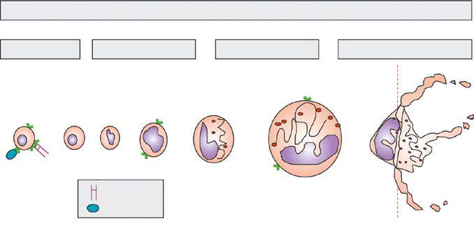
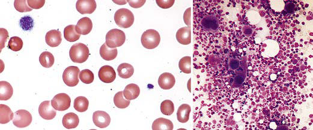

# Chapter 533: Platelet and Blood Vessel Disorders

*Brian R. Branchford, Benjamin J. Samelson-Jones, and Veronica H. Flood*

<!-- p.3895 -->
**MEGAKARYOPOIESIS** Platelets are anuclear cellular fragments produced by megakaryocytes (large polyploid cells) within the bone marrow, lung, and other tis sues. When the megakaryocyte approaches maturity, budding of the cytoplasm occurs, and large numbers of platelets are liberated. Platelets circulate with a life span of 7-10 days. **Thrombopoietin (TPO)** is the primary growth factor that controls platelet production (Fig. 533.1). Levels of TPO appear to correlate inversely with platelet number and megakaryocyte mass, with highest expression in the thrombocytopenic states associated with decreased marrow megakaryopoiesis, and may be variable in states of increased platelet production.

The platelet plays multiple hemostatic roles. The platelet surface pos sesses a number of important receptors for adhesive proteins, including **von Willebrand factor (VWF)** and fibrinogen, as well as receptors for agonists that trigger platelet aggregation, such as thrombin, collagen, and adenosine diphosphate (ADP). After injury to the blood vessel wall, the extracellular matrix containing adhesive and procoagulant proteins is exposed. Subendothelial collagen binds VWF, which then undergoes a conformational change that induces binding of the platelet glyco protein Ib (GPIb) complex, the VWF receptor. This process is called *platelet adhesion.* Platelets then undergo activation. During the process of activation, the platelets generate thromboxane A2 from arachidonic acid via the enzyme cyclooxygenase. After activation, platelets release agonists, such as ADP, adenosine triphosphate (ATP), calcium ions (Ca2+), serotonin, and coagulation factors, into the surrounding milieu from dense and alpha granules. Binding of VWF to the GPIb complex triggers a complex signaling cascade that results in activation of the fibrinogen receptor, the major platelet integrin glycoprotein αIIb-β3 (GPIIb-IIIa). Circulating fibrinogen binds to this receptor on activated platelets, linking platelets in a process called *aggregation.* This series of events forms a hemostatic plug at the site of vascular injury. The serotonin and histamine that are liberated during activation increase

local vasoconstriction. In addition to acting in concert with the vessel wall to form the platelet plug, the platelet provides the catalytic phos pholipid surface on which coagulation factors assemble and eventually generate thrombin through a sequential series of enzymatic cleavages. Lastly, the platelet contractile proteins and cytoskeleton mediate clot retraction.

**THROMBOCYTOPENIA** The normal platelet count is 150-450 × 109/L. *Thrombocytopenia* refers to a reduction in platelet count to <150 × 109/L, although clinically significant bleeding is not seen until counts drop well below 50 × 109/L. Causes of thrombocytopenia include decreased production on either a congenital or an acquired basis, sequestration of the platelets within an enlarged spleen or other organ, and increased destruction of nor mally synthesized platelets on either an immune or a nonimmune basis (Tables 533.1-533.3, Fig. 533.2, and Chapter 524).

## 533.1  Immune Thrombocytopenia Brian R. Branchford and Veronica H. Flood

The most common cause of acute onset of thrombocytopenia in an otherwise-well child is immune thrombocytopenia **(ITP)** (also called immune or idiopathic thrombocytopenic purpura).

**EPIDEMIOLOGY** In a small number of children, estimated at 1/20,000, 1-4 weeks after exposure to a common viral infection, an autoantibody directed against the platelet surface develops with resultant sudden onset of thrombocy topenia. A recent history of viral illness is described in 50–65% of chil dren with ITP. The peak age is 1-4 years, although the age ranges from early in infancy to elderly. In childhood, males and females are equally affected. ITP seems to occur more often in late winter and spring after the peak season of viral respiratory illness. Approximately 5–10% of ITP may recur more than 3 months after initial disease resolution.

**PATHOGENESIS** The exact antigenic target for most such antibodies in most cases of childhood acute ITP remains undetermined, although in chronic ITP, many patients demonstrate antibodies against αIIb-β3 and GPIb. After binding of the antibody to the platelet surface, circulating antibodycoated platelets are recognized by the Fc receptor on splenic macro phages, ingested, and destroyed. The most common identifiable viruses that have been described in association with ITP include Epstein-Barr

*Brian R. Branchford, Benjamin J. Samelson- Jones, and Veronica H. Flood*

**Fig. 533.1** Scheme of megakaryocytopoiesis and platelet production in immune thrombocy topenia (ITP). Hematopoietic stem cells (HSC) are mobilized, and megakaryocyte (MK) and erythroid progenitors (MEP) accumulate with MK-committed progenitors (MKP), giving rise to mature MKs un der control of thrombopoietin (TPO) working with chemokines, cytokines, and growth factors, includ ing stem cell factor (SCF) and interleukin (IL)-3, IL-6, and IL-11. Endoreplication results in ploidy changes in MKs and increased chromosome number (up to 64N). Mature MKs migrate to the endothelial cell barrier delimiting the vascular sinus and, under the influence of stromal-derived factor-1 (SDF-1), give rise to proplatelets that protrude into the circula tion and produce large numbers of platelets under hemodynamic determinants. Therapeutically given romiplostim and eltrombopag enter the marrow and join with TPO to stimulate megakaryocytopoiesis and platelet production. (From Nurden AT, Viallard JF, Nurden P. New-generation drugs that stimulate platelet production in chronic immune thrombocy topenic purpura. Lancet 2009;373:1563–1569.)

**Upgrade of megakaryocytopoiesis and platelet production in ITP**

Proliferation

TPO

HSC c-MPL

+SCF, IL-3, IL-6, IL-11

MEP MKP

TPO

MK

2-4N

c-MPL

+IL-11

MK

8-64N

TPO Stromal cells

+SDF-1

Mature

MK

c-MPL Romiplostim

Eltrombopag

Bone marrow Vascular sinus

**Endothelial cell**

**barrier**

Enhanced JAK2/Stat5

signalling

Endoreplication Maturation Proplatelet formation

<!-- p.3896 -->
virus (EBV; see Chapter 301) and HIV (see Chapter 322), and ITP is also noted as a rare occurrence after measles, mumps, and rubella (MMR) vaccination. EBV-related ITP is usually of short duration and follows the course of infectious mononucleosis. HIV-associated ITP is usu ally chronic. In some patients, ITP appears to arise in children infected with *Helicobacter pylori* or rarely after vaccines. The SARS-CoV-2

virus responsible for the COVID-19 infection has been associated with development of ITP, as have some of the vaccines for this virus.

**CLINICAL MANIFESTATIONS** The classic presentation of ITP is a previously healthy 1–4-year-old child who has sudden onset of generalized petechiae and purpura. The parents often state that the child was fine the previous day but is now covered with bruises and purple dots. There may be bleeding from the gums and mucous membranes, particularly with *profound thrombocy topenia* (platelet count <10 × 109/L). There is a history of a preced ing viral infection 1-4 weeks before the onset of thrombocytopenia. Findings on physical examination are typically normal, other than petechiae and purpura. *Splenomegaly, lymphadenopathy, bone pain, and pallor are rare.* A simple classification system to characterize the severity of bleeding in ITP on the basis of symptoms and signs rather than platelet count includes: 1.	No symptoms 2.	Mild symptoms: Bruising and petechiae, occasional minor epistaxis,

very little interference with daily living 3.	Moderate symptoms: More severe skin and mucosal lesions, more

troublesome epistaxis, and menorrhagia 4.	Severe symptoms: Bleeding episodes—menorrhagia, epistaxis, me

lena—requiring transfusion or hospitalization, symptoms interfer ing seriously with the quality of life The presence of abnormal findings such as hepatosplenomegaly, bone or joint pain, remarkable lymphadenopathy, other cytopenias, or congenital anomalies suggests other diagnoses (e.g., leukemia, genetic syndromes). When the onset is insidious, especially in an adolescent, chronic ITP or the possibility of a systemic illness, such as **systemic lupus erythematosus** (SLE), is more likely. In addition, presentation at an atypical age (neonates, adolescents) should suggest an underlying disease.

**OUTCOME** Severe bleeding is rare (<3% of cases in one large international study). In 70–80% of children who present with acute ITP, spontaneous reso lution occurs within 6 months. Therapy does not appear to affect the natural history of the illness. Fewer than 1% of patients develop an **intracranial hemorrhage** (ICH). Proponents of interventional therapy argue that the objective of early therapy is to raise the platelet count to >20 × 109/L and prevent the rare development of ICH. There is no evidence that therapy prevents serious bleeding. Approximately 20% of children who present with acute ITP go on to have chronic ITP. The outcome/prognosis may be related more to age; ITP in younger chil dren is more likely to resolve, whereas development of chronic ITP in adolescents approaches 50%.

**LABORATORY FINDINGS* Severe thrombocytopenia* (platelet count <20 × 109/L) is common, and platelet size is normal or increased, reflective of increased platelet turn over (Fig. 533.3). In acute ITP, the hemoglobin value, white blood cell (WBC) count, and differential count are usually normal. Hemoglobin may be decreased in the context of profuse nosebleeds (epistaxis) or menorrhagia. Bone marrow examination, *which is not routinely indi cated in this disease*, shows normal granulocytic and erythrocytic series, with characteristically normal or increased numbers of mega karyocytes. Some of the megakaryocytes may appear to be immature and reflect increased platelet turnover. *Indications for bone marrow aspiration/biopsy* include an abnormal WBC count or differential or unexplained anemia, as well as history and physical examination find ings suggestive of a bone marrow failure syndrome or malignancy. Other laboratory tests should be performed as indicated by the history and examination. HIV studies should be done in at-risk populations, especially sexually active teens. Platelet antibody testing is seldom use ful in acute ITP. A direct antiglobulin test (Coombs) should be done if there is unexplained anemia to rule out **Evans syndrome** (autoimmune hemolytic anemia and thrombocytopenia; see Chapter 506). Evans syndrome may be idiopathic or an early sign of SLE, autoimmune lym phoproliferative syndrome, or common variable immunodeficiency

Children and Adolescents

#### **Table 533.1** Differential Diagnosis of Thrombocytopenia in

| Category / Parameter | Clinical Details & Findings |
| --- | --- |
| **Primary Platelet Consumption Syndromes** | Immune thrombocytopenias; Acute and chronic ITP; Autoimmune diseases with chronic ITP as a manifestation; • Cyclic thrombocytopenia; • Autoimmune lymphoproliferative syndrome and its variants; • Systemic lupus erythematosus; • Evans syndrome; • Antiphospholipid antibody syndrome; • Neoplasia-associated immune thrombocytopenia; Thrombocytopenia associated with HIV; Neonatal immune thrombocytopenia; • Alloimmune; • Autoimmune (e.g., maternal ITP); Drug-induced immune thrombocytopenia (including heparin-; induced thrombocytopenia); Posttransfusion purpura; Allergy and anaphylaxis; Posttransplant thrombocytopenia; Nonimmune thrombocytopenias; Thrombocytopenia of infection; • Bacteremia or fungemia; • Viral infection; • Protozoan; Thrombotic microangiopathic disorders; • Hemolytic-uremic syndrome; • Eclampsia, HELLP syndrome; • Thrombotic thrombocytopenic purpura; • Bone marrow transplantation–associated microangiopathy; • Drug induced (quinine, etc.); Platelets in contact with foreign material; Congenital heart disease; Drug-induced via direct platelet effects (ristocetin, protamine); Type 2B VWD or platelet-type VWD |
| **Combined Platelet and Fibrinogen Consumption Syndromes** | Disseminated intravascular coagulation; Kasabach-Merritt syndrome; Hemophagocytic lymphohistiocytosis (inherited or acquired) |
| **IMPAIRED PLATELET PRODUCTION** | Hereditary disorders (see Table 533.2); Acquired disorders; • Aplastic anemia; • Myelodysplastic syndrome; • Marrow infiltrative process—neoplasia; • Osteopetrosis; • Nutritional deficiency states (iron, folate, vitamin B12, anorexia nervosa); • Drug- or radiation-induced thrombocytopenia; • Neonatal hypoxia or placental insufficiency |
| **SEQUESTRATION** | Hypersplenism; Hypothermia; Burns |
| **ASSOCIATION WITH OTHER DISEASES** | Fanconi anemia; Congenital amegakaryocytic thrombocytopenia; Shwachman-Diamond syndrome; Hemophagocytic lymphohistiocytosis; TAFRO syndrome; HELLP, Hemolysis, elevated liver enzymes, and low platelets; HIV, human immunode; ficiency virus; ITP, immune thrombocytopenic purpura; TAFRO, thrombocytopenia,; ascites, myelofibrosis renal dysfunction, organomegaly (a variant of multicentric; Castleman disease); VWD, von Willebrand disease.; From Wilson DB. Acquired platelet defects. In: Orkin SH, Fisher DE, Ginsburg D, et al.,; eds. Nathan and Oski’s Hematology and Oncology of Infancy and Childhood, 8th ed.; Philadelphia: Elsevier, 2015: Box 34.1, p. 1077. |

<!-- p.3897 -->
*Continued*

#### **Table 533.2** Inherited Platelet Disorders

| Category / Parameter | Clinical Details & Findings |
| --- | --- |
| **DEFECTS IN PLATELET ADHESION** | Bernard-Soulier syndrome |
| **(BSS)** | Autosomal recessive:; GP1BA (17p13); GP1BB (22q11); GP9 (3q21); Autosomal dominant:; Ala156Val, GP1BA - Bolzano; variant; • Often severe bleeding phenotype; • Thrombocytopenia; • Large platelets; • Platelet aggregation: absent; ristocetin-induced response; • Flow cytometry: reduced or; absent CD42a (GPIX)/CD42b; (GP1bα); • GP1BA & GP1BB gene; sequencing; • Supportive care; • Platelet transfusion (risk of; alloantibodies); • Antifibrinolytics; • rFVIIa; Velocardiofacial/DiGeorge; syndrome |
| **(VCFS)** | 22q11.2 deletion including GP1BB; • Thrombocytopenia; • Large platelets and α-granules; • Cardiac, thymus, parathyroid,; facial, and cognitive abnormalities; • Supportive care; Platelet-type von Willebrand; disease |
| **(PT-VWD)** | Autosomal dominant:; gain of function variants in GP1BA; • Thrombocytopenia; • Large platelets; • Platelet clumping; • Decreased VWF:Ag, VWF; multimers; • Platelet aggregation: low dose; ristocetin-induced platelet; agglutination; • GP1BA gene sequencing; • Supportive care; • Platelet transfusion; • Antifibrinolytics; • rFVIIa |
| **DEFECTS OF PLATELET AGGREGATION** | Glanzmann thrombasthenia |
| **(GT)** | Autosomal recessive: |
| **ITGA2B (17Q21.32)** | ITGB3 (17q21.32); • Often severe bleeding phenotype; • Normal platelet count and; morphology; • Platelet aggregation: absent; response to all agonists except; ristocetin; • Flow cytometry: absent or; reduced CD41 and CD61; • Supportive care; • rFVIIa (considered the first line); • Platelet transfusion (risk of HPA; alloantibodies); • Antifibrinolytics |
| **DEFECTS IN AGONISTS RECEPTORS** | Thromboxane-prostanoid (TP); receptor defects; Autosomal recessive; TBXA2R (19p13.3); • Mild bleeding phenotype; • Platelet aggregation: abnormal; response to arachidonic acid and |
| **U46619** | • TBXA2R gene sequencing; • Supportive care; ADP receptor defects P2Y12; Autosomal recessive; P2RY12 (3q23–25); • Mild bleeding phenotype; • Platelet aggregation: abnormal; response to ADP; • P2RY12 gene sequencing; • Supportive care; Collagen receptor defects |
| **GPVI** | Autosomal recessive; GP6 (19q13.4); • Mild bleeding phenotype; • Platelet aggregation: abnormal; response to collagen; • GP6 gene sequencing; • Supportive care |
| **PLATELET GRANULES DEFECTS (Α-GRANULES)** | Gray platelet syndrome (GPS); Autosomal recessive; NBEAL2 (3p21); • Progressive myelofibrosis; • Thrombocytopenia; • Large pale platelets on blood; smears; • Absent α-granules on TEM; • NBEAL2 gene sequencing; • Supportive care; • Antifibrinolytics |
| **• DDVAP** | • Platelet transfusion; • Splenectomy; Arthrogryposis, renal dys; function, and cholestasis; syndrome; (ARC syndrome); Autosomal dominant; VPS33B (15q26); VIPAS39 (14q24); • Thrombocytopenia; • Large pale platelets on blood; smears; • Absent α-granules on TEM; • Lethal early in life; • VPS33B & VIPAS39 sequencing; • Supportive care; • Platelet transfusion; • Antifibrinolytics |

<!-- p.3898 -->
syndrome. An antinuclear antibody should be considered in adoles cents, especially with other features of SLE (see Chapter 199).

**DIAGNOSIS AND DIFFERENTIAL DIAGNOSIS** The well-appearing child with moderate to severe thrombocytopenia, an otherwise normal complete blood cell count (CBC), and normal exam findings has a limited differential diagnosis that includes exposure to medication inducing drug-dependent antibodies, splenic sequestration because of previously unappreciated portal hypertension, and, rarely, early

aplastic processes, such as Fanconi anemia (see Chapter 517). Other than congenital thrombocytopenia syndromes (see Chapter 533.8), such as thrombocytopenia–absent radius (TAR) syndrome and MYH9-related thrombocytopenia, most marrow processes that interfere with platelet production eventually cause abnormal synthesis of red blood cells (RBCs) and WBCs and therefore manifest diverse abnormalities on the CBC. Dis orders that cause increased platelet destruction on a nonimmune basis are usually serious systemic illnesses with obvious clinical findings such as **hemolytic-uremic syndrome** (HUS) and **disseminated intravascular**

#### **Table 533.2** Inherited Platelet Disorders—cont’d

| Category / Parameter | Clinical Details & Findings |
| --- | --- |
| **BLEEDING TREATMENT** | Quebec platelet disorder |
| **(QPD)** | Autosomal recessive; Tandem duplication of PLAU; (10q22.2); • Delayed-onset bleeding not; responding to platelet transfusion; • Variable thrombocytopenia; • Abnormal urokinase in platelets; detected with immunoblot or |
| **ELISA** | • PLAU duplication testing; • Supportive care; • Antifibrinolytics; Paris-Trousseau/Jacobsen; syndrome (PTS); Autosomal dominant; Deletion of chromosome 11q23–24; Hemizygous deletion of FLI1; (11q24.1 – q24.3); • Thrombocytopenia; • Large platelets; • Giant α-granules on TEM; • Immature megakaryocytes in the; bone marrow; • Cognitive, cardiac, and facial; abnormalities; • Supportive care; • Antifibrinolytics; • Platelet transfusion |
| **PLATELET GRANULES DEFECTS (δ-GRANULES)** | Hermansky-Pudlak syndrome |
| **(HPS)** | Autosomal recessive |
| **HPS4, HPS5, HPS6, DTNBP1,** | BLOC1S3, BLOC1S6, and AP3D1); • Decreased to absent δ-granules; • Lumiaggregometry: decreased/; absent ATP release; • Whole-mount EM; • Gene sequencing of 10 candidate; genes; • Oculocutaneous albinism; • Supportive care; • Antifibrinolytics; • Platelet transfusion |
| **• DDAVP** | Chediak-Higashi syndrome |
| **(CHS)** | Autosomal recessive; LYST (1q42 – 1q42.2); • Giant eosinophilic inclusions in; neutrophils; • Decreased to absent δ-granules; • Lumiaggregometry: decreased/; absent ATP release; • Hypopigmentation and immuno; deficiency; • Supportive care |
| **PLATELET CYTOSKELETAL DEFECTS** | Wiskott-Aldrich syndrome; (WAS) / X-linked; thrombocytopenia; X-linked; WAS (Xp11.23 – p11.22) encoding; WAS protein; • Thrombocytopenia; • Small platelets; • Recurrent infections and eczema; • Decreased/absent intracellular; • WASp per immunoblot/ELISA; • WAS gene sequencing; • Supportive care; • Platelet transfusion; • Antifibrinolytics; • Splenectomy (not; recommended); ARPC1B deficiency; Autosomal recessive; ARPC1B (7q22.1); • Small platelets; • Inflammatory disease, recurrent; infections, small vessel vasculitis,; abnormal platelet function; • Decreased/absent intracellular; • ARPC1B per immunoblot; • ARPC1B gene sequencing; • Supportive care; • Antifibrinolytics; • Platelet transfusion; MYH9-related disease |
| **(MYH9-RD)** | Autosomal dominant; MYH9 (22q12–13) encoding; nonmuscle myosin heavy chain IIA; • Thrombocytopenia; • Large platelets; • Döhle-like inclusions in; neutrophils; • Myosin IIA aggregates in; neutrophils - immunofluorescence; microscopy; • Variable degree of renal disease,; sensorineural hearing loss,; presenile cataract; • Supportive care; • Platelet transfusion; • Antifibrinolytics; • THPO receptor agonists; VWF, Von Willebrand factor; HPA, human platelet antigen; ADP, adenosine diphosphate; TEM, transmission electron microscopy; EM, electron microscopy; ELISA, enzyme-linked im; munosorbent assay; DDAVP, desmopressin; THPO, thrombopoietin.; Modified from Al-Huniti A, Kahr WHA. Inherited platelet disorders: diagnosis and management. Transfu Med Rev 2020;34:277–285. Table 1. |

<!-- p.3899 -->
**coagulation** (DIC) (see Fig. 533.2, and Table 532.1 in Chapter 532). Patients receiving heparin may develop heparin-induced thrombocytope nia. Isolated enlargement of the spleen suggests the potential for hyper splenism caused by liver disease or portal vein thrombosis. Autoimmune thrombocytopenia may be an initial manifestation of SLE, HIV infection,

common variable immunodeficiency, and, rarely, lymphoma or autoim mune lymphoproliferative syndrome. Wiskott-Aldrich syndrome (WAS) must be considered in young males found to have thrombocytopenia with *small* platelets, particularly if there is a history of eczema and recurrent infection (see Chapter 165.2). Bernard-Soulier syndrome, on the other hand, involves a macrothrombocytopenia. Gray platelet syndrome is usu ally associated with splenomegaly and pale-colored platelets on peripheral smear.

**TREATMENT** A number of treatment options exist (Table 533.4), but there are no current high-quality data showing that treatment affects either shortor long-term clinical outcome of ITP in children. Many patients with new-onset ITP have mild symptoms, with findings limited to petechiae and purpura on the skin, despite severe thrombocytopenia. Compared with untreated controls, treatment appears to be capable of inducing a more rapid rise in platelet count to the presumed safe level of >20 × 109/L, although no data indicate that early therapy prevents ICH.

Thrombocytopenias*

**WELL**

Mass

Large platelets Normal hemoglobin and WBC

**Consumption**

Immune

ITP 2° to SLE, HIV Drug-induced

Maternal ITP NATP

Non-immune 2B or platelet-type VWD Hereditary macrothrombocytopenia

Small platelets Congenital anomalies n Mean corpuscular volume

p** Synthesis**

Congenital

TAR Wiskott-Aldrich syndrome X-linked Amegakaryocytic Fanconi anemia

Acquired Medications Toxins Radiation

p Fibrinogen n Fibrin degradation products Large platelets

**Consumption**

Microangiopathy Hemolytic-uremic syndrome TTP

Disseminated intravascular coagulation Necrotizing enterocolitis Respiratory distress Thrombosis UAC Sepsis Viral infection

Small platelets HSM

p**Synthesis**

Malignancy Storage disease

**Sequestration**

Hemangioma

Hypersplenism

#### **Table 533.3** Classification of Fetal and Neonatal

| Category / Parameter | Clinical Details & Findings |
| --- | --- |
| **General** | Fetal |
| **Congenital infection (CMV,** | toxoplasma, rubella, HIV,; syphilis) |
| **Aneuploidy (trisomy 18, 13, or** | 21, triploidy, Turner syndrome) |
| **Autoimmune condition** | (maternal ITP, SLE); Severe Rh hemolytic disease; Congenital/inherited; (Wiskott-Aldrich, Noonan,; Cornelia deLange, Jacobsen; syndromes); Early-onset neonatal (<72 hr) |
| **Placental insufficiency (PET,** | IUGR, diabetes) |
| **Perinatal infection (Escherichia** | coli, GBS, herpes simplex) |
| **Autoimmune condition** | (maternal ITP, SLE); Congenital infection (CMV,; toxoplasma, rubella, HIV); Thrombosis (aortic, renal vein); Bone marrow disease (congenital; leukemia, HLH); Kasabach-Merritt syndrome; Metabolic disease (propionic and; methylmalonic acidemia); Congenital/inherited (TAR, |
| **CAMT)** | Late-onset neonatal (>72 hr) |
| **NEC** | Congenital infection (CMV,; toxoplasma, rubella, HIV); Autoimmune; Kasabach-Merritt syndrome; Metabolic disease (propionic and; methylmalonic acidemia); Congenital/inherited (TAR, CAMT); *The most common conditions are shown in bold.; CAMT, Congenital amegakaryocytic thrombocytopenia; CMV, cytomegalovirus; DIC,; disseminated intravascular coagulation; GBS, group B streptococcus; HIV, human; immunodeficiency virus; HLH, hemophagocytic lymphohistiocytosis; ITP, immune; thrombocytopenic purpura; IUGR, intrauterine growth restriction; NEC, necrotizing; enterocolitis; PET, preeclampsia; SLE, systemic lupus erythematosus; TAR,; thrombocytopenia with absent radii.; From Roberts I, Murray NA. Neonatal thrombocytopenia: causes and management.; Arch Dis Child Fetal Neonatal Ed 2003;88:F359–F364. |

**Fig. 533.2** Differential diagnostic algorithm of childhood thrombo cytopenic syndromes. The syndromes initially are separated by their clinical appearance. Clues leading to the diagnosis are shown in italics. The mechanisms and common disorders leading to these findings are shown in the lower part of the figure. Disorders that commonly affect neonates are listed in the shaded boxes. HSM, Hepatosplenomegaly; ITP, immune thrombocytopenia; NATP, neonatal alloimmune thrombo cytopenic purpura; SLE, systemic lupus erythematosus; TAR, thrombo cytopenia–absent radius; TTP, thrombotic thrombocytopenic purpura; UAC, umbilical artery catheter; VWD, von Willebrand disease; WBC, white blood cell. (From Scott JP. Bleeding and thrombosis. In Klieg man RM, ed. Practical Strategies in Pediatric Diagnosis and Therapy. Philadelphia: Saunders, 1996. p. 849; and Kliegman RM, Marcdante KJ, Jenson HB, et al., eds. Nelson Essentials of Pediatrics, 5th ed. Philadelphia: Saunders, 2006. p. 716.)

<!-- p.3900 -->
Antiplatelet antibodies bind to transfused platelets as well as they do to autologous platelets. Thus platelet transfusion in ITP is usually con traindicated unless life-threatening bleeding is present. Management guidelines for ITP in children and adults reinforce existing emphasis on prioritizing watchful waiting for spontaneous resolution or outpatient therapy in the uncommon cases for which treatment is needed. Initial approaches to the management of pediatric ITP include the following: 1.	No therapy other than education and counseling of the family and

patient for patients with minimal, mild, and moderate symptoms, as defined earlier. This approach emphasizes the usually benign nature of ITP and avoids the therapeutic roller coaster that ensues once in terventional therapy is begun. This approach is much less costly, and side effects are minimal. Observation is recommended for children with no bleeding or *only* mild bleeding symptoms such as bruising or petechiae. 2.	Treatment with either intravenous immunoglobulin (IVIG) or cor

ticosteroids, particularly for children who present with *mucocutane ous* bleeding. IVIG at a dose of 0.8-1.0 g/kg/day for 1-2 days induces a rapid rise in platelet count (usually >20 × 109/L) in 95% of pa tients within 48 hours. IVIG appears to induce a response by down regulating Fc-mediated phagocytosis of antibody-coated platelets. IVIG therapy is both expensive and time-consuming and typically requires inpatient admission. Additionally, after infusion, there is a risk of headaches and vomiting, suggestive of IVIG-induced aseptic meningitis. 3.	Corticosteroid therapy has been used for many years to treat acute

and chronic ITP in adults and children. Doses of prednisone at 1-4 mg/kg/day appear to induce a more rapid rise in platelet count than

in untreated patients with ITP. Corticosteroid therapy is usually continued for a short course (approximately 5 days) until a rise in platelet count to >20 × 109/L has been achieved to avoid the longterm side effects of corticosteroid therapy, especially growth failure, diabetes mellitus, and osteoporosis. Each of these medications may also be used to treat subsequent ITP exacerbations/recurrences, which usually occur several weeks after an initial course of therapy in 5–10% of patients. In the special case of ICH, multiple modalities should be used, including platelet transfusion (although not recommended in other bleeding manifestations), IVIG, high-dose corticosteroids, and prompt consultation by neurosurgery and general surgery (splenectomy).

Patients who are bleeding significantly (<5% of children with ITP) should be treated. ICH remains rare, and there are no data showing that treatment actually reduces its incidence. *Mucosal bleeding* in par ticular is the most significant in terms of predicting severe bleeding, but specific predictive indices, such as positive or negative predictive values, are not currently well established.

The role of **splenectomy** in ITP should be reserved for one of two circumstances: (1) the older child (≥4 years) with severe ITP that has lasted >1 year **(chronic ITP)** and whose symptoms are not eas ily controlled with therapy and/or (2) when life-threatening hemor rhage (e.g., ICH) complicates acute ITP if the platelet count cannot be corrected rapidly with transfusion of platelets and administration of IVIG and corticosteroids. Splenectomy is associated with a lifelong risk of overwhelming postsplenectomy infection caused by encapsulated organisms, increased risk of thrombosis, and the potential develop ment of pulmonary hypertension in adulthood. As an alternative to splenectomy**, rituximab** has been used in children to treat chronic ITP. In 30–40% of children, rituximab has induced a partial or complete remission. TPO receptor agonists have also been used to increase plate let count and are approved for pediatric use.

**CHRONIC AUTOIMMUNE THROMBOCYTOPENIC PURPURA** Approximately 20% of patients who present with acute ITP have per sistent thrombocytopenia for >12 months and are said to have *chronic* ITP. At that time, a careful reevaluation for associated disorders should be performed, especially for autoimmune disease (e.g., SLE), chronic infectious disorders (e.g., HIV), and nonimmune causes of chronic thrombocytopenia, such as type 2B and platelet-type von Willebrand disease (VWD), X-linked thrombocytopenia, autoimmune lymphop roliferative syndrome, common variable immunodeficiency syndrome, autosomal macrothrombocytopenia, and WAS. The presence of coex isting *H. pylori* and hepatitis C infection should be considered and, if found, treated. Therapy should be aimed at controlling symptoms and

#### **Table 533.4** Treatment Options for Immune Thrombocytopenia (ITP)

| Category / Parameter | Clinical Details & Findings |
| --- | --- |
| **COST** | Observation; Does not expose patient to; unnecessary medications; May increase parent and physician; anxiety; Relatively inexpensive |
| **IVIG** | Rapid response in most cases; IV administration, side effects; Expensive; Corticosteroids; Oral, effective in 70–80% of; patients, minimal side effects; with short courses; Side effects, may not affect long; term outcome; Inexpensive; Rituximab; Long-term remission in 40–60% of; patients; IV administration, immune sup; pression, potential for reactiva; tion of hepatitis; Very expensive; Splenectomy; Curative in 80% of patients; Requires surgery and anesthesia,; lifelong risk of infection; Expensive; Thrombopoietin receptor agonists; Potential for oral administration,; 40–60% of patients respond; Not curative, usually required long; term, can cause elevated liver; enzymes; Very expensive; IV, Intravenous; IVIG, intravenous immunoglobulin.; Adapted from Flood VH, Scott JP. Bleeding and thrombosis. In: Kliegman R, Lye P, Bordini B, et al. eds. Nelson Pediatric Symptom-Based Diagnosis. Philadelphia: Elsevier, 2017. |

A B

**Fig. 533.3** Blood and marrow aspirate from child with immune throm bocytopenia. A, Blood smear shows large platelets. B, Bone marrow aspirate shows increased numbers of megakaryocytes, many of which appear immature. (From Blanchette V, Bolton-Maggs P: Childhood im mune thrombocytopenic purpura: diagnosis and management. Pediatr Clin North Am 2008;55:393–420. Fig 4.)

<!-- p.3901 -->
preventing serious bleeding. In ITP, the spleen is the primary site of both antiplatelet antibody synthesis and platelet destruction. Splenec tomy is successful in inducing complete remission in 64–88% of chil dren with chronic ITP. This effect must be balanced against the lifelong risk of overwhelming postsplenectomy infection and/or thrombosis. This decision is often affected by quality-of-life issues, as well as the ease with which the child can be managed using medical therapy, such as IVIG, corticosteroids, IV anti-D, or rituximab. Two effective agents that act to stimulate thrombopoiesis, **romiplostim** and **eltrombopag** (see Fig. 533.1), are approved to treat adults and children with chronic ITP. Although these do not address the mechanism of action of ITP, the increase in platelet count may be enough to compensate for the increased destruction and allow the patient to have resolution of bleed ing and maintain a platelet count >50 × 109/L.

*Visit Elsevier eBooks+ at eBooks.Health.Elsevier.com** for Bibliography.*

## 533.2  Drug-Induced Thrombocytopenia Brian R. Branchford and Veronica H. Flood

A number of drugs are associated with immune thrombocytopenia as the result of either an immune process or megakaryocyte injury. Some common drugs used in pediatrics that cause thrombocytopenia include valproic acid, phenytoin, carbamazepine, sulfonamides, van comycin, and trimethoprim-sulfamethoxazole. Most of these drugs may affect platelet function as well as the count itself. Heparin-induced thrombocytopenia (and rarely an associated thrombosis) is seldom seen in pediatrics, but it occurs when, after exposure to heparin, the patient has an antibody directed against the heparin–platelet factor 4 complex. Recommended treatment for heparin-induced thrombocyto penia includes direct thrombin inhibitors such as argatroban or bivali rudin and removal of all sources of heparin, including central venous catheter line flushes.

*Visit Elsevier eBooks+ at eBooks.Health.Elsevier.com** for Bibliography.*

## 533.3  Nonimmune Platelet Destruction Brian R. Branchford and Veronica H. Flood

The syndromes of DIC (see Chapter 532), HUS (see Chapter 560.5), and thrombotic thrombocytopenic purpura (see Chapter 533.5) share the hematologic picture of a thrombotic microangiopathy in which there exists RBC destruction and consumptive thrombocytopenia caused by platelet and fibrin deposition in the microvasculature. The microangiopathic hemolytic anemia is characterized by the presence of RBC fragments, including helmet cells, schistocytes, spherocytes, and burr cells.

## 533.4  Hemolytic-Uremic Syndrome See Chapter 560.5.

## 533.5  Thrombotic Thrombocytopenic Purpura Brian R. Branchford and Veronica H. Flood

Thrombotic thrombocytopenic purpura (TTP) is a rare thrombotic microangiopathy characterized by the pentad of fever, microangio pathic hemolytic anemia, thrombocytopenia, abnormal renal function, and central nervous system (CNS) changes; TTP is clinically similar to HUS (Table 533.5). Although TTP can be congenital, the acquired

form is more common and usually presents in adults and occasionally in adolescents. Microvascular thrombi within the CNS cause subtle, shifting neurologic signs that vary from changes in affect and orien tation to aphasia, blindness, and seizures. Initial manifestations are often nonspecific (weakness, pain, emesis), and prompt recognition of this disorder is critical. Laboratory findings provide important clues to the diagnosis and show microangiopathic hemolytic anemia charac terized by morphologically abnormal RBCs, with schistocytes, sphe rocytes, helmet cells, and an elevated reticulocyte count in association with thrombocytopenia. Coagulation studies are usually nondiagnostic. Blood urea nitrogen and creatinine are sometimes elevated. The **treat ment** of acquired TTP is plasmapheresis (plasma exchange), which is effective in 80–95% of patients. Treatment with plasmapheresis should be instituted on the basis of thrombocytopenia and microangiopathic hemolytic anemia even if other symptoms are not yet present because of the high mortality (80–90%) in patients without timely intervention. Rituximab, corticosteroids, and splenectomy are reserved for refractory cases. *Caplacizumab,* an anti-VWF humanized immunoglobulin, blocks the interaction of ultralarge (i.e., most likely to bind platelets) VWF mul timers with platelets, and many result in rapid resolution of acute TTP.

The majority of cases of TTP are acquired, caused by an autoantibodymediated **deficiency of ADAMTS13** (a disintegrin and metalloprotein ase with a thrombospondin type 1 motif member 13) that is responsible for cleaving the high-molecular-weight multimers of VWF and appears to play a pivotal role in the evolution of the thrombotic microangiopa thy (Fig. 533.4) that results in a preponderance of ultralarge multim ers that more adeptly bind platelets, triggering the microangiopathy. In contrast, levels of ADAMTS13 in HUS are usually normal.

**Congenital ADAMTS13 deficiency** causes rare familial cases of TTP/HUS, usually manifested as recurrent episodes of thrombocytope nia, hemolytic anemia, jaundice, and renal involvement, with or with out neurologic changes, that often present in infancy in the context of an intercurrent illness. Treatment of hereditary TTP with recombinant ADAMTS13 has been successful when patients are refractory to fresh frozen plasma therapy. Abnormalities of the complement system have now also been implicated in rare cases of familial TTP. ADAMTS13 deficiency can be treated by repeated infusions of fresh-frozen plasma.

*Visit Elsevier eBooks+ at eBooks.Health.Elsevier.com** for Bibliography.*

## 533.6  Kasabach-Merritt Syndrome Brian R. Branchford and Veronica H. Flood

See also Chapter 691.

The association of a giant hemangioma with localized intravascu lar coagulation causing consumptive thrombocytopenia and hypofi brinogenemia is called Kasabach-Merritt syndrome. In most patients, the site of the hemangioma is obvious, but retroperitoneal and intraabdominal hemangiomas may require body imaging for detection. Platelet trapping and activation of coagulation occurs inside the hem angioma, with fibrinogen consumption and generation of fibrin(ogen) degradation products. Arteriovenous malformation within the lesions can cause heart failure. Pathologically, Kasabach-Merritt syndrome appears to develop more often as a result of a kaposiform hemangioen dothelioma or tufted hemangioma rather than a simple hemangioma. The peripheral blood smear shows microangiopathic changes.

Multiple modalities have been used to treat Kasabach-Merritt syn drome, including propranolol, surgical excision (if possible), laser photocoagulation, high-dose corticosteroids, local radiation therapy, antiangiogenic agents such as interferon-α2, and vincristine. Over time, most patients who present in infancy have regression of the hem angioma. Treatment of the associated coagulopathy may benefit from a trial of antifibrinolytic therapy with ε-aminocaproic acid (Amicar) or anticoagulation with low molecular weight heparin.

*Visit Elsevier eBooks+ at eBooks.Health.Elsevier.com** for Bibliography.*

<!-- p.3902 -->

<!-- p.3903 -->

<!-- p.3904 -->

<!-- p.3905 -->

<!-- p.3906 -->

## 533.7  Sequestration Brian R. Branchford and Veronica H. Flood

Thrombocytopenia develops in individuals with massive splenomeg aly, such as those with portal vein thrombosis or liver disease, because the spleen acts as a reservoir for platelets and may sequester a large number of them. Most such patients also have mild leukopenia and anemia on CBC. Individuals who have thrombocytopenia caused by splenic sequestration should undergo a workup to diagnose the etiol ogy of splenomegaly, including infectious, inflammatory, infiltrative, neoplastic, obstructive, and hemolytic causes.

## 533.8  Congenital Thrombocytopenic Syndromes Brian R. Branchford and Veronica H. Flood

See Table 533.2.

**Congenital amegakaryocytic thrombocytopenia (CAMT)** usually manifests within the first few days to week of life, when the child pres ents with petechiae and purpura caused by profound thrombocytope nia. CAMT is caused by a rare defect in hematopoiesis as a result of pathogenic variants in the *MPL* gene that encodes the stem cell TPO receptor. Other than skin and mucous membrane abnormalities, find ings on physical examination are normal. Examination of the bone marrow shows an absence of megakaryocytes. These patients often progress to marrow failure (aplasia). Hematopoietic stem cell trans plantation (HSCT) is curative.

**Thrombocytopenia–absent radius (TAR) syndrome** consists of thrombocytopenia (absence or hypoplasia of megakaryocytes) that presents in early infancy with bilateral radial anomalies of variable severity, ranging from mild changes to marked limb shortening (Fig. 533.5). Many such individuals also have other skeletal abnormalities of the ulna, radius, and lower extremities. *Present thumbs help to dif ferentiate this disorder from Fanconi anemia*. Intolerance to cow’s milk formula (present in 50%) may complicate management by triggering gastrointestinal (GI) bleeding, increased thrombocytopenia, eosino philia, and a leukemoid reaction. The thrombocytopenia of TAR syn drome frequently remits over the first few years of life. The molecular basis of TAR syndrome is linked to *RBM8A*. A few patients have been reported to have a syndrome of **amegakaryocytic thrombocytope nia with radioulnar synostosis** caused by a pathogenic variant in the *HOXA11* gene. In contrast to TAR syndrome, this clinical disorder presents with marrow aplasia.

**WAS** is characterized by microthrombocytopenia, with tiny plate lets, eczema, and recurrent infection as a consequence of immune defi ciency (see Chapter 165.2). WAS is inherited as an X-linked disorder, and the gene implicated in WAS has been identified. The WAS protein appears to play an integral role in regulating the cytoskeletal archi tecture of both platelets and T lymphocytes in response to receptormediated cell signaling. The WAS protein is common to all cells of hematopoietic lineage. Molecular analysis of families with X-linked thrombocytopenia has shown that many affected members have a sin gle nucleotide pathogenic variant within the WAS gene, whereas indi viduals with the full manifestation of WAS have large gene deletions. Examination of the bone marrow in WAS shows the normal number of megakaryocytes, although they may have bizarre morphologic features. Transfused platelets have a normal life span in these patients. Splenec tomy often corrects the thrombocytopenia, suggesting that the plate lets formed in WAS have accelerated destruction. After splenectomy, these patients are at increased risk for overwhelming infection and require lifelong antibiotic prophylaxis against encapsulated organisms. Approximately 5–15% of patients with WAS develop lymphoreticular malignancies (involving mostly leukemias and lymphomas). Successful HSCT from an unaffected donor cures WAS. **X-linked macrothrom bocytopenia** and **dyserythropoiesis** have been linked to pathogenic variants in *GATA1*, which encodes an erythroid and megakaryocytic transcription factor.

**MYH9-related thrombocytopenias** include a number of diverse hereditary thrombocytopenia syndromes (e.g., Sebastian, Epstein, May-Hegglin, Fechtner) characterized by autosomal dominant mac rothrombocytopenia, neutrophil inclusion bodies, and a variety of physical anomalies, including sensorineural deafness, renal disease, and eye disease. These have all been shown to be caused by different pathogenic variants in the *MYH9* gene (nonmuscle myosin-IIa heavy chain 9). The thrombocytopenia is usually mild and not progressive. Some other individuals with recessively inherited macrothrombocyto penia have abnormalities in chromosome 22q11. Pathogenic variants in the gene for glycoprotein Ibβ, an essential component of the platelet VWF receptor, can result in **Bernard-Soulier syndrome** (see Chapter 533.13), a macrothrombocytopenic disease. A diagnostic approach to genetic platelet disorders is noted in Figure 533.6.

*Visit Elsevier eBooks+ at eBooks.Health.Elsevier.com** for Bibliography.*

Platelet GPIb

Blood Flow

ADAMTS13

VWF

Subendothelium

#### **Table 533.5** ADAMTS13 Deficiency and Thrombotic Thrombocytopenic Purpura

| Category / Parameter | Clinical Details & Findings |
| --- | --- |
| **MANAGEMENT** | Thrombotic thrombocytopenic; purpura (TTP); Acquired: Ab to ADAMTS13; Congenital: Inadequate; ADAMTS13 production; Ab to ADAMTS13 |
| **ADAMTS13 <10%** | Acquired: Plasmapheresis with; plasma; Congenital: Scheduled plasma; infusions; Autoimmune TTP may be transient, recurrent, drug (ticlopidine, clopidogrel) associated, or seen in some pregnancy-associated cases of TTP.; ADAMTS13 pathogenic variants are often familial and chronic-relapsing RRP. |

**Fig. 533.4** Pathogenesis of thrombotic thrombocytopenic purpura (TTP). The von Willebrand factor (VWF) multimers facilitate platelet ad hesion to the subendothelium by binding to exposed connective tissue and then to platelet glycoprotein Ib (GPIb). In flowing blood shear stress unfolds ultralarge VWF multimers in the platelet-rich thrombus and ena bles ADAMTS13 to cleave a specific Tyr-Met bond in the second of the three A domains in VWF subunits. Cleavage reduces VWF multimer size and limits thrombus growth. In the absence of ADAMTS13, VWF- dependent platelet accumulation continues and eventually results in microvascular thrombosis and TTP. (Courtesy Dr. J. Evan Sadler, Wash ington University.)

<!-- p.3907 -->

<!-- p.3908 -->

## 533.9  Neonatal Thrombocytopenia Brian R. Branchford and Veronica H. Flood

Thrombocytopenia in the newborn rarely is indicative of a primary disorder of megakaryopoiesis. It is usually the result of systemic illness or transfer of maternal antibodies directed against fetal platelets (see Table 533.3). Neonatal thrombocytopenia often occurs in association with congenital viral infections, especially rubella, cytomegalovirus, protozoal infection (e.g., toxoplasmosis), and syphilis, and perinatal bacterial infections, especially those caused by gram-negative bacilli.

Thrombocytopenia associated with DIC may be responsible for severe spontaneous bleeding. The constellation of marked thrombocytopenia and abnormal abdominal findings is common in necrotizing entero colitis and other causes of necrotic bowel. Thrombocytopenia in an ill child requires a prompt search for viral and bacterial pathogens.

Antibody-mediated thrombocytopenia in the newborn occurs because of transplacental transfer of maternal antibodies directed against fetal platelets. **Neonatal alloimmune thrombocytopenia (NAIT)** is caused by the development of maternal antibodies against paternally inherited antigens present on fetal platelets that are recog nized as foreign by the maternal immune system. The incidence of NATP is 1/4,000-5,000 live births. The clinical manifestations of NAIT are those of an apparently well child who, within the first few days after delivery, has generalized petechiae and purpura. Laboratory studies show a normal maternal platelet count but moderate to severe throm bocytopenia in the newborn. Detailed review of the history should show no evidence of maternal thrombocytopenia. Up to 30% of infants with severe NAIT may have ICH, either prenatally or in the perinatal period. Unlike Rh disease, first pregnancies may be severely affected. Subsequent pregnancies are often more severely affected than the first.

The **diagnosis** of NAIT is made by checking for the presence of maternal alloantibodies directed against the father’s platelets. Specific studies can be done to identify the target alloantigen. The most com mon cause is incompatibility for the platelet alloantigen HPA-1a. Spe cific DNA sequence polymorphisms have been identified that permit informative prenatal testing to identify at-risk pregnancies. The differ ential diagnosis of NAIT includes transplacental transfer of maternal IgG antiplatelet autoantibodies (maternal ITP), and, more commonly, viral or bacterial infection.

**Treatment** of NAIT requires the administration of IVIG prena tally to the mother if the status is known before birth. Therapy usu ally begins in the second trimester and is continued throughout the pregnancy. Fetal platelet count can be monitored by percutaneous umbilical blood sampling. Delivery should be performed by cesarean section to reduce risk for ICH from vaginal delivery. After delivery, if severe thrombocytopenia persists, transfusion of platelets that share the maternal alloantigens (e.g., washed maternal platelets) will cause a rise in platelet counts to provide effective hemostasis. However, a ran dom donor platelet transfusion is more likely to be readily available. Some centers have units available that may lack the antigens most often involved. After there has been one affected child, genetic counseling is critical to inform the parents of the high risk of thrombocytopenia in subsequent pregnancies.

Children born to mothers with immune thrombocytopenic purpura **(maternal ITP)** appear to have a lower risk of serious hemorrhage than infants born with NAIT, although severe thrombocytopenia may occur. The mother’s preexisting platelet count may have some predic tive value in that severe maternal thrombocytopenia before delivery appears to predict a higher risk of fetal thrombocytopenia. In mothers who have had splenectomy for ITP, the maternal platelet count may be normal and is not predictive of fetal thrombocytopenia.

Treatment includes prenatal administration of corticosteroids to the mother and IVIG and sometimes corticosteroids to the infant after delivery. Thrombocytopenia in an infant, whether a result of NAIT or maternal ITP, usually resolves within 2-4 months after delivery. The period of highest risk is the immediate perinatal period.

Two syndromes of congenital failure of platelet production often present in the newborn period. In **CAMT** the newborn manifests petechiae and purpura shortly after birth. Findings on physical exami nation are otherwise normal. Megakaryocytes are absent from the bone marrow. This syndrome is caused by a pathogenic variant in the megakaryocyte TPO receptor that is essential for development of all hematopoietic cell lines. Pancytopenia eventually develops, and HSCT is curative. **TAR syndrome** consists of thrombocytopenia that pres ents in early infancy, with bilateral radial anomalies of variable severity, ranging from mild changes to marked limb shortening. It frequently remits over the first few years of life (see Chapter 533.8 and Fig. 533.5).

*Visit Elsevier eBooks+ at eBooks.Health.Elsevier.com** for Bibliography.*

**Fig. 533.5** A newborn, the first child of young, healthy parents, with fully expressed thrombocytopenia–absent radius (TAR) syndrome, in cluding hypereosinophilia and anemia. Hypoplasia of the distal humeri and the shoulder girdles, bilateral hip dysplasia, mild talipes calcaneus, and clinodactyly of both little fingers are seen. This patient had a pro nounced allergy to cow’s milk, with exposure followed by diarrhea, vomiting, and decreased weight and platelet count, making a cow’s milk–free diet mandatory. A persistent depressed nasal bridge and de velopment of pronounced bowed legs are seen. (From Wiedemann H- R, Kunze J, Grosse F-R, eds. Clinical Syndromes, 3rd ed. [English trans lation]. London: Mosby-Wolfe, 1997. p. 430.)

<!-- p.3909 -->

<!-- p.3910 -->
Small platelet

size

Normal platelet

size

BM failure

WAS

XLT CAMT RUSAT

TAR QPD XLTDA MYH9

BSS Pseudo-vWD

22q11 del

GPS JS/PTS GT HPS CHS

Bony defect

Storage pool

deficiency (a-granule)

Storage pool

deficiency (a-granule)

Storage pool

deficiency (dense-granule)

Platelet aggregation

defect

Erythroid dysplasia

Nephritis

SNHL

Platelet adhesion

defect

Large platelet

size

Decreased platelet count Normal platelet count

When IPD is suspected

**Fig. 533.6** Diagnostic algorithm for sequence and flow in inherited platelet disorders (IPDs). BM, bone marrow; WAS, Wiskott-Aldrich syn drome; XLT, X-linked thrombocytopenia; CAMT, congenital amegakaryocytic thrombocytopenia; RUSAT, radioulnar synostosis with amegakaryo cytic thrombocytopenia; TAR, thrombocytopenia-absent radius; QPD, Quebec platelet disorder; XLTDA, X-linked thrombocytopenia with or with out dyserythropoietic anemia; MYH9, MYH9-related disorders; BSS, Bernard-Soulier syndrome; vWD, von Willebrand disease; 22q11 del, 22q11 deletion syndrome; GPS, gray platelet syndrome; JS, Jacobsen syndrome; PTS, Paris-Trousseau syndrome; GT, Glanzmann thrombasthenia; HPS, Hermansky-Pudlak syndrome; CHS, Chediak-Higashi syndrome. (From Shim YJ. Genetic classification and confirmation of inherited platelet disor ders: current status in Korea. CEP 2020;63:79–87. Fig. 2.)

## 533.10  Thrombocytopenia From Acquired Disorders Causing Decreased Production Brian R. Branchford and Veronica H. Flood

Disorders of the bone marrow that inhibit megakaryopoiesis usually affect RBC and WBC production. Infiltrative disorders, including malig nancies, such as acute lymphocytic leukemia, histiocytosis, lymphomas, and storage disease, usually cause either abnormalities on physical exam ination (lymphadenopathy, hepatosplenomegaly, or masses), abnormali ties of the WBC count, or anemia. Aplastic processes may present as isolated thrombocytopenia, although there are usually clues on the CBC (leukopenia, neutropenia, anemia, or macrocytosis). Children with con stitutional aplastic anemia (Fanconi anemia) often (but not always) have abnormalities on examination, including radial and/or thumb anoma lies, other skeletal anomalies, short stature, microcephaly, and hyper pigmentation. Bone marrow examination should be performed when thrombocytopenia is associated with abnormalities found on physical examination or on examination of the other blood cell lines.

## 533.11  Platelet Function Disorders Brian R. Branchford and Veronica H. Flood

There is no simple and reliable test to screen for abnormal platelet function. Bleeding time and the platelet function analyzer (PFA-100) have been used, but neither has sufficient sensitivity or specificity to rule in or rule out a platelet defect, especially one with mild-moderate phenotypic expression. Bleeding time measures the interaction of platelets with the blood vessel wall and thus is affected by both plate let count and platelet function. The predictive value of bleeding time is problematic because bleeding time is dependent on other factors, including the technician’s skill and the patient’s cooperation, often a challenge in the infant or young child; it is not recommended in high resource settings. The PFA-100 measures platelet adhesion and aggre gation in whole blood at high shear when the blood is exposed to

either collagen-epinephrine or collagen-ADP. Results are reported as the closure time in seconds. The use of the PFA-100 as a screening test remains controversial. For patients with a positive history of bleeding suggestive of VWD or platelet dysfunction, specific VWF testing and platelet function studies should be done, irrespective of the results of the bleeding time or PFA-100.

Platelet function in the clinical laboratory is measured using platelet aggregometry. In the aggregometer, agonists, such as collagen, ADP, ris tocetin, epinephrine, arachidonic acid, and thrombin (or the thrombin receptor peptide), are added to platelet-rich plasma, and the clumping of platelets over time is measured by an automated machine through either light transmission or electric impedance. At the same time, other instruments measure the release of granular contents, such as ATP, from the platelets after activation. The ability of platelets to aggregate and their metabolic activity can thus be assessed simultaneously. When a patient is being evaluated for possible platelet dysfunction, it is criti cally important to exclude the presence of other exogenous agents and to study the patient, if possible, off all medications for 2 weeks, espe cially those with any potential antiplatelet effects. Further evaluation using flow cytometric analysis of surface receptors or molecular and/or genetic testing is often necessary to make a more definitive diagnosis.

*Visit Elsevier eBooks+ at eBooks.Health.Elsevier.com** for Bibliography.*

## 533.12  Acquired Disorders of Platelet Function

*Brian R. Branchford and Veronica H. Flood*

A number of systemic illnesses are associated with platelet dysfunc tion, most frequently liver disease, kidney disease (uremia), and dis orders that trigger increased amounts of fibrin degradation products. These disorders frequently cause prolonged bleeding time and are often associated with other abnormalities of the coagulation mechanism. *The most important element of management is to treat the primary ill ness.* If treatment of the primary process is not feasible, infusions of

<!-- p.3911 -->

<!-- p.3912 -->

## 533.13  Congenital Abnormalities of Platelet Function

*Brian R. Branchford and Veronica H. Flood*

Severe platelet function defects usually present with petechiae and purpura shortly after birth, especially after vaginal delivery (see Table 533.2). Defects in the platelet GPIb complex (the VWF receptor) or the αIIb-β3 complex (the fibrinogen receptor) cause severe congenital platelet dysfunction. Although laboratory tests of platelet function are available, molecular characterization by genetic testing is rapidly pro gressing for platelet disorders.

**Bernard-Soulier syndrome**, a severe congenital platelet func tion disorder, is caused by absence or severe deficiency of the GPIb complex (VWF receptor) on the platelet membrane. This syndrome is characterized by a macrothrombocytopenia, with giant platelets and greatly prolonged bleeding time (>20 min) or PFA-100 closure time. Patients may have significant mucocutane ous and GI bleeding. Platelet aggregation tests classically demon strate absent ristocetin-induced platelet aggregation but normal aggregation to all other agonists. Ristocetin induces the binding

of VWF to platelets and agglutinates platelets. Results of stud ies of VWF antigen and activity are normal. The GPIb complex interacts with the platelet cytoskeleton; a defect in this interaction is believed to be the cause of the large platelet size. This recep tor deficiency can also be detected by flow cytometry. Bernard- Soulier syndrome is inherited as an autosomal recessive disorder. Causative pathogenic variants are usually identified in the genes encoding the GPIb complex of glycoproteins Ibα, Ibβ, V, and IX.

**Glanzmann thrombasthenia** is a congenital disorder associated with severe platelet dysfunction that yields prolonged bleeding time and a normal platelet count. Platelets have normal size and morphologic fea tures on the peripheral blood smear, and closure times for PFA-100 or bleeding time are extremely abnormal. Aggregation studies classically demonstrate abnormal or absent aggregation with all agonists used except ristocetin because ristocetin agglutinates platelets and does not require a metabolically active platelet. This disorder is caused by defi ciency of the platelet fibrinogen receptor αIIb-β3, the major integrin complex on the platelet surface that undergoes conformational changes by inside-out signaling when platelets are activated. This receptor defi ciency can also be detected by flow cytometry. Fibrinogen binds to this complex when the platelet is activated and causes platelets to aggregate. Glanzmann thrombasthenia is caused by pathogenic variants in the genes for αIIb or β3 and is inherited in an autosomal recessive manner. For both Bernard-Soulier syndrome and Glanzmann thrombasthenia, the **diagnosis** is confirmed by flow cytometry of the patient’s platelet gly coproteins. Bleeding in Glanzmann thrombasthenia may be quite severe and is typically mucocutaneous, including epistaxis, gingival, and GI bleeding. There are reports of curative therapy using stem cell transplant.

Hereditary deficiency of platelet storage granules occurs in two well-characterized but rare syndromes that involve deficiency of intracytoplasmic granules. **Dense granule deficiency** is character ized by absence of the granules that contain ADP, ATP, Ca2+, and serotonin. This disorder is diagnosed by the finding that ATP is not released on platelet aggregation studies and ideally is characterized by transmission electron microscopic studies. **Hermansky-Pudlak syndrome** (with nine subtypes) is a dense granule deficiency caused by defects in lysosomal storage. Affected patients present with oculocutaneous albinism and hemorrhage caused by the platelet defect; some patients also develop granulomatous colitis resembling

#### **Table 533.6** Comparison of Nine Types of Hermansky-Pudlak Syndrome

| Category / Parameter | Clinical Details & Findings |
| --- | --- |
| **9** | Oculocu; taneous; albinism; Variable,; mild-; moderate:; brown to; white hair; Severe: lack of; hair and iris; pigment; Mild-; moderate:; light skin; pigment; Severe:; blonde; hair, gray; iris; Variable:; light-; brown hair,; brown iris; Variable: iris; hetero; chromia; Variable; Variable:; tan skin,; silver hair,; brown iris; Pale skin,; silver-; blonde; hair, pale-; blue iris; Platelet; defect/; bruising; +; +; +; +; +; +; +; +; +; Granuloma; tous colitis; +; −; −; +; −; +; +; −; −; Pulmonary; fibrosis/ |
| **ILD** | +; +; −; +; −; −; −; −; −; Other; symptoms; Neutropenia; Failure to; thrive; Hypothyroidism |
| **CAH** | Depression; High; cholesterol; Cutaneous; infections; +, Present; −, absent; CAH, congenital adrenal hyperplasia; ILD, interstitial lung disease. |

desmopressin have been helpful in augmenting hemostasis and cor recting bleeding time. In some patients, transfusions of platelets and cryoprecipitate have also been helpful in improving hemostasis.

Many medications alter platelet function. The most common drug in adults that alters platelet function is acetylsalicylic acid *(aspirin)*. Aspi rin irreversibly acetylates the enzyme cyclooxygenase, which is critical in the formation of thromboxane A2. Aspirin usually causes moderate platelet dysfunction that becomes more prominent if there is another abnormality of the hemostatic mechanism. In children, common drugs that reversibly inhibit platelet function include other nonsteroidal anti inflammatory drugs (NSAIDs), valproic acid, and high-dose penicillin. Specific agents to inhibit platelet function therapeutically include those that block the platelet ADP receptor (clopidogrel) and αIIb-β3 receptor antagonists, as well as aspirin.

*Visit Elsevier eBooks+ at eBooks.Health.Elsevier.com** for Bibliography.*

<!-- p.3913 -->

<!-- p.3915 -->
