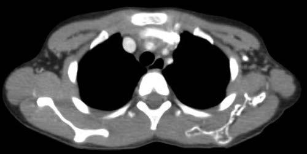

# Chapter 554: Complex Vascular Anomalies

*Alexandra J. Borst and Denise M. Adams*

<!-- p.4043 -->
HCC cases. This variant has been reported to have a distinct trans location, *DNAJB1-PRKACA.* A rare subtype called **transitional liver tumor** occurs in older children and has clinical and histopathologic findings of both hepatoblastoma and HCC.

**Clinical Manifestations** HCC usually presents as a hepatic mass with abdominal distention and symptoms of anorexia, weight loss, jaundice, and abdominal pain. HCC can present as an acute abdominal crisis with rupture of the tumor and hemoperitoneum. Metastatic spread usually involves regional lymph nodes and the lungs. The AFP level is elevated in approximately 60% of children with conventional HCC, but not in the fibrolamellar vari ant. Evidence of hepatitis B usually is found in endemic areas but not in Western countries or with the fibrolamellar type. Liver enzymes may be abnormal.

Diagnostic imaging should include plain radiographs and US of the abdomen to characterize the hepatic mass. US can differentiate malig nant hepatic masses from benign vascular lesions. Either CT or MRI is an accurate method of defining the extent of intrahepatic tumor involvement and the potential for surgical resection. Evaluation for metastatic disease should include CT of the chest.

**Treatment** Complete tumor resection is crucial for curative treatment. Because of the multicentric origin of HCC and underlying liver disease, complete resection is accomplished in only 20–30% of cases. A gross total resec tion should be attempted at diagnosis when possible; if not, neoadju vant chemotherapy should be given to convert nonresectable tumors into resectable ones. Combination chemotherapy following surgery is necessary. For unresectable tumors, **chemotherapy** followed by sur gical assessment is essential, and **liver transplant** should be decided individually for each patient with HCC. Chemotherapy, including cisplatin, carboplatin, doxorubicin, and etoposide, has shown activity against this tumor, but improved long-term outcome has been diffi cult to achieve if tumor is not completed resected. **Sorafenib**, a small inhibitor of several tyrosine protein kinase showed antitumoral activity in adult patients with HCC, and initial studies have been published in the pediatric population with encouraging results. Other techniques are under study in adults, including cryosurgery, RFA, transarterial chemoembolization, and radiation therapy.

*Visit Elsevier eBooks+ at eBooks.Health.Elsevier.com** for Bibliography.*

Vascular anomalies in children encompass a spectrum of disorders that may be divided into **vascular malformations** and vascular tumors (Tables 554.1-554.4; see Chapter 691). **Vascular malformations** are developmental disorders of blood vessel formation. Malformations do not regress; rather, they slowly enlarge. They should be named after the predominant vessel(s) forming the lesion: arterial, capillary, lymphatic, or venous, or combinations of these (see Table 554.1). Vascular tumors exhibit endothelial cell hyperplasia and proliferation. The International Society for the Study of Vascular Anomalies (ISSVA) continues to update the classification structure for vascular disorders as new disorders are

*Alexandra J. Borst and Denise M. Adams*

identified and as the biology and genetic causes for established dis orders are found. The complete classification, associated syndromes, and causative pathogenic variants can be found at www.issva.org. The discovery of the molecular basis of many **vascular malformations** and tumors has allowed for improved understanding of the etiology of these disorders as well as new **targeted therapeutic approaches** for management.

**GENETIC BASIS FOR VASCULAR ANOMALIES** Two key intracellular signaling pathways have been implicated in the pathogenesis of most **vascular malformations**, syndromes, and tumors. The RAS/MAPK and PI3K/AKT/mTOR pathways are cru cial for cell cycle regulation, proliferation, and migration (Fig. 554.1). Pathogenic, *somatic* variants in the *PIK3CA* gene have been identified in patients with **venous malformations**, **lymphatic malformations**, and several vascular anomalies and overgrowth syndromes (see Table 554.4). Pathogenic variants in the RAS/MAPK pathway have been identified in **capillary and arteriovenous malformations (AVMs)**, central conducting lymphatic anomalies, as well as many of the vas cular tumors.

Discovery of the molecular basis for **vascular malformations** and tumors has led to the ability to find **targeted therapies** for manage ment of these conditions. **Sirolimus** has been utilized successfully in vascular malformations and tumors. The identification of the crucial role of *PIK3CA* pathogenic variants in vascular anomalies has led to the investigation of **PI3K inhibitors** as important targeted therapies. Agents that target the RAS/MAPK pathway, such as **MEK inhibitors**, have also been trialed in complicated AVMs as well as Kaposiform lymphangiomatosis (KLA).

**COMPLEX LYMPHATIC ANOMALIES** Lymphatic anomalies represent a rare disease entity, with an estimated incidence of 1:10,000 for the most common form of lymphatic mal formations, but with only a few hundred case reports in the literature for *complex* lymphatic anomalies. Lymphatic anomalies arise from developmental defects in lymphangiogenesis. They carry significant risk for comorbidities, including pain, infection, disfigurement, and life-threatening organ dysfunction. Lymphatic anomalies encompass a broad range of developmental and functional defects in lymphatic vessels that range from discrete malformations to complex anomalies (generalized lymphatic anomaly [GLA], KLA, and Gorham-Stout dis ease [GSD]) and primary lymphedema syndromes.

Most lymphatic anomalies are thought to arise from *somatic* patho genic variants in genes involved in lymphangiogenesis, but germline predispositions also exist. Pathogenic variants in the PIK3CA/AKT/ mTOR and VEGFC/VEGFR3 pathways have been found in many iso lated lymphatic malformations; variants in the RAS/MAPK pathway have been identified in patients with *complex lymphatic anomalies* (Fig. 554.2). However, most patients remain without a genetic diagnosis.

**Generalized Lymphatic Anomaly** Previously known as lymphangiomatosis, GLA is characterized by a nonneoplastic, multicentric proliferation of dilated lymphatic vessels, with multiple sites resembling common lymphatic malformations (Fig. 554.3). The lesions are present since birth but generally become clini cally apparent within the first 2 decades of life. The lesions can affect the bones, liver, spleen, mediastinum, lung, and soft tissues. Bone involve ment is typically osteolytic, with punched out lesions and intact cor tex. Clinical response depends on location and extent of disease, with thoracic involvement having the poorest prognosis. Patients with GLA most commonly have pathogenic somatic variants in *PIK3CA* leading to overactivity in the PI3K/AKT/mTOR pathway and disrupted lym phatic development and growth. Many patients have been successfully managed with sirolimus.

**Gorham-Stout Disease** GSD (also known as *vanishing bone disease*) has significant clinical overlap with GLA but tends to involve a single site or adjacent sites. Patients may present with adjacent soft tissue mass or small areas of

<!-- p.4045 -->

#### **Table 554.1** Overview of Vascular Anomalies

| Category / Parameter | Clinical Details & Findings |
| --- | --- |
| **OTHER ANOMALIES** | Benign; Capillary malformations; Lymphatic malformations |
| **LVM, CLVM** | See Table 554.2; See Table 554.3; Locally aggressive or; borderline; Venous malformations; Arteriovenous malformations† |
| **CLAVM†** | Malignant; Arteriovenous fistula†; Others; *Defined as two or more vascular malformations found in one lesion.; †High-flow lesions.; A list of casual genes and related vascular anomalies is available in Tables 554.3 and 554.4; CVM, Capillary venous malformation; CLM, capillary lymphatic malformation, LVM, lymphatic venous malformation, CLVM, capillary lymphatic venous malformation, CAVM, capillary; arteriovenous malformation; CLAVM, capillary lymphatic arteriovenous malformation.; From ISSVA Classification for Vascular Anomalies (Approved at the 20th ISSVA Workshop, Melbourne, April 2014, last revision May 2018) https://www.issva.org/UserFiles/file/ISSVA-; Classification-2018.pdf |

Known as “Channel Type” or “Truncal” Vascular Malformations)

#### **Table 554.2** Anomalies of Major Named Vessels (Also

| Category / Parameter | Clinical Details & Findings |
| --- | --- |
| **Affect** | Lymphatics; Veins; Arteries |
| **Anomalies of** | Origin; Course; Number; Length; Diameter (aplasia, hypoplasia, stenosis, ectasia / aneurysm); Valves; Communication (AVF); Persistence (of embryonal vessel); AVF, Arteriovenous fistula.; From ISSVA Classification for Vascular Anomalies (Approved at the 20th ISSVA Work; shop, Melbourne, April 2014, last revision May 2018) https://www.issva.org/UserFiles/file; /ISSVA-Classification-2018.pdf |

microcystic lymphatic malformation. The upper axial skeleton is com monly affected, and there is osteolysis of both the medullary and cor tical bone (Fig. 554.4). This osteolysis can be profound and result in significant morbidity, including dysfunction of an appendage or even spinal column instability. Some molecular findings in patients with GSD have suggested that somatic activating variants in *KRAS* and dys function of the RAS/MAPK signaling pathway drive the pathogenesis of GSD. Many patients have been treated with sirolimus with adjunc tive bisphosphonate therapy.

**Kaposiform Lymphangiomatosis** KLA has been considered an aggressive subtype of GLA but is histo logically and molecularly distinct. Many patients with KLA harbor *somatic* activation variants in the RAS pathway, rather than the PI3K/ AKT/mTOR pathway identified as causative in GLA. KLA presents with distinct foci of spindled endothelial cells on a background of malformed lymphatic vessels. KLA can affect multiple organs and sites but primarily affects the thoracic cavity with patients presenting with

life-threatening, and frequently hemorrhagic, pleural effusions (Fig. 554.5). Patients often have a coagulopathy at presentation due to the same **Kasabach-Merritt phenomenon (KMP)** seen in patients with **Kaposiform hemangioendothelioma**. Patients typically present at a younger age than those with GLA or GSD; the mortality has been reported as high as 50–60% prior to the introduction of sirolimus.

**Central Conducting Lymphatic Anomaly** Central conducting lymphatic anomaly (CCLA), also known as *lym phangiectasia*, is classified as a channel-type lymphatic anomaly. CCLA is caused by lymphatic channel dysmotility and distal obstruction/mal formation affecting lymphatic drainage and leading to recurrent effu sions (Fig. 554.6). Patients with other complex lymphatic anomalies may have a component of CCLA. Pathogenic variants in *EPHB4* and *ARAF* have been identified in patients with CCLA and both mTOR and MEK inhibition have been used in its management with mixed success. Patients frequently needed targeted interventional procedures to embolize abnormal lymphatic vessels.

**Treatment of Complex Lymphatic Anomalies** Management of complex lymphatic anomalies is principally aimed at control, not cure. This can include a variety of medical, surgical, and interventional procedures to control symptoms and prevent morbidity. Sirolimus, an mTOR inhibitor, has been shown to decrease symptoms of lymphatic leak such as lymphatic blebs, decrease the size of mac rocystic and microcystic malformations, decrease chylous production, and may slow the pathologic dissolution of bone by lymphatic mal formation. MEK inhibition has shown promise in the management of KLA and CCLA, both found to be driven more by perturbations affect ing RAS/MAPK signaling. Adjunctive therapy with bisphosphonates is often used in GSD and in patients with GLA and KLA with bony vertebral lesions.

**COMPLEX VENOUS ANOMALIES** Venous anomalies are slow-flow lesions that represent abnormal or excessive growth of venous structures. **Venous malformations** are the most common vascular malformations with an incidence of 1 in 5,000 to 10,000. Due to the slow and sometimes turbulent flow, they com monly are associated with pain, swelling, and intralesional thrombosis. Venous malformations have been found to have *somatic* pathogenic variants in both *PIK3CA* and *TIE2/TEK,* an endothelial cell–specific tyrosine kinase receptor that functions through the PI3K/AKT/mTOR pathway (see Fig. 554.1).

**Blue Rubber Bleb Nevus Syndrome** Blue rubber bleb nevus syndrome (BRBNS) is characterized by multiple cutaneous and internal venous malformations, primarily hepatic and intes tinal (Fig. 554.7). Many cases have been found to be due to gain-of-function

<!-- p.4046 -->
*TIE2/TEK* pathogenic variants; both sporadic and autosomal dominant inheritance have been described. Significant morbidity can arise due to intestinal venous malformations, which can lead to severe bleeding and secondary iron deficiency anemia. Patients must be monitored closely for signs and symptoms of bleeding. The mainstay of management is control of disease with sirolimus and supportive care for anemia.

**Glomuvenous Malformation (Glomangioma)** Glomuvenous malformations, also known as *glomangiomas* or *glomus tumors*, are one of the rare germline conditions in vascular anoma lies. Glomuvenous malformations result from an autosomal dominant

loss-of-function variant in the *GLMN* gene, which encodes a protein essential for normal vascular development. Patients present with mul tiple superficial cutaneous lesions with a cobblestone appearance (Fig. 554.8). There is 100% penetrance but variable expressivity. Painful lesions can be treated with surgical resection, laser, or sclerotherapy.

**SYNDROMES ASSOCIATED WITH VASCULAR ANOMALIES PIK3CA-Related Overgrowth Spectrum Disorders** PIK3CA-related overgrowth spectrum (PROS) encompasses a group of disorders caused by somatic mosaic mutations in the PI3K/AKT/ mTOR pathway (see Table 554.4). The *PIK3CA* (phosphatidylinositol- 4,5-bisphosphate 3-kinase catalytic subunit α) gene encodes a group of lipid kinases (PI3 kinases) that are key to regulating cell proliferation and survival via the PI3K/AKT/mTOR pathway. Patients with PROS present with a wide spectrum of clinical phenotypes, but progressive segmental overgrowth and vascular malformations are key components.

**Klippel-Trenaunay Syndrome** Klippel-Trenaunay syndrome (KTS) is characterized by overgrowth of one lower extremity in combination with combined slow-flow vascu lar malformation (capillary, venous, and/or lymphatic). Complications include lymphatic overgrowth, infection, oozing and/or bleeding from lymphatic blebs, and thromboembolism (Fig. 554.9). Patients with KTS have an anomalous venous return system composed of dilated and incompetent veins, often with a larger marginal vein. The deep venous system may also be poorly developed. Patients can have lymphatic involvement of the skin, musculature, and intestinal tract. Venous malformation may affect the bladder and urethra. Due to variability in diagnostic criteria and identification of KTS over the years, the genetic etiology of KTS is not completely confirmed, but many patients have been identified to have a *somatic* variants in *PIK3CA*; KTS is consid ered part of PROS disorders. Surgical and interventional procedures may be important for some patients with KTS. Medical management currently includes sirolimus and anticoagulation therapy.

#### **Table 554.3** Vascular Malformations Associated with Other Anomalies

| Category / Parameter | Clinical Details & Findings |
| --- | --- |
| **GENES** | Klippel-Trenaunay syndrome*:; CM + VM +/− LM + limb overgrowth |
| **PIK3CA** | Parkes-Weber syndrome:; CM + AVF + limb overgrowth |
| **RASA1** | Servelle-Martorell syndrome:; limb VM + bone undergrowth; Sturge-Weber syndrome:; facial + leptomeningeal CM + eye anomalies; +/− bone and/or soft tissue overgrowth |
| **GNAQ** | Limb CM + congenital nonprogressive limb; overgrowth |
| **GNA11** | Maffucci syndrome:; VM +/− spindle-cell hemangioma +; enchondroma |
| **IDH1/IDH2** | Macrocephaly-CM (M-CM/MCAP)* |
| **PIK3CA** | Microcephaly-CM (MICCAP) |
| **STAMBP** | CLOVES syndrome*:; LM + VM + CM +/– AVM + lipomatous; overgrowth |
| **PICK3CA** | Proteus syndrome:; CM, VM, and/or LM + asymmetrical somatic; overgrowth |
| **AKT1** | Bannayan-Riley-Ruvalcaba syndrome:; AVM + VM + macrocephaly, lipomatous; overgrowth |
| **PTEN** | CLAPO syndrome*:; lower lip CM + face and neck LM + asymmetry; and partial/generalized overgrowth |
| **PIK3CA** | *These lesions belong to the PIK3CA-related overgrowth spectrum (PROS); CM, Capillary malformation; VM, venous malformation; LM, lymphatic malformation; AVF, arteriovenous fistula; M-CM, macrocephaly-capillary malformation; MCAP, megalocephaly-; capillary-malformation-polymicrogyria; MICCAP, microcephaly-capillary malformation; CLOVES, congenital lipomatous overgrowth, vascular malformations, epidermal nevi,; skeletal/scoliosis/spinal anomalies; CLAPO, lower lip CM + face and neck LM + asymmetry and partial/generalized overgrowth.; From ISSVA Classification for Vascular Anomalies (Approved at the 20th ISSVA Workshop, Melbourne, April 2014, last revision May 2018) https://www.issva.org/UserFiles/file/ISSVA-; Classification-2018.pdf |

#### **Table 554.4** PIK3CA-Related Overgrowth Spectrum

| Category / Parameter | Clinical Details & Findings |
| --- | --- |
| **General** | PIK3CA-related overgrowth spectrum (PROS) group lesions with; heterogeneous segmental overgrowth phenotypes with or without; vascular anomalies due to somatic PIK3CA activating variants.; This spectrum includes:; • Fibroadipose hyperplasia or overgrowth (FAO); • Hemihyperplasia multiple lipomatosis (HHML); • Congenital lipomatous overgrowth, vascular malformations,; epidermal nevi, scoliosis/skeletal, and spinal (CLOVES) syndrome; • Macrodactyly; • Fibroadipose infiltrating lipomatosis/facial infiltrative lipomatosis; • Megalencephaly-capillary malformation (MCAP or M-CM ); • Dysplastic megalencephaly (DMEG); • Klippel-Trenaunay syndrome; From ISSVA Classification for Vascular Anomalies (Approved at the 20th ISSVA Work; shop, Melbourne, April 2014, last revision May 2018) https://www.issva.org/UserFiles/file; /ISSVA-Classification-2018.pdf |

<!-- p.4047 -->
**CLOVES** CLOVES, or congenital lipomatous overgrowth, vascular malfor mations, epidermal nevi, and scoliosis/spinal/skeletal anomalies, is a disorder that results from an early embryonic pathogenic vari ant in *PIK3CA.* In addition to extremity hypertrophy, patients can have significant fatty lipomatous overgrowth (Fig. 554.10). Spinal involvement is common. Patients with vascular malformations usu ally have a combination of capillary, venous, and lymphatic malfor mations. AVMs are less common but have been reported with spinal involvement. Deep venous anomalies increase the risk for venous thromboembolism. Patients with CLOVES have an increased risk of Wilms tumor and require serial monitoring with abdominal ultrasonography in early childhood. Patients may require sclero therapy, surgery, and other interventional procedures depending on symptoms. Patients have also been successfully managed with sirolimus.

**Macrocephaly-Capillary Malformation** Macrocephaly-capillary malformation (M-CM) syndrome is a PROS disorder characterized by macrocephaly, brain abnormalities, CM (often in a reticular pattern), overgrowth, and developmental delays (Fig. 554.11). Neurologic manifestations can include hydrocephalus, cortical dysplasia, polymicrogyria, and posterior fossa crowding with cerebellar tonsillar herniation. Patients require supportive care for

overgrowth and other vascular anomalies, as well as close monitoring of brain growth and development.

**AKT-RELATED OVERGROWTH SPECTRUM Proteus Syndrome** Proteus is an overgrowth disorder caused by a *somatic* mosaic pathogenic variant in the PI3K/AKT/mTOR pathway. Clinical fea tures include overgrowth (including lipomatous), bony abnormali ties, cerebriform connective tissue nevus, vascular malformations (capillary, venous, lymphatic), epidermal nevi, cerebral abnormali ties and accompanying intellectual disability, and increased risk for secondary neoplasms and venous thromboembolism. Management of proteus disorders has primarily been supportive, although use of AKT1 inhibition is currently being evaluated.

**RASopathies** RASopathies refers to a group of medical conditions caused by pathogenic variants in the RAS/MAPK pathway. It includes both germline conditions, as well as *somatic* variants. The RAS/MAPK pathway is important in cell cycle regulation, proliferation, migra tion, and stress response. RAS/MAPK pathway pathogenic variants have been identified in patients with solitary CMs and AVMs, GLA, KLA, verrucous venous malformation, cerebral CM, pyogenic gran uloma (PG), and congenital hemangiomas.

TIE2 INHIBITOR

BEVACIZUMAB

VEGFR2 TIE2/RTK

PAZOPANIB

THALIDOMIDE

EphB4

Integrin VEcadherin

VEMURAFENIB

EC migration,

proliferation,

vessel formation

RAPAMYCIN/EVEROLIMUS

Integrin signaling

migration

vSMC differentiation

TGFβR

vSMC/

EC RAPAMYCIN?

Proliferation, cell growth, differentiation, angiogenesis

EC

TRAMETINIB SULMETINIB

ALPELISIB

PTEN

SMADs

1/5/8

SMAD4

AKT

PIK3CA

RAS

VEGF

BRAF

MEK1

MAP3K3

PDCD10

Malcavernin

KRIT1

RASA1

GNAQ/11

β-catenin

ICAP1

ERK

FKBP12

p70S6K

glomulin

SMAD PI3K

HGF

mTOR

BMP9/10

endoglin ALK1

VM LM CLOVES

KTS MCAP (PROS)

PG KLA GSD

PG

CCM2

CCM3

HCCVM

CCM1

VVM

AVM

RICH NICH

PG CM

JPHT

PHTS

GVM

CM-AVM1

VM VMCM

BRBN

MVM CM-AVM2

HHT1

HHT5

HHT2

TGFβ

PIP3 PIP2

**Fig. 554.1** PI3K/AKT/mTOR signaling and RAS/MAPK signaling in vascular anomalies. Red, gain of function; blue, loss of function; black, en hanced signaling; gray, decreased signaling. (From Queisser A, Seront E, Boon LM, Vikkula M. Genetic basis and therapies for vascular anomalies. Circ Res. 2021;129[1]:155–173. Fig. 3.)

<!-- p.4048 -->

**Fig. 554.4** Osteolytic destruction of the left scapula in a patient with Gorham-Stout disease (GSD). Axial CT image of the left scapula dem onstrates intramedullary lucent lesions with cortical thinning.

**Capillary Malformation-Arteriovenous Malformation Syndrome** Capillary malformation-arteriovenous malformation (CM-AVM) is an autosomal dominant disorder characterized by diffuse, circumscribed CMs and increased risk for intra- or extracranial AVMs. AVMs are found in ∼80% of patients. The CMs have a distinct appearance with a round or ovoid shape and surrounding pale halo. Most cases of CM- AVM are caused by a loss-of-function pathogenic variant in *RASA1,* but variants in *EPHB4* have also been reported (CM-AVM type 2). Familial penetrance is high, and screening is important due to the high risk for life-threatening complications from AVMs. AVMs may require treat ment with a combination of interventional and surgical procedures.

**Parkes-Weber Syndrome** Parkes-Weber syndrome (PKWS) is associated with pathogenic vari ants in *RASA1.* The syndrome includes multiple microscopic arterio venous fistulae in association with a CM. PKWS is also associated with soft tissue and bony overgrowth of an extremity.

**KAPOSIFORM HEMANGIOENDOTHELIOMA** Kaposiform hemangioendothelioma (KHE) is a rare and potentially life-threatening vascular tumor. KHE classically presents as a red to purple firm plaque on the lateral neck, axilla, trunk, or extremi ties. Visceral tumors occur as well. Lesions may occasionally get smaller over time but rarely resolve completely. **Tufted angioma,** once thought to be a separate tumor on the same clinical spec trum as KHE, is considered under the umbrella term of KHE (Fig. 554.12). The main complication of these tumors is the development of **KMP**, which may be fatal; therefore early diagnosis and treat ment is important. Retroperitoneal or intrathoracic lesions in the absence of cutaneous lesions are uncommon but are often associ ated with KMP.

**Kasabach-Merritt Phenomenon** KMP is a life-threatening combination of a rapidly enlarging KHE, throm bocytopenia, microangiopathic hemolytic anemia, and an acute or chronic consumption coagulopathy. The clinical manifestations are usually evident during early infancy. The vascular lesion is usually cutaneous and is only

A

B

**Fig. 554.3** A, MRI imaging of vertebral body lymphatic malforma tions in a patient with generalized lymphatic anomaly (GLA). B, Splen ic and vertebral body lesions in a patient with GLA. (B from Joshi M, Phansalkar DS. Simple lymphangioma to generalized lymphatic anoma ly: role of imaging in disclosure of a rare and morbid disease. Case Rep Radiol. 2015;2015:603859.)

TKR VEGFR2/3

PDGFR TIE1/TIE2

Primary lymphedema

PIK3CA

Lymphatic malformations

AKT

mTOR

MEK

ERK

RAF

RAS

Vascular growth and differentiation

Generalized lymphatic anomaly

Kaposiform lymphangiomatosis

Central conducting lymphatic anomaly

**Fig. 554.2** Molecular pathways identified in lymphatic anomalies.

<!-- p.4049 -->
rarely located in viscera. The associated thrombocytopenia may lead to precipitous hemorrhage accompanied by ecchymoses, petechiae, and a rapid increase in the size of the vascular lesion. Severe anemia from hemor rhage or microangiopathic hemolysis may ensue. The thrombocytopenia has been attributed to sequestration or increased destruction of platelets within the lesion. Hypofibrinogenemia and decreased levels of consum able clotting factors are relatively common (see Chapter 533.6). KMP is seen in KHE or tufted angioma, as well as to a milder extent in very large congenital and hepatic hemangiomas *but not* in infantile hemangiomas.

Treatment includes surgical excision of small lesions, although this is often difficult because of coagulopathy and the infiltrative nature of the tumor. Additional pharmacologic treatments include systemic steroids with or without vincristine as first-line therapy in most cases. mTOR inhibition with sirolimus has been found to be successful as an alternative first-line treatment for KHE. The optimal initial combination of medical

therapies is not yet known. Antiplatelet, antifibrinolytic, and other chemo therapeutic agents have been used with mixed results. The mortality rate overall once patients have KMP is high.

**OTHER RARE VASCULAR TUMORS Benign Tumors (Other Than Infantile Hemangiomas) (see Chapter 691) Epithelioid Hemangiomas** Epithelioid hemangioma (EH) is a very rare vascular tumor, usually occurring in the skin or subcutaneous tissues, but occasionally occurring

**Fig. 554.5** A, Large hemorrhagic pleural ef fusion in a patient with Kaposiform lymphangi omatosis (KLA). B, Abnormal lymphatic fluid distribution and central lymphatic drainage in a patient with KLA.

B

**Fig. 554.6** MR lymphangiography study showing a dilated and mal formed thoracic duct and central lymphatics with retrograde flow into the mediastinum and pericardium (arrows) in a patient with central con ducting lymphatic anomaly (CCLA).

A

B

**Fig. 554.7** Multiple venous malformations on the tongue (A) and subcutaneous tissues of the foot (B) in a patient with blue rubber bleb nevus syndrome (BRBNS).

<!-- p.4050 -->
in other sites such as bone. They may be mistaken for infantile heman giomas or PGs and can be reactive due to trauma or infection. EHs are well-circumscribed proliferations of capillaries that stain for endothelial cell and lymphatic markers but are without any cytologic atypia or mito ses. Primary treatment is with surgical excision, though they can recur locally. *FOS* gene rearrangements have been identified in some EHs.

**Pyogenic Granuloma (Lobular Capillary Hemangioma)** A PG is a small red, glistening, sessile, or pedunculated papule that often has a discernible epithelial collarette (see Fig. 691.16). The surface may be weeping and crusted or completely epithelialized. PGs initially grow rap idly, may ulcerate, and bleed easily when traumatized because they consist of exuberant granulation tissue. They are relatively common in children, particularly on the face, arms, and hands. Such a lesion located on a finger or hand may appear as a subcutaneous nodule. PGs may arise at sites of injury, but a history of trauma often cannot be elicited.

PGs are benign but a nuisance because they bleed easily with trauma and may recur if incompletely removed. Numerous satellite papules have developed after surgical excision of PGs from the back, par ticularly in the interscapular region. Small lesions may regress after cauterization with silver nitrate; larger lesions require excision and electrodesiccation of the base of the granuloma. Small (<5 mm) lesions may be treated successfully with **pulsed dye laser** therapy.

**Spider Angioma** A vascular spider (nevus araneus) consists of a central feeder artery with many dilated radiating vessels and a surrounding erythematous flush, varying from a few millimeters to several centimeters in diam eter (see Fig. 691.17). Pressure over the central vessel causes blanching; pulsations visible in larger nevi are evidence for the arterial source of the lesion. Spider angiomas are associated with conditions in which there are increased levels of circulating estrogens, such as cirrhosis and pregnancy, but they also occur in up to 15% of normal preschool-age children and 45% of school-age children. Sites of predilection in chil dren are the dorsum of the hand, forearm, nose, infraocular region, lips, and ears. Lesions often regress spontaneously after puberty. If removal is desired, pulsed dye laser therapy is the mode of choice; reso lution is achieved in 90% of cases with a single treatment.

**Maffucci Syndrome** The association of spindle cell hemangiomas with nodular enchondromas in the metaphyseal or diaphyseal cartilaginous portion of long bones is known as Maffucci syndrome. Maffucci syndrome is caused by *somatic* mosaic pathogenic variants in the *IDH1* and *IDH2* genes. Vascular lesions are typically soft, compressible, asymptomatic blue to purple subcutaneous masses that grow in proportion to a child’s growth and stabilize by adult hood. Mucous membranes or viscera may also be involved. Onset occurs during childhood. Bone lesions may produce limb deformities and patho logic fractures. Malignant transformation of enchondromas (chondrosar coma, angiosarcoma) or primary malignancies (ovarian, fibrosarcoma, glioma, pancreatic) may be a complication (see Chapter 550).

**LOCALLY AGGRESSIVE RARE VASCULAR TUMORS Retiform Hemangioendothelioma** Retiform hemangioendothelioma (RHE) is an intermediate, or rarely metastasizing, vascular tumor. They usually present as a slow-growing mass with plaque-like or nodular appearance. They can involve the entire dermis and extend into the subcutaneous tissue. Histologically, hobnail endothelial cells are found, but only variably lymphatic endothelial cell markers. Treatment is with surgical excision, though local recurrence is common and regional lymph node metastases have been reported.

**Papillary Intralymphatic Angioendothelioma** Papillary intralymphatic angioendothelioma (PILA), also referred to as *Dabska tumor,* is a locally aggressive hemangioendothelioma. PILA occur within the dermis and superficial soft tissues of the head, neck, trunk, or extremities. On occasion they have been reported to arise from preexisting lymphatic or venolymphatic malformations, or within an extremity affected by lymphedema. They appear as violaceous nodules similar to RHE but histologically appear similar to lymphatic malforma tions and contain hobnail endothelial cells. Primary treatment is with excision, but regional lymph node metastasis and even death due to dis tant metastasis have been reported. Systemic chemotherapy based on sarcoma treatment may be used in recurrent or refractory cases.

**Composite Hemangioendothelioma** Composite hemangioendotheliomas (CHE) contain overlapping histo logic features with epithelioid, retiform, and spindle-cell hemangioendo theliomas. Some also contain angiosarcoma-like features within the same tumor. Fewer than 40 cases have been reported in the literature, and they can present at any age and in association with other vascular anomalies. Treatment options include surgical excision, chemotherapy, and radiation therapy.

**Fig. 554.8** Cobblestoned appearance of a patient with a glomangi oma, or glomuvenous malformation, caused by a germline pathogenic variant in the glomulin gene (GLMN). Family members all with similar appearing lesions.

**Fig. 554.9** Overgrown right lower extremity with capillary-venous- lymphatic malformation in a patient with Klippel-Trenaunay syndrome.

<!-- p.4051 -->
**Pseudomyogenic Hemangioendothelioma (Epitheli oid Sarcoma-Like Hemangioendothelioma)** Pseudomyogenic hemangioendothelioma (PMH) is a rare vascular tumor that presents more commonly in males than females (4:1 pre dominance) and usually in young adulthood (<40 years). The typical presentation is multifocal presentation within one extremity, and it does frequently have bony involvement. Histologically, it shares some features with epithelioid sarcoma, with myoid-appearing spindle cells, but has very low metastatic potential. Primary treatment is with surgi cal resection, but local recurrence is common, and mTOR inhibition with sirolimus has shown promise in its management.

**MALIGNANT TUMORS Epithelioid Hemangioendothelioma** Epithelioid hemangioendothelioma (EHE) is variant of *angiosarcoma,* which is locally aggressive and has metastatic potential. It usually occurs in middle-age adults and presents as a solitary mass in the soft tissues, viscera, or bone, with liver as the most common site. Thirty

**Fig. 554.10** A, Soft tissue and bony overgrowth of the digits of the bilateral hands in a patient with CLOVES. Also noted is over lying capillary malformation (CM). B, Overgrowth of digits of the feet and right sandal-toe gap deformity in a patient with CLOVES. Also noted are CM and dilated venous pattern from underlying bilateral venous malformation of the lower extremities.

A B

**Fig. 554.11** Infant with macrocephaly, prominent forehead, de pressed nasal bridge, short neck, bluish white iris, and reticulated port- wine stains over body, consistent with macrocephaly-capillary malfor mation (M-CM). (From Panigrahi I, Bhushan M, Yadav M, Khandelwal N, Singhi P. Macrocephaly-capillary malformation syndrome: three new cases. J Neurol Sci. 2012;313:178–181. Fig. 5.)

A

B

**Fig. 554.12** A, Patient with Kaposiform hemangioendothelioma (KHE) of the thigh who presented with Kasabach-Merritt phenomenon (KMP) with thrombocytopenia and hypofibrinogenemia unresponsive to all therapy until introduction of sirolimus. B, Premature infant with KHE of the arm who presented with KMP.

<!-- p.4053 -->
