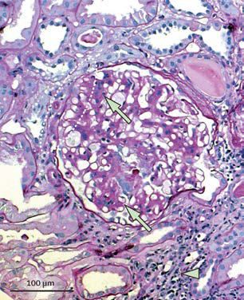
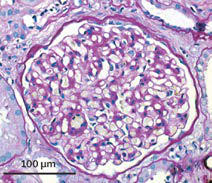

# Chapter 559: Isolated Glomerular Diseases Associated with Recurrent Gross Hematuria

*Francisco X. Flores*

<!-- p.4086 -->
hypervolemia with dilution associated with acute kidney injury; decreased RBC production in chronic kidney disease; hemolysis from hemolytic-uremic syndrome, a chronic hemolytic anemia, or SLE; blood loss from pulmonary hemorrhage, as seen in Goodpasture syn drome; or melena in patients with IgA vasculitis or hemolytic-uremic syndrome. Inspection of the peripheral blood smear might reveal a **microangiopathic** process consistent with the hemolytic-uremic syn drome. The presence of autoantibodies in SLE can result in a positive Coombs test, the presence of antinuclear antibody, leukopenia, and multisystem disease. **Thrombocytopenia** can result from decreased platelet production (malignancies) or increased platelet consump tion (SLE, idiopathic thrombocytopenic purpura, hemolytic-uremic syndrome, renal vein thrombosis, or congenital hepatic fibrosis with portal hypertension secondary to autosomal recessive polycystic kid ney disease). Although urinary RBC morphology may be normal with lower tract bleeding and dysmorphic from glomerular bleeding, it is not sensitive enough to unequivocally delineate the site of hematuria. A bleeding diathesis is an unusual cause of hematuria, and coagulation studies are not routinely obtained unless a personal or family history suggests a bleeding tendency.

A voiding cystourethrogram is only required in patients with a urinary tract infection, renal scarring, hydroureter, or pyelocaliec tasis. Cystoscopy is an unnecessary and costly procedure in most pediatric patients with hematuria and carries the associated risks of anesthesia. This procedure should be reserved for evaluating the rare child with a bladder mass noted on ultrasound, urethral abnor malities caused by trauma, posterior urethral valves, or tumor. The finding of unilateral gross hematuria localized by cystoscopy is rare, but it can indicate a vascular malformation or another anatomic abnormality.

Children with persistent asymptomatic isolated hematuria and a completely normal evaluation should have their blood pressure and urine checked every 3 months until the hematuria resolves. Referral to a pediatric nephrologist should be considered for patients with persistent asymptomatic hematuria greater than 1 year in duration and is recommended for patients with nephritis (glomerulone phritis, tubulointerstitial nephritis), hypertension, renal dysfunc tion, urolithiasis or nephrocalcinosis, or a family history of renal disease such as polycystic kidney disease or hereditary nephritis. Renal biopsy is indicated for some children with persistent micro scopic hematuria and for most children with recurrent gross hema turia associated with decreased renal function, proteinuria, or hypertension.

*Visit Elsevier eBooks+ at eBooks.Health.Elsevier.com** for Bibliography.*

Cola/brown urine? Proteinuria (>30 mg/dL)? RBC casts? Acute nephritic syndrome?

**Extraglomerular hematuria* Step 1* • Urine culture *Step 2* • Urine calcium/creatinine • Sickle prep (Black patients) • Renal/bladder ultrasound *Step 3* • Urinalysis: siblings, parents • Serum electrolytes, Cr, Ca • If crystalluria, urolithiasis, or nephrocalcinosis:

*24-hr urine for Ca, creatinine, uric acid, oxalate • If hydronephrosis/pyelocaliectasis: *Cystogram, ± renal scan

**Glomerular hematuria** • CBC with differential • Electrolytes, Ca • BUN/Cr • Serum protein/albumin • Cholesterol • C3/C4 • ASO/anti-DNase B • ANA • Antineutrophil antibody • Throat/skin culture (if indicated) • 24-hr urine total protein creatinine clearance

**NO YES**

#### **Table 558.3** Common Causes of Gross Hematuria

| Category / Parameter | Clinical Details & Findings |
| --- | --- |
| **General** | Urinary tract infection; Meatal stenosis with ulcer; Perineal irritation; Trauma; Urolithiasis; Hypercalciuria; Obstruction; Coagulopathy; Tumor; Glomerular disease; Postinfectious glomerulonephritis; IgA vasculitis nephritis*; IgA nephropathy; Alport syndrome (hereditary nephritis); Thin glomerular basement membrane disease; Systemic lupus erythematosus nephritis; *Formerly Henoch-Schönlein purpura. |

**Fig. 558.1** Diagnostic algorithm of the general approach to the labo ratory and radiologic evaluation of the patient with glomerular or extra glomerular hematuria. ANA, Antinuclear antibody; ASO, antistreptoly sin O; BUN, blood urea nitrogen; C3/C4, complement; CBC, complete blood cell count; Cr, creatinine; RBC, red blood cell.

**INTRODUCTION** Approximately 10% of children with gross hematuria have an acute or a chronic form of glomerulonephritis that may be associated with a systemic illness. The gross hematuria, which is usually characterized by brown or cola-colored urine, may be painless or associated with vague flank or abdominal pain. A presentation with gross hematuria is common within 1-2 days after the onset of an apparent viral upper respiratory tract infection in immunoglobulin (Ig) A nephropathy and typically resolves within 5 days. This relatively short period con trasts with a latency period of 7-21 days occurring between the onset of a streptococcal pharyngitis or impetiginous skin infection and the development of postinfectious acute glomerulonephritis. Gross hematuria in these circumstances can last as long as 4-6 weeks. Gross hematuria can also be seen in children with glomerular basement membrane (GBM) disorders such as hereditary nephritis (Alport syndrome [AS]) and thin GBM disease. These glomerular diseases can also manifest as microscopic hematuria and/or proteinuria with out gross hematuria.

*Visit Elsevier eBooks+ at eBooks.Health.Elsevier.com** for Bibliography.*

*Francisco X. Flores*

<!-- p.4088 -->

<!-- p.4089 -->

## 559.1  Immunoglobulin A Nephropathy (Berger Nephropathy) Francisco X. Flores

IgA nephropathy is the most common chronic glomerular disease in children. It is characterized by a predominance of IgA within mesangial glomerular deposits in the absence of systemic disease. Its diagnosis requires a renal biopsy, which is performed when clinical features warrant confirmation of the diagnosis or charac terization of the histologic severity, which might affect therapeutic decisions.

**PATHOLOGY AND PATHOLOGIC DIAGNOSIS** Focal and segmental mesangial proliferation and an increased mesan gial matrix are seen in the glomerulus (Fig. 559.1). Renal histology demonstrates mesangial proliferation that may be associated with epi thelial cell crescent formation and sclerosis. IgA deposits in the mesan gium are often accompanied by C3 complement (Fig. 559.2).

IgA nephropathy is an immune complex disease initiated by excessive amounts of poorly galactosylated IgA1 in the serum, caus ing the production of IgG and IgA autoantibodies. The abnormali ties identified in the IgA system have also been observed in patients with IgA vasculitis (formerly known as Henoch-Schönlein purpura), and this finding lends support to the hypothesis that these two dis eases are part of the same disease spectrum. Familial clustering of IgA nephropathy cases suggests the importance of genetic factors. Genome-wide linkage analysis suggests the linkage of IgA nephropa thy to 6q22-23 in multiplex IgA nephropathy kindreds. Additional genomic studies demonstrate a high predisposition to IgA nephropa thy in Southeast Asia.

**CLINICAL AND LABORATORY MANIFESTATIONS** IgA nephropathy is seen more often in male than in female patients. Although there are rare cases of rapidly progressive forms of the dis ease, the clinical presentation of childhood IgA nephropathy is often benign compared with that of adults. IgA nephropathy is an uncom mon cause of end-stage renal failure during childhood. A majority of children with IgA nephropathy in the United States and Europe pres ent with gross hematuria, whereas microscopic hematuria and/or pro teinuria is a more common presentation in Japan. Other presentations include acute nephritic syndrome, nephrotic syndrome, or a combined nephritic-nephrotic picture. Gross hematuria often occurs within 1-2 days of onset of an upper respiratory or gastrointestinal infection, in contrast with the longer latency period observed in acute post infectious glomerulonephritis and may be associated with loin pain. Proteinuria is often <1,000 mg/24 hr in patients with asymptomatic microscopic hematuria. Mild to moderate hypertension is most often seen in patients with nephritic or nephrotic syndrome but is rarely severe enough to result in hypertensive emergencies. Normal serum levels of C3 in IgA nephropathy help to distinguish this disorder from postinfectious glomerulonephritis. Serum IgA levels have limited diag nostic value because they are elevated in only 50% of pediatric patients.

**PROGNOSIS AND TREATMENT** Although IgA nephropathy does not lead to significant kidney dam age in most children, progressive disease develops in 20–30% of adult patients 15-20 years after disease onset. Therefore most children with IgA nephropathy do not display progressive renal dysfunction until adulthood, prompting the need for careful long-term follow-up. Poor

*

A B

C

**Fig. 559.1** IgA nephropathy. A, In IgA nephropathy, segmental ar eas (arrows) of mesangial hypercellularity and matrix expansion occur, characteristic of mesangioproliferative glomerulonephritis. Part of the glomerular tuft adheres to Bowman’s capsule (white dashed oval), con stituting the starting point of a secondary focal segmental glomeru losclerosis lesion. Tubulointerstitial damage with leukocyte infiltrates, tubular atrophy and fibrosis (arrowhead), and tubular protein casts (asterisk) is also present. Periodic acid–Schiff (PAS) stain. B, Other glo meruli in the same patient exhibit few pathologic abnormalities on light microscopy (PAS stain), but the characteristic mesangial granular IgA deposition (C) can be found in these glomeruli as well. (From Floege J, Amann K. Primary glomerulonephritides. Lancet. 2016;387:2036–2046. Fig. 2.)

**Fig. 559.2** Immunofluorescence microscopy of the biopsy specimen from a child with episodes of gross hematuria demonstrating mesangial deposition of IgA (×150).

**Fig. 559.3** Electron micrograph of a biopsy specimen from a child with Alport syndrome depicting thickening, thinning, splitting, and layering of the glomerular basement membrane (GBM; ×1,650). (From Yum M, Bergstein JM. Basement membrane nephropathy. Hum Pathol. 1983;14:996–1003.)

<!-- p.4090 -->
prognostic indicators at presentation or follow-up include persistent hypertension, diminished renal function, and significant, increasing, or persistent proteinuria. A more severe prognosis is correlated with histologic evidence of diffuse mesangial proliferation, extensive glo merular crescents, glomerulosclerosis, and diffuse tubulointerstitial changes, including inflammation and fibrosis.

The primary treatment of IgA nephropathy is appropriate blood pres sure control and management of significant proteinuria. Angiotensinconverting enzyme inhibitors and angiotensin II receptor antagonists are effective in reducing proteinuria and slowing the rate of disease progression when used individually or in combination. Fish oil, which contains antiinflammatory omega-3 polyunsaturated fatty acids, may decrease the rate of disease progression in adults. If a renin-angiotensin system (RAS) blockade proves ineffective and significant proteinuria persists, then addition of immunosuppressive therapy with corticoste roids is recommended. Corticosteroids reduce proteinuria and improve renal function in those patients with a glomerular filtration rate >60 mL/min/m2. It remains unclear if the effects of glucocorticoids deter progression to end-stage renal failure to a degree to offset their signifi cant side effects. Additional immunosuppression with cyclophospha mide or azathioprine has not appeared to be effective. Tonsillectomy has been used as a treatment for IgA nephropathy in many countries, including Japan. Performing a tonsillectomy in the absence of signifi cant tonsillitis in association with IgA nephropathy is currently not recommended. Targeted-release oral budesonide is approved by the FDA to reduce proteinuria in adult patients with IgA nephropathy. Patients with IgA nephropathy may undergo successful kidney trans plantation. Although recurrent disease is frequent, allograft loss caused by IgA nephropathy occurs in only 15–30% of patients.

*Visit Elsevier eBooks+ at eBooks.Health.Elsevier.com** for Bibliography.*

## 559.2  Alport Syndrome Francisco X. Flores

Alport syndrome (AS), or hereditary nephritis, is a genetically heterogeneous disease caused by pathogenic variants in the genes coding for type IV collagen, a major component of basement mem branes. These genetic alterations are associated with marked vari ability in the clinical presentation, natural history, and histologic abnormalities.

**GENETICS** Approximately 70–80% of patients have X-linked inheritance caused by a mutation in the *COL4A5* gene encoding the α5 chain of type IV col lagen. Patients with a subtype of X-linked AS and diffuse **leiomyoma tosis** demonstrate a contiguous pathogenic variant within the *COL4A5* and *COL4A6* genes that encodes the α5 and α6 chains, respectively, of type IV collagen. Autosomal recessive forms of AS in approximately 5% of patients are caused by pathogenic variants in the *COL4A3* and *COL4A4* genes on chromosome 2 encoding the α3 and α4 chains, respectively, of type IV collagen. An autosomal dominant form of AS linked to the *COL4A3-COL4A4* gene locus occurs in 19–31% of cases.

**Fechtner syndrome** (AS with macrothrombocytopenia) and **Epstein syndrome** are autosomal dominant disorders due to patho genic variants in *MYH9*. **Hereditary angiopathy with nephropathy, aneurysms, and muscle cramps (HANAC)** may initially resemble AS. HANAC is due to pathogenic variants in the *COL4A1* gene.

**PATHOLOGY** Kidney biopsy specimens during the first decade of life will show only a few changes on light microscopy. Later, the glomeruli may develop mesangial proliferation and capillary wall thickening, leading to pro gressive glomerular sclerosis. Tubular atrophy, interstitial inflamma tion and fibrosis, and lipid-containing tubular or interstitial cells, called

*foam cells,* develop as the disease progresses. Immunopathologic stud ies are usually nondiagnostic.

In most patients, electron microscopy reveals diffuse thickening, thinning, splitting, and layering of the glomerular and tubular base ment membranes (Fig. 559.3). To confound the diagnosis, the ultra structural analysis of the GBM in all genetic forms of AS may be completely normal, display nonspecific alterations, or demonstrate only uniform thinning.

**CLINICAL MANIFESTATIONS** All patients with AS have *asymptomatic* microscopic hematuria, which may be *intermittent* in females and younger males. Single or recurrent episodes of gross hematuria commonly occurring 1-2 days after an upper respiratory infection are seen in approximately 50% of patients. Proteinuria is often seen in males but may be absent, mild, or intermit tent in females. Progressive proteinuria, often exceeding 1 g/24 hours, is common by the second decade of life and can be severe enough to cause nephrotic syndrome.

Bilateral **sensorineural hearing loss,** which is never congenital, develops in 90% of hemizygous males with X-linked AS, 20% of hetero zygous females with X-linked AS, and 67% of patients with autosomal recessive AS. This deficit begins in the high-frequency range but pro gresses to involve the hearing associated with normal speech, prompt ing the need for hearing aids. This progression of hearing loss seems to run parallel to the loss of renal function. **Ocular abnormalities**, which occur in 30–40% of patients with X-linked AS, include anterior len ticonus (extrusion of the central portion of the lens into the anterior chamber), macular flecks, and corneal erosions. **Leiomyomatosis** of the esophagus, tracheobronchial tree, and female genitals has been reported but is rare.

**DIAGNOSIS** A combination of a thorough family history, a screening urinaly sis of first-degree relatives, an audiogram, and an ophthalmologic examination are critical in making the diagnosis of AS. The pres ence of anterior lenticonus is pathognomonic. AS is highly likely in the patient who has hematuria and at least two of the following characteristic clinical features: macular flecks, recurrent corneal ero sions, GBM thickening and thinning, or sensorineural deafness. The absence of epidermal basement membrane staining for the α5 chain of type IV collagen in male hemizygotes and discontinuous epider mal basement membrane staining in female heterozygotes on skin biopsy is pathognomonic for X-linked AS and can preclude a diag nostic renal biopsy. Genetic testing is clinically available for X-linked AS and *COL4A5* pathogenic variants. Prenatal diagnosis is available for families with members who have X-linked AS and who carry an identified pathogenic variant.

**Fig. 559.4** Glomerulus from a patient with poststreptococcal glo merulonephritis appears enlarged and relatively bloodless and shows mesangial proliferation and exudation of neutrophils (×400).

<!-- p.4091 -->

<!-- p.4092 -->
**PROGNOSIS AND TREATMENT** The risk of progressive renal dysfunction leading to end-stage kidney disease (ESKD) is highest among hemizygotes and auto somal recessive homozygotes. ESKD occurs before age 30 years in approximately 75% of hemizygotes with X-linked AS. The risk of ESKD in X-linked heterozygotes is 12% by age 40 years and 30% by age 60 years. Risk factors for progression are gross hematuria dur ing childhood, nephrotic syndrome, and prominent GBM thicken ing. An intrafamilial variation in phenotypic expression results in significant differences in the age of ESKD among family members. No specific therapy is available to treat AS, although angiotensinconverting enzyme inhibitors (and possibly angiotensin II receptor inhibitors) can slow the rate of progression. Careful management of renal failure complications, such as hypertension, anemia, and elec trolyte imbalance, is critical. Patients with ESKD are treated with dialysis and kidney transplantation (see Chapter 573). Approxi mately 5% of kidney transplantation recipients develop anti-GBM nephritis, which occurs primarily in males with X-linked AS who develop ESKD before age 30 years.

Pharmacologic treatment of proteinuria with angiotensin-converting enzyme inhibition or angiotensin II receptor blockade has proven effective in other glomerular diseases and has also shown promise in AS. Screening of heterozygote carriers for significant renal disease in later adulthood and possible treatment of significant proteinuria is also recommended.

*Visit Elsevier eBooks+ at eBooks.Health.Elsevier.com** for Bibliography.*

## 559.3  Thin Basement Membrane Disease Francisco X. Flores

Thin basement membrane disease (TBMD) is defined by the pres ence of persistent microscopic hematuria and isolated thinning of the GBM (and, occasionally, tubular basement membranes) on electron microscopy. Microscopic hematuria is often initially observed during childhood and may be intermittent. Episodic gross hematuria can also be present, particularly after a respiratory illness. Isolated hematuria

in multiple family members without renal dysfunction is referred to as **benign familial hematuria.** Although most of these patients will not undergo renal biopsy, it is often presumed that the underlying pathology is TBMD. TBMD may be sporadic or transmitted as an autosomal dominant trait. Heterozygous pathogenic variants in the *COL4A3* and *COL4A4* genes, which encode the α3 and α4 chains of type IV collagen present in the GBM, result in TBMD. Rare cases of TBMD progress, and such patients develop significant proteinuria, hypertension, or renal insufficiency. Homozygous pathogenic vari ants in these same genes result in autosomal recessive AS. Therefore in these rare cases, the absence of a positive family history for renal insufficiency or deafness would not necessarily predict a benign out come. Consequently, monitoring patients with benign familial hema turia for progressive proteinuria, hypertension, or renal dysfunction is important throughout childhood and young adulthood.

*Visit Elsevier eBooks+ at eBooks.Health.Elsevier.com** for Bibliography.*

## 559.4  Acute Poststreptococcal Glomerulonephritis Francisco X. Flores

Group A β-hemolytic streptococcal infections are common in children and can lead to the postinfectious complication of acute GN. Acute poststreptococcal glomerulonephritis (APSGN) is a classic example of the **acute nephritic syndrome** characterized by the sudden onset of gross hematuria, edema, hypertension, and renal dysfunction. It is one of the most common glomerular causes of gross hematuria in children and is a major cause of morbidity in group A β-hemolytic streptococcal infections.

**ETIOLOGY AND EPIDEMIOLOGY** APSGN follows infection of the throat or skin by certain *nephritogenic* strains of group A β-hemolytic streptococci. Epidemics and clusters of household (camps, military) cases occur throughout the world, and 97% of cases occur in less-developed countries. The overall inci dence has decreased in industrialized nations, presumably as a result of improved hygienic conditions and the near eradication of streptococ cal pyoderma. Poststreptococcal GN commonly follows streptococcal pharyngitis during cold-weather months and streptococcal skin infec tions or pyoderma during warm-weather months. Although epidemics of nephritis have been described in association with throat (serotypes M1, M4, M25, and some strains of M12) and skin (serotype M49) infections, this disease is most commonly sporadic.

**PATHOLOGY** Glomeruli appear enlarged and relatively bloodless and show a dif fuse mesangial cell proliferation, with an increase in mesangial matrix (Fig. 559.4). Polymorphonuclear leukocyte infiltration is common in glomeruli during the early stage of the disease. Crescents and intersti tial inflammation may be seen in severe cases, but these changes are not specific for poststreptococcal GN. Immunofluorescence micros copy reveals a pattern of “lumpy-bumpy” deposits of immunoglobu lin and complement on the glomerular basement membrane and in the mesangium. On electron microscopy, electron-dense deposits, or “humps,” are observed on the epithelial side of the glomerular base ment membrane (Fig. 559.5).

**PATHOGENESIS** Morphologic studies and a depression in the serum complement (C3) level provide strong evidence that ASPGN is mediated by immune complexes. Circulating immune complex formation with streptococcal antigens and subsequent glomerular deposition is thought less likely to be a pathogenic mechanism. Molecular mimicry, whereby circulating antibodies elicited by streptococcal antigens react with normal glomer ular antigens, in situ immune complex formation of antistreptococcal

**BS**

**D**

**D L**

**P**

**M**

**Ep**

**Fig. 559.5** Electron micrograph in poststreptococcal glomerulo nephritis demonstrating electron-dense deposits (D) on the epithelial cell (Ep) side of the glomerular basement membrane. A polymorpho nuclear leukocyte (P) is present within the lumen (L) of the capillary. BS, Bowman’s space; M, mesangium.

<!-- p.4093 -->

<!-- p.4094 -->

<!-- p.4095 -->
antibodies with glomerular deposited antigen, and complement activa tion by directly deposited streptococcal antigens, continues to be con sidered as a probable mechanism of immunologic injury.

Group A streptococci possesses M proteins, and nephritogenic strains are related to the M protein serotype. The search for the precise nephritogenic antigen(s) that cause disease suggests that streptococcal pyogenic exotoxin (SPE) B and nephritis-associated streptococcal plasmin receptor are promising candidates. Both have been identified in glomeruli of affected patients, and in one study, circulating antibodies to SPE B were found in all patients. Cross reactivity of SPE B and other M proteins with various compo nents of the glomerular basement membrane also give evidence for molecular mimicry.

**CLINICAL MANIFESTATIONS** Poststreptococcal GN is most common in children ages 5-12 years and uncommon before the age of 3 years. The typical patient develops an acute nephritic syndrome 1-2 weeks after an antecedent streptococcal pharyngitis or 3-6 weeks after a streptococcal pyoderma. The history of a specific infection may be absent because symptoms may have been mild or have resolved without patients receiving specific treatment or seeking the care of a medical provider.

The severity of kidney involvement varies from asymptomatic microscopic hematuria with normal renal function to gross hematuria with acute renal failure. Depending on the severity of renal involve ment, patients can develop various degrees of edema, hypertension,

and oliguria. Patients are at risk for developing encephalopathy and/ or heart failure secondary to hypertension or hypervolemia. Hyper tensive encephalopathy must be considered in patients with blurred vision, severe headaches, altered mental status, or new seizures. The effects of acute hypertension not only depend on the severity of hyper tension but also the absolute change in comparison with the patient’s baseline blood pressure and the rate at which it has risen. Respiratory distress, orthopnea, and cough may be symptoms of pulmonary edema and heart failure. Peripheral edema typically results from salt and water retention and is common; nephrotic syndrome develops in a minority (<5%) of childhood cases. Atypical presentations of APSGN include those with subclinical disease and those with severe symptoms but an absence of initial urinary abnormalities; in individuals who present with a purpuric rash, it is difficult to distinguish APSGN from IgA vas culitis without a renal biopsy.

The acute phase generally resolves within 6-8 weeks. Although urinary protein excretion and hypertension usually normalize by 4-6 weeks after onset, persistent microscopic hematuria can persist for 1-2 years after the initial presentation.

**DIAGNOSIS** Urinalysis demonstrates red blood cells, often in association with red blood cell casts, proteinuria, and polymorphonuclear leukocytes. A mild normochromic anemia may be present from hemodilution and low-grade hemolysis. The serum C3 level is significantly reduced in >90% of patients in the acute phase and returns to normal 8-10 weeks

↑ Serum IgA (50%) IgA in dermal capillaries

#### **Table 559.1** Summary of Primary Renal Diseases that Manifest as Acute Glomerulonephritis

| Category / Parameter | Clinical Details & Findings |
| --- | --- |
| **CLINICAL MANIFESTATIONS** | Age and sex; All ages, mean 7 yr, 2:1; male; 10-35 yr, 2:1 male; 15-30 yr, 6:1 male; Adults, 2:1 male; Acute nephritic syndrome; 90%; 50%; 90%; 90%; Asymptomatic hematuria; Occasionally; 50%; Rare; Rare; Nephrotic syndrome; 5–10%; Rare; Rare; 10–20%; Hypertension; 60%; 30–50%; Rare; 25%; Acute renal failure; 50% (transient); Very rare; 50%; 60%; Other; Latent period of 1-3 wk; Follows viral syndromes; Pulmonary hemorrhage;; iron deficiency anemia; None; Laboratory findings; ↑ ASO titers (70%); Positive Streptozyme (95%); ↓ C3-C9; normal C1, C4; Positive anti-GBM; antibody; Positive ANCA in some; Immunogenetics |
| **HLA-B12, D “EN” (9)*** | HLA-Bw 35, DR4 (4)* |
| **HLA-DR2 (16)*** | None established |
| **RENAL PATHOLOGY** | Light microscopy; Diffuse proliferation; Focal proliferation; Focal → diffuse; proliferation with; crescents; Crescentic GN; Immunofluorescence; Granular IgG, C3; Diffuse mesangial IgA; Linear IgG, C3; No immune deposits; Electron microscopy; Subepithelial humps; Mesangial deposits; No deposits; No deposits; Prognosis; 95% resolve spontaneously; 5% RPGN or slowly; progressive; Slow progression in; 25–50%; 75% stabilize or improve if; treated early; 75% stabilize or improve if; treated early; Treatment; Monitor for oliguria,; hypertension; treat; appropriately; Uncertain (options include; steroids, and ACE; inhibitors); sparsentan; (adults); Plasma exchange, steroids,; cyclophosphamide; Steroid pulse therapy; *Relative risk.; ACE, Angiotensin-converting enzyme; ANCA, antineutrophil cytoplasmic antibody; ASO, antistreptolysin O; GBM, glomerular basement membrane; GN, glomerulonephritis; HLA,; human leukocyte antigen; Ig, immunoglobulin; RPGN, idiopathic rapidly progressive glomerulonephritis.; From Kliegman RM, Greenbaum LA, Lye PS, eds. Practical Strategies in Pediatric Diagnosis and Therapy, 2nd ed. Philadelphia: Elsevier; 2004. |

<!-- p.4096 -->
after the onset. Although serum CH50 is commonly depressed, *C4 is most often normal in APSGN,* or only mildly depressed.

Confirmation of the diagnosis requires clear evidence of a prior streptococcal infection. A positive throat culture report might support the diagnosis or might represent the carrier state. A rising antibody titer to streptococcal antigen(s) confirms a recent streptococcal infec tion. The antistreptolysin O titer is commonly elevated after a pharyn geal infection but rarely increases after streptococcal skin infections. The best single antibody titer to document cutaneous streptococcal infection is the antideoxyribonuclease B level. If available, a positive Streptozyme screen (which measures multiple antibodies to different streptococcal antigens) is a valuable diagnostic tool. Serologic evi dence for streptococcal infections is more sensitive than the history of recent infections and far more sensitive than positive bacterial cultures obtained at the time of onset of acute nephritis.

MRI of the brain is indicated in patients with severe neurologic symptoms and can demonstrate **posterior reversible encephalopathy syndrome** in the parietooccipital areas on T2 weighted images. Chest x-ray is indicated in those with signs of heart failure or respiratory distress, or physical exam findings of a heart gallop, decreased breath sounds, rales, or hypoxemia.

The clinical diagnosis of poststreptococcal GN is quite likely in a child presenting with acute nephritic syndrome, evidence of recent streptococcal infection, and a low C3 level. However, it is important to consider other diagnoses such as systemic lupus erythematosus, endocarditis, membranoproliferative GN, and an acute exacerbation of chronic GN. Renal biopsy should be considered only in the pres ence of acute renal failure, nephrotic syndrome, absence of evidence of streptococcal infection, or normal complement levels. In addi tion, renal biopsy is considered when hematuria and proteinuria, diminished renal function, and/or a low C3 level persist more than 2 months after onset. Persistent hypocomplementemia can indicate a chronic form of postinfectious GN or another disease such as mem branoproliferative GN.

The differential diagnosis of poststreptococcal GN includes many of the causes of hematuria listed in Table 559.1 and Table 558.2, and algorithms to help with the diagnosis are presented in Figs. 559.6 and 559.7. Acute postinfectious GN can also follow other infec tions with coagulase-positive and coagulase-negative staphylococci, *Streptococcus pneumoniae,* and gram-negative bacteria. The clini cal course, histopathology, and laboratory features are similar to those described for APSGN. For some, the terms APSGN and acute postinfectious GN are used synonymously. Acute GN can occur after certain fungal, rickettsial, protozoan, parasitic, or viral diseases. Among the latter, influenza and parvovirus infections are particu larly notable.

**COMPLICATIONS** Acute complications result from hypertension and acute renal dys function. Hypertension is seen in 60% of patients and is associated with hypertensive encephalopathy in 10% of cases. Although the

Clinical features of acute glomerulonephritis

Serologic evidence of an antecedent streptococcal infection

(ASO, anti–DNase B, streptozyme test)

↓↓Serum complement (C3, CH 50)

**Systemic diseases**

• Lupus nephritis (focal 75%, diffuse 90%) • Subacute bacterial endocarditis (90%) • Shunt nephritis (90%) • Essential mixed cryoglobulinemia (85%) • Visceral abscess

**Renal diseases**

• Acute postinfectious GN ( 90%) • Membranoproliferative GN Type I (50–80%)

**Systemic diseases**

• Polyarteritis nodosa • Hypersensitivity vasculitis • Granulomatosis with polyangiitis • IgA vasculitis • Goodpasture syndrome

**Renal diseases**

• IgA nephropathy • Idiopathic rapidly progressive (crescentic) GN Type I (anti-GBM disease) Type II (immune complex CGN) Type III (pauciimmune CGN) Postinfectious GN (nonstreptococcal)

Normal serum complement

Positive and/or return of low serum

C3 complement to normal

by 6–8 wk

Negative or failure of low serum C3 complement to return to normal

by 6–8 wk

Acute poststreptococcal GN Lupus nephritis (anti–nuclear antibodies, anti–double-stranded DNA antibody) Essential mixed cryoglobulinemia (cryoglobulin, hepatitis C virus) Shunt nephritis (history, clinical symptoms) Visceral abscess (blood culture) Membranoproliferative GN (C3NF) Bacterial endocarditis Postinfectious GN (nonstreptococcal)

**Fig. 559.6** Differential diagnostic algorithm of acute glomerulonephri tis (GN). ASO, Anti–streptolysin O; CGN, crescentic glomerulonephritis; GBM, glomerular basement membrane; NF, nuclear factor. (Adapted from Sulyok E. Acute proliferative glomerulonephritis. In: Avner ED, Harmon WE, Niaudet P, eds. Pediatric Nephrology, 5th ed. Philadelphia: Lippincott Williams & Wilkins; 2004: Fig. 30-4.)

Glomerulonephritis

#### **Table 559.2** Secondary Causes of Membranoproliferative

| Category / Parameter | Clinical Details & Findings |
| --- | --- |
| **ASSOCIATED WITH INFECTION** | Hepatitis B and C; Visceral abscesses; Infective endocarditis; Shunt nephritis; Quartan malaria; Schistosoma nephropathy; Mycoplasma infection |
| **ASSOCIATED WITH RHEUMATOLOGIC DISEASE** | Systemic lupus erythematosus; Scleroderma; Sjögren syndrome; Sarcoidosis; Mixed essential cryoglobulinemia with or without hepatitis C; infection; Anti–smooth muscle syndrome |
| **ASSOCIATED WITH MALIGNANCY** | Carcinoma; Lymphoma; Leukemia |
| **ASSOCIATED WITH AN INHERITED DISORDER** | α1-Antitrypsin deficiency; Complement deficiency (C2 or C3), with or without partial; lipodystrophy; From Saha MK, Pendergraft WF III, Jennette JC, et al. Primary glomerular disease. In:; Yu AS, Chertow GM, Luyckx VA, et al., eds. Brenner & Rector’s The Kidney, 11th ed.; Philadelphia: Elsevier; 2020: Box 31.7. |

<!-- p.4097 -->
neurologic sequelae are often reversible with appropriate man agement, severe prolonged hypertension can lead to intracranial bleeding. Other potential complications include heart failure, hyperkalemia, hyperphosphatemia, hypocalcemia, acidosis, sei zures, and uremia. Acute renal failure can require treatment with dialysis.

**PREVENTION** Early systemic antibiotic therapy for streptococcal throat and skin infections does not eliminate the risk of GN. Family members of patients with acute GN, especially young children, should be con sidered at risk and be cultured for group A β-hemolytic streptococci and treated if positive. Family pets, particularly dogs, have also been reported as carriers.

**TREATMENT** Management is directed at treating the acute effects of renal dys function and hypertension (see Chapter 572.1). Although a 10-day course of systemic antibiotic therapy with penicillin is recommended to limit the spread of the nephritogenic organisms, antibiotic ther apy does not affect the natural history of APSGN. This is unlike the GN seen in the context of ongoing or chronic infections, as noted in Chapter 560.1. Sodium and fluid restriction, diuretics, and phar macotherapy with calcium channel antagonists, vasodilators, or

angiotensin-converting enzyme inhibitors are standard therapies used to treat hypertension.

**PROGNOSIS** Complete recovery occurs in >95% of children with APSGN. Recur rences are extremely rare. Mortality in the acute stage can be avoided by appropriate management of acute renal failure, cardiac failure, and hypertension. Infrequently, the acute phase is severe and leads to glo merulosclerosis and chronic renal disease in <2% of affected children.

*Visit Elsevier eBooks+ at eBooks.Health.Elsevier.com** for Bibliography.*

## 559.5  Membranous Nephropathy Francisco X. Flores

Membranous nephropathy (MN), among the most common causes of nephrotic syndrome in adults, is a rare cause of nephrotic syn drome in children. MN is classified as the primary, idiopathic form, where there is isolated renal disease, or secondary MN, where nephropathy is associated with other identifiable systemic diseases or medications. In children, *secondary* MN is far more common than primary, idiopathic MN. The most common etiologies of secondary

**Immunoglobulin- and Complement-Mediated Glomerulonephritis**

Anti-GBM disease Immune complex GN C3 glomerulopathy ANCA disease

ANCA GN MPA DDD C3 GN Anti-GBM

GN

Goodpasture’s

syndrome

GPA EGPA

Immune complex MPGN

Membranous

GN Lupus nephritis IgA vasculitis IgA nephropathy

Postinfectious

acute GN

Fibrillary

GN

Other immune

complex GN

Linear GBM immunoglobulin

IF staining

Granular IF staining

for immunoglobulin

and C3

Granular IF staining

for C3 and little or no immunoglobulin

Paucity of IF staining

for immunoglobulin

and complement

No systemic vasculitis

Vasculitis

with no granulomas,

or asthma

Dense deposits in GBMs

No dense

deposits in GBMs No lung hemorrhage

Lung hemorrhage

Vasculitis with

granulomas,

no asthma

Vasculitis

with granulomas and asthma

Thick capillaries and hypercellularity

Thick capillaries, no hypercellularity

Systemic

lupus erythematosus

Dominant

IgA and vasculitis

Dominant IgA and no

vasculitis

Acute strep

or staph infection

~20 nm

fibrils

Other features

**Fig. 559.7** Algorithm for diagnostic classification of glomerulonephritis (GN) that is known or suspected of being mediated by antibodies and complement. Note that the integration of light microscopy, immunofluorescence (IF) microscopy, electron microscopy, laboratory data, and clinical manifestations is required to precisely diagnose GN. ANCA, Anti–neutrophil cytoplasmic autoantibody; DDD, dense deposit disease; EGPA, eo sinophilic granulomatosis with polyangiitis; GBM, glomerular basement membrane; GPA, granulomatosis with polyangiitis; IgA, immunoglobulin A; MPA, microscopic polyangiitis; MPGN, membranoproliferative glomerulonephritis. (From Saha MK, Pendergraft WF III, Jennette JC, et al. Primary glomerular disease. In Yu AS, BChir GM, Chertow GM, et al., eds. Brenner & Rector’s The Kidney, 11th ed. Philadelphia: Elsevier; 2020: Fig. 31-35.)

<!-- p.4098 -->

<!-- p.4099 -->

<!-- p.4100 -->
MN are systemic lupus erythematosus or chronic infections. Among the latter, chronic hepatitis B infection and congenital syphilis are the best characterized and recognized causes of MN. Other chronic infections have also been associated with MN, including malaria, which is likely the most common cause of nephrotic syndrome worldwide. Certain medications, such as penicillamine and gold, or chronic factor replacement in patients with hemophilia, can also cause MN. Rare causes associated with MN include tumors, such as neuroblastoma, or other idiopathic systemic diseases. Identifica tion of secondary causes of MN is critical, because removal of the offending agent or treatment of the causative disease often leads to resolution of the associated nephropathy and improves patient outcome.

**PATHOLOGY** Glomeruli have diffuse thickening of the glomerular basement mem brane (GBM), without significant cell proliferative changes. Immuno fluorescence and electron microscopy typically demonstrate granular deposits of IgG and C3 located on the epithelial side of the GBM. The GBM thickening presumably results from the production of membrane-like material in response to deposition of immune com plexes (Fig. 559.8).

**PATHOGENESIS** MN is believed to be caused by in situ immune complex formation. Therefore antigens from the infectious agents or medications associated with secondary MN directly contribute to the pathogenesis of the renal disease. The causative antigen in idiopathic MN is not established, but the podocyte phospholipase A2 receptor (PLA2R), present on normal podocytes, may be a target antigen in idiopathic MN. Antigen from this receptor is found in immune deposits extracted from glomeruli in patients with idiopathic MN. The majority of idiopathic MN patients

have circulating antibody against this podocyte membrane antigen, as well as against several podocyte cytoplasmic antigens. Childhood MN may be associated with anticationic bovine serum albumin antibod ies. In addition, neutral endopeptidase antigen may be the antigen in neonatal onset MN.

**CLINICAL MANIFESTATIONS** In children, MN is most common in the second decade of life, but it can occur at any age, including infancy. The disease usually man ifests as nephrotic syndrome and accounts for 2–6% of all cases of childhood nephrotic syndrome. Most patients also have microscopic hematuria and only rarely present with gross hematuria. Approxi mately 20–30% of children have hypertension at presentation. A subset of patients with MN present with a major venous thrombosis, commonly **renal vein thrombosis**. This complication of nephrotic syndrome (see Chapter 567) is particularly common in patients with MN. Serum C3 and CH50 levels are normal, except in secondary forms such as in systemic lupus erythematosus, where levels may be depressed (see Fig. 559.6).

**DIAGNOSIS** MN might be suspected on clinical grounds, particularly in the setting of known risk factors for secondary forms of the disease. In the past, the diagnosis could be established only by renal biopsy, but testing for PLA2R antibodies has allowed a noninvasive way to make the diagnosis, to differentiate primary vs secondary MN, and to guide treatment deci sions. Common indications for renal biopsy leading to the diagnosis of MN include presentation with nephrotic syndrome in a child >10 years old or unexplained persistent hematuria with significant proteinuria.

**PROGNOSIS AND TREATMENT** The clinical course of idiopathic membranous glomerulopathy is variable. Children presenting with asymptomatic, low-grade pro teinuria can enter remission spontaneously. Retrospective reports of children 1-15 years after diagnosis treated with a variety of regi mens indicate that 20% progress to chronic renal failure, 40% con tinue with active disease, and 40% achieve complete remission. Poor prognostic factors include male gender, high levels of proteinuria, reduced kidney function, and findings of glomerulosclerosis and tubular damage in the renal biopsy. Although no controlled trials have been performed in children, immunosuppressive therapy with an extended course of prednisone can be effective in promoting complete resolution of symptoms. The addition of chlorambucil or cyclophosphamide provides further benefit to those not respond ing to steroids alone. Rituximab has shown significant promise in adults and has been proposed by some as the first-line treatment but has yet to be studied in a randomized controlled trial in any age-group. For those unresponsive to immunosuppression, or with mild clinical features, proteinuria can be reduced with angiotensinconverting enzyme inhibitors and angiotensin II receptor blockers.

*Visit Elsevier eBooks+ at eBooks.Health.Elsevier.com** for Bibliography.*

## 559.6  Membranoproliferative Glomerulonephritis Francisco X. Flores

Membranoproliferative glomerulonephritis (MPGN), also known as **mesangiocapillary glomerulonephritis**, most commonly occurs in older children or young adults. MPGN can be classified into *primary* (idiopathic) and *secondary* forms of glomerular disease. Secondary forms of MPGN are most commonly associated with subacute and chronic infection, including hepatitis B and C, syphi lis, endocarditis, and infected shunts, especially ventriculoatrial

A B

D C

**Fig. 559.8** Membranous glomerulonephritis. The periodic acid–Schiff (PAS) stain (A) shows slightly thickened glomerular basement mem branes and prominent podocytes. On immunohistology, granular de posits of IgG (B) and C3c (C) can be found along the glomerular base ment membrane, and pronounced de novo expression of phospholipase A2 receptor (PLA2R) (D) is present on the podocytes. (From Floege J, Amann K. Primary glomerulonephritides. Lancet. 2016;387:2036–2046. Fig. 3.)

<!-- p.4101 -->

<!-- p.4102 -->
shunts (shunt nephritis) (Table 559.2). MPGN can also be one of the glomerular lesions seen in lupus nephritis (see Chapter 560.2).

**PATHOLOGY** Primary MPGN is defined by the histologic pattern of glomeruli as seen by light, immunofluorescence, and electron microscopy. Two subtypes have been defined on histologic criteria and are associated with different clinical phenotypes. **Type I MPGN** is most common. Glomeruli have an accentuated lobular pattern from diffuse mesangial expansion, endocapillary proliferation, and an increase in mesangial cells and matrix. The glomerular capillary walls are thickened, often with splitting from interposition of the mesangium. Crescents, if present, indicate a poor prognosis. Immunofluorescence microscopy reveals C3 and lesser amounts of immunoglobulin in the mesangium and along the peripheral capillary walls in a lobular pattern. Electron microscopy confirms numerous deposits in the mesangial and suben dothelial regions.

Far less common is **type II MPGN,** also called **dense deposit dis ease,** which has similar light microscopic findings as type I MPGN. Differentiation from type I disease is by immunofluorescence and electron microscopy. In type II disease, C3 immunofluorescence typically is prominent, without concomitant immunoglobulin. By electron microscopy, the lamina densa in the GBM undergoes a very dense transformation, without evident immune complex–type deposits.

**C3 glomerulonephritis (C3GN)** is a related but separate diagnostic category. By light and electron microscopy C3GN usually has features indistinguishable from classic MPGN. Immunofluorescence studies distinguish between the two, with C3GN having only C3 deposition and MPGN having both C3 and immunoglobulin fluorescence.

**PATHOGENESIS** Although the histology of type I MPGN produced by primary and sec ondary forms is indistinguishable, it appears that type I disease occurs when circulating immune complexes become trapped in the glomer ular subendothelial space, which then causes injury, resulting in the characteristic proliferative response and mesangial expansion. Further evidence confirming this pathway to glomerular injury is the finding of complement activation through the classic pathway in as many as 50% of affected patients.

Type II MPGN appears *not* to be mediated by immune complexes. The pathogenesis of the disease is not known, but the characteristic finding of severely depressed serum complement levels suggests that deranged complement regulation might play a major role in the dis ease. A typical finding is markedly depressed serum C3 complement levels, with normal levels of other complement components. In many patients with type II MPGN, **C3 nephritic factor** (ant–C3 convertase antibody) is present. This factor activates the alternative complement pathway. In unusual cases, patients with type II MPGN demonstrate an associated systemic disease called **partial lipodystrophy,** where there is diffuse loss of adipose tissue and decreased complement in the pres ence of C3 nephritic factor. The correlation between the presence of C3 nephritic factor, complement levels, and disease presence or severity is not strong, indicating that the complement abnormalities alone are not sufficient to cause the disease.

Type II MPGN (dense deposit disease) is considered part of the broader spectrum of C3GN. The latter, as defined previously pathologi cally, appears to be caused by primary dysregulation of the alternative or terminal cascade complement pathways.

**CLINICAL MANIFESTATIONS** MPGN is most common in the second decade of life, equally affects males and females, and is more common in White individuals. Sys temic features may provide clues to which type of MPGN may be present, but the two histologic types of idiopathic MPGN are indis tinguishable in terms of their renal manifestations. Patients present in

equal proportions with nephrotic syndrome, acute nephritic syndrome (hematuria, hypertension, and some level of renal dysfunction), or per sistent asymptomatic microscopic hematuria and proteinuria. Serum C3 complement levels are low in the majority of cases (see Fig. 559.6).

**DIFFERENTIAL DIAGNOSIS** The differential diagnosis includes all forms of acute and chronic glo merulonephritis, including idiopathic and secondary forms, along with postinfectious glomerulonephritis. Postinfectious glomerulonephritis, far more common than MPGN, usually does not have nephrotic fea tures but typically has hematuria, hypertension, renal dysfunction, and transiently low C3 complement, all features that may be seen with MPGN or C3GN. In contrast to MPGN and C3GN, where C3 levels usually remain persistently low, C3 returns to normal within 8-10 weeks after the onset of postinfectious glomerulonephritis (see Chap ter 559.4). The diagnosis of MPGN is made by renal biopsy. Indications for biopsy include nephrotic syndrome in an older child, significant proteinuria with microscopic hematuria, and hypocomplementemia lasting >2 months in a child with acute nephritis. If C3 but no immu noglobulin deposition is found in glomeruli with MPGN, genetic test ing and functional assays to define defects of complement cascade regulation should be pursued.

**PROGNOSIS AND TREATMENT** It is important to determine whether MPGN is idiopathic or sec ondary to a systemic disease, particularly lupus or chronic infec tion, because treatment of the causative disease can result in resolution of the MPGN. Untreated, idiopathic MPGN, regardless of type, has a poor prognosis. By 10 years following onset, 50% of patients with MPGN have progressed to end-stage renal disease. By 20 years following onset, up to 90% have lost renal function. Those with nephrotic syndrome and hypertension at the time of presenta tion progress to renal failure more rapidly. No definitive therapy exists, but several reports, including a randomized controlled trial, indicate that extended courses of alternate-day prednisone (for years) provide benefit. Some patients treated with steroids enter a complete clinical remission of their disease, but many have ongo ing disease activity. Nevertheless, an extended course of prednisone is associated with significant preservation of renal function when compared with patients receiving no such treatment.

The prognosis of C3GN, separate from dense deposit disease (con sidered a part of C3GN by some) and other forms of classically defined MPGN, is as yet hard to define because reports of the outcome of such patients previously had been grouped in studies of all forms of MPGN (types I and II, and even a poorly characterized type III form not con sidered earlier). The apparent pathophysiology of C3GN promises that treatments targeting the interruption of complement activation path ways, such as complement factor H replacement or shutting down the terminal complement cascade by blocking C5 activation with eculi zumab (anti–C5 antibody), could be beneficial in preventing the pro gression of renal disease.

*Visit Elsevier eBooks+ at eBooks.Health.Elsevier.com** for Bibliography.*

## 559.7  Rapidly Progressive (Crescentic) Glomerulonephritis Francisco X. Flores

Rapidly progressive describes the clinical course of several forms of glomerulonephritis (GN) that have the unifying feature of a histopathologic finding of crescents in the majority of glomeruli (Fig. 559.9). The terms *rapidly progressive glomerulonephritis* (RPGN) and *crescentic glomerulonephritis* (CGN) are synonymous. The natural history of most forms of CGN is the rapid loss of the renal function.

<!-- p.4103 -->
**CLASSIFICATION** CGN can be a severe manifestation of essentially every defined primary and secondary GN, but particular forms of GN are more likely to present as, or evolve into, RPGN (Table 559.3). If no underlying cause is identi fied by systemic features, serologic testing, or histologic examination, the disease is classified as idiopathic CGN. The incidence of specific etiolo gies of CGN in children varies widely; certain common themes are shared in all such reports. Patients with systemic vasculitis appear to be particu larly prone to develop CGN. Patients with IgA vasculitis, antineutrophil cytoplasmic antibody (ANCA)-mediated GN (microscopic polyangiitis and granulomatosis with polyangiitis), and systemic lupus erythematosus account for the majority of patients with CGN. Postinfectious GN or endo carditis rarely progresses to CGN, but because it is the most common form of GN in childhood, it accounts for a significant percentage of patients with CGN in most reports. MPGN and idiopathic disease make up most of the remaining cases of CGN. IgA nephropathy, a common GN, only rarely is rapidly progressive. Goodpasture disease often has rapidly progressive GN as a component of the syndrome, but its rarity in childhood results in only a small percentage of children with CGN.

**PATHOLOGY AND PATHOGENESIS** The hallmark of CGN is the histopathologic finding of epithelial crescents involving 50% or more glomeruli (see Fig. 559.9). Crescent formation, through proliferation of parietal epithelial cells in Bowman’s space, may be the final pathway of any severe inflammatory glomerular injury. Podo cytes and renal progenitor cells are involved in the pathogenesis of CGN. Fibrous crescents, in which proliferative cellular crescents are replaced by collagen, are a late finding. The immunofluorescence findings, as well as the pattern of any deposits by electron microscopy, can delineate the underlying glomerulopathy in CGN secondary to lupus, IgA vasculitis nephritis, MPGN, postinfectious GN, IgA nephropathy, or Goodpasture disease. Rare or absent findings by immunofluorescence and electron

microscopy typify pauciimmune GN (granulomatosis with polyangiitis and microscopic polyangiitis) and idiopathic crescentic GN.

**CLINICAL MANIFESTATIONS** Most children present with acute nephritis (hematuria, various degrees of renal dysfunction, and hypertension) and usually have concomitant pro teinuria, often with nephrotic syndrome. Occasional patients present late in the course of disease with oliguric renal failure. Extrarenal manifestations, such as pulmonary involvement, joint symptoms, or skin lesions, can help lead to the diagnosis of the underlying systemic disease causing the CGN.

**DIAGNOSIS AND DIFFERENTIAL DIAGNOSIS** The diagnosis of CGN is made by obtaining a kidney biopsy. Delinea tion of the underlying etiology is reached by a combination of addi tional biopsy findings (described earlier), extrarenal symptoms and signs, and serologic testing, including the evaluation of antinuclear and anti-DS DNA antibodies, serum complement levels, anti-GBM antibodies, and ANCA titers. If the patient has no extrarenal mani festations and a negative serologic evaluation, and if the biopsy has no immune or electron microscopy deposits, the diagnosis is idiopathic, rapidly progressive CGN.

**PROGNOSIS AND TREATMENT** The natural course of CGN is far more severe in the setting of other etiologies, including the idiopathic category, and progression to end-stage kidney disease within weeks to months from the onset is common. Having a majority of fibrous crescents on a renal biopsy portends a poor prog nosis, because the disease usually has progressed to irreversible damage. Although there are few controlled data, the consensus of most nephrolo gists is that the combination of high-dose corticosteroids and cyclophos phamide may be effective in preventing progressive renal failure in patients with systemic lupus erythematosus, IgA vasculitis nephritis, granuloma tosis with polyangiitis, and IgA nephropathy if given early in the course when acute cellular crescents predominate. Although such therapy can also be effective in the other diseases causing RPGN, renal outcomes in those settings are less favorable. Progression to end-stage kidney disease often occurs despite aggressive immunosuppressive therapy. In combina tion with immunosuppression, plasmapheresis has been reported to ben efit patients with Goodpasture disease. Plasmapheresis may also benefit patients with ANCA-associated CGN, in particular those with the most severe renal dysfunction and pulmonary hemorrhage at presentation. The possible benefits of plasmapheresis in other forms of RPGN are unclear.

*Visit Elsevier eBooks+ at eBooks.Health.Elsevier.com** for Bibliography.*

**Fig. 559.9** Light micrograph showing a cellular crescent in Bowman’s space. The underlying glomerular tuft is delineated by the glomerular basement membranes. (Periodic acid-Schiff stain, x500.) (From Saha MK, Pendergraft WF, Jennette JC, Falk RJ. Primary glomerular dsease. In Yu AS, Chertow, G, et al, eds. Brenner and Rector’s The Kidney, 11th edition. Philadelphia: Elsevier; 2020: Fig. 31.34.)

(Crescentic) Glomerulonephritis

#### **Table 559.3** Classification of Rapidly Progressive

| Category / Parameter | Clinical Details & Findings |
| --- | --- |
| **PRIMARY** | Anti–glomerular basement membrane antibody disease; Goodpasture syndrome (with pulmonary disease); Immune complex mediated; Pauci-immune (usually antineutrophil cytoplasmic antibody positive) |
| **SECONDARY** | Membranoproliferative glomerulonephritis; Immunoglobulin A nephropathy, IgA vasculitis; Poststreptococcal glomerulonephritis; Systemic lupus erythematosus; Light micrograph showing a cellular crescent in Bowman’s space. The underlying; glomerular tuft is delineated by the glomerular basement membranes. (Periodic; acid-Schiff stain, x500.) (From Saha MK, Pendergraft WF, Jennette JC, Falk RJ. Primary; glomerular dsease. In Yu AS, Chertow, G, et al, eds. Brenner and Rector’s The Kidney,; 11th edition. Philadelphia: Elsevier; 2020: Fig. 31.34.) |

<!-- p.4104 -->
