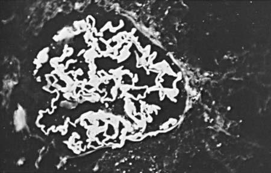

# Chapter 560: Multisystem Disease Associated with Hematuria

*Prasad Devarajan*

<!-- p.4105 -->
Gross or microscopic hematuria may be associated with several multi system disorders, including chronic systemic infections, systemic lupus erythematosus (SLE), IgA vasculitis nephritis (formerly known as Henoch-Schönlein purpura nephritis), Goodpasture disease, hemo lytic uremic syndrome (HUS), nephrotoxicity, and renal cortical necrosis. In most of these conditions, the presenting complaints per tain primarily to the underlying systemic illness, and hematuria often heralds or portends renal involvement (see Chapters 560.1-560.8).

## 560.1  Chronic Infections Prasad Devarajan

Glomerulonephritis (GN) with hematuria is a recognized complica tion of various chronic infections. Examples include bacterial endo carditis caused by viridans group streptococci and other organisms, and ventriculoatrial shunts infected with *Staphylococcus epidermidis.* Other infections, observed less commonly in children than in adults, include those due to HIV, hepatitis B virus (HBV), or hepatitis C virus; syphilis; and renal candidiasis. Parasitic infections associated with glomerular disease include malaria, schistosomiasis, leishmaniasis, filariasis, hydatid disease, trypanosomiasis, and toxoplasmosis. In each condition, the infecting organism has a low virulence, and the host is chronically infected with a microbial antigen. In the presence of high levels of circulating antigen, the host’s antibody response leads to the formation of **immune complexes** that are deposited in the kidneys and initiate glomerular inflammation. Foreign antigens can also stimulate an autoimmune response through the production of antibodies that cross react with such antigens incorrectly recognized as glomerular structural components.

The kidney histopathology in GN due to chronic infections can resemble poststreptococcal GN, membranous GN, or membranopro liferative GN. The clinical manifestations are generally those of an acute nephritic syndrome (active urinary sediment with hematuria, protein uria, and granular and/or red blood cell (RBC) casts, edema, hyperten sion) or nephrotic syndrome (proteinuria, edema, hypoalbuminemia). *The serum C3 and CH**50 complement levels are often decreased due to activation of the classic complement pathway.*

In **HIV-associated nephropathy,** direct viral infection of nephrons occurs because renal cells express a variety of lymphocyte chemokine receptors that are essential for and facilitate viral invasion. The kidney expression of HIV infection is quite variable and includes an immune complex injury and a direct cytopathic effect. The classic histopatho logic lesion of HIV-associated nephropathy is *focal segmental glomeru losclerosis.* In the era of antiretroviral therapy, the decline in mortality from HIV disease has led to the increased recognition of renal disor ders as an important long-term complication in children who survive perinatal HIV infection.

HBV infection is a global public health problem. It is estimated that there are more than 350 million HBV carriers in the world.

Prompt eradication of any infection before severe glomerular injury occurs usually results in resolution of the GN associated with chronic infections. Progression to end-stage kidney disease has been described but is uncommon. Spontaneous resolution of hepatitis B

infection is common in children (30–50%) and results in remission of the glomerulopathy. Widespread use of hepatitis B vaccines has decreased the incidence of HBV-related renal diseases. Also, with the new availability of direct-acting antivirals for hepatitis C virus, a sus tained virologic response, successful remission, and even regression of glomerular lesions can be achieved if treatment is initiated at an early stage. Similarly, in patients with HIV-associated nephropathy, several clinical studies have demonstrated the overall improvement in kidney function with early initiation of antiretroviral therapy. Particularly in children, modern antiretroviral therapy has improved the outcome and decreased the prevalence of childhood HIV-associated nephropathy.

*Visit Elsevier eBooks+ at eBooks.Health.Elsevier.com** for Bibliography.*

## 560.2  Glomerulonephritis Associated with Systemic Lupus Erythematosus Prasad Devarajan

Systemic lupus erythematosus (SLE) is a chronic autoimmune disease characterized by fever, weight loss, dermatitis, hematologic abnor malities, arthritis, and involvement of the heart, lungs, central nervous system (CNS), and kidneys (see Chapter 199). Although SLE is less fre quent in children, kidney involvement (lupus nephritis) is more com mon and is more severe than that seen in adults. Lupus nephritis is the most important cause of morbidity and mortality in SLE.

**PATHOGENESIS AND PATHOLOGY** The hallmark of SLE is the abnormal production of pathogenic auto antibodies to self-antigens such as DNA (anti–double stranded DNA antibody [anti-dsDNA]) and nuclear proteins (antinuclear antibodies [ANA]), driven by immune dysregulation and loss of self-tolerance. The antigen-antibody complexes accumulate in small vessels of many organs, where they incite a local inflammatory response by activating complement pathways and by binding to Fc receptors. Lupus nephritis is a result of the deposition of circulating immune complexes, as well as the direct binding of autoantibodies to glomerular components with resultant complement stimulation.

Kidney biopsy and evaluation of kidney histopathology remain the gold standard for establishing the diagnosis of SLE nephritis and deter mining specific therapeutic regimens. The World Health Organization (WHO) classification of lupus nephritis has been employed in clinical trials and is based on a combination of features, including light micros copy, immunofluorescence, and electron microscopy. In patients with **WHO class I nephritis** (minimal mesangial lupus nephritis), no his tologic abnormalities are detected on light microscopy, but mesangial immune deposits are present on immunofluorescence or electron microscopy. In **WHO class II nephritis** (mesangial proliferative nephritis), light microscopy shows both mesangial hypercellularity and an increased matrix, along with mesangial deposits containing immu noglobulin and complement.

**WHO class III nephritis** and **WHO class IV nephritis** are inter related lesions characterized by both mesangial and endocapillary lesions. Class III nephritis is defined by <50% glomeruli with involve ment, and class IV has ≥50% glomerular involvement. Immune depos its are present in both the mesangium and subendothelial areas. A **subclassification** scheme helps grade the severity of the proliferative lesion based on whether the glomerular lesions are segmental (<50% glomerular tuft involved) or global (≥50% glomerular tuft involved). The WHO classification scheme also delineates whether there is a pre dominance of chronic disease versus active disease. Chronic injury results in glomerular sclerosis and is felt to be the consequence of sig nificant proliferative disease seen in classes III and IV. Other signs of active disease include capillary walls that are thickened secondary to subendothelial deposits (creating the characteristic wire-loop lesion), necrosis, and crescent formation. WHO class IV nephritis is associated with poorer outcomes but can be successfully treated with aggressive immunosuppressive therapy.

*Prasad Devarajan*

<!-- p.4106 -->

<!-- p.4107 -->
**WHO class V nephritis** (membranous lupus nephritis) is less com monly seen as an isolated lesion and resembles idiopathic membranous nephropathy with subepithelial immune deposits. This lesion is often seen in combination with class III or IV proliferative nephritis, and if the membranous lesion is present in >50% glomeruli, both classes are noted in the designation. This classification scheme also identifies cases with combinations of mixed classes III, IV, and V lesions, direct ing appropriate treatment for such patients.

Another classification scheme proposed by both the International Society of Nephrology and the Renal Pathology Society differs mainly in its subclassification of class IV into diffuse global and diffuse seg mental lesions (Table 560.1). Although this classification is widely pre ferred, it should be noted that most available results of clinical trials are based on the WHO classification.

*Transformation of the histologic lesions of lupus nephritis from one class to another is common.* This is more likely to occur among inad equately treated patients and usually results in progression to a more severe histologic lesion.

Immunofluorescence microscopy is an essential component of the pathologic evaluation. Lupus nephritis is characterized by the granu lar deposition of all immunoglobulin isotypes (IgG, IgM, and IgA— also referred to as “full house”), as well as complements (C3, C4, and C1q) in the glomerular mesangium and capillary walls. This pattern of extensive glomerular immune deposition is referred to as full-house immune staining and is diagnostic of lupus nephritis.

**CLINICAL MANIFESTATIONS** Most children with SLE are adolescent females (female-to-male ratio of 5:1) and present with extrarenal manifestations. The relative risk of SLE is three- to sevenfold higher in Asian, Black, and Hispanic females compared with White females. Lupus nephritis in Black and Hispanic populations also typically displays an increased severity and

worse prognosis. Lupus nephritis affects 80% of pediatric patients with SLE, and although it commonly presents within the first year of diag nosis, may occur at any time during the disease. The clinical findings in patients having milder forms of lupus nephritis (all class I and II, some class III) include hematuria, normal renal function, and protein uria <1 g/24 hr. Some patients with class III and all patients with class IV nephritis have hematuria and proteinuria, active urinary sediment with cellular casts, hypertension, reduced kidney function, nephrotic syndrome, or acute kidney injury. The urinalysis may be normal on rare occasions in patients with proliferative lupus nephritis. Patients with class V nephritis commonly present with nephrotic syndrome.

**DIAGNOSIS** The diagnosis of SLE is confirmed by the detection of circulating ANA and by demonstrating antibodies that react with native anti-dsDNA. In most patients with active disease, C3 and C4 levels are depressed. In view of the lack of a clear correlation between the clinical manifesta tions and the severity of the kidney involvement, kidney biopsy should be performed in all patients with SLE who display even minor urinary abnormalities or other clinical evidence for renal disease. Histopatho logic findings are used to determine the classification, severity, progno sis, and selection of specific immunosuppressive therapies.

**TREATMENT** Current therapies are largely based on the histology, clinical severity, and lessons learned from clinical trials of adults with lupus nephritis. Immunosuppression remains the cornerstone of therapy. The goal of immunosuppressive therapy in lupus nephritis is to produce both a clinical remission, defined as normalization of renal function and pro teinuria, and a serologic remission, defined as normalization of anti- DNA antibody, C3, and C4 levels. Therapy is initiated in all patients with prednisone at a dose of 1-2 mg/kg/day in divided doses, followed by a slow steroid taper over 4-6 months beginning 4-6 weeks after achieving a serologic remission.

For patients with more severe forms of nephritis (WHO classes III and IV), more aggressive immunosuppressive regimens are required because corticosteroid therapy alone is insufficient to induce a remis sion. In general, such regimens are separated into two phases, namely, induction and maintenance. The most commonly employed induc tion therapy has been six consecutive monthly intravenous infusions of cyclophosphamide at a dose of 500-1,000 mg/m2. Pulse intravenous methylprednisolone (1,000 mg/m2) is also used in addition to oral cor ticosteroids. Maintenance therapy previously consisted of additional cyclophosphamide infusions every 3 months for 18 months, which reduced the risk of progressive renal dysfunction. Serious side effects of cyclophosphamide have included infections, hair loss, hemorrhagic cystitis, and gonadal failure.

As an alternative induction therapy, in adult and pediatric clinical trials, mycophenolate mofetil was as efficacious as, or even superior to, cyclophosphamide, and is increasingly considered for use in children at a dosage of 600 mg/m2 per dose twice daily. Maintenance therapy using mycophenolate mofetil or azathioprine is also as efficacious as intravenous cyclophosphamide and results in less serious side effects. Mycophenolate mofetil is particularly more efficacious than cyclophos phamide in Black patients. Major side effects of mycophenolate mofetil have included diarrhea, leukopenia, and teratogenicity. Azathioprine, at a single daily dose of 1.5-2.0 mg/kg, may be used as a steroid-sparing agent in patients with WHO class I or II lupus nephritis.

Rituximab, a chimeric monoclonal antibody specific for human CD20, is an alternative that has been shown to induce a remission in adults and children with proliferative lupus nephritis refractory to steroids and other immunosuppressants. Rituximab is used in cases where resistance to conventional treatment is demonstrated. Plasma pheresis is ineffective in lupus nephritis unless there is accompany ing thrombotic thrombocytopenic purpura (TTP) or antineutrophilic cytoplasmic antibody (ANCA)-associated disease. Other therapies include belimumab, a fully humanized monoclonal antibody against a type II transmembrane protein that functions in the normal survival and differentiation of B cells; it has been approved by the FDA for use

#### **Table 560.1** Classification of Lupus Nephritis

| Category / Parameter | Clinical Details & Findings |
| --- | --- |
| **CLINICAL FEATURES** | I.	 Minimal mesangial LN; No renal findings; II.	 Mesangial proliferative LN; Mild clinical renal disease;; minimally active urinary; sediment; mild to moderate; proteinuria (never nephrotic); but may have active serology; III.	 Focal proliferative LN; (<50% glomeruli involved); A. Active; A/C. Active and chronic; C. Chronic; More active sediment changes;; often active serology; increased; proteinuria (>25% nephrotic);; hypertension may be present;; some evolve into class IV; pattern; active lesions require; treatment; chronic do not; IV.	 Diffuse proliferative LN; (>50% glomeruli involved);; all may be with segmental or; global involvement (S or G); A. Active; A/C. Active and chronic; C. Chronic; Most severe renal involvement; with active sediment,; hypertension, heavy proteinuria; (frequent nephrotic syndrome),; often reduced glomerular; filtration rate; serology very; active; active lesions require; treatment; V.	 Membranous LN; glomerulonephritis; Significant proteinuria (often; nephrotic) with less active lupus; serology; VI.	 Advanced sclerosing LN; More than 90%; glomerulosclerosis; no; treatment prevents renal failure; LN, Lupus nephritis.; From Radhakrishnan J, Appel GB. Glomerular disorders and nephrotic syndromes. In:; Goldman L, Schafer AI, eds. Goldman’s Cecil Medicine. 26th ed. Philadelphia: Elsevier;; 2020: Table 113.7. |

<!-- p.4108 -->
in SLE. Its role in lupus nephritis, either in combination with current therapies or to replace them, requires further study.

The optimal treatment for class V lupus nephritis remains unclear. On the one hand, the low risk of progression to end-stage kidney dis ease when compared with proliferative forms of lupus nephritis has encouraged a less aggressive approach. On the other hand, patients with uncontrolled nephrotic syndrome due to class V lupus nephri tis are at a high risk of morbidity and may require more aggressive immunosuppression.

Hydroxychloroquine is prescribed for most patients with SLE for extrarenal manifestations but is thought to have a beneficial effect in maintaining the remission in lupus nephritis. It is a rational choice given its low side effect profile. Use of antihypertensive drugs to aggres sively treat hypertension, as well as the specific use of drugs that block the renin-angiotensin system (angiotensin-converting enzyme inhibi tors and angiotensin-receptor blockers) to reduce proteinuria, are also important adjuvant therapies that appear to decrease the long-term progression of renal disease.

**PROGNOSIS** Overall, kidney survival (defined as chronic kidney disease with out progression to end-stage kidney disease therapy) is seen in 80% of patients 10 years after the diagnosis of SLE nephritis. Patients with diffuse proliferative WHO class IV lupus nephritis, poor kidney func tion at presentation, or persistent nephrotic-range proteinuria exhibit the highest risk for progression to end-stage kidney disease. Concerns regarding the side effects of chronic immunosuppressive therapy and the risk of recurrent disease are lifelong. Close monitoring for the relapse of disease is critical to ensure maximally successful renal out comes. Special care must be taken to minimize the risks of infection, osteoporosis, obesity, poor growth, hypertension, and diabetes mellitus associated with chronic corticosteroid therapy. Patients require coun seling regarding the risk of malignancy or infertility, which may be increased in those receiving a cumulative dose of >20 g of cyclophos phamide or other immunosuppressant therapies.

*Visit Elsevier eBooks+ at eBooks.Health.Elsevier.com** for Bibliography.*

## 560.3  IgA Vasculitis Nephritis Prasad Devarajan

IgA vasculitis (formerly known as Henoch-Schönlein purpura) is an idiopathic systemic immune complex–mediated vasculitis associated with IgA deposition within small-vessel walls. It is the most common small-vessel vasculitis in children, with a peak incidence in early child hood (4-6 years of age). Ninety percent of cases occur in children, with about half the cases preceded by an upper respiratory infection. It is characterized by a purpuric rash and commonly accompanied by arthritis and abdominal pain (see Chapter 210.1). Approximately 50% of patients with IgA vasculitis develop kidney manifestations, which vary from asymptomatic microscopic hematuria to severe, progressive GN. IgA vasculitis nephritis shares a similar pathogenesis and nearly identical kidney histology with IgA nephropathy. Although the two are considered as distinct entities, many consider IgA vasculitis nephritis and IgA nephropathy as part of the same clinical spectrum and IgA nephropathy as one of the sequelae of IgA vasculitis nephritis.

**PATHOGENESIS AND PATHOLOGY** The pathogenesis of IgA vasculitis nephritis appears to be mediated by the deposition of **polymeric IgA** in glomeruli. This is analogous to the same type of IgA deposits seen in systemic small vessels in IgA vasculitis, primarily those of the skin and intestine. Studies have iden tified defective glycosylation of the hinge region of IgA1 in patients with both IgA vasculitis nephritis and IgA nephropathy. Recognition of the exposed hinge region of IgA1 by naturally occurring autoan tibodies leads to formation of immune complexes that are deposited in the glomerular mesangium. Any mucosal infection or food antigen

may trigger the increased production of pathogenic IgA1. IgA immune complexes are deposited throughout the body and activate pathways leading to necrotizing vasculitis. A skin biopsy characteristically shows leukocytoclastic vasculitis with IgA, C3, and fibrin deposition. The glo merular findings can be indistinguishable from those of IgA nephropa thy. Pathognomonic IgA deposits are detected by immunofluorescence as the dominant immunoglobulin in the glomerular mesangium. His tologically, a broad spectrum of glomerular lesions that can range from mild mesangial and endocapillary proliferation to necrotic and cres centic changes from extracapillary proliferation can be seen.

**CLINICAL AND LABORATORY MANIFESTATIONS** The classic tetrad of IgA vasculitis nephritis includes a palpable pur pura, arthritis or arthralgia, abdominal pain, and evidence for kidney disease. *These may develop over a period of days to weeks and may vary in their order of presentation.* Notably, not all of the tetrad are pres ent in all patients. The nephritis associated with IgA vasculitis usually *follows* the onset of the rash, often presenting weeks or even months after the initial nonkidney manifestations have resolved. Nephritis can be manifest at the initial presentation but only rarely before onset of the rash. Some degree of kidney involvement occurs in approximately 50% of IgA vasculitis cases, more commonly in older children (age >8 years confers a threefold greater risk for kidney involvement). Most patients (80%) initially display only mild renal involvement, princi pally isolated microscopic hematuria without significant proteinuria. About 20% of patients can present with a more severe kidney involve ment, including a combined acute nephritic and nephrotic picture (hematuria, hypertension, renal insufficiency, significant proteinuria, and nephrotic syndrome). Older children (and adults) have a greater risk for more severe involvement. Initial mild kidney involvement can also occasionally progress to more severe nephritis despite resolu tion of all other features of IgA vasculitis. The severity of the systemic manifestations is not correlated with the severity of the nephritis. *Most patients who develop nephritis have urinary abnormalities by 1 month, and nearly all have abnormalities by 3-6 months after the onset of IgA vasculitis*. Therefore a urinalysis (and blood pressure checks) should be performed weekly in patients with IgA vasculitis during the period of active clinical disease (usually during the first 4 weeks). Thereafter, a urinalysis (and blood pressure checks) should be performed once a month for up to 6 months. If all urinalyses and blood pressures are normal during this follow-up interval, nephritis is unlikely to develop. If proteinuria, kidney insufficiency, or hypertension develops along with hematuria, consultation with a pediatric nephrologist is indi cated. Indications for a kidney biopsy in children with IgA vasculitis nephritis include significant proteinuria (urine protein >1 g/day or urine protein/creatinine ratio >1.0), significant hypertension, or ele vated serum creatinine.

Mimics of IgA vasculitis include endocarditis (skin, renal) and gran ulomatosis with polyangiitis (skin, renal).

**PROGNOSIS AND TREATMENT** The prognosis of IgA vasculitis nephritis for most patients is excellent. Spontaneous and complete resolution of the nephritis typically occurs in many patients with mild initial manifestations (isolated hematuria with insignificant proteinuria). However, such patients uncommonly can progress to severe kidney involvement, including development of chronic kidney disease. Patients with acute nephritic or nephrotic syn drome at presentation have a guarded kidney prognosis, particularly if they are found to have concomitant necrosis or substantial crescentic changes on kidney biopsy. Untreated, the risk of developing chronic kidney disease, including end-stage kidney disease, is 2–5% in all patients with IgA vasculitis, but almost 50% in those with the most severe early kidney clinical and histologic features.

No controlled studies have demonstrated any efficacy of short courses (weeks) of oral corticosteroids administered promptly after the onset of IgA vasculitis in either preventing the development of nephritis or decreasing the severity of subsequent kidney involvement. Tonsillectomy has been proposed as an intervention for IgA vasculitis nephritis, but it also does not appear to have any measurable effect on

<!-- p.4109 -->

<!-- p.4110 -->
the renal outcome. Mild IgA vasculitis nephritis does not require treat ment because it usually resolves spontaneously.

The efficacy of treatment for moderate or severe IgA vasculitis nephritis, which is far more likely to progress to chronic kidney dis ease, is more difficult to assess. Several uncontrolled studies have reported a significant benefit from aggressive immunosuppression (high-dose and extended courses of corticosteroids with azathioprine, mycophenolate mofetil, or cyclophosphamide) in patients with poor prognostic features on kidney biopsy; such patients are at high risk of progressing to chronic kidney disease. Reports of the treatment of high-risk patients with either plasmapheresis or rituximab have also indicated a potential benefit. Balancing the absence of controlled data with the severe side effects of aggressive therapies in patients with poor renal prognostic factors is difficult. Aggressive therapy with careful monitoring may be reasonable in those with the most severe IgA vas culitis nephritis (>50% crescents on biopsy). One common approach in children with severe clinical kidney involvement (nephrotic range proteinuria, elevated serum creatinine, hypertension) is the use of oral prednisone (1 mg/kg/day for 3 months), along with angiotensinconverting enzyme inhibitors, followed by azathioprine or mycophe nolate mofetil if severe clinical involvement persists. For children with severe histologic manifestations (>50% glomerular crescents), treat ment with intravenous methylprednisolone pulses for 3 days, followed by a combination of oral prednisone (for 3 months) and azathioprine or mycophenolate mofetil (extended course) may be considered. For children with the most severe histology (>75% glomerular crescents) and progressive kidney disease, intravenous steroids plus plasmapher esis may be considered. If progression to end-stage kidney disease occurs, renal transplantation is the treatment of choice. Deposition of IgA in the transplanted kidney is common, but most cases are sub clinical, and the overall graft survival is similar to that for other renal transplant recipients.

*Visit Elsevier eBooks+ at eBooks.Health.Elsevier.com** for Bibliography.*

## 560.4  Goodpasture Disease Prasad Devarajan

Goodpasture disease is an autoimmune disease characterized by pul monary hemorrhage, **rapidly progressive glomerulonephritis**, and elevated **anti–glomerular basement membrane (anti-GBM) antibody** titers. The disease results from an attack on these organs by antibodies directed against certain epitopes of type IV collagen, located within the alveolar basement membrane in the lung and glomerular basement membrane (GBM) in the kidney. An acquired conformational change in the noncollagenous 1 domain of the alpha 3-chain of type IV col lagen leads to the production of pathologic autoantibodies. The high affinity of these antibodies to the GBM results in the characteristic rap idly progressive kidney disease. Infusion of human anti-GBM antibod ies into animals reproduces the rapidly aggressive glomerulonephritis, confirming the high pathogenicity of these antibodies.

**PATHOLOGY** Kidney biopsy shows proliferative crescentic glomerulonephritis in most patients. Immunofluorescence microscopy demonstrates the pathognomonic continuous linear deposition of immunoglobulin G along the GBM (Fig. 560.1).

**CLINICAL MANIFESTATIONS** Goodpasture disease is rare in childhood. Patients usually present with hemoptysis from pulmonary hemorrhage that can be life-threatening. Concomitant renal manifestations include acute glomerulonephri tis with hematuria, nephritic urinary sediment with cellular casts, proteinuria, and hypertension, which usually follow a rapidly pro gressive course. Kidney failure commonly develops within days to weeks of the clinical presentation. Although fever may be present, other systemic complaints such as malaise or arthralgia are usually

absent; their presence should raise suspicion for a systemic vasculi tis. *Less commonly, patients can have anti-GBM nephritis manifesting as isolated, rapidly progressive glomerulonephritis without pulmonary hemorrhage.* In essentially all cases, anti-GBM antibody is present in the serum and/or the kidney, and the serum complement C3 level is normal. **Antineutrophilic cytoplasmic antibody (ANCA)** levels can be found to be elevated in 10–40% of patients, along with the anti- GBM antibody; such patients doubly positive for these autoantibod ies have more severe disease at presentation. In general, anti-GBM antibody titers are correlated with the severity of the renal involve ment. However, a kidney biopsy should be performed (unless con traindicated) because the accuracy of anti-GBM serology is variable, and renal biopsy provides additional histologic information that can guide therapy.

**DIAGNOSIS AND DIFFERENTIAL DIAGNOSIS** The diagnosis is made by a combination of the clinical presentation of pulmonary hemorrhage with acute glomerulonephritis, the presence of serum antibodies directed against GBM (anti–type IV collagen in GBM), and characteristic renal biopsy findings. Other diseases that can cause a **pulmonary-renal syndrome** need to be considered and include SLE, IgA vasculitis, nephrotic syndrome–associated pulmonary embo lism, and ANCA-associated vasculitis (such as granulomatosis with polyangiitis and microscopic polyangiitis). These diseases are ruled out by the absence of other characteristic clinical features, kidney biopsy findings, and negative serologic studies for antibodies against nuclear (ANA), DNA (anti-dsDNA), and neutrophil cytoplasmic components (ANCA antibody).

**PROGNOSIS AND TREATMENT** Untreated, the prognosis of Goodpasture disease is poor. Treatment must be initiated emergently as soon as the diagnosis is suspected. The prompt institution of plasmapheresis, high-dose intravenous meth ylprednisolone, and cyclophosphamide often induces remission and improves survival times. Initial therapy with plasmapheresis removes circulating anti-GBM antibodies, and initial immunosuppression with steroids and cyclophosphamide inhibits ongoing antibody produc tion. Rituximab may be used as a substitute in cases where cyclophos phamide toxicity is encountered. Initial treatment is guided by the clinical response and serial anti-GBM antibody titers. Retrospective cohort studies suggest that when this combination of treatments is started early, most patients will have a good kidney outcome. How ever, an initial presentation with oligoanuria, a high proportion of glo merular crescents, or kidney failure requiring dialysis predicts worse kidney and patient survival rates. After the induction of remission, maintenance therapy with lower doses of prednisone and azathioprine (or mycophenolate mofetil) is continued for 6-9 months. However, patients who survive the acute pulmonary hemorrhage and rapidly progressive glomerulonephritis can still progress to end-stage kidney disease despite ongoing immunosuppressive therapy. For patients who

**Fig. 560.1** Immunofluorescence micrograph demonstrating the con tinuous linear staining of immunoglobulin G along the glomerular base ment membrane in Goodpasture disease (×250).

<!-- p.4111 -->

<!-- p.4112 -->
progress, kidney transplantation is the treatment of choice. Relapse and recurrent disease after kidney transplantation are both uncommon.

*Visit Elsevier eBooks+ at eBooks.Health.Elsevier.com** for Bibliography.*

## 560.5  Hemolytic-Uremic Syndrome Prasad Devarajan

Hemolytic-uremic syndrome (HUS) is a common cause of communityacquired acute kidney injury in young children. It is the most common form of **thrombotic microangiopathy (TMA)** in children (Fig. 560.2). Like all TMAs, HUS is characterized by the triad of microangiopathic hemolytic anemia, thrombocytopenia, and kidney insufficiency. HUS has clinical features in common with thrombotic thrombocytopenic purpura (TTP) (see Chapter 533.5). The etiology and pathophysiology of the more common forms of HUS clearly delineate typical childhood HUS as separate from idiopathic TTP.

**ETIOLOGY** The various etiologies of HUS and other related thrombotic microan giopathies allow classification into infection-induced, genetic, druginduced, and HUS associated with systemic diseases characterized by microvascular injury (Table 560.2; see Fig. 560.2). The most com mon form of HUS is caused by **Shiga toxin–producing Escherichia coli**** (STEC)**, which causes prodromal acute enteritis and is commonly termed STEC-HUS or *diarrhea-associated HUS.* In the subcontinent of Asia and in southern Africa, the toxin of *Shigella dysenteriae* type 1 is causative, whereas in Western countries, verotoxin or STEC is the usual cause. STEC-HUS accounts for about 90% of all HUS cases in childhood.

Several serotypes of *E. coli* can produce the toxin. O157:H7 is most common in Europe and the Americas; other serotypes include O26, O111, O121, O145, O91, O103, O104, and O80. The reservoir of STEC is the intestinal tract of domestic animals, usually cows. Dis ease commonly is transmitted by undercooked meat or unpasteur ized (raw) milk and apple cider. Local outbreaks have followed the ingestion of undercooked, contaminated hamburger or other foods cross-contaminated on unwashed cutting boards at fast food restau rants; contaminated municipal water supplies; petting farms; and swimming in contaminated ponds, lakes, or pools. With broad food distribution, wider epidemics have been traced to lettuce, raw spin ach, and bean sprouts contaminated with STEC. Less often, STEC has been spread by person-to-person contact within families or childcare centers.

A rare but distinct entity of infection-triggered HUS is related to neuraminidase-producing *Streptococcus pneumoniae* (Sp-HUS)*.* Sp-HUS, typically severe, develops during acute infection with this organism, typically manifesting as pneumonia with empy ema. Compared with the prevaccine era, Sp-HUS incidence seems to be decreasing after the introduction of 7-serotype valent and 13-serotype valent pneumococcal vaccines. However, severe Sp-HUS cases continue to occur secondary to vaccine failure and emergence of nonvaccine/replacement serotypes. A TMA, similar to HUS or TTP, also can occur in patients with untreated HIV infection and influenza infection.

*Genetic* forms of HUS (atypical, nondiarrheal) compose the sec ond major category of the disease (see Table 560.2 and Fig. 560.2). Inherited deficiencies of either von Willebrand factor–cleaving prote ase (ADAMTS13) or complement factor H, I, or B can cause HUS. A specific genetic defect has not been identified in approximately 50% of familial cases transmitted in classic Mendelian autosomal dominant or

**Thrombotic microangiopathies**

**(TMA)**

**Hemolytic uremic**

**syndrome**

**Shiga toxin-induced E. coli**** HUS**

**(STEC-HUS)**

**TIP (ADAMTS13 deficiency)**

Acquired due to autoantibody to ADAMTS13 Congenital due to homozygous or compound heterozygous ADAMTS pathogenic variants

**aHUS with dysregulation of the alternative complement pathway**

Pathogenic variants in CFH, CFI, MCP, C3, CFB, THBD Anti-CFH antibodies CFH/CFHR1 hybrid gene CFHR1,3 deletion

**Miscellaneous conditions/ Diseases associated with TMA**

Bone marrow/solid organ transplantation Malignancy Sepsis/DIC Autoimmune disorders (SLE, APA syndrome) Drugs (calcineurin inhibitors, gemcitabine, anti-VEGF) Malignant hypertension Pregnancy HELLP syndrome HIV infection, Streptococcus pneumoniae, Influenza Cobalamin C defect DGKE pathogenic variant

**Fig. 560.2** Classification algorithm for the thrombotic microangiopathies based on etiology. ADAMTS13, A disintegrin and metalloproteinase with a thrombospondin type 1 motif, member 13; aHUS, atypical hemolytic uremic syndrome; APA, antiphospholipid antibody syndrome; CFB, comple ment Factor B; CFH, complement Factor H; CFI, complement Factor I; DGKE, diacylglycerol kinase ε; DIC, disseminated intravascular coagulation; HELLP syndrome, hemolysis, elevated liver enzymes and low platelet count syndrome; MCP, membrane cofactor protein (CD46); SLE, systemic lupus erythematosus; THBD, thrombomodulin gene; VEGF, vascular endothelial growth factor. (From Dixon BP, Gruppo RA. Atypical hemolytic uremic syndrome. Pediatr Clin N Am. 2018;65:509–525. Fig. 2.)

<!-- p.4113 -->

<!-- p.4114 -->
recessive patterns. Some of these may be due to cobalamin C pathogenic variants. A major feature characteristic of genetic forms of HUS is the *absence* of a preceding diarrheal prodrome, although the presence of a diarrheal prodrome does not rule out atypical HUS. Genetic forms of HUS can be indolent and unremitting once they become manifest, or they can have a relapsing pattern precipitated by an infectious illness. The latter feature likely explains the association of many infectious agents with HUS, particularly in reports published before the recog nition of the unique pathophysiology of STEC and neuraminidaseproducing pneumococci in causing HUS.

HUS can be superimposed on any disease associated with microvascular injury, including malignant hypertension, SLE, and antiphospholipid syndrome. It can also occur after bone marrow or solid organ transplantation and may be triggered by the use of the calcineurin inhibitors cyclosporine and tacrolimus in that setting. Several other medications also can induce HUS (see Table 560.2 and Fig. 560.2).

**PATHOLOGY** Kidney biopsies are only rarely performed in HUS because the diag nosis is usually established by clinical criteria, and the risks of biopsy are significant during the active phase of the disease. Early glomerular changes include thickening of the capillary walls caused by swelling of endothelial cells and accumulation of fibrillar material between endo thelial cells and the underlying basement membrane, causing narrow ing of the capillary lumens. Platelet-fibrin thrombi are often seen in glomerular capillaries. Thrombi are also seen in afferent arterioles and small arteries with fibrinoid necrosis of the arterial wall, leading to kidney cortical necrosis from vascular occlusion. Late findings include glomerular sclerosis and obsolescence secondary to either severe direct glomerular involvement or glomerular ischemia from arteriolar involvement.

**PATHOGENESIS** Microvascular injury with endothelial cell damage is characteristic of all forms of TMA, including HUS. In the diarrhea-associated form of HUS, enteropathic organisms produce either Shiga toxin or the highly homologous Shiga-like verotoxin. These toxins are easily absorbed from the colonic mucosa into the systemic circulation, bind to endo thelial cells in the glomerulus and elsewhere, and directly cause endo thelial cell damage. Shiga toxin can also directly activate platelets to promote their aggregation. Mechanical injury to RBCs passing through the thrombotic microvasculature results in a severe nonimmune ane mia with a negative direct Coombs test. In pneumococcal-associated HUS, neuraminidase cleaves sialic acid on membranes of endothelial cells, red cells, and platelets to expose the underlying cryptic Thomsen- Friedenreich (T) antigen. Endogenous IgM antibodies recognize and react with the T antigen to trigger hemolysis and anemia with a posi tive direct Coombs test.

The *familial* recessive and dominant forms of HUS, including the inherited deficiencies of ADAMTS13 and regulators of the complement cascade, probably predispose patients to developing HUS but do not cause the disease per se because these patients might not develop HUS until later childhood or even adulthood. In such cases, HUS is often triggered by an inciting event such as an infectious disease. The absence of ADAMTS13 impairs cleavage of von Willebrand factor multimers, which enhances platelet aggregation. Factor H plays a central role in complement regulation, primarily arresting the amplification and propagation of complement activation. It is possible that mild endothe lial injury that would normally resolve instead evolves to an aggressive microangiopathy because of the inherited deficiencies of these factors.

In each form of HUS, capillary and arteriolar endothelial injury in the kidney leads to localized thrombosis, particularly in glomeruli, causing a direct decrease in glomerular filtration. Progressive platelet aggregation in the areas of microvascular injury results in consumptive thrombocytopenia. Microangiopathic hemolytic anemia results from mechanical damage to RBCs as they pass through the damaged and thrombotic microvasculature.

**CLINICAL MANIFESTATIONS** Typical HUS (diarrhea form) is most common in preschool- and school-age children, but it can occur in adolescents and adults. In HUS caused by toxigenic *E. coli,* the onset of HUS occurs 5-7 days after the onset of gastroenteritis with fever, vomiting, abdominal pain, and diar rhea. The prodromal intestinal symptoms may be severe and require hospitalization, but they can also be relatively mild and considered trivial. Not all infected patients will develop HUS. The diarrhea is often bloody but not necessarily so. After the prodromal illness, the sudden onset of pallor, weakness, and lethargy heralds the onset of HUS, and it reflects the development of microangiopathic hemolytic anemia. Oliguria can be present in early stages but may be masked by ongoing diarrhea because the prodromal enteritis often overlaps the onset of HUS, particularly with ingestion of large doses of toxin. Thus patients with HUS can present with either significant dehydration or volume overload, depending on whether the enteritis or kidney insuf ficiency from HUS predominates and the amount of fluid that has been administered.

Uremic Syndromes and Thrombotic Microangiopathies

#### **Table 560.2** Current Classification of Hemolytic

| Category / Parameter | Clinical Details & Findings |
| --- | --- |
| **DIARRHEA-ASSOCIATED HUS** | STEC (Escherichia coli O157:H7); STEC (E .coli 0121 and 0104:H4); Non-STEC (Shigella dysenteriae type 1) |
| **HUS SECONDARY TO SYSTEMIC INFECTIONS** | Neuraminidase (Streptococcus pneumoniae) |
| **HIV** | Influenza; Human herpes virus 6; Parvovirus B19; Malaria |
| **ATYPICAL HUS DUE TO COMPLEMENT DYSREGULATION** | Factor H deficiency (pathogenic variants, autoantibodies); Factor I deficiency (pathogenic variants); Factor B (gain-of-function pathogenic variants); Membrane cofactor (MCP) deficiency (pathogenic variants); C3 deficiency (pathogenic variants, autoantibodies); Thrombomodulin deficiency (pathogenic variants); Anti–complement factor H antibody; Unknown |
| **THROMBOTIC THROMBOCYTOPENIC PURPURA (TTP)** | Inherited ADAMTS13 deficiency (pathogenic variants); Acquired ADAMTS13 deficiency (antibody-mediated); Pregnancy-associated; Vitamin B12 deficiency |
| **DRUG INDUCED** | Cyclosporine; Tacrolimus; Bleomycin; Mithramycin; Cisplatin; Quinine; Cocaine; Anti–vascular endothelial growth factor (anti-VEGF) drugs |
| **SYSTEMIC DISEASE ASSOCIATED** | Systemic lupus erythematosus; Coexisting nephropathies; Malignant hypertension; Malignancies; Cobalamin C defect; Diacylglycerol kinase epsilon pathogenic variant |
| **TRANSPLANT ASSOCIATED** | Stem cell transplant; Bone marrow transplant; Renal; Heart; Intestinal |

<!-- p.4115 -->
Patients with pneumococci-associated HUS usually are quite ill with pneumonia, empyema, and bacteremia when they develop HUS. The onset can be insidious in patients with the genetic forms of HUS, with HUS triggered by a variety of illnesses, including mild, nonspecific gas troenteritis or respiratory tract infections.

HUS can be relatively mild or can progress to a severe and fatal multisystem disease. Leukocytosis, severe prodromal enteritis, hypo natremia, and antibiotic use portend a severe course, but no present ing features reliably predict the severity of HUS in any given patient. Patients with HUS who appear mildly affected at presentation can rap idly develop severe, multisystem, life-threatening complications. Kid ney insufficiency can be mild but also can rapidly evolve into severe oliguric or anuric kidney failure. The combination of rapidly develop ing kidney failure and severe hemolysis can result in life-threatening hyperkalemia. Severe acute kidney injury requiring dialysis develops in about 50% of patients with STEC-HUS. The duration of the dialy sis requirement is usually about 2 weeks. Volume overload, hyperten sion, and severe anemia can all develop soon after the onset of HUS and together can precipitate heart failure. Direct **cardiac involvement** is rare, but pericarditis, myocardial dysfunction, or arrhythmias can occur without predisposing features of hypertension, volume overload, or electrolyte abnormalities.

The majority of patients with HUS have some **CNS involvement**. Most have mild manifestations, with significant irritability, lethargy, or nonspecific encephalopathic features. Severe CNS involvement occurs in ≤20% of cases. Seizures and significant encephalopathy are the most common manifestations in those with severe CNS involvement, result ing from focal ischemia secondary to microvascular CNS thrombosis. Small infarctions in the basal ganglion and cerebral cortex have also been reported, but large strokes and intracranial hemorrhage are rare. Hypertension may produce an encephalopathy and seizures. Intestinal complications can be protean and include severe inflammatory colitis, ischemic enteritis, bowel perforation, intussusception, and pancreati tis. Patients can develop petechiae, but significant or severe bleeding is rare despite very low platelet counts.

**DIAGNOSIS AND DIFFERENTIAL DIAGNOSIS** The diagnosis is made by the combination of microangiopathic hemo lytic anemia with schistocytes, thrombocytopenia, and some degree of kidney involvement. The anemia can be mild at presentation, but it rapidly progresses. Thrombocytopenia is an invariable finding in the acute phase, with platelet counts usually 20,000-100,000/mm3. Par tial thromboplastin and prothrombin times are usually normal. The Coombs test is negative, except in pneumococci-induced HUS, where the Coombs test is usually positive. Leukocytosis is often present and significant. Urinalysis typically shows microscopic hematuria and lowgrade proteinuria. The kidney insufficiency can vary from mild eleva tions in serum BUN and creatinine to acute, anuric kidney failure.

The etiology of HUS is often clear with the presence of a diarrheal prodrome or pneumococcal infection. The presence or absence of toxi genic organisms on stool culture has little role in making the diagnosis of diarrhea-associated STEC-HUS. Only a minority (∼10%) of patients infected with those organisms develops HUS, and the organisms that cause HUS may be rapidly cleared. Therefore the stool culture may be negative in patients who have diarrhea-associated HUS. If no history of diarrheal prodrome or pneumococcal infection is obtained, then evaluation for genetic forms of HUS should be considered because those patients are at risk for recurrence, have a severe prognosis, and can benefit from specific therapy. Other causes of acute kidney injury associated with a microangiopathic hemolytic anemia and thrombo cytopenia should be considered and excluded, such as SLE, malignant hypertension, and bilateral renal vein thrombosis. A kidney biopsy is rarely indicated to diagnose HUS.

**PROGNOSIS AND TREATMENT** With early recognition and intensive supportive care, the mortality rate for diarrhea-associated HUS is <5%. Up to half of patients may require dialysis support during the acute phase of the disease. Recovery of platelet counts usually occurs first, followed by kidney recovery about

5 days later, and finally by resolution of anemia. Most recover kidney function completely, but of surviving patients, 5% remain dependent on dialysis, and up to 30% are left with some degree of chronic kidney disease. The prognosis for HUS not associated with diarrhea is more severe. Pneumococci-associated HUS causes increased patient mor bidity (>80% require dialysis), with the mortality rate reported as 20%. The familial, genetic forms of HUS can be insidiously progressive or relapsing diseases and have a poor prognosis. Identification of specific factor deficiencies in some of these genetic forms provides an opportu nity for directed therapy to improve the outcome.

The primary approach that has substantially improved an acute outcome in HUS is early recognition of the disease, monitoring for potential complications, and meticulous supportive care. Supportive care includes careful management of fluid and electrolytes, including prompt correction of a volume deficit, control of hypertension, and early institution of dialysis if the patient becomes significantly oliguric or anuric, particularly with hyperkalemia. Early intravenous volume expansion before the onset of oliguria or anuria may be nephropro tective in diarrhea-associated HUS. Red cell transfusions are usually required because hemolysis can be brisk and recurrent until the active phase of the disease has resolved. In pneumococci-associated HUS, it is critical that any administered red cells be washed before transfusion to remove residual plasma, because endogenous IgM directed against the revealed T antigen can play a role in accelerating the pathogenesis of the disease. Platelets should generally not be administered, regard less of the platelet count, to patients with HUS because they are rapidly consumed by the active coagulation and theoretically can worsen the clinical course. Despite low platelet counts, serious bleeding is very rare in patients with HUS.

There is no evidence that any therapy directed at arresting the dis ease process of the most common, diarrhea-associated STEC-HUS provides benefit, and some can cause harm. Attempts have been made using anticoagulants, antiplatelet agents, fibrinolytic therapy, plasma therapy, immune globulin, and antibiotics. Anticoagulation, antiplate let, and fibrinolytic therapies are specifically contraindicated because they increase the risk of serious hemorrhage. Antibiotic therapy to clear enteric toxigenic organisms (STEC) can result in increased toxin release, potentially exacerbating the disease; therefore it is not recom mended. However, prompt treatment of causative pneumococcal infec tion is important. The European experience with *E. coli* O104:H4 in adults who were treated with azithromycin demonstrated more rapid elimination of the organism. Furthermore, in  vitro evidence sug gests that meropenem, rifaximin, and azithromycin downregulate the release and expression of Shiga toxin. Nonetheless, *in children with E. coli O157:H7–associated HUS, antibiotics are still considered contraindicated*.

Plasma infusion or plasmapheresis has been proposed for patients suffering severe manifestations of HUS with serious CNS involve ment. There are no controlled data demonstrating the effectiveness of this approach, and it is specifically contraindicated in those with pneumococcal-associated HUS because it could exacerbate the disease. The use of plasma therapy in STEC-HUS was one of many treatment strategies during one of the largest reported outbreaks of STEC-HUS. This outbreak was caused by an uncommon serotype (O104:H4) that had unique virulence factors. Thought initially to cause more severe disease, it differed epidemiologically from other STEC-HUS serotypes by affecting primarily healthy adults, rather than the usual pattern of affecting children and the elderly. Treatment in this epidemic included plasma exchange in most of the adult patients, as well as the use of eculizumab.

Eculizumab is an anti-C5 antibody that inhibits complement acti vation, a pathway that contributes to active disease in some forms of atypical familial HUS; this pathway may also contribute to the pro cess in STEC-HUS. Eculizumab is approved by the FDA for the treat ment of *atypical HUS*. Because of the risk of meningococcal disease in patients with defects in terminal complement components, it is recom mended to give the meningococcal vaccine before giving eculizumab (if the patient has not been primarily immunized). Although initial reports suggested that eculizumab provided benefit in patients with

<!-- p.4116 -->
diarrhea-associated HUS, subsequent systematic analysis showed no benefit from either plasma exchange or eculizumab.

Plasma therapy can be of substantial benefit to patients with iden tified deficits of ADAMTS13 or factor H. It may also be considered in patients with other genetic forms of HUS, such as the undefined familial (recessive or dominant) form or sporadic but recurrent HUS. In contrast to its use in STEC-HUS, eculizumab shows great prom ise in the treatment of atypical HUS, including HUS occurring fol lowing renal transplantation. Whether it should be combined with plasma therapy or used as a primary treatment of atypical HUS is still undetermined.

Most patients with diarrhea-associated HUS recover completely, with little risk of long-term sequelae. Patients with hypertension, any level of kidney insufficiency, or residual urinary abnormalities per sisting a year after an episode of diarrhea-positive HUS (particularly significant proteinuria) require careful follow-up. Patients who have recovered completely with no residual urinary abnormalities after 1 year are less likely but may still manifest long-term sequelae. In a multi center pooled analysis of 3,476 children with hemolytic uremic syn drome followed up for a mean of 4.4 years, the combined average death and end-stage kidney disease rate was 12%, and the combined average kidney sequelae rate (chronic kidney disease, proteinuria, hyperten sion) was 25%. Because of reports of late sequelae in such patients, annual examinations with a primary physician are still warranted.

*Visit Elsevier eBooks+ at eBooks.Health.Elsevier.com** for Bibliography.*

## 560.6  Toxic Nephropathy Prasad Devarajan

Aberrant renal function often results from purposeful or accidental exposure to any number of diagnostic, biologic, or therapeutic agents that are potential or actual nephrotoxins. Among diagnostic agents, **contrast-induced nephropathy** is a common and generally revers ible form of **acute kidney injury** that results from administration of radiocontrast media in predisposed individuals. Iodinated radiocon trast agents are generally well tolerated by most patients without sig nificant adverse consequences. In volume-depleted patients or patients with underlying chronic kidney disease, their use poses a risk for the development of acute kidney injury with significant attendant morbid ity and mortality. Contrast agents can lead to renal vasoconstriction as well as direct tubule cell injury. Contrast-induced nephropathy usually manifests as an increase in serum creatinine 1-2 days following expo sure; most patients are not oliguric. In most cases, the serum creatinine normalizes in the next 3-7 days, and treatment is supportive. The over all risk of radiocontrast agents to cause acute kidney injury remains controversial but appears to be low in children with normal kidney function and with the dominant current practice of using low osmolar contrast agents. Biologic nephrotoxins include venomous exposures from insects, reptiles, amphibians, and a wide variety of sea-dwelling animals. The most common forms of toxic nephropathy unfortunately relate to the exposure of children to pharmacologic agents, account ing for close to 20% of episodes of acute kidney injury occurring in children and adolescents. Age, underlying medical condition, genetics, exposure dose, and the concomitant use of other drugs all influence the likelihood of developing acute kidney injury. One common scenario is the use of nonsteroidal antiinflammatory agents (NSAIDs) in febrile children with concomitant dehydration. In this situation, NSAIDs can inhibit the production of intrarenal vasodilatory prostaglandins, thereby leading to decreased renal perfusion and acute kidney injury.

#### **Table 560.3** summarizes the agents that commonly cause acute kid ney injury and some of their clinical manifestations. A combination of multiple drugs amplifies the risk. Mechanisms of injury often help to explain the presentation; however, multiple toxic exposures in patients with complicated clinical histories often limit the ability to clearly establish clinical cause and effect. For example, diminished urine output may be the clinical hallmark of tubular obstruction caused by

agents such as methotrexate or agents that cause acute tubular necro sis, such as amphotericin B or pentamidine. Alternatively, nephrogenic

#### **Table 560.3** Renal Syndromes Produced by Nephrotoxins

| Category / Parameter | Clinical Details & Findings |
| --- | --- |
| **NEPHROTIC SYNDROME** | Angiotensin-converting enzyme; inhibitors; Gold salts; Interferon; Mercury compounds; Nonsteroidal antiinflammatory; drugs; Penicillamine |
| **INSIPIDUS** | Amphotericin B; Cisplatin; Colchicine; Demeclocycline; Lithium; Methoxyflurane; Propoxyphene; Vinblastine |
| **RENAL VASCULITIS** | Hydralazine; Isoniazid; Penicillins; Propylthiouracil; Sulfonamides; Numerous other drugs that; can cause a hypersensitivity; reaction |
| **MICROANGIOPATHY** | Cyclosporine A; Oral contraceptive agents; Mitomycin C |
| **NEPHROLITHIASIS** | Allopurinol; Bumetanide; Ethylene glycol; Furosemide; Melamine; Methoxyflurane; Topiramate; Vitamin D |
| **ACUTE KIDNEY INJURY** | Acetaminophen; Acyclovir; Aminoglycosides; Amphotericin B; Angiotensin-converting enzyme; inhibitors; Biologic toxins (snake, spider,; bee, wasp); Cisplatin; Cyclosporine; Ethylene glycol; Halothane; Heavy metals; Ifosfamide; Lithium; Methoxyflurane; Nonsteroidal antiinflammatory; drugs; Radiocontrast agents; Tacrolimus; Vancomycin with or without; piperacillin-tazobactam |
| **OBSTRUCTIVE UROPATHY** | Sulfonamides; Acyclovir; Methotrexate; Protease inhibitors; Ethylene glycol; Methoxyflurane |
| **FANCONI SYNDROME** | Aminoglycosides; Chinese herbs (aristolochic); Cisplatin; Heavy metals (cadmium, lead,; mercury, and uranium); Ifosfamide; Lysol; Outdated tetracycline |
| **RENAL TUBULAR ACIDOSIS** | Amphotericin B; Lead; Lithium; Toluene |
| **INTERSTITIAL NEPHRITIS** | Amidopyrine; p-Aminosalicylate; Carbon tetrachloride; Cephalosporins; Cimetidine; Cisplatin; Colistin; Copper; Cyclosporine; Ethylene glycol; Foscarnet; Gentamicin; Gold salts; Indomethacin; Interferon-α; Iron; Kanamycin; Lithium; Mannitol; Mercury salts; Mitomycin C; Neomycin; Nonsteroidal antiinflammatory; drugs; Penicillins (especially methicillin); Pentamidine; Phenacetin; Phenylbutazone; Poisonous mushrooms; Polymyxin B; Radiocontrast agents; Rifampin; Salicylate; Streptomycin; Sulfonamides; Tacrolimus; Tetrachloroethylene; Trimethoprim-sulfamethoxazole; STEC, Shiga toxin–producing Escherichia coli. |

<!-- p.4117 -->

<!-- p.4118 -->
diabetes insipidus may be the critical clinical manifestation of agents that cause interstitial nephritis, such as lithium or cisplatin. Acute kid ney injury due to nephrotoxins is frequently polyuric. Nephrotoxicity is often reversible if the noxious agent is promptly removed.

Clinical use of potential nephrotoxins should be judicious. Necessity of exposure, dosing parameters, and the use of drug levels or pharma cogenomic data, when available, should always be considered. Caution is particularly mandated for patients with complex medical conditions that include preexisting renal disease, cardiac disease, diabetes, and/ or complicated surgeries. Alternative approaches to imaging or the use of different pharmacologic options should be considered when pos sible. Imaging modalities such as ultrasonography, radionuclide scan ning, or MRI may be preferable to contrast studies in some patients. Alternatively, a judicious volume expansion with or without the administration of *N*-acetylcysteine might offer renoprotection when radioiodinated contrast studies are critical, especially in children with chronic kidney disease or those who are already on other nephrotoxic agents. Pharmacologic agents with no known kidney effects can often be substituted for known nephrotoxins with equal clinical efficacy. In all cases, simultaneous use of known nephrotoxins should be avoided whenever possible. The use of nephrotoxic agents represents one of the few modifiable risk factors for acute kidney injury, and promising new biomarkers for the early detection and modification of nephrotoxic injuries are currently becoming available. Use of the electronic health record for systematic surveillance for nephrotoxic medication expo sure and acute kidney injury can also lead to sustained reductions in avoidable kidney injury.

*Visit Elsevier eBooks+ at eBooks.Health.Elsevier.com** for Bibliography.*

## 560.7  Cortical Necrosis Prasad Devarajan

**BACKGROUND** Renal cortical necrosis is a rare cause of severe acute kidney injury occurring secondary to extensive ischemic damage of the renal cortex. Ischemic necrosis is due to markedly decreased renal arterial perfu sion as a result of vascular spasm, microvascular injury, or intravas cular coagulation. Renal cortical necrosis is usually bilateral and extensive, although focal and patchy forms have also been described. The medulla, the juxtamedullary cortex, and a thin rim of subcapsular cortex are usually spared. It occurs most commonly in neonates and in adolescents of childbearing age.

**ETIOLOGY** In newborns, cortical necrosis is most associated with hypoxic or isch emic insults caused by perinatal asphyxia, placental abruption, and twin–twin or fetal–maternal transfusion. Other causes include renal vascular thrombosis and severe congenital heart disease. After the neo natal period, cortical necrosis is most commonly seen in children with septic shock or severe hemolytic-uremic syndrome. In adolescents and women, cortical necrosis occurs in association with obstetric compli cations, including prolonged intrauterine fetal death, placental abrup tion, septic abortion, or amniotic fluid embolism.

Less common causes of cortical necrosis include malaria, extensive burns, snakebites, infectious endocarditis, and medications (e.g., non steroidal antiinflammatory agents). Acute renal cortical necrosis has also been reported to occur in SLE-associated antiphospholipid anti body syndrome.

**PATHOGENESIS** The presumed initiating factor in many cases is intense vasospasm of the small vessels. When prolonged, this leads to necrosis and thrombosis

of the distal arterioles and glomeruli, with ensuing cortical necrosis. In hemolytic-uremic syndrome and septic abortion, endotoxin-mediated endothelial damage contributes to worsening vascular thrombosis.

**CLINICAL MANIFESTATIONS** Cortical necrosis clinically presents as severe acute kidney injury in patients with predisposing causes. Urine output is diminished and gross, and/or microscopic hematuria may be present. Hypertension is common, and thrombocytopenia may be present because of renal microvascular injury.

**LABORATORY AND RADIOLOGIC FINDINGS** Laboratory results are consistent with acute kidney injury: an elevated BUN and creatinine, hyperkalemia, and metabolic acidosis. Anemia and thrombocytopenia are common. Urinalysis reveals hematuria with red cell or granular casts, and proteinuria.

Ultrasound examination with Doppler flow studies demonstrates decreased perfusion to both kidneys. Kidneys are enlarged in the initial stages, but cortical tissue becomes shrunken in the later stages. Thin cortical shells of calcification (tram lines) are a radiologic hallmark, but they develop only 4-5 weeks after the initial insult.

CT scanning with contrast is the most sensitive imaging modality in renal cortical necrosis. Diagnostic features include absent opacifica tion of the renal cortex and enhancement of subcapsular and juxta medullary regions and of the medulla with absent excretion of contrast medium.

A radionuclide renal scan shows decreased uptake with significantly delayed or absent function. Renal scanning is the imaging technique of choice if contrast-enhanced CT scanning is not available or is contraindicated.

**TREATMENT** The cornerstones of therapy for renal cortical necrosis are to restore hemodynamic stability, institute early dialysis, and treat the underlying cause. Most cases of renal cortical necrosis require initial treatment in an intensive care setting. It is important to prevent or treat the underly ing cause of acute cortical necrosis, when possible. Therapy involves medical management of acute renal failure, often with the initiation of dialysis as indicated. Management is otherwise supportive and involves volume repletion, correction of asphyxia, and treatment of sepsis.

**PROGNOSIS** The most important prognostic factors include the extent of necrosis, duration of oligoanuria, and severity of the overall associated condi tions. Untreated, renal cortical necrosis has a high mortality rate, exceeding 50%. Early initiation of dialysis significantly diminishes the mortality rate. Most patients require dialysis for variable but extended periods of time. Twenty to 40% of patients have partial recovery of renal function, the extent of which depends on the amount of pre served cortical tissue. All patients require long-term follow-up for chronic kidney disease.

*Visit Elsevier eBooks+ at eBooks.Health.Elsevier.com** for Bibliography.*

## 560.8  Coagulopathies and Thrombocytopenia Prasad Devarajan

Gross or microscopic hematuria may be associated with inherited or acquired disorders of coagulation (hemophilia, disseminated intravas cular coagulation, thrombocytopenia). In these cases, however, hema turia is not usually the presenting complaint or a major factor affecting the clinical management or outcome (see Chapters 524-533).

<!-- p.4119 -->

<!-- p.4120 -->
