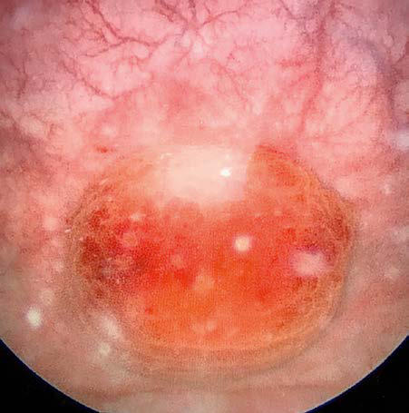

# Chapter 579: Neuropathic Bladder

*Heather N. Di Carlo and Chad B. Crigger*

<!-- p.4236 -->
A

B

**Fig. 578.6** A, CT scan demonstrating infected urachal abscess in an 8-yr-old child. The condition was managed by drainage and excision. B, Cystoscopic view of 10-yr-old child with new-onset daytime frequency and incontinence secondary to infected urachal cyst.

Neuropathic bladder dysfunction in children is usually congenital, generally resulting from neural tube defects or other spinal abnormali ties (see Chapter 754). Acquired diseases and traumatic lesions of the spinal cord are less common (see Chapter 751). Central nervous sys tem tumors, sacrococcygeal teratoma, spinal abnormalities associated with imperforate anus (see Chapter 392), and spinal cord trauma also can result in abnormal innervation of the bladder and/or sphincter (Table 579.1).

**NEURAL TUBE DEFECTS** Neural tube defects, resulting from failure of the neural tube to close spontaneously between the third and fourth week in utero, result in abnormalities of the vertebral column that affect spinal cord function, including **spina bifida occulta**, **myelomeningocele,** and **meningocele**

*Heather N. Di Carlo and Chad B. Crigger*

(see Chapters 631.2, 631.3, and 631.4). Specialized medical centers in the United States have performed antenatal myelomeningocele closure. Long-term results from one large clinical trial of **in utero closure** have not shown a definite improvement in lower urinary tract function, although some children have demonstrated nearly normal bladder function. Overall, this trial has demonstrated a significant reduction in the need for ventriculoperitoneal shunting and improved performance on measures of self-care, motor function, and mobility.

**Clinical Manifestations and Diagnosis** The most important urologic consequences of neuropathic bladder dysfunction associated with neural tube defects are urinary inconti nence (see Chapter 580), urinary tract infections (UTIs; see Chapter 575), and hydronephrosis from vesicoureteral reflux (see Chapter 576) or detrusor-sphincter dyssynergia (see Chapter 580). Pyelonephri tis and renal functional deterioration (see Chapter 575) are common causes of premature death in affected patients.

In the neonate, renal ultrasonography, assessment of postvoiding residual urine volumes, and a voiding cystourethrogram are performed after closure of the myelomeningocele as approximately 10–15% of newborns with myelomeningocele have hydronephrosis, and renal malformations are common; 25% have vesicoureteral reflux. A **urody namic** study also should be performed. In this study, the bladder is filled with saline, and the bladder volume, bladder pressure, abdominal pressure, and sphincter tone are measured until the patient voids. Dur ing bladder filling, the bladder might show (1) uninhibited (premature) contractions (termed hyperreflexia) at low volumes, (2) normal blad der volume with contraction at an appropriate volume, or (3) atonia (lack of bladder contraction). Bladder compliance or elasticity also may be abnormal (i.e., abnormally high bladder pressure during blad der filling). The sphincter can show (1) normal tonicity with relaxation during bladder contraction, (2) reduced or absent tonicity, or (3) nor mal or increased tonicity that increases significantly during a bladder contraction (termed **detrusor-sphincter dyssynergia**; Fig. 579.1).

**Renal Damage** Renal damage usually results from detrusor-sphincter dyssynergia. This dyssynergia causes functional obstruction of the bladder outlet, leading to bladder muscle hypertrophy and trabeculation, high intra vesical pressure, and transmission of this high pressure into the upper urinary tracts, causing hydronephrosis (Fig. 579.2). Vesicoureteral reflux and UTI compound this problem, but severe hydronephrosis can result without reflux. Treatment includes reduction of bladder pres sure with anticholinergic drugs (e.g., oxybutynin, 0.2 mg/kg/dose up to three times per day) and **clean intermittent catheterization** every 3-4 hours. If the child has vesicoureteral reflux or UTI, antimicrobial prophylaxis also is prescribed.

Lower Urinary Tract

#### **Table 579.1** Causes of Neuromuscular Dysfunction of the

| Category / Parameter | Clinical Details & Findings |
| --- | --- |
| **CONGENITAL** | Neural tube defect; Occult forms of neural tube defect (lipomeningocele and other; spinal dysraphisms); Sacral agenesis; Anorectal malformations |
| **ACQUIRED** | Extensive pelvic surgery; Central nervous system disorders; Cerebral palsy; Conditions of the brain (tumors, infarcts, encephalopathies); Spinal cord insults; Trauma; Transverse myelitis; From Partin AW, Dmochowski RR, Kavoussi LR, Peters CW, eds. Campbell-Walsh; Urology, 12th ed. Philadelphia: Elsevier; 2021: Box 34-1. |

<!-- p.4238 -->
B A

D C **Fig. 579.1**  Grouping of neuropathic bladder dysfunction according to the innervation, tonicity, and coordination of the detrusor and sphinc ters described by Guzman. This grouping is based on data from imag ing studies, cystometrography, and electromyography of the sphincters. Patients in group B are at risk of developing reflux and hydronephrosis. For guidance in the treatment of incontinence, group A patients ben efit from procedures that increase outlet resistance, group B patients from anticholinergics or bladder augmentation surgery, and group C patients from intermittent catheterization. Group D patients require both increased outlet resistance and pharmacologic or surgical blad der enlargement. Most patients require intermittent catheterization to empty. *(Modified from Gonzalez R. Urinary incontinence. In Kelalis PK, King LR, Belman AB, eds. Clinical Pediatric Urology. Philadelphia: Saun ders; 1992. p. 387.)*

**Fig. 579.2** Voiding cystourethrogram in an infant with myelodyspla sia shows a severely trabeculated bladder with multiple diverticula and grade V (out of V) right vesicoureteral reflux. Evaluation showed severe detrusor-sphincter dyssynergia.

Temporary urinary diversion by cutaneous vesicostomy is an alter native in the newborn or infant with severe reflux, if intermittent cath eterization is difficult, or if anticholinergic medications are not well tolerated. Another option for treating the severely trabeculated bladder is transurethral injection of botulinum toxin (Botox) into the detru sor muscle, which reduces bladder hypertonicity for approximately 6 months and often needs to be repeated. A different approach in these children is to temporarily inactivate the tight sphincter by urethral overdilation or transurethral injection of botulinum toxin into the sphincter. In children with upper tract changes, continuous overnight bladder drainage allows significant bladder relaxation and can reduce bladder wall thickening and lessen hydronephrosis.

Clean intermittent catheterization and anticholinergic therapy cure reflux in up to 80% of children with grade I or II reflux. Children with more severe reflux often require subureteral endoscopic injection ther apy (see Chapter 576) or open antireflux surgery followed by intermit tent catheterization and anticholinergic drugs. In older children with myelomeningocele with high-grade reflux, UTI, and hydronephrosis, augmentation enterocystoplasty (enlarging the bladder with a patch of intestine) with intermittent catheterization may be necessary. This intervention allows a normal-capacity bladder with low bladder pres sure and effective drainage of the bladder.

**Urinary Incontinence** Incontinence in the child with neuropathic bladder can result from total or partial denervation of the sphincter, bladder hyperreflexia, poor bladder compliance, chronic urinary retention, or a combination of these factors.

Incontinence is often addressed at 4-5 years of age and is tailored to the individual child. Nearly all children require clean intermittent catheterization to stay dry. This technique allows efficient bladder emptying with minimal risk of symptomatic UTI. *The urinary tract should be reevaluated with renal ultrasonography, a voiding cystoure throgram, and a urodynamic study (including bladder capacity) prior to initiation of an intermittent catheterization regimen*. If the external sphincter tone is sufficient and the bladder has adequate compliance, intermittent catheterization every 3-4 hours is often successful in keep ing the child socially dry. If there are unstable bladder contractions, an anticholinergic medication such as oxybutynin chloride, hyoscyamine, or tolterodine is prescribed to increase bladder capacity. If there is sphincteric incompetence, α-adrenergic medications are prescribed to enhance outlet resistance. Bacteriuria is seen in up to 50% of children using intermittent self-catheterization, but it seldom causes symptoms. In the absence of reflux, there seems to be little cause for concern. Per forming intermittent catheterization with a new catheter (hydrophilic or standard silicone) each time is also quite effective in preventing bac teriuria and avoids the need for antibiotic prophylaxis. With this treat ment plan, 40–85% of patients are dry, depending on the definition of continence; some children wear a pad in their underwear or a diaper for security but feel that they are dry.

If there is persistent incontinence despite medical therapy, recon structive urinary tract surgery nearly always provides complete or satisfactory continence. If urethral resistance is low, bladder neck reconstructive procedures such as a periurethral sling are often suc cessful. Alternatively, implantation of an artificial sphincter is usually successful. This sphincter consists of an inflatable cuff that is placed around the bladder neck, a pressure-regulating balloon implanted in the extraperitoneal space, and a pump mechanism that is implanted in the scrotum of boys and in the labia majora of girls. Squeezing the pump 3-4 times moves the fluid out of the inflatable urethral cuff, and then the cuff slowly refills over the next 2-3 minutes.

If the bladder capacity or bladder compliance is low, or if there are persistent uninhibited contractions despite anticholinergic therapy, enlargement of the bladder with a patch of small or large intestine,

<!-- p.4239 -->
termed augmentation cystoplasty or **enterocystoplasty**, is effective. These patients still need to perform clean intermittent catheterization. If urethral catheterization is difficult, a continent urinary stoma may be incorporated into the urinary tract reconstruction. A common method is the **Mitrofanoff procedure** (appendicovesicostomy), in which the appendix is isolated from the cecum on its vascular pedicle and is inter posed between the bladder and abdominal wall to allow intermittent catheterization through a dry stoma. An ileal conduit with a bag on the abdominal wall is rarely used.

**Complications of Augmentation Cystoplasty Urinary Tract Infection** The urine may be colonized with gram-negative bacteria, and attempts to sterilize the urine for prolonged periods usually fail. There is no evidence that chronic bacteriuria in patients who have had enterocys toplasty is associated with renal damage; therefore only symptomatic UTIs should be treated.

**Metabolic Acidosis** The enteric mucosal surface in contact with the urine absorbs ammo nium, chloride, and hydrogen ions and loses potassium. *Hyperchlore mic metabolic acidosis can result, possibly requiring medical treatment* (see Chapter 73). Chronic acidosis can compromise skeletal growth. This condition is common with colocystoplasty but is uncommon with ileocystoplasty. Metabolic acidosis is also common in patients with compromised renal function. To overcome this limitation of entero cystoplasty in patients with chronic renal insufficiency, a composite augmentation using the stomach and a small or large bowel gastric seg ment can be used. The stomach secretes chloride and hydrogen ions; thus preexisting metabolic acidosis remains stable or improves. How ever, augmentation with a gastric segment remains rare.

**Spontaneous Perforation** Perforation of the augmented bladder is a life-threatening compli cation that results most often from acute or chronic overdistention of the augmented bladder. Patients with this complication typically present with severe abdominal pain and signs of peritonitis. Prompt diagnosis and treatment with exploratory laparotomy and bladder closure are necessary. Meticulous adherence to the prescribed pro gram of intermittent catheterization to avoid bladder overdistention is important.

**Bladder Calculi** Bladder calculi have developed in as many as 70% of children followed for 10 years after enterocystoplasty. The calculi develop in response to mucus that accumulates in the bladder and serves as a nidus for stone formation. This complication can be prevented by daily irrigation of the bladder with sterile saline.

**Malignant Neoplasm** Invasive transitional cell carcinoma has been reported in nearly 4.6% of patients undergoing enterocystoplasty (compared with a 2.6% risk in spina bifida patients without enterocystoplasty). The pathogenesis is uncertain, but there is speculation that it is related to bacteriuria and the bowelbladder contact. The risk is highest following gastrocystoplasty. The risk increases 10 years following enterocystoplasty. Although there are no for mal guidelines or recommendations regarding screening, it seems appro priate to advise yearly endoscopic examinations or urine cytologic studies beginning in the tenth postoperative year.

**ASSOCIATED DISORDERS Constipation** Many patients with spina bifida also have bowel problems with consti pation, and a vigorous bowel regimen is important. Some benefit from the **Malone antegrade continence enema (MACE) procedure**, in which the appendix is brought out to the skin to allow a catheter to be inserted into the cecum for antegrade enema. The stoma is continent, and an antegrade enema can be performed with tap water each day. This form of management allows the patient to be continent of stool and be more self-sufficient. An alternative to the MACE procedure is a percutaneous cecostomy, in which a button is placed into the cecum to allow an antegrade flush. The MACE and percutaneous cecostomy procedures can be performed laparoscopically.

**Latex Allergy** Latex allergy is a very serious problem encountered by as many as half of patients with spina bifida and other urologic conditions who require clean intermittent catheterization and urinary tract recon structive procedures. This immunoglobulin E–mediated allergy is acquired and is secondary to repeated exposure to the latex allergen. Latex allergy can manifest as watery eyes, sneezing, itching, hives, or anaphylaxis when blowing up a balloon or if an examiner is using latex gloves. Intraoperatively, a sensitized patient can experience ana phylactic shock. A latex-free environment should be provided for all children with spina bifida in the office, during hospitalization, and during operative procedures. Affected children also should wear a medical alert bracelet.

**Occult Spinal Dysraphism** Approximately 1 in 4,000 patients have occult spinal dysraphism, a category that includes lipomeningocele, intradural lipoma, diastemato myelia, tight filum terminale, dermoid cyst-sinus, aberrant nerve roots, anterior sacral meningocele, and cauda equina tumor. More than 90% of patients have a cutaneous abnormality overlying the lower spine, including a **sacral dimple**, tuft of hair, dermal vascular malformation, or subcutaneous lipoma (Fig. 579.3). Often these children have higharched feet, discrepancy in muscle size and strength between the legs,

A B C

**Fig. 579.3** A, Buttocks of teenage boy with tethered cord secondary to lipomeningocele. Note sacral dimple and deviation of gluteal fold to the left. B, Fat deposit over sacrum in girl with tethered cord secondary to lipomeningocele. C, Deep sacral pit in child with neuropathic bladder.

<!-- p.4241 -->
