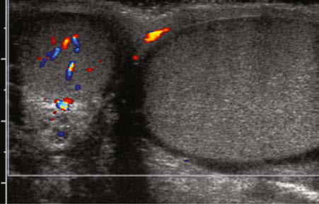

# Chapter 582: Disorders and Anomalies of the Scrotal Contents

*Heather N. Di Carlo and Chad B. Crigger*

<!-- p.4254 -->
**UNDESCENDED TESTIS (CRYPTORCHIDISM)** The absence of a palpable testis in the scrotum indicates that the testis is undescended, absent, atrophic, or retractile.

**Epidemiology** An undescended **(cryptorchid)** testis is the most common congenital genitourinary tract disorder in males. At birth, approximately 4.5% of males have an **undescended testis.** Because testicular descent occurs at 7-8 months of gestation, 30% of premature male infants have an undescended testis; the incidence is 3.4% at term. As many as 50% of congenital undescended testes descend spontaneously during the first 3 months of life, and by 6 months the incidence decreases to 1.5%. Spon taneous descent occurs secondary to a temporary testosterone surge (termed a *minipuberty*) during the first 2 months, which also results in significant penile growth. If the testis has not descended by 4 months, it will remain undescended. Cryptorchidism is bilateral in 10% of cases. There is some evidence that the incidence of cryptorchidism is increas ing; this is attributed to increase in utero exposure to endocrine dis rupting chemicals. Although cryptorchidism usually is considered to be congenital, some older males have a scrotal testis that “ascends” to a low inguinal position and therefore requires an orchiopexy. In addition, 1–2% of neonatal and young males undergoing hernia repair develop secondary cryptorchidism from scar tissue along the spermatic cord.

**Pathogenesis** The process of testicular descent is regulated by an interaction among genetic, hormonal, and mechanical factors, including testosterone, dihy drotestosterone, müllerian-inhibiting factor, the gubernaculum, intraab dominal pressure, and the genitofemoral nerve (Table 582.1). The testis develops in the abdomen at 7-8 weeks of gestation. Insulin-like factor 3 controls the transabdominal phase. At 10-11 weeks, the Leydig cells produce testosterone, which stimulates differentiation of the Wolffian (mesonephric) duct into the epididymis, vas deferens, seminal vesicle, and ejaculatory duct. At 32-36 weeks, the testis, which is anchored at the internal inguinal ring by the gubernaculum, begins its process of descent and is controlled in part by a calcium gene-related peptide produced by the genitofemoral nerve. The gubernaculum descends the inguinal canal and guides the testis into the scrotum. Following testicular descent, the patent processus vaginalis (hernia sac) normally closes.

**Clinical Manifestations** Undescended testes are classified as **abdominal** (which are nonpal pable), **peeping** (abdominal but can be pushed into the upper part of the inguinal canal), **inguinal, gliding** (can be pushed into the scrotum but retracts immediately to the pubic tubercle), and **ectopic** (superficial inguinal pouch or, rarely, perineal). Most undescended testes are pal pable just distal to the inguinal canal over the pubic tubercle.

A **disorder of sex development** should be suspected in a newborn phenotypic male with bilateral nonpalpable testes, as the child could be a virilized female with congenital adrenal hyperplasia (see Chapter 616). *In a male with midpenile or proximal hypospadias and a palpable undescended testis, the risk of a disorder of sexual development is 15%; the risk is 50% if the testis is nonpalpable.*

The potential **consequences of cryptorchidism** include poor tes ticular growth, infertility, testicular malignancy, associated hernia, tor sion of the cryptorchid testis, and the possible psychologic effects of an empty scrotum.

The undescended testis is normal at birth histologically with a pleth ora of germ cells, but pathologic changes occur by 6-12 months of age. Delayed germ cell maturation, germ cell depletion, hyalinization of the seminiferous tubules, and reduced Leydig cell number are typical; these changes are progressive over time if the testis remains undescended. At puberty, an undescended testis has no viable sperm components. Although less severe, changes may occur in the contralateral descended testis after 4-7 years. After treatment for a unilateral undescended testis, 85% of patients are fertile, which is slightly less than the 90% rate of fer tility in an unaffected population of adult males. In contrast, following bilateral orchiopexy, only 50–65% of patients are fertile.

The risk of a **germ cell malignancy** (see Chapter 552) developing in an undescended testis is four times higher than in the general popula tion and is approximately 1 in 80 with a unilateral undescended tes tis and 1 in 40-50 for bilateral undescended testes. Testicular tumors are less common if orchiopexy is performed before 10 years of age, but they still occur, and adolescents should be instructed in testicu lar self-examination. The peak age for developing a malignant testis tumor is 15-45 years of age. The most common tumor developing in an undescended testis in an adolescent or adult is a **seminoma** (65%); after orchiopexy, nonseminomatous tumors represent 65% of testis tumors. Orchiopexy seems to reduce the risk of testicular cancer; it is uncommon for testis tumors to occur if the orchiopexy was performed before the age of 2 years. The contralateral scrotal testis may also be at a slightly increased risk for malignancy.

An indirect inguinal hernia usually accompanies a congenital unde scended testis but rarely is symptomatic. Torsion and infarction of the cryptorchid testis also are uncommon but can occur because of exces sive mobility of undescended testes. Consequently, inguinal pain and/ or swelling in a male with an undescended testis should raise the suspi cion of an inguinal hernia or torsion of the undescended testis.

An *acquired* or **ascending undescended testis** occurs when a male has a descended testis at birth, but during childhood, usually between ages 4-10 years, the testis does not remain in the scrotum. Such males often have a history of a retractile testis. With testicular ascent on physi cal examination, the testis can often be manipulated into the upper scro tum, but there is obvious tension on the spermatic cord. This condition is speculated to result from incomplete involution of the processus vagina lis, restricting spermatic cord growth and resulting in the testis gradually moving out of its scrotal position during a male’s somatic growth.

On physical examination of the scrotum, the child should be encour aged to relax. Careful consideration of a hypoplastic ipsilateral scrotum may clue the examiner in to a diagnosis of an undescended testicle. The examiner should examine the patient’s scrotum and inguinal canal using their dominant hand. The nondominant hand is positioned over the pubic tubercle and is pushed inferiorly toward the scrotum. The examiner’s dominant hand is used to try to palpate the testis. If the testis is nonpalpable, the *soap test* often is useful; soap is applied to the inguinal canal and the examiner’s hand, significantly reducing friction and facilitating identification of an inguinal testis. In addition, pulling on the scrotum can pull a high inguinal testis into a palpable position. One soft sign that a testis is absent is contralateral testicular hypertro phy, but this finding is not 100% diagnostic.

**Retractile testes** may be misdiagnosed as undescended testes. Males older than 1 year of age often have a brisk cremasteric reflex, and if the child is anxious or ticklish during scrotal examination, the testis may be difficult to manipulate into the scrotum. Males should be examined with their legs in a relaxed frog-leg position, and if the testis can be manipu lated into the scrotum comfortably, it is probably retractile. It should be monitored every 6-12 months with follow-up physical examinations, because it can become an acquired undescended testis. Overall, as many as one third of males with a retractile testis develop an acquired unde scended testis requiring orchiopexy, and males younger than 7 years of age at diagnosis of a retractile testis are at greatest risk. Although defini tive data are not available, it is generally thought that males with a retrac tile testis are not at increased risk for infertility or malignancy.

Approximately 10% of undescended testes are **nonpalpable testes.** Of these, 50% are viable testes in the abdomen or high in the inguinal canal, and 50% are atrophic or absent, almost always in the scrotum,

*Heather N. Di Carlo and Chad B. Crigger*

<!-- p.4255 -->

#### **Table 582.1** Conditions Associated with Cryptorchidism

| Category / Parameter | Clinical Details & Findings |
| --- | --- |
| **Disorders of Sex Development (DSD)** | Sex chromosome DSD; 47,XXY (Klinefelter syndrome and variants); 45,X/46,XY (mixed gonadal dysgenesis); 46,XX/46,XY (chimerism) |
| **46,XY DSD** | Disorders of testicular development; Complete or partial gonadal dysgenesis; Variations in ARX, ATRX, CBX2, DAX1 (NROB1), DHH, DHX37, DMRT1, EMX2, ESR2, FGFR2, GATA4, HHAT, MAP3K1, NR5A1, SF1, SOX9, SRY,; TSPYL1, WNT4, WT1(WAGR syndrome, Denys-Drash syndrome, Frasier syndrome), ZFPM2, and ZNRF3 genes; Disorders in androgen synthesis or action; Androgen biosynthetic defect; • Abnormal LH (LHB); • Steroidogenic acute regulatory protein (StAR deficiency) (STAR); • 7-Dehydro-cholesterol desmolase deficiency (Smith-Lemli-Opitz syndrome); • Cholesterol desmolase deficiency (CYP11A1); • 3β -hydroxysteroid dehydrogenase type 2 deficiency (HSD3B2); • 17,20-lyase deficiency or combined 17 hydroxylase/17,20-lyase deficiency (CYP17A1); • P450-oxidoreductase deficiency (POR); • 17β -Hydroxysteroid-dehydrogenase type 3 (HSD17B3); • 5-α reductase type 2 enzyme deficiency (SRD5A2); • Cytochrome b5 deficiency (CYB5A); • Backdoor steroidogenetic enzyme deficiency (AKR1C2, AKR1C4); Defect in androgen action; • Partial androgen insensitivity (AR); • Infantile onset X-linked spinal muscular atrophy; LH receptor defects; • Inactivating mutation of LH receptor gene (LHCGR) (Leydig cell hypoplasia, aplasia) |
| **46,XX DSD** | Ovotesticular DSD; Testicular DSD (e.g. SRY+, dup SOX9, RSP01); 46,XX male |
| **Congenital Hypogonadotropic Hypogonadism in 46,XY** | Isolated hypogonadotropic hypogonadism with anosmia (Kallmann syndrome); KAL1, FGFR1/FGF8, PROK2/PROKR2, KAL1, NELF, HS6ST1, WDR11, and SEMA3A; gene variants; CHD7 gene variant (CHARGE syndrome); Normosmic isolated hypogonadotropic hypogonadism; Variants in KISS1, GPR54, LEP, LEPR, TAC3/TACR3, and GNRH1/GNRHR genes (also reported variants in FGFR1/FGF8, PROKR2, CHD7, and; WDR11 genes); Multiple pituitary hormone deficiencies; Variants in PROP1 genes, HESX1 gene (septo-optic dysplasia) |
| **Congenital Hypergonadotropic Hypogonadism** | Down syndrome; Noonan syndrome |
| **Syndromes Associated with Both Primary and Secondary Hypogonadism** | Prader-Willi syndrome; Bardet-Biedl syndrome |
| **CONDITIONS ASSOCIATED WITH DECREASED INSL3 OR AMH LEVELS OR ACTIONS** | INSL3 or RXFP2 variants; Persistent Müllerian duct syndrome: AMH and AMH receptor (AMH, AMHR2) |
| **OTHER CONDITIONS RELATED WITH CRYPTORCHIDISM** | Multiple syndromes not specifically involving pituitary-gonadal development or function; AMH, anti-Müllerian hormone; CHARGE, coloboma, heart defects, atresia choanal, growth restriction, genital abnormalities, ear abnormalities; INSL3, insulin like peptide 3;.LH,; luteinizing hormone.; Modified from Rodprasert W, Virtanen HE, Mäkekä JA, Toppari J: Hypogonadism and cryptorchidism. Front Endocrinol (Lausanne). 2020;10:906. |

secondary to spermatic cord torsion in utero **(vanishing testis).** If the nonpalpable testis is abdominal, it will not descend after 3 months of age. *Although sonography often is performed to try to identify whether the testis is present, it rarely changes clinical management, because the abdominal testis and atrophic testis are not identified on sonography.* Inguinal/scrotal sonography might be beneficial in obese males with a

nonpalpable testis; in this clinical setting, the undescended testis often is nonpalpable, and an inguinal/scrotal sonogram can be beneficial in surgical planning. Computed tomographic imaging is relatively accu rate in demonstrating the presence of the testis, but the radiation expo sure is significant. MRI is even more accurate, but the disadvantage is that general anesthesia or sedation is necessary in most young children.

<!-- p.4256 -->
None of these imaging studies are 100% accurate and in general do not add significantly to clinical decision-making by the pediatric urologist or pediatric surgeon. Consequently, routine use of imaging is discour aged. A diagnostic approach is noted in Figure 582.1.

**Treatment** The congenital undescended testis that does not descend by 6 months (corrected for gestational age) should be treated surgically within the next 12 months. Most testes can be brought down to the scrotum with an orchiopexy, which involves an inguinal incision, mobilization of the testis and spermatic cord, and correction of an indirect inguinal hernia. The procedure is typically performed on an outpatient basis and has a success rate of 98%. In some males with a testis that is close to the scro tum, a prescrotal orchiopexy can be performed. In this procedure, the entire operation is performed through a high scrotal incision. Often the associated inguinal hernia also can be corrected through this inci sion. Advantages of this approach over the inguinal approach include shorter operative time and less postoperative discomfort.

In males with a nonpalpable testis, an exam under anesthesia should be done to reassess for palpability; if testes are still nonpalpable, diag nostic laparoscopy is performed in most centers. This procedure allows safe and rapid assessment of whether the testis is intraabdominal. In

most cases, orchiopexy of the intraabdominal testis located adjacent to the internal inguinal ring is successful, but orchiectomy should be considered in more difficult cases or when the testis appears to be atrophic. A two-stage orchiopexy sometimes is needed in males with a high abdominal testis. Males with abdominal testes are managed with laparoscopic techniques at many institutions. Testicular prostheses are available for older children and adolescents when the absence of the gonad in the scrotum might have an undesirable psychologic effect. The FDA has approved a saline testicular implant. Solid silicone “carv ing block” implants also are used (Fig. 582.2). Placement of testicular prostheses early in childhood is recommended for males with anorchia (absence of both testes).

The American Urological Association guidelines for the evaluation and treatment of males with an undescended testis are summarized in Table 582.2.

**SCROTAL SWELLING** Scrotal swelling may be acute or chronic and painful or painless (Table 582.3). Abrupt onset of painful scrotal swelling necessitates prompt evaluation because some conditions, such as testicular torsion and incarcerated inguinal hernia, require emergency surgical management. Tables 582.4 and 582.5 show the differential diagnosis.

**Fig. 582.1** Management algorithm for undescended testis. aIf blind-ending vas deferens vessels are unequivocally iden tified, then there is no need for further exploration. bBaseline FSH and LH levels are elevated if values are 3 SD above the mean. c, Increased suspicion of anorchia with elevated baseline FSH and LH levels; however, exploration is still warranted. d, Testicular remnant tissue may be pre sent despite a negative hCG stimulation test; therefore exploration for testicular remnant tissue should still be performed. (From Bowlin PR, Lorenzo AJ. Undescend ed testes and testicular tumors. In: Hol comb III GW, Murphy JP, St. Peter SD, eds. Holcomb and Ashcraft’s Pediatric Surgery, 7th ed. Philadelphia: Elsevier; 2020: Fig. 51-2, p. 808.)

Unilateral

palpable

Dartos pouch

orchiopexy

Unilateral nonpalpable

Bilateral nonpalpable

Laparoscopy Baseline gonadotropins

Blind-ending

vesselsa Intraabdominal

testis

Vessels

exiting internal ring

Inguinal exploration No further exploration

Increased

baseline FSH, LHb

Normal baseline FSH, LH

Suspect anorchiac hCG stimulation

Increased testosterone

No responsed

Staged orchiopexy (Fowler–Stephens)

Orchiopexy Orchiectomy

Laparoscopy +/3 exploration

**Fig. 582.2** A, Adolescent with soli tary left testis. B, Appearance follow ing implantation of right testicular prosthesis.

A B

<!-- p.4257 -->
**Clinical Manifestations** A detailed history is helpful in determining the cause of the swelling and includes the rapidity of onset of pain. With testicular torsion, the pain often is sudden in onset and may be associated with exercise or minor genital trauma, duration of pain, and radiation of pain. Inguinal discom fort is common with testicular torsion, inguinal hernia, or epididymitis, and associated flank pain can occur with passage of a ureteral calculus; previous episodes of similar pain, which are common in males with inter mittent testicular torsion or inguinal hernia; nausea and vomiting, which

for Evaluation and Treatment of Males with an Undescended Testis

#### **Table 582.2** American Urological Association Guidelines

| Category / Parameter | Clinical Details & Findings |
| --- | --- |
| **DIAGNOSIS** | • Providers should obtain gestational history at initial evaluation of; males with suspected cryptorchidism. (Standard); • Primary care providers should palpate testes for quality and; position at each recommended well-child visit. (Standard); • Providers should refer infants with a history of cryptorchidism; (detected at birth) who do not have spontaneous testicular; descent by 6 months (corrected for gestational age) to an; appropriate surgical specialist for timely evaluation. (Standard); • Providers should refer males with the possibility of newly diagnosed; (acquired) cryptorchidism after 6 months (corrected for gestational; age) to an appropriate surgical specialist. (Standard); • Providers must immediately consult an appropriate specialist for; all phenotypic male newborns with bilateral, nonpalpable testes; for evaluation of a possible disorder of sex development (DSD).; (Standard); • Providers should not perform ultrasound (US) or other imaging; modalities in the evaluation of males with cryptorchidism before; referral because these studies rarely assist in decision making.; (Standard); • Providers should assess the possibility of a disorder of sex; development (DSD) when there is increasing severity of; hypospadias with cryptorchidism. (Recommendation); • In males with bilateral, nonpalpable testes who do not have; congenital adrenal hyperplasia (CAH), providers should measure; Mullerian Inhibiting Substance (MIS or Anti-Mullerian Hormone; [AMH] level), and consider additional hormone testing, to; evaluate for anorchia. (Option); • In males with retractile testes, providers should monitor the; position of the testes at least annually to monitor for secondary; ascent. (Standard) |
| **TREATMENT** | • Providers should not use hormonal therapy to induce testicular; descent because evidence shows low response rates and lack of; evidence for long-term efficacy. (Standard); • In the absence of spontaneous testicular descent by 6 months; (corrected for gestational age), specialists should perform surgery; within the next year. (Standard); • In prepubertal males with palpable, cryptorchid testes, surgical; specialists should perform scrotal or inguinal orchidopexy. (Standard); • In prepubertal males with nonpalpable testes, surgical specialists; should perform examination under anesthesia to reassess for; palpability of testes. If nonpalpable, surgical exploration and, if; indicated, abdominal orchidopexy should be performed. (Standard); • At the time of exploration for a nonpalpable testis in boys, surgical; specialists should identify the status of the testicular vessels to; help determine the next course of action. (Clinical Principle); • In males with a normal contralateral testis, surgical specialists may; perform an orchiectomy (removal of the undescended testis) if a; male has a normal contralateral testis and either very short testicular; vessels and vas deferens, dysmorphic or very hypoplastic testis, or; postpubertal age. (Clinical Principle); • Providers should counsel males with a history of cryptorchidism; and/or monorchidism and their parents regarding potential long-; term risks and provide education on infertility and cancer risk.; (Clinical Principle); Adapted from Kolon TF, Herndon CDA, Baker LA, et al. Evaluation and treatment; of cryptorchidism (2018): AUA Guideline. https://www.auanet.org/guidelines-and-; quality/guidelines/cryptorchidism-guideline |

Acute Scrotal Pain

#### **Table 582.3** Differential Diagnosis of Pediatric Adolescent

| Category / Parameter | Clinical Details & Findings |
| --- | --- |
| **General** | Appendage torsion; Appendix testis; Other appendage (epididymis, paradidymis, vas aberrans); Spermatic cord torsion; Intravaginal, acute or intermittent; Extravaginal; Epididymitis; Infectious; Urinary tract infection; Sexually transmitted infection; Viral including COVID-19; Sterile or traumatic; Scrotal edema or erythema; Diaper dermatitis, insect bite, or other skin lesions; Idiopathic scrotal edema; IgA vasculitis (Henoch-Schönlein purpura); Orchitis; Associated with epididymitis with or without abscess; Vasculitis (e.g., IgA vasculitis); Viral illness (mumps, COVID-19); Trauma; Hematocele or scrotal contusion or testis rupture; Hernia or hydrocele; Inguinal hernia with or without incarceration; Communicating hydrocele; Encysted hydrocele with or without torsion; Associated with acute abdominal pathology (e.g., appendicitis,; peritonitis); Varicocele; Intrascrotal mass; Cystic dysplasia or tumor of testis; Epididymal cyst, spermatocele or tumor; Other paratesticular tumors; Musculoskeletal pain from inguinal tendinitis or muscle strain; Ilioinguinal neuropathy; Genitofemoral nerve entrapment; Referred pain (e.g., ureteral calculus or anomaly); Modified from Palmer LS, Palmer JS. Management of abnormalities of the external gen; italia in boys. In: Partin AW, Dmochowski RR, Kavoussi LR, Peters CW, eds. Campbell-; Walsh Urology, 12th ed. Philadelphia: Elsevier; 2021: Box 44-2. |

Male Children and Adolescents

#### **Table 582.4** Differential Diagnosis of Scrotal Masses in

| Category / Parameter | Clinical Details & Findings |
| --- | --- |
| **PAINFUL** | Testicular torsion; Torsion of appendix testis; Epididymitis; Trauma: ruptured testis,; hematocele; Inguinal hernia (incarcerated); Mumps orchitis; Testicular vasculitis |
| **PAINLESS** | Hydrocele; Inguinal hernia*; Varicocele*; Spermatocele*; Testicular tumor*; IgA vasculitis*; Idiopathic scrotal edema; *May be associated with discomfort. |

Newborn Males

#### **Table 582.5** Differential Diagnosis of Scrotal Swelling in

| Category / Parameter | Clinical Details & Findings |
| --- | --- |
| **General** | Hydrocele; Inguinal hernia (reducible); Inguinal hernia (incarcerated)*; Testicular torsion*; Scrotal hematoma; Testicular tumor; Meconium peritonitis; Epididymitis*; *May be associated with discomfort. |

<!-- p.4258 -->
are associated with testicular torsion and inguinal hernia; and irritative urinary symptoms, such as dysuria, urgency, and frequency, which indi cate a urinary tract infection that can cause epididymitis. Some males report a recent history of scrotal trauma. There are multiple reports of familial testicular torsion related to inheritance of bell clapper deformity (discussed later). Males with lower urinary tract pathology such as ure thral stricture or neuropathic bladder may be prone to epididymitis.

Physical examination may be difficult in males with a painful scro tum. Some have advocated performing a spermatic cord block or administering intravenous analgesia to facilitate the examination, but such measures are often unnecessary. Scrotal wall erythema is common in testicular torsion, epididymitis, torsion of the appendix testis, and an incarcerated hernia. In males with a normal cremasteric reflex, testicu lar torsion is unlikely. Absence of a cremasteric reflex is nondiagnostic.

**Laboratory Findings and Diagnosis** Pertinent laboratory studies include urinalysis and culture. A positive urinalysis suggests bacterial epididymitis (uncommon before adoles cence). Serum studies are not helpful in establishing a diagnosis unless a testicular malignancy is suspected. After initial evaluation in males with testicular pain, color Doppler ultrasonography often is helpful in estab lishing the diagnosis because it assesses whether testicular blood flow is normal, reduced, or increased (Fig. 582.3). If a hydrocele is present and the testis is nonpalpable, or if an abnormality of the testis is found, sonography also is indicated. *Imaging studies are not 100% accurate; they should not be used to decide whether a male with testicular pain should be referred for urologic evaluation.* As such, torsion is a clinical diagnosis.

Color Doppler ultrasonography allows assessment of testicular blood flow and testicular morphologic features. Accuracy is >95% if the ultrasonographer is experienced and the patient is older than 2 years of age. The “whirlpool” sign is pathognomonic. A false-negative study (demonstrates normal testicular blood flow) can occur in a male with testicular torsion if the degree of torsion is <360 degrees and the duration of torsion is short, because there may be contin ued testicular perfusion. In males <1 year of age, including neonates, blood flow may be difficult to demonstrate in 15% of normal testes.

**TESTICULAR (SPERMATIC CORD) TORSION Etiology** Testicular torsion requires prompt diagnosis and treatment to salvage the testis. Torsion is the most common cause of severe testicular pain in males 12 years of age and older and is uncommon before age 10. It is caused by inadequate fixation of the testis within the scrotum, resulting from a redundant tunica vaginalis and abnormal gubernacu lar attachment, allowing excessive mobility of the testis. The abnormal

attachment is termed a **bell clapper deformity** and may be bilateral. Following spermatic cord torsion, venous congestion occurs, and sub sequently arterial flow is interrupted. The likelihood of testis survival depends on the duration and severity of torsion. After 6 hours of absent blood flow to the testis, irreversible loss of spermatogenesis can occur. Torsion is familial in 10% of males.

**Diagnosis** Testicular torsion produces acute pain and swelling of the scrotum. On examination, the scrotum is swollen, and the testis is exquisitely tender and often difficult to examine. The cremasteric reflex is nearly always absent, though this may be absent at baseline in a proportion of males. The posi tion (lie) of the testis is abnormal, and the testis is often located high in the scrotum. In addition, nausea and vomiting often occur. The condition can be differentiated from an incarcerated hernia because swelling in the inguinal area typically is absent with torsion. The Testicular Workup for Ischemia and Suspected Torsion (TWIST) score is a clinical tool that can be used determine the likelihood of testicular torsion. The score consists of testicular swelling (2 points), hard testis (2 points), high-riding testis (1 point), absent cremasteric reflex (1 point), and nausea/vomiting (1 point). Patients can then be stratified into low (0 points), intermediate (1-5), and high risk (6-7), which aids in determining further imaging and/or surgical consultation.

For patients who are high risk or meet the clinical diagnosis of testicu lar torsion, prompt surgical consultation should be obtained. If the pain duration is <4-6 hours, manual detorsion may be attempted. In 65% of cases the torsed testis rotates inward, so detorsion should be attempted in the opposite direction (e.g., the left testis is rotated clockwise). Success ful manual detorsion results in dramatic pain relief. In the emergency department, patients with an intermediate risk TWIST score should undergo immediate scrotal ultrasound. In some centers, this is per formed as a point of care procedure by the emergency department staff.

Some adolescents experience **intermittent testicular torsion**. These males report episodes of severe unilateral testicular pain that resolves spontaneously after 30-60 minutes. Treatment is elective bilateral scro tal orchiopexy. Close follow-up and clear return instructions are requi site in such cases until elective orchiopexy is performed.

**Treatment** Treatment is prompt surgical exploration and detorsion. If the testis is explored within 6 hours of torsion, up to 90% will survive. Testicu lar salvage decreases rapidly with a delay of more than 6 hours. If the degree of torsion is 360 degrees or less, the testis might have sufficient arterial flow to allow the gonad to survive, even after 24-48 hours. Fol lowing detorsion, the testis is fixed in the scrotum with nonabsorbable sutures, termed **scrotal orchiopexy,** to prevent torsion in the future. The contralateral testis also should be fixed in the scrotum because the predisposing anatomic condition (bell clapper deformity) often is bilateral. If the testis appears nonviable, orchiectomy is performed (Fig. 582.4A). The detorsed testis may undergo compartment syndrome,

**R L R L**

**Fig. 582.3** Testicular torsion and axis change. A color Doppler ultra sound in the transverse plane shows color flow in the right testicle. The right testicle is oval to circular because it has been evaluated in the transverse plane. The left testicle is elongated as if it is in the longitu dinal plane, indicating an abnormal lie within the scrotum worrisome for torsion. Lack of color Doppler flow in the left testicle confirms left testicular torsion. (From Coley BD, ed. Caffey’s Pediatric Diagnostic Im aging, 13th ed. Philadelphia: Elsevier; 2019: Fig. 125-13, p. 1195.)

A B

**Fig. 582.4** A, Left testicular torsion in adolescent with acute scrotum; the testis is necrotic. B, “Late-phase torsion” in an adolescent with se vere testicular pain 1 month prior. Note absence of inflammation and high position of testis in scrotum.

<!-- p.4259 -->
and following detorsion, despite blood flow to the testis, high intrates ticular pressure may cause ischemia and necrosis. This condition has been treated intraoperatively by incising the tunica vaginalis (similar to a blunt testicular rupture) and placing a tunica vaginalis flap over the exposed tunica. Some adolescents do not undergo prompt evalu ation and treatment and present with *late phase testicular torsion,* in which there is delayed diagnosis of torsion. Often the testis is high in the scrotum and nontender (see Fig. 582.4B). While males with torsion of longer duration prior to treatment may exhibit reduced spermato genesis, current evidence shows pregnancy rates of couples in which the male has a history of acute testicular torsion to be similar to the general population.

*Spermatic cord torsion can also occur in the fetus or neonate***.** This condition results from incomplete attachment of the tunica vaginalis to the scrotal wall and is “extravaginal.” When torsion occurs just before delivery, the baby usually is born with a large, firm, nontender testis. Usually the ipsilateral hemiscrotum is ecchymotic (Fig. 582.5). In these cases, the testis rarely is viable because torsion was a remote event. However, the contralateral testis is at increased risk for torsion until 1-2 months beyond term. The pediatric urology community is divided regarding whether immediate exploration is necessary in a male new born who has suspected testicular torsion at birth, but if observation is recommended, the family needs to be counseled regarding the risk of contralateral spermatic cord torsion. If the initial exam is normal and the newborn subsequently develops scrotal swelling and erythema, and imaging is consistent with spermatic cord torsion, emergency scrotal exploration is indicated.

**TORSION OF THE APPENDIX TESTIS/EPIDIDYMIS** Torsion of the appendix testis is the most common cause of testicu lar pain in males age 4-10 years but is uncommon in adolescents. The appendix testis is a stalklike structure that is a vestigial embryonic rem nant of the müllerian (paramesonephric) ductal system that is attached to the upper pole of the testis. When it undergoes torsion, progres sive inflammation and swelling of the testis and epididymis occurs, resulting in testicular pain and scrotal erythema. The onset of pain is typically gradual. Palpation of the testis usually reveals a 3-5 mm ten der indurated mass on the upper pole (Fig. 582.6A). In some cases, the appendage that has undergone torsion may be visible through the scrotal skin, termed the **“blue dot”** sign. In some males, distinguish ing torsion of the appendix from testicular torsion is difficult. In such cases, color Doppler ultrasonography is useful because testicular blood flow is normal and shows hyperemia to the upper pole of the testis. In such cases, the radiologist often recognizes epididymal enlargement and makes the diagnosis of epididymitis, reflecting the inflammatory reaction (see Fig. 582.6B).

The natural history of torsion of the appendix testis is for the inflammation to resolve in 3-10 days. Nonoperative treatment is recommended, including bed rest for 24 hours and analgesia with

nonsteroidal antiinflammatory medication for several days. If the diag nosis is uncertain, scrotal exploration is recommended.

**EPIDIDYMITIS** Acute bacterial inflammation of the epididymis is an ascending ret rograde infection from the urethra, through the vas deferens into the epididymis. This condition causes acute scrotal pain, erythema, and swelling. It is rare before puberty and should raise the question of a congenital abnormality of the Wolffian duct, such as an ectopic ureter entering the vas. In younger males, the responsible organism is often *Escherichia coli* (see Chapter 246). After puberty, bacterial epididymi tis becomes progressively more common and can cause acute pain ful scrotal swelling in young sexually active males. Urinalysis usually reveals pyuria. Epididymitis can be bacterial (usually gonococcus or *Chlamydia*; see Chapters 238 and 272) or viral (mumps, enterovirus, or adenovirus; see Chapters 295, 297, and 309), but often the organism remains undetermined. Familial Mediterranean fever is another cause. Treatment consists of bed rest and antibiotics as indicated. Differentia tion from torsion is straightforward with scrotal ultrasonography.

**IgA vasculitis**, previously known as Henoch-Schönlein purpura, (see Chapter 210.1) is a systemic vasculitis that involves multiple organ systems and that can involve the kidney and spermatic cord. When the spermatic cord is involved, typically there is bilateral painful scrotal swelling with purpuric lesions involving the scrotum. Scrotal sonog raphy should show normal testicular blood flow. Treatment is directed toward systemic treatment of the IgA vasculitis. Isolated testicular vas culitis is less common in IgA vasculitis and, in such cases, polyarteritis nodosa should be suspected.

**VARICOCELE** A **varicocele** is a congenital condition in which there is abnormal dila tion of the pampiniform plexus in the scrotum, often described as a “bag of worms” (Fig. 582.7). Dilation of the pampiniform venous plexus results from valvular incompetence of the internal spermatic vein. Approximately 15% of adult males have a varicocele; of these, approx imately 10–15% are subfertile. Varicocele is the most common (and virtually the only) surgically correctable cause of infertility in males. A varicocele is found in 10–15% of adolescent males, but it rarely is diagnosed in males younger than 10 years old, because the varicocele becomes distended only after the increased blood flow associated with

A B

**Fig. 582.5** A and B, Right testicular torsion in a newborn. The right hemiscrotum is darker, and the testis was indurated and enlarged.

A

B

**Fig. 582.6** A, Torsion of the appendix testis; the appendix testis is ne crotic (arrow). B, Color Doppler scrotal sonogram showing hyperemia to the testis and absent flow to the appendix testis (right side). Symptoms resolved with medical therapy.

<!-- p.4260 -->
puberty occurs. Varicoceles occur predominantly on the left side, are bilateral in 2% of cases, and rarely involve the right side only. A varico cele in a male younger than 10 years or on the right side might indicate an abdominal or retroperitoneal mass; an abdominal ultrasound or CT scan should be performed in such cases.

A varicocele typically is a painless paratesticular mass. Occasionally patients describe a dull ache in the affected testis. Usually the varicocele is not apparent when the patient is supine because it is decompressed; in contrast, the varicocele becomes prominent when the patient is stand ing and enlarges with a Valsalva maneuver. Many pediatricians do not routinely screen adolescents for a varicocele. Varicoceles typically are graded from 1-3 with the male standing: **grade 1** is palpable only with Valsalva (clinically insignificant); **grade 2** is palpable without Valsalva but is not visible on inspection; and **grade 3** is visible with inspection. Males with a grade 3 varicocele are at greatest risk for testicular growth arrest, particularly if the varicocele is larger than the testis. Testicular size should be documented with calipers, an orchidometer, or scrotal sonography, because if the affected left testis is significantly smaller than the right testis, spermatogenesis probably has been adversely affected. A **semen analysis** should be considered in sexually mature adolescents who are Tanner stage V.

The goal of varicocelectomy is to maximize future fertility. Surgical treatment of varicoceles is indicated in males with a significant dispar ity in testicular size, with pain in the affected testis, if the contralateral testis is diseased or absent, or with oligospermia on semen analysis. Following treatment, typically the involved testis enlarges and catches up with the normal testis over the following 1-2 years. Varicocelectomy should also be considered in males with a large grade 3 varicocele, even if there is no disparity in testicular size. Surgical repair is accomplished with a variety of techniques by ligation of the veins of the pampiniform plexus laparoscopically or through an inguinal or subinguinal incision (with or without an operating microscope) or by ligating the internal spermatic vein in the retroperitoneum. The operation is performed on an ambulatory basis.

**SPERMATOCELE** A **spermatocele** is a cystic lesion that contains sperm and is attached to the upper pole of the sexually mature testis. Spermatoceles usu ally are painless and are incidental findings on physical examination. Enlargement of the spermatocele or significant pain is an indication for removal.

**HYDROCELE Etiology** A hydrocele is an accumulation of fluid in the tunica vaginalis (Fig. 582.8). Between 1% and 2% of neonates have a hydrocele. In most cases, the hydrocele is noncommunicating (the processus vaginalis was obliterated during development). In such cases, the hydrocele fluid disappears by 1 year of age. If there is a persistently patent processus vaginalis, the hydrocele persists. It is typically small in the morning and may become larger during the day due to upright positioning. A rare variant of a hydrocele is the **abdominoscrotal hydrocele,** in which there is a large, tense hydrocele that extends into the lower abdominal cavity. In some older males, a noncommunicating hydrocele can result from an inflammatory condition within the scrotum, such as testicular torsion, torsion of the appendix testis, epididymitis, or testicular tumor. The long-term risk of a communicating hydrocele is the development of an inguinal hernia. Some older males and adolescents also develop a hydrocele. In some cases, hydroceles develop acutely after an episode of scrotal trauma or epididymoorchitis, whereas others develop more insidiously.

**Diagnosis** On examination, hydroceles are smooth and nontender. Transillumination of the scrotum confirms the fluid-filled nature of the mass. It is impor tant to palpate the testis, because some young males develop a hydrocele in association with a testis tumor. If the testis is nonpalpable, a scrotal ultrasound should be performed to confirm that the testis is present and normal. If compression of the fluid-filled mass completely reduces the hydrocele, an inguinal hernia/hydrocele is the likely diagnosis.

**Treatment** Most congenital hydroceles resolve by 12 months of age following reabsorption of the hydrocele fluid. If the hydrocele is large and tense, however, early surgical correction should be considered, because it is difficult to verify that the child does not have a hernia, and large hydro celes rarely disappear spontaneously. Hydroceles persisting beyond 12- 18 months often are communicating and should be repaired. Surgical correction is similar to a herniorrhaphy (see Chapter 394). Through an inguinal incision, the spermatic cord is identified, the hydrocele fluid is drained, and a high ligation of the processus vaginalis is performed. If an older male has a large hydrocele, often diagnostic laparoscopy can be performed to determine whether there is a patent processus vagi nalis, and if the internal ring is closed, then the hydrocele may be cor rected with a scrotal incision.

**Fig. 582.7** Left varicocele in an adolescent male.

**Fig. 582.8** Newborn with large right hydrocele.

<!-- p.4262 -->
