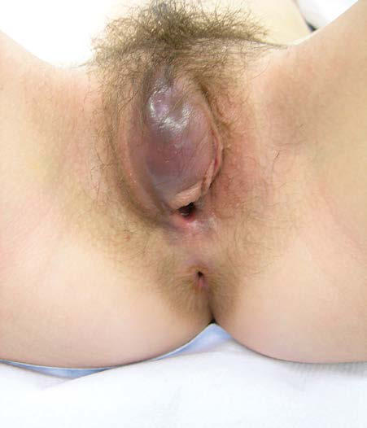
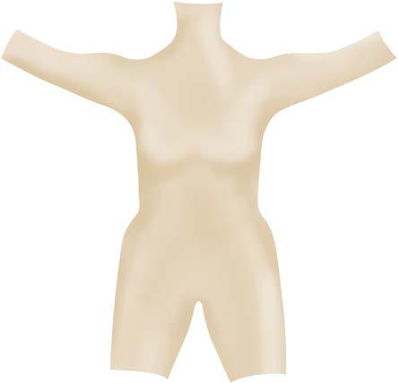

# Chapter 588: Breast Health

*Marcene R. McVay-Gillam and Amy D. DiVasta*

<!-- p.4285 -->
**Vulvovaginal trauma** is an especially concerning cause of pediatric genital bleeding. Most traumatic injuries are accidental, but physical and sexual abuse must be ruled out (see Chapter 17.1). **Straddle inju ries** are commonly seen after falls at home, particularly after slipping on a wet surface in the bathroom; they may result in bruising, hemato mas, or lacerations (Fig. 587.2). Accidental trauma usually spares the hymen and vagina, instead affecting the external impact-absorbing tis sue of the mons and labia. *However, a physical finding consistent with external injuries does not exclude the need to rule out involvement of internal genital structures. If there are no eyewitnesses to the injury, if the history does not clarify or support the clinical findings, and espe cially if there is a hymenal laceration, abuse must be considered in the differential diagnosis and a forensic interview of the patient and family conducted.* If after initial inspection a penetrative injury is suspected, further examination and imaging are necessary to assess for potential damage to the urethra, bladder, anus, or intraabdominal structures. An examination under anesthesia may be needed to fully assess and repair extensive injuries, while minor lacerations in a cooperative child may potentially be repaired using local anesthesia and/or conscious seda tion. If the patient can void spontaneously, nonexpanding hematomas can be observed and treated with ice, pressure, and pain medications. Large expanding hematomas may require drainage, ligation of bleeding vessels, and placement of a closed suction drain if the overlying skin is showing signs of necrosis. A Foley catheter should be placed in all children who are having difficulty with voiding secondary to the injury.

Vaginal bleeding in the infant or prepubertal female is distressing to the patient and their family and can result from a wide spectrum of pathologic conditions or traumatic incidents. A detailed history and thorough physical examination must be done to identify the source of bleeding and for a management plan to be established efficiently. Pre sentations suspicious for trauma or abuse should involve the appropri ate healthcare staff and authorities from an early stage, with findings meticulously documented. If an intervention is indicated to manage bleeding, regardless of its source, the risks and benefits of any therapy should be reviewed carefully with the family before initiation.

*Visit Elsevier eBooks+ at eBooks.Health.Elsevier.com** for Bibliography.*

**Fig. 587.2** Vulvar hematoma in an adolescent female as a result of a straddle injury. (From Mok-Lin EY, Laufer MR. Management of vulvar hematomas: Use of a Word catheter. J Pediatr Adolesc Gynecol. 2009; 22:e156-e158.)

Breast complaints in pediatric patients typically include concerns about breast appearance or development, pain, nipple discharge, or a lump/mass. Although the development of breast cancer is very rare during childhood and adolescence, this patient population should be evaluated by practitioners who have experience with the immature and developing breast to avoid overtreatment with unnecessary diagnostic or invasive procedures.

**BREAST DEVELOPMENT** Prenatal breast development begins around the fifth week of gesta tion, when the ectoderm on the anterior body wall thickens into two **mammary ridges.** These ridges extend from the axilla to the region of the inguinal canal (Fig. 588.1). The ridge above and below the area of the pectoralis muscle recedes in utero, leaving the **mammary pri mordium**, which is the origin of the lactiferous ducts. The lactiferous ducts form between weeks 10 and 20 and become interspersed through the developing mesenchyme, which develops into the fibrous and fatty portions of the breast. The **breast bud**, under the stimulation of mater nal estrogen, becomes palpable at week 34 of gestation. This breast bud regresses within the first month of life once estrogen stimulation is no longer present. The **areola** appears at 5 months of gestation, and the nipple is seen shortly after birth. It is initially depressed or inverted, and later becomes elevated.

**Thelarche,** the onset of pubertal breast development, is hormonally mediated. It occurs when the hypothalamus releases gonadotropinreleasing hormone (GnRH), which stimulates the pituitary gland to produce follicle-stimulating hormone (FSH) and luteinizing hormone (LH) (see Chapter 599). FSH and LH then stimulate the ovaries to produce estradiol, which leads to breast development. Thelarche typi cally occurs between ages 8 and 13 years. Age at thelarche is affected by familial predisposition and varies by ethnicity.

*Marcene R. McVay-Gillam and 
 Amy D. DiVasta*

**Fig. 588.1** Milk lines or mammary ridges. (From Gao Y, Saksena MA, Brachtel EF, terMeulen DC, Rafferty EA. How to approach breast lesions in children and adolescents. Eur J Radiol. 2015;84:1350-1364; Fig. 1.)

<!-- p.4287 -->
Breast development continues over a 2-4 year period after thelarche and is classified by the **Sexual Maturity Rating (SMR) system** (also known as **Tanner staging**) into five stages (see Chapter 150). Lack of breast development (**amastia**) by age 13 years is considered delayed and warrants evaluation. **Menarche** (onset of menses) usually occurs 2-3 years after thelarche.

**BREAST EXAMINATION** Breast examination should be included in the routine healthcare main tenance examinations of all children and adolescents. Assessment of the newborn includes breast size, nipple position, presence of accessory nipples, and nipple discharge. Assessment of the prepubertal female includes inspection and palpation of the chest wall for masses, pain, nipple discharge, and signs of **premature thelarche.** Examination of the adolescent is performed with the patient in the supine position; the arm ipsilateral to the breast that is being examined should be placed next to the patient’s head. The breast tissue is examined with the flat pads of the middle fingers, and the examiner should palpate all of the breast tissue in a uniform manner. The SMR should be noted and the axillary, supracla vicular, and infraclavicular nodes evaluated for lymphadenopathy. The areola should be gently compressed to assess for nipple discharge.

**BREAST SELF-AWARENESS** Controversy exists as to the utility of breast self-examination in the ado lescent population. Experts believe that it might be ill-advised to encour age breast self-examination in the adolescent because of a potential for unnecessary anxiety and possible unwarranted treatment in a popula tion that is at low risk for malignant disease. The American College of Obstetricians and Gynecologists (ACOG) endorses breast self-awareness, which is defined as a female’s awareness of the normal appearance and feel of their breasts. Breast self-awareness may increase an adolescent’s under standing of their body, increase their comfort with exams, and provide opportunities for questions or discussion. Instruction in self-exam tech niques should be considered for high-risk patients, such as those with a family history of conditions that may increase breast cancer risk or those at risk of secondary tumors. Adolescents should be educated to report any changes in their breasts or concerns to their healthcare providers.

**Neonatal Breast Hypertrophy** Breast bud enlargement is a common condition in term newborns of either gender. It occurs as a result of elevated circulating maternal ste roid hormones in late gestation. As maternal estrogen levels fall, pro lactin levels can increase, and the breasts may produce a clear or cloudy (milk like) nipple discharge (“witch’s milk”) in male and female infants. Repeated manipulation of the breast can exacerbate the condition and should be discouraged.

**ABNORMAL DEVELOPMENT Premature Thelarche** Premature thelarche is defined as isolated unilateral or bilateral breast development in a female child under age 8 years without other signs of puberty; this is commonly seen in children under 3 years of age. Patient assessment includes a careful review of medications (including creams, ointments), home exposures to potential estrogens, review of growth charts, and x-ray for determination of bone age. Treatment consists of reassurance and follow-up to confirm that thelarche remains benign. Serial examinations, with particular emphasis on growth velocity, sec ondary sex characteristics such as pubic hair, pigmentation of the labia or areola, or vaginal bleeding, are imperative. Occasionally, patients with premature thelarche eventually develop true **central precocious puberty** (see Chapter 600.1). If puberty progresses, further workup should be performed to exclude central nervous system disorders or possible adrenal or gonadal neoplasm.

**Amastia and Athelia** Complete absence of the breast, or **amastia,** is rare and is thought to occur from lack of formation of or obliteration of the mammary ridge. Amastia is usually unilateral and can be congenital or associ ated with systemic disorders (e.g., ectodermal dysplasia), endocrine

disorders (e.g., congenital adrenal hyperplasia, gonadal dysgenesis, hypogonadotropic hypogonadism), or novel pathogenic gene vari ants. It can be associated with anomalies of the underlying meso derm, such as the absence or hypoplasia of the pectoralis muscles seen in **Poland syndrome** (aplasia of the pectoralis muscles, rib deformities, webbed fingers, and radial nerve aplasia) (Fig. 588.2). Amastia or hypomastia can also be iatrogenic, resulting from inju ries sustained during thoracotomy, chest tube placement, radio therapy, severe burns, or incisional/excisional procedures on the breast bud. Surgical correction is individualized to the patient and the etiology. **Athelia**, the absence of a nipple either unilaterally or bilaterally, is rare and can be familial. It is also associated with expo sure to endogenous androgens during pregnancy.

**Polymastia and Polythelia** Accessory breast tissue **(polymastia)** or accessory nipples **(polythe lia)** occur in approximately 1–6% of the population (Fig. 588.3). The abnormally placed tissue can be seen anywhere along the mam mary ridges (“milk lines”) as a result of incomplete involution but is usually noted on the chest, axilla, or just inferior to the normally positioned breast. Polythelia has been reported in association with congenital malformations, particularly renal anomalies; it is there fore reasonable to perform a genitourinary ultrasound in an infant with supernumerary nipples. Surgical excision of the accessory breast or nipple is usually performed for pain (mastodynia), nipple discharge, or cosmesis.

**Fig. 588.2** Preoperative frontal view of a patient with left breast hypo plasia secondary to Poland syndrome. (From Laberge LC, Bortoluzzi PA. Correction of breast asymmetry in teenagers. In: Hall-Findlay EJ, Evans GRD, eds. Aesthetic and Reconstructive Surgery of the Breast. London: Elsevier, 2010. Fig 39.14.)

**Fig. 588.3** Accessory nipple located inferior to the right breast. (From Swartz MH. Textbook of Physical Diagnosis. Philadelphia: Elsevier, 2014; Fig 13-5.)

<!-- p.4288 -->

**Fig. 588.4** Bilateral tuberous breast anomaly. (Adapted from Pacifico MD, Kang NV. The tuberous breast revisited. J Plast Reconstr Aesthet Surg. 2007;60:455-464; Fig. 5.)

**Fig. 588.5** Juvenile hypertrophy in a 12-year-old female. (From Al- Saif AA, Al-Yahya GM, Al-Qattan MM. Juvenile mammary hypertrophy: is reduction mammaplasty always feasible? J Plast Reconstr Aesthet Surg. 2009;62:1470-1472; Fig. 1.)

**Breast Hypoplasia and Asymmetry** Breast hypoplasia varies in degree from a near-total absence of breast tissue to well-formed breasts that are considered by the patient to be too small. Poor or absent breast development may simply be a delay in the development of normal secondary sex characteristics; the breasts develop slowly but are normal in all other respects. Family history may reveal other family members with a similar pattern. Other causes include ovarian dysfunction, hypothyroidism, eating disorders, chest wall irradiation, or surgery. Hypoplastic breast tissue can also be asso ciated with a **tuberous breast** anomaly. Tuberous breasts are charac terized by hypoplasia, a narrow breast base, and the appearance of herniation of the glandular tissue through enlarged areolae (Fig. 588.4).

More commonly, patients complain of *breast asymmetry*. Some degree of breast asymmetry is normal; it may be more pronounced during puberty while the breasts are developing. In asymmetry, the goals of evaluation are twofold. First, it is essential to exclude a neo plasm as the cause of the larger breast. Other etiologies may include a solitary large fibroadenoma, multiple fibroadenomas, or a parenchy mal abscess. Alternatively, the possibility of tuberous breast develop ment or Poland syndrome should be considered when evaluating the smaller side. Treatment depends on the underlying cause. Patients with mild asymmetry and no other associated pathology should be reas sured. If a child has marked breast asymmetry, they may be initially offered cosmetic options, such as use of bra inserts or prostheses for the underdeveloped breast. Surgical correction may be pursued after breast development is complete. The American Society of Plastic Surgeons generally recommends that uncommon chest deformities or congenital breast asymmetry are the only cases in which a board-certified plas tic surgeon should deem breast augmentation appropriate for a teen ager. It is important that patients undergoing surgery have a realistic understanding of the potential results as well as the possible need for additional surgery. Saline-filled implants are the only type of implant approved by the U.S. Food and Drug Administration for females <22 years; saline-filled implants typically have a life span of about 10 years.

**Macromastia** Adolescents may develop very large breasts **(macromastia)**, leading to both physical and psychologic symptoms. Common complaints include back pain, postural kyphosis, breast pain, intertrigo, limitation of physical activities, unwanted negative attention, diminished selfesteem, and eating disordered behaviors. Strong emotional support should be provided because macromastia can affect an adolescent’s self-esteem at a vulnerable time in their psychologic development. The differential diagnosis for macromastia includes obesity, pregnancy, fibrocystic disease, end organ hormonal hypersensitivity, or lesions described in the previous paragraphs. Options for treatment of simple macromastia include surgical and nonsurgical interventions. Bras that provide maximal support can help correct symptoms. Alternatively, breast reduction mammoplasty may be desired. When adolescents are seeking breast surgery, ACOG first recommends education and reassurance regarding normal variations in anatomy, growth, and development for the patient and her family. Nonsurgical alternatives for comfort and appearance should be emphasized, and knowledge

regarding indications and timing of surgical intervention and referral should be provided. Assessment of the adolescent’s physical and emo tional maturity level must be performed, as well as screening for **body dysmorphic disorder.**

**Juvenile hypertrophy**, or spontaneous massive growth of one or both breasts, is rare and should be distinguished from simple ado lescent macromastia. This rapid growth of breast tissue may occur any time after thelarche but more commonly occurs abruptly over a several month period, after a preceding sustained period of normal breast development. Circulating estradiol levels are normal. Juvenile hypertrophy can cause extreme mastalgia, skin hyperemia or necrosis, and even damage to normal breast parenchyma due to compromised vascular supply. It can be unilateral or bilateral (Fig. 588.5). The etiol ogy has not been elucidated; therefore treatment options include both pharmacologic and surgical interventions. The key to management is prompt recognition and intervention before the development of com plications. Reduction mammoplasty is often the treatment of choice, with pharmacologic treatment (e.g., tamoxifen) or even mastectomy reserved for recurrence following surgery.

**Infections Mastitis** is the most common infection of the breast and can occur any time from the neonatal period through adolescence and into adulthood. **Neonatal mastitis** is an infection that usually occurs in the first 2 months after delivery in term or near-term infants. Breast infections in adoles cents occur most commonly with lactation. Adolescents can also develop **nonlactational mastitis** or a **breast abscess** as a result of irritation of the skin (e.g., acne lesions of the chest, shaving, or nipple stimulation), trauma, a foreign body (e.g., piercing), or ductal abnormality (such as ductal ectasia). *Staphylococcus aureus* is the cause of nearly all breast infections, but anaerobic bacilli *(Bacteroides)* may also be involved in the adolescent population. Methicillin-resistant *S. aureus* (MRSA) cover age should be considered in communities where the prevalence is high,

<!-- p.4289 -->
especially for infants. Mastitis may be initially treated with warm com presses, analgesics, and oral antibiotics for 7-10 days. Antibiotic options include dicloxacillin, clindamycin, trimethoprim-sulfamethoxazole, or amoxicillin-clavulanic acid. If symptoms fail to resolve after a course of antibiotics, ultrasonography may reveal an abscess and can be used to guide needle aspiration. Incision and drainage should be reserved for failure of aspiration, and a periareolar incision is most cosmetic. Followup ultrasonography should be considered in adolescents to ensure that there is no remaining parenchymal lesion (e.g., cyst).

**Trauma and Inflammation** Breast trauma is common in adolescent girls participating in contact sports. The trauma usually takes the form of contusion or **hematoma** and can resolve spontaneously or may be associated with late cystic changes in the breast, **fat necrosis** with calcium deposition over time, or fibrosis with retraction of the skin or the nipple over the injured area. When diagnosed with a hematoma, or when a palpable mass is present at the area of injury, serial follow-up by ultrasound is recommended until complete resolu tion. Persistent calcifications lasting more than 18 months after injury may require additional investigation by advanced imaging or biopsy.

**Nipple Discharge** Nipple discharge must be carefully evaluated and characterized. Discharge may be milky and white **(galactorrhea)**, bloody, purulent, or serous (Table 588.1). A careful history and physical examination will help the practitioner determine the etiology. Examination of the discharge assists in diagnosis. Infection is usually associated with a purulent discharge; **ductal ectasia** (dilated subareolar ducts and periductal inflammation) may present with sticky, green or brown, or serosanguineous discharge. Discharge from the ducts of Montgomery (coming from the areola itself rather than through the nipple) may appear clear or brownish.

**Galactorrhea** is a specific type of nipple discharge that appears milky and is usually bilateral. Causes of galactorrhea are listed in Table 588.2. Cytologic evaluation of milky nipple discharge is not recommended. Lab oratory evaluation should include a pregnancy test, prolactin, estradiol, and thyroid-stimulating hormone (TSH); these measures are obtained to rule out pregnancy, a pituitary prolactinoma, and/or the presence of a thyroid abnormality. If the prolactin level is elevated, visual field stud ies and a brain MRI might reveal the presence of a pituitary adenoma (see Chapter 598). Treatment is directed by results of the history, physi cal exam, and lab and imaging studies. Patients should be instructed to avoid nipple stimulation and stop any offending drugs, if appropri ate to do so. Hypothyroidism should be treated and prolactin-releasing tumors managed with appropriate medical or surgical care. Medical treatment of galactorrhea consists primarily of dopamine agonists such

as bromocriptine or cabergoline. Surgical intervention, usually transs phenoidal hypophysectomy, is rarely required.

**Bloody discharge** may be due to chronic nipple irritation (such as from **jogger**’**s nipple**), ductal ectasia, phyllodes tumor, or intraductal papilloma (a rare, benign proliferative tumor). Unless the etiology of the bloody discharge is superficial (i.e., from obvious skin breakdown related to jogger’s nipple), cytologic assessment of bloody discharge should be performed. Breast ultrasound may also be obtained to deter mine whether a mass or cyst is present.

**Mastalgia** Mastalgia, or breast tenderness, is common in reproductive-age females. Mastalgia may be due to exercise, medications, early pregnancy, or benign breast changes **(fibrocystic changes)**. Physiologic swelling and tender ness can occur on a cyclic basis, most commonly during the premenstrual phase, and are secondary to hormonal stimulation and resulting prolif erative changes. Hormonal imbalance can cause exaggerated responses in the breast tissue, especially in the upper and outer quadrants. Evaluation should include a pregnancy test and a breast examination. Nodularity,

#### **Table 588.1** Common Causes of Nipple Discharge

| Category / Parameter | Clinical Details & Findings |
| --- | --- |
| **POTENTIAL ETIOLOGY** | Milky (galactorrhea); Pregnancy or postpartum; Medication use/drug use; Herbal supplements; Hypothyroidism; Prolactinoma; Chest wall trauma; Serous, serosanguineous; Ductal ectasia; Intraductal papilloma; Sticky; Ductal ectasia; Fibrocystic changes; Purulent; Mastitis; Abscess; Bloody; Intraductal papilloma; Phyllodes tumor; Ductal ectasia; Trauma (“jogger’s nipple”); Episodic, clear to brown; Montgomery tubercles |

#### **Table 588.2** Etiologies of Hyperprolactinemia

| Category / Parameter | Clinical Details & Findings |
| --- | --- |
| **PITUITARY DISEASE** | Prolactinomas; Acromegaly; Empty sella syndrome; Lymphocytic hypophysitis; Cushing disease |
| **HYPOTHALAMIC DISEASE** | Craniopharyngiomas; Meningiomas; Dysgerminomas; Nonsecreting pituitary adenomas; Other tumors/metastatic disease; Sarcoidosis; Eosinophilic granuloma; Chiari-Frommel syndrome; Encephalitis; Pituitary stalk section or compression |
| **MEDICATIONS** | Anesthetics, including cocaine; Opiates; Selective serotonin reuptake inhibitors; Phenothiazines; Benzodiazepines; Protease inhibitors; Prostaglandins; Tricyclic antidepressants; Atypical antipsychotics; α-Methyldopa; Reserpine; Metoclopramide; Marijuana; Herbal supplements (fennel, anise, fenugreek) |
| **NEUROGENIC DISORDERS** | Chest wall lesions/surgery; Spinal cord lesions; Breast stimulation |
| **OTHER CAUSES** | Pregnancy, postpartum, and postabortion; Hypothyroidism |
| **ROHHAD** | Chronic renal failure; Cirrhosis; Stress; Idiopathic disorders; ROHHAD, rapid-onset obesity, hypothalamic dysregulation, hypoventilation, and; autonomic dysregulation.; Modified from Chanson P, Maiter D. Prolactinoma. In Melmed S (ed). The Pituitary. 4th; ed. Philadelphia: Elsevier, 2017; 467-514. |

<!-- p.4290 -->
poorly localized tenderness, and soreness radiating to the axilla and arm are usual accompanying findings. Treatments for mastalgia include utili zation of a firm, supportive sports-type bra, heat, and analgesics (oral or topical). Low-dose combined estrogen/progestin oral contraceptives often improve the breast pain. A course of NSAIDs is also typically effective. The effect of caffeine and chocolate on mastalgia is controversial, but if pain is worsened with increased intake, they should be avoided. Evening primrose oil, vitamin E, and chamomile extract are popular but unproven treatments.

**BREAST MASSES Peripubertal Masses** Initial breast development at the onset of thelarche can be unilateral and asymmetric, with the developing breast bud being mistaken for a “mass.” Such asynchronous thelarche should be recognized to avoid unnecessary biopsy and potential injury to the maturing breast. If there is any question as to the etiology of the lump, ultrasound can be used to evaluate for a mass.

**Adolescent Breast Masses** The differential diagnosis for breast masses in the adolescent patient is broad (Table 588.3). The patient should be questioned about varia tions associated with the menstrual cycle, associated symptoms such as nipple discharge, recent trauma to the breast, family history of breast masses or cancer, and personal history of chest radiation or malig nancy. Physical examination should characterize the mass location, size, and firmness and determine whether tenderness, skin changes, nipple discharge, or lymphadenopathy is present. Because breast can cer in the adolescent is extremely rare (3.2 cases per million personyears for women <25 years), masses in this population can often be expectantly managed for extended periods of time.

**Fibroadenomas** are the most common solid mass found in the adolescent breast. Fibroadenomas are slow-growing, hormonal dependent masses most often located in the upper, outer quadrant of the breast. The average size at diagnosis is 2-3 cm; 10–25% of patients have multiple lesions. On examination, these lesions are well circumscribed, rubbery, mobile, and not tender. Given the slow-growing nature and lack of malignant potential, conservative

management is recommended for most patients. If expectant man agement is chosen, serial exams and/or ultrasounds every 6-12 months may be done to prove lack of progression or rapid growth. Fibroadenomas have defined sonographic characteristics; biopsy is not required to make the diagnosis. A subset of fibroadenomas behave differently and can be distinguished from their routine counterparts by rapidity of growth and excisional biopsy alone. **Juvenile fibroadenomas** (or **giant fibroadenomas**) grow rapidly over 3-6 months to >5 cm and can replace the breast tissue or cause skin necrosis. The distinction between these and **phyllodes tumor** on core needle biopsy is difficult, so excisional biopsy is the recom mended intervention. The only true histologic difference between juvenile and routine fibroadenomas is hypercellularity. Surgical excision of fibroadenomas is recommended when a mass has com plex ultrasonographic signs, is >5 cm or rapidly growing, or causes anxiety to the patient or their family. The presence of five or more fibroadenomas in an adolescent should prompt a genetic evaluation for *PTEN* pathogenic variant.

**Breast cysts** are common, often arising from ductal ectasia, glands of Montgomery, or lymphatic malformations. Ultrasound is used for diagnosis and surveillance. Simple cysts are usually self-limited. If a simple cyst persists, it may be aspirated with a needle. Aspirated fluid that is clear may be discarded. Bloody fluid and other aspirated mate rial should be sent for cytologic examination. Cysts that resolve with aspiration should be reevaluated in 3 months by ultrasound. If they recur, biopsy or excision should be considered.

**Malignant Masses Phyllodes tumors** are classified as sarcomas and are the most common nonepithelial tumor of the breast. They are classified as benign, borderline, or malignant based on histopathology and are characterized by asymmetric breast enlargement in association with a firm, mobile, circumscribed mass. The tumor often grows rapidly and can become quite large, mimicking a giant or juvenile fibroad enoma. The majority of these tumors have a favorable prognosis, but malignant phyllodes can recur locally or with metastases. Exci sion with 1 cm margins is the preferred initial therapy in adolescent patients, regardless of the histologic classification of the lesion. Sur vival at 10 years approaches 90% after complete excision.

**Juvenile papillomatosis** is a rare proliferative tumor that often presents as a discrete mass. It is a marker for increased breast cancer risk in family members, and in patients with this condition, up to 15% may have a juvenile secretory carcinoma. Treatment of juvenile papil lomatosis is total resection of the lesion with preservation of the breast. Family members of these patients should be screened.

**Primary breast carcinoma** is extremely rare in adolescents. Sur veillance Epidemiology and End Results (SEER) data from 2015– 2019 established an age-specific rate for female invasive breast cancer of 0.1/100,000 for ages <20 years. Although malignancy is rare, suspicion may be raised if a lesion is enlarging, hard, immo bile, and poorly circumscribed. Biopsy of lesions with suspicious imaging findings (e.g., irregular shape or microlobulated/spiculated margins) or progressive growth is imperative. Contrary to adults with primary ductal carcinoma, 10-year survival is only slightly bet ter than 50% in adolescents.

Rather than primary breast cancer, **secondary** cancers or **metastatic** tumors are more prevalent. Adolescents with previous *therapeutic radia tion* to the chest or with malignancies with the potential to metastasize to the breast should be monitored more closely for breast masses. Rhab domyosarcoma is the most common to metastasize to the breast. Other malignancies with risk of breast metastases include neuroblastoma, mela noma, renal cell carcinoma, and Ewing sarcoma. Breast tumors also may be the first manifestation of relapse (extramedullary) in acute lymphoblas tic leukemia. Those with previous radiation therapy have increased risk of developing breast cancer at a young age and require careful ongoing surveillance.

#### **Table 588.3** Breast Masses in the Adolescent Female

| Category / Parameter | Clinical Details & Findings |
| --- | --- |
| **General** | Developmental; Unilateral thelarche; Macromastia, simple; Juvenile hypertrophy or gigantomastia; Intramammary lymph node; Infectious; Mastitis; Abscess; Traumatic; Fat necrosis; Hematoma; Cystic; Fibrocystic change; Vascular malformation (hemangioma, lymphatic; malformation); Galactocele; Benign tumors; Fibroadenoma (simple or juvenile/giant); Lipoma; Hamartoma; Intraductal papilloma; Juvenile papillomatosis; Malignant; tumors; Cystosarcoma phyllodes; Breast carcinoma (secretory or ductal); Metastatic disease (lymphoma, neuroblastoma,; sarcoma, rhabdomyosarcoma, acute leukemia) |

<!-- p.4291 -->
**Imaging of Breast Masses Ultrasonography** is the imaging modality of choice for palpable abnormalities in the pediatric and adolescent breast, given the diag nostic specificity and lack of ionizing radiation. MRI may be useful in select disease processes, but its use should be guided by a surgeon or oncologist. Because of the dense breast tissue in this patient popula tion, there is no role for mammography.

**MANAGEMENT OF BREAST MASSES** Figure 588.6 represents management algorithms for pediatric patients undergoing imaging for an identified breast mass. Core needle biopsy as a diagnostic tool is very sensitive but lacks specificity in distinguish ing the hypercellular stroma of a juvenile fibroadenoma from a phyl lodes tumor. Core needle biopsy should be recommended only for indeterminate masses, and based on co-decision-making between the patient, family, and clinician. Generally, observation and ultrasound surveillance should be the initial management for masses under 4 cm in size and excisional biopsy considered for those >4-5 cm.

**Recommendations for Daughters of Women with Breast Cancer Risk Reduction** There are a limited number of things that young people can do to lower their risk of breast cancer. The American Cancer Society recommends

regular physical activity, limiting alcohol, eliminating cigarette smoking, and maintaining a healthy weight. Some studies have shown that breast feeding for at least 1 year may slightly lower the breast cancer risk.

**Screening Procedures** Screening mammography and/or ultrasound are not currently recom mended in adolescents, regardless of family history. Routine testing of children and adolescents for the *BRCA1* and *BRCA2* pathogenic variants in families with a known history is also not typically recom mended, because there are no guidelines for additional screening or treatment at this age, and *children* are very unlikely to develop a cancer related to an inherited *BRCA* variant.

Even in high-risk families, development of breast cancer below the age of 18 years is extremely rare. The American Cancer Society rec ommends a breast-screening regimen including mammography and MRI beginning at age 30 years for females with a known *BRCA* patho genic variant or history of chest radiation between the ages of 10 and 30 years. Patients with an identified familial predisposition for malig nancy should be referred for genetic evaluation to determine whether and/or when screening tests should occur. Any adolescent patient with a known primary breast malignancy should also be referred to a geneti cist to be screened for pathogenic variants such as Li-Fraumeni (p53) or Cowden syndrome (*PTEN*).

*Visit Elsevier eBooks+ at eBooks.Health.Elsevier.com** for Bibliography.*

Palpable breast mass, age ≤ 18

Low risk1

Asymptomatic

High risk1

Symptomatic2 Surgery

Observation3

+/– Pain control

Needle biopsy4

**OR**

*Ultrasound*

Rapid growth5

OR Persistent

Surgery

Benign findings Indeterminate

OR Phyllodes

tumor

OR Malignant

No growth

OR Resolution

Continue observation

1 Risk stratification should be based on personal and family cancer history, as well as provider’s clinical judgment. 2 Symptomatology include, but not limited to, pain, discharge, and/or anxiety. 3 Initial 3–6 month follow-up with repeat ultrasound. 4 Fine needle aspiration and core needle biopsy acceptable, per provider and institutional experience. 5 Doubling of size or > 2 cm increase in largest diameter in 3–6 month period.

**Fig. 588.6** Suggested clinical care algorithm for children presenting with a palpable breast mass. (From McLaughlin CM, Gonzalez-Hernandez J, Bennett M, Piper HG. Pediatric breast masses: An argument for observation. J Surg Res. 2018;228:247-252; Fig 3.)

<!-- p.4292 -->
