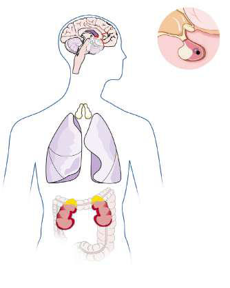

# Chapter 619: Cushing Syndrome

*Perrin C. White*

<!-- p.4442 -->
Virilization is the most common presenting symptom in children with adrenocortical tumors (see Chapter 617), occurring in 50–80%. In males, the clinical picture is similar to that of simple virilizing congenital adrenal hyperplasia: accelerated growth velocity and muscle development, acne, penile enlargement, and the precocious development of pubic and axillary hair. In females, virilizing tumors of the adrenal gland cause masculinization of a previously normal female with clitoral enlargement, growth acceleration, acne, deepening of the voice, and premature pubic and axillary hair development.

Conversely, adrenal tumors can occasionally (<10%) secrete high levels of estrogens because of overexpression of CYP19 (aromatase). Gynecomastia in males or premature thelarche in females is often the initial manifestation. Growth and development may be otherwise normal, or concomitant virilization may occur.

In addition to virilization, 15–40% of children with adrenocortical tumors also have Cushing syndrome (see Chapter 619). Whereas isolated virilization occurs relatively frequently, children with adrenal tumors usually do not have Cushing syndrome alone.

**LABORATORY FINDINGS** Serum levels of dehydroepiandrosterone, dehydroepiandrosterone sulfate, and androstenedione are usually elevated, often markedly. Serum levels of testosterone are often increased, usually because of peripheral conversion of androstenedione, but infants with predominantly testosterone-secreting adenomas have been reported. Levels of estrone and estradiol are elevated in tumors from patients with feminizing signs. Urinary 17-ketosteroids (sex steroid metabolites) are also increased but are no longer routinely measured. Many adrenocortical tumors have a relative deficiency of 11βhydroxylase activity and secrete increased amounts of deoxycorticosterone; these patients are hypertensive, and their tumors are often malignant.

**DIFFERENTIAL DIAGNOSIS** For virilizing signs, the differential includes virilizing forms of adrenal hyperplasia (see Chapter 616) and factitious exposure to androgens, such as topical testosterone preparations. The differential diagnosis for adrenal tumors is discussed in Chapter 617.

**TREATMENT** Functioning adrenocortical tumors should be removed surgically (see Chapter 617).

*Visit Elsevier eBooks+ at eBooks.Health.Elsevier.com** for Bibliography.*

*Perrin C. White*

Cushing syndrome is the result of abnormally high blood levels of cortisol or other glucocorticoids. This can be iatrogenic or the result of endogenous cortisol secretion, a result of either an adrenal tumor or of hypersecretion of corticotropin (adrenocorticotropic hormone [ACTH])

*Perrin C. White*

**ETIOLOGY** The most common cause of Cushing syndrome is prolonged exogenous administration of glucocorticoid hormones, especially at the high doses used to treat lymphoproliferative disorders. This rarely represents a diagnostic challenge, but management of hyperglycemia, hypertension, weight gain, linear growth retardation, and osteoporosis often complicates therapy with corticosteroids.

**Endogenous Cushing syndrome** is most often caused in infants by a functioning adrenocortical tumor (see Chapter 617). Patients with these tumors often exhibit signs of hypercortisolism along with signs of hypersecretion of other steroids such as androgens, estrogens, and aldosterone.

Although extremely rare in infants, the most common etiology of endogenous Cushing syndrome in children older than 7 years of age is **Cushing disease**, in which excessive ACTH secreted by a **pitu- itary adenoma** causes bilateral adrenal hyperplasia. Such adenomas are often too small to detect by imaging techniques and are termed **microadenomas**. They consist principally of chromophobe cells and frequently show positive immunostaining for ACTH and its precursor, proopiomelanocortin. Although most such tumors are sporadic, a small number occur in kindreds with **familial isolated pituitary ade- noma syndrome**. This syndrome, which is caused by pathogenic variants in the *AIP* gene, accounts for perhaps 2% of pituitary adenomas; more commonly tumors with *AIP* variants secrete growth hormone or prolactin, and only rarely do they secrete ACTH. Similarly, multiple endocrine neoplasia type 1 (MEN1) patients who have pathogenic variants in the *MEN1* gene may develop pituitary tumors, but these are typically prolactinomas. Other genes have also been implicated (Fig. 619.1). ACTH-dependent Cushing syndrome may also result from ectopic production of ACTH, although this is uncommon in children. Ectopic ACTH secretion in children is associated with islet cell carcinoma of the pancreas, neuroblastoma or ganglioneuroblastoma, hemangioperi-

Hyperfunction

#### **Table 619.1** Etiologic Classification of Adrenocortical

| Category / Parameter | Clinical Details & Findings |
| --- | --- |
| **EXCESS ANDROGEN** | Congenital adrenal hyperplasia; 21-Hydroxylase (CYP21A2) deficiency; 11β-Hydroxylase (CYP11B1) deficiency; 3β-Hydroxysteroid dehydrogenase (HSD3B2) defect (deficiency or; dysregulation); Tumor |
| **EXCESS CORTISOL (CUSHING SYNDROME)** | Bilateral adrenal hyperplasia; Adenoma; Hypersecretion of corticotropin (Cushing disease); Ectopic secretion of corticotropin; Exogenous corticotropin; Adrenocortical nodular dysplasia; Pigmented nodular adrenocortical disease (Carney complex); Tumor; McCune-Albright syndrome |
| **EXCESS MINERALOCORTICOID** | Primary hyperaldosteronism; Aldosterone-secreting adenoma; Bilateral micronodular adrenocortical hyperplasia; Glucocorticoid-suppressible aldosteronism; Tumor; Deoxycorticosterone excess; Congenital adrenal hyperplasia; • 11β-Hydroxylase (CYP11B1); • 17α-Hydroxylase (CYP17A1); Tumor; Apparent mineralocorticoid excess (deficiency of 11β-hydroxysteroid; dehydrogenase type 2 [HSD11B2]) |
| **EXCESS ESTROGEN** | Tumor |

<!-- p.4443 -->

**Fig. 619.1** Summary of genetic and molecular mecha- nisms implicated in Cushing syndrome. For each cause, the various pathogenic variants or abnormal protein ex- pression believed to play a part in the pathophysiology is shown. The most frequent mechanisms are highlighted in red; the well-characterized mechanisms are highlight- ed in bold characters, and other potential mechanisms are in normal characters; a question mark shows an un- confirmed association or genetic predisposition. Please refer to the text for explanation of the various genetic defects under each diagnostic category. AC, Adenylate cyclase; ACTH, adrenocorticotropic hormone; BMAH, bilateral macronodular adrenal hyperplasia; Cα, catalytic subunit of PKA; GEP-NETs, gastroenteropancreatic neu- roendocrine tumors; GPCR, G protein–coupled receptor; PDEs, phosphodiesterases; PKA, protein kinase A; PP- NAD, primary pigmented nodular adrenocortical disease; R1α, type 1α regulatory subunit of PKA. (From Lacroix A, Feelders RA, Stratakis CA, et  al. Cushing’s syndrome. Lancet. 2015;386:913–927. Fig. 1.)

**Cushing disease:** • Gene variants

• Abnormal protein expression Brg1, HDAC2, TR4, PTTG, EGFR, others

**Ectopic ACTH secretion:** • Gene variants RET, MEN1, others

**BMAH:** • Gene variants

• Protein expression **GPCR, POMC/ACTH**, PRKAR1A, others

**Adrenal adenoma:** • Gene variants **PRKACA****,** CTNNB1, GNAS1, PRKAR1A

• Protein expression GPCR, **PRKAR1A**, others

**PPNAD:** • Gene variants **PRKAR1A**, PDE11A, PDE8B, PRKACA

• Protein expression PRKACA, glucocorticoid receptor

**Adrenal Cushing syndrome:**

GEP-NETs

GPCR GsÜ ATP

PDEs PDE11A

PDE8B cAMP

AC

**ARMC5**, MEN1, FH, GNAS1, PDE11A, PDE8B, MC2R, PRKACA, DOTL1(?), HDAC9(?), PRUNE2(?)

**USP8**, MEN1, CDKIs, CDKN1B/p27Kip1, AIP, SDHx(?), DICER1, others

common in ectopic ACTH syndrome than in other forms of Cushing syndrome, because very high cortisol levels may overwhelm type 2 11β-hydroxysteroid dehydrogenase in the kidney (see Chapter 615) and thus have an enhanced mineralocorticoid (salt-retaining) effect.

Several syndromes are associated with the development of multiple autonomously hyperfunctioning nodules of adrenocortical tissue, rather than single adenomas or carcinomas (see Chapter 617). In many cases they are caused by pathogenic variants in genes in the cyclic adenosine monophosphate (cAMP)–mediated signaling pathway by which ACTH normally regulates cortisol secretion. **Primary pigmented nod- ular adrenocortical disease (PPNAD)** is a distinctive form of ACTHindependent Cushing syndrome. It may occur as an isolated event or, more commonly, as a familial disorder with other manifestations. The adrenal glands are small and have characteristic multiple small (<4 mm in diameter), pigmented (black) nodules containing large cells with cytoplasm and lipofuscin; there is cortical atrophy between the nodules. This adrenal disorder occurs as a component of **Carney com- plex**, an autosomal dominant disorder also consisting of centrofacial lentigines and blue nevi; cardiac and cutaneous myxomas; pituitary, thyroid, and testicular tumors; and pigmented melanotic schwannomas. Carney complex is inherited in an autosomal dominant manner, although sporadic cases occur. Genetic loci for Carney complex have been mapped to the gene for the type 1α regulatory subunit of protein kinase A *(PRKAR1A)* on chromosome 17q22-24 and less frequently to chromosome 2p16. Patients with Carney complex and *PRKAR1A* variants generally develop PPNAD as adults, and those with the disorder mapping to chromosome 2 (and most sporadic cases) develop PPNAD less frequently and later. Conversely, children presenting with PPNAD as an isolated finding rarely have pathogenic variants in *PRKAR1A,* or subsequently develop other manifestations of Carney complex. Some patients with isolated PPNAD have pathogenic variants in *PDE8B* or *PDE11A* encoding different phosphodiesterase isozymes. In contrast, activating *somatic* variants have been documented in the PRKACA catalytic subunit of protein kinase A in cortisol-secreting adenomas.

ACTH-independent Cushing syndrome with nodular hyperplasia and adenoma formation occurs rarely in cases of **McCune-Albright syndrome**, with symptoms beginning in infancy or childhood. McCune-Albright syndrome is caused by *somatic* variants of *GNAS* encoding the G protein, Gsα, through which the ACTH receptor (MCR2) normally signals. When the variant is present in adrenal tissue, cortisol and cell division are stimulated independently of ACTH. Other tissues in which activating mutations may occur are bone (producing fibrous dysplasia), gonads, thyroid, and pituitary. Clinical manifestations depend on which tissues are affected.

The genes causing nodular adrenocortical hyperplasia that have been identified mainly produce overactivity of the ACTH signaling pathway either by constitutively activating Gsα (McCune-Albright syndrome), by reducing the breakdown of cAMP and thus increasing its intracellular levels (variants of *PDE8B* or *PDE11A*), by disrupting the regulation of the cAMP-dependent enzyme protein kinase A (PRKAR1A mutations), or via microduplications encompassing *PRKACA*. Additionally, *ARMC5,* a tumor-suppressor gene, is abnormal in approximately 40% of cases of primary bilateral macronodular adrenocortical hyperplasia. Adrenocortical lesions, including diffuse hyperplasia, nodular hyperplasia, adenoma, and rarely carcinoma, may occur as part of MEN1 syndrome (see Chapter 617), an autosomal dominant disorder in which there is homozygous inactivation of the menin (MEN1) tumor-suppressor gene on chromosome 11q13.

**CLINICAL MANIFESTATIONS** Signs of Cushing syndrome have been recognized in infants younger than 1 year of age. The disorder appears to be more severe and the clinical findings more dramatic in infants than in older children. The face is rounded, with prominent cheeks and a flushed appearance (moon facies). Generalized obesity is common in younger children. In children with adrenal tumors, signs of abnormal masculinization occur frequently; accordingly, there may be hirsutism on the face and trunk, pubic hair, acne, deepening of the voice, and enlargement of the clitoris in females. Growth is impaired, with length falling below the third percentile, except when significant virilization produces normal or even accelerated growth. Hypertension is common and may occasionally lead to heart failure. An increased susceptibility to infection may also lead to sepsis.

In older children, in addition to obesity, short stature is a common presenting feature (Table 619.2). Gradual onset of obesity and deceleration or cessation of growth may be the only early manifestations. Older children most often have more severe obesity of the face and trunk compared with the extremities. However, obesity of the neck and upper back (“buffalo hump”) is a nonspecific finding to which excessive importance should not be attached. Purplish striae on the hips, abdomen, and thighs are common. Pubertal development may be delayed, or amenorrhea may occur in females past menarche. Weakness, headache, and emotional lability may be prominent. Hypertension and hyperglycemia usually occur; hyperglycemia may progress to frank diabetes. Osteoporosis is common and may cause pathologic fractures.

<!-- p.4444 -->
**LABORATORY FINDINGS** Cortisol levels in blood are normally highest at 8 am and decrease to less than 50% of peak levels by midnight, except in infants and young children, in whom a diurnal rhythm is not always established. In patients with Cushing syndrome, this circadian rhythm is lost; *mid- night cortisol levels >4.4 μ**g/dL strongly suggest the diagnosis*. It is difficult to obtain diurnal blood samples as part of an outpatient evaluation, but cortisol can be measured in *saliva samples,* which can be obtained at home at the appropriate times of day. Elevated nighttime salivary cortisol levels raise suspicion for Cushing syndrome.

Urinary excretion of free cortisol is increased. This is best measured in a 24-hour urine sample and is expressed as a ratio of micrograms of cortisol excreted per gram of creatinine. This ratio is independent of body size and completeness of the urine collection.

A single-dose dexamethasone suppression test is often helpful; a dose of 25-30 μg/kg (maximum: 2 mg) given at 11 pm results in a plasma cortisol level of less than 5 μg/dL at 8 am the next morning in normal individuals but not in patients with Cushing syndrome. It is prudent to measure the dexamethasone level in the same blood sample to ensure the adequacy of dosing.

A glucose tolerance test is often abnormal but is of no diagnostic utility. Levels of serum electrolytes are usually normal, but potassium may be decreased, especially in patients with tumors that secrete ACTH ectopically.

After the diagnosis of Cushing syndrome has been established, it is necessary to determine whether it is caused by a pituitary adenoma, an ectopic ACTH-secreting tumor, or a cortisol-secreting adrenal tumor (Fig. 619.2). ACTH concentrations are usually suppressed in patients with cortisol-secreting tumors and are very high in patients with ectopic ACTH-secreting tumors, but may be normal in patients with ACTH-secreting pituitary adenomas. After an intravenous bolus of corticotropin-releasing hormone, patients with ACTH-dependent Cushing syndrome have an exaggerated ACTH and cortisol response, whereas those with adrenal tumors show no increase in ACTH and cortisol. The two-step dexamethasone suppression test consists of administration of dexamethasone, 30 and 120 μg/kg/24 hr in four divided doses, on consecutive days. In children with pituitary Cushing syndrome, the larger dose, but not the smaller dose, suppresses serum levels of cortisol. Typically, patients with ACTH-independent Cushing syndrome do not show suppressed cortisol levels with dexamethasone.

CT detects virtually all adrenal tumors larger than 1.5 cm in diameter. MRI may detect ACTH-secreting pituitary adenomas, but many are too small to be seen; the addition of gadolinium contrast increases

Syndrome in Children

#### **Table 619.2** Presenting Signs and Symptoms of Cushing

| Category / Parameter | Clinical Details & Findings |
| --- | --- |
| **General** | Dermatologic; Facial plethora, acne, acanthosis; nigricans, easy bruising, supratemporal; and supraclavicular fat pads, moon; facies, fungal infection, hirsutism, fine; downy hair, violaceous striae (unusual; in children <7 yr age); Neurologic; Headaches; Cardiovascular; Hypertension, coagulopathy; Growth; Growth deceleration with concomitant; weight gain, central obesity; Gonadal; Amenorrhea, virilization, gynecomastia; Other; Nephrolithiasis, bone fractures, impaired; glucose tolerance, type 2 diabetes; Psychologic; Depression, anxiety, mood swings,; irritability, fatigue; From Lodish MB, Keil MF, Stratakis CA. Cushing’s syndrome in pediatrics: an update.; Endocrinol Metab Clin N Am. 2018;47:451–462. Table 1. |

the sensitivity of detection. Bilateral inferior petrosal blood sampling to measure concentrations of ACTH before and after corticotropinreleasing hormone administration may be required to localize the tumor when a pituitary adenoma is not visualized; this is not routinely available in many centers, and moreover may be of decreased specificity in children.

**DIFFERENTIAL DIAGNOSIS** Cushing syndrome is frequently suspected in children with obesity, particularly when striae and hypertension are present. Children with simple obesity are usually tall, whereas those with Cushing syndrome are short or have a decelerating growth rate. Although urinary excretion of cortisol is often elevated in simple obesity, salivary nighttime levels of cortisol are usually normal, and cortisol secretion is normally suppressed by oral administration of low doses of dexamethasone.

Elevated levels of cortisol and ACTH without clinical evidence of Cushing syndrome occur in patients with generalized glucocorticoid resistance (see Chapter 615.4). Affected patients may be asymptomatic or exhibit hypertension, hypokalemia, and precocious pseudopuberty; these manifestations are caused by increased mineralocorticoid and adrenal androgen secretion in response to elevated ACTH levels. Mutations in the glucocorticoid receptor have been identified.

**TREATMENT** Transsphenoidal pituitary microsurgery is the treatment of choice in *pituitary* Cushing disease in children. The overall success rate with follow-up of less than 10 years is 60–80%. Low postoperative serum or urinary cortisol concentrations predict long-term remission in most cases. Relapses are treated with reoperation or pituitary irradiation.

Cyproheptadine, a centrally acting serotonin antagonist that blocks ACTH release, has been used to treat Cushing disease in adults; remissions are usually not sustained after discontinuation of therapy. This agent is rarely used in children. Inhibitors of adrenal steroidogenesis (metyrapone, ketoconazole, aminoglutethimide, etomidate) have been used preoperatively to normalize circulating cortisol levels and reduce perioperative morbidity and mortality. Mifepristone, a glucocorticoid receptor antagonist, has been used in a limited number of cases. Pasireotide, a somatostatin analog, can inhibit ACTH secretion and is approved for use in adults with persistent disease after surgery or in whom surgery is contraindicated.

If a pituitary adenoma does not respond to treatment or if ACTH is secreted by an ectopic metastatic tumor, the adrenal glands may need to be removed. This can often be accomplished laparoscopically. Adrenalectomy may lead to increased ACTH secretion by an unresected pituitary adenoma, evidenced mainly by marked hyperpigmentation; this condition is termed **Nelson syndrome**, which occurs in ∼25% of adults who have undergone adrenalectomy for Cushing syndrome.

Several drugs that inhibit adrenocortical function may be an alternative to adrenalectomy. FDA-approved agents include mitotane (which is toxic to adrenocortical cells) and osilodrostat (a cortisol synthesis inhibitor); levoketoconazole, a stereoisomer of ketoconazole, inhibits several steroidogenic enzymes and is in an advanced stage of development.

Management of patients undergoing adrenalectomy requires adequate preoperative and postoperative replacement therapy with a corticosteroid. Tumors that produce corticosteroids usually lead to atrophy of the normal adrenal tissue, and replacement with cortisol (10 mg/m2/24 hr in three divided doses after the immediate postoperative period) is required until there is recovery of the hypothalamicpituitary-adrenal axis. Postoperative complications may include sepsis, pancreatitis, thrombosis, poor wound healing, and sudden collapse, particularly in infants with Cushing syndrome. Substantial catch-up growth, pubertal progress, and increased bone density occur, but bone density remains abnormal and adult height is often compromised. The management of adrenocortical tumors is discussed in Chapter 617.

*Visit Elsevier eBooks+ at eBooks.Health.Elsevier.com** for Bibliography.*
