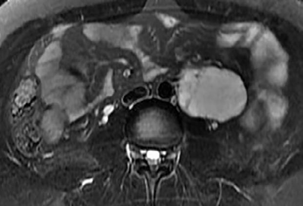
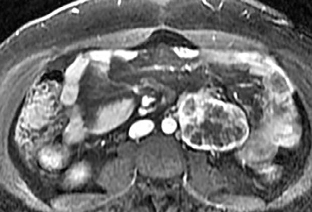

# Chapter 622: Development and Function of the Gonads

*Patricia A. Donohoue*

<!-- p.4448 -->
A C B

**Fig. 621.2** Paraganglioma in a 30-yr-old woman who presented with refractory hypertension. A, Axial T2-weighted MRI shows homogeneously T2-hyperintense left periaortic mass just above the level of the aortic bifurcation (Zuckerkandl organ), illustrating the “light bulb” T2-bright appear- ance of pheochromocytomas and paragangliomas. B, Axial contrast-enhanced T1-weighted MRI demonstrates heterogeneous enhancement within the mass. C, 123I-MIBG fused SPECT/CT axial image shows diffuse uptake within the tumor, compatible with paraganglioma. (From Ho LM. Adrenal glands. In: Haaga JR, Boll DT, eds. CT and MRI of the Whole Body, 6th ed. Philadelphia: Elsevier; 2017: Fig. 53-18.)

Section **5 Disorders of the Gonads**

**GENETIC CONTROL OF EMBRYONIC GONADAL DIFFERENTIATION** Gonadal differentiation is a complex, multistep process that requires the sequential action and interaction of multiple gene products. Early in the first trimester, the undifferentiated, bipotential fetal gonad begins as a thickening of the urogenital ridge, near the developing kidney and adrenal cortex. At 6 weeks of gestation, the gonad contains germ cells, stromal cells that will become Leydig cells in the testes or theca, interstitial, or hilar cells in the ovaries, and supporting cells that will develop into Sertoli cells in the testes or granulosa cells in the ovaries. In males, the *SRY* gene (**s**ex-determining **r**egion on the **Y** chromosome) is transiently expressed, followed by a sequential upregulation of a number of testis-specific genes. In the absence of *SRY,* the bipotential gonad will be able to develop into an ovary. Ovarian development is also characterized by expression of ovary-specific genes during the same period. One such gene is *R-spondin1*. During the gestation period of 6-9 weeks, a number of genes are upregulated to the same degree in both the testis and the ovary, including *WNT4* and *CTNNB1*.

A chromosome complement of 46,XX is necessary for the development of normal ovaries. Both the long and short arms of the X chromosome contain genes for normal ovarian development. The DSS (**d**osage **s**ensitive/**s**ex reversal) locus associated with the *DAX1* (**D**SS **a**drenal hypoplasia on the **X** chromosome) gene, which is defective in 46,XY patients with X-linked congenital adrenal hypoplasia and hypogonadotropic hypogonadism, is a member of the nuclear receptor superfamily and acts as a repressor of male gene expression. The *DAX1* gene product acts by binding to a related nuclear receptor SF-1 (**s**teroidogenic **f**actor-1, also known as *NR5A1*). In vitro, the signaling gene

*Patricia A. Donohoue*

*WNT4* stimulates expression of *DAX1,* resulting in the suppression of androgen synthesis in XX females. The WNTs are ligands that activate receptor-mediated signal transduction pathways and are involved in modulating gene expression as well as cell behavior, adhesion, and polarity. Once developed, the ovary requires FAX12 to preserve its differentiation and stability. A key to its role in humans was elucidated by a loss-of-function pathogenic variant of *WNT4* that was found in an 18-year-old 46,XX woman. She had an absence of müllerian-derived structures (uterus and fallopian tubes), unilateral renal agenesis, and clinical signs of androgen excess.

Pathogenic variants of the Wilms tumor 1 *(WT1)* gene may also affect sex differentiation. *WT1* pathogenic variants are associated with **Denys-Drash syndrome** (early-onset renal failure, abnormal external genitalia in genetic males, and Wilms tumor). Haploinsufficiency of a three–amino acid (KTS) form of *WT1* has been implicated in the gonadal dysgenesis of patients with **Fraser syndrome** (late-onset progressive glomerulopathy and 46,XY gonadal dysgenesis). Variants in the *FOXL2* and *SF-1* genes are associated with ovarian failure. Pathogenic variants of the *R-spondin1* gene has been described in individuals with 46,XX disorder of sex development (DSD). Other autosomal genes also play a role in normal ovarian organogenesis and testicular development. Several conditions of gonadal dysgenesis are associated with gross abnormalities of both autosomes and sex chromosomes. A deletion affecting the short arm of the X chromosome produces the typical somatic anomalies of Turner syndrome.

**Development of the testis** requires the short arm of the Y chromosome; this contains the *SRY* gene, which is required for testicular differentiation. During male meiosis, the Y chromosome must segregate from the X chromosome so that both X and Y chromosomes do not occur in the same spermatozoa. The major portion of the Y chromosome is composed of Y-specific sequences that do not pair with the X chromosome. However, a minor portion of the Y chromosome shares sequences with the X chromosome, and pairing does occur in this region. The genes and sequences in this area recombine between the sex chromosomes, behaving like autosomal genes. Therefore the term *pseudoautosomal region* is used to describe this portion of the chromosome, and the term indicates genetic behavior of these genes relative to pairing and recombinational events. The *SRY* gene is localized to the 35-kb portion proximal to the pseudoautosomal region of the Y chromosome. It contains a high-mobility group (HMG) nonhistone protein (HMG box), supporting SRY’s role as a transcriptional regulator of other genes involved in sex differentiation. The gonadal ridge forms at around 33 days of gestation. SRY is detected at 41 days, peaks at 44 days when testis cords are first visible, and persists into adulthood.

Other genes that are found on autosomes are important in this process. *SOX9,* an *SRY*-related gene containing a region homologous with the HMG box 9 of *SRY,* is located on chromosome 17. Pathogenic variants of this gene result in **XY sex reversal** and **campto- melic dysplasia**. *SF-1 (NR5A1)* on chromosome 9q33 is important

<!-- p.4449 -->
α-Thalassemia,

#### **Table 622.1** Pathogenic Genes in Disorders of Sex Development

| Category / Parameter | Clinical Details & Findings |
| --- | --- |
| **TF** | 607102; 11p13 |
| **AD** | Dysgenetic; testis; ±; Female or; ambiguous; Wilms tumor, renal; abnormalities, gonadal; tumors (WAGR, Denys-; Drash, and Frasier; syndromes) |
| **(NR5A1)** | Nuclear; receptor TF; 184757; 9q33 |
| **AD/AR** | Dysgenetic; testis;; ovotestis; ±; Female or; ambiguous; More severe; phenotypes include; primary adrenal failure;; milder phenotypes; have isolated partial; gonadal dysgenesis;; mothers who carry; SF-1 mutation have; premature ovarian; insufficiency |
| **TF** | 480000; Yp11.3 |
| **Y** | Dysgenetic; testis or; ovotestis; ±; Female or; ambiguous |
| **TF** | 608160; 17q24-25 |
| **AD** | Dysgenetic; testis or; ovotestis; ±; Female or; ambiguous; Camptomelic; dysplasia (17q24; rearrangements milder; phenotype than point; mutations) |
| **DHH** | Signaling; molecule; 605423; 12q13.1 |
| **AR** | Dysgenetic; testis; ±; Female; The severe phenotype; of one patient; included minifascicular; neuropathy; other; patients have isolated; gonadal dysgenesis |
| **ATRX** | Helicase; (?chromatin; remodeling); 300032; Xq13.3 |
| **X** | Dysgenetic; testis; −; Female,; ambiguous; or male; intellectual disability |
| **TF** | 3003382; Xp22.13 |
| **X** | Dysgenetic; testis; –; Ambiguous; X-linked lissencephaly,; epilepsy, temperature; instability; Gata4 |
| **TF** | 615542; 8p23.1; AD in XY; subjects; Dysgenetic; testes; _; Ambiguous; Congenital heart; disease; DISORDERS OF GONADAL (TESTICULAR) DEVELOPMENT: CHROMOSOMAL CHANGES INVOLVING KEY CANDIDATE GENES |
| **TF** | 602424; 9p24.3; Monosomic; deletion; Dysgenetic; testis; ±; Female or; ambiguous; Intellectual disability |
| **(NR0B1)** | Nuclear; receptor TF; 300018; Xp21.3; dupXp21; Dysgenetic; testis or; ovary; ±; Female or; ambiguous |
| **WNT4** | Signaling; molecule; 603490; 1p35; dup1p35; Dysgenetic; testis; +; Ambiguous; Intellectual disability |

in adrenal and gonadal development, as well as the development of gonadotropin-releasing hormone–secreting neurons in the hypothalamus. *WTI,* especially the KST isoform on chromosome 11p13, is needed for early gonadal, adrenal, and renal development. Fibroblast growth factor-9, GATA-4, XH-2, and SOY9 are also important.

When genetic recombination events on sex chromosomes extend beyond the pseudoautosomal region, X- and Y-specific DNA may be transferred between the chromosomes. Such aberrant

recombinations result in X chromosomes carrying *SRY,* resulting in **XX males**, or Y chromosomes that have lost *SRY,* resulting in **XY females**. SRY acts as a transcriptional regulator to increase cellular proliferation, attract interstitial cells from adjacent mesonephros into the genital ridge, and stimulate testicular Sertoli cell differentiation. Sertoli cells act as an organizer of steroidogenic and germ cell lines and produce **antimüllerian hormone** (AMH) that causes the female duct system to regress. Table 622.1 lists additional genes involved in sex development that, if abnormal, result in DSD.

<!-- p.4450 -->

#### **Table 622.1** Pathogenic Genes in Disorders of Sex Development—cont’d

| Category / Parameter | Clinical Details & Findings |
| --- | --- |
| **LHGCR** | G-protein; receptor; 152790; 2p21 |
| **AR** | Testis; –; Female,; ambiguous; or; micropenis; Leydig cell hypoplasia |
| **DHCR7** | Enzyme; 602858; 11q12-13 |
| **AR** | Testis; –; Variable; Smith-Lemli-Opitz; syndrome: coarse; facies, 2nd-3rd toe; syndactyly, failure to; thrive, developmental; delay, cardiac and; visceral abnormalities; StAR; Mitochondrial; membrane; protein; 600617; 8p11.2 |
| **AR** | Testis; –; Female; Congenital lipoid; adrenal hyperplasia; (primary adrenal; failure), pubertal failure |
| **CYP11A1** | Enzyme; 118485; 15q23-24 |
| **AR** | Testis; –; Female or; ambiguous; Congenital adrenal; hyperplasia (primary; adrenal failure),; pubertal failure |
| **HSD3B2** | Enzyme; 201810; 1p13.1 |
| **AR** | Testis; –; Ambiguous; CAH, primary adrenal; failure, partial; androgenization; caused by ↑ DHEA |
| **CYP17** | Enzyme; 202110; 10q24.3 |
| **AR** | Testis; –; Female; ambiguous; or; micropenis; CAH, hypertension caused; by ↑ corticosterone and; 11-deoxycorticosterone; (except in isolated; 17,20-lyase deficiency) |
| **POR (P450** | oxido-; reductase); CYP enzyme; electron donor; 124015; 7q11.2 |
| **AR** | Testis; –; Male or; ambiguous; Mixed features of; 21-hydroxylase; deficiency, 17α-; hydroxylase/17,20-; lyase deficiency, and; aromatase deficiency;; sometimes associated; with Antley-Bixler; skeletal dysplasia |
| **HSD17B3** | Enzyme; 605573; 9q22 |
| **AR** | Testis; –; Female or; ambiguous; Partial androgenization; at puberty,; ↑ androstenedione:; testosterone ratio |
| **SRD5A2** | Enzyme; 607306; 2p23 |
| **AR** | Testis; –; Ambiguous; or; micropenis; Partial androgenization; at puberty,; ↑ testosterone:DHT ratio |
| **AKR1C4** | Enzyme; 600451; 10p15.1; Unclear; Testis; –; Ambiguous; or; micropenis; DHT deficiency in; patients once thought; to have 17,20 lyase; deficiency; dose effect; with AKR1C2 variant is; possible |
| **AKR1C2** | Enzyme; 600450; 10p15.1; Unclear; Testis; –; Ambiguous; or; micropenis; DHT deficiency in; patients once thought; to have 17,20 lyase; deficiency; dose effect; with AKR1C2 variant is; possible |
| **AMH** | Signaling; molecule; 600957; 19p13.3-13.2 AR; Testis; +; Normal male; Persistent müllerian duct; syndrome (PMDS);; male |
| **AHM** | receptor; Serine-threonine; kinase; transmembrane; receptor; 600956; 12q13 |
| **AR** | Testis; –; Normal male; External genitalia,; bilateral; cryptorchidism |

<!-- p.4451 -->

#### **Table 622.1** Pathogenic Genes in Disorders of Sex Development—cont’d

| Category / Parameter | Clinical Details & Findings |
| --- | --- |
| **PHENOTYPES** | Androgen; receptor; Nuclear; receptor TF; 3130700; Xq11-12 |
| **X** | Testis; –; Female,; ambiguous,; micropenis,; or normal; male; Phenotypic spectrum; from complete; androgen insensitivity; syndrome (female; external genitalia); and partial androgen; insensitivity; (ambiguous) to normal; male genitalia/infertility |
| **TF** | 480000; Yp11.3; Translocation; Testis or; ovotestis; –; Male or; ambiguous |
| **TF** | 608160; 17q24; dup17q24 |
| **ND** | –; Male or; ambiguous; R-spondin1 |
| **TF** | 610644; 1p34.3 |
| **AR** | Ovotestis; ±; Male or; ambiguous; Palmoplantar; hyperkeratosis and; certain malignancies |
| **HSD3B2** | Enzyme; 201810; 1p13 |
| **AR** | Ovary; +; Clitoromegaly; CAH, primary; adrenal failure,; partial androgenization; caused by ↑ DHEA |
| **CYP21A2** | Enzyme; 201910; 6p21-23 |
| **AR** | Ovary; +; Ambiguous; CAH, phenotypic; spectrum from severe; salt-losing forms; associated with adrenal; failure to simple virilizing; forms with compensated; adrenal function,; ↑ 17-hydroxyprogesterone |
| **CYP11B1** | Enzyme; 20210; 8q21-22 |
| **AR** | Ovary; +; Ambiguous; CAH, hypertension; caused by; ↑ 11-deoxycortisol and; 11-deoxycorticosterone |
| **POR (P450** | oxidore-; ductase); CYP enzyme; electron donor; 124015; 7q11.2 |
| **AR** | Ovary; +; Ambiguous; Mixed features of; 21-hydroxylase; deficiency, 17α-; hydroxylase/17,20-; lyase deficiency, and; aromatase deficiency;; associated with; Antley-Bixler skeletal; dysplasia |
| **CYP19** | Enzyme; 107910; 15q21 |
| **AR** | Ovary; +; Ambiguous; Maternal virilization; during pregnancy,; absent breast; development at; puberty, except in; partial cases; Glucocorti-; coid; receptor; Nuclear; receptor TF; 138040; 5q31 |
| **AR** | Ovary; +; Ambiguous |
| **↑ ACTH,** | 17-hydroxyprogesterone; and cortisol; failure; of dexamethasone; suppression (patient; heterozygous for a; variant in CYP21); ACTH, Adrenocorticotropin; AD, autosomal dominant (often de novo mutation); AR, autosomal recessive; CAH, congenital adrenal hyperplasia; ND, not determined; OMIM #, Online; Mendelian Inheritance in Man number; TF, transcription factor; WAGR, Wilms, aniridia, genital anomalies, and retardation; X, X-chromosomal; Y, Y-chromosomal. Chromosomal; rearrangements likely to include key genes are included.; From Lee PA, Houk CP, Ahmed SF, et al. International Consensus Conference on Intersex organized by the Lawson Wilkins Pediatric Endocrine Society and the European; Society for Paediatric Endocrinology. Consensus statement on management of intersex disorders. International Consensus Conference on Intersex. Pediatrics. 2006;118:e488–; e500; with additional data from Baxter RM, Arboleda VA, Lee H, et al. Exome sequencing for the diagnosis of 46,XY disorders of sex development. J Clin Endocrinol Metab.; 2015;100:e333–e344; and Lourenco D, Brauner R, Rybczynska M, et al. Loss-of-function mutation in GATA4 causes anomalies of human testicular development. PNAS.; 2011;108:1597–1602. |

<!-- p.4452 -->
**Development of the ovary** was once thought to be a passive process in the absence of SRY. Although the morphologic changes in the developing ovary are less marked than in the testis, sequentially expressed genes and pathways are required for complete ovarian development along with maintenance of ovarian integrity postnatally. One of these genes is *R-spondin1,* which if abnormal can result in testicular or ovotesticular development in 46,XX individuals. Some peptides in the Wnt-signaling pathway may antagonize testicular development, thus allowing for ovarian differentiation. This effect may be mediated by β-catenin signaling,

which is required for suppressing testicular features. Once developed, the ovary requires FAX12 to preserve its differentiation and stability.

**FUNCTION OF THE TESTES** Levels of placental chorionic gonadotropin peak at 8-12 weeks of gestation and stimulate the fetal Leydig cells to secrete testosterone, the main hormonal product of the testis (Fig. 622.1). By way of two different biosynthetic pathways, the more potent metabolite of testosterone, dihydrotestosterone (DHT), is produced. In the originally described

**Fig. 622.1** Biosynthesis of sex steroids. Dashed lines indicate enzymatic defects as- sociated with 46,XY disorders of sex develop- ment. 3β-HSD2, 3β-hydroxysteroid dehydro- genase type 2; 5RED2, 5α-reductase type 2; AKR1C2/RoDH (Ox), one of the enzymes in the alternative androgen biosynthetic pathway; ARO, aromatase; CYP17A1, the enzyme that catalyzes both 17α-hydroxylase (17-OH) and 17,20-lyase activities; HSD17B3, the enzyme that catalyzes the 17-ketoreductase reaction; POR, P450 oxidoreductase; StAR, steroido- genic acute regulatory protein.

CYPIIAI  StAR

3 HSD2

3 HSD2

3 HSD2

5 RED2

AKRIC2/RoDH

(ox)

ARO

ARO

Estrone

Estradiol 17

(17 CH activity) CYP17A1 POR

(17,20-Lyase activity)

CYP17A1 POR

HSD17B3

<!-- p.4453 -->
pathway, testosterone is converted by the enzyme 5α-reductase to DHT. In another pathway, DHT is produced from androstanediol. The early fetal period of DHT production and action is critical for normal and complete virilization of the XY fetus. Defects in this process lead to different forms of atypical male development (see Chapter 628.2). After virilization occurs, fetal levels of testosterone decrease but are maintained at lower levels in the latter half of pregnancy by luteinizing hormone (LH) secreted by the fetal pituitary; this LH-mediated testosterone secretion is required for continued penile growth and to some degree also for testicular descent.

As part of the normal transition from intrauterine to extrauterine life, perhaps related to the sudden withdrawal of maternal and placental hormones, newborns and young infants experience a transient surge of gonadotropins and sex steroids. This is the so-called **minipuberty**.

In males, LH and testosterone peak at 1-2 months of age and then decline to reach prepubertal levels by 4-6 months of age. Folliclestimulating hormone (FSH), along with inhibin B, peak at 3 months and decline to prepubertal levels by 9 and 15 months, respectively. The LH rise is more dominant than that of FSH.

The neonatal surge may be important for postnatal maturation of the gonads, stabilization of male external genitalia, and perhaps also for gender identity and sexual behaviors. The postnatal surge in LH and testosterone is absent or blunted in infants with hypopituitarism, cryptorchidism, and complete androgen insensitivity syndrome. The development of nocturnal pulsatile secretion of LH marks the beginning of puberty.

Within specific target cells, 6–8% of testosterone is converted by 5α-reductase to DHT, the more potent androgen (see Fig. 622.1), and approximately 0.3% is acted on by aromatase to produce estradiol. Approximately half of circulating testosterone is bound to sex hormone–binding globulin and half to albumin; only 2% circulates in the free form. Plasma levels of sex hormone–binding globulin are low at birth, rise rapidly during the first 10 days of life, and then remain stable until the onset of puberty. Thyroid hormone may play a role in this physiologic increase because neonates with athyreosis (absence of the thyroid gland) have very low levels of sex hormone–binding globulin.

**AMH** (previously referred to as *müllerian inhibitory substance*), **inhibin**, and **activin** are members of the transforming growth factor-β (TGF-β) superfamily of growth factors. This group, which has more than 45 members, also includes bone morphogenetic proteins. Members of the TGF-β superfamily are involved in the regulation of developmental processes and multiple diverse human disease states, including chondrodysplasias and cancer.

AMH, a homodimeric glycoprotein hormone encoded by a gene on chromosome 19, is the earliest secreted product of the Sertoli cells of the fetal testis. Produced as a prohormone, its carboxyterminal fragment is cleaved to make it active. *AMH* transcription is initiated by *SOX9* acting through the HMG box, and its expression is upregulated by SF-1 binding to its promoter and further interacting with *SOX9, WT1,* and *GATA4.* AMH binds to two distinct serine/ threonine receptors, each having a single transmembrane domain. The activated type 1 receptor signals to the SMAD family of intracellular mediators.

The gene for the AMH receptor (on chromosome 12) is expressed in Sertoli cells. In the female, it is expressed in fetal müllerian duct cells and in fetal and postnatal granulosa cells. During sex differentiation in males, AMH causes involution of the müllerian (paramesonephric) ducts, which are embryologic precursors of the cervix and uterus. It works in concert with SF-1 to cause involution of the fallopian tubes.

AMH is secreted in males by Sertoli cells during both fetal and postnatal life. In females, it is secreted by granulosa cells from 36 weeks of gestation to menopause but at lower levels. The serum concentration of AMH in males is highest at birth, whereas in females it is highest at puberty. After puberty, both sexes have similar serum concentrations of AMH. Its role in postnatal life is not yet fully characterized.

**Inhibin** is another glycoprotein hormone secreted by the Sertoli cells of the testes and granulosa and theca cells of the ovary. Inhibin A consists of an α-subunit disulfide linked to the β-A subunit,

whereas inhibin B consists of the same α subunit linked to the β-B subunit. Activins are dimers of the B subunits, either homodimers (BA/BA, BB/BB) or heterodimers (BA/BB). Inhibins selectively inhibit, whereas activins stimulate pituitary FSH secretion. By means of immunoassays specific for inhibin A or B, it has been shown that inhibin A is absent in males and is present mostly in the luteal phase in women. Inhibin B is the principal form of inhibin in males and in females during the follicular phase. Inhibin B may be used as a marker of Sertoli cell function in males. FSH stimulates inhibin B secretion in females and males, but only in males is there also evidence for gonadotropin-independent regulation. Levels of inhibin B are potentially informative in children with various forms of gonadal and pubertal disorders. In males with delayed puberty, inhibin B may be a useful screening test to differentiate between constitutional delay of puberty and hypogonadotropic hypogonadism. In hypogonadotropic hypogonadism, the serum inhibin B level is very low to undetectable.

Like inhibin and activin, follistatin (a single-chain glycosylated protein) is produced by gonads and other tissues such as the hypothalamus, kidney, adrenal gland, and placenta. Follistatin inhibits FSH secretion principally by binding activins, thereby blocking the effects of activins at the level of both ovary and pituitary.

Many additional peptides act as mediators of the development and function of the testis. They include neurohormones such as growth hormone–releasing hormone, gonadotropin-releasing hormone, corticotropin-releasing hormone, oxytocin, arginine vasopressin, somatostatin, substance P, and neuropeptide Y; growth factors such as insulin-like growth factors (IGFs) and IGF-binding proteins, TGF-β, and fibroblast, platelet-derived, and nerve growth factors; vasoactive peptides; and immune-derived cytokines such as tumor necrosis factor and interleukins 1, 2, 4, and 6.

Clinical patterns of pubertal changes vary widely (see Chapter 599). In 95% of males, enlargement of the genitals begins between 9.5 and 13.5 years of age, reaching maturity at 13-17 years of age. In a minority of normal males, puberty begins after 15 years of age. In some males, pubertal development is completed in less than 2 years, but in others it may take longer than 4.5 years. Pubertal development and the adolescent growth spurt occur at an older age in males than in females by approximately 2 years.

The median age of sperm production (spermarche) is 14 years. This event occurs in midpuberty as judged by pubic hair, testis size, evidence of growth spurt, and testosterone levels. Nighttime levels of FSH are in the adult male range at the time of spermarche; the first conscious ejaculation occurs at about the same time.

**FUNCTION OF THE OVARIES** In the normal female, the undifferentiated gonad can be identified histologically as an ovary by 10-11 weeks of gestation, after the upregulation of *R-spondin1*. Oocytes are present from the fourth month of gestation and reach a peak of 7 million by 5 months of gestation. For normal maintenance, oocytes need granulosa cells to form primordial follicles. Functional FSH (but not LH) receptors are present in oocytes of primary follicles during follicular development. Two normal X chromosomes are needed for maintenance of oocytes. In contrast to somatic cells, in which only one X chromosome is active, both X chromosomes are active in germ cells. At birth, the ovaries contain approximately 1 million active follicles, which decrease to 0.5 million by menarche. Thereafter, they decrease at a rate of 1,000/month and at an even higher rate after the age of 35 years.

The hormones of the fetal ovary are provided for the most part by the fetoplacental unit. As in males, peak gonadotropin secretion occurs in fetal life and then again at 2-3 months of life, with the lowest levels at about 6 years of age. In contrast to males, the FSH surge predominates over LH in females. FSH peaks around 3-6 months of age and declines by 12 months, but remains detectable for 24 months. Under LH influence, estradiol peaks at 2-6 months of age. The inhibin B response is variable, peaking between 2 and 12 months and remaining above prepubertal levels until 24 months.
