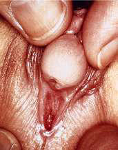

# Chapter 628: Disorders of Sex Development

*Patricia A. Donohoue*

<!-- p.4470 -->
with **McCune-Albright syndrome** is usually associated with autonomous follicular cysts caused by somatic-activating pathogenic variants of the GSα-protein occurring early in development (see Chapter 600.6). Gonadotropins are suppressed, and estradiol levels are often markedly elevated, but they may fluctuate widely and even temporarily may return to normal. Gonadotropin-releasing hormone analog stimulation fails to evoke an increase in gonadotropins. Ultrasonography is the method of choice for the detection and monitoring of such cysts. Aromatase inhibitors are shown to be the mainstay of therapy in females with McCune-Albright syndrome and persistent estradiol elevation. Estrogen receptor blockers have also been used. A short period of observation to ascertain the lack of spontaneous resolution is advisable before cyst aspiration or cystectomy is considered. Cystic neoplasms must be considered in the differential diagnosis.

**ANDROGENIC LESIONS OF THE OVARY** Virilizing ovarian tumors are rare at all ages but particularly so in prepubertal females. **Arrhenoblastoma** has been reported as early as 14 days of age, but few cases have been reported in females younger than 16 years of age. The **gonadoblastoma** occurs exclusively in dysgenetic gonads, particularly in phenotypic females who have a Y chromosome or a Y fragment in their genotype (46,XY; 45,X/46,XY; 45,X/46,X-fra). There is a gonadoblastoma locus on the Y chromosome (GBY). The tumors may be bilateral. Virilization occurs with some, but not all, tumors. The clinical features are the same as those seen in patients with virilizing adrenal tumors and include accelerated growth, acne, clitoral enlargement, and growth of sexual hair. A palpable, abdominal mass is found in about 50% of patients. Plasma levels of testosterone and androstenedione are elevated, and gonadotropins are suppressed. Ultrasonography, CT, and MRI usually localize the lesion. The dysgenetic gonad of phenotypic females with a Y chromosome or fragment of Y chromosome containing GBY should be removed prophylactically. *When a unilateral tumor is removed, the contralateral dysgenetic gonad should also be removed.* Association of gonadoblastoma and WAGR (Wilms tumor, aniridia, genitourinary anomalies, mental retardation) syndrome is also reported. In an immunohistochemical study of two gonadoblastomas, expressions of *WT1, p53,* and *MIS*, as well as inhibin, were all demonstrated.

Virilizing manifestations occur occasionally in females with **juvenile granulosa cell tumors**. Adrenal rests and hilum cell tumors rarely lead to virilization. Activating pathogenic variants of G protein genes have been described in ovarian (and testicular) tumors. GSα variants, usually seen in gonadal tumors associated with **McCune-Albright syndrome**, were also noted in four of six Leydig cell tumors (three ovarian, one testicular). Two granulosa cell tumors and 1 thecoma of 10 ovarian tumors studied were found to have *GIP-2* variants.

**Sertoli-Leydig cell tumors**, rare sex cord/stromal neoplasms, constitute less than 1% of ovarian tumors. The average age at diagnosis is 25 years; less than 5% of these tumors occur before puberty. α-Fetoprotein levels may be mildly elevated. In one 12-month-old with Sertoli-Leydig cell tumor presenting with isosexual precocity, the only detectable tumor marker was the serum inhibin level, with elevations in both A and B subunits. Five-year survival rates are 70–90%. Of 102 consecutive patients who underwent surgery because of ovarian masses over a 15-year period, the presenting symptoms were acute abdominal pain in 56% and abdominal or pelvic mass in 22%. Of nine children whose cause for surgery was presumed malignancy, three had dysgerminomas, two had teratomas, two had juvenile granulosa cell tumors, one had a Sertoli-Leydig cell tumor, and one had a yolk sac tumor.

*Visit Elsevier eBooks+ at eBooks.Health.Elsevier.com** for Bibliography.*

**SEX DIFFERENTIATION** See also Chapter 622.

Differentiation and development of the gonads and genitalia are largely complete in the first half of gestation. In normal differentiation, the final form of all sexual structures is consistent with normal sex chromosomes (either XX or XY). A 46,XX complement of chromosomes, as well a genetic factors such as DAX1 (dosage-sensitive/ sex-reversal adrenal hypoplasia on the X chromosome), the signaling molecule WNT-4, and R-Spondin1, are among the many needed for the development of normal ovaries. Development of the male phenotype is potentially more complex. It requires a Y chromosome and, specifically, an intact *SRY* (sex-determining region on the Y chromosome) gene, which, in association with genes such as *SOX9, SF-1* (steroidogenic factor-1), *WT1* (Wilms tumor 1), and others (see Chapter 622), directs the undifferentiated gonad to become a testis. Aberrant recombinations may result in X chromosomes carrying *SRY,* resulting in XX males, or Y chromosomes that have lost *SRY,* resulting in XY females.

Antimüllerian hormone (AMH) causes the müllerian (paramesonephric) ducts to regress; in its absence, they persist as the uterus, fallopian tubes, cervix, and upper vagina. AMH activation in the testes probably requires the *SF-1* gene. By about 8 weeks of gestation, the Leydig cells of the testis begin to produce testosterone. During this critical period of male differentiation, testosterone secretion is stimulated by placental human chorionic gonadotropin (hCG), which peaks at 8-12 weeks. In the latter half of pregnancy, lower levels of testosterone are maintained by luteinizing hormone (LH) secreted by the fetal pituitary. Testosterone produced locally initiates development of the ipsilateral wolffian (mesonephric) duct into the epididymis, vas deferens, and seminal vesicle. Complete development of the external genitalia also requires dihydrotestosterone (DHT), the more active metabolite of testosterone. DHT is produced largely from circulating testosterone and is necessary to fuse the genital folds to form the penis and scrotum. DHT is produced from testosterone via the action of the enzyme 5α-reductase. DHT is also produced through an alternative biosynthetic pathway from androstanediol, and this pathway must be intact for normal and complete prenatal virilization to occur. Figure 628.1 illustrates the production of steroid hormones in various glands and the integrated pathways to the synthesis of DHT. A functional androgen receptor, produced by an X-linked gene, is required for testosterone and DHT to induce these androgen effects.

In the XX fetus with normal long and short arms of the X chromosome, the bipotential gonad develops into an ovary by about the 10th to 11th week. This occurs only in the absence of SRY, testosterone, and AMH and requires a normal gene in the dosage-sensitive/sex-reversal locus *DAX1,* the WNT-4 molecule, and R-Spondin1. A female external phenotype develops in the absence of fetal gonads. However, the male phenotype development requires androgen production and action. Estrogen is unnecessary for normal prenatal sexual differentiation, as demonstrated by 46,XX patients with aromatase deficiency.

Chromosomal aberrations may result in ambiguity of the external genitalia. Conditions of aberrant sex differentiation may also occur with the XX or XY genotype. The appropriate term for what was previously called *intersex* is **disorders of sex development** (**DSD)**. This term defines a condition “in which development of chromosomal, gonadal, or anatomic sex is atypical.” It is increasingly preferable to use the term *atypical genitalia* rather than *ambiguous genitalia.* Tables 628.1 and 628.2 compare previous

*Patricia A. Donohoue*

<!-- p.4471 -->
terms with their revised etiologic classification nomenclature. Table 622.1 in Chapter 622 lists some of the many genes that may be abnormal in various forms of DSD. Gender fluidity (nonconformity) has become a socially and, in New York State, legally accepted concept and is often expressed by self-identified people as intersex. New York State has an intersex category on its birth certificate. Partial androgen insensitivity, 5α-reductase deficiency, and mixed gonadal dysgenesis are often associated with gender dissatisfaction, and an intersex designation may help with future selfidentification once the child is mature.

The definition of atypical or ambiguous genitalia, in a broad sense, is any case in which the external genitalia do not appear completely male or completely female. Although there are standards for genital size dimensions, variations in size of these structures do not always constitute ambiguity.

Development of the external genitalia begins with the potential to be either male or female (Fig. 628.2). Virilization of a female, the most common form of DSD, results in varying phenotypes (Fig. 628.3) that develop from the basic bipotential genital appearances of the embryo (see Fig. 628.2).

**DIAGNOSTIC APPROACH TO THE PATIENT WITH ATYPICAL OR AMBIGUOUS GENITALIA** The appearance of the external genitalia is rarely diagnostic of a particular disorder and thus does not often allow distinction among the various forms of DSD. The most common forms of 46,XX DSD are *virilizing forms of congenital adrenal hyperplasia*. It is important to note that in 46,XY DSD, the specific diagnosis is not found in up to 50% of cases; partial androgen insensitivity syndrome (PAIS) and

**Fig. 628.1** Steroidogenic pathways enzyme names and activities. CYP11A1: cholesterol side-chain cleavage. Enzyme activities include 20-hydroxylase, 22-hydroxylase, and 20,22-lyase. CYP17A1: activities include 17α-hydroxylase and 17,20-lyase. 3βHSD2 (HSD3B2): activities in- clude 3β-hydroxysteroid dehydrogenase (type 2) and D5D4-isomerase. CYP21A2: activity is 21-hydroxylase. CYP11B1: activity is 11β-hydroxylase. CYP11B2: activities include 18-hydroxylase (CMOI) and 18-dehydrogenase (CMOII). SRD5A1: activity is 5α-reductase type 1. SRD5A2: activity is 5α-reductase type 2. HSD17B2: activity is 17β-hydroxysteroid dehydrogenase type 2. HSD17B3: activity is 17β-hydroxysteroid dehydrogenase type 3. AKR1C2/4: activities are 3α-reductase types 1 and 3. AKR1C2/RoDH (ox): activities are 3α-reductase and 3-hydroxyepimerase. ARO, aromatase; CMOI, corticosterone methyl oxidase type 1; CMOII, corticosterone methyl oxidase type 2; DHEA, dehydroepiandrosterone; DHT, dihydrotes- tosterone; 5αDHP, 5α dihydroprogesterone. (Adapted from Kim MS, Donohoue PA. Adrenal disorders. In Kappy MS, Allen DB, Geffner ME, eds. Pediatric Practice Endocrinology, 2nd ed. New York: McGraw Hill, 2014; and Flück CE, Meyer-Böni M, Pandey AV, et al. Why boys will be boys: two pathways of fetal testicular androgen biosynthesis are needed for male sexual differentiation. Am J Hum Genet. 2011;89:201–218.)

HSD3B2

CYP11A1 + StAR

Cholesterol

Pregnenolone 17-OH pregnenolone

Adrenal & Sex Steroid Synthesis Sex Steroid Synthesis

Standard Pathway Adrenal Steroid Synthesis

DHEA

CYP21A2 + POR

CYP11B1

CYP11B2

Aldosterone

Corticosterone Cortisol DHT

Testosterone Estradiol

Estrone Androstenedione 17-OH progesterone Progesterone

DOC 11-Deoxycortisol

SRD5A2

AKR1C2/4

17-OH allopregnanolone

Androstanediol

DHT

5αDHP

Sex Steroid Synthesis Alternative Pathway To DHT

AKR1C2/RoDH (ox)

CYP17A1 + POR HSD17B3

HSD17B3 HSD17B2

C Y P 1 7 A 1 +

P O R S R D

5 A 1

C Y P 1 7 A 1 +

P O R A R O +

P O R

#### **Table 628.1** Revised Nomenclature

| Category / Parameter | Clinical Details & Findings |
| --- | --- |
| **CURRENTLY ACCEPTED** | Intersex; Disorders of sex development; (DSDs); Male pseudohermaphrodite |
| **46,XY DSD** | Undervirilization of an XY male |
| **46,XY DSD** | Undermasculinization of an XY; male |
| **46,XY DSD** | 46,XY intersex |
| **46,XY DSD** | Female pseudohermaphrodite |
| **46,XX DSD** | Overvirilization of an XX female |
| **46,XX DSD** | Masculinization of an XX female |
| **46,XX DSD** | 46,XX intersex |
| **46,XX DSD** | True hermaphrodite; Ovotesticular DSD; Gonadal intersex; Ovotesticular DSD; XX male or XX sex reversal; 46,XX testicular DSD; XY sex reversal; 46,XY complete gonadal; dysgenesis; From Lee PA, Houk CP, Ahmed SF, et al. Consensus statement on management of; intersex disorders. Pediatrics. 2006;118:e488–e500. Table 1. |

<!-- p.4472 -->
pure gonadal dysgenesis are common identifiable etiologies in XY DSD. At one center with a large experience, the etiologies of DSD in 250 patients older than 25 years were compiled. The six most common diagnoses accounted for 50% of the cases. These included virilizing congenital adrenal hyperplasia (14%), androgen insensitivity syndrome (AIS; 10%), mixed gonadal dysgenesis (8%), clitoral/labial anomalies (7%), hypogonadotropic hypogonadism (6%), and 46,XY small-for-gestational-age males with hypospadias (6%). Potential diagnostic clues are noted in Tables 628.3 and 628.4.

The potential of not finding a diagnosis in patients with DSD and the resulting lack of specific management emphasizes the need for thorough diagnostic evaluations. These include biochemical characterization of possible steroidogenic enzymatic defects in each patient with genital ambiguity. The parents need counseling about the potentially complex nature of the baby’s condition and guidance as to how to deal with their well-meaning but curious friends and family members. The evaluation and management should be carried out by a multidisciplinary team of experts that includes pediatric endocrinology, pediatric surgery/urology, pediatric radiology, newborn medicine, genetics, and psychology. Once the sex of rearing has been agreed on by the family and team, treatment can be organized. Genetic counseling should be offered when the specific diagnosis is established.

After a complete history and physical exam, the common diagnostic approach includes multiple steps, described in the following outline. These steps are usually performed simultaneously rather than waiting for results of one test before performing another, because of the sensitive and sometimes urgent nature of the condition. Careful attention to the presence of physical features other than the genitalia is crucial to determine if a diagnosis of a particular multisystem syndrome is possible (see Chapters 628.1, 628.2, and 628.3). Table 628.5 summarizes many of the features of commonly encountered causes of DSD. Exome sequencing or molecular testing using specific DSD DNA panels are quite useful in the diagnostic evaluation, especially in 46,XY DSD, and may become first-line diagnostic tests.

Diagnostic tests include the following: 1.	Blood karyotype, with rapid determination of sex chromosomes (in

many centers this is available within 24-48 hours) 2.	Other blood tests a.	 Screen for congenital adrenal hyperplasia: cortisol bio-

synthetic precursors and adrenal androgens (particularly 17-hydroxyprogesterone and androstenedione for 21-hydroxylase deficiency, the most common form). In the United States, all 50 states have a newborn screen for 21-hydroxylase deficiency. b.	 Screen for androgen biosynthetic defects with serum levels of an-

drogens and their precursors. c.	 Assess for gonadal response to gonadotropin stimulation to

screen for the presence and function of testicular gonadal tissue: obtain serum levels of testosterone and DHT before and after IM injections of hCG. d.	 Molecular genetic analyses for SRY, other Y-specific loci, and

when needed, other single-gene defects associated with DSD. e.	 Gonadotropin (LH and follicle-stimulating hormone [FSH]) lev-

els. 3.	The internal anatomy of patients with ambiguous genitalia can be

defined with one or more of the following studies: a.	 Voiding cystourethrogram b.	 Endoscopic examination of the genitourinary tract c.	 Pelvic ultrasound; renal and adrenal ultrasound d.	 Pelvic MRI e.	 Exploratory laparoscopy to locate and characterize/biopsy the

gonads

*Visit Elsevier eBooks+ at eBooks.Health.Elsevier.com** for Bibliography.*

Development

#### **Table 628.2** Etiologic Classification of Disorders of Sex

| Category / Parameter | Clinical Details & Findings |
| --- | --- |
| **Androgen Exposure** | Fetal/fetoplacental source; 21-Hydroxylase (P450c21 or CYP21) deficiency; 11β-Hydroxylase (P450c11 or CYP11B1) deficiency; 3β-Hydroxysteroid dehydrogenase II (3β-HSD II) deficiency; Cytochrome P450 oxidoreductase (POR deficiency); Aromatase (P450arom or CYP19) deficiency; Glucocorticoid receptor gene pathogenic variant; Maternal source; Virilizing ovarian tumor; Virilizing adrenal tumor; Androgenic drugs |
| **Disorder of Ovarian Development** | XX gonadal dysgenesis; Testicular DSD (SRY+, SOX9 duplication) |
| **Undetermined Origin** | Associated with genitourinary and gastrointestinal tract defects |
| **Defects in Testicular Development** | Denys-Drash syndrome (pathogenic variant in WT1); WAGR syndrome (Wilms tumor, aniridia, genitourinary malformation,; retardation); Deletion of 11p13; Campomelic syndrome (autosomal gene at 17q24.3-q25.1) and; SOX9 pathogenic variant; XY pure gonadal dysgenesis (Swyer syndrome); Pathogenic variant in SRY; XY gonadal agenesis; Unknown cause |
| **Deficiency of Testicular Hormones** | Leydig cell aplasia; Pathogenic variant in LH receptor; Lipoid adrenal hyperplasia (P450scc or CYP11A1) deficiency;; pathogenic variant in StAR (steroidogenic acute regulatory protein); 3β-HSD II deficiency; 17-Hydroxylase/17,20-lyase (P450c17 or CYP17) deficiency; Persistent müllerian duct syndrome because of antimüllerian; hormone gene variants or receptor defects for antimüllerian; hormone |
| **Defect in Androgen Action** | Dihydrotestosterone deficiency because of 5α-reductase II; pathogenic variants or AKR1C2/AKR1C4 variants; Androgen receptor defects:; Complete androgen insensitivity syndrome; Partial androgen insensitivity syndrome; (Reifenstein and other syndromes); Smith-Lemli-Opitz syndrome (defect in conversion of; 7-dehydrocholesterol to cholesterol, DHCR7) |
| **XY** | XX/XY chimeras |
| **SEX CHROMOSOME DSD** | 45,X (Turner syndrome and variants); 47,XXY (Klinefelter syndrome and variants); 45,X/46,XY (mixed gonadal dysgenesis, sometimes a cause of; ovotesticular DSD); 46,XX/46,XY (chimeric, sometimes a cause of ovotesticular DSD); DSD, Disorders of sex development.; Data from Lee PA, Houk CP, Ahmed SF, et al. Consensus statement on management of; intersex disorders. Pediatrics. 2006;118:e488–e500. |

<!-- p.4473 -->
Genital tubercle (penis) Urethral fold

Urethral groove

Scrotal swelling

Anus Male Female

Genital tubercle (clitoris) Inner labial fold

Vulval groove

Outer labial swelling Anus

Penis Urethral raphe (joining line of urethral fold) Scrotal raphe (joining line of scrotal swelling) Scrotum Anus Male Female

Clitoris

Urethral opening

Vaginal opening

Labia minora Labia majora

Anus

Sexual appearance of fetus at 3rd to 4th mo of pregnancy

Sexual appearance of fetus at time of birth

Genital tubercle

Genital groove

Labioscrotal fold

Male and female identical

Sexual appearance of fetus at 2nd to 3rd mo of pregnancy

Urethrolabial fold

Anus

**Fig. 628.2** Schematic demonstration of differentiation of normal male and female genitalia during embryogenesis. (From Zitelli BJ, Davis HW. Atlas of Pediatric Physical Diagnosis, 4th ed. St. Louis: Mosby, 2002: p. 328.)

A B

D E

C

**Fig. 628.3** Examples of atypical genitalia. These cases include ovotesticular disorder of sexual development (A) and congenital viriliz- ing adrenal hyperplasia (B-E). (B-D, Courtesy D. Becker, MD, Pittsburgh. From Zitelli BJ, Davis HW. Atlas of Pediatric Physical Diagnosis, 4th ed. St. Louis: Mosby, 2002: p. 329.)

## 628.1  46,XX DSD Patricia A. Donohoue

The genotype is XX and the gonads are ovaries, but the external genitalia are virilized. There is no significant prenatal AMH production because the gonads are ovaries. Thus the uterus, fallopian tubes, and cervix develop. The varieties and causes of this condition are relatively few. Most instances result from exposure of the female fetus to excessive *exogenous* or *endogenous* androgens during intrauterine life. The changes consist principally of virilization of the external genitalia (clitoral hypertrophy and labioscrotal fusion).

**CONGENITAL ADRENAL HYPERPLASIA** See Chapter 616.1.

#### **Table 628.3** Associations of Genital Abnormalities

| Category / Parameter | Clinical Details & Findings |
| --- | --- |
| **MALE-APPEARING GENITALIA** | Micropenis; Growth hormone or luteinizing hormone; deficiency; Testosterone deficiency (in second and; third trimesters); Partial androgen insensitivity; Syndrome: idiopathic; Hypospadias (more; severe); Disorders of gonadal development |
| **46,XX DSD** | Ovotesticular DSD; 46,XX or 46,XY DSD; Syndrome: idiopathic; Impalpable gonads; Anorchia; Persistent müllerian duct syndrome; 46,XX DSD with 21- or 11β-hydroxylase; deficiency; Cryptorchidism; Small gonads |
| **47,XXY, 46,XX DSD** | Dysgenetic or rudimentary testes; Inguinal mass (uterus; or tube); Persistent müllerian duct syndrome,; dysgenetic testes |
| **FEMALE-APPEARING GENITALIA** | Clitoromegaly; XX with 21- or 11β-hydroxylase or; 3β-hydroxy dehydrogenase deficiency; Other 46,XX DSD; Gonadal dysgenesis, dysgenetic testes,; ovotesticular DSD |
| **46,XY DSD** | Tumor infiltration of clitoris; Syndrome: idiopathic; Posterior labial fusion; As for clitoromegaly; Palpable gonad(s); Gonadal dysgenesis, dysgenetic testes,; ovotesticular DSD |
| **46,XY DSD** | Inguinal hernia or mass; As for palpable gonad(s); DSD, Disorders of sex development.; From Al Remeithi S, Wherrett DK. Disorders of sex development. In: Martin RJ, Fanaroff; AA, Walsh MC, eds. Fanaroff and Martin’s Neonatal-Perinatal Medicine, 10th ed.; Philadelphia: Elsevier; 2015: Table 98.3. |

<!-- p.4474 -->
This is the most common cause of atypical genitalia and of 46,XX DSD. Females with the 21-hydroxylase and 11-hydroxylase defects are the most highly virilized, although minimal virilization also occurs with the type II 3β-hydroxysteroid dehydrogenase defect (see Fig. 628.3). Female patients with salt-losing congenital adrenal hyperplasia (CAH) caused by 21-hydroxylase deficiency tend to have more virilization than do patients with the non–salt-losing form. Masculinization may be so complete that a penile urethra results, and the patient may appear to be a male with bilateral cryptorchidism.

**AROMATASE DEFICIENCY** In 46,XX females, the rare condition of aromatase deficiency during fetal life leads to 46,XX DSD and results in hypergonadotropic hypogonadism at puberty because of ovarian failure to synthesize estrogen.

Examples of this condition include two 46,XX infants who had enlargement of the clitoris and posterior labial fusion at birth. In one instance, maternal serum and urinary levels of estrogen were very low and serum levels of androgens were high. Cord serum levels of estrogen were also extremely low, and levels of androgen were elevated. The second patient also had virilization of unknown cause since birth, but the aromatase deficiency was not diagnosed until 14 years of age, when she had further virilization and failed to go

into puberty. At that time, she had elevated levels of gonadotropins and androgens but low estrogen levels, and ultrasonography revealed large ovarian cysts bilaterally. These patients demonstrate the important role of aromatase in the conversion of androgens to estrogens. Additional female and male patients with aromatase deficiency as a consequence of pathogenic variants in the *aroma- tase gene (CYP19)* are known. Two siblings with this gene defect were described, both of whom had tall stature because of a lack of estrogen-mediated epiphyseal fusion. The 28-year-old XX proband was 177.6 cm tall (+2.5 SD) after having received hormonal replacement therapy. Her 24-year-old brother was 204 cm tall (+3.7 SD) and had a bone age of 14 years. Low-dose estradiol replacement, carefully adjusted to maintain normal age-appropriate levels, may be indicated for affected females, even prepubertally.

**CORTISOL RESISTANCE CAUSED BY A GLUCOCORTICOID RECEPTOR GENE PATHOGENIC VARIANT** A 9-year-old female with 46,XX DSD, thought to be caused by 21-hydroxylase deficiency (CAH) since the age of 5 years, had elevated cortisol levels both at baseline and after dexamethasone, hypertension, and hypokalemia, suggestive of the diagnosis of generalized glucocorticoid resistance. A novel homozygous variant in exon 5 of the glucocorticoid receptor was demonstrated. In this Brazilian family, the condition was autosomal recessive. Virilization occurs because of excess adrenocorticotropic hormone (ACTH) stimulation of adrenal steroid production because the glucocorticoid receptor defect is also present in the pituitary gland, which senses inadequate cortisol effect to provide negative feedback.

**P450 Oxidoreductase Deficiency** Cytochrome P450 oxidoreductase (POR), encoded by a gene on 7q11.2, is a cofactor required for normal enzymatic activity of the microsomal 21- and 17-hydroxylases. POR deficiency thus causes partial combined P450C17 and P450C21 steroidogenic defects. Females are born with ambiguous genitalia, but as opposed to classic CAH, the virilization does not progress postnatally and androgen levels are normal or low. Males may be born undervirilized. Both may exhibit bony abnormalities seen in **Antley-Bixler syn- drome**. Conversely, in a series of Antley-Bixler syndrome patients, those with ambiguous genitalia and disordered steroidogenesis had cytochrome POR deficiency. Those without genital ambiguity with normal steroidogenesis had *FGFR2* pathogenic variants. The cardinal features of Antley-Bixler syndrome include craniosynostosis, severe midface hypoplasia, proptosis, choanal atresia/stenosis, frontal bossing, dysplastic ears, depressed nasal bridge, radiohumeral synostosis, long bone fractures and femoral bowing, and urogenital abnormalities.

**VIRILIZING MATERNAL TUMORS** Rarely, the female fetus has been virilized by a *maternal* androgenproducing tumor. In a few cases, the lesion was a benign adrenal adenoma, but all others were ovarian tumors, particularly androblastomas, luteomas, and Krukenberg tumors (Table 628.6). **Mater- nal virilization** may be manifested by enlargement of her clitoris, acne, deepening of the voice, decreased lactation, hirsutism, and elevated levels of androgens. In the infant, there is enlargement of the clitoris of varying degrees, often with labial fusion. Mothers of children with unexplained 46,XX DSDs should undergo physical examination and measurements of their own levels of plasma testosterone, dehydroepiandrosterone (DHEA) sulfate, and androstenedione.

**EXPOSURE TO ANDROGENIC DRUGS BY WOMEN DURING PREGNANCY** Testosterone and 17-methyltestosterone have been reported to cause 46,XX DSDs in some instances (see Table 628.6). The greatest number of cases has resulted from the use of certain progestational compounds

Disorders of Sexual Development

#### **Table 628.4** Key Points in Evaluation of Infants with

| Category / Parameter | Clinical Details & Findings |
| --- | --- |
| **General** | Identification of; syndromic features in; physical exam; • Craniosynostosis and other synostosis; in POR deficiency; • Cleft palate and second to third toe; syndactyly in Smith-Lemli-Opitz (SLO); syndrome; • Pierre Robin sequence or campomelia; for SOX9 pathogenic variants; • Kidney abnormalities or dysfunction in; WTI or WNT4 pathogenic variants; • Cardiac abnormalities in Turner; syndrome, mixed gonadal dysgenesis; or GATA4 pathogenic variants; • Adrenal insufficiency in cases of SLO,; NR5A1 (SF-1) pathogenic variants; • POR deficiency or congenital adrenal; hyperplasia or hypoplasia forms; • Polyneuropathy in DHH pathogenic; variants; • Chondrodysplasia in HHAT; pathogenic variants; • Blepharophimosis/ptosis in FOXL2; pathogenic variants; Evaluation of internal; genitalia to conclude; about exposure to; AMH using pelvic; ultrasound or MRI |
| **Normal Uterus In:** | 46,XY complete gonadal dysgenesis |
| **46,XX CGD** | 46,XX with androgen exposure (i.e.,; virilizing forms of CAH); Turner syndrome |
| **Abnormal Uterus In:** | 46,XY PGD (partial gonadal dysgenesis); Mixed gonadal dysgenesis |
| **Absent Uterus In:** | 46,XY DSD with androgen synthesis; defects and androgen action defects; 46,XX testicular DSD; POR, P450 oxidoreductase; AMH, anti-Mullerian hormone; CAH, congenital adrenal; hyperplasia.; Modified from Rodriguez-Buritica D. Overview of genetics of disorders of sexual; development. Curr Opin Pediatr. 2015;27:675–684. Table 1. |

<!-- p.4475 -->
for the treatment of threatened abortion. These progestins have since been replaced by nonvirilizing ones.

Infants with virilization and 46,XX chromosomes and caudal anomalies have been reported for whom no virilizing agent could be

identified. In such instances, the disorder is usually associated with other congenital defects, particularly of the urinary and gastrointestinal tracts. Y-specific DNA sequences, including *SRY,* are absent. In one case, a scrotal raphe and elevated testosterone levels were found, but the cause remains unknown.

**SF-1**** Pathogenic Variants** In a worldwide study of patients with **46,XX ovotesticular DSD**, a specific variant in *SF-1* was identified: p.Arg92Trp. Functional studies showed that the variant probably interfered with inhibition of testicular development. In one family with a maternally transmitted variant, the mother had early menopause. Multiple other *SF-1* variants have been reported to cause isolated ovarian insufficiency, some associated with 46,XY DSDs in their offspring.

**46,XX Testicular DSD** In this condition, also known as **XX male**, the gonads are testicular and virilization is typically incomplete. Infertility and/or gonadal failure may develop after childhood. Many cases are caused by translocation of *SRY* sequences onto one of the X chromosomes, often paired with duplication of *SOX-9*. The appropriate sex of rearing may be difficult to determine.

**46,XX Gonadal Dysgenesis** These females typically present at puberty with normal female genitalia and lack of breast development and hypergonadotropic hypogonadism. Normal müllerian structures are present, but ovaries are absent or streaked.

**Undetermined/Unknown** Rarely, 46,XX DSDs can be associated with other congenital anomalies, especially those of the GU or GI tract, and are thus multifactorial in

#### **Table 628.5** Atypical Genitalia: Steps in Establishing the Diagnosis

| Category / Parameter | Clinical Details & Findings |
| --- | --- |
| **CLINICAL FEATURE** | Palpable gonad(s); –; ±; ±; +; +; Uterus present*; +; +; Usually; –; –; Increased skin; pigmentation; ±; –; –; –; –; Sick baby; ±; –; –; –; ±; Dysmorphic features; –; ±; –; –; – |
| **DIAGNOSTIC CONSIDERATIONS** | Serum 17-OHP; Elevated; Normal; Normal; Normal; Normal; Electrolytes; Possibly abnormal; Normal; Normal; Normal; Possibly abnormal; Karyotype |
| **46,XX** | 45,X/46,XY or others; 46,XX most common |
| **46,XY** | Testosterone; response to hCG |
| **NA** | Positive; Normal or reduced; Positive response; Reduced or absent; Gonadal biopsy |
| **NA** | Dysgenetic gonad; Ovotestis; Normal testis with; ± Leydig cell; hyperplasia; Normal testis; Other testing; Genital skin fibroblast; culture; Measure testosterone; precursors; AR assay, OR blood; DNA screening for; AR gene variants; *As determined by ultrasound, MRI, or rectal examination.; AR, Androgen receptor; DSD, disorder of sex development; hCG, human chorionic gonadotropin; 21-OH, 21-hydroxylase; 17-OHP, 17-hydroxyprogesterone; NA, not applicable.; Adapted from Donohoue PA, Saenger PH. Ambiguous genitalia. In Finberg L, Kleinman RE, eds. Saunders Manual of Pediatric Practice, Philadelphia: WB Saunders, 2002: p. 874. |

#### **Table 628.6** Sources of Maternal-Derived Androgens

| Category / Parameter | Clinical Details & Findings |
| --- | --- |
| **Benign** | Luteoma of pregnancy; Adrenal adenoma; Hyperreactio luteinalis; Thecoma/fibroma; Stromal hyperthecosis; Brenner tumor; Serous cystadenoma; Mature cystic teratoma (dermoid cyst) |
| **Malignant** | Metastatic carcinomas (Krukenberg tumor); Sex-cord stromal tumors—granulosa cell and Sertoli-Leydig tumors; Adrenal cortical carcinoma; Cystadenocarcinoma; Hilar cell tumor |
| **Synthetic Androgens** | Danazol; Progestins (medroxyprogesterone acetate); Potassium-sparing diuretics; From Auchus RJ, Chang AY. 46,XX DSD: the masculinised female. Best Pract Res Clin; Endocrinol Metab. 2010;24:219–242. Table 2. |

<!-- p.4476 -->
origin. These include cloacal exstrophy and **MURCS association** (müllerian hypoplasia, renal agenesis, and cervicothoracic somite abnormalities). Isolated deficiency of müllerian development is known as **Meyer-Rokitansky-Küster-Hauser syndrome**.

*Visit Elsevier eBooks+ at eBooks.Health.Elsevier.com** for Bibliography.*

## 628.2  46,XY DSD Patricia A. Donohoue

In this condition the genotype is XY but the external genitalia are either not completely virilized, are ambiguous (atypical), or are completely female. When gonads can be found, they typically contain *testicular* elements; their development ranges from rudimentary to normal. Because the process of normal virilization in the fetus is so complex, it is not surprising that there are many varieties and causes of 46,XY DSD. The etiology is not identified in up to 50% of cases.

**DEFECTS IN TESTICULAR DIFFERENTIATION** The first step in male differentiation is conversion of the bipotential gonad into a testis. In the XY fetus, if there is a deletion of the short arm of the Y chromosome or of the *SRY* gene, male differentiation does not occur. The phenotype is female; müllerian (paramesonephric) ducts are well developed because of the absence of AMH, and gonads consist of undifferentiated streaks. By contrast, even extreme deletions of the long arm of the Y chromosome (Yq−) have been found in normally developed males, most of whom are azoospermic and have short stature. This indicates that the long arm of the Y chromosome normally has genes that prevent these manifestations. In many syndromes in which the testes fail to differentiate, Y chromosomes are morphologically normal on karyotyping.

**Wilms Tumor-Suppressor Gene Pathogenic Variants: Denys-Drash, Frasier, and WAGR Syndromes Denys-Drash syndrome**: The constellation of nephropathy with atypical (ambiguous) genitalia and bilateral Wilms tumor is the major phenotype of this syndrome. Most reported cases have been 46,XY. Müllerian ducts are often present, indicating a global deficiency of fetal testicular function. Patients with a 46,XX karyotype have normal external genitalia. The onset of proteinuria in infancy progresses to nephrotic syndrome and end-stage renal failure by 3 years of age, with focal or diffuse mesangial sclerosis being the most consistent histopathologic finding. Wilms tumor usually develops in children younger than 2 years of age and is frequently bilateral. Gonadoblastomas have also been reported.

Several pathogenic variants in *WT1,* located on chromosome 11p13, have been found. *WT1* functions as a tumor suppressor gene and a transcription factor and is expressed in the genital ridge and fetal gonads. Nearly all reported variants are near or within the zinc finger–coding region. One report found a zinc finger domain variant in the *WT1* alleles of a patient with no GU abnormalities, suggesting that some cases of sporadic Wilms tumor may carry the *WT1* pathogenic variant.

**Frasier syndrome:** Different pathogenic variants in *WT1,* constitutional heterozygote variants at intron 9, have been described in Frasier syndrome, a condition of nonspecific focal and segmental glomerulosclerosis, 46,XY gonadal dysgenesis, and frequent gonadoblastoma, but *with- out* Wilms tumor.

**WAGR syndrome:** This acronym refers to a contiguous gene syndrome consisting of Wilms tumor, aniridia, GU malformations, and retardation (WAGR). These children have a deletion of one copy of chromosome 11p13, which may be visible on karyotype analysis. The deleted region encompasses the aniridia gene *(PAX6)* and the Wilms tumor suppressor gene *(WT1).* Only the 46,XY patients have genital abnormalities, ranging from cryptorchidism to severe deficiency of virilization. Gonadoblastomas have developed in the

dysgenetic gonads. Wilms tumor usually occurs by 2 years of age. Some cases also had unexplained obesity, raising the question of an obesity-associated gene in this region of chromosome 11 and naming the syndrome *WAGRO.*

**Campomelic Syndrome** See Chapter 735.

This form of **short-limbed skeletal dysplasia** is characterized by anterior bowing of the femur and tibia, small, bladeless scapulae, small thoracic cavities, and 11 pairs of ribs, along with malformations of other organs. It is usually lethal in early infancy. Approximately 75% of reported 46,XY patients exhibit a completely **female phenotype**; the external and internal genitalia are female. Some 46,XY patients have ambiguous genitalia. The gonads appear to be ovaries but histologically may contain elements of both ovaries and testes.

The gene responsible for the condition is *SOX9* and is on 17q24q25. This gene is structurally related to *SRY* and directly regulates development of the type II collagen gene *(COL2A1)*. The same variants may result in different gonadal phenotypes. Gonadoblastoma was reported in a patient with this condition. The inheritance is autosomal dominant.

**SF-1****(Also Known as Ad4BP****and NR5A1****) Defects and 46,XY DSD** Adrenal insufficiency and 46,XY gonadal dysgenesis have been described in patients with pathogenic variants in *SF-1*. In some of these patients, if the mother shares the *SF-1* variant, she has premature ovarian insufficiency. *SF-1*–related 46,XY DSD may also occur in the absence of adrenal insufficiency and may resemble PAIS.

46,XY sex reversal has also been described in patients with deletions of parts of autosomal loci on chromosomes 2q, 9p, and 10q.

**XY Pure Gonadal Dysgenesis (Swyer Syndrome)** The designation *pure* distinguishes this condition from forms of gonadal dysgenesis that are of chromosomal origin and associated with somatic anomalies. Affected patients have normal stature and a female phenotype, including vagina, uterus, and fallopian tubes, but at pubertal age, breast development and menarche fail to occur. None of the other phenotypic features associated with 45,X (Turner syndrome) are present. Patients present at puberty with hypergonadotropic primary amenorrhea. Familial cases suggest an X-linked or a sex-limited dominant autosomal transmission. Most of the patients examined have had pathogenic variants in *SRY*. The gonads consist of almost totally undifferentiated streaks despite the presence of a cytogenetically normal Y chromosome. The primitive gonad cannot accomplish any testicular function, including suppression of müllerian (paramesonephric) ducts. There may be hilar cells in the gonad capable of producing some androgens; accordingly, some virilization, such as clitoral enlargement, may occur at the age of puberty. The streak gonads may undergo neoplastic changes, such as gonadoblastomas and dysgerminomas, and should be removed as soon as the diagnosis is established, regardless of the age of the patient.

Pure gonadal dysgenesis also occurs in XX individuals.

**XY Gonadal Agenesis Syndrome (Embryonic Testicular Regression Syndrome)** In this rare syndrome, the external genitalia are slightly ambiguous but more nearly female. Hypoplasia of the labia; some degree of labioscrotal fusion; a small, clitoris-like phallus; and a perineal urethral opening are present. No uterus, no gonadal tissue, and usually no vagina can be found. At the age of puberty, no sexual development occurs and gonadotropin levels are elevated. Most children have been reared as females. In several patients with XY gonadal agenesis in whom no gonads could be found on exploration, significant rises in testosterone followed stimulation with hCG, indicating

<!-- p.4477 -->
Leydig cell function somewhere. Siblings with the disorder are known.

It is presumed that testicular tissue was active long enough during fetal life for AMH to inhibit development of müllerian ducts but not long enough for testosterone production to result in virilization. In one patient, no deletion of the Y chromosome was found by means of Y-specific DNA probes. Testicular degeneration seems to occur between the 8th and 12th fetal week. Regression of the testis before the 8th week of gestation results in Swyer syndrome; between the 14th and 20th weeks of gestation, it results in the rudimentary testis syndrome; and after the 20th week, it results in anorchia.

In **bilateral anorchia**, sometimes referred to as *vanishing testes syndrome,* testes are absent, but the male phenotype is complete; it is presumed that tissue with fetal testicular function was active during the critical period of genital differentiation but that sometime later it was damaged. Bilateral anorchia in identical twins and unilateral anorchia in identical twins and in siblings suggest a genetic predisposition. Coexistence of anorchia and gonadal agenesis syndrome in a sibship is evidence for a relationship between the disorders. A retrospective review of urologic explorations revealed absent testes in 21% of 691 testes. Of those, 73% had blind-ending cord structures with the suggested site of the vanishing testes being the inguinal canal (59%), abdomen (21%), superficial inguinal ring (18%), and scrotum (2%). It was suggested that the presence of cord structures on laparoscopy should prompt inguinal exploration because viable testicular tissue was found in four of these children.

**DEFICIENCY OF TESTICULAR HORMONE PRODUCTION** Several genetic defects have been delineated in the enzymatic synthesis of testosterone by the fetal testis, and a defect in Leydig cell differentiation has been described. These defects produce 46,XY males with inadequate masculinization. Because levels of testosterone are normally low before puberty, an hCG stimulation test may be needed in children to assess the ability of the testes to synthesize testosterone.

**Leydig Cell Aplasia** Patients with aplasia or hypoplasia of the Leydig cells usually have female phenotypes, but there may be mild virilization. Testes, epididymis, and vas deferens are present; the uterus and fallopian tubes are absent because of normal production of AMH. There is no breast development at puberty, but pubic hair development may be normal because of the production of adrenal androgens. Plasma levels of testosterone are low and do not respond to hCG; LH levels are elevated. The Leydig cells of the testes are absent or markedly deficient. The defect may involve a lack of functional receptors for LH. In children, hCG stimulation is necessary to differentiate the condition from the AISs. There is male-limited autosomal recessive inheritance. The human LH/chorionic gonadotropin (CG) receptor is a member of the G-protein–coupled superfamily of receptors that contains seven transmembrane domains. Several inactivating pathogenic variants of the LH/CG receptor have been described in males with hypogonadism suspected of having Leydig cell hypoplasia or aplasia.

High serum LH and low FSH were noted in one male with hypogonadism owing to a pathogenic variant in the gene for the β-subunit of FSH (see Table 622.1).

**Lipoid Adrenal Hyperplasia** See Chapter 616.

This is the most severe form of CAH; enlarged adrenal glands result from accumulation of cholesterol and cholesterol esters. The rate-limiting process in steroidogenesis is the transport of free cholesterol through the cytosol to the inner mitochondrial membrane, where the P450 side-chain cleavage enzyme (P450scc; CYP11A1) acts. Cholesterol transport into mitochondria is mediated by the steroidogenic acute regulatory protein (StAR). StAR is a 30-kDa

protein essential for steroidogenesis and is encoded by a gene on chromosome 8p11.2. The mitochondrial content of StAR increases between 1 and 5 hours after ACTH stimulation, long after the acute ACTH-induced increase in steroidogenesis. This has led some to suggest that extramitochondrial StAR might also be involved in the acute response to ACTH. Most patients with lipoid CAH have pathogenic variants in the gene encoding *StAR,* and a few have variants in *CYP11A1*.

All serum steroid levels are low or undetectable, whereas ACTH and plasma renin levels are quite elevated. The phenotype is female in both genetic females and males. Genetic males have no müllerian structures because the testes can produce normal AMH but no steroid hormones. These children present with acute adrenal crisis and salt wasting in infancy. Most patients are 46,XY. In a few patients, ovarian steroidogenesis is present at puberty.

The regulatory role of StAR-independent steroidogenesis is illustrated by 46,XX 4-month-old twins with lipoid adrenal hyperplasia. One died at 15 months because of cardiac complications related to coarctation of the aorta. The adrenal glands had characteristic lipid deposits. The surviving twin had spontaneous puberty with feminization at 11.5 years and menarche at 13.8 years. When restudied at the age of 15 years, a homozygous frameshift-inactivating variant in *StAR* was discovered. This supports the hypothesis that StARindependent steroidogenesis was able to proceed until enough intracellular lipid accumulated to damage steroidogenic activity. Partial defects in only partially virilized males and delayed onset of salt wasting have been described. Complete *CYP11A1* defects may be incompatible with life because only this enzyme can convert cholesterol to pregnenolone, which then becomes progesterone, a hormone essential for the maintenance of normal mammalian pregnancy. Heterozygous variants in *CYP11A1* were described in a 4-year-old with 46,XY sex reversal and late-onset form of lipoid adrenal hyperplasia. At 6-7 weeks of gestation, when maternal corpus luteum progesterone synthesis stops, the placenta, which does not express StAR, produces progesterone by StAR-independent steroidogenesis using the CYP11A1 enzyme system.

**3****β****-Hydroxysteroid Dehydrogenase Deficiency** Males with this form of CAH (see Chapter 616) have various degrees of hypospadias, with or without bifid scrotum and cryptorchidism, and, rarely, a complete female phenotype. Affected infants usually develop salt-losing manifestations shortly after birth. Incomplete defects, occasionally seen in males with premature pubarche, as well as late-onset nonclassic forms, have been reported. These children have pathogenic variants of the gene for type II 3β-hydroxysteroid enzyme, resulting in impairment of steroidogenesis in the adrenals and gonads; the impairment may be unequal between adrenals and gonads. Normal pubertal changes in some males could be explained by the normally present type I 3β-hydroxysteroid dehydrogenase present in many peripheral tissues. Infertility is frequent. There is no correlation between degree of salt wasting and degree of phenotypic abnormality.

**Deficiency of 17-Hydroxylase/17,20-Lyase** A single enzyme (CYP17A1) encoded by a single gene on chromosome 10q24.3 has both 17-hydroxylase and 17,20-lyase activities in adrenal and gonadal tissues (see Chapter 616). Many different pathogenic gene variants have been reported. Genetic males usually have a complete female phenotype or, less often, various degrees of undervirilization, from labioscrotal fusion to perineal hypospadias and cryptorchidism. Pubertal development fails to occur in both genetic sexes.

In the classical disorder, there is decreased synthesis of cortisol by the adrenals and of sex steroids by the adrenals and gonads. Levels of the steroid precursor with mineralocorticoid activity, deoxycorticosterone and corticosterone, are markedly increased and lead to the hypertension and hypokalemia characteristic of this form of 46,XY

<!-- p.4478 -->
DSD. Although levels of cortisol are low, the elevated ACTH and corticosterone levels prevent symptomatic cortisol deficiency. The reninaldosterone axis is suppressed because of the strong mineralocorticoid effect of elevated deoxycorticosterone. Virilization does not occur at puberty; levels of testosterone are low and those of gonadotropins are increased. Because fetal production of AMH is normal, no müllerian duct remnants are present. In XY phenotypic females, gonadectomy and replacement therapy with hydrocortisone and sex steroids are indicated.

The defect follows autosomal recessive inheritance. Affected XX females are usually not detected until young adult life, when they fail to experience normal pubertal changes and are found to have hypertension and hypokalemia. This condition should be suspected in patients presenting with primary amenorrhea and hypertension whose chromosomal complement is either 46,XX or 46,XY.

Some patients originally described as having isolated 17,20 lyase deficiency were subsequently shown to have a defect in the production of DHT because of deficiency of enzymes in the alternative pathway of DHT synthesis.

**Deficiency of 17-Ketosteroid Reductase** This enzyme, also called *17**β**-hydroxysteroid dehydrogenase,* catalyzes the final step in testosterone biosynthesis. It is necessary to convert androstenedione to testosterone, DHEA to androstenediol, and estrone to estradiol. Deficiency of 17-ketosteroid reductase in the fetal testis causes the male fetus to have complete or near-complete female phenotype. Müllerian ducts are absent, and a shallow vagina is present. The diagnosis is based on the ratio of androstenedione to testosterone. In prepubertal children, stimulation with hCG may be necessary to make the diagnosis.

The defect is inherited in an autosomal recessive fashion. At least four different types of 17β-hydroxysteroid dehydrogenase are recognized, each coded by genes on different chromosomes. Type III is the enzyme responsible for testicular production of testosterone. This defect is more common in a highly inbred Arab population in Gaza than it is in other populations. The gene for the disorder is at 9q22 and is expressed only in the testes, where it converts androstenedione to testosterone. Most patients are diagnosed at puberty because of virilization and the failure to menstruate. Testosterone levels at puberty may approach normal, presumably as a result of peripheral conversion of androstenedione to testosterone; at this time, some patients may spontaneously adopt a male gender role.

Type I 17β-hydroxysteroid dehydrogenase, encoded by a gene on chromosome 17q21, converts estrone to estradiol and is found in the placenta, ovary, testis, liver, prostate, adipose tissue, and endometrium. Type II, whose gene is on chromosome 16q24, reverses the reactions of types I and III (converting testosterone to androstenedione and estrone to estradiol, respectively). Type IV is similar in action to type II. A lateonset form of 17-ketosteroid reductase deficiency presents as gynecomastia in young adult males.

**Persistent Müllerian Duct Syndrome** In this disorder, there is persistence of müllerian (paramesonephric) duct derivatives in otherwise completely virilized males. Cases have been reported in siblings and identical twins. Cryptorchidism is present in 80% of affected males, and during surgery for this or inguinal hernia, the condition is discovered when a fallopian tube and uterus are found. The degree of müllerian development is variable and may be asymmetric. Testicular function is normal in most, but testicular degeneration has been reported. Some affected males acquire testicular tumors after puberty. In a study of 38 families, 16 families had defects in the AMH gene, located on the short arm of chromosome 19. Affected patients had low AMH levels. In 16 families with high AMH levels, the defect was in the AMH type II receptor gene, with 10 of 16 having identical 27-bp deletions on exon 10 in at least one allele.

Treatment consists of removal of as many of the müllerian structures as possible without causing damage to the testis, epididymis, or vas deferens.

**DEFECTS IN ANDROGEN ACTION Dihydrotestosterone Deficiency** Decreased production of DHT in utero results in marked ambiguity of external genitalia of affected males. Biosynthesis and peripheral action of testosterone are normal.

The phenotype commonly associated with this condition results in males who have a small phallus, bifid scrotum, urogenital sinus with perineal hypospadias, and a blind vaginal pouch (Fig. 628.4). Testes are in the inguinal canals or labioscrotal folds and are normal histologically. There are no müllerian structures. Wolffian (mesonephric) structures—the vas deferens, epididymis, and seminal vesicles—are present. Most affected patients have been identified initially as females but at puberty, *virilization occurs;* the phallus enlarges, the testes descend and grow normally, and spermatogenesis occurs. There is no gynecomastia. Beard growth is scanty, acne is absent, the prostate is small, and recession of the temporal hairline fails to occur. Virilization of the wolffian duct is caused by the action of testosterone itself, although masculinization of the urogenital sinus and external genitals depends on the action of DHT during the critical period of fetal masculinization. Growth of facial hair and of the prostate also appears to be DHT dependent.

The adult height reached is close to that of the father and other male siblings. There is significant phenotypic heterogeneity. This has led to a classification of such patients into five types of **steroid 5****α****-reductase deficiency (SRD)**.

Several different gene defects of *SRD5A2* (the 5α-reductase type 2 gene leading to SRD) have been identified, located on the short arm of chromosome 2, in patients from throughout the world. Familial clusters have been reported from the Dominican Republic, Turkey, Papua New Guinea, Brazil, Mexico, and the Middle East. There is no reliable correlation between genotype and phenotype.

The disorder is inherited as an autosomal recessive trait but is limited to males; normal homozygous females with normal fertility indicate that in females DHT has no clinically significant role in sexual differentiation or in ovarian function later in life. The clinical diagnosis

**Fig. 628.4** 5α-Reductase deficiency. (From Wales JKH, Wit JM, Rogol AD. Pediatric Endocrinology and Growth, 2nd ed. Philadelphia: Saun- ders, 2003: p. 165.)

<!-- p.4479 -->
should be made as early as possible in infancy. It is important to distinguish this from PAIS because patients with PAIS are far less sensitive to androgen than are patients with SRD. The biochemical diagnosis of SRD is based on finding normal serum testosterone levels, normal or low DHT levels with markedly increased basal and especially hCGstimulated testosterone:DHT ratios (>17), and high ratios of urinary etiocholanolone to androsterone. Children with androgen insensitivity have normal hepatic 5α reduction and thus a normal ratio of tetrahydrocortisol to 5α-tetrahydrocortisol, as opposed to those with SRD.

It is important to note that many, but not all, children with SRD reared as females in childhood have changed to a male role around the time of puberty. It appears that exposures to testosterone in utero, neonatally, and at puberty have variable contributions to the formation of male gender identity. Infants with this condition should be reared as males whenever practical. Treatment of male infants with DHT results in phallic enlargement.

Another cause of DHT deficiency is a block in an alternative pathway of DHT synthesis. Patients previously thought to have 46,XY DSD because of isolated 17,20-lyase deficiency have subsequently been characterized as having pathogenic variants in *AKR1C2* (3α-reductase type 3) or both *AKR1C2* and *AKR1C4* (3α-reductase type 4) (see Fig. 628.1). These findings showed that both the classical and alternative pathways to DHT must be intact for normal prenatal virilization.

**Androgen Insensitivity Syndromes** The AISs are the most common forms of male DSDs, occurring with an estimated frequency of 1/20,000 genetic males. This group of heterogeneous X-linked recessive disorders is caused by more than 150 different pathogenic variants in the androgen receptor gene, located on Xq11-12: single point variants result in amino acid substitutions or premature stop codons, frameshift and premature terminations, gene deletions, and splice-site variants.

**Clinical Manifestations** The clinical spectrum of patients with AISs, all of whom have a 46,XY chromosomal complement, range from phenotypic females (in *com- plete* AIS), to males with various forms of ambiguous genitalia and undervirilization (*partial* AIS, or clinical syndromes such as **Reifen- stein syndrome**), to phenotypically normal-appearing males with infertility. In addition to normal 46,XY chromosomes, the presence of

testes and normal or elevated testosterone and LH levels are common to all such children (Figs. 628.5 and 628.6).

In **complete androgen insensitivity syndrome (CAIS)**, an extreme form of failure of virilization, genetic males appear female at birth and are invariably reared accordingly. The external genitalia are female. The vagina ends blindly in a pouch, and the uterus is absent because of the normal production and effect of AMH by the testes. In ∼30% of patients, unilateral or bilateral fallopian tube remnants are found. The testes are usually intraabdominal but may descend into the inguinal canal; they consist largely of seminiferous tubules. At puberty, there is normal development of breasts and the habitus is female, but menstruation does not occur and sexual hair is absent. Adult heights are commensurate with those of normal males despite profound congenital deficiency of androgenic effects.

The testes of affected adult patients produce normal male levels of testosterone, which are converted to normal levels of DHT. Failure of normal male differentiation during fetal life reflects a defective response to androgens at that time. The absence of androgenic effects is caused by a striking resistance to the action of endogenous or exogenous testosterone at the cellular level.

Prepubertal phenotypic females with this disorder are often detected when inguinal masses prove to be testes or when a testis is unexpectedly found during herniorrhaphy. Approximately 1–2% of females with an inguinal hernia prove to have this disorder. In infants, elevated LH levels should suggest the diagnosis. In older children and adults, amenorrhea is the usual presenting symptom. In prepubertal children, the condition must be differentiated from other types of XY undervirilized males in which there is complete feminization. These include XY gonadal dysgenesis **(Swyer syndrome)**, true agonadism, Leydig cell aplasia including LH receptor defects, and 17-ketosteroid reductase deficiency. All these conditions, unlike CAIS, are characterized by low

**Fig. 628.6** Partial androgen insensitivity syndrome at adolescence, male sex of rearing. Note gynecomastia from peripheral aromatase conversion of testosterone to estrogen. Abundant pubic hair implies only partial resistance. (From Wales JKH, Wit JM, Rogol AD. Pediatric Endocrinology and Growth, 2nd ed. Philadelphia: Saunders, 2003: p. 165.)

A B

**Fig. 628.5** A, Partial androgen insensitivity with descended testes in bifid labioscrotal folds. B, Less severe partial androgen insensitivity with severe hypospadias and maldescent of testes. (From Wales JKH, Wit JM, Rogol AD. Pediatric Endocrinology and Growth, 2nd ed. Philadel- phia: Saunders, 2003: p. 165.)

<!-- p.4480 -->
levels of testosterone as neonates and during adult life and by failure to respond to hCG during the prepubertal years.

Although patients with CAIS have unambiguously female external genitals at birth, those with **PAIS** have a wide variety of phenotypic presentations, ranging from **perineoscrotal hypospadias**, bifid scrotum, and cryptorchidism to extreme undervirilization appearing as clitoromegaly and labial fusion. Some forms of PAIS are known as specific syndromes. Patients with **Reifenstein syndrome** have incomplete virilization characterized by hypogonadism, severe hypospadias, and gynecomastia (see Fig. 628.6). **Gilbert-Dreyfus** and **Lubs syndromes** are also classified as PAISs. In all cases, abnormalities in the androgen receptor gene have been identified. Table 628.7 lists other causes of a PAIS-like syndrome.

**Diagnosis** The diagnosis of patients with PAIS may be particularly difficult in infancy. The postnatal surge in testosterone and LH is diminished in those with CAIS but not in those with PAIS. In some, especially those sufficiently virilized in infancy, the diagnosis is not suspected until puberty, when there is inadequate virilization with lack of facial hair or voice change and the appearance of gynecomastia. Azoospermia and infertility are common. Androgen receptor defects are recognized in adults who have a small phallus and testes and infertility. A single–amino acid substitution in the androgen receptor was reported in a large Chinese family in whom some affected members were fertile whereas others had gynecomastia and/or hypospadias.

**Treatment and Prognosis** In patients with CAIS whose sexual orientation is unambiguously female, the testes should be removed because they have malignant potential. Historically, they were removed as soon as they were discovered. However, there is a trend to allow the testes to remain because they are the source of estradiol (through conversion from testosterone), and this results in normally timed puberty with the individual’s endogenous hormones. Careful monitoring for testicular masses should be performed, and removal of the testes is advised in early adulthood. Laparoscopic removal of Y chromosome–bearing gonads has been performed in patients with AIS and in those with gonadal dysgenesis. In ∼30% of patients, malignant tumors, usually seminomas, develop by 50 years of age. Several teenage females developed seminomas. Replacement therapy with estrogens is indicated at the age of puberty in those whose testes were removed in childhood.

Normal breasts develop in affected females who have not had their testes removed by the age of puberty. The absence of androgenic

activity in addition to the production of estradiol contributes to the feminization of these women.

The psychosexual and surgical management of patients with PAIS is extremely complex and depends in large part on the presenting phenotype. Osteopenia is recognized as a late feature of AIS.

Molecular analyses have suggested that phenotype may depend in part on somatic mosaicism of the androgen receptor gene. The presence of mosaicism shifts the phenotype to a higher degree of virilization than expected from the genotype of the mutant allele alone.

Genetic counseling is difficult in families with androgen receptor gene variants. In addition to lack of genotype-phenotype correlations, there is a high rate (27%) of de novo pathogenic variants in families.

Sex hormone–binding globulin reduction after exogenous androgen administration (stanozolol) correlates with the severity of the receptor defect and may become a useful clinical tool. Successful therapy with supplemental androgens has been reported in patients with PAIS and various variants of the androgen receptor in the DNA-binding domain and the ligand-binding domain.

Pathogenic variants in androgen receptors are also reported in patients with **spinal and bulbar muscular atrophy** in whom clinical manifestations including testicular atrophy, infertility, gynecomastia, and elevated LH, FSH, and estradiol levels usually manifest between the third and fifth decades of life.

**UNDETERMINED CAUSES** Other XY undervirilized males display great variability of the external and internal genitalia and various degrees of phallic and müllerian development. The testes may be histologically normal or rudimentary, or there may only be one. No recognized cause is identified in up to 50% of children with 46,XY DSDs. Some ambiguity of the genitalia is associated with a wide variety of chromosomal aberrations, which must always be considered in the differential diagnosis, the most common being 45,X/46,XY syndrome (see Chapter 626.1). It may be necessary to karyotype several tissues to establish mosaicism. Other complex genetic syndromes, many resulting from single-gene variants, are associated with varying degrees of ambiguity of the genitalia, particularly in the male. These entities must be identified by the associated extragenital malformations.

**Smith-Lemli-Opitz syndrome** is an autosomal recessive disorder caused by pathogenic variants in the sterol Δ7-reductase gene located on chromosome 11q12-q13. It is characterized by prenatal and postnatal growth restriction, microcephaly, ptosis, anteverted nares, broad alveolar ridges, syndactyly of the second to third toes, and severe cognitive impairment (see Chapter 106.3). Its incidence is 1 in 20,000-30,000 live births in populations of Northern and Central European origin; 70% are male. Genotypic males usually have genital ambiguity and, occasionally, partial sex reversal with female genital ambiguity or complete sex reversal with female external genitalia. Müllerian duct derivatives are usually absent. Affected 46,XX patients have normal genitalia. Two types of Smith-Lemli- Opitz syndrome have been recognized: the **classical form (type I)** described earlier and the acrodysgenital syndrome, which is usually lethal within 1 year and is associated with severe malformations, postaxial polydactyly, and extremely abnormal external genitalia **(type II)**. Pyloric stenosis is associated with Smith-Lemli-Opitz syndrome type I and Hirschsprung disease with type II. Cleft palate, skeletal abnormalities, and one case of a lipoma of the pituitary gland have been seen in **type II** cases. Some authors believe in a spectrum of disease severity rather than in the previous classification. Low plasma cholesterol with elevated 7-dehydrocholesterol, its precursor, are found in types I and II, and the levels do not correlate with severity. Maternal apolipoprotein E values do seem to correlate with severity. The most common prenatal expression of Smith-Lemli-Opitz syndrome is intrauterine growth retardation (see Chapter 106.3 for treatment).

46,XY DSD subjects also have been described in siblings with αthalassemia/mental retardation syndrome.

*Visit Elsevier eBooks+ at eBooks.Health.Elsevier.com** for Bibliography.*

Syndrome–Like Phenotype

#### **Table 628.7** Causes of a Partial Androgen Insensitivity

| Category / Parameter | Clinical Details & Findings |
| --- | --- |
| **DEFECTS IN ANDROGEN PRODUCTION** | Partial gonadal dysgenesis; Pathogenic variants in SRY, NR5A1, WT1; Pathogenic variants of the luteinizing hormone receptor; Biosynthetic enzyme deficiencies; 17,20-Lyase deficiency; P450 oxidoreductase deficiency; 17β-hydroxysteroid dehydrogenase deficiency type 3; 5α-Reductase deficiency type 2 |
| **GENETIC** | Klinefelter syndrome; Smith-Lemli-Opitz syndrome; Denys-Drash syndrome; Frasier syndrome |
| **PAIS** | Pathogenic variants of the androgen receptor gene; Normal androgen receptor gene with fetal growth restriction; NR5A1, Nuclear receptor subfamily 5 A1; PAIS, partial androgen insensitivity syndrome;; SRY, sex-determining region Y; WT1, Wilms tumor 1.; From Hughes IA, Davies JD, Bunch TI, et al. Androgen insensitivity syndrome. Lancet.; 2012;380:1419–1428. Panel 1. |

<!-- p.4481 -->

## 628.3  Ovotesticular DSD Patricia A. Donohoue

In ovotesticular DSD, both ovarian and testicular tissues are present, either in the same or in opposite gonads. Affected patients have ambiguous genitalia, varying from normal female genitalia with only slight enlargement of the clitoris to almost normal male external genitalia (see Fig. 628.3A).

Approximately 70% of all patients have a 46,XX karyotype. Ninety-seven percent of affected patients of African descent are 46,XX. Less than 10% of persons with ovotesticular DSD are 46,XY. Approximately 20% have 46,XX/46,XY mosaicism. Half of these are derived from more than one zygote and are chimeras (chi 46,XX/46,XY). The presence of paternal and both maternal alleles for some blood groups is demonstrated. An ovotesticular DSD chimera, 46,XX/46,XY, was reported as resulting from embryo amalgamation after in vitro fertilization. Each embryo was derived from an independent, separately fertilized ovum.

Examination of 46,XX ovotesticular DSD patients with Y-specific probes has detected less than 10% with a portion of the Y chromosome, including the *SRY* gene. Ovotesticular DSD is usually sporadic, but several siblings have been reported. The cause of many cases of ovotesticular DSD is unknown.

The most frequently encountered gonad in ovotesticular DSD is an ovotestis, which may be bilateral. If unilateral, the contralateral gonad is usually an ovary but may be a testis. The ovarian tissue is normal, but the testicular tissue is dysgenetic. The presence and function of testicular tissue can be determined by measuring basal and hCG-stimulated testosterone levels along with AMH levels. Patients who are highly virilized and have had adequate testicular function with no uterus are usually reared as males. If a uterus exists, virilization is often mild and testicular function minimal; assignment of female sex may be indicated. Selective removal of gonadal tissue inconsistent with sex of rearing may be indicated. In a few families, 46,XY ovotesticular DSD subjects and 46,XX males have been described in the same sibship.

Defects in R-Spondin1, encoded by the *RSPO1* gene, have been described in 46,XX ovotesticular DSD. Defects in SF-1 have been described in both XX and XY ovotesticular DSD.

Pregnancies with living offspring have been reported in 46,XX ovotesticular DSD individuals reared as females, but very few males with ovotesticular DSD have fathered children. Approximately 5% of patients will develop gonadoblastomas, dysgerminomas, or seminomas.

**DIAGNOSIS AND MANAGEMENT OF DISORDERS OF SEX DEVELOPMENT** In the neonate, ambiguity of the genitals requires immediate attention to decide on the sex of rearing as early in life as possible. The family of the infant needs to be informed of the child’s condition as early, completely, compassionately, and honestly as possible. Caution must be used to avoid feelings of guilt, shame, and discomfort. Guidance needs to be provided to alleviate both short-term and long-term concerns and to allow the child to grow up in a completely supportive environment. The initial care is best provided by a team of professionals that includes neonatologists and pediatric specialists, endocrinologists, radiologists, surgeons/urologists, psychologists, and geneticists, all of whom remain focused foremost on the needs of the child. Management of the potential psychologic upheaval that these disorders can generate in the child or the family is of paramount importance and requires physicians and other healthcare professionals with sensitivity, training, and experience in this field.

While awaiting the results of chromosomal analysis, pelvic ultrasonography is indicated to determine the presence of a uterus and

ovaries. Presence of a uterus and absence of palpable gonads usually suggest a virilized XX female; however, as described previously, these structures may also be found in 46,XY DSD. A search for the source of virilization should be undertaken; this includes studies of adrenal hormones to rule out varieties of congenital adrenal hyperplasia, and studies of androgens and estrogens occasionally may be necessary to rule out aromatase deficiency. Virilized XX females are generally (but not always) reared as females even when highly virilized.

The absence of a uterus, with or without palpable gonads, often indicates an undervirilized male and an XY karyotype. Measurements of levels of gonadotropins, testosterone, AMH, and DHT are necessary to determine whether testicular production of androgen is present and is normal. Undervirilized males who are totally feminized may be reared as females. Certain significantly feminized infants, such as those with 5α-reductase deficiency, may be reared as males because these children virilize normally at puberty. Sixty percent of individuals with 5α-reductase deficiency assigned as female in infancy live as males as adults. An infant with a comparable degree of feminization resulting from an androgen receptor defect, such as CAIS, may be successfully reared as a female.

When receptor disorders are suspected in the XY male with a small phallus (micropenis), a course of three monthly IM injections of testosterone enanthate (25-50 mg) may assist in the differential diagnosis of androgen insensitivity and in the treatment of the small phallus.

In some mammals, the female exposed to androgens prenatally or in early postnatal life exhibits nontraditional sexual behavior in adult life. Most, but not all, females who have undergone fetal masculinization from CAH or from maternal progestin therapy have female sexual identity, although during childhood they may appear to prefer male playmates and activities over female playmates and feminine play with dolls in mothering roles.

In the past it was thought that surgical treatment of ambiguous genitalia to create a female appearance, particularly when a vagina is present, was more successful than construction of male genitalia. Considerable controversy exists regarding these decisions. Sexual functioning is to a large extent more dependent on neurohormonal and behavioral factors than the physical appearance and functionality of the genitalia. Similarly, controversy exists regarding the timing of the performance of invasive and definitive procedures, such as surgery. Whenever possible without endangering the physical or psychologic health of the child, an expert multidisciplinary team should consider deferring elective surgical repairs and gonadectomies until the child can participate in the informed consent for the procedure. One study of children (59 males and 18 females) with gender dysphoria but without documentation of genomic or enzymologic abnormalities indicated that most of these children no longer have gender dysphoria after completion of puberty. Among those who do, homosexuality and bisexuality are the most frequent diagnoses.

For patients with DSD who have Y-chromosome material and intraabdominal gonads, gonadectomy is generally recommended because of the risk of gonadal tumors, many of which are malignant.

The pediatrician, pediatric endocrinologist, and psychologist, along with the appropriate additional specialists, should provide ongoing compassionate, supportive care to the patient and the patient’s family throughout childhood, adolescence, and adulthood. Support groups are available for families and patients with many of the conditions discussed.

*Visit Elsevier eBooks+ at eBooks.Health.Elsevier.com** for Bibliography.*
