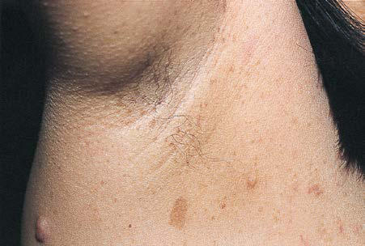

# Chapter 636: Neurocutaneous Syndromes

*Mustafa Sahin, Nicole Ullrich, Siddharth Srivastava, and Anna L. Pinto*

<!-- p.4645 -->

## 635.3  Tension-Type Headaches Andrew D. Hershey, Marielle Kabbouche, and Joanne Kacperski

Tension-type headaches (TTHs) may be common in children and ado lescents, with a prevalence in some studies as high as 48%, with those having a combination of migraine and TTH around 20%. Because of their mild to moderate nature, relative lack of associated symptoms, and lower degree of associated disability, they are often ignored or have minimal impact. The ICHD-3 subclassifies TTHs as infrequent (<12 headaches/year) (Table 635.13), frequent (1-15 headaches/month), and chronic (>15 headaches/month). They can further be separated into headaches with or without pericranial muscle tenderness. The classi fication of TTH can be likened to the opposite of migraine. Whereas migraines are typically moderate to severe, are focal in location, are worsened by physical activity or limit physical activity, and have a throbbing quality, TTHs are mild to moderate in severity, are diffuse in location, are not affected by activity (although the patient may not feel like being active), and are nonthrobbing (often described as a con stant pressure). TTH is much less frequently associated with nausea, photophobia, or phonophobia and is never associated with more than one of these at a time or with vomiting. TTH must be recurrent, but at least 10 headaches are required, and the duration can be 30 minutes to 7 days. Secondary headaches with other underlying etiologies must be ruled out.

Evaluation of patients with suspected TTHs requires a detailed headache history and complete general and neurologic examination. This is to establish the diagnosis and ensure exclusion of secondary etiologies. When secondary headaches are suspected, further directed evaluation is indicated.

Treatment of TTHs can require acute therapy to stop attacks, pre ventive therapy when frequent or chronic, and behavioral therapy. It is often suspected that there may be underlying psychologic stressors (hence, the misnomer as a stress headache), but this is often difficult to identify in children, and although it may be suspected by the parents, it cannot be confirmed in the child. Studies of and conclusive evidence to guide the treatment of TTH in children are lacking, but the same general principles and medications used in migraine can be applied to children with TTHs (see Chapter 635.1). Oftentimes, simple analge sics (ibuprofen or acetaminophen) can be effective for acute treatment. Flupirtine is a nonopioid analgesic that has been approved in Europe for the treatment of TTH in children as young as age 6 years but is not available in the United States. Amitriptyline has the most evidence of effective prevention of TTH; biobehavioral intervention, including biofeedback-assisted relaxation training and coping skills, can be use ful as well.

*Visit Elsevier eBooks+ at eBooks.Health.Elsevier.com** for Bibliography.*

Headache

#### **Table 635.13** Infrequent Episodic Tension-Type

| Category / Parameter | Clinical Details & Findings |
| --- | --- |
| **General** | A.	At least 10 episodes of headache occurring on <1 day/mo on; average (<12 days/yr) and fulfilling criteria B-D; B.	Lasting from 30 min to 7 days; C.	At least two of the following four characteristics:; 1.	 Bilateral location; 2.	 Pressing or tightening (nonpulsating) quality; 3.	 Mild or moderate intensity; 4.	 Not aggravated by routine physical activity, such as walking or; climbing stairs; D.	Both of the following:; 1.	 No nausea or vomiting; 2.	 No more than one of photophobia or phonophobia; E.	Not better accounted for by another ICHD-3 diagnosis; From Headache Classification Committee of the International Headache Society; (HIS). The International Classification of Headache Disorders, 3rd ed. Cephalalgia.; 2018;38(1):1–211, Table 10. |

The neurocutaneous syndromes include a heterogeneous group of dis orders characterized by abnormalities of both the integument and cen tral nervous system (CNS) of variable severity (Table 636.1). Many of the disorders are hereditary and believed to arise from a defect in dif ferentiation of the primitive ectoderm (nervous system, eyeball, retina, and skin). Disorders classified as neurocutaneous syndromes include neurofibromatosis type 1 (NF1), neurofibromatosis type 2 (NF2), tuberous sclerosis complex (TSC), Sturge-Weber syndrome (SWS), von Hippel-Lindau disease (VHL), PHACE (posterior fossa malfor mations, hemangiomas, arterial anomalies, coarctation of the aorta, cardiac defects, eye abnormalities) syndrome, ataxia-telangiectasia (AT), linear nevus syndrome, hypomelanosis of Ito, and incontinentia pigmenti.

## 636.1  Neurofibromatosis Nicole Ullrich

NF refers to a group of autosomal dominant genetic conditions that cause tumors to grown on nerves throughout the body.  The types of NF include neurofibromatosis type 1 (NF1) and all types of schwanno matosis (SWN), including NF2-related schwannomatosis (NF2-SWN, formerly called neurofibromatosis type 2, or NF2).

**CLINICAL MANIFESTATIONS AND DIAGNOSIS NF1** has an incidence of 1 in 2,500 live births and is caused by autoso mal dominant loss-of-function pathogenic variants in the *NF1* gene. Approximately 50% are inherited from an affected parent, and the other 50% result from a sporadic gene variant. The diagnostic criteria for NF1 were updated in 2021 by an international expert panel. The disease is clinically diagnosed when any two of the following mani festations are present: **(1)** Six or more café-au-lait macules (CALMs) >5 mm in greatest diameter in prepubertal individuals and >15 mm in greatest diameter in postpubertal individuals (Fig. 636.1). CALMs are the hallmark of neurofibromatosis and are present in almost 100% of patients. They are present at birth but increase in size, number, and pigmentation, especially during the first few years of life. The CALMs are scattered over the body surface, with predilection for the trunk and extremities. CALMs are not specific for NF1 and may be observed in other disorders (Table 636.2). **(2)** Axillary or inguinal freckling con sisting of multiple hyperpigmented areas 2-3 mm in diameter; at least one of the two pigmentary findings (café-au-lait macules or freck ling) must be bilateral (Fig. 636.2). Skinfold freckling usually appears between 3 and 5 years of age. The frequency of axillary and inguinal freckling is reported to be >80% by 6 years of age. **(3)** Two or more iris Lisch nodules, which are hamartomas located within the iris and are best identified by a slit-lamp examination, or two or more choroi dal abnormalities (Fig. 636.3). They are present in more than 74% of patients with NF1. The prevalence of Lisch nodules increases with age, from only 5% of children younger than 3 years of age, to 42% among children 3-4 years of age, and virtually 100% of adults older than 21 years of age. **(4)** Two or more neurofibromas or one plexiform neurofi broma. Neurofibromas are most visible on the skin, but they may occur on any peripheral nerve in the body, including along peripheral nerves and blood vessels and within viscera, including the gastrointestinal

*Mustafa Sahin, Nicole Ullrich, 
 Siddharth Srivastava, and Anna L. Pinto*

<!-- p.4647 -->

#### **Table 636.1** Genetic and Clinical Features Associated with Neurocutaneous Syndromes

| Category / Parameter | Clinical Details & Findings |
| --- | --- |
| **CLINICAL FEATURES** | Tuberous sclerosis; complex; TSC1 (tuberous sclerosis; 1; hamartin); TSC2 (tuberous sclerosis; 2; tuberin); Autosomal dominant; Angiofibromas, hypomelanotic macules, shagreen patches,; ungual fibromas, cortical dysplasias, subependymal giant; cell astrocytomas, subependymal nodules, intellectual; disability, epilepsy including infantile spasms, autism spectrum; disorder, retinal hamartomas, cardiac rhabdomyomas,; lymphangioleiomyomatosis, renal angiomyolipomas; Neurofibromatosis; type 1; NF1 (neurofibromin); Autosomal dominant; Schwannomatosis; Autosomal; dominant; NF2-related; schwannomatosis |
| **NF2** | Vestibular schwannoma, meningioma, ependymoma, schwannoma,; juvenile subcapsular or cortical cataract, retinal hamartoma,; epiretinal membrane, affected parent, NF2 pathogenic variant in; at least two distinct tumors; (formerly called NF2); Non-NF2-related; schwannomatosis; Two or more schwannomas or hybrid nerve sheath tumors AND; pathogenic variant identified; no vestibular schwannomas identified; SMARCB1-related; schwannomatosis |
| **SMARCB1** | LZTR1-related; schwannomatosis |
| **LZTR1** | 22q-related; schwannomatosis; LOH of chromosome 22; Schwannomatosis; NOS (not otherwise; specified):; For those who have not; had genetic testing; Schwannomatosis; NEC (not elsewhere; classified):; For those in whom; genetic testing of; blood/saliva and; tumors failed to detect; a pathogenic variant; Von Hippel-Lindau; VHL (von Hippel-Lindau; tumor suppressor); Autosomal dominant; Cerebellar hemangioblastomas, retinal angiomas, endolymphatic; sac tumors, pancreatic neuroendocrine tumors, renal cysts, renal; cell carcinomas, pheochromocytomas; Linear nevus; sebaceous; HRAS (HRas proto-; oncogene, GTPase); KRAS (KRAS proto-; oncogene, GTPase); NRAS (neuroblastoma; RAS viral oncogene; homolog); Somatic mosaicism; Linear sebaceous nevus, hemimegalencephaly, ventriculomegaly,; intellectual disability, epilepsy, ocular defects (e.g., strabismus),; cardiac defects (e.g., coarctation of the aorta), urogenital defects; (e.g., horseshoe kidney), skeletal defects (e.g., fibrous dysplasia) |
| **PHACE** | Unknown; Posterior fossa malformations, hemangiomas, arterial lesions (e.g.,; dysplasia of cerebral arteries), cardiac defects (e.g., coarctation of; the aorta), ocular defects (e.g., microphthalmia), ventral defects; (e.g., sternal clefting); Incontinentia; pigmenti; IKBKG (inhibitor of; kappa B kinase; gamma); X-linked dominant; Distinctive skin lesion appearing in four stages (bullous, verrucous,; pigmentary, atretic), alopecia, dental anomalies (e.g., hypodontia),; intellectual disability, epilepsy, ocular defects (e.g., retinal; neovascularization), nail defects (e.g., dystrophic nails) |

tract. These lesions appear characteristically during adolescence or pregnancy, suggesting a hormonal influence. They are usually small, rubbery lesions with a slight purplish discoloration of the overlying skin. Plexiform neurofibromas are typically congenital and result from diffuse thickening of nerve trunks and surrounding soft tissues. The skin overlying a plexiform neurofibroma may be coarse and associated

with hyperpigmentation. Plexiform neurofibromas may produce over growth of an extremity and a deformity of the corresponding bone. **(5)** A distinctive osseous lesion such as sphenoid dysplasia (which may cause pulsating exophthalmos), anterolateral bowing of tibia (tibial dysplasia), or pseudarthrosis of a long bone. **(6)** Optic pathway glio mas are present in approximately 15–20% of individuals with NF1;

<!-- p.4648 -->
Café-Au-Lait Macules

#### **Table 636.2** Diseases Associated with Multiple

| Category / Parameter | Clinical Details & Findings |
| --- | --- |
| **MAJOR FEATURES** | Ataxia telangiectasia; Progressive ataxia, lymphoreticular; malignancy; Bannayan-Riley-Ruvalcaba; syndrome; Macrosomia, megalencephaly,; lipomas, intestinal polyps; Basal cell nevus syndrome; Multiple basal cell epitheliomas, jaw; cysts, skeletal anomalies; Bloom syndrome; Short stature, photosensitivity,; chromosome breaks, malignancy; Fanconi anemia; Limb anomalies, renal anomalies,; pancytopenia; Gaucher disease; Jewish predilection, ataxia, mental; retardation; Hunter syndrome; Thickened skin, coarse facies, skin; papules, joint contractures; Jaffe-Campanacci; syndrome; Fibromas of long bones,; hypogonadism, mental retardation,; ocular/cardiac anomalies; Legius syndrome; Axillary freckling, macrocephaly, a; Noonan-like facial dysmorphism,; lipomas; Maffucci syndrome; Venous malformations, enchondromas; McCune-Albright syndrome; Polyostotic fibrous dysplasia,; precocious puberty; Multiple lentigines; syndrome; Multiple lentigines, hypertelorism,; pulmonic stenosis; Multiple mucosal neuroma; syndrome; Mucosal neuromas, thyroid carcinoma,; pheochromocytoma, parathyroid; adenoma, dysautonomia; Neurofibromatosis type 1; Neurofibromas, optic pathway; glioma, central nervous system; tumors, iris hamartomas, axillary; freckles, skeletal anomalies, learning; disabilities; Neurofibromatosis; type 2-related; schwannomatosis; Vestibular schwannoma, meningioma,; subcapsular cataracts, skin plexiform; schwannomas, ependymoma; Schwannomatosis; Multiple schwannomas or hybrid; nerve sheath tumors; subtypes; distinguished by the molecular; phenotype of the tumor.  No; vestibular schwannomas present.; Russell-Silver syndrome; Short stature, asymmetry, limb; anomalies; Tuberous sclerosis; White macules, multiple hamartomas,; central nervous system anomalies; Watson syndrome; Pulmonic stenosis, axillary freckles,; low intelligence; From Marcoux DA, Duran-McKinster C, Baselga E, et al. Pigmentary abnormalities. In:; Schachner LA, Hansen RC, eds. Pediatric Dermatology, 4th ed. Philadelphia: Mosby;; 2011: Table 10-2. |

however, only ∼30% of these are clinically symptomatic and require tumor-directed therapy. They are the most frequently observed CNS tumor in NF1. Because of visual acuity compromise, it is recom mended that all children with NF1 undergo at least annual ophthal mologic examinations, or more frequent ones if there is a concern. The most common time to develop symptoms is between the ages of 2 and 6 years; they manifest as a change in visual acuity, a change in the visual fields, or pallor of the optic nerve. Extension into the hypothalamus can lead to precocious puberty. The brain MRI findings of an optic glioma include diffuse thickening, localized enlargement, or a distinct focal mass originating from the optic nerve or chiasm (Fig. 636.4). **(7)** A parent with NF1 whose diagnosis was based on the aforementioned criteria. **(8)** A pathogenic *NF1* gene variant.  It is important to note that genetic testing is not required to make a diagnosis of NF1, but it may allow for an earlier diagnosis.  In addition, presence of a genetic vari ant *alone* is not sufficient to diagnose NF1; a second diagnostic feature is required.

Children with NF1 are susceptible to **neurologic complications**. MRI studies of selected children have shown abnormal hyperintense T2-weighted signals in the optic tracts, brainstem, globus pallidus, thalamus, internal capsule, and cerebellum (Fig. 636.5). These signals, **unidentified bright objects** or focal areas of signal abnormality (FASI), tend to disappear with age; most have disappeared by 30 years of age. It is unclear what the unidentified bright objects represent pathologically, and there is disagreement as to the relationship between the presence and number of unidentified bright objects and the occurrence of learn ing disabilities, attention-deficit disorders, behavioral and psychosocial problems, and abnormalities of speech among affected children. There fore imaging studies such as brain MRIs should be reserved for patients with clinical symptoms only.

One of the most common complications is a learning disabil ity affecting more than half of individuals with NF1. Seizures are observed in approximately 8% of NF1 patients. The cerebral ves sels may develop aneurysms or stenosis consistent with moyamoya syndrome (see Chapter 641). Neurologic sequelae of these vascular abnormalities include transient cerebrovascular ischemic attacks, hemiparesis, and cognitive defects. Precocious puberty may become evident in the presence or absence of lesions of the optic pathway tumors. Malignant peripheral nerve sheath tumors are in the family of aggressive sarcomas and occur either de novo or as the result of malignant degeneration of an existing plexiform neurofibroma. The lifetime risk is 8–13%. Additionally, the incidence of pheochromo cytoma, rhabdomyosarcoma, leukemia, and Wilms tumor is higher than in the general population. Scoliosis is a common complication found in approximately 10% of the patients. Patients with NF1 are at risk for hypertension, which may be present in isolation or result from renal vascular stenosis or a pheochromocytoma.

**Mosaic NF1** (also called *segmental NF1*) results from a pathogenic variant that occurs after conception, leading to a mixture of cells with and without the gene variant. The manifestations are therefore limited to one or more body segments secondary to somatic (or gonadal) vari ants expressed in those locations. Lesions may be unilateral or bilateral, asymmetric or symmetric, and confined to a narrow band or a single quadrant. Neurologic manifestations are rare but have been reported.

**Fig. 636.1** Neurofibromatosis type 1 (NF1). The presence of six or more café-au-lait (CAL) spots larger than 0.5 cm in diameter in children and 1.5 cm in adolescents suggests the possibility of NF1, although having CAL spots alone does not allow for definitive diagnosis. (From Paller AS, Mancini AJ. Hurwitz Clinical Pediatric Dermatology, 5th ed. Philadelphia: Elsevier; 2016, Fig. 11-44.)

<!-- p.4649 -->
**MANAGEMENT** Because of the diverse and unpredictable complications associated with NF1, close multidisciplinary follow-up is necessary. Patients with NF1 should have regular clinical assessments at least yearly, focusing the history and examination on the potential problems for which they are at increased risk. These assessments include yearly ophthalmologic examination, neurologic assessment, blood pressure monitoring, and scoliosis evaluation. Neuropsychologic and educational testing should be considered as needed. The National Institutes of Health (NIH) Con sensus Development Conference has advised against routine imaging studies of the brain and optic tracts because treatment in these *asymp tomatic* NF1 children is rarely required. However, all symptomatic cases (i.e., those with changes in visual acuity, optic pallor, proptosis, precocious puberty) should undergo MR imaging. Selumetinib, an oral inhibitor of mitogen-activated protein kinase kinase (MEK) 1 and 2, has been demonstrated in children (≥2 years of age) with NF1-related inoperable plexiform neurofibromas to be effective in inducing partial responses and reducing tumor progression.

**GENETIC COUNSELING** Although NF1 is an autosomal dominant disorder, more than half the cases are sporadic, representing de novo pathogenic variants. The *NF1* gene on chromosome region 17q11.2 encodes for a protein also known as *neurofibromin*. Neurofibromin acts as an inhibitor of the oncogene Ras (Fig. 636.6). The diagnosis of NF1 is based on the clinical features; molecular testing for the *NF1* gene variants is available and now is included as one of the diagnostic criteria. Some scenarios in which genetic testing is particularly helpful include patients who meet only one of the criteria for clinical diagnosis, those with unusually severe disease, and those seeking prenatal/ preimplantation diagnosis.

An international consensus group of NF experts updated the diagnos tic criteria for neurofibromatosis type 2 and **schwannomatosis** (SWN). SWN is the umbrella term used to describe the group of overlapping conditions in which a patient has multiple schwannomas. The criteria also address the discovery of the genes involved, assists in distinguishing the types of neurofibromatosis and SWN using classification according to

**Fig. 636.2** Neurofibromatosis. Axillary freckling (Crowe’s sign) is a pathognomonic sign. (From Habif TP, ed. Clinical Dermatology, 4th ed. Philadelphia: Mosby; 2004: Fig. 26-11.)

**Fig. 636.3** Neurofibromatosis type 1 (NF1). Pigmented hamartomas of the iris (Lisch nodules). (From Zitelli BJ, McIntire S, Nowalk AJ, eds. Zitelli and Davis’ Atlas of Pediatric Physical Diagnosis, 6th ed. Philadel phia: Mosby; 2012: Fig. 15-9.)

**Fig. 636.4** Optic glioma. Sagittal T1-weighted MRI scan of a patient with NF1 shows thickening of the optic nerve (arrow).

**Fig. 636.5** T2-weighted MRI scan of a patient with NF1. Note the high-signal areas (unidentified bright objects or focal areas of signal abnormality [FASI]) in the basal ganglia (arrows).

<!-- p.4650 -->
Schwannomatosis (Formerly Called Neurofibromatosis Type 2 [NF2])

#### **Table 636.3** Diagnostic Criteria for NF2-Related

| Category / Parameter | Clinical Details & Findings |
| --- | --- |
| **General** | A diagnosis of NF2-related schwannomatosis can be made when a; patient has one of the following:; • Bilateral vestibular schwannomas (VS); • An identical NF2 pathogenic variant in at least two anatomically; distinct NF2-related tumors (schwannoma, meningioma, and/or; ependymoma); Either two major OR one major and two minor criteria are present; as follows: |
| **MAJOR CRITERIA** | • Unilateral vestibular schwannoma; • First-degree relative other than a sibling with NF2-related; schwannomatosis; • Two or more meningiomas; • NF2 pathogenic variant in an unaffected tissue, such as blood |
| **MINOR CRITERIA** | Can count more than one of a type (e.g. two schwannomas = two; minor criteria); • Ependymoma; • Schwannoma (note that if the major criterion is a unilateral VS, at; least one schwannoma must be dermal in location); Can count only once; • Juvenile subcapsular or cortical cataract; • Retinal hamartoma; • Epiretinal membrane in a person aged less than 40 years; • Single meningioma (meningioma cannot be used as both a major; and a minor criteria) |

the pathogenic variant identified, and minimizes the misdiagnosis with NF1. Genetic testing for the variants involved in all subtypes of SWN is available and should be completed whenever possible for a patient sus pected of having this diagnosis. This can be performed on a blood or saliva sample, but often requires tumor tissue. There are several key updates to the former NF2 diagnostic criteria: *NF2* pathologic variant added; clari fication of first-degree relative with “other than sibling”; cataract clarified as juvenile cataract; retinal hamartoma added as a criterion; glioma and neurofibroma removed; and ependymoma added (Table 636.3).

Genetic testing identifies pathogenic variants in the *NF2* gene in 66-90% of individuals with *NF2-*schwannomatosis (*NF2-*SWN), which has an incidence of 1:25,000 worldwide. The *NF2* gene (which codes for a protein known as merlin or schwannomin) is located on chromosome 22q1.11. Table 636.4 notes the frequency of lesions in *NF2*. Testing is *not* required for the diagnosis and it remains possi ble to diagnose *NF2*-SWN based on clinical criteria. Genetic testing *is* required for the diagnosis of a specific type of schwannomatosis (except *NF2*-related or NOS). Excluding *NF2-*SWN, the other types of SWN affect 1:70,000 individuals. Genetic testing alone is not suf ficient to make a diagnosis and there must also be a clinical feature. In most cases, tissue from schwannoma or hybrid nerve sheath tumor is required to diagnose the type of SWN and to distinguish between *LZTR1-*related SWN, *SMARCB1*-related SWN, *22q*-related SWN and SWN NOS/NEC.

Individuals with *NF2-*SWN may present with tinnitus, hearing loss, facial weakness, headache, and gait instability. Although this may pres ent in childhood, VS are more likely to appear in the second and third decades of life. In the pediatric age group, café au lait macules and cuta neous plexiform schwannomas are the most common presentation and can be confused with the skin findings in NF1.

Workup should include ophthalmologic evaluation (assessing for subcapsular or cortical cataracts), MRI of the brain and spine, and audiology evaluation. These are all important components of ongoing surveillance and management of individuals with sus pected or confirmed *NF2*-related SWN. The goal is to preserve hearing related to VS. Other forms of SWN should be suspected when an individual has two or more schwannomas in the absence

TNFR

IKKα

IKKβ

IKBKG* Incontinentia Pigmenti

Canonical NF-KB signaling

Sturge-Weber

syndrome

Neurofibromatosis

NF1* RAS*

BRAF

MEK1/2

ERK1/2

Linear nevus sebaceous syndrome

PI3K

AKT

Tuberous sclerosis

complex

TSC2*

TSC1*

TBC1D7

RHEB

mTOR

Von Hippel-Lindau

Syndrome

VHL* HIF1α S6K 4E-BP1

Proliferation

Survival

Angiogenesis Cell growth Protein synthesis

Cell growth Protein synthesis

IL1R TLR ETR

GNAQ*/11

RTK GFRs

**Fig. 636.6** Schematic representation of the cellular pathways affected by pathogenic variants in the genes associated with neurocutaneous disor ders, such as NF1, TSC, and SWS. The asterisks denote genes with associated syndromes discussed in the chapter.

<!-- p.4651 -->
of bilateral vestibular schwannomas. Evaluation also includes imaging of the brain and spine to exclude VS and to distinguish from *NF2*-related SWN.

**Legius syndrome** (caused by *SPRED1* pathogenic variants) is an autosomal dominant disorder with skin findings that resemble and may be hard to distinguish from NF1 in younger individuals. Persons with Legius syndrome present with multiple CALMs and macro cephaly, with and without skinfold freckling. However, other typical features of NF1, such as Lisch nodules, neurofibromas, optic nerve gliomas, long bone dysplasia, plexiform neurofibromas, and malig nant peripheral nerve sheath tumors, are not seen in individuals with *SPRED1* variants.

*Visit Elsevier eBooks+ at eBooks.Health.Elsevier.com** for Bibliography.*

## 636.2  Tuberous Sclerosis Siddharth Srivastava and Mustafa Sahin

Tuberous sclerosis complex (TSC) is a multisystem disease character ized by an autosomal dominant mode of inheritance, variable expres sivity, and a prevalence of 1 in 6,000-10,000 newborns. Spontaneous pathogenic variants occur in 65% of the cases. Molecular genetic stud ies have identified two foci for TSC: the *TSC1* gene (located on chro mosome 9q34) and the *TSC2* gene (located on chromosome 16p13). The *TSC1* gene encodes a protein called *hamartin,* and the *TSC2* gene encodes a protein called *tuberin*. Within a cell, these two molecules form a complex along with a third protein, TBC1D7 (Tre2-Bub2- Cdc16 1 domain family, member 7). Consequently, a pathogenic vari ant in either the *TSC1* gene or the *TSC2* gene results in a similar disease in patients, though individuals with *TSC2* variants tend to be more severely affected.

Tuberin and hamartin are involved in a key pathway in the cell that regulates protein synthesis and cell size (see Fig. 636.6). One of the ways

cells regulate their growth is by controlling the rate of protein synthe sis. A protein called *mechanistic target of rapamycin* (mTOR) is one of the master regulators of cell growth (mTOR has additional roles in the CNS, where it helps regulate neuronal development and synaptic plas ticity). mTOR, in turn, is controlled by Ras homolog enriched in brain (RHEB), a small cytoplasmic guanosine triphosphatase. When RHEB is activated, the protein synthesis machinery is turned on, most likely via mTOR signaling, and the cell grows. Under normal conditions, the tuberin/hamartin complex keeps RHEB in an inactive state. However, in TSC, there is disinhibition of RHEB and subsequent overactivation of the mTOR pathway. Accordingly, the *TSC1* and *TSC2* genes can be considered tumor-suppressor genes. The loss of either tuberin or hamartin protein results in the formation of numerous benign tumors (hamartomas).

TSC is an extremely heterogeneous disease with a wide clinical spectrum varying from severe intellectual disability and intractable epilepsy to normal intelligence and a lack of seizures. This variation is often seen within the same family, that is, with individuals within a family carrying the same variant. The disease affects many organ sys tems other than the skin and brain, including the heart, kidney, eyes, lungs, and bone (Fig. 636.7).

**CLINICAL MANIFESTATIONS AND DIAGNOSIS** Definite TSC is diagnosed when at least two major or one major plus two minor features are present (Tables 636.5 and 636.6 list the major and minor features). In addition, carrying a pathogenic vari ant in *TSC1* or *TSC2* is sufficient for the diagnosis of TSC.

The hallmark of TSC is the involvement of the CNS. The charac teristic brain lesion is a cortical tuber (Fig. 636.8). Brain MRI is the best way of identifying cortical tubers, which can form before birth.

Subependymal nodules are lesions found along the wall of the lateral ventricles, where they undergo calcification and project into the ven tricular cavity, producing a candle-dripping appearance. These lesions do not cause any problems; however, in 5–10% of cases, these benign lesions can grow into **subependymal giant cell astrocytomas (SEGAs)**. These tumors can grow and block the circulation of cerebrospinal fluid around the brain and cause hydrocephalus, which requires immediate neurosurgical intervention. Thus it is recommended that all asymptom atic TSC patients undergo brain MRI every 1-3 years to monitor for new occurrences of SEGA. Patients with large or growing SEGAs, or with SEGAs causing ventricular enlargement without other manifestations, should undergo MRI scans more frequently, and the patients and their families should be educated regarding the potential of new symptoms caused by increased intracranial pressure. Surgical resection should be performed for acutely symptomatic SEGA. For growing but otherwise asymptomatic SEGAs, either surgical resection or medical treatment with an mTOR inhibitor (sirolimus, everolimus) may be used. Treat ment with everolimus can be effective in slowing the growth or even reducing the size of SEGAs. Everolimus is also effective in treating renal angiomyolipomas. Sirolimus is also effective in treating lymphangi oleiomyomatosis, renal angiomyolipomas, and cardiac rhabdomyomas.

The most common neurologic manifestations of TSC are epilepsy, intellectual disability, and autism spectrum disorder. TSC may pres ent during infancy with infantile spasms and a hypsarrhythmic elec troencephalogram pattern. However, it is important to remember that TSC patients can have infantile spasms without hypsarrhyth mia. The seizures may be difficult to control, and at a later age, they may develop into other seizure types such as focal-onset seizures or generalized myoclonic seizures (see Chapter 633). Vigabatrin is the first-line therapy for infantile spasms. Adrenocorticotropic hormone (ACTH) or prednisolone can be used if treatment with vigabatrin fails. Anticonvulsant therapy for other seizure types in TSC should generally follow that of other epilepsies, and epilepsy surgery can be considered for medically refractory TSC patients. Everolimus (adjunc tive) has received U.S. Food and Drug Administration (FDA) approval for treatment-refractory focal seizures in TSC. Studies on prevention of epilepsy with preemptive treatment with vigabatrin have yielded mixed results so far. However, it is recommended that infants with TSC should undergo baseline EEG to enable early detection and treatment

Neurofibromatosis Type 2-Related Schwannomatosis*

#### **Table 636.4** Frequency of Lesions Associated with

| Category / Parameter | Clinical Details & Findings |
| --- | --- |
| **NEUROLOGIC LESIONS** | Bilateral vestibular schwannomas; 90–95%; Other cranial nerve; schwannomas; 24–51%; Meningioma; 45–58%; Spinal schwannomas; 63–90%; Spinal ependymoma; 20%; Peripheral neuropathy; Up to 66% |
| **OPHTHALMOLOGIC LESIONS** | Juvenile subcapsular or cortical; cataract; 60–81%; Epiretinal membranes (age less; than 40 years); 12–40%; Retinal hamartomas; 6–22% |
| **CUTANEOUS LESIONS** | Cutaneous schwannomas; 59–68%; Subcutaneous tumors; 43–48%; Intradermal tumors; Rare; *Formerly known as NF2.; Modified from Asthagiri AR, Parry DM, Butman JA, et al. Neurofibromatosis type 2.; Lancet. 2009;373:1974–1984, Table 1. |

<!-- p.4652 -->

<!-- p.4653 -->
of seizures, and this should be repeated every 6 weeks until 12 months of age. In addition to epilepsy, about 90% of individuals with TSC have a spectrum of cognitive, behavioral, psychiatric, and academic impair ments termed *tuberous sclerosis–associated neuropsychiatric disorders (TANDs),* which include intellectual disability, autism spectrum dis order, attention-deficit/hyperactivity disorder, anxiety, and depression. About 45% of individuals with TSC have intellectual disability, and up to 25-50% have autism spectrum disorder.

## Skin Lesions More than 90% of patients show the typical hypomelanotic macules

Visualization of the hypomelanotic macule is enhanced by using a Wood ultraviolet lamp (see Chapter 694). To count as a major feature, at least three hypomelanotic macules must be present (see Fig. 636.7). Facial angiofibromas develop between 4 and 6 years of age; they appear as tiny red nodules over the nose and cheeks and are sometimes confused with acne (see Fig. 636.7). Later, they enlarge, coalesce, and assume a fleshy appearance. Topical rapamycin is approved for treatment of facial angio fibromas. A shagreen patch is also characteristic of TSC and consists of a roughened, raised lesion with an orange-peel consistency located primarily in the lumbosacral region (see Fig. 636.7). Forehead fibrous plaques usually occur on one side of the forehead. They are charac teristically raised, yellow-brown or flesh-colored, and soft to hard in consistency. Forehead plaques are histologically similar to facial angiofi bromas, though the former can appear at any point. During adolescence or later, small fibromas or nodules of skin may form around fingernails

Complex

#### **Table 636.5** Major Features of Tuberous Sclerosis

| Category / Parameter | Clinical Details & Findings |
| --- | --- |
| **General** | Cortical dysplasias (including tubers and cerebral white matter; migration lines); Subependymal nodules; Subependymal giant cell astrocytoma; Facial angiofibromas (≥3) or forehead plaque; Ungual fibromas (≥2); Hypomelanotic macules (≥3, ≥5 mm in diameter); Shagreen patch; Multiple retinal nodular hamartomas; Cardiac rhabdomyoma; Renal angiomyolipoma; Pulmonary lymphangioleiomyomatosis |

Complex

#### **Table 636.6** Minor Features of Tuberous Sclerosis

| Category / Parameter | Clinical Details & Findings |
| --- | --- |
| **General** | Dental enamel pits (>3); Intraoral fibromas (≥2); Retinal achromic patch; Confetti skin lesions; Nonrenal hamartomas; Multiple renal cysts |

B A

**Fig. 636.8** Tuberous sclerosis. A, CT scan with subependymal calci fications characteristic of tuberous sclerosis. B, The MRI demonstrates multiple subependymal nodules in the same patient (arrow). Parenchy mal tubers are also visible on both the CT and the MRI scan as low- density areas in the brain parenchyma.

A B C

D

RVOT

Tumour

TV

RA

AOV

LA

PV

PA

E F

**Fig. 636.7** Dermatologic, cardiac, and pulmonary manifestations of tuberous sclerosis. A, Hypomelanotic macules. B, Facial angiofibromas. C, Shagreen patch. D, Hyperechoic rhabdomyoma detected by echocardiography. E, Retinal hamartoma. F, Lymphangioleiomyomatosis. (From Curatolo P, Bom bardieri R, Jozwiak S. Tuberous sclerosis. Lancet. 2008;372:657–668, Fig. 7.)

<!-- p.4654 -->
**Other Organ Involvement** Retinal lesions consist of two types: hamartomas (elevated mulberry lesions or plaquelike lesions (Fig. 636.10) and white depigmented patches (similar to the hypopigmented skin lesions). Approximately 50% of children with TSC have cardiac rhabdomyomas, which may be detected in the fetus by an echocardiogram, usually by 20-30 weeks of gestation. The rhabdomyomas may be numerous and located through out the ventricular myocardium, and although they can cause conges tive heart failure and arrhythmias in a minority of patients, they tend to slowly resolve spontaneously. In 75–80% of patients older than 10 years of age, the kidneys display angiomyolipomas that are usually benign tumors. Angiomyolipomas begin in childhood in many individuals with TSC, but they may not be problematic until young adulthood. By the third decade of life, they may cause lumbar pain and hematuria from slow bleeding, and rarely they may result in sudden retroperi toneal bleeding. Embolization followed by corticosteroids to alleviate postembolization syndrome is first-line therapy for angiomyolipoma presenting with acute hemorrhage. Nephrectomy should be avoided as a way of maintaining renal function, because lesions can be numerous and bilateral. For asymptomatic, growing angiomyolipomas measur ing larger than 3 cm in diameter, an mTOR inhibitor, everolimus, is approved for treatment by the FDA. Selective embolization or kidneysparing resection is an alternative therapy for asymptomatic angio myolipoma. Single or multiple renal cysts are also commonly present in TSC; renal cell carcinoma, on the other hand, is rare. Lymphan gioleiomyomatosis is the classic pulmonary lesion in TSC and only affects women, beginning in late adolescence (≥15 years). Sirolimus is approved by the FDA for lymphangioleiomyomatosis. Topical rapamy cin should be considered for treatment of facial angiofibromas.

Diagnosis of TSC relies on a high index of suspicion, especially when assessing a child with infantile spasms. A careful evaluation for the typical skin and retinal lesions should be completed in all patients with a seizure disorder or autism spectrum disorder. Brain MRI can confirm the clinical diagnosis in many cases. Genetic testing for patho genic *TSC1* and *TSC2* variants is available and should be considered when the individual patient does not meet all the clinical criteria, or in order to provide molecular confirmation of a clinical diagnosis. Prena tal testing may be offered when a known pathogenic *TSC1/TSC2* vari ant exists in that family.

**MANAGEMENT** The following are recommended for routine follow-up of individuals with TSC in addition to physical examination: brain MRI every 1-3 years, abdominal MRI to evaluate the kidneys every 1-3 years; echocar diogram every 1-3 years in patients with cardiac rhabdomyomas until there is regression of the rhabdomyomas; electrocardiogram every 3-5 years; high-resolution chest CT every 5-10 years in females older than 18 years; dental examination twice a year; skin examinations once a year; detailed ophthalmic examination once a year in patients with vision con cerns or retinal lesions (sooner if they are receiving treatment with viga batrin); neurodevelopmental testing at the beginning of first grade or sooner based on concerns; and screening for TAND at each clinic visit. Based on the complications of the disease, additional follow-up testing may be required for each individual. Symptoms and signs of increased intracranial pressure suggest obstruction of the foramen of Monro by a SEGA and warrant immediate investigation and surgical intervention.

*Visit Elsevier eBooks+ at eBooks.Health.Elsevier.com** for Bibliography.*

## 636.3  Sturge-Weber Syndrome Anna L. Pinto

Sturge-Weber syndrome (SWS) is a segmental vascular neurocutane ous disorder with a constellation of symptoms and signs characterized by capillary malformation in the face (port-wine birthmark [PWB]) and brain (leptomeninges), as well as abnormal blood vessels of the eye leading to glaucoma. Low flow of the leptomeningeal capillary malfor mation appears to result in a chronic hypoxic state leading to cortical atrophy and calcifications. Patients present with seizures, hemiparesis, strokelike episodes, headaches, and developmental delay. Approxi mately 1 in 20,000-50,000 live births are affected with SWS.

**ETIOLOGY** The nonsyndromic PWBs and SWS are caused by a pathologic somatic single-nucleotide variant (c.548G→A, p.Arg183Gln) in the *GNAQ* gene (see Fig. 636.6). Brain tissue from SWS patients also demonstrates the same change in the *GNAQ* gene. These results strongly suggest that SWS occurs as a result of a *mosaic pathologic genetic variant* in *GNAQ*.

The *GNAQ* p.R183Q variant is enriched in endothelial cells in SWS brain lesions, thereby revealing endothelial cells as a source of aber rant Gαq signaling. The timing of the somatic variant in *GNAQ* during development likely affects the clinical phenotype. Mosaic-activating *GNA11* and *GNB2* gene variants have been described in atypical SWS cases. The aberrant G-protein signaling provides a molecular basis to explain SWS lesions.

**CLINICAL MANIFESTATIONS** Facial PWBs are present at birth, but not all are associated with SWS (Table 636.7). In fact, the overall incidence of SWS has been reported to be 20–40% in those with a PWB involving the forehead and upper eyelid. High-risk PWB for SWS includes hemifacial, median, and fore head phenotypes (Fig. 636.11), along with large segmental PWB. The PWB tends to be unilateral and ipsilateral to the brain involvement (Fig. 636.12). The capillary malformation may also be evident over the lower face and trunk and in the mucosa of the mouth and phar ynx. Buphthalmos and glaucoma of the ipsilateral eye are common

**Fig. 636.9** Periungual fibroma in a patient with tuberous sclerosis complex (TSC).

**Fig. 636.10** A mulberry lesion involving the superior part of the optic nerve in a patient with tuberous sclerosis. (From Yanoff M, Sassani JW. Ocular Pathology, 7th ed. Philadelphia: WB Saunders; 2015: Fig. 2-7.)

<!-- p.4655 -->

<!-- p.4656 -->
complications. Seizures occur in 75–80% of all SWS patients and in over 90% of those with bilateral brain involvement. Early onset of seizures will likely occur during the first year of life but rarely during the first month of life, and they are typically focal clonic and contra lateral to the side of the facial PWB. They may become refractory to anticonvulsants, and status epilepticus is often associated. One third of children with intractable epilepsy associated with SWS experience episodes of *prolonged postictal deficits,* which would last from 1 day to a few years, until recovering back to baseline. Some patients also develop slowly progressive hemiparesis. Transient strokelike epi sodes or visual field defects persisting for several days and unrelated to seizure activity are common and probably result from thrombosis of cortical veins in the affected region. Although neurodevelopment appears to be normal in the first year of life, intellectual disability

or severe learning disabilities are present in at least 50% of patients in later childhood, probably the result of intractable epilepsy and increasing cerebral atrophy. The degree of visual field defect, hemipa resis, seizure frequency, and cognitive function (based on age-group: infant/preschooler, child, and adult) can be rated using a validated SWS neurologic rating system.

**DIAGNOSIS** Brain MRI with contrast is the imaging modality of choice for dem onstrating the extension of pial capillary malformation in SWS (Fig. 636.13). White matter abnormalities are common and are thought to be a result of chronic hypoxia. Often, atrophy is noted ipsilateral to the leptomeningeal capillary malformation. Calcifications can be seen best with a head CT (Fig. 636.14). The choroid plexus is frequently enlarged, and the degree of plexal enlargement shows a positive cor relation with the extent of the leptomeningeal capillary malformation. Positron emission tomography using 18 F-deoxyglucose has been used to study cerebral metabolism in patients with SWS, and it has been useful for the surgical planning and prognosis. Ophthalmologic evalu ation examining for glaucoma is also necessary and is a lifelong con cern because ocular complications can occur at any moment during a lifetime. Based on the involvement of the brain and the face, there are three types of SWS in the Roach Scale:

Forehead PWS phenotype

Median PWS phenotype

Hemifacial PWS phenotype

#### **Table 636.7** Port-Wine Birthmark–Associated Syndromes

| Category / Parameter | Clinical Details & Findings |
| --- | --- |
| **General** | Sturge-Weber syndrome; Klippel-Trénaunay syndrome; Parkes Weber syndrome; Phakomatosis pigmentovascularis; Proteus syndrome; CLOVES syndrome; Macrocephaly–capillary malformation (M-CM) syndrome; Capillary malformation–arteriovenous malformation (CM-AVM); syndrome; Cobb syndrome; Bannayan-Riley-Ruvalcaba syndrome; Beckwith-Wiedemann syndrome; Von Hippel-Lindau disease; Rubinstein-Taybi syndrome; Wyburn-Mason syndrome; Roberts syndrome; Coat disease; Nonsyndromic, idiopathic, neurologically asymptomatic; CLOVES, Congenital lipomatous overgrowth, vascular malformations, epidermal nevi,; and scoliosis/skeletal and spinal anomalies.; From Paller AS, Mancini AJ. Hurwitz Clinical Pediatric Dermatology, 5th ed.; Philadelphia: Elsevier; 2016: Box 12-2. |

**Fig. 636.11** Port-wine stain (birthmark) phenotypes associated with highest risk of Sturge-Weber syndrome. (From Zallmann M, Mackay MT, Leventer RJ, et al. Retrospective review of screening for Sturge-Weber syndrome with brain magnetic resonance imaging and electroencepha lography in infants with high-risk port-wine stains. Pediatr Dermatol. 2018;35:575–581, Fig.1, p. 576.)

**Fig. 636.12** Port-wine birthmark involving both the V1 and V2 der matomes. (Courtesy Dr. Anne W. Lucky, Cincinnati Children’s Hospital.)

**Fig. 636.13** Gadolinium-enhanced axial T1 fluid-attenuated inversion recovery (FLAIR) images of a 15-mo-old with Sturge-Weber syndrome show leptomeningeal enhancement in the left hemisphere.

<!-- p.4657 -->
Type I: Classic facial and leptomeningeal capillary malformation

present; often with glaucoma. Type II: Facial capillary malformation alone (no CNS involvement);

may have glaucoma. Type III: Isolated leptomeningeal capillary malformation; usually no

glaucoma. In addition, there is an overlap syndrome between SWS and **Klippel- Trénaunay syndrome** (mixed capillary, venous, or lymphatic malfor mations involving bone and muscle in one limb).

**MANAGEMENT** The management of SWS is primarily symptomatic and multidisciplinary but not well studied by prospective studies. Treatment is aimed at seizure control, relief of headaches, and prevention of strokelike episodes, as well as monitoring of glaucoma and laser therapy for the cutaneous capillary malformations. Most infants with SWS brain involvement have seizure onset by 2 years of age. Presymptomatic treatment in high-risk babies may prevent or delay seizure onset. For patients with well-controlled sei zures and normal or near-normal development, management consists of anticonvulsants and surveillance for complications, including glaucoma and behavioral abnormalities. If the seizures are refractory to anticonvul sant therapy, especially in infancy and the first 1-2 years and arise from primarily one hemisphere, most medical centers advise a hemispherec tomy or, if well indicated, focal disconnections. The use of low-dose aspi rin is controversial. The medication is not used routinely, but patients with strokelike events and frequent refractory seizures may benefit from this form of treatment. Because of the risk of glaucoma, regular measure ment of intraocular pressure is indicated. The facial PWB is often a tar get of ridicule by classmates, leading to psychologic trauma. Pulsed-dye laser therapy often provides excellent clearing of the PWB, particularly if it is located on the forehead.

*Visit Elsevier eBooks+ at eBooks.Health.Elsevier.com** for Bibliography.*

## 636.4  Von Hippel-Lindau Disease Siddharth Srivastava and Mustafa Sahin

von Hippel-Lindau disease affects many organs, including the cer ebellum, spinal cord, retina, endolymphatic sac of the inner ear, kid ney, pancreas, adrenal glands, epididymis, and broad ligament of the

uterus. Its incidence is around 1 in 36,000 newborns. It results from an autosomal dominant pathogenic variant affecting a tumor sup pressor gene, *VHL.* Approximately 80% of affected individuals have an inherited variant, and approximately 20% have a de novo variant. Molecular testing is available and detects pathogenic variants in most probands.

The major neurologic feature of the condition is CNS hemangioblas tomas, including brain hemangioblastomas and spinal hemangioblas tomas. In affected individuals, brain hemangioblastomas commonly affect the cerebellum. Patients with cerebellar hemangioblastoma can present in early adult life with symptoms and signs of increased intracranial pressure. A brain CT or MRI scan typically shows a cystic cerebellar lesion with a vascular mural nodule. A smaller number of patients have hemangioblastoma of the spinal cord, producing pain as well as sensory and motor changes. Syringomyelia often accompanies symptomatic spinal hemangioblastomas in von Hippel-Lindau disease. Surgical intervention for symptomatic CNS hemangioblastomas and syringomyelia is often warranted.

Approximately 70% of individuals with von Hippel-Lindau disease have retinal angiomas (also known as *retinal hemangioblastomas*), which have identical histology as CNS hemangioblastomas. Retinal angiomas, which can present in childhood, are characterized by small masses of thin-walled capillaries that are fed by large and tortuous arte rioles and venules. They are usually located in the peripheral retina so that vision is unaffected. Exudation in the region of the angiomas may lead to retinal detachment and visual loss. Retinal angiomas are treated with photocoagulation and cryocoagulation, though outcomes can vary depending on the characteristics of the lesions, and complications such as retinal edema can occur.

Cysts (affecting the kidneys, pancreas, and liver), as well as tumors/ malignancies (including endolymphatic sac tumors, pheochromo cytoma, paragangliomas, neuroendocrine tumors of the pancreas, renal cell carcinomas, epididymis cystadenomas, and broad ligament cystadenomas) are associated with von Hippel-Lindau disease. Renal carcinoma and CNS hemangioblastomas can be causes of death in affected individuals. Regular follow-up and appropriate imaging stud ies are necessary to identify lesions that may be treated at an early stage. In affected individuals ≥1 year, there should be yearly ophthalmology evaluation for retinal angiomas. Beginning in the first decade of life, there should be yearly clinical assessment for neurological concerns, vision concerns, and hearing concerns, as well as measurement of blood pressure. At age 5 years,  laboratory screening for pheochromo cytoma should begin. Beginning at age 11 years, there should be brain and complete spine MRI every 2 years to evaluate for CNS lesions, with particular focus on the inner/petrous temporal bone and posterior fossa. Beginning at age 11 years, there should also be formal audiology assessment every 2-3 years to screen for endolymphatic sac tumors. Formal audiological assessment should occur sooner and more fre quently if symptoms such as hearing loss, tinnitus, and vertigo are present. Beginning at age 15 years, there should be MRI of the abdo men (including kidney, pancreas, and adrenal glands) every 2 years to evaluate for visceral lesions. At age 15-20 years in asymptomatic indi viduals, there should be an MRI of internal auditory canals to screen for endolymphatic sac tumor.

*Visit Elsevier eBooks+ at eBooks.Health.Elsevier.com** for Bibliography.*

## 636.5  Linear Nevus Sebaceous Syndrome Siddharth Srivastava and Mustafa Sahin

This sporadic condition is characterized by a large facial nevus, neuro developmental abnormalities, and systemic defects. The nevus is usu ally located on the forehead and nose and tends to be midline in its distribution, although it may affect other locations, such as the scalp and neck. It may be quite faint during infancy but later becomes hyper keratotic, with a yellow-brown appearance.

The most common associated CNS finding is unilateral hemimega lencephaly (enlargement of one cerebral hemisphere), which affects

**Fig. 636.14** CT scan of a patient with Sturge-Weber syndrome showing unilateral calcification and underlying atrophy of a cerebral hemisphere.

<!-- p.4658 -->

<!-- p.4659 -->

<!-- p.4660 -->
about half of patients. Other structural brain abnormalities include enlargement of the lateral ventricles, white matter hyperintensity on T2-weighted imaging, cortical dysplasia, pachygyria, agyria, agenesis of the corpus callosum, and Dandy-Walker malformation. The inci dence of epilepsy and intellectual disability is as high as 75% and 60%, respectively. Focal neurologic signs, including hemiparesis and hom onymous hemianopia, may occur.

Other organ systems may be involved, including the eyes (strabis mus, retinal abnormalities, coloboma, cataracts, corneal revascular ization, ocular hemangiomas, and lipodermoid scleral tumors); heart (aortic coarctation, ventricular septal defect); kidneys (horseshoe kid ney); and skeleton (fibrous dysplasia, skeletal hypoplasia, scoliosis/ kyphoscoliosis, and vitamin D-resistant hypophosphatemic rickets).

The syndrome is associated with somatic variants in members of the Ras family of oncogenes, including *HRAS* (HRas proto-oncogene, GTPase), *KRAS* (KRAS proto-oncogene, GTPase), and *NRAS* (neuro blastoma RAS viral oncogene homolog) (see Fig. 636.6).

*Visit Elsevier eBooks+ at eBooks.Health.Elsevier.com** for Bibliography.*

## 636.6  PHACE Syndrome Siddharth Srivastava and Mustafa Sahin

See also Chapter 691.

The syndrome denotes *p*osterior fossa malformations, *h*emangio mas, *a*rterial anomalies, *c*oarctation of the aorta and other cardiac defects, and *e*ye abnormalities (see Chapter 691). It is also referred to as *PHACES syndrome* when ventral developmental defects, includ ing *s*ternal clefting and/or a *s*upraumbilical raphe, are present. The hallmark of the disorder is infantile hemangiomas affecting the face, neck, and/or scalp. The underlying pathogenesis of PHACE syndrome remains unknown, though evidence that infantile hemangiomas may result from abnormal growth and differentiation of hemogenic endo thelium highlights some avenues for further investigation. Overall, there is a female predominance, but the reasons for this association are unclear.

Other organ systems besides the skin are commonly affected in PHACE syndrome. Posterior fossa anomalies affect up to 80% of patients and encompass Dandy-Walker malformation and cerebel lar hypoplasia/dysplasia. Less common structural brain anomalies include neuronal migration defects (polymicrogyria, heterotopia, cortical dysplasia), dysgenesis of the corpus callosum or septum pellu cidum, and pituitary defects. Congenital heart disease affects up to two thirds of patients, and common defects are aortic anomalies (coarc tation of aorta, dysplasia of aortic arch) and aberrant left subclavian artery. The facial hemangioma is typically ipsilateral to the aortic arch anomalies. Arterial anomalies include hypoplasia/dysplasia/altered anatomic course of cervical, cerebral, and brachiocephalic arteries. Cerebrovascular anomalies can result in progressive arterial stenosis and acute ischemic stroke. Ophthalmologic findings include persistent fetal vasculature (also known as *persistent hyperplastic primary vitre ous*), retinal vascular anomalies, morning glory disc anomaly, optic nerve hypoplasia, peripapillary staphyloma, coloboma, cataracts, and microphthalmia. Endocrinopathies (such as hypopituitarism, hypogo nadism, hypothyroidism, ectopic thyroid gland, growth hormone defi ciency, and diabetes insipidus) can occur. Midline defects of the chest and abdomen encompass sternal defect, sternal pit, sternal cleft, and supraumbilical raphe. Dental abnormalities, specifically enamel hypo plasia, can be associated with PHACE syndrome.

There can be an assortment of neurologic symptoms, the most com mon of which is headaches, specifically migraines. Other reported neu rologic symptoms are seizures, cyclical vomiting, developmental delay (language, gross motor, fine motor), hypotonia, tremor, dysphagia, opisthotonus, hearing loss (conductive, sensorineural, or mixed), and cranial nerve deficits. New onset of headaches in an individual with PHACE syndrome should prompt further evaluation for vessel disease and cerebral ischemia. Development can be affected: according to a

case series of 29 children with PHACE syndrome, 69% had abnormal neurodevelopment, including 44% with language delay, 36% with gross motor delay, and 8% with fine motor delay. Certain medical comorbid ities like posterior fossa malformations and oropharyngeal hemangio mas increase the risk for dysphagia. Sensorineural hearing loss may be caused by involvement of the cranial nerve VIII that is on the same side as the infantile hemangioma; similarly, conductive hearing loss may be caused by compression of the eustachian tube that is on the same side as the infantile hemangioma.

There are clinical diagnostic criteria for PHACE syndrome that delineate definite PHACE syndrome and possible PHACE syndrome. Definite PHACE syndrome is defined by either of the following: (1) infantile hemangioma (>5 cm in diameter) affecting the head/scalp in combination with one major or two minor criteria or (2) segmental infantile hemangioma of the neck, upper trunk, or trunk/proximal arm in combination with two major criteria. Possible PHACE syndrome is defined by one of the following: (1) infantile hemangioma (>5 cm in diameter) affecting the head/scalp in combination with one minor cri teria; (2) segmental infantile hemangioma of the neck, upper trunk, or trunk/proximal arm in combination with one major or two minor criteria; and (3) absence of hemangioma but presence of two major criteria. Major and minor criteria pertain to arterial, structural brain, cardiovascular, ocular, and ventral/midline features of the syndrome.

Children newly diagnosed with PHACE syndrome should undergo a complete physical examination, screening echocardiogram, oph thalmologic examination, hearing screening, and MRI with and without gadolinium of the brain/neck as well as MRA of the brain/ neck/aortic arch. Results of these baseline evaluations steer further management. The presence of a severe midline defect would prompt evaluation with pediatric surgery. Abnormalities on echocardiogram would require expertise from pediatric cardiology. Anomalies on ophthalmologic exam would likely require ongoing care. Hearing loss can be a risk factor for language delay, so affected children should have hearing screening if not already performed. If there are struc tural brain abnormalities identified on MRI, evaluation by pediatric neurology and neurosurgery (in the case of Dandy-Walker malforma tion or hydrocephalus) would be necessary. Pituitary defects would require endocrinologic evaluation. Results from MRA of cervical and cerebral arteries would classify patients into one of three risk tiers for cerebrovascular changes and stroke (low risk, intermediate risk, high risk), each with varying levels of need for follow-up neuroimaging and ongoing neurologic care.

Treatments in PHACE syndrome are symptom targeted. The β blocker propranolol can be used for infantile hemangiomas associ ated with PHACE syndrome, though there must be careful consider ation in the presence of cerebrovascular abnormalities predisposing to stroke. Treatment of headaches is per standard clinical care, but certain vasoconstrictive medications, like triptans and ergotamine derivatives, should be avoided if there are arterial abnormalities. Dysphagia would require referral for feeding evaluation. Developmental delays should prompt neurodevelopmental assessment and developmental therapies such as physical therapy and speech-language therapy.

**LUMBAR syndrome** (*l*ower-segment hemangioma, *u*rogenital defects, *m*yelopathy of spinal cord, *b*ony deformities, *a*rterial and anorectal defects, *r*enal anomalies), also called **SACRAL syndrome** (*s*pinal dysraphism, *a*nogenital anomalies, *c*utaneous anomalies, *r*enalurologic anomalies, *a*ngioma of *l*umbosacral localization), is a possible variant of PHACES syndrome in the lumbosacral region.

*Visit Elsevier eBooks+ at eBooks.Health.Elsevier.com** for Bibliography.*

## 636.7  Incontinentia Pigmenti Siddharth Srivastava and Mustafa Sahin

Incontinentia pigmenti (IP) is a rare, heritable, multisystem ecto dermal disorder that features dermatologic, dental, ocular, and CNS abnormalities. The phenotype is produced by defects in the X-linked

<!-- p.4661 -->

<!-- p.4662 -->

<!-- p.4663 -->
dominant gene *IKBKG (*previously *NEMO)*, which plays a role in acti vating the antiapoptotic signaling molecule NF-kappaB (NF-κB). In the majority of males, IP causes embryonic lethality, so affected males who survive have *somatic mosaicism* for a pathogenic *IKBKG* variant or a 47,XXY karyotype. With respect to a male with IP, some of his daugh ters may inherit a pathogenic *IKBKG* variant and hence be affected, but all of his sons would be unaffected. Among affected females, an abnor mal gene product causes apoptosis in cells; therefore highly skewed X-inactivation can be a result. With respect to a female with IP, one third of her offspring are expected to be unaffected females, one third are expected to be affected females, and one third are expected to be unaffected males; this ratio accounts for the high rate of miscarriages in pregnancies with a male conceptus carrying a pathogenic variant in *IKBKG.*

**CLINICAL MANIFESTATIONS AND DIAGNOSIS** This disease has four stages, not all of which may occur in a given patient. The **first (bullous) stage** is evident at birth or in the first few weeks of life and consists of erythematous linear streaks and plaques of vesicles (Fig. 636.15) that are most pronounced on the limbs and circumferentially on the trunk. The lesions may be confused with those of herpes simplex, bullous impetigo, or mastocytosis, but the linear configuration is unique. Histopathologically, epidermal edema and eosinophil-filled intraepidermal vesicles are present. Eosinophils also infiltrate the adjacent epidermis and dermis. Blood eosinophilia as high as 65% of the white blood cell count is common. The **first stage** generally resolves by 4 months of age, but mild, short-lived recurrences of blisters may develop during febrile illnesses. In the **second (verru cous) stage**, as blisters on the distal limbs resolve, they become dry and hyperkeratotic, forming verrucous plaques. The verrucous plaques rarely affect the trunk or face and generally involute within 6 months. Epidermal hyperplasia, hyperkeratosis, dyskeratosis, and papillomato sis are characteristic. The **third (pigmentary) stage** is the hallmark of IP. It generally develops over weeks to months and may overlap the ear lier phases or, more commonly, begin to appear in the first few months of life. Hyperpigmentation is more often apparent on the trunk than the limbs and is distributed in macular whorls, reticulated patches, flecks, and linear streaks that follow Blaschko lines. The axillae and groin are characteristically affected. The sites of involvement are not necessar ily those of the preceding vesicular and warty lesions. The pigmented lesions, once present, persist throughout childhood. They generally begin to fade by early adolescence and often disappear by age 16 years. Occasionally, the pigmentation remains permanently, particularly in the groin. Histopathologically, the lesion shows vacuolar degeneration of the epidermal basal cells and melanin in melanophages of the upper dermis as a result of incontinence of pigment. In the **fourth (atretic) stage**, hairless, anhidrotic, hypopigmented patches or streaks occur as a late manifestation of IP; they may develop, however, before the hyper pigmentation of stage 3 has resolved. The lesions develop mainly on the flexor aspect of the lower legs and less often on the arms and trunk. On

histology, there are decreased rete ridges (epidermal protrusions) and sweat gland secretory coils during this stage.

A large percentage of affected children have other dermal/dental defects. Alopecia, which may be scarring and patchy or diffuse, is most common on the vertex and occurs in up to 40% of patients. Hair may be coarse and wooly or sparse and brittle. Fingernails and toenails may demonstrate pigmentary or dystrophic changes (ridging, pitting), as well as painful subungual and periungual keratotic tumors. Dental anomalies consist of late dentition, hypodontia, conical teeth, maloc clusion, and impaction.

CNS manifestations are found in up to 30% of affected children and include seizures, intellectual disability, learning disabilities, microceph aly, hemiplegia/hemiparesis (in the setting of stroke), spasticity, and cer ebellar ataxia. Brain MRI in patients can be notable for periventricular and subcortical white matter changes, ischemic/hemorrhagic infarcts, hemorrhagic necrosis, dysgenesis of the corpus callosum, cerebral atro phy, cerebellar hypoplasia, cystic changes, and ventricular enlargement.

Ocular anomalies, such as retinal neovascularization, microphthal mos, strabismus, optic nerve atrophy, cataracts, and retrolenticular masses, occur in up to 77% of affected individuals. Nonetheless, >90% of patients have normal vision. Notably, retinal neovascularization could herald abnormalities in the CNS vasculature that predispose the patient to ischemic or hemorrhagic stroke.

Other medical issues have been reported in IP. Leukocytosis with eosinophilia can occur. Primary pulmonary hypertension is seen in some affected individuals.

Diagnosis of IP is made on clinical grounds, although major and minor criteria have been established to aid in the diagnosis. Satisfac tion of the sole major criteria (pertaining to the characteristic skin lesions in the varying stages) is needed for a clinical diagnosis; lack of fulfillment of any of the minor criteria may direct the clinician toward the possibility of another diagnosis. Wood lamp examination may be useful in older children and adolescents to highlight pigmen tary abnormalities. Clinical molecular testing is available, and around 65% of affected females and 16% of affected males have a recurrent pathogenic variant, an 11.7-kb deletion of exons 4-10 of *IKBKG*. Skin biopsy may be helpful if the patient has unclear clinical findings and negative genetic testing. For male patients with negative genetic testing from blood, a variant may be detectable in skin cells from an affected region, increasing the utility of a skin biopsy. The differential diagnosis includes hypomelanosis of Ito, which presents with similar skin mani festations and is often associated with chromosomal mosaicism.

**MANAGEMENT** The choice of investigative studies and the plan of management depend on the occurrence of particular noncutaneous abnormalities. Medical genetics and genetic counseling can help establish a molecular diagno sis in addition to providing family counseling. Dermatology may be involved to characterize the nature of skin lesions and to manage skin manifestations that are extensive. Dentistry can provide teeth implants along with routine care. If dental issues affect speech or feeding, then input from speech pathologists and nutritionists may be necessary. Ophthalmology is important for delineating the presence and extent of retinal neovascularization (which can be treated with cryotherapy and laser photocoagulation) and other ocular abnormalities. Cardiol ogy may be necessary if there is pulmonary hypertension. Neurology can help evaluate and treat relevant concerns such as microcephaly, sei zures, and motor abnormalities. A brain MRI is useful if there are focal neurologic deficits or retinal neovascularization. Finally, developmen tal medicine can formulate recommendations regarding developmental and behavioral concerns. Surveillance includes regular ophthalmologic assessment (monthly until age 4 months, then every 3 months until age 1 year, then every 6 months until age 3 years, then annually thereafter). Regular evaluation with dentistry and neurologic/neurodevelopmental assessments are appropriate.

*Visit Elsevier eBooks+ at eBooks.Health.Elsevier.com** for Bibliography.*

**Fig. 636.15** Whorled vesicular phase of incontinentia pigmenti.

<!-- p.4664 -->
