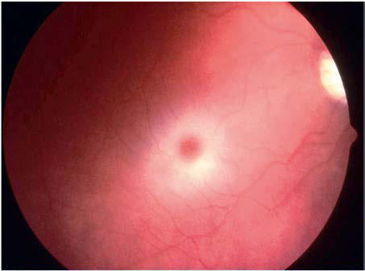
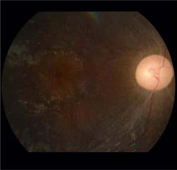

# Chapter 639: Neurodegenerative Disorders of Childhood

*Kristin A. Seaborg and Jennifer M. Kwon*

<!-- p.4720 -->
brainstem, cerebellum, and, occasionally, spinal cord dysfunction. A brain MRI shows symmetric curvilinear gadolinium enhance ment peppering the pons and extending variably into the medulla, brachium pontis, cerebellum, and midbrain and occasionally into the spinal cord. The clinical and radiologic findings usually respond to high-dose steroids but may worsen after steroid tapering, requir ing chronic steroid or other immunosuppressive therapy. The dif ferential diagnosis is extensive and includes infections, acquired demyelinating syndromes, granulomatous disease, lymphoma, or vasculitis. Biopsy studies may be needed to exclude these and other conditions.

**AUTOIMMUNE ENCEPHALOPATHIES ASSOCIATED WITH EPILEPSY AND STATUS EPILEPTICUS Rasmussen encephalitis** is an inflammatory encephalopathy char acterized by progressive refractory focal seizures, cognitive dete rioration, and focal neurologic deficits that occur with gradual atrophy of one brain hemisphere. The disorder frequently presents in children 6-8 years old, although adolescents and adults can be affected. The etiology is unknown, and therefore multiple theories are proposed, including the presence of neuronal antibodies and T-cell–mediated mechanisms triggered by a viral infection. None of these mechanisms satisfactorily explain the unilateral brain involvement characteristic of the disorder. Treatment with highdose steroids, plasma exchange, or IVIG can ameliorate symptoms in early stages of the disease. Multiple different approaches with immunotherapy, including rituximab, tacrolimus, azathioprine, adalimumab, mycophenolate mofetil, natalizumab, or anakinra have not substantially changed the poor outcome of most patients. The most effective treatment for control of the seizures is func tional hemispherectomy, which consists of surgical disconnection of the affected hemisphere.

**OTHER SUSPECTED TYPES OF AUTOIMMUNE ENCEPHALITIS** Vasculitis of the CNS and rheumatic diseases associated with auto immune mechanisms that can result in encephalitis are discussed in Chapter 642.

Rapid-onset obesity with hypothalamic dysfunction, hypoventila tion, and autonomic dysregulation (ROHHAD) is discussed in Chapter 468.3. The term **basal ganglia encephalitis** is used to describe patients with predominant or isolated involvement of the basal ganglia. These patients typically have abnormal movements such as dystonia, chorea, or parkinsonism and neuropsychiatric disease. Although these clinical manifestations may have multiple etiologies, includ ing metabolic, toxic, genetic, and infectious processes, an immunemediated etiology has been postulated in some patients. There have been no clinical trials, but case reports and small noncontrolled case series describe the potential benefit of immunotherapy. Antibodies against the dopamine-2 receptor have been infrequently identified in these patients.

**Pseudomigraine syndrome with CSF pleocytosis (PMP)** or **head ache with neurologic deficits and CSF lymphocytosis (HaNDL)** is an ill-defined entity that predominantly affects young male adults with a family history of migraine, although adolescents can be affected. This syndrome is characterized by repeat episodes of severe headache with transient neurologic deficits, accompanied by asep tic CSF lymphocytosis and a normal brain MRI. Patients frequently show a high CSF opening pressure, an elevated CSF protein concen tration, and focal EEG slowing, which normalize after the episodes of headache. Because of the inflammatory characteristics of the CSF and the high prevalence of prodromal viral-like symptoms, an infec tious–immune-mediated mechanism has been proposed. Other the ories include spreading cortical depression and trigeminal-vascular activation.

*Visit Elsevier eBooks+ at eBooks.Health.Elsevier.com** for Bibliography.*

Neurodegenerative disorders of childhood encompass a large, hetero geneous group of diseases caused by specific genetic and biochemical defects. Although many children with neurodegenerative disorders first present with developmental delay or seizures, the hallmark of a neuro degenerative disease is **regression and progressive deterioration** of neurologic function with loss of speech, vision, hearing, locomotion, feeding difficulties, and cognitive decline. The age of onset, rate of pro gression, and principal neurologic findings determine whether the dis ease affects primarily the white or the gray matter. Upper motor neuron signs and progressive spasticity are the hallmarks of white matter dis orders; convulsions and intellectual and visual impairments that occur early in the disease course are the hallmarks of gray matter disorders. A precise history confirms regression or delay of developmental mile stones, and the neurologic examination localizes the process within the nervous system. At that point, modern neuroimaging techniques and specific biochemical and molecular diagnostic tests are used to arrive at a diagnosis. Although available therapies are often limited, it is important to make the correct diagnosis so that genetic counseling may be offered and prevention strategies can be implemented. Bone marrow transplantation, enzyme replacement therapies, cell-based gene therapy, immune modulation, and dietary restrictions may pre vent the progression of disease in certain individuals who are either presymptomatic or very early in their disease course. For all conditions in which the specific genetic defect is known, prevention by prenatal diagnosis through chorionic villus sampling or amniocentesis is pos sible, as is carrier detection. Table 639.1 summarizes selected inherited neurodegenerative and metabolic disorders by their usual age of onset.

## 639.1  Sphingolipidoses Kristin A. Seaborg and Jennifer M. Kwon

The sphingolipidoses are characterized by intracellular storage of lipid substrates resulting from defective catabolism of the sphingolipids com prising cellular membranes (Fig. 639.1). Poorly degraded sphingolipids accumulate in neuronal lysosomes leading to cellular dysfunction and death. There are multiple sphingolipidoses, including Niemann-Pick disease, Gaucher disease, GM1 gangliosidosis, GM2 gangliosidosis, Krabbe disease (KD), and metachromatic leukodystrophy. Niemann- Pick disease and Gaucher disease are discussed in Chapter 106.4.

**GANGLIOSIDOSES** See also Chapter 106.4.

Gangliosides are sphingolipids consisting of an oligosaccharide chain attached to a hydroxyl group of ceramide and sialic acid bound to galactose. The gangliosides are catabolized by sequential cleavage of the sugar molecules by specific exoglycosidases. Abnormalities in catabolism result in an accumulation of the ganglioside within the cell, resulting in disease. Defects in ganglioside degradation include GM1 gangliosidosis and the GM2 gangliosidoses.

**GM****1**** Gangliosidosis** GM1 gangliosidosis is an autosomal recessive condition caused by deficiency of acid β-galactosidase from pathogenic variants in *GLB1.* It is further classified by age at presentation: infantile (type I), juve nile (type II), and adult (type III), where the age of onset and severity

*Kristin A. Seaborg and Jennifer M. Kwon*

<!-- p.4722 -->
Taieb G, Mulero P, Psimaras D, et  al. CLIPPERS and its mimics: evaluation of

new criteria for the diagnosis of CLIPPERS. J Neurol Neurosurg Psychiatry. 2019;90:1027–1038. Titulaer MJ, Höftberger R, Iizuka T, et al. Overlapping demyelinating syndromes and

anti-N-methyl-d-aspartate receptor encephalitis. Ann Neurol. 2014;75:411–428. Titulaer MJ, McCracken L, Gabilondo I, et al. Treatment and prognostic factors for

long-term outcome in patients with anti-NMDA receptor encephalitis: an obser vational cohort study. Lancet Neurol. 2013;12:157–165. Tobin WO, Guo Y, Krecke KN, et al. Diagnostic criteria for chronic lymphocytic in

flammation with pontine perivascular enhancement responsive to steroids (CLIP PERS). Brain. 2017;140:2415–2425.

Van BA, Stephani U, Kluger G, et al. FIRES: febrile infection responsive epileptic

(FIRE) encephalopathies of school age. Brain Dev. 2009;31:91–93. Van Sonderen A, Petit-Pedrol M, Dalmau J, Titulaer MJ. The value of LGI1, Caspr2,

and voltage-gated potassium channel (VGKC) antibodies in encephalitis. Nat Rev Neurol. 2017;13:290–301. Waters P, Fadda G, Woodhall M, et al. Serial anti-myelin oligodendrocyte glycopro

tein antibody analyses and outcomes in children with demyelinating syndromes. JAMA Neurol. 2020;77:82–93. Wingerchuk DM, Banwell B, Bennett JL, et al. International consensus diagnostic

criteria for neuromyelitis optica spectrum disorders. Neurology. 2015;85:177–189.

<!-- p.4723 -->
depends on the degree of β-galactosidase deficiency. Diagnosis can be made by enzyme assay or by identification of biallelic pathogenic vari ants in *GLB1* by molecular genetic testing. Prenatal diagnosis is pos sible by enzyme or direct molecular testing of cultured amniotic cells.

**Infantile GM****1 gangliosidosis** presents during the neonatal period with poor sucking and inadequate weight gain. Development is delayed,

#### **Table 639.1** Selected Metabolic Conditions Associated with Developmental Regression

| Category / Parameter | Clinical Details & Findings |
| --- | --- |
| **COMMENTS** | <2, often with hepatomegaly or; hepatic effects; Fructose intolerance; Vomiting, hypoglycemia, poor feeding, failure to thrive; (when given fructose); Galactosemia; Lethargy, hypotonia, icterus, cataract, hypoglycemia; (when given lactose); Glycogenosis (glycogen storage disease) types I-IV; Hypoglycemia, cardiomegaly (type II); Mucopolysaccharidosis types I and II; Coarse facies, stiff joints; GM1 gangliosidosis; Coarse facies, macroglossia, cherry- red spot in macula; Niemann-Pick disease, infantile type; Gray matter disease, failure to thrive; Zellweger syndrome; Hypotonia, high forehead, flat facies; Gaucher disease (neuronopathic form); Extensor posturing, irritability; Carbohydrate-deficient glycoprotein syndromes; Dysmyelination, cerebellar hypoplasia; <2, without hepatomegaly; Krabbe disease; Irritability, extensor posturing, optic atrophy, and; blindness; Rett syndrome; Girls with deceleration of head growth, loss of hand; skills, hand wringing, impaired language skills, gait; apraxia; Maple syrup urine disease; Poor feeding, tremors, myoclonus, opisthotonos; Phenylketonuria; Light pigmentation, microcephaly; Menkes kinky hair disease; Hypertonia, irritability, seizures, abnormal hair; Tay-Sachs disease, GM2 gangliosidoses; Seizures, cherry-red spot of macula, increased startle; response; Subacute necrotizing encephalopathy or Leigh; disease; White matter disease, basal ganglia, brainstem lesions; Canavan disease; White matter disease, macrocephaly; Neurodegeneration with brain iron accumulation; disease (see Table 639.4); Cerebellar atrophy, optic atrophy, iron accumulation in; basal ganglia, movement disorder; 2-5; Niemann-Pick disease types III and IV; Hepatosplenomegaly, gait difficulty; Wilson disease; Liver disease, Kayser-Fleischer ring; deterioration of; cognition is late; Neuronal ceroid lipofuscinosis; Gray matter disease; Mitochondrial encephalopathies (e.g., myoclonic; epilepsy with ragged red fibers [MERRF]); Gray matter disease; Ataxia-telangiectasia; Basal ganglia disease; Neurodegeneration with brain iron accumulation; syndrome; Basal ganglia disease; Metachromatic leukodystrophy; White matter disease; Adrenoleukodystrophy; White matter disease, behavior problems, deteriorating; school performance, vision loss; 5-15; Adrenoleukodystrophy; Same as for adrenoleukodystrophy in 2- to 5-yr-olds; Neuronal ceroid lipofuscinosis, juvenile and adult; forms; Gray matter disease; Refsum disease; Peripheral neuropathy, ataxia, retinitis pigmentosa; Sialidosis II, juvenile form; Cherry-red macula, myoclonus, ataxia, coarse facies; Adapted from Kliegman RM, Greenbaum LA, Lye PS, eds. Practical Strategies in Pediatric Diagnosis and Therapy, 2nd ed. Philadelphia: Elsevier; 2004:542. |

and generalized seizures are prominent. The phenotype is characterized by coarse facial features, prominent forehead, depressed nasal bridge, large tongue (macroglossia), and gum hypertrophy. There is early hep atosplenomegaly from intracellular accumulation of foamy histiocytes and kyphoscoliosis from anterior beaking of the vertebral bodies. The neurologic examination is notable for progressive blindness, deafness,

<!-- p.4724 -->
*Most common HSM, osteoporosis, CNS disease rare*

*Angiokeratomas, kidney/heart disease, burning dysesthesias*

*Similar to Tay-Sachs, may have HSM, dysostosis multiplex*

*Neurodegeneration, HSM, CRS, skeletal deformities*

*Neurodegeneration, CRS, large head, acoustic startle*

β*-Galactosidase* Gal

**Gal-GalNAc**

**NANA**

**Gal**

**GalNAc**

**NANA**

**NANA**

**Gal**

**Glc-Ceramide* (GM**1** Ganglioside)*

**GalNac-Gal-Gal-Glc-Ceramide* (Globoside)*

**Gal-Gal-Glc-Ceramide**

**Glc-Ceramide**

**Glc-Ceramide**

**Gal-Ceramide**

**MLD**

**Krabbe**

**Farber disease**

**Gaucher disease**

**Fabry disease**

**Sandhoff disease Tay-Sachs Disease**

**GM****1**** gangliosidoses**

**Niemann-Pick A/B**

**SO****3****H-Gal-Ceramide**

**Ceramide**

**Sphingosine**

**Phosphorylcholine-Ceramide**

**Gal**

**Glc-Ceramide* (GM**2**)*

**Gal Glc-Ceramide* (GM**3**)*

Gal

Gal

Gal

Choline P

Glc

Fatty Acid

SO3H

GalNAc

GalNac

NANA

β*-Hexosaminidase A*

β*-Hexosaminidase A & B*

α*-Galactosidase*

β*-Galactosidase*

β*-Galactosidase*

*Arylsulfatase A*

β*-Glucosidase*

*Ceramidase*

*(Lactosyl Ceramide)*

*Sphingomyelinase*

*Neurodegeneration HSM*

*Neuraminidase*

*Painful joint deformities, subcutaneous lipid nodules, hoarse cry*

*Spasticity, irritability, blindness, failure to thrive*

*Spasticity, dementia, areflexia*

**Fig. 639.1** Sphingolipid degradation pathway showing the sites of enzyme deficiencies and their associated disorders. Sphingolipids are com posed of a ceramide backbone with oligosaccharide side chains. CRS, cherry-red spot (retinal); Gal-, galactosyl-; GalNAc, N-acetyl-galactose; Glc-, glucosyl-; HSM, hepatosplenomegaly; MLD, metachromatic leukodystrophy; NANA, N-acetyl-neuraminic acid.

spastic quadriplegia, and decerebrate rigidity. A cherry-red spot in the macula is visualized in approximately 50% of cases (Fig. 639.2). Treat ment is supportive, and children rarely survive beyond age 2-3 years. Death is often from aspiration pneumonia.

**Type II GM****1 gangliosidosis** presents later in infancy, before 3 years. Initial symptoms consist of weakness, ataxia, and regression of language. Thereafter, convulsions, spasticity, decerebrate rigidity, and blindness are the major findings. Unlike type I, coarse facial features and hepatosplenomegaly are not usually seen. Lumbar vertebrae may show minor beaking. Children rarely survive beyond 10 years of age. **Adult GM****1 gangliosidosis** is a slowly progressive disease with onset between ages 3 and 30 years consisting of spasticity, ataxia, dysarthria, cardiomyopathy, and a gradual loss of cognitive function.

**GM****2**** Gangliosidoses** The GM2 gangliosidoses are a heterogeneous group of autosomal reces sive disorders caused by abnormal catabolism of the GM2 ganglioside, which accumulates in neuronal lysosomes. GM2 catabolism requires functional isoenzymes β-hexosaminidase and GM2 activator protein. Tay-Sachs disease (TSD), Sandhoff disease, juvenile GM2 gangliosido sis, and adult GM2 gangliosidosis are caused by genetic variants in the genes that encode the alpha and beta subunits of β-hexosaminidase and lead to decreased or absent β-hexosaminidase activity with subse quent accumulation of GM2.

**TSD** is most prevalent in the Ashkenazi Jewish population, with an approximate carrier rate of 1 in 30 Jews in the United States. TSD is caused by pathogenic variants in *HEXA* on chromosome 15q23, which

<!-- p.4725 -->
encodes the α subunit of β-hexosaminidase. Affected infants often have a *marked startle reaction* to noise that is evident soon after birth but otherwise have normal development until ∼6 months of age. They then begin to lag in developmental milestones and gradually lose the abil ity to stand, sit, and vocalize by age 1. Children with TSD have earlier onset of dysphagia than children with other GM2 gangliosidoses. Early hypotonia develops into progressive spasticity and relentless deterio ration follows, with convulsions, blindness, deafness, and cherry-red spots in almost all patients (see Fig. 639.2). Macrocephaly becomes apparent by 1 year of age and results from the 200- to 300-fold normal content of GM2 ganglioside deposited in the brain. Few children live beyond 3-4 years of age, and death is usually associated with aspiration or bronchopneumonia.

To diagnose TSD or any of the GM2 gangliosidoses, a deficiency of the isoenzyme β-hexosaminidase is found in blood, serum, or fibro blasts. In addition, molecular genetic testing may be done to evaluate for variants in the *HEXA* or *HEXB* gene to confirm the diagnosis.

**Sandhoff disease** occurs secondary to a variant *HEXB* gene located on chromosome 5q13. Affected infants present very similar to TSD, including progressive loss of motor and language milestones beginning at 6 months of age. Unlike children with TSD, children with Sandhoff disease may also have visceromegaly. The visual evoked potentials (VEPs) are normal early in the course of Sandhoff disease and TSD but become abnormal or absent as the disease progresses. The auditory brainstem responses show prolonged latencies. The diagnosis of Sand hoff disease is established by finding deficient levels of hexosaminidases A and B in serum and leukocytes. Children usually die by 3 years of age.

**Juvenile GM****2 gangliosidosis** develops in mid-childhood, initially with clumsiness followed by ataxia. Signs of spasticity, athetosis, loss of language, and seizures gradually develop. Progressive visual loss is associated with optic atrophy, but cherry-red spots rarely occur in juvenile GM2 gangliosidosis. A deficiency of hexosaminidase is vari able (total deficiency to near normal) in these patients. Death occurs around 15 years of age.

Although the genetic etiologies of the gangliosidoses are wellestablished, there is currently no known treatment for these disorders other than supportive management and palliative care. An adenoassociated virus-HEXA/HEXB–directed gene therapy proof-ofconcept trial has been performed in two children with TSD.

**KRABBE DISEASE (GLOBOID CELL LEUKODYSTROPHY)** Krabbe disease (KD) is a rare autosomal recessive neurodegenerative disorder characterized by severe myelin loss and the presence of glo boid bodies in the white matter. The gene for KD *(GALC)* is located on chromosome 14q24.3-q32.1. The disease results from a marked deficiency of the lysosomal enzyme galactocerebroside β-galactosidase

(GALC). KD is a disorder of myelin destruction rather than abnormal myelin formation. Normally, myelination begins in the third trimester, corresponding with a rapid increase of GALC activity in the brain. In patients with KD, galactocerebroside cannot be metabolized during the normal turnover of myelin because of deficiency of GALC. Nonme tabolized galactocerebroside stimulates the formation of globoid cells, which can be cytotoxic to oligodendrocytes. Because oligodendroglial cells are responsible for the elaboration of myelin, their loss results in myelin breakdown, thus producing additional galactocerebroside and causing a vicious circle of myelin destruction.

Myelin exists in both the central and peripheral nervous system and allows for rapid conduction along axons. With GALC deficiency and associated rapid and severe demyelination, the symptoms of KD become evident in the first few months of life and include excessive irritability and crying, poor head control, episodes of hyperpyrexia, vomiting, and difficulty feeding. In the initial stage of KD, children are often treated for colic or milk allergy with frequent formula changes. Generalized seizures may appear early in the course of the disease. Alterations in body tone with rigidity and opisthotonos as well as visual inattentiveness caused by optic atrophy become apparent as the disease progresses. In the later stages of the illness, blindness, deafness, absent deep tendon reflexes, autonomic instability, and decerebrate rigidity constitute the major physical findings. Most patients die by 2 years of age. MRI and magnetic resonance spectroscopy are useful for evalu ating the extent of demyelination in KD. Umbilical cord blood (stem cell) transplantation from unrelated donors in asymptomatic babies may favorably alter the natural history but will not help patients who already have neurologic symptoms. Recombinant GALC triggers an immune reaction, and the large protein does not efficiently cross the blood-brain barrier.

*Late-onset KD* has been described beginning in childhood or ado lescence. Patients present with pes cavus, sensorimotor demyelinat ing neuropathy, optic atrophy, and cortical blindness; their condition may be confused with adrenoleukodystrophy. Slowly progressive gait disturbances, including spasticity and ataxia, are prominent. Globoid cells are abundant in the white matter, and leukocytes are deficient in GALC. MRI may reveal white matter lesions. An examination of the cerebrospinal fluid shows an elevated protein content, and the nerve conduction velocities are markedly delayed as a result of segmental demyelination of the peripheral nerves.

**METACHROMATIC LEUKODYSTROPHY** This disorder of myelin metabolism is inherited as an autosomal recessive trait and is characterized by a deficiency of arylsulfatase A activity. The *ARSA* gene is located on chromosome 22q13.33. The absence or deficiency of arylsulfatase A leads to accumulation of cerebroside sulfate within the myelin in both the central and periph eral nervous systems, and the excessive cerebroside sulfate is thought to cause myelin breakdown. Prenatal diagnosis of metachromatic leukodystrophy (MLD) is made by assaying arylsulfatase A activity in chorionic villi or cultured amniotic fluid cells. Those affected with MLD are generally classified according to age of onset: late infantile, juvenile, and adult.

**Late infantile MLD** begins with insidious onset of gait disturbances between 1 and 2 years of age. The child initially appears awkward and frequently falls, but locomotion is gradually impaired significantly and support is required to walk. The extremities are hypotonic, and the deep tendon reflexes are absent or diminished. Within the next several months, the child can no longer stand, and deterioration in intellectual function becomes apparent. The speech is slurred and dysarthric, and the child appears dull and apathetic. Visual fixation is diminished, nys tagmus is present, and examination of the retina shows optic atrophy. Within 1 year from the onset of the disease, the child is unable to sit unsupported, and progressive decorticate postures develop. Feeding and swallowing are impaired because of pseudobulbar palsies. Affected children develop seizures and painful muscle spasms and generalized irritability. Patients ultimately become stuporous and die of aspiration or bronchopneumonia by age 5-6 years. Neurophysiologic evaluation shows slowing of peripheral nerve conduction velocities caused by

**Fig. 639.2** A cherry-red spot in a patient with GM1 gangliosidosis. Note the whitish ring of sphingolipid-laden ganglion cells surrounding the fovea. (From Leavitt JA, Kotagal S. The “cherry red” spot. Pediatr Neurol. 2007;37:74–75, Fig. 1.)

<!-- p.4726 -->
peripheral myelin damage and progressive changes in the VEPs, audi tory brainstem responses, and somatosensory evoked potentials. CT and MRI images of the brain indicate diffuse symmetric attenuation of the cerebellar and cerebral white matter, and examination of the cere brospinal fluid shows an elevated protein content.

Late infantile MLD is characterized by little to no functional aryl sulfatase A, resulting in rapid accumulation of sulfatides and disease progression. Bone marrow transplant or lentiviral autologous hema topoietic stem cell gene (ARSA-cDNA) therapy is a promising experi mental therapy for the management of late infantile MLD patients identified very early in the course of their disease.

**Juvenile MLD** has many features in common with late infantile MLD, but the onset of symptoms is delayed to 5-10 years of age. Deteri oration in school performance and alterations in personality may her ald the onset of the disease. This is followed by incoordination of gait, urinary incontinence, and dysarthria. Muscle tone becomes increased, and ataxia, dystonia, tremor, or diminished deep tendon reflexes may be present. In the terminal stages, generalized tonic-clonic convulsions are prominent and are difficult to control. Patients rarely live beyond mid-adolescence. Patients with juvenile MLD usually have one func tional copy of *ARSA* with some residual enzyme activity.

*Visit Elsevier eBooks+ at eBooks.Health.Elsevier.com** for Bibliography.*

## 639.2  Neuronal Ceroid Lipofuscinoses Kristin A. Seaborg and Jennifer M. Kwon

The neuronal ceroid lipofuscinoses (NCLs) are a group of inherited, neurodegenerative, **lysosomal storage disorders** characterized by visual loss, progressive dementia, seizures, motor deterioration, and early death. The NCLs are named because of the intracellular accu mulation of fluorescent lipopigments ceroid and lipofuscin. They comprise a genetically and phenotypically heterogeneous group of dis orders (currently there are at least 14 NCL types) that have traditionally been subclassified by age of onset, among other clinical features. With the exception of CLN4 (Parry disease), which is transmitted as an auto somal dominant trait, all other types of NCL are autosomal recessive. They differ from one another in the associated ultrastructural patterns of the inclusions as seen by electron microscopy. With the advent of enzymatic and molecular testing methods, clinicians can make specific NCL diagnoses using genetic and biochemical testing (Table 639.2).

#### **Table 639.2** NCL of Childhood Onset: Clinical Classification and Major Diagnostic Procedure

| Category / Parameter | Clinical Details & Findings |
| --- | --- |
| **MAJOR SYMPTOMS AT ONSET** | Congenital; Birth |
| **NGS** | Enzymatic assay; Microcephaly, dysmorphic features,; seizures, hyperkinetic movements; Infantile; 6-18 mo |
| **NGS** | enzymatic assay; Decreased head growth,; neurodevelopmental regression,; seizures |
| **NGS** | enzymatic assay; Decreased head growth,; neurodevelopmental regression |
| **NGS** | Decreased head growth, seizures; (myoclonus) |
| **LATE INFANTILE** | Classical; 2-4 yr |
| **NGS** | enzymatic assay; Seizures, ataxia, visual loss, delayed; language development; Variant; 2-5 yr |
| **NGS** | enzymatic assay; Seizures, neurodevelopmental; regression, behavioral; disturbances |
| **NGS** | Impaired learning and cognition |
| **NGS** | Seizures, ataxia, delayed language; development |
| **NGS** | Seizures, visual loss, motor and; cognitive regression |
| **NGS** | Seizures, visual loss, motor and; cognitive regression |
| **JUVENILE** | Classical; 3-5 yr |
| **NGS** | Visual loss, behavioral problems,; cognitive decline; 5-7 yr |
| **NGS** | Motor and cognitive regression,; behavioral problems; 5-7 yr |
| **NGS** | enzymatic assay; Visual loss, cognitive decline; Late; 8-12 yr |
| **NGS** | enzymatic assay; Myoclonic seizures, cognitive; decline; ataxia, cognitive decline,; visual loss; 13-16 yr |
| **NGS** | Rigidity, hypokinesia; NSG, Next-generation sequencing.; From Simonati A, Williams RE. Neuronal ceroid lipofuscinosis: the multifaceted approach to the clinical issues, an overview. Frontiers Neurol. 2022;13:Article 811686, Table 1. |

<!-- p.4727 -->

<!-- p.4728 -->
A B C D

**Fig. 639.3** A, T2-weighted (axial) image showing leukoencephalopathy in a child with late infantile neuronal ceroid lipofuscinoses (NCL). B, T1- weighted (axial) sequence revealing diffuse atrophy in a child with late infantile NCL. C, A child with late infantile NCL with cerebellar atrophy in T2-weighted axial section of the brain. D, Fundus photograph showing atypical retinitis pigmentosa with optic atrophy in a child with juvenile NCL. (Modified from Jadav RH, Sinha S, Yasha TC, et al. Clinical, electrophysiological, imaging, and ultrastructural description in 68 patients with neuronal ceroid lipofuscinoses and its subtypes. Pediatr Neurol. 2014;50:85–95, Fig. 1, p. 88.)

**Infantile-type neuronal ceroid lipofuscinosis (ICLN, Santavuori disease)** begins in the first year of life with developmental delay, myo clonic seizures, intellectual deterioration, and blindness. Optic atrophy and brownish discoloration of the macula are evident on examination of the retina, and cerebellar ataxia is prominent. The infantile form is caused by recessive pathogenic variants of the gene for the lysosomal enzyme palmitoyl-protein thioesterase-1 (PPT1) on chromosome 1p32. A number of cell types in INCL patients show characteristic intracellular fine granular osmiophilic deposits discernible by electron microscopy.

Although death typically occurs during early childhood, a sub set of children with PPT1 enzyme deficiency has a much less severe course with clinical features resembling those of the juvenile-onset NCL patients. Clinically, these variant INCL patients have a course that is often quite distinct from the typical, classic, rapidly degenerating infantile form, yet they have PPT1 deficiency and granular osmiophilic deposits on pathology. There is no clear *CLN1* genotype that predicts severity of phenotype.

**Late infantile-type neuronal ceroid lipofuscinosis (LINCL, Jansky- Bielschowsky)** is the second most common type of NCL and generally presents with myoclonic seizures beginning between 2 and 4 years of age in a previously normal child. Dementia and ataxia are combined with a progressive loss of visual acuity and microcephaly. Examination of the retina shows marked attenuation of vessels, optic atrophy, and a subtle brown pigment in the macular region, with associated visual changes early in the course of disease (Fig. 639.3). The autofluorescent material is deposited in neurons, fibroblasts, and secretory cells.

LINCL can be caused by autosomal recessive variants of several different genes: *CLN2* gene, which codes for a tripeptidyl peptidase- 1 (TPP1) that is essential for the degradation of cholecystokinin-8, as well as the *CLN5, CLN6,* CLN8*,* and *CLN14* genes, which code for membrane proteins that have not been completely characterized. *CLN8* is also known as *locus of northern epilepsy syndrome,* which is often called *progressive epilepsy with cognitive impairment.*

At this time, there is only one clinically approved treatment for all types of NCL. *CLN2* can be treated with *intraventricular* cerliponase alfa, a recombinant human proenzyme of TPP1. Treatment with cerli ponase alfa can attenuate motor and language decline but does not alter visual symptoms. Stem cell therapy, gene therapy, and immunomodu latory therapy to repair genetic variants or alter adaptive immunore sponses are all in preclinical studies for adjunctive treatment of NCL.

**Juvenile-type neuronal ceroid lipofuscinosis (JNCL, Spielmeyer- Vogt or Batten disease)** is the most common form of NCL disease and is generally caused by autosomal recessive variants in *CLN3*. Children affected with JNCL tend to develop normally for the first 5 years of life. Their initial symptom is usually progressive visual loss, and their reti nal pigmentary changes often result in an initial diagnosis of retinitis pigmentosa. The funduscopic changes are similar to those for LINCL. After disease onset, there may be a rapid decline with changes in cog nition and personality, motor incoordination, and seizures. Myoclonic seizures are not as prominent as in LINCL, but parkinsonism can

develop and impair ambulation. Patients die in their late 20s to early 30s. In JNCL caused by *CLN3,* the electron microscopy of tissues shows deposits called *fingerprint profiles,* and routine light microscopy of a peripheral blood smear may show lymphocyte vacuoles.

A possible mimic of JNCL is **Lafora disease (LD)** caused by patho genic variants in *EPM2A* and *EPM2B*. LD also has skin (eccrine) inclu sion bodies in addition to seizures, myoclonus, ataxia, dysarthria, progressive loss of milestones, and death within 10 years of onset. The diseases can be distinguished by specific gene sequencing.

*Visit Elsevier eBooks+ at eBooks.Health.Elsevier.com** for Bibliography.*

## 639.3  Adrenoleukodystrophy See Chapter 106.2.

## 639.4  Sialidosis Kristin A. Seaborg and Jennifer M. Kwon

Sialidosis is the result of lysosomal sialidase deficiency second ary to an autosomal recessive pathogenic variant in the sialidase (α-neuraminidase, *NEU1*) gene on chromosome 6p21.3. Up to 40 pathologic variants of *NEU1* have been identified. The accumulation of sialic acid–oligosaccharides with markedly increased urinary excretion of sialic acid–containing oligosaccharides is associated with clinical presentations that range from the milder sialidosis type I to the more severe sialidosis type II.

**Sialidosis type I**, **cherry-red spot myoclonus syndrome**, usually presents in the second decade of life, when a patient complains of visual deterioration. Inspection of the retina shows a cherry-red spot, but, unlike patients with TSD, visual acuity declines slowly in individuals with cherry-red spot myoclonus syndrome. Myoclonus of the extremi ties is gradually progressive and eventually renders patients nonambu latory. The myoclonus is triggered by voluntary movement, touch, and sound and is not controlled with anticonvulsants. Generalized convul sions responsive to antiseizure medications occur in most patients.

**Sialidosis type II** patients present at a younger age and have cherryred spots and myoclonus, as well as somatic involvement, including coarse facial features, hepatosplenomegaly, corneal clouding (rarely), and dysostosis multiplex, producing anterior beaking of the lumbar ver tebrae. Type II patients may be further subclassified into congenital and infantile (childhood) and juvenile forms, depending on the age of onset and severity. Examination of lymphocytes shows vacuoles in the cyto plasm, biopsy of the liver demonstrates cytoplasmic vacuoles in Kupffer cells, and membrane-bound vacuoles are found in Schwann cell cyto plasm, all attesting to the multiorgan nature of sialidosis type II. Identi fication of genetic variants in the *NEU1* gene can confirm the diagnosis.

<!-- p.4729 -->

<!-- p.4730 -->
Some cases of what appears to be sialidosis type II are the result of com bined deficiencies of β-galactosidase and α-neuraminidase resulting from deficiency of protective protein/cathepsin A that prevents premature intra cellular degradation of these two enzymes. These patients have galactosia lidosis, and they are clinically indistinguishable from those with sialidosis type II. Consequently, patients who have features of sialidosis type II with marked urinary excretion of oligosaccharides should be tested for protec tive protein/cathepsin A deficiency as well as sialidase deficiency.

*Visit Elsevier eBooks+ at eBooks.Health.Elsevier.com** for Bibliography.*

## 639.5  Miscellaneous Neurodegenerative Disorders Kristin A. Seaborg and Jennifer M. Kwon

**PELIZAEUS-MERZBACHER DISEASE** Pelizaeus-Merzbacher disease (PMD) is an X-linked recessive disor der characterized by nystagmus and abnormalities of myelin. PMD is caused by gene variants in the *PLP1* gene on chromosome Xq22, which is essential for CNS myelin formation and oligodendrocyte differentiation. Different variants in the same gene can cause a spectrum of disorders, ranging from the milder **familial spastic paraparesis** (progressive spas tic paraparesis type 2, SPG2) to the more severe connatal form associated with rapid neurologic decline from an early age and death in the first decade of life. *PLP1* variants causing disease include point changes, dele tions, gene duplications, and other gene dosage variants.

Classic PMD is the most common type, clinically recognized by nys tagmus and roving eye movements along with head nodding during infancy. Developmental milestones are delayed; ataxia, choreoatheto sis, and spasticity ultimately develop. Optic atrophy and dysarthria are associated findings, and death occurs in the second or third decade. The major pathologic finding is a loss of myelin with intact axons, sug gesting a defect in the function of oligodendroglia. An MRI scan shows a symmetric pattern of delayed myelination. The final diagnosis can be made through genetic testing for variants in the *PLP1* gene.

Other PMD-like, hypomyelinating leukodystrophies continue to be identified and should be considered in the differential diagnosis of PMD. These include Allan-Herndon-Dudley syndrome, TUBB4Arelated disorders, and hypomyelinating leukodystrophy 7 or 8.

**ALEXANDER DISEASE** This is a rare disorder that causes progressive macrocephaly and leuko dystrophy. Alexander disease is caused by dominant pathogenic variants in the *GFAP* gene on chromosome 17q21; cases are usually sporadic. Pathologic examination of the brain discloses deposition of eosinophilic hyaline bodies called *Rosenthal fibers* in astrocyte processes. In the classic infantile form of Alexander disease **(type I)**, degeneration of white mat ter is most prominent frontally. The diagnosis may be suggested by MRI (Fig. 639.4) and MR spectroscopy demonstrating abnormal metabolic substrates. Affected children develop progressive loss of intellect, spas ticity, and treatment-resistant seizures causing death by 5 years of age. Patients with **type II** Alexander disease present later in life and may not have the characteristic frontal predominance or megalencephaly. Most patients with type II Alexander disease develop ataxia, and approxi mately 50% develop difficulty with speech or swallowing.

**CANAVAN SPONGY DEGENERATION** See Chapter 105.15.

**OTHER LEUKODYSTROPHIES** Metabolic and degenerative disorders can present with significant cere bral white matter changes, such as some mitochondrial disorders (see Chapters 106.1 and 108) and glutaric aciduria type 1. In addition, the broader use of brain MRI has brought to light new leukodystrophies.

One example is vanishing white matter disease or childhood ataxia with central nervous system (CNS) hypomyelination characterized by ataxia and spasticity (Fig. 639.5). Some patients also have optic

B A

**Fig. 639.4** Alexander disease. MRI of the index patient at the age of 15 mo. A, Axial T2-weighted sequences (TR/TE: 4000/99) at the basal ganglia and thalamus level demonstrating diffuse bilateral, symmetric increased signal predominantly of the frontal periventricular but also of the subcortical, white matter and the basal ganglia. B, Significant periventricular rim after intravenous gadolinium infusion (T1-weighted sequences; TR/TE: 400/88). (From Zafeiriou DI, Dragoumi P, Vargiami E. Alexander disease. J Pediatr. 2013;162:648.)

A B

D C

**Fig. 639.5** T1-weighted and FLAIR images of a patient with vanishing white matter disease. Axial FLAIR (A, C) and sagittal T1-weighted (B, D) images of a patient at ages 1½ and 2½ yr. The first MRI (A, B) was obtained soon after the onset of symptoms. The initial FLAIR image (A) shows diffuse abnormality and partial cystic degeneration of the cerebral white matter, whereas the follow-up FLAIR image (C) shows that all of the cerebral white matter has been replaced by fluid. The initial T1-weighted sagittal image (B) shows the typical stripelike pat tern within the abnormal white matter, whereas the follow-up image (D) shows that all of the cerebral white matter has disappeared and that only the cerebral cortex and ependymal lining are preserved. The cerebellum has become highly atrophic. (A, C from Van der Knaap MS, Valk J. Magnetic Resonance of Myelination and Myelin Disorders, 3rd ed. Heidelberg: Springer; 2005, Fig 65.3; B, D from van der Knaap MS, Pronk JC, Scheper GC. Vanishing white matter disease. Lancet Neurol.

<!-- p.4731 -->

<!-- p.4732 -->
atrophy, seizures, and cognitive deterioration. Symptoms worsen rap idly after episodes of fever, head trauma, or external stressors. The age of presentation and the rapidity of decline in leukodystrophies can be quite variable. In the early-onset forms, decline is usually rapid and followed quickly by death; in the later-onset forms, mental decline is usually slower and milder. Interestingly, acute demyelination in these disorders can be triggered by fever or fright. The diagnosis of vanishing white matter disease or childhood ataxia with CNS hypomyelination is

based on clinical findings, characteristic abnormalities on cranial MRI, and autosomal recessive gene variants in one of five causative genes (*EIF2B1, EIF2B2, EIF2B3, EIF2B4,* and *EIF2B5*) encoding the five subunits of the eukaryotic translation initiation factor, eIF2B, which regulates cellular protein synthesis. An approach to leukodystrophies based on MRI findings is noted in Figure 639.6 and associated clini cal features in Figure 639.7, and the diagnostic evaluation is noted in Table 639.3.

A

Mild T2-hyperintensity in combination with T1hyperintensity (= normal signal), T1-isointensity or mild

T1-hypointensity relative to gray matter structures

Improving =

**DELAYED MYELINATION**

Prominent cerebral atrophy and slowly

progressing myelination = **FALSE**

**HYPOMYELINATION**

DELAYED MYELINATION OR HYPOMYELINATION

**+ MULTIFOCAL LESIONS**

Permanent = **HYPOMYELINATION**

B

Prominent T2-hyperintensity and prominent T1hypointensity relative to gray matter structures =

**other pathologies than hypomyelination**

**(demyelination and others)**

**May be CONFLUENT, or**

**May be MULTIFOCAL**

**Fig. 639.6** MRI pattern recognition in the leukodystrophies and genetic leukoencephalopathies (gLEs). Three major MRI characteristics help to discriminate between the different types of leukodystrophy and gLE. The first discriminator is the presence or absence of hypomyelination (A). Within this subset, the presence of improvement of myelination or atrophy directs the clinician toward a series of gLEs. Within the true hypomy elinating leukodystrophies, the presence of basal ganglia and cerebellar involvement further helps refine the diagnosis. If the pattern is not one of hypomyelination, then the second discriminator is whether the white matter abnormalities are confluent or isolated and multifocal (B). If the white matter abnormalities are confluent, then the third discriminator is the predominant localization of the abnormalities (B). 4H, Hypomyelination, hypo dontia, and hypogonadotropic hypogonadism; HACB, hypomyelination with atrophy of the basal ganglia and cerebellum; HEMS, hypomyelination of early myelinating structures; ODDD, oculodentodigital dysplasia; HCC, hypomyelination with congenital cataract; PMD, Pelizaeus-Merzbacher disease; PMLD, Pelizaeus-Merzbacher–like disease; NCL, neuronal ceroid lipofuscinosis; APBD, adult polyglucosan body disease; ADLD, autosomal dominant leukodystrophy with autonomic symptoms; CRMCC, cerebroretinal microangiopathy with calcifications and cysts; CTX, cerebrotendinous xanthomatosis; DRPLA, dentatorubral pallidoluysian atrophy); HDLS, hereditary diffuse leukoencephalopathy with spheroids/neuroaxonal leukod ystrophy with spheroids; HBSL, hypomyelination with brainstem and spinal cord and leg involvement; LTBL, leukoencephalopathy with thalamic and brainstem involvement and high lactate; LBSL, leukoencephalopathy with brainstem and spinal cord involvement and lactate elevation; MLC, megalencephalic leukodystrophy with subcortical cysts; X-ALD, X-linked adrenoleukodystrophy. (Pattern recognition reprinted with permission from GeneReviews; from Parikh S, Bernard G, Leventer RJ, et al. A clinical approach to the diagnosis of patients with leukodystrophies and genetic leu koencephalopathies. Mol Gen Metab. 2018;114:501–515, Fig. 2, pp. 508–509.)

<!-- p.4733 -->
**Leukodystrophies: “special” clinical features**

Peripheral neuropathy

MLD Krabbe PMDL PMD (mutations leading to loss of both PLP1 and DM20) HCC LCC SOX10-related disorder APBD CTX ALD and variants MNGIE

SOX10-related disorder Cockayne 18q minus Early-onset peroxisomal disorders Fabry Mitochondrial LDs

4H leukodystrophy (delayed dentition, hypodontia, abnormal tooth shape, caries) ODDD (hypodontia, abnormal tooth shape, caries) Cockayne (caries) Early-onset peroxisomal disorders (enamel hypoplasia) Periodontal Ehlers Danlos (premature loss of teeth)

HSMD (spondylometaphyseal dysplasia) 4H leukodystrophy (osteosclerosis) Fucosidosis (dysostosis multiplex) ODDD (syndactyly of 4th and 5th fingers) Coats plus (osteopenia with poor bone healing) Early-onset peroxisomal disorders (skeletal dysplasia)

Early-onset VWM (cataracts) HCC (cataracts) 4H leukodystrophy (severe myopia) Aicardi-Goutières (glaucoma) Cockayne (retinitis pigmentosa) HSMD (retinitis pigmentosa) CTX (cataracts) SLS (macular degeneration, retinitis pigmentosa, white glistening spots) Coats plus (retinal telangiectasia and exudates) SOX10-related disorder (iris heterochromia) AMACR deficiency (retinitis pigmentosa) Early-onset peroxisomal disorders (retinitis pigmentosa) Mitochondrial LDs (cataracts, retinitis pigmentosa) Late stage of many LDs (optic atrophy)

MLD (gallbladder) Early-onset VWM (liver, pancreas, kidneys) Salla (hepatosplenomegaly) Fucosidosis (hepatosplenomegaly) Early-onset peroxisomal disorders (liver, kidney) CTX (neonatal cholestasis, diarrhea) Congenital muscular dystrophies 18q minus (congenital heart defects) Coats plus (gastrointestinal bleeding and portal hypertension) SOX10-related disorder (Hirschsprung disease; white lock of hair) MNGIE (intestinal pseudoobstruction) NRF2-related LD (immune deficiency) PUS3-related LD (nephropathy)

VWM (premature ovarian failure) AARS2-related LD (premature ovarian failure) ALD and variants (adrenal failure, testicular failure) 4H leukodystrophy (delayed puberty, growth hormone deficiency) Cockayne (hypothyreosis) 18q minus (growth hormone deficiency) KSS (growth hormone deficiency, diabetes, hypoparathyroidism)

Generalized pigmentation (ALD and variants) Aicardi-Goutières (chilblains) Cockayne (photosensitivity) Trichothiodystrophy (photosensitivity) CTX (tendon xanthomas) SLS (ichthyosis) Fabry (angiokeratoma) Fucosidosis (angiokeratoma) Hyperpigmentation (Addison in ALD and variants) Linear pigment alterations (chromosomal mosaicism)

Ophthalmologic Hearing loss Endocrine Skin Dental Skeletal Other

**Fig. 639.7** Leukodystrophies: “Special” clinical features. MLD, Metachromatic leukodystrophy; PMDL, Pelizaeus-Merzbacher–like disease; PMD, Pelizaeus-Merzbacher disease; HCC, hypomyelination with congenital cataracts; LCC, leukodystrophy with calcifications and cysts; APBD, adult polyglucosan body disease; CTX, cerebrotendinous xanthomatosis; ALD, adrenoleukodystrophy; MNGIE, myoneurogastrointestinal encephalopa thy; VWM, vanishing white matter; HSMD, X-linked hypomyelination with spondylometaphyseal dysplasia; SLS, Sjögren-Larsson syndrome; AMACR, alpha-methylacyl-CoA racemase; KSS, Kearns-Sayre syndrome; ODDD, oculodentodigital dysplasia; LD, leukodystrophy. (From van der Knaap MS, Schiffmann R, Mochel F, Wolf NI. Diagnosis, prognosis, and treatment of leukodystrophies. Lancet Neurol. 2019;18:962–972, Appendix Fig. 2.)

**MENKES DISEASE** Menkes disease (kinky hair disease) is a progressive neurodegenerative condition inherited as an X-linked recessive trait. The Menkes gene, *ATP7A,* on Xq21.1, codes for a copper-transporting, P-type adenos ine triphosphatase, and mutations in the protein are associated with low serum copper and ceruloplasmin levels, as well as a defect in intestinal copper absorption and transport. The clinical symptoms of Menkes disease depend on the activity of different enzymes that use copper as a cofactor, such as superoxide dismutase, cytochrome *c* oxi dase, and dopamine β hydroxylase, among others. Symptoms begin in the first few months of life and include hypothermia, hypotonia, and generalized myoclonic seizures. The facies are distinctive, with chubby, sagging, rosy cheeks and kinky, colorless, friable hair. Microscopic examination of the hair shows several abnormalities, including **trich orrhexis nodosa** (fractures along the hair shaft) and **pili torti** (twisted

hair). Feeding difficulties are prominent and lead to failure to thrive. Severe cognitive impairment, vascular tortuosity, and optic atrophy are constant features of the disease. Neuropathologic changes include tor tuous degeneration of the gray matter and marked changes in the cer ebellum with loss of the internal granule cell layer and necrosis of the Purkinje cells. Death can occur by 3 years of age in untreated patients. Very rarely does Menkes disease manifest in females, and when it does, symptoms are milder.

Copper histidine therapy may be effective in preventing neurologic deterioration in some patients with Menkes disease, particularly when treatment is begun in the neonatal period or, preferably, with the fetus. These presymptomatic children are identified because of a family his tory of an affected brother and confirmed by target analysis for vari ants in the *ATP7A* gene. Infants diagnosed presymptomatically in the first 10 days of life can be started on an experimental protocol of daily

<!-- p.4734 -->
Diagnosis of Leukodystrophies and Genetic Leukoencephalopathies

#### **Table 639.3** Clinical and Laboratory Tests that Aid in the

| Category / Parameter | Clinical Details & Findings |
| --- | --- |
| **DIAGNOSTIC TARGET** | Brain and spinal MRI (±; gadolinium, ± MRS); Establish white matter disease;; ± evidence of leaky blood-; brain barrier and metabolite; accumulation (mitochondrial; disorders, Canavan disease,; Sjögren-Larson syndrome,; peroxisomal biogenesis; disorders); Ophthalmologic exam; Document ophthalmologic signs; in several leukodystrophies; Head CT; Assess for calcifications; Plasma very long-chain fatty; acids; X-linked adrenoleukodystrophy; and adrenomyeloneuropathy; and peroxisomal biogenesis; disorders; Lysosomal enzymes (leukocytes); Metachromatic leukodystrophy,; Krabbe disease, multiple; sulfatase deficiency,; galactosialidosis, sialidosis; Blood lactate, pyruvate, amino; acids; Mitochondrial disorders; Lumbar puncture (cell count,; protein, ± CSF neopterin, ±; interferon-alpha); Nonspecific marker of; demyelination; ± pleocytosis; and markers for Aicardi-; Goutières syndrome; Urine sulfatides; Metachromatic leukodystrophy,; multiple sulfatase deficiency; Urine organic acids; L-2-hydroxyglutarate; N-; acetyl aspartic acid for; Canavan disease; Krebs cycle; intermediates (mitochondrial; disorders); Neurophysiologic studies (BAER |
| **EMG/NCV, VEP, SSEP)** | Characterize involvement of; cranial and peripheral nerves,; optic tracts, and spinal tracts; Genetic analyses; As indicated for each; leukodystrophy or genetic; leukoencephalopathy; *Additional tests may be indicated for patients with certain distinctive clinical; presentations or extraneurologic features suggestive of one or more specific; leukodystrophies.; BAER, Brainstem auditory evoked response test; CSF, cerebrospinal fluid; CT,; computed tomography; EMG, electromyogram; MRI, magnetic resonance imaging;; MRS, magnetic resonance spectroscopy; NCV, nerve conduction velocity test; SSEP,; somatosensory evoked potential test; VEP, visual evoked potential test.; From Parikh S, Bernard G, Leventer RJ, et al. A clinical approach to the diagnosis of; patients with leukodystrophies and genetic leukoencephalopathies. Mol Gen Metab.; 2018;114:501–515, Table 6. |

copper-histidine subcutaneous injections. Optimal response to treat ment appears to occur only in patients who are identified in the newborn period and whose mutations permit residual copper transport activity.

**RETT SYNDROME** This syndrome is characterized as a disorder of early brain development marked by a period of developmental regression and deceleration of

brain growth after a relatively normal neonatal course. It is an X-linked disease that occurs predominantly in females and is one of the most common causes of cognitive disability in females. The frequency is approximately 1 in 10,000-15,000 live births. Rett syndrome is caused by pathogenic variants in *MeCP2* on Xq28, which codes for a transcription factor that binds to methylated CpG islands and silences transcription.

Clinically, development may proceed normally until 1 year of age, when regression of language and motor milestones and acquired microcephaly become apparent. Some atypical forms of Rett syn drome are congenital and can be associated with early-onset sei zures and developmental impairment within the first months of life. An ataxic gait or fine tremor of hand movements is an early neuro logic finding. Most children develop peculiar sighing respirations with intermittent periods of apnea that may be associated with cya nosis. The hallmark of Rett syndrome is repetitive hand-wringing movements and a loss of purposeful and spontaneous use of the hands; these features may not appear until 2-3 years of age. Autistic behavior is a typical finding in all patients. Generalized tonic-clonic convulsions occur in the majority but may be well controlled by anticonvulsants. Feeding disorders and poor weight gain are com mon. After the initial period of neurologic regression, the disease process appears to plateau, with persistence of the autistic behavior. Cardiac arrhythmias may result in sudden, unexpected death at a rate that is higher than the general population. Females usually sur vive into adulthood.

Although very few males survive with the classic Rett syndrome phenotype, genotyping of males without the classic Rett syndrome phenotype but with intellectual disability and other atypical neurologic features has detected patients with variants in *MeCP2.* Gene variants in *MeCP2* have been demonstrated in normal female carriers, females with Angelman syndrome, and males with fatal encephalopathy, Kline felter (47,XXY) syndrome, and familial X-linked cognitive impair ment. Males may present with a Rett-like syndrome if they have an *MECP2* duplication.

Classic Rett syndrome has been treated with trofinetide, an analog of the amino-terminal tripeptide of insulin-like growth factor 1. Its potential antiinflammatory and trophic properties may be the mecha nisms that produce a positive clinical effect. It is approved for patients ≥2 years of age.

Some females have an atypical Rett phenotype associated with severe myoclonic seizures in infancy, slowing of head growth, and develop mental arrest and have variants in another X-linked gene encoding for cyclin-dependent kinase–like 5 (CDKL5), which may interact with MeCP2 and other proteins regulating gene expression.

**NEURODEGENERATION WITH BRAIN IRON ACCUMULATION** Neurodegeneration with brain iron accumulation represents mul tiple age-of-onset–dependent disorders characterized by extrapyra midal symptoms and intellectual deterioration and regression, with iron deposition in the basal ganglia. There is significant phenotypic variability of these disorders; however, a characteristic finding on MRI demonstrates symmetric T2-signal homogeneous *hypointensity.* Common neurodegeneration with brain iron accumulation disorders are distinguished in Table 639.4, and an approach to their diagnosis is noted in Figure 639.8. Clinical features, which are highly variable, may include dystonia, parkinsonism, ataxia, spasticity, psychiatric symptoms, and intellectual impairment. Treatment should focus on the specific disorder and is usually symptomatic relief rather than curative. Iron chelation has been attempted without major long-term benefit.

*Visit Elsevier eBooks+ at eBooks.Health.Elsevier.com** for Bibliography.*

<!-- p.4735 -->
√, Present; BPAN, beta-propeller–associated neurodegeneration; CP, ceruloplasmin; FA2H, fatty acid 2-hydroxylase; FAHN, fatty acid 2-hydroxylase–associated neurodegeneration; FTL, ferritin light chain; LB, Lewy body; MPAN,

#### **Table 639.4** Overview of Neurodegeneration with Brain Iron Accumulation Conditions and Genes (If Known)

| Category / Parameter | Clinical Details & Findings |
| --- | --- |
| **PANK2** | 20p13; No; Early childhood,; around age 3; Typical PKAN; Teens or early; adulthood; Atypical PKAN |
| **PLA2G6** | 22q12; √; Infancy; Infantile; neuroaxonal; dystrophy; Teens or early; adulthood; Dystonia; parkinsonism |
| **FA2H** | 16q23; Not known; Childhood; Leukodystrophy,; hereditary spastic; paraplegia; Adulthood (age; range up to 30 yr); May resemble; idiopathic; Parkinson; disease |
| **MPAN** | —; C19orf12; 19q12; √; —; Pyramidal; extrapyramidal; syndrome; Kufor-Rakeb disease |
| **ATP13A2** | 1p36; √; Childhood- teens; Parkinsonism,; pyramidal; tract signs,; eye movement; disorder |
| **SENDA** | syndrome |
| **WDR45** | Xp11.23; Not known; Childhood; Encephalopathy; with; psychomotor; regression, then; static; Then: 20s to 30s; Sudden-onset; progressive; dystonia; parkinsonism; Aceruloplasminemia; — |
| **CP** | 3q23; No; —; —; 50s (range: 16-70); Extrapyramidal,; diabetes,; dementia; Neuroferritinopathy; — |
| **FTL** | 19q13; No; —; —; 40s; Chorea, dystonia,; dementia; Idiopathic late-onset; cases; —; Probably; heterogeneous; Probably; heterogeneous; Heterogeneous; —; —; Heterogeneous; Parkinsonism; it; may resemble; idiopathic; Parkinson; disease; mitochondrial membrane–associated neurodegeneration; NBIA, neurodegeneration with brain iron accumulation; PANK2, pantothenate kinase 2; PKAN, pantothenate kinase–associated neurodegeneration; PLA2G6, phospholipase A2;; PLAN, PLA2G6-associated neurodegeneration; SENDA, static encephalopathy of childhood with neurodegeneration in adulthood; SPG, spastic paraplegia.; From Schneider SA, Zorzi G, Nardocci N. Pathophysiology and treatment of neurodegeneration with brain iron accumulation in the pediatric population. Curr Treat Option Neurol. 2013;15:652–667, Table 1. |

<!-- p.4737 -->
