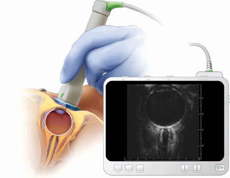

# Chapter 645: Idiopathic Intracranial Hypertension (Pseudotumor Cerebri)

*Alasdair P.J. Parker and Pooja D. Harijan*

<!-- p.4813 -->
Idiopathic intracranial hypertension (IIH), or pseudotumor cerebri, is frequently considered a potential cause of headache *with* papill edema in children with normal findings on standard brain MRI. A false-positive diagnosis is common, and strategies are needed to avoid this. The pathophysiology remains poorly understood, particularly in children.

IIH is rare, affecting 1 in 100,000-150,000 children, but accurate diagnosis is essential because of the risk of loss of vision. Previously, normal levels of intracranial pressure (ICP) were unclear, leading to overdiagnosis of IIH. Studies in children with ICP monitoring show an upper limit of normal as 10 mm Hg (13.5 cm H2O) between the ages of 2 and 5 years, with the adult level of cerebrospinal fluid (CSF) pressure being reached by 8 years of age. Currently, the 90th percentile of CSF pressure on lumbar puncture (LP) has been reported to be 28 cm CSF (22 mm Hg) in children age 5 to 18 years, without a significant age effect. Other normal parameters include CSF cell count, protein content, and ventricular size (although this could be slightly decreased on brain MRI). Papilledema may be overdiagnosed. With the advent of orbital coherence tomography (OCT), *B*-ultrasound, and MRI/ venography, identification has improved (Figs. 645.1-645.3). Great care should be taken before the diagnosis of IIH, as there is a high rate of misdiagnosis (Fig. 645.4) and management is challenging.

**ETIOLOGY** IIH, by definition, will not have an identifiable cause, despite typical findings. A large proportion of children referred to the pediatrician with possible/probable IIH after a thorough history, examination, and careful investigation will have *secondary IH* with an underlying cause

identified. Table 645.1 lists some of the many disorders that cause IH with no obstructive lesion on MRI. Research in adults suggests abnor mal CSF androgen profiles/endocrine dysfunction leading to abnormal CSF pressure; glucagon-like peptide-1 and 11β-hydroxysteroid dehy drogenase type 1 have been implicated.

**CLINICAL MANIFESTATIONS** IIH is rare under the age of 10 years. In postpubertal children, there is a female sex preponderance, and for reasons that are poorly under stood, patients are much more likely to be obese. However, most obese children with headache do not have IH and are at risk of false-positive

*Alasdair P.J. Parker and Pooja D. Harijan*

**Fig. 645.1** Optic nerve ultrasonography. Left, A sagittal schematic view of gel applied on top of the closed right eyelid with the orien tation of the operator hand and ultrasonography probe to the orbit. Right, An ultrasonography machine screen showing a coronal section of the orbit and optic nerve sheath. The distance between the stars represents the diameter of the optic nerve sheath. (From Koziarz A, Sne N, Kegel F, et al. Bedside optic verve ultrasonography for diagnosing increased intracranial pressure. Ann Intern Med. 2019;171[12]:896–905, Fig. 1, p. 897.)

**Fig. 645.2** Papilledema. Axial T2-weighted image with fat saturation of the orbits shows enlargement of the optic nerve sheaths (long white arrow), flattening of the posterior sclera (short white arrow), and pro trusion of the optic disc head into the globe (black arrow). (Modified from Guarnizo A, Albreiki D, Cruz JP, et al. Papilledema: a review of the pathophysiology, imaging findings, and mimics. Can Assoc Radiol J. 2022;73[3]:557–567, Fig. 3a, p.561.)

A

B

**Fig. 645.3** A, Optical coherence tomogram (cross-sectional image) through an optic disc with drusen showing the typically irregular tissue underlying the elevated surface of the disc with no extension of the subretinal hyporeflective layer (arrows) beyond the optic nerve head. B, Optical coherence tomogram (cross-sectional image) of a papille dematous optic disc showing a smoothly elevated disc with underlying hyporeflective fluid extending beyond the disc into the subretinal space in a lazy-V pattern (illustrated by yellow lines). (Courtesy Louise Allen, MD, FRCOphth, Cambridge, United Kingdom.)

<!-- p.4814 -->
misdiagnosis. The most frequent symptom is chronic (weeks to months), progressive, frontal headache that may worsen with pos tural changes or a Valsalva maneuver. The headache phenotype attrib uted to IIH may mimic and/or coexist with chronic migraine and chronic tension-type headache. Calcitonin gene–related peptide has been implicated in the headache attributed to IIH (and in migraine). Although vomiting may occur, it is rarely as persistent and insidi ous as that associated with a posterior fossa tumor. **Transient visual**

**obscuration (TVO)** lasting seconds and diplopia (secondary to dys function of the abducens nerve) may also occur, as may pulsatile tinni tus. TVO is a transient graying out or vision loss often associated with postural changes or Valsalva maneuvers. Children are alert and lack constitutional symptoms. **Papilledema** with an enlarged blind spot is the most consistent sign. It is frequently misdiagnosed. Optic nerve head drusen and/or optic neuritis may be mistaken for papilledema, and failure/delay on treating the latter can lead to irreversible visual

**Fig. 645.4** Optic nerve pho tos of the right and left eyes, re spectively, demonstrating grade 5 optic nerve head edema with characteristics, including (A) total obscuration of the optic cup, (B) total obscuration of a segment of a major blood vessel, (C) total ob scuration of the disc margin, and (D) macular star. (From Vickers AL, El-Dairi MA. Subacute vision loss in young, obese female. J Pediatr. 2013;163:1518–1519, Fig. 1.)

#### **Table 645.1** Secondary Intracranial Hypertension Without an Obstructive Lesion on MRI

| Category / Parameter | Clinical Details & Findings |
| --- | --- |
| **HEMATOLOGIC DISORDERS** | Wiskott-Aldrich syndrome; Iron-deficiency anemia; Aplastic anemia; Sickle cell disease; Polycythemia; Bone marrow transplantation and associated treatments; Prothrombotic states; Fanconi anemia; Hemolytic anemia |
| **INFECTIONS** | Acute sinusitis; Otitis media (lateral sinus thrombosis); Mastoiditis; Tonsillitis; Measles; Roseola; Varicella, recurrent varicella-zoster virus infection; Lyme disease; HIV or associated treatment complications |
| **DRUG-RELATED CONDITIONS** | Tetracyclines; Sulfonamides; Nalidixic acid; Fluoroquinolones; Corticosteroid therapy and withdrawal; Nitrofurantoin; Cytarabine; Cyclosporine; Phenytoin; Mesalamine; Isotretinoin; Amiodarone; Oral contraceptive pills/implants; Valproic acid |
| **RENAL DISORDERS** | Nephrotic syndrome; Chronic renal insufficiency; Post–renal transplantation; Peritoneal dialysis |
| **NUTRITIONAL DISORDERS** | Hypovitaminosis A; Vitamin A intoxication; Hyperalimentation in malnourished patient; Refeeding syndrome; Vitamin D–dependent rickets |
| **CONNECTIVE TISSUE DISORDERS** | Antiphospholipid antibody syndrome; Systemic lupus erythematosus; Behçet disease |
| **ENDOCRINE DISORDERS** | Polycystic ovarian syndrome; Hypothyroidism; Hypoparathyroidism/hyperparathyroidism; Pseudohypoparathyroidism; Congenital adrenal hyperplasia; Addison disease; Recombinant growth hormone; Menarche |
| **OTHER CONDITIONS** | Dural sinus thrombosis; Transverse sinus stenosis; Obesity (in pubertal patients); Superior vena cava syndrome; Sleep apnea; Guillain-Barré syndrome; Crohn disease; Ulcerative colitis; Turner syndrome; Galactosemia; Atrial septal defect repair; Moebius syndrome; Sarcoidosis; Hypophosphatasia; Pregnancy |

<!-- p.4815 -->
impairment. OCT (see Fig. 645.3), *B*-ultrasound, and autofluorescence studies are strongly advised in all cases, as these will identify drusen and image the swelling. Inferior nasal or peripheral visual field defects may be detected. The presence of other focal neurologic signs prompts investigations to uncover a process other than IIH. All children should undergo cranial MRI, which may show any of the following: empty sella (in postpubertal children), posterior pituitary stalk displacement, meningoceles, posterior globe flattening, optic nerve head protrusion, optic nerve enhancement, optic nerve sheath distension, optic nerve tortuosity, slitlike ventricles, tight subarachnoid spaces, and inferior position of cerebellar tonsils (Fig. 645.5 and see Fig. 645.2). Absence of these findings does not rule out the diagnosis.

MR venography is essential, both to exclude venous thromboses/steno ses and to identify the tapering of the transverse sinuses that is commonly seen in intracranial hypertension (see Fig. 645.5). All children require measurement of their CSF pressure. Standard opening pressures in cm H2O using a manometer can be falsely raised when the child is distressed or overflexed. More accurate recording will be achieved using an elec tronic transducer (similar equipment routinely attaches onto an arterial line), which will give a computer-aided recording with waveform analy sis, both on opening and in steady state for 20 minutes (when the child is relaxed, happy, in the lateral decubitus position, and not held tightly or in an overflexed position). Cooperation of the child is required and is helped by the presence of a play specialist or use of nitrous oxide dur ing needle insertion, thereby minimizing factors that may artificially alter ICP such as pain, crying, Valsalva maneuver, or abnormal respiration.

When LP opening pressure is measured under general anesthesia, it is important to record a normal end-tidal partial pressure of carbon dioxide (ET-PCo2). Because secondary IH is more common, renal, liver, thyroid, hematologic, inflammatory, and autoimmune profiles should be obtained on venous blood testing. CSF infusion studies can also be helpful, particularly in borderline cases. Sterile fluid is infused via the spinal needle, and the resultant pressure-volume data can be analyzed to give the CSF dynamics and variables such as the pulse amplitude of ICP, the compensatory reserve, and the magnitude of slow waves of CSF pressure. Typically in IIH, the CSF pressure is elevated, the resistance to CSF outflow is low, and there is a depleted compensa tory reserve. A summary of diagnostic criteria is noted in Table 645.2.

**TREATMENT** Any causes of secondary IH should be treated (e.g., withdrawal of a drug). There are no randomized clinical trials (RCTs) to guide the treatment of IIH. The initial diagnostic LP may be therapeutic. The spi nal needle produces a small hole in the dura that allows CSF to escape the subarachnoid space, thus reducing ICP. An additional LP and the removal of sufficient CSF to reduce the opening pressure by 50% occa sionally lead to resolution of the process. Obese children with IIH need a weight-loss regimen, but the success rate is low. Medical manage ment may include acetazolamide and topiramate. Acetazolamide (10- 30 mg/kg/24 hours) has been found effective in adult RCT studies:

some authors have recommended using topiramate, which has the added benefits of possible migraine prophylaxis and, in obese children, of being an appetite suppressant. Corticosteroids are not routinely administered because there is no benefit. When the symptoms such as headache and, in particular, visual deterioration, do not improve with an LP and acetazolamide or topiramate, then consideration of surgical management is necessary. In children first-line surgical management is currently CSF diversion (e.g., ventriculoperitoneal [VP] shunt, LP shunt); risks include obstruction and infection. There is a potential role for endovascular management of dural sinus stenosis (the technique of inserting a catheter to direct a self-expanding stent over a guide wire across a venous sinus stenosis)—this is increasingly first-line surgical treatment in adults; pediatric experience is limited. Repeated LP is likely to be traumatic for the child and unlikely to produce a longerterm solution. The value of optic nerve sheath fenestration (a decom pressive procedure) is debated and is rarely performed; risks include ischemia and hemorrhage.

A B C D

**Fig. 645.5** Female with idiopathic intracranial hypertension. A, Sagittal T1-weighted image shows a partially empty sella. The pituitary gland is flattened against the floor of the sella, and the rest of the sella is filled with CSF (circle). B, Axial T1-weighted postgadolinium image of the orbits demonstrates protrusion of the optic disc heads into the vitreous, with associated enhancement (arrows). C, Axial head CT (shows slitlike appearance of the lateral ventricles (arrows). D, Coronal CE-MRV MIP image shows focal stenosis at the junction of the transverse and sigmoid venous sinuses (arrows). (From Guarnizo A, Albreiki D, Cruz JP, et al. Papilledema: a review of the pathophysiology, imaging findings, and mimics. Can Assoc Radiol J. 2022;73:557–567, Fig. 2, p. 560.)

Hypertension (IIH)

#### **Table 645.2** Diagnostic Criteria for Idiopathic Intracranial

| Category / Parameter | Clinical Details & Findings |
| --- | --- |
| **PAPILLEDEMA** | Diagnosis of IIH is definite if; the patient fulfils A-E:; A.	 Papilledema; B.	 Normal neurologic; examination except; for sixth cranial nerve; abnormalities; C.	 Neuroimaging: Normal; brain parenchyma; without evidence of; hydrocephalus, mass,; or structural lesion and; no abnormal meningeal; enhancement on MRI,; venous thrombosis; excluded in all (best; done on MRV); D.	 Normal CSF composition; E.	 Elevated lumbar; puncture opening; pressure (≥250 mm CSF; in adults; ≥280 in children; or obese adults) in an; appropriately performed; lumbar puncture; In the absence of papilledema, a; diagnosis of IIH can be made if; B-E are satisfied and in addition; the patient has unilateral or; bilateral abducens nerve palsy; In the absence of papilledema or; sixth nerve palsy, a diagnosis; of IIH can be suggested, but; not made, if B-E are satisfied; and in addition at least three; of the following are present on; neuroimaging:; 1.	 Empty sella; 2.	 Flattening of the posterior; aspect of the globe; 3.	 Distention of the perioptic; subarachnoid space ± a; tortuous optic nerve; 4.	 Transverse venous sinus; stenosis; From Mollan SP, Davies B, Silver NC, et al. Idiopathic intracranial hypertension:; consensus guidelines on management. J Neurol Neurosurg Psychiatry.; 2018;89(10):1088–1100. |

<!-- p.4817 -->
