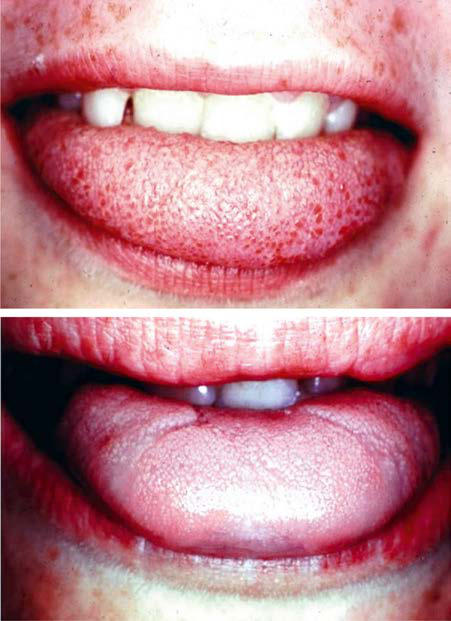
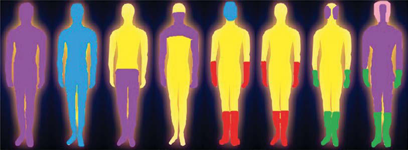

# Chapter 656: Guillain-Barré Syndrome

*Monique M. Ryan*

<!-- p.4979 -->
**ALLGROVE SYNDROME (TRIPLE A SYNDROME)** Allgrove syndrome is a rare autonomic neuropathy characterized by early-onset alacrima, feeding difficulties and achalasia, autonomic dys function with orthostatic hypotension, altered heart rate variability, hyperreflexia, ataxia, muscle weakness, sensorimotor polyneuropa thy, and adrenocorticotropic hormone–resistant adrenal insufficiency, which develops in the first decade. The gene *AAAS* (alacrima-achalasiaadrenal insufficiency neurologic disorder) is located on chromosome 12q13.

*Visit Elsevier eBooks+ at eBooks.Health.Elsevier.com** for Bibliography.*

A

B

**Fig. 655.1** A, Normal tongue with fungiform papillae present on the tip. B, Dysautonomic tongue. Note absence of the highly vascularized fungiform papillae from the tongue tip, which gives the appearance of a smooth tongue. (From Axelrod FB, Gold-von Simson G. Hereditary sensory and autonomic neuropathies: Types II, III, and IV. Orphanet J Rare Dis. 2007;2:39. Fig. 4.)

Guillain-Barré syndrome (GBS) is an autoimmune disorder that is thought to be a **postinfectious polyneuropathy,** involving mainly motor but also sensory and sometimes autonomic nerves. This syn drome affects people of all ages and is not hereditary. Most GBS patients in the United States and Europe have a demyelinating neuropathy, but primarily axonal degeneration is apparent in some forms of GBS seen mainly in China, Mexico, Bangladesh, and Japan.

*Monique M. Ryan*

**CLINICAL MANIFESTATIONS** The onset of weakness usually follows a nonspecific gastrointestinal or respiratory infection by approximately 10 days. The original infec tion might have caused only gastrointestinal (especially *Campylobacter jejuni,* but also *Helicobacter pylori*), respiratory (especially *Mycoplasma pneumoniae*), or systemic (Zika virus, COVID-19) symptoms. Con sumption of undercooked poultry, unpasteurized milk, and contami nated water are the main sources of gastrointestinal infections. West Nile virus also can mimic Guillain-Barré–like syndrome, but more often causes a motor neuron disease similar to poliomyelitis. GBS may follow administration of vaccines against rabies, influenza, and conjugated meningococcal vaccine, particularly serogroup C. Other infectious precursors of GBS include mononucleosis, Lyme dis ease, cytomegalovirus, the Zika virus and, most recently, COVID-19 infection.

Initial symptoms include numbness and paresthesia, followed by weakness (Fig. 656.1). Radicular back pain and myalgia are common in the initial stages; affected children can be very irritable. Weakness usually begins in the lower extremities and progressively involves the trunk, the upper limbs, and finally the bulbar muscles, but weakness is sometimes proximally prominent. Extraocular muscle involvement is rare, but many children develop facial weakness. In most cases weak ness is essentially symmetric. Weakness progresses over days or weeks, the clinical nadir occurring in less than 4 weeks. Approximately 60% of children lose the ability to walk at some point in their illness; a small proportion progress to flaccid tetraplegia. The maximal severity of weakness is reached by 4 weeks after onset. The differential diagnosis of GBS is shown in Tables 656.1 and 656.2.

**Bulbar involvement** occurs in about 50% of cases and can result in respiratory insufficiency (see Fig. 656.1; Table 656.3). Dysphagia and facial weakness can be signs of impending respiratory failure, interfere with saliva control and swallowing, and increase the risk of aspiration. Vocal cord paralysis may cause dyspnea or a hoarse voice. Severe bul bar and respiratory muscle involvement can lead to death if GBS is not recognized and treated.

The **autonomic nervous system** is also involved in some cases. Labil ity of blood pressure and heart rate, postural hypotension, episodes of profound bradycardia or tachycardia, and occasional asystole occur more commonly in younger patients or those with severe weakness. Cardiovascular monitoring is important, especially early in the disease course, when rapid progression of weakness, respiratory insufficiency, and autonomic instability can be life-threatening. The tendon reflexes are lost in GBS, usually early, but are sometimes preserved until later; areflexia is more common but hyporeflexia may be seen. As many as 10% of affected children retain their reflexes throughout their course. Subtypes of GBS include an acute inflammatory demyelinating polyneuropathy and an acute motor axonal neuropathy; these are distinguished by findings on nerve conduction studies and an associ ated pattern of antiganglioside antibodies (see Table 656.3). Localized forms of GBS also occur and include a pattern of facial diplegia with paresthesias and a pattern of pharyngeal-cervical-brachial weakness. **Miller Fisher syndrome (MFS)** is an uncommon GBS variant associ ated with acute external (and occasionally internal) ophthalmoplegia, ataxia, and areflexia. The cranial nerve VI is most often involved in MFS. Although areflexia is seen in MFS, patients have no or only very mild lower extremity weakness, compared with GBS. Distal paresthe sias are common in MFS. Urinary incontinence or retention is seen in approximately 20% of cases but is usually transient. MFS overlaps clinically with Bickerstaff brainstem encephalitis, which has similar findings with an associated encephalopathy.

**Chronic inflammatory demyelinating polyradiculoneuropathy** (CIDP, sometimes called *chronic inflammatory relapsing polyneuritis*) is a more chronic, slowly progressive, acquired inflammatory neuropa thy with some clinical overlap with GBS (Table 656.4). Symptoms such as weakness and paresthesias develop over more than 4-6 weeks, recur intermittently (relapsing), or progress slowly over periods of months to years. Weakness is generally both proximal and distal, and variably severe. Hyporeflexia or areflexia is almost universal. Motor deficits occur in 94% of cases and sensory paresthesias in 64%, but cranial

<!-- p.4981 -->
**Keywords:** dysautonomia; crises; alacrima; pain; anhidrosis.

**KLIEGMAN: 655**

**Non-Print Items**

<!-- p.4982 -->
Classic Sensorimotor

Pure Motor

Sensory

Motor

Sensory & Motor

Ataxia

Altered consciousness

Paraparetic Pharyngeal - Cervical - Brachial

Bilateral facial palsy with paresthesias

Pure sensory Miller Fisher Syndrome

Bickerstaff brainstem encephalitis

**Fig. 656.1** Pattern of symptoms in variants of Guillain-Barré syndrome (GBS). Graphic representation of the pattern of symptoms typically ob served in the different clinical variants of GBS. Symptoms can be purely motor, purely sensory (rare), or a combination of motor and sensory. Ataxia can be present in patients with Miller Fisher syndrome, and both decreased consciousness and ataxia can be present in patients with Bickerstaff brainstem encephalitis. Symptoms can be localized to specific regions of the body, and the pattern of symptoms differs between variants of GBS. Although rare, bilateral facial palsy with paresthesias, the pure sensory variant, and Miller Fisher syndrome are included in the GBS spectrum, but they do not fulfill the diagnostic criteria for GBS. (From El-Abassi RN, Soliman M, Levy MH, et al. Treatment and management of autoimmune neuropathies. In: Bertorini TE, ed. Neuromuscular Disorders Treatment and Management, 2nd ed. Philadelphia: Elsevier; 2022: Fig. 15.1, p. 313.)

#### **Table 656.1** Differential Diagnosis of Childhood Guillain-Barré Syndrome

| Category / Parameter | Clinical Details & Findings |
| --- | --- |
| **SPINAL CORD LESIONS** | Acute transverse myelitis (may occur with GBS); Epidural abscess; Tumors; Poliomyelitis; Enteroviral myelitis; Acute flaccid myelitis; Hopkins syndrome; Vascular malformations; Cord infarction; Fibrocartilaginous embolism; Cord compression from tumors; Acute disseminated encephalomyelitis; Bickerstaff brainstem encephalitis; Anterior spinal artery syndrome |
| **PERIPHERAL NEUROPATHIES** | Toxic (See Chapter 654); Vincristine; Thalidomide; Glue sniffing; Heavy metal: gold, arsenic, lead, thallium, mercury; Organophosphate pesticides; Fluoroquinolones; Isoniazid; Dapsone; Nitrous oxide; Snake venom; Puffer fish; Buckthorn toxin; Carbon monoxide; Immune checkpoint inhibitors; Infections |
| **HIV** | Diphtheria; West Nile virus; Cytomegalovirus (radiculitis); Leprosy; Lyme disease; Zika virus |
| **COVID-19** | Inborn errors of metabolism/hereditary; Leigh disease; Tangier disease; Porphyria; Fabry disease; Tyrosinemia; Mitochondrial neuropathies; Critical illness: polyneuropathymyopathy; Eosinophilic granulomatosis with polyangiitis; Granulomatosis with polyangiitis; Sarcoidosis; Systemic lupus erythematosus; Microscopic polyangiitis; Other vasculitides; Nutritional deficiencies; Vitamin B1, B6, B12, E; Riboflavin |
| **NEUROMUSCULAR JUNCTION DISORDERS** | Tick paralysis; Myasthenia gravis; Acute flaccid myelitis; Botulism; Hypercalcemia |
| **MYOPATHIES** | Periodic paralyses (hypokalemic or hyperkalemic); Dermatomyositis; Critical illness myopathy/polyneuropathy |
| **OTHER** | Conversion disorder; Chronic inflammatory demyelinating polyneuritis (acute onset) |

<!-- p.4983 -->

#### **Table 656.2** Differential Diagnosis of Guillain-Barré Syndrome by Anatomic Site and Illness

| Category / Parameter | Clinical Details & Findings |
| --- | --- |
| **BRAIN** | Encephalitis; Drowsiness, seizures; Pleocytosis; Normal; Brain MRI for hyperintense; lesions, EEG for slowing; epileptiform discharges; Brainstem stroke; Hyperacute sudden onset,; cranial and limb weakness; Normal; Normal; Brain MRI and magnetic; resonance angiography for; corresponding infarct and; vascular occlusion |
| **SPINAL CORD** | Transverse myelitis; Sensory level, brisk reflexes; Normal; Normal; Abnormal spine MRI for; hyperintense lesions; Malignant infiltration; Cauda equina syndrome; Malignant cells; Normal; Abnormal spine MRI; for enhancing lesions,; investigations for primary; lesions |
| **ANTERIOR HORN CELL** | Infection with poliovirus,; enterovirus 71, or; enterovirus D68; Fever, flaccid paralysis; Pleocytosis; Motor neuronopathy; Presence of virus |
| **PLEXUS** | Neuralgic amyotrophy; Asymmetry, pain, and; findings limited to affected; nerves; Normal; Abnormal in affected nerves; Brachial plexus MRI for nerve; enhancement |
| **NERVE ROOTS** | Cytomegalovirus and; HIV radiculitis; Subacute presentation; Pleocytosis; Delayed or absent F waves; and H waves; HIV and cytomegalovirus; serology; Chronic inflammatory; demyelinating; polyneuropathy; Subacute presentation and; relapsing–remitting pattern; Albumin-cytologic; dissociation; Demyelinating neuropathy; Nerve ultrasound for enlarged; nerve roots |
| **PERIPHERAL NERVES** | Chronic inflammatory; demyelinating; polyneuropathy; Subacute presentation and; relapsing–remitting pattern; Albumin-cytologic; dissociation; Demyelinating neuropathy; Nerve ultrasound for enlarged; nerve roots, and proximal; and distal nerves; Porphyria; Family history, concomitant; psychiatric and abdominal; pain; Normal; Axonal neuropathy; Increased urinary; porphobilinogen; Lyme disease or other; tick-borne diseases; History of exposure,; characteristic rash; (erythema migrans in Lyme; disease); Normal; Axonal neuropathy; Antibodies against Borrelia; burgdorferi (Lyme disease); or the related tick species; Thiamine deficiency; Predisposing factors (e.g.,; hyperemesis gravidarum,; alcohol misuse, nutritional; deficiency, and other; neurologic features such as; Wernicke encephalopathy); Normal; Axonal neuropathy; Reduced blood thiamine and; erythrocyte transketolase; activity; Diphtheria; Laryngeal infection; Increased total; protein; Demyelinating neuropathy; Isolation of Corynebacterium; diphtheriae on cultures; Critical illness; polyneuropathy; Prolonged illness or; ventilation; Normal; Axonal neuropathy; Overlap with myopathy; Metabolic or electrolyte; imbalance; Predisposing factors; Normal; Normal; Low serum concentrations of; abnormal electrolyte |
| **NEUROMUSCULAR JUNCTION** | Myasthenia gravis; Fatigable weakness,; relapsing–remitting pattern; Normal; Repetitive nerve stimulation; for a decremental response; Acetylcholine receptor; antibodies; Botulism; Rapid progression,; pupillary abnormalities,; dysautonomia, and; descending paralysis; Normal; Rapid repetitive nerve; stimulation for an; incremental increase; Botulism toxin |

<!-- p.4984 -->

#### **Table 656.2** Differential Diagnosis of Guillain-Barré Syndrome by Anatomic Site and Illness—cont’d

| Category / Parameter | Clinical Details & Findings |
| --- | --- |
| **OTHER SUPPORTIVE TESTS** | Lambert-Eaton; syndrome; Proximal weakness,; depressed tendon reflexes,; and autonomic changes; Normal; Repetitive nerve stimulation; for post-tetanic facilitation; Antibodies against; voltage-gated calcium; channels |
| **MUSCLE** | Inflammatory myositis; Proximal weakness, normal; reflexes and sensation; Normal; Normal sensory potentials; Myopathic; Increased serum creatine; kinase; Critical illness myopathy; Prolonged illness or; ventilation; Normal; Normal sensory potentials; Overlap with neuropathy; Hypokalemic periodic; paralysis; Transient weakness, family; history, triggering factors; (e.g., fasting, exercise, and; carbohydrate-rich meals); Normal; Abnormal exercise test; Low serum potassium; concentrations, genetic; mutation |
| **MISCELLANEOUS** | Functional disorder; Inconsistent, variable; presentation; Normal; Normal; Psychologic evaluation; From Shahrizaila N, Lehmann HC, Kuwabara S. Guillain-Barre syndrome. Lancet. 2021;397:1214–1226. Table 2. |

#### **Table 656.3** Clinical Classification of Guillain-Barré Syndrome

| Category / Parameter | Clinical Details & Findings |
| --- | --- |
| **Classic** | Demyelinating; Upper and; lower limbs; Yes; Yes; No |
| **AIDP** | Unknown; 69–90%; Axonal; Upper and; lower limbs; Yes in AMSAN,; no in AMAN; Yes; No |
| **AMSAN, RCF** | GM1, GD1a; <22%; Pure motor; Upper and; lower limbs; No; Yes; No |
| **AMAN, RCF** | GM1, GD1a; 5–70%; Pure sensory; None; Yes; No; No; Abnormal; SNAPs; GD1b; <1%; Paraparetic; Lower limbs; Yes; No; No; Axonal; GM1, GD1b; 5–10%; Facial diplegia and; paresthesia; None; Yes (distal); Facial; No |
| **AIDP** | Unknown; <5%; Pharyngeal,; cervical, brachial; Proximal; upper limbs; Supportive; Bulbar; No; Equivocal; GT1a, GQ1b; <5%; Acute bulbar palsy; None; Supportive; Bulbar; No; Equivocal; GT1a; <1%; Guillain-Barré; syndrome with; hyperreflexia; Upper and; lower limbs; Yes; Yes; No; Axonal |
| **GM1** | <1% |
| **MILLER FISHER SYNDROME SPECTRUM** | Classic; None; Ataxia; Ocular motor; nerves; No; Abnormal; SNAPs; GQ1b, GT1a; 4–25%; Acute; ophthalmoplegia; None; Supportive; Ocular motor; nerves; No; Normal; GQ1b; <1%; Acute ataxic; neuropathy; None; Ataxia; No; No; Axonal |
| **GM1** | <5%; Acute ptosis; None; Supportive; Ptosis only; No; Normal; GQ1b; <1%; Acute mydriasis; None; Supportive; Dilated pupils; No; Normal; Unknown; <1%; Acute vestibular; syndrome; None; Supportive; Nystagmus; Nystagmus; Normal; GQ1b; <1%; Continued |

<!-- p.4985 -->
**PATTERNS**

**OF LIMB WEAKNESS**

**SENSORY 
 INVOLVEMENT**

**CRANIAL**

**NERVE 
 INVOLVEMENT**

**CNS 
 INVOLVEMENT**

**SERIAL 
 NEURAL 
 CONDUCTION**

**IgG AGAINST GANGLIOSIDE**

**TYPE**

**PROPORTION OF**

**PATIENTS WITH GUILLAIN-BARRÉ**

**SYNDROME**

BICKERSTAFF BRAINSTEM ENCEPHALITIS Classic None Supportive Ocular motor

nerves

Yes Axonal GQ1b, GT1a <5%

Acute ataxic

hypersomnolence

None Ataxia No Yes Normal GQ1b <1%

AIDP, acute inflammatory demyelinating polyneuropathy; AMAN, acute motor axonal neuropathy; AMSAN, acute motor and sensory neuropathy; RCF, reversible conduction failure; SNAP,

sensory nerve action potential. From Shahrizaila N, Lehmann HC, Kuwabara S. Guillain-Barre syndrome. Lancet. 2021;397:1214–1226. Table 3.

#### **Table 656.3** Clinical Classification of Guillain-Barré Syndrome—cont’d

#### **Table 656.4** Differential Diagnosis CIDP

| Category / Parameter | Clinical Details & Findings |
| --- | --- |
| **TYPICAL CIDP** | • AL amyloidosis, ATTRv polyneuropathy; • Chronic ataxic neuropathy ophthalmoplegia M-protein; agglutination disialosyl antibodies (CANOMAD); • Guillain-Barré syndrome; • Hepatic neuropathy; • HIV-related neuropathy; • Multiple myeloma; • Osteosclerotic myeloma; • POEMS syndrome; • Uremic neuropathy; • Vitamin B12 deficiency—actual or functional (e.g., nitrous oxide; poisoning); • Riboflavin transporter deficiency (SLC52A2) |
| **DISTAL CIDP** | • Anti-MAG IgM neuropathy; • Diabetic neuropathy; • Hereditary neuropathies (CMT1, CMTX1, CMT4, metachromatic; leukodystrophy, Refsum disease, adrenomyeloneuropathy, ATTRv; polyneuropathy); • POEMS syndrome; • Vasculitic neuropathy |
| **MULTIFOCAL AND FOCAL CIDP** | • Diabetic radiculopathy/plexopathy; • Entrapment neuropathies; • Hereditary neuropathy with liability to pressure palsies (HNPP); • Multifocal motor neuropathy (MMN); • Neuralgic amyotrophy; • Peripheral nerve tumors (such as lymphoma, perineurioma,; schwannoma, neurofibroma); • Vasculitic neuropathy (mononeuritis multiplex) |
| **MOTOR CIDP** | • Hereditary motor neuropathies (such as distal hereditary motor; neuropathies, spinal muscular atrophy, porphyria); • Inflammatory myopathies; • Motor neuron disease; • Neuromuscular junction disorders (such as myasthenia gravis,; Lambert-Eaton syndrome) |
| **SENSORY CIDP** | • Cerebellar ataxia, neuropathy, vestibular areflexia syndrome |
| **(CANVAS)** | • Chronic immune sensory polyradiculopathy (CISP); • Dorsal column lesions (such as syphilis, paraneoplastic, copper; deficiency, vitamin B12 deficiency); • Hereditary sensory neuropathies; • Idiopathic sensory neuropathy; • Sensory neuronopathy; • Toxic neuropathies (such as chemotherapy and vitamin B6 toxicity); AL, amyloid light chain; ATTRv, hereditary transthyretin amyloidosis; CIDP, chronic; inflammatory demyelinating polyradiculoneuropathy; MAG, antimyelin-associated; glycoprotein; POEMS, polyneuropathy,organomegaly, endocrinopathy, M-protein,; skin changes.; Modified from Van den Bergh PYK, van Doorn PA, Hadden RDM, et al. European; Academy of Neurology/Peripheral Nerve Society guideline on diagnosis and treatment; of chronic inflammatory demyelinating polyradiculoneuropathy: report of a joint task |

nerve and autonomic involvement is uncommon. The cerebrospinal fluid (CSF) shows no pleocytosis, but the CSF protein is almost always elevated. Nerve conduction studies show variable slowing of nerve conduction; where required, sural nerve biopsy shows patchy myelin loss and focal inflammatory changes. Acute-onset CIDP may be diffi cult to distinguish from GBS; CIDP may also be difficult to distinguish from GBS with treatment-related symptom fluctuations.

**Congenital GBS** is very rare, manifesting as generalized hypotonia, weakness, and areflexia in an affected neonate, fulfilling all electro physiologic and CSF criteria and in the absence of maternal neuro muscular disease. Treatment is not always required.

**LABORATORY FINDINGS AND DIAGNOSIS** CSF studies are helpful in diagnosing GBS. The CSF protein is usually elevated to more than twice the upper limit of normal, the glucose level is normal, and there is no pleocytosis; there should be fewer than 10 white blood cells/mm3. Bacterial cultures are negative, whereas viral studies rarely isolate specific viruses. The dissociation between high CSF protein and a lack of cellular response (cytoalbuminologic disso ciation) in a patient with an acute or subacute polyneuropathy is essen tially diagnostic of GBS. These findings may not be apparent in the first week after the onset of symptoms (Table 656.5).

On MRI of the spinal cord in GBS, typical findings include thicken ing of the cauda equina and intrathecal nerve roots with gadolinium enhancement (Fig. 656.2). Atypical findings should prompt consid eration of the alternative diagnoses listed in Table 656.1. Imaging in CIDP is similar but may show greater enhancement of spinal nerve roots (Fig. 656.3).

Nerve conduction studies and electromyography are sensitive to early signs of peripheral nerve inflammation in GBS. Motor and sensory nerve conduction velocities are reduced to a variable extent, reflecting the patchy nature of nerve involvement in this disorder, which is also reflected by focal conduction block and dispersed responses. Electro myography may show acute denervation of muscle. Serum creatine kinase levels may be mildly elevated or normal. Serum antiganglioside antibodies against GM1 and GD1 are sometimes elevated in GBS, par ticularly in cases with primarily axonal rather than demyelinating neu ropathy, suggesting that they might play a role in disease propagation and/or recovery in some cases (see Table 656.3). Sural nerve biopsy shows segmental demyelination, focal inflammation, and Wallerian degeneration, but is almost never required for diagnosis.

Serologic testing for *Campylobacter* and *Helicobacter* infections helps establish causation if results are positive but does not alter treat ment. Stool cultures are rarely positive because the infection is gener ally self-limited, and the neuropathy follows the acute gastroenteritis.

**TREATMENT** Patients in early stages of GBS should be admitted to the hospital for observation because the ascending paralysis can rapidly cause (potentially life-threatening) respiratory failure and autonomic insta bility (Fig. 656.4). The respiratory effort (measured by bedside testing or spirometry) *must* be monitored for changes predicting onset of hypoventilation and respiratory failure. Patients with milder weak ness and slow progression may be treated expectantly, with observa

<!-- p.4986 -->
progressive muscle weakness is treated with intravenous immuno globulin (IVIG); common protocols include IVIG 0.4 g/kg/day for 5 consecutive days or 1 g/kg/day for 2 days. Plasmapheresis and/ or immunosuppressive drugs are alternatives if IVIG is ineffective. Steroids are not effective for weakness but may help with pain. Sup portive care, such as respiratory support, prevention of pressure sores and constipation, nutritional support, pain management, prevention of deep vein thrombosis, and treatment of secondary bacterial infec tions is important.

*Neuropathic pain in GBS should be treated aggressively,* with narcotic analgesics where necessary, and with medications such as gabapentin.

Syndrome*

#### **Table 656.5** Diagnostic Criteria for Guillain-Barré

| Category / Parameter | Clinical Details & Findings |
| --- | --- |
| **SYNDROME IN CLINICAL PRACTICE** | • Progressive weakness in legs and arms (sometimes initially only in legs); • Areflexia (or decreased tendon reflexes) in weak limbs |
| **ADDITIONAL SYMPTOMS** | • Progressive phase lasts days to 4 wk (often 2 wk); • Relative symmetry; • Mild sensory symptoms or signs (not present in acute motor; axonal neuropathy); • Cranial nerve involvement, especially bilateral weakness of facial; muscles; • Autonomic dysfunction; • Pain (common) |
| **OF GUILLAIN-BARRÉ SYNDROME** | • CSF: increased number of mononuclear cells or; polymorphonuclear cells (>50 cells/μL); • Severe pulmonary dysfunction with little or no limb weakness at; onset; • Severe sensory signs with little or no weakness at onset; • Bladder or bowel dysfunction at onset; • Fever at onset; • Sharp spinal cord sensory level; • Marked, persistent asymmetry of weakness; • Persistent bladder or bowel dysfunction; • Slow progression of weakness and without respiratory; involvement (consider subacute inflammatory demyelinating; polyneuropathy or acute-onset chronic inflammatory; demyelinating polyneuropathy) |
| **NERVE CONDUCTION STUDIES** | • Can be helpful in clinical practice but are generally not required; to diagnose Guillain-Barré syndrome; • Essential for classification of Guillain-Barré syndrome as acute; inflammatory demyelinating polyneuropathy or acute motor; axonal neuropathy; • Acute inflammatory demyelinating polyneuropathy: features; of demyelination (decreased motor nerve conduction velocity,; prolonged distal motor latency, increased F-wave latency,; conduction blocks, and temporal dispersion); • Acute motor axonal neuropathy: no features of demyelination; (one demyelinating feature in one nerve, if distal CMAP amplitude; is less than 10% LLN, can be found; distal CMAP amplitude; less than 80% LLN in at least two nerves. Transient motor nerve; conduction block might be present.; *Classification of Guillain-Barré syndrome as either acute inflammatory demyelinating; polyneuropathy or acute motor axonal neuropathy is not required for the diagnosis of; Guillain-Barré syndrome. Whether acute inflammatory demyelinating polyneuropathy and; acute motor axonal neuropathy require different treatments is unknown. The amount of; conduction slowing required to define demyelination differs between classification systems.; CSF, Cerebrospinal fluid; CMAP, compound muscle action potential; LLN, lower limit of; normal.; From Willison HJ, Jacobs BC, van Doorn PA. Guillain-Barré syndrome. Lancet.; 2016;388:717–727. Panel 1. |

CIDP can be treated with either oral or pulsed steroids or IVIG, with refractory cases often requiring use of other immunosuppressive medications. Children with relapsing or slowly progressive weakness often need months to years of therapy, but most eventually achieve a sustained remission. The outcome is generally good, but some children have permanent deficits.

**PROGNOSIS** GBS is usually a monophasic illness; spontaneous recovery begins within 2-3 weeks but can take months. Therapy with IVIG hastens recovery but not does alter the long-term outcome. As many as 60% of affected children become nonambulant during their illness, but most eventually regain full strength. A minority has some residual weak ness, most often of the ankle dorsiflexors. Improvement usually follows a gradient opposite the direction of involvement, with bulbar function recovering first and lower extremity weakness resolving last. The ten don reflexes are usually the last function to recover. Clinical features predicting a severe course and slow (possibly incomplete) recovery include cranial nerve involvement, the need for ventilatory support, and maximum disability at the time of presentation. Neurophysiologic studies do not necessarily predict the long-term outcome, but chil dren with demyelinating forms of GBS generally recover more quickly than those with axonal forms. Bulbar and respiratory muscle involve ment can lead to death from GBS if the syndrome is not recognized and treated. Fatigue is the most common long-term residuum of GBS. Relapses occur in about 4% of children with GBS and are generally responsive to immunomodulatory treatment.

*Visit Elsevier eBooks+ at eBooks.Health.Elsevier.com** for Bibliography.*

A B

C D

**Fig. 656.2** Guillain-Barré syndrome. Sagittal off-midline (A) and mid line (B) postgadolinium T1 weighted fat-saturated images through the lumbar spine of a patient who could not ambulate. C and D, Axial post contrast T1 weighted images through the conus medullaris and proximal lumbar nerve roots, respectively. The images show extensive contrast enhancement of nerve roots (arrows in A-D), in keeping with changes of Guillain-Barré syndrome. (From Slovis TL, ed. Caffey’s Pediatric Diag nostic Imaging, 11th ed. Philadelphia: Mosby; 2008: Fig. 65-6.)

<!-- p.4987 -->
**Re-challenge** • Intravenous immunoglobulin • Plasma exchange

**Monitor** • Thromboembolic events • Autonomic dysfunction • Secondary infections • Pain

**Monitor** • Deep-vein thrombosis or pulmonary embolism • Respiratory or bulbar weakness • Autonomic dysfunction • Secondary infections • Pain

**Supportive** • Deep-vein thrombosis prophylaxis • Early intubation if respiratory weakness • Nasogastric tube if bulbar or respiratory weakness • Temporary pacing in arrhythmias • Early passive and active rehabilitation support • Pain relief

**Immunotherapy** • Intravenous immunoglobulin • Plasma exchange

**Monitor** • Disease progression • Respiratory weakness • Bulbar weakness • Autonomic dysfunction

**Immunotherapy** • Intravenous immunoglobulin • Steroids • Plasma exchange

Treatment-related fluctuation

Acute chronic inflammatory demyelinating polyneuropathy

Diagnosis of Guillain-Barré syndrome

Relapse Recovery Immunotherapy

completed Late presentation

• Independent walking • Mild variant • Unable to walk unaided • Respiratory weakness • Bulbar weakness • Autonomic dysfunction

Acute phase Within 2 weeks of disease onset

Progressive phase Usually 2–4 weeks after disease onset

Plateau reached Usually between 4–8 weeks of disease onset

**Fig. 656.4** Management algorithm for Guillain-Barré syndrome. Depending on the time of symptom presentation from disease onset, patients can be managed according to the disease phase. Immunotherapy with either intravenous immunoglobulin or plasma exchange is recommended when the patient cannot walk unaided. Supportive management includes monitoring for disease progression and early intervention when there is evidence of autonomic dysfunction, respiratory weakness, or bulbar weakness. Due to prolonged immobility, patients are also at risk of deep vein thrombosis and pulmonary embolism, warranting preventive prophylaxis. After plateau is reached, some patients can have a relapse, which could be

A B C

**Fig. 656.3** Chronic inflammatory demyelinating polyneuropathy (CIDP) in a 13-yr-old male with peripheral neuropathy and gait disturbance. Sagit tal fat-saturated T1 weighted images off the midline to the right (A), at the midline (B), and off the midline to the left (C). (From Slovis TL, ed. Caffey’s Pediatric Diagnostic Imaging, 11th ed. Philadelphia: Mosby; 2008: Fig. 65-7.)

<!-- p.4988 -->

<!-- p.4989 -->
**Keywords:** acute inflammatory demyelinating neuropathy; Guillain-Barré; acute flaccid paralysis; acute motor axonal neuropathy.

**KLIEGMAN: 656**

**Non-Print Items**
