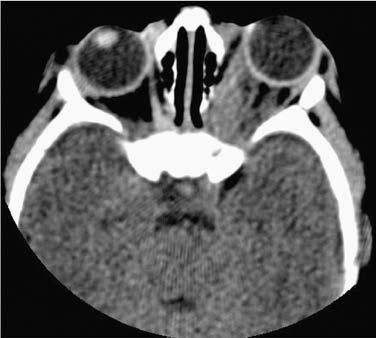

# Chapter 674: Orbital Infections

*Scott E. Olitsky, Justin D. Marsh, and Mary Anne Jackson*

<!-- p.5073 -->
Orbital infections are common in children. It is important to be able to distinguish the different forms of infection that occur in the orbital region to allow rapid diagnosis and treatment to prevent loss of vision or spread of the infection to the nearby intracranial structures (Table 674.1).

**DACRYOADENITIS** Dacryoadenitis is inflammation of the lacrimal gland; it most com monly occurs in the pediatric population and in some young adults and is related to a variety of infectious pathogens or inflammatory processes

are most commonly seen in patients with neurofibromatosis and may present with poor vision or proptosis. Retinoblastoma (see Chapter 551) may extend into the orbit if it is discovered late or goes untreated. Teratomas are rare tumors that typically grow rapidly after birth and exhibit explosive proptosis.

The effects of orbital tumors vary with their locations and growth patterns. The principal signs are proptosis, resistance to retroplacement of the eye, and impairment of eye movement. A palpable mass may be found. Other significant signs are ptosis, optic nerve head congestion, optic atrophy, and loss of vision. Bruit and visible pulsation of the globe are important clues to vascular lesions.

Evaluation of orbital tumors includes ultrasonography, MRI, and CT. Pseudotumor of the orbit also must be considered in children with signs of a mass lesion. In selected cases, an incisional or excisional biopsy of the lesion may be warranted.

*Visit Elsevier eBooks+ at eBooks.Health.Elsevier.com** for Bibliography.*

A

B

**Fig. 673.5** Orbital hemangioma. A, Note the proptosis. B, CT scan. (Courtesy Amy Nopper, MD, and Brandon Newell, MD.)

*Scott E. Olitsky, Justin D. Marsh, and 
 Mary Anne Jackson*

(see Chapter 673). Pain, redness, swelling, increase in tearing, and dis charge over the lacrimal gland are noted and usually visible at the lateral one third of the upper eyelid; concurrent preauricular lymphadenopathy may be noted (Fig. 674.1). It may occur with mumps (in which case it is usually acute and bilateral, subsiding in a few days or weeks), with influ enza, infectious mononucleosis, and herpes zoster. *Staphylococcus aureus* may produce a suppurative dacryoadenitis, and other bacterial causes include streptococci and *Neisseria gonorrhoeae*. Chronic dacryoadeni tis is associated with certain systemic diseases, particularly sarcoidosis, tuberculosis, and syphilis. Some systemic diseases may produce enlarge ment of the lacrimal and salivary glands (Mikulicz syndrome).

**DACRYOCYSTITIS** Dacryocystitis is an infection of the lacrimal sac and generally requires obstruction of the nasolacrimal system to allow its development. Acute, subacute, and chronic forms are described. Most patients with dacryocystitis present with redness and swelling over the region of the lacrimal sac (Fig. 674.2). It is treated with warm compresses and sys temic antibiotics. This helps control the infection, but the obstruction usually requires definitive treatment to reduce the risk of recurrence.

Dacryocystitis may occur in newborns as a complication of a con genital dacryocystocele (see Chapter 665). If present, systemic antibi otics and digital pressure for decompression are recommended. The obstruction of the nasolacrimal system may resolve once the infection clears. If spontaneous resolution does not occur, probing should be considered within a short time frame. An intranasal cyst may be pres ent in conjunction with the dacryocystocele. If this occurs, marsupial ization of the cyst may be needed at the time of the probing.

**PRESEPTAL CELLULITIS** Inflammation of the lids and periorbital tissues without signs of true orbital involvement (such as proptosis or limitation of eye movement) is generally referred to as *periorbital* or *preseptal cellulitis* and is a form of facial cellulitis. This is a common entity in young children, usually under age 5 years, and may rarely be caused by direct seeding related to bacteremia (usually seen in those <3 years), or more often sinusitis,

Associated with Ethmoid Sinusitis

#### **Table 674.1** Manifestations of Orbital Cellulitis

| Category / Parameter | Clinical Details & Findings |
| --- | --- |
| **CLINICAL AND CT IMAGING DESCRIPTION** | 1: Inflammatory; edema; Eyelid edema and erythema; eye may be; swollen shut; Fever; Painless extraocular muscle movement; full; range of motion; Visual acuity normal; Edema of orbit without abscess formation; 2: Orbital cellulitis; Inflammation of orbital contents without; discrete abscess formation; Fever, malaise; 3: Subperiosteal; abscess; Purulent exudate beneath medial orbital; periosteum of lamina papyracea; Pain on extraocular muscle movement; Fever, malaise, may have pain with extraocular; muscle movement; Displacement of globe (down and out); 4: Orbital abscess/; orbital apex; syndrome; Purulent collection within orbit; Proptosis, chemosis; Ophthalmoplegia; pain on extraocular muscle; movement; Decreased vision; Fever, malaise; 5: Septic; cavernous sinus; thrombophlebitis; Bilateral (contralateral) eye findings; ptosis,; proptosis, swelling, ophthalmoplegia; Severe headaches; Meningismus, fever, severe malaise; Decreased vision |

<!-- p.5075 -->
A B

**Fig. 674.1** MRI of the bilateral lacrimal glands. A, Coronal T1- weighted image. B, Axial T2-weighted image. The bilateral lacrimal glands are markedly enlarged (arrows). (From Hoshino A, Fujii T, Hibino S, Abe Y. Acute infantile dacryoadenitis. J Pediatr. 2014;164:425: Fig. 2))

**Fig. 674.2** Dacrycystitis in a child previously treated for nasolacrimal duct obstruction.

trauma, or other infected wounds in the periorbital region, or an abscess of the lid or periorbital region (pyoderma, hordeolum, con junctivitis, dacryocystitis, insect bite). Brown recluse spider bites are often associated with considerable local swelling, and in the first 24 hours, the bite itself may not be obvious to the parent or the examiner.

Patients present with eyelid swelling; the edema may be so intense as to make it difficult to evaluate the globe. Before the *Haemophilus influenzae* type B (Hib) vaccine, the most common cause of pediat ric preseptal (facial) cellulitis was bacteremia caused by Hib. Group A streptococcus (GAS), pneumococcus, and *S. aureus* (especially if related to an infected wound or bite) are the most common identifi able etiologic agents. Occasionally, young children with herpes simplex virus infection of the periorbital tissues will present first with swelling and redness, followed by the appearance of discrete tiny ulcers.

Clinical examination will show **lack of** proptosis, with normal pain less ocular movements, normal vision, and normal pupil responses. CT imaging can demonstrate edema of the lids and subcutaneous tissues anterior to the orbital septum (Fig. 674.3); imaging is not necessary in those without signs of an orbital process. Antibiotic therapy and careful clinical monitoring and evaluation to identify signs of local progres sion are essential. In well-appearing children with infected traumatic wounds or insect bites associated with periorbital cellulitis, oral anti biotics that target *S. aureus* and GAS may be considered. For young children in whom a hematogenous process is suspected, or in any toxic, ill-appearing child, blood cultures should be obtained, and hospitaliza tion and intravenous antibiotics are required. Most recommend intra venous ampicillin with sulbactam or intravenous clindamycin plus cefotaxime (or ceftriaxone) for hospitalized patients.

**Periorbital necrotizing fasciitis** is a severe, rapidly spreading form of periorbital bacterial infection, involving both superficial and deep fascial planes. The disease may have no preceding events or may follow trauma to the periorbital skin. Initial symptoms resemble peri orbital/facial cellulitis but rapidly progress to tissue necrosis, blister ing, and significant systemic toxicity. Streptococci and *S. aureus* are the most common pathogens. Treatment includes broad spectrum antibiotics, surgical debridement, and, when available, hyperbaric oxygen therapy.

**ORBITAL CELLULITIS** Inflammation of the tissues of the orbit, characterized by the triad of proptosis, painful limitation of movement of the eye (ophthalmople gia), and potentially decreased visual acuity, is termed *orbital cellulitis* (see Table 674.1). Edema of the conjunctiva (chemosis) and inflamma tion and swelling of the eyelids may be seen. The mean age is ∼7 years, ranges from 1 week to 18 years, and has a 2:1 predilection in males. An increased risk is seen in the winter because complicated obliga tory sinusitis often follows respiratory viral infection (e.g., influenza). Patients often feel ill, are febrile, and appear toxic, and leukocytosis sometimes but not always may be appreciated. Practitioners should have an increased clinical suspicion for intracranial extension in those with headache, vomiting, and any focal neurologic findings.

Orbital cellulitis may follow direct infection of the orbit from a wound, hematogenous seeding of organisms during bacteremia, or *more often* direct extension or venous spread of infection from contiguous sites such as the lids, conjunctiva, globe, lacrimal gland, nasolacrimal sac, or *more commonly* from the paranasal (ethmoid) sinuses. The **dif ferential diagnosis** includes idiopathic orbital inflammation, myositis, sarcoidosis, granulomatous vasculitis, leukemia, lymphoma, histiocytic disorders, rhabdomyosarcoma, ruptured dermoid cyst, orbital trauma, and orbital foreign body (see Chapter 673). In some cases, primary or metastatic tumor in the orbit can produce the clinical picture of orbital cellulitis.

Although the most common cause of orbital cellulitis in children is direct extension or venous spread from infected paranasal sinuses, an antecedent history of sinusitis requiring antibiotic therapy is generally not reported. The spread of infection to the orbit from the sinuses is more prevalent in children because of their thinner bony septa and sinus wall, greater porosity of bones, open suture lines, and larger vascular foramina (Fig. 674.4). The spread of infection is also facilitated by the venous and lymphatic communication between the sinuses and surrounding struc tures, which allow flow in either direction, facilitating retrograde throm bophlebitis. Frequently noted pathogenic organisms include *S. aureus,* streptococcus species (especially *Streptococcus anginosus* also known as the *Streptococcus milleri* group, and *S. pyogenes*), *Streptococcus pneu moniae*, and anaerobes (e.g., *Bacteroides* spp., *Prevotella* spp.).

**Fig. 674.3** CT scan of a patient with preseptal cellulitis.

<!-- p.5076 -->
The potential for complications is high. Visual loss can occur sec ondary to an increase in orbital pressure that causes retinal artery or ophthalmic vein occlusion or optic neuritis. This is more likely to occur in the presence of an orbital abscess. Extension of infection from the orbit into the cranial cavity may lead to cavernous sinus thrombo sis or meningitis, epidural or subdural empyema, or brain abscesses (Fig. 674.5). Additional complications include optic atrophy, exposure keratitis, and retinal or choroidal ischemia. An interdisciplinary team involving an infectious disease specialist, ophthalmologist, otolaryn gologist, and, where indicated, a pediatric neurosurgeon should be involved in the care of the patient with orbital infection.

Orbital cellulitis must be recognized promptly and treated aggres sively. Hospitalization and systemic antibiotic therapy are indicated. All patients with suspected orbital cellulitis should undergo contrast CT imaging of the orbit, paranasal sinuses, and adjacent cortex. Lum bar puncture should not be considered unless there is a meningitis pre sentation (and only after CT imaging), assuming there are no signs of elevated intracranial pressure or focal neurologic findings on examina tion. Parenteral antibiotics should be initiated immediately. Antimicro bial agents should begin with intravenous ampicillin with sulbactam or intravenous clindamycin plus ceftriaxone, cefepime (or cefotaxime); in cases where there is suspicion for intracranial extension, vancomycin plus cefotaxime (or ceftriaxone) plus metronidazole should be given.

If the patient does not show evidence of improvement or if there are signs of progression, sinus and abscess drainage should be considered. The presence of an orbital or unresponsive subperiosteal abscess (see Fig. 674.4) may require urgent drainage of the orbit. The clinical pre sentation and course of each individual patient should dictate the need and timing of abscess drainage.

Most children (especially those <9 years of age) with a medial **sub periosteal abscess** can initially be managed with intravenous antibi otics, which usually are sufficient for resolution of the subperiosteal abscess. Adjunctive use of corticosteroids is controversial but may hasten resolution. Patients should be examined frequently for signs of visual deterioration or pupillary abnormalities. Most will become afebrile within 48 hours and have examination improvement by 72 hours. If there are pupillary abnormalities, decreased vision, or failure to improve, the subperiosteal abscess should be drained.

Many recommend drainage for a subperiosteal abscess and an orbital abscess in older children. Additionally, abscesses involving the orbital roof with associated frontal sinus disease may require more frequent surgical intervention. Operative procedures should be coordinated with the otolar yngologist to allow for sinus drainage at the same time that the subperios teal abscess is drained, and cultures should be obtained from the sinus and the abscess. Similarly, if neurosurgical intervention is required, operative coordination should occur with ophthalmology and otolaryngology.

**Fig. 674.4** Orbital complications of sinusi tis. A, Orbital phlegmon and orbital cellulitis. Axial contrast-enhanced computed tomography (CECT) shows left preseptal periorbital soft tissue swelling (STS) and left ethmoid air cell opacifica tion. There is increased density of the left medial extraconal orbital fat (asterisks), consistent with phlegmon. The adjacent medial rectus muscle is thickened. There is subtle increased density of the intraconal orbital fat, consistent with or bital cellulitis. B, Orbital subperiosteal abscess. Axial CECT shows preseptal periorbital STS (ar rowhead), extensive left ethmoid air cell opaci fication, and an elliptical low-density, peripher ally enhancing, medial subperiosteal abscess (a). (Modified from Walters MM, Robertson RL, eds. Pediatric Radiology: The Requisites, 4th ed. Philadelphia: Elsevier, 2017. Fig. 10.37, p. 377.)

A

**

a

B

A

*

B

s

C

**Fig. 674.5** Superior ophthalmic vein (SOV) and cavernous sinus thrombosis (CST). A, SOV thrombosis. Axial contrast-enhanced computed tomog raphy (CECT) shows opacification of the partially visualized paranasal sinuses (arrowhead). There is a tram-track sign due to lack of enhancement of the thrombosed left SOV (black arrow). Compare with the normally enhancing right SOV (white arrow). B, CST (new patient). Axial computed tomog raphy image demonstrates a sphenoid sinus air–fluid level caused by sphenoid sinusitis. Gas is present within the right cavernous sinus (arrow) due to CST. There is resultant right ocular proptosis with minimal reticulation of the right intraconal orbital fat (asterisk). C, Axial T2-weighted magnetic resonance (same patient) shows low signal intensity within the right cavernous sinus with lateral convexity of its lateral margin (arrow), consistent with CST. Note the sphenoid sinus air–fluid level (s). (From Walters MM, Robertson RL [eds]. Pediatric Radiology: The Requisites. 4th ed. Philadelphia: Elsevier, 2017: Fig. 10.38, p. 377.)

<!-- p.5078 -->
