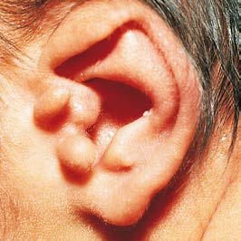
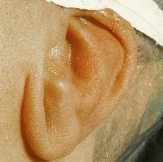

# Chapter 678: Congenital Malformations of the Ear

*Joseph Haddad Jr.*

<!-- p.5100 -->
The external and middle ears, derived from the first and second bran chial arches and grooves, grow throughout puberty, but the inner ear, which develops from the otocyst, reaches adult size and shape by midfe tal development. The ossicles are derived from the first and second arches (malleus and incus), and the stapes arises from the second arch and the otic capsule. The malleus and incus achieve adult size and shape by the 15th week of gestation, and the stapes achieves adult size and shape by the 18th week of gestation. Although the pinna, ear canal, and tympanic membrane (TM) continue to grow after birth, congenital abnormalities of these structures develop during the first half of gestation. Malformed external and middle ears may be associated with serious renal anoma lies, mandibulofacial dysostosis, hemifacial microsomia, and other cra niofacial malformations (Table 678.1). Facial nerve abnormalities may be associated with any of the congenital abnormalities of the ear and temporal bone. Malformations of the external and middle ears also may be associated with abnormalities of the inner ear and both conductive hearing loss (CHL) and sensorineural hearing loss (SNHL).

Congenital ear problems may be either minor and mainly cosmetic or major, affecting both appearance and function. Any child born with an abnormality of the pinna, external auditory canal, or TM should have a complete audiologic evaluation in the neonatal period. Imaging studies are necessary for evaluation and treatment; in the patient with other craniofacial abnormalities, a team approach with other special ists can assist in guiding therapy.

**PINNA MALFORMATIONS** Severe malformations of the external ear are rare, but minor deformities are common. Isolated abnormalities of the external ear occur in approxi mately 1% of children (Fig. 678.1). A **pitlike** depression just in front of the helix and above the tragus may represent a cyst or an epidermis-lined fistulous tract (Fig. 678.2). These are common, with an incidence of approximately 8 in 1,000 children, and may be unilateral or bilateral and familial. The pits require surgical removal only if there is recurrent infec tion. Accessory **skin tags**, with an incidence of 1-2/1,000 live births, can be removed for cosmetic reasons by simple ligation if they are attached by a narrow pedicle. If the pedicle is broad based or contains cartilage, the defect should be corrected surgically. An unusually prominent or “lop” ear results from lack of bending of the cartilage that creates the antihelix. It may be improved cosmetically in the neonatal period by applying a firm framework (sometimes soldering wire is used) attached by Steri-Strips to the pinna and worn continuously for weeks to months. Otoplasty for cos metic correction can be considered in children older than 5 years of age, when the pinna has reached approximately 80% of its adult size.

The term **microtia** may indicate subtle abnormalities of the size, shape, and location of the pinna and ear canal or major abnormalities with only small nubbins of skin and cartilage and the absence of the ear canal opening; **anotia** indicates complete absence of the pinna and ear canal (Fig. 678.3). Microtia can have a genetic or environmental predis position. Several hereditary forms of microtia have been identified that exhibit either autosomal dominant or recessive mendelian inheritance. In addition, some forms due to chromosomal aberrations have been reported. Most of the responsible genes that have been identified are homeobox genes, which are involved in the development of pharyngeal arches. Microtic ears often are more anterior and inferior in placement than normal auricles, and the location and function of the facial nerve may be abnormal. Surgery to correct microtia is considered for both cosmetic and functional reasons; children who have some pinna can

wear regular glasses, a hearing aid, and earrings and feel more normal in appearance. If the microtia is severe, some patients may opt for cre ation and attachment of a prosthetic ear, which cosmetically closely Chapter **678 Congenital Malformations of the Ear**

*Joseph Haddad Jr.*

Middle Ears Listed by Pathologic Defect and Traditional Name

#### **Table 678.1** Diseases with Anomalies of the External and

| Category / Parameter | Clinical Details & Findings |
| --- | --- |
| **EPONYM** | 4p-syndrome; Wolf-Hirschhorn syndrome; Acrocephalosyndactyly type I; Apert syndrome; Acrocephalosyndactyly type III; Saethre-Chotzen syndrome; Acrocephalosyndactyly type V; Pfeiffer syndrome; Anus imperforate with hand,; foot, and ear anomalies; Townes-Brocks syndrome; Arteriohepatic dysplasia; Alagille syndrome; Branchio-oto-renal syndrome; Melnick Fraser syndrome; Brevicollis; Klippel-Feil syndrome; Cervico-oculoacoustic syndrome; Wildervanck syndrome; Cleft palate, microcephaly, large; ears, and short stature; Say syndrome; Cleft palate, micrognathia, and; glossoptosis; Pierre Robin sequence; Congenital contractural; arachnodactyly; Beals syndrome; Congenital facial diplegia; Möbius syndrome; Constitutional aplastic; pancytopenia with multiple; anomalies; Fanconi syndrome; Craniofacial dysostosis; Crouzon disease; Craniometaphyseal dysplasia; Pyle disease; Dyschondrosteosis; Léri-Weill syndrome; Exomphalos-macroglossia-; gigantism syndrome; Beckwith-Wiedemann syndrome; Faciodigitogenital syndrome; Aarskog syndrome; Gargoylism; Hurler syndrome; Gonadal aplasia; Turner syndrome; Hemifacial microsomia; (oculoauriculovertebral; dysplasia); Goldenhar syndrome; Lacrimoauriculodentodigital; syndrome; Levy-Hollister syndrome; Mandibulofacial dysostosis; Treacher Collins syndrome; Orofaciodigital syndrome type II; Mohr syndrome; Osteodysplasty; Melnick-Needles syndrome; Osteopetrosis; Albers-Schönberg disease; Renal agenesis, bilateral; Potter syndrome; Third and fourth pharyngeal; pouch syndrome; DiGeorge syndrome; Trisomy 13-15 syndrome; Patau syndrome; Trisomy 18 syndrome; Edwards syndrome; Trisomy 21 syndrome; Down syndrome; From Lesperance MM, Flint PW, eds. Cummings Pediatric Otolaryngology.; Philadelphia: Elsevier; 2015, Table 15.1, p. 197. |

<!-- p.5101 -->
resembles a real ear. Surgery to correct severe microtia may involve a multistage procedure, including carving and transplantation of autog enous cartilage rib grafts and local soft tissue flaps. Cosmetic recon struction of the auricle usually is performed between 5 and 7 years of age and is performed before canal atresia repair in children deemed appropriate for this surgery.

**CONGENITAL STENOSIS OR ATRESIA OF THE EXTERNAL AUDITORY CANAL** Stenosis or atresia of the ear canal often occurs in association with malformation of the auricle and middle ear. Malformations can occur

in isolation or as part of a genetic syndrome. For example, the ear canal is narrow in trisomy 21, and external canal stenosis or atresia is common in branchiooculofacial syndrome, leading to CHL. Audio metric evaluation of these children should be undertaken as early in life as possible. Most children with significant CHL secondary to bilateral atresia wear bone conduction hearing aids for the first sev eral years of life. Diagnosis, evaluation, and surgical planning often are aided by CT, and sometimes MRI, of the temporal bone. Mild cases of ear canal stenosis do not require surgical enlargement unless the patient develops chronic external otitis or severe cerumen impac tion that affects hearing.

C A D B

**Fig. 678.1** Minor congenital auricular deformities. A, In this infant, the superior portion of the helix is folded over, obscuring the triangular fossa; the antihelix is sharply angulated; and there are three preauricular skin tags. B, This neonate with orofaciodigital and Turner syndromes has a sim ple helix and a redundant folded lobule. The ear is low set and posteriorly rotated, and the antitragus is anteriorly displaced. C, This infant with Rubinstein-Taybi syndrome has an exaggerated elongated intertragal notch. D, Prominent ear in an otherwise normal child. The auricular cartilage is abnormally contoured, making the ear protrude forward. (C courtesy Dr. Michael E. Sherlock, Lutherville, Maryland; from Zitelli BJ, McIntire SC, Nowalk AJ, eds. Zitelli and Davis’ Atlas of Pediatric Physical Diagnosis, 7th ed. Philadelphia: Elsevier; 2018: Fig. 24.17, p. 875.)

**Fig. 678.2** Preauricular sinuses. A, These congenital remnants are located anterior to the pinna and have an overlying surface dimple. B, In this child, the sinus has become infected, forming an abscess. (A courtesy Mi chael Hawke, MD; from Zitelli BJ, McIntire SC, Nowalk AJ, eds. Zitelli and Davis’ Atlas of Pediatric Physical Di agnosis, 7th ed. Philadelphia: Elsevier; 2018: Fig. 24.18, p. 876.)

A B

A

B

C

D

**Fig. 678.3** A, Type I microtia with constricted ear and minimal tissue deficiency. B, Type II microtia, conchal type: absence of superior portions of the ear and preservation of inferior conchal anatomy. C, Type III microtia, lobular type: markedly deformed and no identifiable concha and preser vation of the lobule. D, Type IV, anotia. (From Lesperance MM, ed. Cummings Pediatric Otolaryngology, 2nd ed, Philadelphia: Elsevier; 2022: Fig. 18.2, p. 250.)

<!-- p.5102 -->
Reconstructive ear canal and middle-ear surgery for atresia usually is considered for children older than 5 years of age who have bilateral deformities resulting in significant CHL. The aim of reconstructive sur gery is to improve hearing to a point where the child may not need a hearing aid or to provide an ear canal and pinna so that the child can derive improved benefit from an air-conduction hearing aid. Hearing results for atresiaplasty range from fair to excellent. CT evidence of an adequate middle-ear cleft, ossicles, and mastoid is required to perform the surgery; the position of the facial nerve, which often is in an abnor mal location in these children, also must be considered (Fig. 678.4). The use of bone-anchored hearing aids is a safe, reliable, and low-risk alternative to atresiaplasty, and hearing results are generally excellent. Bone-anchored hearing aids may also be useful for rehabilitation of nonoptimal atresiaplasty hearing results. These devices are approved by the US Food and Drug Administration for surgical placement in children age 5 years and older; before age 5 years, they can be worn with a soft band around the head. Disadvantages include the fact that cosmesis is not very good (a bone-anchored hearing aid has a visible titanium abutment and snap-on hearing aid) and frequent wound care is required. Middle ear implants are effective alternatives for those who cannot tolerate foreign bodies in the ear for medical reasons or rely on good perception of high-frequency sounds.

**CONGENITAL MIDDLE-EAR MALFORMATIONS** Children may have congenital abnormalities of the middle ear as an isolated defect or in association with other abnormalities of the tempo ral bone, especially the ear canal and pinna, or as part of a syndrome.

Affected children usually have CHL but may have mixed CHL and SNHL. Most malformations involve the ossicles, with the incus most commonly affected. Other less common abnormalities of the middle ear include persistent stapedial artery, high-riding jugular bulb, and abnormalities of the shape and volume of the aerated portion of the middle ear and mastoid; all present problems for a surgeon. Depend ing on the type of abnormality and the presence of other anomalies, surgery may be considered to improve hearing.

**CONGENITAL INNER EAR MALFORMATIONS** Congenital inner ear malformations are classified as a result of improvements in imaging modalities (Table 678.2). As many as 20% of children with SNHL may have anatomic abnormalities identified on CT or MRI. Congenital malformations of the inner ear usually are associated with SNHL of various degrees, from mild to profound. These malformations are most commonly found in infants and may occur as isolated anomalies or in association with other syndromes, genetic abnormalities, or structural abnormalities of the head and neck (Table 678.3). High-resolution temporal bone CT can identify enlarged vestibular aqueducts and cochlear nerve canal stenosis in association with SNHL. Although no therapy exists for this condition, it may be associated with progressive SNHL in some children; therefore diagno sis may have some prognostic value.

**Congenital perilymphatic fistula** of the oval or round window mem brane may present as a rapid-onset, fluctuating, or progressive SNHL with or without vertigo and often is associated with congenital inner ear abnormalities. Middle-ear exploration may be required to confirm this

A B

C D

m

**Fig. 678.4** External auditory canal atresia on CT scans. A, Coronal scan of right ear shows absent external auditory canal with thick bony atresia plate (white arrows). Malleus neck is rotated and fused to superior portion of atresia plate (black arrow). B, Axial scan through attic shows fused ossicular mass (arrow). C, Coronal scan more posterior to (A) shows mastoid segment of facial nerve canal positioned more anteriorly than normal (arrows). D, Axial scan more inferior to (B) shows anterior-posterior mastoid segment of the facial nerve en face (arrow). Note abnormally close re lationship to mandibular condyle. (From Faerber EN, Booth TN, Swartz JD. Temporal bone and ear. In Slovis TL, ed. Caffey’s Pediatric Diagnostic

<!-- p.5103 -->
diagnosis, because no reliable nonoperative diagnostic test exists. It may be necessary to repair a perilymphatic fistula to prevent possible spread of infection from the middle ear to the labyrinth or meninges, to stabilize hearing loss, and to improve vertigo when present.

**CONGENITAL CHOLESTEATOMA** A congenital cholesteatoma (approximately 2–5% of all cholesteato mas) is a nonneoplastic, destructive, cystic lesion that usually appears as a white, round, cystlike structure medial to an intact TM. Cysts are seen most commonly in boys and in the anterior-superior por tion of the middle ear, although they can present in other locations and within the TM or in the skin of the ear canal. They can be classi fied as “open,” meaning in direct continuity with mucosa of the middle ear, or “closed.” Affected children often have no prior history of otitis media. One theory for the pathogenesis is that the cyst derives from a congenital rest of epithelial tissue that persists beyond 33 weeks of gestation, when it ordinarily would disappear. Other theories include squamous metaplasia of the middle ear, entrance of squamous epi thelium through a nonintact eardrum into the middle ear, ectoder mal implants between the first and second branchial arch remnants, and residual amniotic fluid squamous debris. Congenital or acquired cholesteatoma should be suspected when deep retraction pockets, keratin debris, chronic drainage, aural granulation tissue, or a mass behind or involving the TM is present. Congenital cholesteatoma is often asymptomatic, whereas acquired cholesteatoma commonly presents with otorrhea. Besides acting as a benign tumor causing local bone destruction, the keratinaceous debris of a cholesteatoma serves as a culture medium, leading to chronic otitis media. Com plications include ossicular erosion with hearing loss, bone erosion into the inner ear with dizziness, or exposure of the dura, with con sequent meningitis or a brain abscess. Evaluation includes a CT scan (Fig. 678.5) to detect bone erosion and audiometry to assess air and bone conduction and speech reception and discrimination. Treat ment includes cholesteatoma removal, repair of damaged small mid dle ear bones, and mastoidectomy in 50% of congenital and >90% of acquired cholesteatoma cases. A second-look procedure 6-9 months after primary surgery is usually recommended to detect and remove small amounts of residual disease before more extensive recurrence or development of complications. Higher initial stage of disease, erosion of ossicles, cholesteatoma abutting or enveloping the incus or stapes,

Malformations

#### **Table 678.2** Classification of Congenital Inner Ear

| Category / Parameter | Clinical Details & Findings |
| --- | --- |
| **MALFORMATIONS LIMITED TO THE MEMBRANOUS LABYRINTH** | Complete membranous labyrinthine dysplasia; Limited membranous labyrinthine dysplasia; Cochleosaccular dysplasia (Scheibe); Cochlear basal turn dysplasia |
| **LABYRINTH** | Complete labyrinthine aplasia (Michel); Cochlear anomalies; Cochlear aplasia; Cochlear hypoplasia; Incomplete partition (Mondini); Common cavity; Labyrinthine anomalies; Semicircular canal dysplasia; Semicircular canal aplasia; Aqueductal anomalies; Enlargement of the vestibular aqueduct; Enlargement of the cochlear aqueduct; Internal auditory canal anomalies; Narrow internal auditory canal; Wide internal auditory canal; Eighth cranial nerve anomalies; Hypoplasia; Aplasia; From Lesperance MM, ed. Cummings Pediatric Otolaryngology, 2nd ed, Philadelphia:; Elsevier; 2022: Box 13.1, p. 178. |

#### **Table 678.3** Inner Ear Malformations in Syndromic Hearing Loss

| Category / Parameter | Clinical Details & Findings |
| --- | --- |
| **ASSOCIATED ANOMALIES** | Apert |
| **FGFR2** | Vestibular dysplasia, high-riding; jugular bulb; Stapes footplate fixation; Branchio-oto-renal |
| **EYA1** | Hypoplastic cochlea, enlarged VA; Malleus or incus dysplasia, aberrant facial nerve |
| **CHD7** | Hypoplastic or absent SCC; Coloboma, heart defects, choanal atresia, growth; retardation, genital/urinary abnormalities; Down; Trisomy 21; Hypoplastic cochlea, SCC dysplasia,; cochlear nerve canal hypoplasia; Narrow external auditory canal, eustachian tube; dysfunction; Edwards; Trisomy 18; Hypoplastic cochlea, absent SCC; Microtia, low-set ears; Pendred |
| **SLC26A4** | Hypoplastic cochlea, enlarged VA,; modiolar deficiency; Goiter, hypothyroidism; Waardenburg type I |
| **PAX3** | Hypoplastic cochlea and/or SCC,; enlarged VA; Telecanthus, white forelock, heterochromia; iridum; Waardenburg type II |
| **MITF, SNAI2, SOX10** | Enlarged vestibule, hypoplastic SCC; White forelock, heterochromia iridum; Waardenburg type III |
| **PAX3** | Hypoplastic cochlea and/or SCC,; enlarged VA; Upper limb abnormalities, white forelock,; heterochromia iridum; Waardenburg type IV |
| **EDNRB, EDN3, SOX10** | Enlarged vestibule, hypoplastic SCC; Hirschsprung disease, white forelock,; heterochromia iridum; SCC, Semicircular canal; VA, vestibular aqueduct.; Modified from Lesperance MM, ed. Cummings Pediatric Otolaryngology, 2nd ed. Philadelphia: Elsevier; 2022: Table 13.2, p. 189. |

<!-- p.5105 -->
