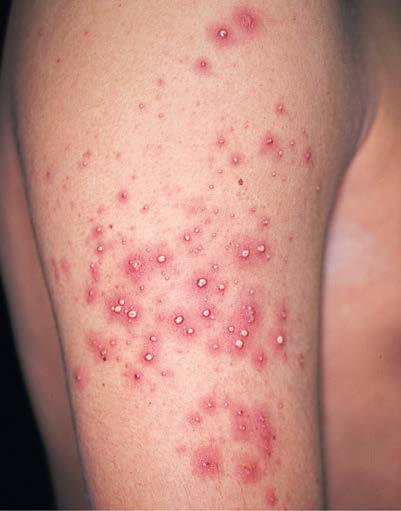

# Chapter 687: Principles of Dermatologic Therapy

*Stephen R. Humphrey*

<!-- p.5153 -->
**FIXED-DRUG ERUPTION** Fixed-drug eruption (FDE) occurs minutes to hours after exposure to a drug and is characterized by mild pruritus or burning of a wellcircumscribed, dusty red, brown, gray or, if severe, violaceous patch appearing on the extremities, trunk, lips, or genitals (Fig. 686.13). There is usually one lesion that, on reexposure to the drug, appears in the same (fixed) location as the previous episode, often appear ing more rapidly. On occasion, there may be two or more lesions. Stopping the offending agent is required; the FDE will then resolve within 10-14 days, often with residual hyperpigmentation. Offend ing medications include sulfonamides, tetracyclines, NSAIDs, and acetaminophen.

**ACUTE GENERALIZED EXANTHEMATOUS PUSTULOSIS** Acute generalized exanthematous pustulosis is often drug-related (most commonly aminopenicillins, macrolides, sulfonamides), occurring **within hours to days after drug exposure**. It is char acterized by many nonfollicular sterile pustules with underlying edema and erythema, typically beginning on the face and intertrig inous regions (Fig. 686.14). Neutrophilia and fever are common, whereas eosinophilia is less common than in DRESS syndrome. The rash may burn or itch; mucous membrane involvement is rare and often mild. Internal organ involvement is not common and often is asymptomatic. A pustular smear is always indicated to rule out infection in the setting of leukocytosis, fever, and a pustular rash. Differential diagnosis includes generalized pustular psoriasis, bul lous impetigo, IgA pemphigus, and subcorneal pustular dermatosis. Therapy consists of stopping the causative drug and offering symp tomatic relief with moist dressings, emollients, and mid-potency topical corticosteroids (applied twice daily for 1-2 weeks).

*Visit Elsevier eBooks+ at eBooks.Health.Elsevier.com** for Bibliography.*

**Fig. 686.14** Acute generalized exanthematous pustulosis is char acterized by the acute onset of fever and generalized erythema with numerous small, discrete, sterile, nonfollicular pustules. Pustules may appear in a few days after the drug therapy is started. Pustules resolve in <15 days, followed by desquamation. (From Habif TP, ed. Clinical Dermatology, 4th ed. Philadelphia: Mosby; 2004: p. 490.)

Competent skin care requires an appreciation of primary versus sec ondary lesions, a specific diagnosis, and knowledge of the natural course of the disease. If the diagnosis is uncertain, it is better to err on the side of less aggressive rather than more aggressive treatment.

In the use of topical medication, consideration of vehicle is as impor tant as the specific therapeutic agent. Acute **weeping lesions** respond best to wet compresses, followed by lotions or creams. For **dry, thick ened,** scaly skin, or for treatment of a contact allergic reaction possibly the consequence of a component of a topical medication, an ointment base is preferable, as it helps to occlude and moisten the affected area. Gels and solutions are most useful for the scalp and other hairy areas because of their faster absorption. The site of involvement is of consid erable importance because the most desirable vehicle may not be cos metically or functionally appropriate, such as an ointment on the face or hands. A patient’s preference should also play a part in the choice of vehicle because compliance is poor if a medication is not acceptable to a patient. Ointments tend to sting less and are the least irritating. Cosmetically acceptable foam delivery systems have been developed, and the number of products and formulations available is increasing.

Most **lotions** are mixtures of water and oil that can be poured. After the water evaporates, the small amount of remaining oil covers the skin. Some shake lotions are a suspension of water and insoluble pow der; as the water evaporates, cooling the skin, a thin film of powder covers the skin. **Creams** are emulsions of oil and water that are viscous and do not pour (more oil than in lotions). **Ointments** have oils and a small amount of water or no water at all; they feel greasy, lubricate dry skin, trap water, and aid in occlusion. Ointments without water usu ally require no preservatives because microorganisms require water to survive. Because of this, ointments often have the lowest number and concentration of ingredients, decreasing the risk of sensitizing the skin.

Therapy should be kept as simple as possible, and specific written instructions about the frequency and duration of application should be provided. Physicians should become familiar with one or two prepa rations in each category and should learn to use them appropriately. Prescribing nonspecific proprietary medications that may contain sen sitizing agents should be avoided. Certain preparations, such as topical antihistamines and sensitizing anesthetics, are never indicated.

**WET DRESSINGS** Wet dressings cool and dry the skin by evaporation and cleanse it by removing crusts and exudate, which would cause further irritation if permitted to remain. The dressings decrease pruritus, burning, and stinging sensations and are indicated for acutely inflamed moist or ooz ing dermatitis. Although various astringent and antiseptic substances may be added to the solution, cool or tepid tap water compresses are just as effective. Dressings of multiple layers of Kerlix, gauze, or soft cotton material may be saturated with water and remoistened as often as necessary. Compresses should be applied for 10-20 minutes at least every 4 hours and should usually be continued for 24-48 hours.

Alternatively, cotton pajamas can be soaked in water and then wrung as dry as possible. These are placed on the child and covered with dry paja mas, preferably sleeper pajamas with feet. The child should sleep in these overnight. This type of dressing can be used nightly for up to 1 week.

Wet dressings or wet wraps in conjunction with topical steroids may also be used in more severe cases of dermatitis (e.g., atopic der matitis). In this method, a thin layer of the topical steroid is applied to the affected areas, which are then covered with warm, wet wraps

*Stephen R. Humphrey*

<!-- p.5155 -->
for approximately 30 minutes to 1 hour 2-3 times daily. This method is especially effective in children with extensive and severe dermatitis.

**BATH OILS, COLLOIDS, AND SOAPS** Bath oil has little benefit in the treatment of children. It offers little mois turizing effect but increases the risk of injury during a bath. Bath oil may lubricate the surface of the bathtub, causing an adult or child to fall when stepping into the tub. Tar bath solutions can be prescribed and may be helpful for psoriasis and atopic dermatitis. Colloids such as starch powder and colloidal oatmeal are soothing and antipruritic for some patients when added to the bathwater. Oilated colloidal oatmeal contains mineral oil and lanolin derivatives for lubrication if the skin is dry. These can also lubricate the bathtub surface. Ordinary bath soaps may be irritating and drying if patients have dry skin or dermatitis. Synthetic soaps are much less irritat ing. Fragrance-free soaps and cleansers are often better tolerated and less likely to irritate skin. Additionally, solid soaps tend to be less irritating, as they do not have as many preservatives as liquid soap might. When skin is acutely inflamed, avoidance of soap is advised.

**LUBRICANTS** Lubricants, such as lotions, creams, and ointments, can be used as moistur izers for dry skin and as vehicles for topical agents such as corticosteroids and keratolytics. In general, ointments are the most effective emollients. Numerous commercial preparations are available. Some patients do not tolerate ointments, and some may be sensitized to a component of the lubricant; some preservatives in creams are also sensitizers. These prepara tions can be applied several times a day if necessary and tolerated. Maxi mal effect is achieved when they are applied to dry skin 2 or 3 times daily. Lotions containing menthol and camphor in an emollient vehicle can help control pruritus and dryness, but the use of moisturizers in addition to these products is best to decrease skin dryness.

**SHAMPOOS** Special shampoos containing sulfur, salicylic acid, zinc, and selenium sulfide are useful for conditions in which there is scaling of the scalp, such as seborrheic dermatitis or psoriasis. Tar-containing shampoos are useful in these conditions. Most shampoos also contain surfactants and detergents. They should be used as frequently as necessary to con trol scaling. Patients should be instructed to leave the lathered sham poo in contact with the scalp for 5-10 minutes before thorough rinsing.

**POWDERS** Powders are hygroscopic and serve as absorptive agents in areas of excessive moisture. When dry, powders decrease friction between two surfaces. They are most useful in the intertriginous areas and between the toes, where maceration and abrasion may result from friction on movement. Coarse powders may cake; therefore they should be of fine particle size and inert, unless medication has been incorporated in the formulation. The use of cornstarch-based powders in inflamed or bro ken skin may serve as a good growth environment for microorganisms and should be avoided.

**PASTES** Pastes contain fine powder in ointment vehicles and are not often pre scribed in current dermatologic therapy; in certain situations, however, they can be used effectively to protect vulnerable or damaged skin. A stiff zinc oxide paste is bland and inert and can be applied to the diaper area to prevent further irritation caused by diaper dermatitis. Zinc oxide paste should be applied in a thick layer, completely obscuring the skin, and is removed more easily with mineral oil than with soap and water.

**KERATOLYTIC AGENTS** Urea-containing agents are hydrophilic; they hydrate the stratum cor neum and make the skin more pliable. In addition, because urea dis solves hydrogen bonds and epidermal keratin, it is effective in treating scaling disorders. Concentrations of 10–40% are available in several commercial lotions and creams, which can be applied once or twice daily as tolerated. Salicylic acid is an effective keratolytic agent and can be incorporated into various vehicles in concentrations up to 6% to be applied 2 or 3 times daily. Salicylic acid preparations should not

be used in treating small infants or on large surface areas or denuded skin; percutaneous absorption may result in salicylism. The α-hydroxy acids, particularly lactic acid and glycolic acid, are available in com mercial preparations or can be incorporated in an ointment vehicle in concentrations up to 12%. Some creams contain both urea and lactic acid. The α-hydroxy acid preparations are useful for the treatment of keratinizing disorders and may be applied once or twice daily. Some patients complain of burning with the use of these agents; in such cases, the frequency of application should be decreased.

**TAR COMPOUNDS** Tars are obtained from bituminous coal, shale, petrolatum (coal tars), and wood. They are antipruritic and astringent and appear to promote normal keratinization. They may be useful for chronic eczema and psoriasis, and their efficacy may be increased if the affected area is exposed to UV light after the tar has been removed. Tars should not be used for acute inflamma tory lesions. Tars are often messy and unacceptable because they may stain and they have an odor. They may be incorporated into shampoos, bath oils, lotions, and ointments. A useful preparation for pediatric patients is liquor carbonis detergens (LCD) 2–5% in a cream or ointment vehicle. Tar gel and tar in light body oil are relatively pleasant cosmetic preparations that cause minimal staining of skin and fabrics. Tars can also be incorporated into a vehicle with a topical corticosteroid. The frequency of application varies from 1-3 times daily, according to tolerance. Many children refuse to use tar preparations because of their odor and staining characteristics.

**ANTIFUNGAL AGENTS** Antifungal agents are available as powders, lotions, creams, ointments, and solutions for the treatment of dermatophyte and yeast infections. Nystatin, naftifine, and amphotericin B are specific for *Candida albicans* and are ineffective in other fungal disorders. Tolnaftate is effective against dermatophytes but not against yeast. The spectrum for ciclopirox olamine includes the dermatophytes, *Malassezia furfur,* and *C. albicans.* The azoles clotrimazole, econazole, ketoconazole, miconazole, oxiconazole, and sul conazole have a similar broad spectrum. Butenafine has a similar broad

#### **Table 687.1** Potency of Topical Glucocorticosteroids

| Category / Parameter | Clinical Details & Findings |
| --- | --- |
| **CLASS 1—SUPER-POTENT** | Betamethasone dipropionate, 0.05% gel, ointment; Clobetasol propionate cream, ointment, 0.05%; Halobetasol propionate cream, ointment, 0.05% |
| **CLASS 2—POTENT** | Betamethasone dipropionate cream 0.05%; Desoximetasone cream, ointment, gel 0.05% and 0.25%; Fluocinonide cream, ointment, gel, 0.05% |
| **CLASS 3—UPPER MID-STRENGTH** | Betamethasone dipropionate cream, 0.05%; Betamethasone valerate ointment, 0.1%; Fluticasone propionate ointment, 0.005%; Mometasone furoate ointment, 0.1%; Triamcinolone acetonide cream, 0.5% |
| **CLASS 4—MID-STRENGTH** | Desoximetasone cream, 0.05%; Fluocinolone acetonide ointment, 0.025%; Triamcinolone acetonide ointment, 0.1% |
| **CLASS 5—LOWER MID-STRENGTH** | Betamethasone valerate cream/lotion, 0.1%; Fluocinolone acetonide cream, 0.025%; Fluticasone propionate cream, 0.05%; Triamcinolone acetonide cream/lotion, 0.1% |
| **CLASS 6—MILD STRENGTH** | Desonide cream, 0.05% |
| **CLASS 7—LEAST POTENT** | Topicals with hydrocortisone, dexamethasone, flumethasone,; methylprednisolone, and prednisolone; From Weston WL, Lane AT, Morelli JG. Color Textbook of Pediatric Dermatology, 4th; ed. St. Louis: Mosby; 2007: p. 418. |

<!-- p.5156 -->
spectrum and also has antiinflammatory properties. Terbinafine has greater activity against dermatophytes but poorer activity against yeasts than the azoles. The topical antifungal agents should be applied 1-2 times a day for most fungal infections. All have low sensitizing potential; addi tives such as preservatives and stabilizers in the vehicles may cause allergic contact dermatitis. Ointments containing 6% benzoic acid and 3% salicylic acid are potent keratolytic agents that have also been used for the treatment of dermatophyte infections. Irritant reactions are common.

**TOPICAL ANTIBIOTICS** Topical antibiotics have been used for many years to treat local cutane ous infections, although their efficacy, with the exception of mupirocin, fusidic acid, and retapamulin, has been questioned. Ointments are the pre ferred vehicles (except in the treatment of acne vulgaris; see Chapter 710), and combinations with other topical agents such as corticosteroids are, in general, inadvisable. Whenever possible, the etiologic agent should be identified and treated specifically. Antibiotics in wide use as systemic prep arations should be avoided because of the risk of bacterial resistance. The sensitizing potential of certain topical antibiotics, such as neomycin and nitrofurazone, should be kept in mind and avoided when possible. Mupi rocin, fusidic acid, and retapamulin are the most effective topical agents currently available and are as effective as oral erythromycin in treatment of mild to moderate impetigo. Polysporin and bacitracin are not as effective.

**TOPICAL CORTICOSTEROIDS** Topical corticosteroids are potent antiinflammatory agents and effective antipruritic agents. Successful therapeutic results are achieved in a wide variety of skin conditions. Corticosteroids can be divided into seven dif ferent categories on the basis of strength (Table 687.1), but for practical purposes, four categories can be used: low, moderate, high, and super. Low-potency preparations include hydrocortisone, desonide, and hydro cortisone butyrate. Medium-potency compounds include betamethasone, flurandrenolide, fluocinolone, mometasone furoate, and triamcinolone. High-potency topical steroids include fluocinonide and halcinonide. Betamethasone dipropionate, halobetasol, and clobetasol propionate are superpotent preparations and should be prescribed with care. Some of these compounds are formulated in several strengths according to clinical efficacy and degree of vasoconstriction. Physicians using topical steroids should become familiar with preparations within each class.

All corticosteroids can be obtained in various vehicles, including creams, ointments, solutions, gels, and aerosols. Some are available in a foam vehicle. Absorption is enhanced by an ointment or gel vehicle, but the vehicle should be selected on the basis of the type of disorder and the site of involvement. Frequency of application should be determined by the potency of the preparation, the location on the body, and the severity of the eruption. Applying a thin film 2 times daily usually suffices. Adverse local effects include cutaneous atrophy, striae, telangiectasia, acneiform erup tions, purpura, hypopigmentation, and increased hair growth. Systemic adverse effects of high-potency and superpotent topical steroids occur with long-term use and include poor growth, cataracts, and suppression of adrenal function.

The relative skin thickness should be considered in regard to the selec tion of class of steroid (see Table 687.1). Thin skin such as the eyelids, face, groin, and genitalia will absorb a substantial amount of medication compared to the thickest skin on the palms and soles. One adult fingertip’s worth of medication is enough to cover an area the size of an adult palm and is approximately half a gram of medication. Knowing the area being treated and which medication class to prescribe can decrease the potential for side effects.

In selected circumstances, corticosteroids may be administered by intralesional injection (acne cysts, keloids, psoriatic plaques, alopecia areata, persistent insect bite reactions). Only experienced physicians should use this method of administration.

**TOPICAL NONSTEROIDAL ANTIINFLAMMATORY AGENTS** Calcineurin-inhibiting antiinflammatory agents that inhibit T-cell activation may be used instead of topical steroids for the treatment of atopic dermatitis and other inflammatory conditions. These agents are pimecrolimus and tacrolimus. They do not have the adverse local effects

seen with topical steroids. Stinging with application is the most common complaint and may be lessened by mixing the medication with an oint ment such as petrolatum jelly for the initial applications. These agents are only as strong as medium-potency topical steroids. In 2006, the FDA issued a boxed warning for topical calcineurin inhibitors because data from animal experiments and case reports suggested potential for an increased risk of lymphoma with systemic use. No clear link between topical calcineurin inhibitor use and lymphoma risk has been established despite multiple epidemiologic and clinical studies. Crisaborole, a novel PDE4 inhibitor, is now approved for mild to moderate atopic dermatitis, and is another option for nonsteroidal treatments.

**SUNSCREENS** Sunscreens are of two general types: (1) those, such as zinc oxide and titanium dioxide, that absorb all wavelengths of the UV and visible spectrums and (2) a heterogeneous group of chemicals that selectively absorb energy of various wavelengths within the UV spectrum. In addi tion to the spectrum of light that is blocked, other factors to be consid ered include cosmetic acceptance, sensitizing potential, retention on skin while swimming or sweating, required frequency of application, and cost. Sunscreen ingredients include para-aminobenzoic acid (PABA) with ethanol, PABA esters, cinnamates, and benzophenone. These block transmission of the majority of solar UVB and some UVA wavelengths. Avobenzone and ecamsule are more effective in blocking UVA. Antioxi dants may also be found in some sunscreens. Lip protectants that absorb in the UVB range are also available. Some chemical sunscreens (oxy benzone, octocrylene, and octinoxate) have been implicated in harming coral reefs and are banned in certain areas of the world.

Sunscreens are designated by sun protection factor (SPF). The SPF is defined as the amount of time to develop a mild sunburn with the sun screen compared with the amount of time without the sunscreen. A mini mum SPF factor of 30 should be recommended most often. The higher the SPF, the better the protection is against UVB rays. Sunscreens do not include any measurement of the efficacy in blocking UVA. The efficacy of these agents depends on careful attention to instructions for use. Chemical sunscreens should be applied at least 30 minutes before sun exposure to permit penetration into the epidermis, again on arrival at the destination, and every subsequent hour when exposed to direct sunlight. Most patients with photosensitivity eruptions require protection by agents that absorb both UVB and UVA wavelengths (see Chapter 697).

Although sunscreens do confer photoprotection and may decrease the development of nevi, protection is incomplete against all harm ful UV light. Midday (10 am to 4 pm) sun avoidance is the primary method of photoprotection. Clothing, hats, and staying in the shade offer additional sun protection.

**LASER THERAPY** The vascular-specific pulsed dye laser therapy is used mainly for the treatment of capillary malformations (port-wine stains). Spider telan giectasia, small facial pyogenic granulomas, superficial and ulcerated hemangioma, and warts may also be treated. Vascular-specific pulsed dye lasers produce light that is readily absorbed by oxyhemoglobin, producing selective photothermolysis of vascular lesions.

**Ultraviolet Phototherapy** Phototherapy can be a useful treatment for many cutaneous inflam matory disorders, including atopic dermatitis, psoriasis, pityriasis lichenoides, vitiligo, and a few others. Some benefits of photother apy include the fact that it is well tolerated, may treat a large area of the body, and may enable a patient to avoid systemic immunosup pressive agents. There are two traditional modalities of treatment: psoralen (a photosensitizer) + UVA (PUVA) or narrow-band UVB phototherapy (NBUVB). NBUVB phototherapy is most often used, typically dosed between 1 and 3 times per week, depending on the condition. There is an increased risk of skin cancers with long-term use of PUVA, but there does not seem to be an increased risk for NBUVB. Risks include burns, though this is quite rare if performed properly.

<!-- p.5157 -->
