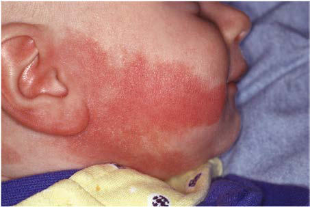
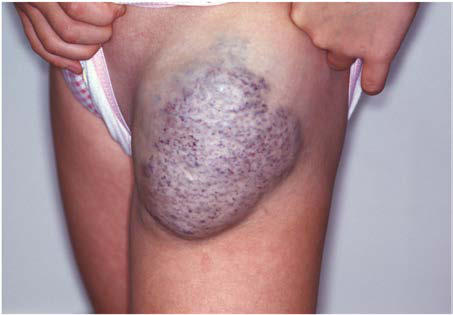

# Chapter 691: Vascular Anomalies

*Kari L. Martin*

<!-- p.5169 -->
Production

#### **Table 690.4** Disorders Associated with Decreased Sweat

| Category / Parameter | Clinical Details & Findings |
| --- | --- |
| **CUTANEOUS LESIONS** | Congenital absence of sweat glands without ectodermal dysplasia; Incontinentia pigmenti; Burns |
| **MULTISYSTEM DISORDERS** | Fabry disease; Crisponi syndrome; Chronic graft-versus-host disease; Sjögren syndrome |
| **NEUROLOGIC DISORDERS** | Spinal cord injury; Guillain-Barré syndrome; Hereditary sensory autonomic neuropathy type I, II, IV; Complex regional pain syndrome; Multiple sclerosis; Multiple system atrophy; Ross syndrome; Shy-Drager syndrome |
| **MEDICATIONS** | Anticholinergic drugs; Opioids; Botulism toxin; Clonidine; Barbiturate overdose; α2-Receptor antagonists |
| **OTHER** | Idiopathic acquired generalized anhidrosis; Hypothyroidism; Conversion disorder; Heat shock; Sympathectomy |
| **CHARACTERISTIC CLINICAL FINDINGS** | AEC (Hay-Wells; syndrome) and RHS |
| **AD** | Erosive dermatitis, neonatal erythroderma (e.g., scalp, hands), dyspigmentation of skin; Coarse, wiry, lightly pigmented hair, patchy alopecia; ± Hypohidrosis; Hypodontia, conical teeth; Nail absence or dystrophy with thickened nails; Ectrodactyly more common than syndactyly; Lacrimal duct abnormality, hearing loss, cleft lip/palate, ankyloblepharon, reflux; Limb-mammary |
| **AD** | Normal hair; Hypodontia; ± Hypohidrosis; Nail dystrophy; Ectrodactyly more common than syndactyly; Bifid uvula, hypoplastic nipples, joint contracture of hand, lacrimal duct atresia, cleft palate |
| **AD** | Dry skin, photosensitivity, lentigines; Hypodontia, premature loss of teeth; Normal sweating; Pitting and longitudinal ridging of nails; Ectrodactyly and syndactyly; No cleft palate or lip; Hypoplastic nipples, lacrimal duct atresia,; AD, Autosomal dominant; ADULT, acro-dermato-ungal-lacrimal-tooth; AEC, ankyloblepharon-ectodermal dysplasia-clefting; AR, autosomal recessive; ED, ectodermal dysplasia; EEC,; ectrodactyly, ectodermal dysplasia, and cleft lip/palate syndrome; RHS, Rapp-Hodgkin syndrome; XLR, X-linked recessive. |

#### **Table 690.3** Common Ectodermal Dysplasias: Inheritance and Characteristic Clinical Findings—cont’d

In addition to the EDs, other disorders are associated with absent or decreased sweat production (Table 690.4).

*Visit Elsevier eBooks+ at eBooks.Health.Elsevier.com** for Bibliography.*

Nearly all vascular lesions of childhood may be divided into vascular malformations and vascular tumors (Table 691.1). Vascular malforma tions are developmental disorders of blood vessel formation. Malfor mations do not regress, but slowly enlarge. They should be named after the predominant vessel(s) forming the lesion: arterial, capillary, lymph, venous, or combinations of these. Vascular tumors exhibit endothe lial cell hyperplasia and proliferation. The International Society for the Study of Vascular Anomalies (ISSVA) continues to update the classi fication structure for vascular disorders as new disorders are identi fied and as the biology and genetic causes for established disorders are found. The complete classification, associated syndromes, and caus ative pathogenic variants can be found at www.issva.org.

**VASCULAR MALFORMATIONS Capillary Malformation (Port-Wine Stain)** Capillary malformations (CMs) are present at birth. These vascular malformations consist of mature dilated dermal capillaries. The lesions are macular, sharply circumscribed, pink to purple, and tremendously varied in size (Fig. 691.1). The head and neck region is the most com mon site of predilection; most lesions are unilateral. The mucous mem branes can be involved. As a child matures into adulthood, the CM may become darker in color and pebbly in consistency; it may occasionally develop papules that bleed spontaneously. CM may occur in isolation or in combination with other vessel malformations.

True CM should be distinguished from **nevus simplex**, which, in contrast, is a relatively transient lesion often located in the midline (see Chapter 688). When a CM is lateral and localized to the forehead and upper eyelid, the diagnosis of **Sturge-Weber syndrome** (glaucoma, leptomeningeal venous angioma, seizures, hemiparesis contralateral to the facial lesion, intracranial calcification) must be considered (see Chapter 636.3). Early screening for glaucoma is important to

*Kari L. Martin*

<!-- p.5171 -->
Anomalies (ISSVA 2014 Classification)

#### **Table 691.1** Contemporary Classification of Vascular

| Category / Parameter | Clinical Details & Findings |
| --- | --- |
| **Benign** | Infantile hemangioma/hemangioma of infancy; Congenital hemangiomas (RICH, NICH, PICH); Tufted angioma; Spindle cell hemangioma; Epithelioid hemangioma; Pyogenic granuloma |
| **Locally Aggressive or Borderline** | Kaposiform hemangioendothelioma; Retiform hemangioendothelioma; Papillary intralymphatic angioendothelioma (Dabska tumor); Composite hemangioendothelioma; Kaposi sarcoma |
| **Malignant** | Angiosarcoma; Epithelioid hemangioendothelioma |
| **Simple** | Capillary (CM) (e.g., port-wine stain, telangiectasia, CMTC, salmon; patch/nevus simplex); Venous (VM) (includes common, familial, glomuvenous, others); Lymphatic (LM) (includes macrocystic, microcystic, primary; lymphedema, others); Arteriovenous (AVM) and arteriovenous fistula (sporadic or; syndromal) |
| **CM + LM + VM + AVM** | Of major named vessels; Affect veins, arteries or lymphatics; usually of large caliber; Associated with other anomalies; Associated with anomalies of bone, soft tissue (usually overgrowth,; rarely undergrowth) or viscera; CMTC, Cutis marmorata telangiectatica congenita; NICH, noninvoluting congenital; hemangioma; PICH, partially involuting congenital hemangioma; RICH, rapidly; involuting congenital hemangioma.; From Paller AS, Mancini AJ. Hurwitz Clinical Pediatric Dermatology, 6th ed.; Philadelphia: Elsevier; 2022: Box 12.1, p. 327. Created with data from Wassef M,; Blei F, Adams D, et al. Vascular anomalies classification: Recommendations from the; International Society for the Study of Vascular Anomalies. Pediatrics. 2015;136(1):e203–; e214. |

prevent additional damage to the eye. CMs also occur as a component of **Klippel-Trenaunay syndrome** and with moderate frequency in other syndromes, including megalencephaly, capillary malformation, polymicrogyria (MCAP), Cobb (spinal arteriovenous malformation [AVM], port-wine stain), congenital lipomatous, overgrowth, vascular malformations, epidermal nevi, skeletal anomalies (CLOVES), Proteus, Beckwith-Wiedemann, and Bonnet-Dechaume-Blanc syndromes, and others (Table 691.2). In the absence of associated anomalies, morbid ity from these lesions may include a poor self-image, hypertrophy of underlying structures, and traumatic bleeding.

The most effective treatment for CM is with the pulsed-dye laser. This therapy is targeted to hemoglobin within the lesion and minimizes thermal injury to the surrounding normal tissue. After such treatment, the texture and pigmentation of the skin are generally improved with low risks of scarring. Therapy can begin in infancy when the surface area of involvement is smaller. There may be advantages to treating within the first year of life. Although this approach is quite effective, redarkening of the stain may occur over time, making ongoing treat ments useful. Camouflaging cosmetics may also be used.

**Venous Malformation** Venous malformations include vein-only malformations and combi nation malformations. Malformations consisting of veins only range from nodules containing a mass of venules (Fig. 691.2) to diffuse large vein abnormalities that may consist of either a superficial component resembling varicose veins, deeper venous malformations, or both. Most venous malformations are sporadic, although inherited forms exist as well. Inherited forms and up to 40% of sporadic venous malfor mations are caused by *TIE2* pathogenic variants. Treatment is reserved for painful or symptomatic lesions. Surgical excision is best for small

**Fig. 691.1** Capillary malformation. Pink macule on the cheek of an infant.

#### **Table 691.2** Port-Wine Stain–Associated Syndromes

| Category / Parameter | Clinical Details & Findings |
| --- | --- |
| **General** | • Sturge-Weber syndrome; • Klippel-Trenaunay syndrome; • Parkes-Weber syndrome; • Phakomatosis pigmentovascularis; • Macrocephaly–capillary malformation (M-CM) syndrome; • Capillary malformation–arteriovenous malformation (CM-AVM); syndrome; • Diffuse capillary malformation with overgrowth (DCMO); • Bannayan-Riley-Ruvalcaba syndrome; • Von Hippel-Lindau disease; • Rubinstein-Taybi syndrome; • Wyburn-Mason syndrome; • Roberts syndrome; • Coat disease; Modified from Paller AS, Mancini AJ. Hurwitz Clinical Pediatric Dermatology, 6th ed.; Elsevier: Philadelphia; 2022: Box 12.4, p. 347. |

**Fig. 691.2** Nodular venous malformation on the leg of an adolescent.

<!-- p.5172 -->
or superficial nodular lesions; sclerotherapy or laser ablation is used for larger, diffuse lesions. Localized intravascular coagulopathy can be problematic in these lesions because of the chronic slow flow. This leads to both painful thrombotic episodes and the risk of progression to sys temic disseminated intravascular coagulopathy. Pulmonary embolus has been reported in patients with large venous malformations.

**LYMPHATIC MALFORMATIONS** See Chapter 538.

**ARTERIOVENOUS MALFORMATION** AVMs are direct connections of artery to vein that bypass the capillary bed (Fig. 691.3). AVMs of the skin are very rare. Skin changes are often noted at birth, but they tend to be very subtle, presenting as a red-pink patch. Over time the lesions deepen in color and often result in thicken ing of the skin and surrounding tissue. They are diagnosed from their obvious arterial palpation. Some AVMs are progressive and can lead to significant morbidity and even mortality, so early diagnosis and evalua tion by an experienced multidisciplinary team are essential.

**KLIPPEL-TRENAUNAY AND PARKES-WEBER SYNDROMES** Klippel-Trenaunay syndrome is a term historically used to describe complex mixed vascular malformation with overgrowth of bone and soft tissue (Figs. 691.4 and 691.5). The anomaly is present at birth and usually involves a lower limb but may involve more than one limb, as well as portions of the trunk or face. Enlargement of the soft tissues may be gradual and may involve the entire extremity, a por tion of it, or selected digits. The vascular lesion most often is a capil lary malformation, generally localized to the hypertrophied area. The deep venous system may be absent or hypoplastic. Venous blebs and/

or vesicular lymphatic lesions may be present on the malformation’s surface. Thick-walled venous varicosities typically become appar ent ipsilateral to the vascular malformation after the child begins to ambulate. If there is an associated AVM, the disorder is called **Parkes-Weber syndrome**.

Somatic pathogenic activating variants in multiple genes have been associated with vascular malformations and limb overgrowth (Fig. 691.6 and Table 691.3). These disorders can be confused with Maffucci syndrome or, if the surface vascular lesion is minimal, with Milroy disease. Pain, limb swelling, and cellulitis may occur. Thrombophlebitis, disloca tions of joints, hematuria secondary to angiomatous involvement of the urinary tract, rectal bleeding from lesions of the gastrointestinal tract, pulmonary lesions, and malformations of the lymphatic ves sels are infrequent complications. MRI may delineate the extent of the anomaly, but surgical correction or palliation is often difficult. Sclerotherapy or endovenous laser ablation may be of benefit when a venous component is the dominant vessel in the malformation. The indications for radiologic studies of viscera and bones are best determined by clinical evaluation. Supportive care includes com pression bandages for varicosities; surgical treatment may help care fully selected patients. Leg-length differences should be treated with orthotic devices to prevent the development of spinal deformities. Corrective bone surgery may eventually be needed to treat significant leg-length discrepancy.

**Angiokeratoma Circumscriptum** Several forms of angiokeratoma have been described. Angiokerato mas are characterized by ectasia of superficial lymphatic vessels and capillaries with hyperkeratosis of the overlying epidermis. Angio keratoma circumscriptum is a rare disorder consisting of a solitary lesion or multiple lesions that manifest as a plaque or plaques of blue-red crusted papules or nodules. The limbs are the sites of pre dilection. **If therapy is desired, surgical excision is the treatment of choice.**

**Cutis Marmorata Telangiectatica Congenita** Cutis marmorata telangiectatica congenita, a benign vascular anomaly apparent at birth, is composed of dilated superficial capillaries and veins. Involved areas of skin have a reticulated red or purple hue that resembles physiologic cutis marmorata but is more pronounced and relatively unvarying (Fig. 691.7). The lesions may be restricted to a single limb and a portion of the trunk or may be more widespread. The lesions become more pronounced during changes in environmental temperature, physical activity, or crying. In some cases, the underlying subcutaneous tissue is atrophic, and ulceration may occur within the reticulated bands. Rarely, defective growth of bone and other congeni tal abnormalities may be present. No specific therapy is indicated. Mild vascular-only cases may show gradual improvement. Cutis marmorata telangiectatica congenita may be associated with CM, Adams-Oliver syndrome, patent ductus arteriosus, and a variety of other anomalies. It must be differentiated from reticulate CM and physiologic cutis marmorata.

**Blue Rubber Bleb Nevus Syndrome** Blue rubber bleb nevus is a rare syndrome consisting of numerous venous malformations of the skin, mucous membranes, and gastroin testinal tract caused by somatic pathogenic variants in *TEK* in some patients. Typical lesions are blue-purple and rubbery in consistency; they vary in size from a few millimeters to a few centimeters in diam eter. They are sometimes painful or tender. The compressible nodules may be present at birth but usually are progressive during childhood. New lesions may continue to develop throughout life. Large disfiguring and irregular blue marks may also occur. The lesions, which can rarely be located in the liver, spleen, and central nervous system in addition to the skin and gastrointestinal tract, do not involute spontaneously. Recurrent gastrointestinal hemorrhage caused by lesions in the gastro intestinal tract may lead to severe anemia. Palliation can be achieved by excision of involved bowel.

**Fig. 691.3** Arteriovenous malformation in conjunction with a port- wine stain of the scalp of a newborn.

**Fig. 691.4** Overgrowth of the right arm and hand in an adolescent with Klippel-Trenaunay syndrome.

<!-- p.5173 -->
**PHAKOMATOSIS PIGMENTOVASCULARIS** Phakomatosis pigmentovascularis is a rare disorder characterized by the association of a capillary malformation and melanocytic lesions. Typically, the capillary malformation is extensive, and asso ciated pigmentary lesions may include dermal melanocytosis, caféau-lait macules, or a nevus spilus (speckled nevus). Nonpigmented

skin lesions that may occur in this setting include nevus anemicus and epidermal nevi. Systemic anomalies are seen in rare cases.

**NEVUS ANEMICUS** Although present at birth, nevus anemicus may not be detectable until early childhood. The nevus consists of solitary or numerous sharply

A B C D

**Fig. 691.5** Parkes-Weber syndrome. A, Three-dimensional volume-rendering CT angiography image of the limbs shows overgrowth of the right limb (arrows) with an arterial blush adjacent to the posterior tibial artery (arrowhead), consistent with a high-flow vascular malformation. B, Three- dimensional volume-rendering CT angiography image of the limbs shows arterial blush adjacent to the posterior tibial artery (arrowhead). C, Coronal CT angiography image of the limb shows arterial blush adjacent to the posterior tibial artery (arrowhead). D, Venous phase CT of the limb reveals varicose veins in the right limb. (From Ufuk F. Limb overgrowth with vascular anomalies. J Pediatr. 2020;240:308–309, Fig, p. 309)

Cell survival

and growth Other effects

PI3K

PIP3

PIP2

PTEN

AKT

TSC2

TSC1

**mTOR**

P D K

CLOVES Fibroadipose hyperplasia (FH) Fibroadipose infiltrating lipomatosis MCAP Hemihyperplasia multiple lipomatosis (HHML) Macrodactyly Muscle hemihypertrophy Skin disorders including benign lichenoid keratosis, epidermal nevi and seborrheic keratosis Hemimegalencephaly

• • • • •

• • •

•

Proteus syndrome Megalencephaly polymicrogyria polydactyly hydrocephalus (MPPH) syndrome Lipodystrophy syndrome – Hypoglycemia Hemimegalencephaly Focal cortical dysplasia

• •

•

• •

Hemimegalencephaly Focal cortical dysplasia • •

Tuberous sclerosis complex •

Bannayan-Riley-Ruvalcaba syndrome Cowden syndrome Type II segmental Cowden syndrome Lhermitte-Duclos disease

•

• •

•

Apoptosis

**mTOR related**

**AKT related**

**Plasma membrane**

**Ligand**

**Receptor**

**PIK3CA related PTEN related**

**TSC1/2 related**

**Fig. 691.6** Simplified PIK3CA-AKT-mTOR pathway and associated clinical overgrowth disorders. PIP, Phosphatidylinositol polyphosphate; PTEN, phosphatase and tensin homolog; PDK, phosphatidylinositol-dependent kinase. (From Kang HC, Baek ST, Song S, Gleeson JG. Clinical and genetic aspects of the segmental overgrowth spectrum due to somatic mutations in PIK3CA. J Pediatr. 2015;167[5]:957–962, Fig, p. 959)

<!-- p.5174 -->
delineated, pale macules or patches that are most often on the trunk but may also occur on the neck or limbs. These nevi may simulate plaques of vitiligo, leukoderma, or nevoid pigmentary defects, but they can be readily distinguished because of their response to firm stroking. Stroking evokes an erythematous line and flare in normal surround ing skin, but the skin of a nevus anemicus does not redden. They can also be diagnosed by diascopy, in which pressure of the skin with a glass slide will obscure the borders of a nevus anemicus. Although the cutaneous vasculature appears normal histologically, the blood ves sels within the nevus do not respond to injection of vasodilators. It has been postulated that the persistent pallor may represent a sustained localized adrenergic vasoconstriction.

**VASCULAR TUMORS** Vascular tumors include infantile hemangiomas (IHs), tufted angio mas, kaposiform hemangioendotheliomas (KHEs), congenital heman giomas, and additional more rare entities.

**Infantile Hemangioma** IHs are proliferative benign vascular tumors of vascular endothelium that may be present at birth or, more commonly, may become appar ent in the first or second week of life, predictably enlarge, and then spontaneously involute. IHs are the most common tumor of infancy, occurring in 5% of newborns. Risk factors include prematurity, low birthweight, female gender, and White race. IHs should be classified as superficial, deep, or mixed (Fig. 691.8). The terms *strawberry* and *cavernous* should not be used to describe hemangiomas. The immu nohistochemical marker GLUT-1 is specifically expressed in an IH, which helps distinguish it histologically from other vascular anoma lies. Superficial IHs are bright red, protuberant, compressible, sharply demarcated lesions that may occur on any area of the body (Fig. 691.9, see also Fig. 691.8). Although sometimes present at birth, they more often appear in the first or second month of life and are heralded by an erythematous or blue mark or an area of pallor, which subsequently develops a fine telangiectatic pattern before the growth phase (see Fig. 691.9). The presenting sign may occasionally be an ulceration of the perineum or lip. Favored sites are the face, scalp, back, and anterior chest; lesions may be solitary or multiple. Patterns of facial involve ment include frontotemporal, maxillary, mandibular, and frontonasal regions. IHs that are more deeply situated are more diffuse and are less defined than superficial IHs. The lesions are cystic, firm, or compress ible, and the overlying skin may appear normal in color or may have a bluish hue (Fig. 691.10).

Most IHs are mixed, having both superficial and deep components. IHs undergo a phase of rapid expansion, followed by a stationary period and finally by spontaneous involution (Fig. 691.11). Regression may be anticipated when the lesion develops pale gray areas centrally. The course of a particular lesion is unpredictable, but approximately 60% of these lesions reach maximal involution by 5 years of age and 90–95% by 9 years. Spontaneous involution cannot be correlated with size or site of involvement, but lip lesions seem to persist most often. Compli cations include impairment of a vital function, ulceration, secondary infection, and permanent disfigurement. The location of a lesion may interfere with a vital function (e.g., on an eyelid interfering with vision, on the urethra with urination, on the airway with respiration). IHs in a “beard” distribution may be associated with upper airway or subglottic involvement. Stridor should suggest a tracheobronchial lesion. Large visceral (hepatic) IHs may be complicated by coexistent hypothyroid ism because of type 3 iodothyronine deiodinase; symptoms may be difficult to detect in this age-group. Table 691.4 lists other concerning features.

In the usual patient with an IH who has no serious complications or extensive growth resulting in tissue destruction and severe disfigurement, treatment consists of expectant observation. Because almost all lesions regress spontaneously, therapy is rarely indicated. Parents require repeated reassurance and support. After spontaneous involution, many patients are left with small cosmetic defects, such as telangiectasia, hypopigmen tation, fibrofatty deposits, and scars if the lesion has ulcerated. Residual telangiectasias may be treated with pulsed dye laser therapy. Other defects can be treated or minimized by judicious surgical repair if desired.

In the rare case in which intervention is required, topical timolol solution (1 drop of 0.5% gel-forming solution applied twice each day) is effective, especially in small, superficial, nonulcerating, and nonmu cosal IH. Topical timolol treatment is a very safe alternative to observa tion alone for a superficial IH. Timolol solution may also be used with caution in the treatment of an ulcerated IH, with or without occlusion.

In a disfiguring, life- or vision-threatening, or ulcerated IH that is not responding to other treatment, oral propranolol is the first-line treatment. IHs typically respond with growth arrest and often early signs of involution within a couple of weeks of treatment initiation. Dosing varies ranging from 1 to 3 mg/kg/day, though best outcomes occur at 3 mg/kg/day with no increase in side effects. Some recom mend inpatient initiation of propranolol for infants younger than 8 weeks gestational age or those with comorbid conditions. The dose is initiated at 1 mg/kg/day divided into three doses with heart rate and blood pressure monitoring at 1 and 2 hours after each dose. If that dose is tolerated, the dose is increased to 2 mg/kg/day divided

Related Overgrowth Spectrum (PROS)

#### **Table 691.3** Clinical Diagnostic Criteria for PIK3CA-

| Category / Parameter | Clinical Details & Findings |
| --- | --- |
| **REQUIRED CRITERIA** | 1.	 The presence of somatic PIK3CA pathogenic variant (if the; pathogenic variant cannot be defined, then the disease is; regarded as a presumptive PROS disorder); 2.	 Congenital or early childhood onset; 3.	 Sporadic, without family history and mosaic distribution; 4.	 Affected patients can have one or more findings from category A; or B |
| **FEATURES)** | 1.	 Adipose, muscle, nerve, and; skeletal overgrowth; 2.	 Capillary, venous,; arteriovenous, and/or LMs; 3.	 Epidermal nevus; 1.	 Large, isolated LM; 2.	 Isolated macrodactyly,†; overgrown and splayed feet/; hands, or overgrown limbs; 3.	 Truncal adipose overgrowth; 4.	 Hemi- or bilateral dysplastic; megalencephaly or focal; cortical dysplasia type 2; 5.	 Epidermal nevus; 6.	 Seborrheic keratosis; 7.	 Benign lichenoid keratoses; *Typically progressive. Can manifest as scoliosis (kyphosis), limb overgrowth, central; nervous system (hydrocephalus, cerebellar tonsillar ectopia, Chiari, megalencephaly,; mega corpus callosum), regional lipomatous undergrowth with overgrowth,; infiltrating lipomatosis, or Wilms tumor/ovarian cystadenoma.; †Other terms include macrodystrophia lipomatosa, macrodactylia fibrolipomatosis, and; gigantism.; From Kang HC, Baek ST, Song S, Gleeson JG. Clinical and genetic aspects of the; segmental overgrowth spectrum due to somatic mutations in PIK3CA. J Pediatr.; 2015;167(5):957–962, Table 1. |

**Fig. 691.7** Mottled pattern of cutis marmorata telangiectatica con genita on the right hand.

<!-- p.5175 -->
into three doses. The outpatient initiation assumes good social support and access to the hospital. The initial dose and monitor ing are similar to the inpatient plan; if the dose is tolerated for 3-7 days, the dose is increased to 1.5 mg/kg/day. If the latter dose is

tolerated after 3-7 days, the dose is increased to 2 mg/kg/day. In all situations, propranolol must be given a minimum of 6 hours after the last dose. Risks of propranolol treatment include hypoglyce mia, bradycardia, hypotension, gastroesophageal reflux disease or

A B C

**Fig. 691.8** Types of infantile hemangiomas according to anatomic location. A, Bright red, superficial hemangioma. B, Bluish, deep hemangioma. C, Mixed type. (From Léaute-Labréze C, Harper JI, Hieger PH. Infantile haemangioma. Lancet. 2017;390:85–94, Fig. 4, p. 88.)

A

B

C

**Fig. 691.9** Precursor lesions of infantile hemangioma. Figure shows a sharply demarcated, so-called anemic spot on the left shoulder. A, Day 3. B, Day 21. C, Day 90. (From Léaute-Labréze C, Harper JI, Hieger PH. Infantile haemangioma. Lancet. 2017;390:85–94, Fig. 3, p. 87.)

**Fig. 691.10** Deep infantile hemangioma of the chest.

A

B

**Fig. 691.11** Spontaneous regression of infantile hemangioma. A, He mangioma on right lower arm, age 14 wk. B, Residual telangiectasia at age 23 mo. (From Léaute-Labréze C, Harper JI, Hieger PH. Infantile haemangioma. Lancet. 2017;390:85–94, Fig. 5, p. 88.)

<!-- p.5176 -->
worsening of existing disease, hyperkalemia, and bronchospasm/ wheezing. Nonetheless, reports of side effects of propranolol used for IH treatment are rare. Increased propranolol levels occur with inhibitors of CYP2D6 (cimetidine, amiodarone, fluoxetine, quini dine, ritonavir) and CPY1A2 (cimetidine, ciprofloxacin, isoniazid, ritonavir, theophylline); decreased blood levels occur with inducers of hepatic drug metabolism (rifampin, phenytoin, phenobarbital).

In patients unable to tolerate propranolol, or if the IH has not responded after a couple of weeks of treatment, systemic oral corticosteroids may be used. Termination of growth and some times regression may be evident after 2-4 weeks of therapy. When a response is obtained, the dose should be decreased gradually, though most patients will require treatment until about 1 year of age.

Intralesional corticosteroid injection by an experienced physician can also induce rapid involution of a localized IH but has risks of ulcer ation, tissue atrophy, and blindness if used near the orbit. Vincristine is used by some oncologists to treat significant IH. Interferon-α therapy may also be effective, but spastic diplegia is seen in 10% of cases. Use

of these therapies has become less necessary since the introduction of propranolol.

In patients with large segmental IH of the face, **PHACES** syn drome should be considered (Fig. 691.12 and Table 691.5). PHACES stands for **p**osterior fossa brain defects such as Dandy-Walker mal formation or cerebellar hypoplasia, large segmental facial infantile **h**emangioma, **a**rterial cerebrovascular abnormalities such as aneu rysms and stroke, **c**oarctation of the aorta, and **e**ye abnormalities. **S**ternal raphe defects such as pits, scars, or **s**upraumbilical raphe are infrequently observed. Evaluation of children at risk for PHACES is important both to detect any underlying abnormalities and before starting systemic therapy, which may be indicated given the size and location of the IH typically associated with this syndrome. PHACES children with cervical and intracranial arterial abnormalities are at increased risk of cerebrovascular accidents, and specialized care by an experienced multidisciplinary team is essential.

**Multifocal Infantile Hemangioma Diffuse neonatal hemangiomatosis** (or benign neonatal heman giomatosis) is a historical term to describe a condition in which numerous or multifocal vascular lesions are widely distributed (Fig. 691.13). Several distinct diagnoses have been previously lumped together under this clinical phenotype with mortality cited as high as 60–80%. Upon further analysis, this group of disorders has been found to comprise several distinct entities, which are important to distinguish from one another, given their varying prognoses and management strategies. Therefore the term *multifocal IH* is more accurate and leads to correct treatments and prognosis for these patients with more than one cutaneous (and/or visceral) IH.

Multifocal IHs may occur in the skin and visceral organs, but remain GLUT-1–positive when biopsied, have a relatively good prognosis with low morbidity, and respond to systemic propranolol just as solitary cutaneous IH. Patients with more than five cutane ous IH should undergo an abdominal physical exam and possibly liver ultrasound to detect liver IH, which can grow quite large (Fig. 691.14). **Multifocal lymphangioendotheliomatosis** (also known as cutaneo visceral angiomatosis) also presents with many vascular tumors in the skin and visceral organs but is GLUT-1–negative and complicated by

Hemangiomas

#### **Table 691.4** Clinical “Red Flags” Associated with

| Category / Parameter | Clinical Details & Findings |
| --- | --- |
| **RECOMMENDED EVALUATION** | Facial hemangioma; involving significant; area of face (>5 cm); Evaluate for PHACES (posterior fossa; abnormalities, hemangioma, and; arterial, cardiac, eye, and sternal; abnormalities):; MRI and MRA of brain, neck, orbit; Cardiac, ophthalmologic evaluation; Evaluate for midline abnormality:; supraumbilical raphe, sternal atresia,; cleft palate, thyroid abnormality; Cutaneous hemangiomas; in beard distribution; Evaluate for airway hemangioma,; especially if manifesting with stridor; Periocular hemangioma; MRI of orbit; Ophthalmologic evaluation; Paraspinal midline; vascular lesion; Ultrasonography or MRI to evaluate for; occult spinal dysraphism; Multifocal infantile; hemangiomas (>5 cm); Evaluate for parenchymal hemangiomas,; especially hepatic/central nervous; system; Guaiac stool test, liver ultrasound; Large hemangioma,; especially hepatic; Ultrasonography with Doppler flow study |
| **MRI** | TSH to detect associated hypothyroidism; Thrill and/or bruit; associated with; hemangioma; Consider cardiac evaluation and; echocardiography to rule out diastolic; reversal of flow in aorta; MRI to evaluate extent and flow; characteristics; Perineal segmental; hemangioma; MRI of spine, kidneys to detect; LUMBAR/PELVIS/SACRAL syndrome; LUMBAR, Lower body infantile hemangiomas and other skin defects, urogenital; anomalies and ulceration, myelopathy, bony deformities, anorectal malformations; and arterial anomalies, renal anomalies; PELVIS, perineal hemangioma, external; genital malformations, lipomyelomeningocele, vesicorenal anomalies, imperforate; anus, skin tag; SACRAL, spinal dysraphism, anogenital anomalies, cutaneous; anomalies, renal/urologic anomalies, angioma in lumbosacral location.; Modified from Blei F. Vascular anomalies: from bedside to bench and back again. Curr; Probl Pediatr Adolesc Health. 2002;32:67–102. |

**Fig. 691.12** Large segmental infantile hemangioma of the face in a 2-mo-old infant with definite PHACE. (From Garzon MC, Epstein LG, Heyer GL, et al. PHACE syndrome: consensus-derived diagnosis and care recommendations. J Pediatr. 2016;178:24–33, Fig. 1, p. 25.)

<!-- p.5177 -->
severe thrombocytopenia and gastrointestinal bleeding with high mor tality. Accurate diagnosis in patients who present with multifocal vascu lar tumors is critical so early, appropriate management may be initiated.

**Congenital Hemangioma** Congenital hemangiomas are benign vascular tumors that are pres ent typically at birth. They are most often red or blue hued with telangiectasia and may have a ring of pallor. They do not undergo further growth after delivery as IHs do. Changes after delivery occur along a spectrum, and the lesion may stay stable **(noninvoluting congenital hemangiomas [NICH])**, partially involute (**partially involuting congenital hemangiomas [PICH]**), or decrease rapidly in size, leaving fibrofatty residual tissue behind **(rapidly involuting congenital hemangiomas [RICH])**. They are distinguishable from IH because of their clinical course and negative GLUT-1 markers on histopathology. It is also important to note the difference because CH do not respond to propranolol.

**Kaposiform Hemangioendothelioma** KHE is a rare and potentially life-threatening vascular tumor. KHE classically presents as a red to purple firm plaque on the lateral neck, axilla, trunk, or extremities. Visceral tumors occur as well. Lesions may occasionally get smaller over time but rarely resolve completely. Tufted angioma, once thought to be a separate tumor on the same clinical spectrum as KHE, is considered under the umbrella term of KHE (Fig. 691.15). The main complication of these tumors is the development of **Kasabach-Merritt phenomenon (KMP)**, which may be fatal; therefore early diagnosis and treatment are important. Oral sirolimus may be helpful to stabilize and sometimes shrink these tumors. Retroperito neal or intrathoracic lesions in the absence of cutaneous lesions are uncommon but are often associated with KMP.

**Kasabach-Merritt Phenomenon** KMP is a life-threatening combination of a rapidly enlarging KHE, thrombocytopenia, microangiopathic hemolytic anemia, and an acute

#### **Table 691.5** PHACES Diagnostic Criteria: Revised

| Category / Parameter | Clinical Details & Findings |
| --- | --- |
| **MINOR CRITERIA** | Arterial anomalies; Anomaly of major cerebral or cervical arteries*; Dysplasia† of the large cerebral arteries; Arterial stenosis or occlusion with or without moyamoya collaterals; Absence or moderate-severe hypoplasia of the large cerebral and; cervical arteries; Aberrant origin or course of the large cerebral or cervical arteries; except common arch variants such as bovine arch; Persistent carotid-vertebrobasilar anastomosis (proatlantal; segmental, hypoglossal, otic, and/or trigeminal arteries); Aneurysm of any of the cerebral arteries; Structural brain; Posterior fossa brain anomalies; Dandy-Walker complex; Other hypoplasia/dysplasia of the mid and/or hind brain; Midline brain anomalies; Malformation of cortical development; Cardiovascular; Aortic arch anomalies; Coarctation of the aorta; Dysplasia*; Aneurysm; Aberrant origin of the subclavian artery with or without a vascular; ring; Ventricular septal defect; Right aortic arch/double aortic arch; Systemic venous anomalies; Ocular; Posterior segment abnormalities; Persistent hyperplastic primary vitreous; Persistent fetal vasculature; Retinal vascular anomalies; Morning glory disc anomaly; Optic nerve hypoplasia; Peripapillary staphyloma; Anterior segment abnormalities; Microphthalmia; Sclerocornea; Coloboma; Cataracts; Ventral/midline; Anomaly of the midline chest and abdomen; • Sternal defect; • Sternal pit; • Sternal cleft; • Supraumbilical raphe; Ectopic thyroid hypopituitarism; Midline sternal papule/hamartoma |
| **DEFINITE PHACE** | Hemangioma >5 cm in diameter of the head including scalp PLUS one; major criteria or two minor criteria; Hemangioma of the neck, upper trunk, or trunk and proximal upper; extremity; PLUS two major criteria |
| **POSSIBLE PHACE** | Hemangioma >5 cm in diameter of the head; including scalp; PLUS one minor criteria; Hemangioma of the neck, upper trunk, or; trunk and proximal upper extremity; PLUS one major or two minor criteria; No hemangioma; PLUS two major criteria; *Internal carotid artery, middle cerebral artery, anterior cerebral artery, posterior cerebral artery, or vertebrobasilar system.; †Includes kinking, looping, tortuosity, and/or dolichoectasia.; From Garzon MC, Epstein LG, Heyer GL, et al. PHACE syndrome: consensus-derived diagnosis and care recommendations. J Pediatr. 2016;178:24–33, Table II. |

<!-- p.5178 -->
or chronic consumption coagulopathy. The clinical manifestations are usually evident during early infancy. The vascular lesion is usually cutaneous and is only rarely located in viscera. The associated throm bocytopenia may lead to precipitous hemorrhage accompanied by ecchymoses, petechiae, and a rapid increase in the size of the vascular lesion. Severe anemia from hemorrhage or microangiopathic hemoly sis may ensue. Thrombocytopenia is present, but the bone marrow con tains increased numbers of normal or immature megakaryocytes. The

thrombocytopenia has been attributed to sequestration or increased destruction of platelets within the lesion. Hypofibrinogenemia and decreased levels of consumable clotting factors are relatively common (see Chapter 533.6).

Treatment includes surgical excision of small lesions, although this is often difficult because of coagulopathy. Additional phar macologic treatments include systemic steroids with or without vincristine as first-line therapy in most cases. Antiplatelet, anti fibrinolytic, and other chemotherapeutic agents have been used with mixed results. Initial studies of sirolimus therapy have been promising. The mortality rate overall once patients have KMP is significant.

**Pyogenic Granuloma (Lobular Capillary Hemangioma)** A pyogenic granuloma (PG) is a small, red, glistening, sessile, or pedunculated papule that often has a discernible epithelial collarette (Fig. 691.16). The surface may be weeping and crusted or completely epithelialized. PGs initially grow rapidly, may ulcerate, and bleed easily

**Fig. 691.13** Multifocal cutaneous and systemic (liver) infantile heman giomas. (From Eichenfield LF, Frieden IJ, Esterly NB. Textbook of Neo natal Dermatology, 2nd ed. Philadelphia: Saunders; 2008:359.)

A

B C

**Fig. 691.14** Multifocal infantile hemangioma. A, Multiple hypoechoic lesions (arrowheads). B, Arteriovenous shunting on ultrasound. C, Multiple hypervascular masses in the liver on computed tomography (arrowheads). (From Uda K, Okubo Y, Matushima T, et al. Multifocal infantile heman gioma. J Pediatr. 2019;210:238, Fig. 2, p. 238.e1.)

**Fig. 691.15** Nodular tufted angioma on the left thigh.

<!-- p.5179 -->
when traumatized because they consist of exuberant granulation tissue. They are relatively common in children, particularly on the face, arms, and hands. Such a lesion located on a finger or hand may appear as a subcutaneous nodule. PGs may arise at sites of injury, but a history of trauma often cannot be elicited.

PGs are benign but a nuisance because they bleed easily with trauma and may recur if incompletely removed. Numerous satellite papules have developed after surgical excision of PGs from the back, par ticularly in the interscapular region. Small lesions may regress after cauterization with silver nitrate; larger lesions require excision and electrodesiccation of the base of the granuloma. Small (<5 mm) lesions may be treated successfully with pulsed dye laser therapy.

**Angiokeratoma of Mibelli** Angiokeratoma of Mibelli is characterized by 1- to 8-mm red, purple, or black scaly, verrucous, occasionally crusted papules and nodules that appear on the dorsum of the fingers and toes and on the knees and the elbows. Less commonly, palms, soles, and ears may be affected. In many patients, onset has followed frostbite or chilblains. These nodules bleed freely after injury and may involute in response to trauma. They may be effectively eradicated by cryotherapy, electrofulguration, exci sion, or laser ablation.

**Spider Angioma** A vascular spider (nevus araneus) consists of a central feeder artery with many dilated radiating vessels and a surrounding erythema tous flush, varying from a few millimeters to several centimeters in diameter (Fig. 691.17). Pressure over the central vessel causes

blanching; pulsations visible in larger nevi are evidence for the arte rial source of the lesion. Spider angiomas are associated with condi tions in which there are increased levels of circulating estrogens, such as cirrhosis and pregnancy, but they also occur in up to 15% of normal preschool-age children and 45% of school-age children. Sites of predilection in children are the dorsum of the hand, fore arm, nose, infraocular region, lips, and ears. Lesions often regress spontaneously after puberty. If removal is desired, pulsed dye laser therapy is the mode of choice; resolution is achieved in 90% of cases with a single treatment.

**Maffucci Syndrome** The association of spindle cell hemangiomas with nodular enchon dromas in the metaphyseal or diaphyseal cartilaginous portion of long bones is known as *Maffucci syndrome.* Maffucci syndrome is caused by somatic mosaic pathogenic variants in the *IDH1* and *IDH2* genes. Vascular lesions are typically soft, compressible, asymptomatic, blue to purple subcutaneous masses that grow in proportion to a child’s growth and stabilize by adulthood. Mucous membranes or viscera may also be involved. Onset occurs during childhood. Bone lesions may produce limb deformities and pathologic fractures. Malignant transformation of enchondromas (chondrosarcoma, angiosarcoma) or primary malig nancies (ovarian, fibrosarcoma, glioma, pancreatic) may be a complica tion (see Chapter 550).

**Hereditary Hemorrhagic Telangiectasia (Osler-Weber- Rendu Disease)** Hereditary hemorrhagic telangiectasia (HHT), which is inherited as an autosomal dominant trait, occurs in two types. The gene in **HHT-1** encodes *ENG,* a membrane glycoprotein on endothelial cells that binds transforming growth factor-β. **HHT-2** is caused by pathogenic variants in the *ACVRL1* gene and is associated with increased risk for hepatic involvement and pulmonary hyperten sion. **HHT-juvenile polyposis syndrome** is caused by a pathogenic variant in *SMAD4*.

Affected children usually experience recurrent epistaxis before detection of the characteristic skin and mucous membrane lesions. The mucocutaneous lesions, which usually develop at puberty, are 1- to 4-mm, sharply demarcated, red to purple macules, papules, or spider-like projections, each composed of a tightly woven mat of tortuous telangiectatic vessels (Fig. 691.18). The nasal mucosa, lips, and tongue are usually involved; less commonly, cutaneous lesions occur on the face, ears, palms, and nail beds. Vascular ectasias may also arise in the conjunctivae, larynx, pharynx, gastrointestinal tract, bladder, vagina, bronchi, brain, and liver. Diagnostic crite ria include spontaneous recurrent epistaxis, telangiectasias (oral, nose, fingers), visceral lesions (gastrointestinal telangiectasias,

**Fig. 691.16** Pyogenic granuloma on the left cheek.

**Fig. 691.17** Spider angioma with visible central arteriole component.

**Fig. 691.18** Hereditary hemorrhagic telangiectasia. Telangiectases are found on the lips, oral mucosa, nasal mucosa, skin, and conjunc tiva. Epistaxis is the most common manifestation of the disease. Blood transfusions may be required. (From Habif TP. Clinical Dermatology: A Color Guide to Diagnosis and Therapy, 4th ed. Philadelphia: Mosby; 2004: Fig. 23.22, p. 831.)

<!-- p.5180 -->
pulmonary or hepatic or cerebral AVMs), and first-degree relative with HHT.

Massive hemorrhage is the most serious complication of HHT and may result in severe anemia. Bleeding may occur from the nose, mouth, gastrointestinal tract, genitourinary tract, or lungs; epistaxis is often the only complaint, occurring in 80% of patients. Approximately 15–20% of patients with AVMs in the lungs present with stroke due to embolic abscesses (Fig. 691.19). Hepatic encephalopathy in the presence of nor mal liver function may occur with a hepatic AVM. Persons with HHT have normal levels of clotting factors and an intact clotting mechanism. In the absence of serious complications, the life span of a person with HHT is normal. Local lesions may be ablated temporarily with chemi cal cautery or electrocoagulation. More drastic surgical measures may be required for lesions in critical sites, such as the lung or gastroin testinal tract. Bevacizumab, an anti–vascular endothelial growth factor agent, has been effective in treating affected patients with HHT who have high cardiac output secondary to hepatic AVMs. The nasal spray form of bevacizumab may be beneficial therapy for epistaxis.

**Capillary Malformation–Arteriovenous Malformation Syndrome (CM-AVM)** CM-AVM is an autosomal dominant disorder caused by pathogenic variants in *RASA1* (CM-AVM-1) or *EPHB4* (CM-AVM-2) and is

characterized by multiple atypical-appearing macules or patches that are present at birth, suggestive of microcutaneous AVMs that look like capillary malformations (Fig. 691.20). Lesions that are present at birth will enlarge and darken with increasing age. Some lesions have periph eral pallor (**halo effect**). In addition, associated high-flow AVMs may be present in the brain, spinal cord, or skin. Arteriovenous fistulas have also been reported. Pulse dye laser treatment may be effective for cuta neous lesions, whereas embolization is indicated for AVMs.

**Ataxia-Telangiectasia** See Chapter 637.1.

Ataxia-telangiectasia is transmitted as an autosomal recessive trait because of a pathogenic variant in the *ATM* gene. The characteristic telangiectasias develop at approximately 3 years of age, first on the bul bar conjunctivae and later on the nasal bridge, malar areas, external ears, hard palate, upper anterior chest, and antecubital and popliteal fossae. Additional cutaneous stigmata include café-au-lait spots, pre mature graying of the hair, and sclerodermatous changes. Progressive cerebellar ataxia, neurologic deterioration, sinopulmonary infections, and malignancies are also seen.

**Angiokeratoma Corporis Diffusum (Fabry Disease)** See Chapter 106.4.

An inborn error of glycolipid metabolism (α-galactosidase), angiokeratoma corporis diffusum is an X-linked recessive disor der that is fully penetrant in males and is of variable penetrance in carrier females. Angiokeratomas appear before puberty and occur in profusion over the genitalia, hips, buttocks, and thighs and in the umbilical and inguinal regions. They consist of 0.1- to 3.0-mm, red to blue-black papules that may have a hyperkeratotic surface. Telangiectasias are seen in the mucosa and conjunctiva. On light microscopy, these angiokeratomas appear as blood-filled, dilated, endothelium-lined vascular spaces. Granular lipid deposits are demonstrable in dermal macrophages, fibrocytes, and endothelial cells.

Additional clinical manifestations include recurrent episodes of fever and agonizing pain, cyanosis and flushing of the acral limb areas, paresthesias of the hands and feet, corneal opacities detectable on slitlamp examination, and hypohidrosis. Renal involvement and cardiac involvement are the usual causes of death. The biochemical defect is a deficiency of the lysosomal enzyme α-galactosidase, with accumulation of ceramide trihexoside in tissues, particularly vascular endothelium, and excretion in urine (see Chapter 106.4 for therapy). Similar cuta neous lesions have also been described in another lysosomal enzyme disorder, α-l-fucosidase deficiency, and in sialidosis, a storage disease with neuraminidase deficiency.

*Visit Elsevier eBooks+ at eBooks.Health.Elsevier.com** for Bibliography.*

**Fig. 691.19** Chest multislice spiral CT in a pa tient showing a large pulmonary arteriovenous malformation in the posterior segment of right upper lobe (arrowhead). A, Axial maximum in tensity projection image. B, Coronal maximum intensity projection image. C, Three-dimensional volume rendering. (From Giordano P, Lenato GM, Suppressa P, et  al. Hereditary hemorrhagic tel angiectasia: arteriovenous malformations in chil dren. J Pediatr. 2013;163:179–186, Fig. 1, p. 182.)

A B C

**Fig. 691.20** Infant with CM-AVM syndrome and a typical-appearing CM-AVM stain of the left chest. This lesion demonstrates high flow on Doppler evaluation, differentiating it from classic CM. In CM-AVM syn drome, the lesions tend to be multifocal, with more arising over time. (From Eichenfield LF, Frieden IJ, eds. Neonatal and Infant Dermatology, 3rd ed. Philadelphia: Elsevier; 2015: Fig. 22.14, p. 363.)

<!-- p.5181 -->
