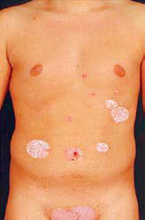

# Chapter 698: Diseases of the Epidermis

<!-- p.5235 -->
**BLOOM SYNDROME** Bloom syndrome is inherited in an autosomal recessive manner, most commonly in the Ashkenazi Jewish population. It is caused by pathogenic genetic variants in the *BLM/RECQL3* gene encoding a DNA helicase. Patients are sensitive to UV radiation, with increased rates of chromosomal breaks and sister chromatid exchanges. Ery thema and telangiectasia develop during infancy in a butterfly distribution on the face after exposure to sunlight. A bullous erup tion on the lips and telangiectatic erythema on the cheeks, hands, and forearms may develop. Café-au-lait spots and hypopigmented macules may be present. Intrauterine growth deficiency develop ing into short stature, referred to as “proportionate dwarfism,” and a distinctive facies consisting of a prominent nose and ears and a small, narrow face are generally found. Intellect is average to low average. Immunodeficiency is seen in all patients, manifesting as recurrent ear and pulmonary infections. Gastrointestinal malab sorption, gastroesophageal reflux, and hypogonadism are common. Affected children have an unusual tendency to develop both solid tumors (especially of the skin) and lymphoreticular malignancies, which often result in death during childhood or early adulthood. Sister chromatid exchange analysis is generally performed to con firm diagnosis. The only effective measures to reduce skin disease are sun protection and avoidance.

**HARTNUP DISEASE** See Chapter 105.5.

Hartnup disease is a rare inborn error of metabolism with auto somal recessive inheritance. Neutral amino acids, including tryp tophan, are not transported across the brush border epithelium of the intestine and kidneys due to a pathogenic variant in the *SLC6A19* gene encoding the transporter. This results in deficiency of nicotinamide synthesis and causes a photo-induced **pellagra-like syndrome**. The urine contains increased amounts of monoamine monocarboxylic amino acids, distinguishing Hartnup disease from dietary pellagra. Cutaneous signs, which precede neurologic manifestations, initially develop during the early months of life. An eczematous, occasionally vesiculobullous, eruption occurs on the face and extremities in a glove-and-stocking photodistribution. Hyperpigmentation and hyperkeratosis may supervene and are intensified by further exposure to sunlight. Episodic flares may be precipitated by febrile illness, sun exposure, emotional stress, and poor nutrition. In most cases, mental development is normal, but some patients display emotional instability and episodic cerebellar ataxia. Neurologic symptoms are fully reversible. Administration of nicotinamide and protection from sunlight result in improvement of both cutaneous and neurologic manifestations.

*Visit Elsevier eBooks+ at eBooks.Health.Elsevier.com** for Bibliography.*

**Fig. 697.9** Poikiloderma on the arm of an infant with Rothmund- Thomson syndrome.

## 698.1  Psoriasis Julie M. Dhossche and Yvonne E. Chiu

Psoriasis affects 2–4% of the U.S. population, and pediatric psoriasis accounts for approximately one third of all cases.

**ETIOLOGY/PATHOGENESIS** Psoriasis is an inflammatory autoimmune-related disease characterized by inflammation and keratinocyte proliferation (Fig. 698.1). Within the dermis, dendritic cells are activated by self-antigens and release cytokines such as interferon-γ, tumor necrosis factor, and interleukin (IL)-12, IL- 17, IL-22, and IL-23, which recruit T cells. Once activated, the T cells release cytokines that induce proliferation and abnormal differentiation of epidermal keratinocytes; in turn, more cytokines are produced to per petuate the cycle. Psoriasis has a complex multifactorial genetic basis. Family history of psoriasis is present in ∼50% of patients, typically a first-degree relative. The major psoriasis-susceptibility gene *(PSORS1)* is human leukocyte antigen (HLA)-CW*0602, encoding a class I major his tocompatibility complex protein involved in recognition of self-antigens. Numerous other psoriasis susceptibility genes have been identified.

Factors contributing to disease onset/flares in some patients include bacterial and viral infections, trauma, physical or emotional stress, tobacco use/secondhand exposure, and certain medications.

**CLINICAL MANIFESTATIONS** This common chronic skin disorder is first evident within the first 2 decades of life for approximately 30% of affected individuals. **Plaque psoriasis**, the most common (>80%) subtype, is characterized by erythematous papules that coalesce to form plaques with sharply demarcated, irregular borders (Fig. 698.2A-D). If they are unaltered by treatment, a thick silvery or yellow-white scale (resembling mica) develops (see Fig. 698.2A). Removal of the scale may result in pin point bleeding **(Auspitz sign)**. The **Koebner phenomenon**, in which new lesions appear at sites of trauma, is a valuable diagnostic feature. Lesions may occur anywhere, but preferred sites are the scalp, knees, elbows, umbilicus, superior intergluteal fold, genitalia, and ear canal. Nail involvement, a valuable diagnostic sign, is characterized by pit ting of the nail plate, detachment of the plate (onycholysis), yellowishbrown subungual discoloration, and accumulation of subungual debris (see Fig. 698.2G, H, and M). Plaques are generally asymptomatic; how ever, pruritus is more common in children than in adults.

**Guttate psoriasis**, a variant that occurs predominantly in children, is characterized by an acute eruption of many oval or round papules smaller than 1.5 cm that are morphologically identical to the larger plaques of psoriasis (see Fig. 698.2N-Q). Sites of predilection are the trunk, face, and proximal portions of the limbs. The onset usually fol lows a few weeks after a **streptococcal** infection such as pharyngitis; thus throat culture and serologic titers should be obtained. Guttate psoriasis has also been observed after perianal streptococcal infection, viral infections, sunburn, and withdrawal of systemic corticosteroid therapy or tumor necrosis factor (TNF)-α inhibitors. Clinical course ranges from spontaneous resolution to chronic disease.

**Pustular psoriasis** is a multisystem autoinflammatory disease char acterized by recurrent episodes with the sudden onset of fever, malaise, extracutaneous organ involvement, and a diffuse erythematous-pustular exanthema. It may be associated with plaque psoriasis in some patients; unregulated cytokine production as a result of pathogenic genetic vari ants in the *IL36RN, AP1S3,* and *CARD14* genes are implicated in a sub set of patients.

Psoriasis is rare in infants but may be severe and recalcitrant and may pose a diagnostic problem. Psoriatic diaper rash is a common

<!-- p.5237 -->
CCL20 CXCL1 CXCL8

Keratinocyte

Post-transcriptional mRNA stabilization

AP1

MAPK C/EBPs

NF-κB

IKK

TAK1 TRAF2 and TRAF5

IL-17RB

IL-17RA

IL-17E IL-17C

IL-17RA IL-17RA

IL-17RC IL-17RE

TRAF6

Act1

IL-17A/A IL-17A/F IL-17F/F

IL-23

p19

JAK2

TYK2

p40

IL-12Rβ1

IL-23Rα

STAT3

RORγt

IL-17

IL-22

IL-22

Th17

IL-23Rα RORC

Tc17

Th22

Th17

**Remaining alterations in resolved psoriatic lesions**

Extended capillary net B

A

C

**Immunologic mechanisms underlying the persistence of psoriatic lesions**

AVPs

AMPs

IL-19

IL-36 IL-17C

IL-24

CCL20 CXCL1 CXCL8

IL-20

IL-22

IL-22

IL-29

IL-23 IL-23

IL-26

T22 cell

T17 cell T17/1 cell

Macrophages and dendritic cells

Strengthened epidermal immune defense

Endothelial activation and recruitment of immune cells

Hyperproliferation and altered terminal differentiation of keratinocytes

IL-17

IL-17

TNF-α

TNF-α

IFN-γ

Parakeratosis

Munro’s microabscesses and NETosis

Hyperkeratosis Acanthosis

**IL-23 and IL-17 signaling**

**Fig. 698.1** Immune pathogenesis of psoriasis. The IL-23 and IL-17 pathway in psoriasis with elements of their signaling. A, IL-23 acts on Th17 cells via the transmembrane receptor complex composed of IL-12Rβ1 and IL-23Rα and intracellular JAK–STAT signaling and induces the expression of IL-17A, IL-17F, and IL-22, which act on epithelial cells through distinct receptor and signaling pathways. B, In psoriatic skin IL-23 is essential for the stabilization of the phenotype of IL-17–producing lymphocytes, activates these cells, and enhances their cytokine production and pathogenicity. IL-17 mostly acts synergistically with other cytokines, leading to massive activation of immunologic pathways and cytokines such as IL-22, IL-20, and IL-24, promoting the epidermal changes. C, After successful antipsoriatic treatment, potentially pathogenetic T cells remain in the resolved psori atic skin. Blood capillaries extend during psoriatic inflammation by angiogenic signals and recede slowly. AMP, antimicrobial protein; AVP, antiviral protein; C/EBP, CCAAT-enhancer-binding protein; T17, Th17 and Tc17; T1, Th1 and Tc1; T22, Th22 and Tc22; Th, T helper cell; Tc, cytotoxic T cell; NETosis, activation and release of neutrophil extracellular traps. (From Ghoreschi K, Balato A, Enerbäck C, Sabat R. Therapeutics targeting the IL-23 and IL-17 pathway in psoriasis. Lancet. 2021;397:754–766, Fig. 2.)

presentation in children younger than 2 years old. Other rare forms include psoriatic erythroderma (>90% body surface area involvement), linear psoriasis, palmoplantar psoriasis, and inverse psoriasis (occur ring in intertriginous areas). Children may also develop juvenile psori atic arthritis, with or without skin lesions.

Psoriasis may be triggered by mild trauma (piercing, tattoos), sun or chemical burns, medications (β blockers, NSAIDs), or HIV infection. Comorbid conditions include arthritis, Crohn disease, depression, and nonalcoholic fatty liver disease.

**DIFFERENTIAL DIAGNOSIS** Psoriasis is a clinical diagnosis. The differential diagnosis of plaquetype psoriasis includes nummular dermatitis, tinea corporis, sebor rheic dermatitis, postinfectious arthritis syndromes, and pityriasis rubra pilaris. Scalp lesions may be confused with seborrheic dermatitis,

atopic dermatitis, or tinea capitis. Diaper area psoriasis may mimic seb orrheic dermatitis, eczematous diaper dermatitis, perianal streptococ cal disease, candidiasis, or allergic contact dermatitis. Guttate psoriasis can be confused with viral exanthems, secondary syphilis, pityriasis rosea, and pityriasis lichenoides chronica (PLC). Nail psoriasis must be differentiated from onychomycosis, lichen planus, and other causes of onychodystrophy.

**PATHOLOGY** When the diagnosis is in doubt, histopathologic examination of an untreated lesion can be helpful. Characteristic changes of psoriasis include parakeratosis, acanthosis, elongated rete ridges, neutro philic infiltrate in the epidermis sometimes forming microabscesses, dilated dermal blood vessels, and lymphocytic infiltrate in the dermis.

<!-- p.5238 -->
**TREATMENT** The therapeutic approach varies with the age of the child, type of pso riasis, sites of involvement, and extent of the disease. Physical and chemical trauma to the skin should be avoided as much as possible to prevent Koebner-response lesions. The treatment of psoriasis should be viewed as a four-tier process. Efficacy varies with each therapy (Table 698.1).

**The first tier is topical therapy.** The first-line topical agents for lesions on the body are emollients, vitamin D analogs (calcipotriene or calcitriol, although calcitriol is less irritating for children), and mid- to high-potency corticosteroids (see Chapter 687). A propri etary formulation containing both calcipotriene and betamethasone dipropionate (a high-potency topical corticosteroid) exists in ointment and solution forms. The preparation that is least potent but effective should be applied twice a day. Second-line topical options for lesions on the body include retinoids (tazarotene), tar preparations, anthralin, and keratolytics (salicylic acid or urea). Facial or intertriginous lesions may be treated with low-potency topical corticosteroids and/or topical vitamin D analogs or calcineurin inhibitors as corticosteroid-sparing agents. For scalp lesions, applications of a phenol and saline solution (e.g., Baker Cummins P&S liquid) or salicylic acid shampoo followed by a tar shampoo are effective in the removal of scales. A high-potency to superpotency corticosteroid in a foam, solution, or lotion base may be applied when the scaling is diminished. Nail lesions are difficult to treat topically; the first-line approach is a high-potency topical cortico steroid to the proximal nail fold.

**The second tier of therapy is phototherapy.** Narrow-band ultravio let B (311 nm; NB-UVB) is an effective and well-tolerated alternative in pediatric patients with plaque and guttate psoriasis poorly controlled with topical treatments. Excimer (308 nm) laser UVB irradiation may be used for localized treatment-resistant plaques. Exposure to natural sunlight is often effective for less severe psoriasis.

**The third tier is systemic therapy** for children with moderate to severe, recalcitrant or generalized psoriasis. Methotrexate (0.2-0.7 mg/ kg/wk to a maximum of 25 mg/week) is the first-line systemic agent for children; other options include oral retinoids (0.5-1.0 mg/kg/day to a maximum of 50 mg/day) and cyclosporine (modified formula tion, 3-5 mg/kg/day). Oral retinoids may be cautiously combined with phototherapy, although doses may need to be decreased because of the photosensitizing effects of the medication. Oral retinoids are also con sidered for generalized pustular and diffuse guttate psoriasis.

*Biologic response modifiers are increasingly used in place of tradi tional oral agents.* TNF-α inhibitors such as etanercept, infliximab, and adalimumab have increasingly been used for pediatric psoriasis. Etanercept has FDA approval for those 4 years and older with psoria sis. One study reported a significant improvement in psoriatic lesions at 12 weeks with 57% versus 11% of patients receiving etanercept or placebo, respectively, achieving a 75% improvement in Psoriasis Area and Severity Index-75 (PASI-75, a metric to evaluate psoriasis sever ity). Ustekinumab, a human monoclonal antibody that blocks IL-12 and IL-23 and their cell-surface receptors, is approved for those 6 years and older with moderate to severe psoriasis. Biologic IL-17 inhibitors

A B C D E F

H I G J K L

Q P O N M

**Fig. 698.2** Clinical manifestations of psoriasis. Typical erythematous plaques with silvery scales (A) can be scattered (B, psoriasis nummularis), cover larger areas of the skin (C, psoriasis geographica), or affect the entire body surface (D, erythrodermic psoriasis). Scalp involvement might be ac companied by nonscarring alopecia (E). Psoriatic arthritis affects up to 30% of all patients (F, thumb interphalangeal joint). Nail changes are frequent and range from pitting and yellow or brown discoloration (G) to complete dystrophy (H). Psoriasis inversa occurs in intertriginous areas and is usually devoid of scales (I). Pustular psoriasis might occur in a generalized form (J and K) or localized (L, palmoplantar type and M, acrodermatitis continua suppurativa type). In children, the onset as guttate psoriasis might follow streptococcal infection of the upper respiratory tract (N) and affect any site of the body (O-Q). (From Boehncke WH, Schön MP. Psoriasis. Lancet. 2015;386:983–992, Fig. 1, p. 984.)

<!-- p.5239 -->

#### **Table 698.1** Recommendations for Pediatric Psoriasis

| Category / Parameter | Clinical Details & Findings |
| --- | --- |
| **EVIDENCE** | Topical corticosteroids are recommended for the treatment of pediatric psoriasis as an off-label; therapy |
| **II** | The use of ultra-high-potency topical corticosteroids as monotherapy is effective for short-term; treatment of localized psoriasis in pediatric patients |
| **II** | Tacrolimus 0.1% ointment is recommended for off-label use as monotherapy for pediatric psoriasis of; the face and genital region |
| **II-III** | Calcipotriene/calcipotriol is recommended as a treatment option for childhood plaque psoriasis |
| **II** | Because of the theoretical risk of increased calcium absorption and systemic effects of hypercalcemia,; occlusion of calcipotriene/calcipotriol applied to large body surface areas is not recommended |
| **III** | Monitoring of vitamin D metabolites may be considered during calcipotriene/calcipotriol therapy; when applied to a large body surface area |
| **I-II** | The combination of calcipotriol/betamethasone dipropionate ointment applied once daily for up; to 4 weeks at a time is recommended as a safe and effective treatment for children ages 12 yr and; older with mild to moderate plaque psoriasis |
| **I-II** | The combination of calcipotriol/betamethasone dipropionate suspension applied once daily for up; to 8 wk at a time is recommended as a safe and effective treatment for children ages 12 yr and; older with mild to moderate plaque psoriasis of the scalp |
| **II** | The use of emollients (at the same time or different time of day) with topical calcipotriene may be; considered to reduce irritation and enhance the efficacy of calcipotriene |
| **III** | Rotational therapy with topical vitamin D analogues, topical calcineurin inhibitors, emollients,; tar-based therapies, and topical corticosteroids may be considered in children as steroid-sparing; regimens that may reduce potential adverse effects from overreliance on topical steroid therapy |
| **II** | The off-label use of topical tazarotene may be recommended as monotherapy or in combination; with topical corticosteroids for the treatment of localized pediatric skin or nail psoriasis |
| **III** | Long-term use (12 wk or longer) of topical anthralin is recommended for the treatment of mild to; moderate psoriasis. Short-contact anthralin protocols are recommended to limit adverse effects |
| **II** | Coal tar preparations can be used as a monotherapy or combined with other topical therapies for; the treatment of pediatric psoriasis |
| **II-III** | The use of coal tar preparations in conjunction with phototherapy is effective for the treatment of; psoriasis in children but may be limited by the theoretical long-term risk of carcinogenesis |
| **II-III** | NB-UVB is recommended as a treatment option for moderate to severe pediatric plaque and guttate; psoriasis |
| **II-III** | The use of excimer laser or PUVA therapy in children with psoriasis may be efficacious and well; tolerated but has limited supporting evidence |
| **III** | Methotrexate is recommended as an effective systemic therapy for moderate to severe plaque; psoriasis and other psoriasis subtypes in children |
| **II-III** | Methotrexate is recommended as an effective systemic therapy for pustular psoriasis in children |
| **III** | Methotrexate weight-based dosing is recommended in younger children, ranging from 0.2 to 0.7; mg/kg/wk (maximum, 25 mg/wk) |
| **III** | Folic acid supplementation daily or six times weekly during treatment with methotrexate is; recommended |
| **II** | Routine clinical and laboratory monitoring is recommended before and during treatment with; methotrexate |
| **III** | Cyclosporine is recommended as an effective systemic therapy for moderate to severe plaque; psoriasis in children |
| **II-III** | Cyclosporine is recommended as an effective systemic therapy for moderate to severe pustular; psoriasis in children |
| **III** | Cyclosporine is recommended for short-term crisis management of severe or unstable plaque,; erythrodermic, or pustular psoriasis until the patient can be transitioned to a medication; appropriate for long-term use |
| **III** | Routine blood pressure clinical and laboratory monitoring is recommended during therapy with; cyclosporine |
| **III** | Modified cyclosporine (for microemulsion in capsules or solution) is recommended for use and is not; interchangeable with unmodified forms of cyclosporine |
| **III** | Continued |

<!-- p.5240 -->
secukinumab and ixekizumab are also FDA approved for those 6 and older. The safety and efficacy data of these biologic agents show they are generally well tolerated and efficacious in the treatment of moder ate to severe plaque psoriasis. The primary risk is injection site reac tion. A small-molecule inhibitor of phosphodiesterase 4, apremilast, is also used for pediatric psoriasis. IL-23 inhibitors may also have a role in the treatment of severe disease and are being studied in pediatric populations.

**PROGNOSIS** Prognosis is best for children with limited disease. Psoriasis is a life long disease characterized by remissions and exacerbations. Arthritis or various eye diseases may be extracutaneous complications. Meta bolic and cardiovascular disorders also occur with increased frequency in patients with psoriasis. For example, an increasing degree of obesity and the associated metabolic syndrome (hyperglycemia, hyperlipid emia, and hypertension) correlates with psoriasis severity. Patients with psoriasis also have increased rates of stroke, myocardial infarction,

and other vascular diseases later in adult life. A proposed mechanism involves the systemic proinflammatory state induced by both psoria sis and these associated conditions, although the direction of causality remains unclear. Furthermore, children suffering from psoriasis have a greater risk of taking psychotropic medications for anxiety or depres sion and are more likely to report impairment in quality of life due to their chronic disease.

*Visit Elsevier eBooks+ at eBooks.Health.Elsevier.com** for Bibliography.*

## 698.2  Pityriasis Lichenoides Julie M. Dhossche and Yvonne E. Chiu

Pityriasis lichenoides encompasses a disease spectrum rang ing from PLC to pityriasis lichenoides et varioliformis acuta (PLEVA; Mucha-Habermann disease). The designation of pityriasis

#### **Table 698.1** Recommendations for Pediatric Psoriasis—cont’d

| Category / Parameter | Clinical Details & Findings |
| --- | --- |
| **EVIDENCE** | Acitretin is recommended as an effective, nonimmunosuppressive systemic therapy for children with; extensive guttate or moderate to severe (ideally thin plaque) psoriasis vulgaris at a dosage of 0.1-1; mg/kg/d |
| **II** | Acitretin is recommended as an effective systemic therapy for pustular psoriasis in children |
| **II-III** | Acitretin combined with NB-UVB therapy may be synergistic for plaque and pustular psoriasis in; childhood and allows for a reduction in dosing of both agents |
| **III** | Acitretin may be combined with other systemic therapies such as methotrexate or cyclosporine, or; biologics, depending on the individual clinical situation |
| **III** | Routine clinical and laboratory monitoring is recommended during therapy with acitretin |
| **III** | Fumaric acid esters may be considered as a potentially effective alternative therapy for pediatric; patients with moderate to severe psoriasis who are candidates for systemic therapy |
| **II-III** | Clinical and laboratory monitoring is recommended during treatment with fumaric acid esters |
| **III** | Etanercept is recommended as an effective therapy for moderate to severe psoriasis in children 6 yr; of age and older |
| **I-III** | Etanercept dosing is typically once weekly and is dosed subcutaneously at 0.8 mg/kg with a; maximum of 50 mg weekly |
| **I, III** | Adalimumab is recommended for off-label use as an effective therapy in children and adolescents; with moderate to severe psoriasis |
| **I, III** | The dose of adalimumab is 0.8 mg/kg (maximum, 40 mg) at weeks 0 and 1 and then is given every; other week; adalimumab administered at a dose of 0.8 mg/kg is more efficacious than at a dose of; 0.4 mg/kg |
| **I** | Infliximab can be recommended as monotherapy or in combination with methotrexate for use in; pediatric patients with severe plaque or pustular psoriasis that is unresponsive to other systemic; medications, rapidly progressive, unstable, and/or life threatening |
| **III** | The starting dose of infliximab is an infusion of 5 mg/kg administered on weeks 0, 2, and 6 and then; every 8 weeks |
| **III** | Ustekinumab is recommended as an effective therapy for adolescents 12 yr and older with moderate; to severe plaque psoriasis |
| **I, III** | Ustekinumab can be used as an effective therapy for pediatric patients younger than 12 yr old with; moderate to severe plaque psoriasis |
| **III** | Ustekinumab is given at weeks 0, 4, and 16 and then every 12 weeks with weight-based dosing as; follows: 0.75 mg/kg if < 60 kg, 45 mg if 60 to 100 kg, and 90 mg if > 100 kg |
| **I** | Biologics may be safely combined with topical corticosteroids, with or without a vitamin D analogue,; to augment effectiveness for the treatment of moderate to severe plaque psoriasis |
| **III** | The major risk for biologics in children is injection site reaction, but patients should be monitored for; their increased risk of infection |
| **II** | Data from Menter A, Cordoro KM, Davis DMR, et al. Joint American Academy of Dermatology–National Psoriasis Foundation guidelines of care for the management and treatment; of psoriasis in pediatric patients. J Am Acad Dermatol. 2020;82(1):161–201, Tables XX–XLVIII, pp. 173–189. |

<!-- p.5241 -->

<!-- p.5242 -->
lichenoides as acute or chronic refers to the morphologic appear ance of the lesions rather than to the duration of the disease. No correlation is found between the type of lesion at the onset of the eruption and the duration of the disease. Many patients have both acute and chronic lesions simultaneously, and transition of lesions from one form into another occurs occasionally. As a result, some authors advocate using pityriasis lichenoides as the general diag nosis rather than differentiating between PLC and PLEVA. Febrile ulceronecrotic Mucha-Habermann disease (FUMHD) is a rare sub type of PLEVA that is more severe and potentially life-threatening.

**ETIOLOGY/PATHOGENESIS** Two main theories exist for the etiology of pityriasis lichenoides. The first is that it arises in a genetically susceptible individual as a hyper sensitivity reaction to an infection. The second is that it represents a monoclonal T-cell lymphocytic proliferation on the pathway to cutane ous T-cell dyscrasia.

**CLINICAL MANIFESTATIONS** Pityriasis lichenoides most commonly manifests in the second and third decades of life; 30% of cases manifest before age 20 years, with peaks of incidence at 5 and 10 years of age. The overall eruption persists for months to years with a tendency to eventually remit.

PLC manifests gradually as generalized, multiple, brown-red papules to plaques that are covered by a fine grayish scale (Fig. 698.3). Lesions may be asymptomatic or may cause minimal pruritus and occasionally become vesicular, hemorrhagic, crusted, or superinfected. Individual papules become flat and brownish in 2-6 weeks, ultimately leaving hyperpigmented or hypopigmented macules and patches. Scarring is unusual. Various stages of lesions are present, most commonly on the trunk and extremities and generally spare the face, palmoplantar sur faces, scalp, and mucous membranes.

**PLEVA** manifests as an abrupt eruption of numerous 2- to 3-mm papules that have a vesiculopustular and then a purpuric center, are covered by a dark adherent hemorrhagic or necrotic crust, and are surrounded by an erythematous halo (Fig. 698.4). Constitutional symptoms, such as fever, malaise, headache, and arthralgias, may be present for 2-3 days after the initial outbreak. Lesions are distrib uted diffusely on the trunk and extremities, as in PLC. Individual lesions heal within a few weeks, sometimes leaving a varioliform scar, and successive crops of papules produce the characteristic polymorphous appearance of the eruption, with lesions in various stages of evolution.

**FUMHD** manifests as high fever and ulceronecrotic nodules up to a few centimeters in diameter, which are most common on the anterior trunk and flexor surfaces of the proximal upper extremities. Histopathology of lesions is consistent with PLEVA. Hemorrhagic bul lae, mucosal ulcers, arthritis, cardiomyopathy, vasculitis, abdominal

complaints, hematologic abnormalities (megaloblastic anemia, pan cytopenia, and diffuse intravascular coagulation), and superinfection of cutaneous lesions with *Staphylococcus aureus* may also develop. These patients may have a history of previous PLEVA diagnosis. Although there is no reported standardized treatment and there have been reports of fatalities, typically the ulceronecrotic lesions heal with hypopigmented scarring in a few weeks.

**PATHOLOGY** PLC histologically shows a parakeratotic, thickened corneal layer; epidermal spongiosis; a superficial perivascular infiltrate of macro phages and predominantly CD8 lymphocytes that may extend into the epidermis; and small numbers of extravasated erythrocytes in the papillary dermis.

The histopathologic changes of PLEVA and FUMHD reflect their more severe nature. Intercellular and intracellular edema in the epider mis may lead to degeneration of keratinocytes. A dense perivascular mononuclear cell infiltrate, endothelial cell swelling, and extravasation of erythrocytes into the epidermis and dermis are additional charac teristic features.

**DIFFERENTIAL DIAGNOSIS** The differential diagnosis of pityriasis lichenoides includes guttate psoriasis, pityriasis rosea, drug eruptions, secondary syphilis, viral exanthems, lymphomatoid papulosis, and lichen planus. The chro nicity of pityriasis lichenoides helps preclude pityriasis rosea, viral exanthems, and some drug eruptions. A skin biopsy can help dis tinguish pityriasis lichenoides from other entities in the differential diagnosis.

**TREATMENT** Pityriasis lichenoides should be considered a benign condition that does not alter the health of the child. A lubricant to remove excessive scaling may be all that is necessary if the patient is asymp tomatic. If treatment is required, first-line agents are oral antiin flammatory antibiotics such as erythromycin (30-50 mg/kg/day to a maximum of 4000 mg/day for 2-3 months) or doxycycline for children >8 years. Topical corticosteroids (mid-potency, applied twice daily) and topical calcineurin inhibitors may help the pruritus and inflammation but do not alter the course of the disease. Pho totherapy (NB-UVB) is the second-line treatment option. Metho trexate should be reserved for severely symptomatic cases. The rare FUMHD usually requires inpatient treatment; initially, systemic corticosteroids, methotrexate, intravenous immunoglobulin, or cyclosporine may be necessary, with eventual transition to another form of treatment, as mentioned earlier, once the disease improves and stabilizes.

*Visit Elsevier eBooks+ at eBooks.Health.Elsevier.com** for Bibliography.*

**Fig. 698.3** Widespread plaques with fine scale in pityriasis lichenoides chronica.

**Fig. 698.4** Necrotic lesion with erythematous halo in pityriasis li chenoides et varioliformis acuta.

<!-- p.5243 -->

<!-- p.5244 -->

## 698.3  Keratosis Pilaris Julie M. Dhossche and Yvonne E. Chiu

Keratosis pilaris is a common papular eruption resulting from keratin plugging of hair follicles. It displays an autosomal dominant transmis sion with variable penetrance. Typical areas of involvement include the upper extensor surfaces of the arms and thighs, cheeks, and buttocks. The lesions may resemble gooseflesh; they are noninflammatory, scaly, fol licular papules that do not coalesce. They are generally asymptomatic but may be pruritic. Irritation of the follicular plugs occasionally causes ery thema surrounding the keratotic papules (Fig. 698.5). A subset of patients has keratosis pilaris associated with facial telangiectasia and ulerythema ophryogenes, a rare cutaneous disorder characterized by inflammatory keratotic facial papules that may result in scars, atrophy, and alopecia. Because the lesions of keratosis pilaris are associated with and accen tuated by dry skin, they are often more prominent during the winter. Keratosis pilaris is more frequent in patients with atopic dermatitis and is most common during childhood and early adulthood, tending to sub side in the third decade of life. Treatment of keratosis pilaris is optional. Measures to decrease pruritus include moisturization with a bland emol lient. Regular applications of a 10–40% urea cream or an alpha-hydroxy acid preparation such as 12% lactic acid cream or lotion can improve the appearance of keratosis pilaris but may further contribute to pruritus and irritation. Therapy may improve the condition but does not cure it.

## 698.4  Lichen Spinulosus Julie M. Dhossche and Yvonne E. Chiu

Lichen spinulosus is an uncommon disorder that occurs principally in children and more frequently in boys. The cause is unknown. The lesions consist of sharply circumscribed irregular plaques of spiny, ker atotic, follicular plugs. Plaques may occur anywhere on the body and are often distributed symmetrically on the trunk, elbows, knees, and extensor surfaces of the limbs. Although sometimes erythematous or pruritic, the lesions are usually skin colored and asymptomatic.

Treatment is usually unnecessary. For patients who regard the erup tion as a cosmetic defect, urea-containing lubricants (10–40%) are often effective in flattening the projections. The plaques usually disap pear spontaneously after several months or years.

## 698.5  Pityriasis Rosea Julie M. Dhossche and Yvonne E. Chiu

Pityriasis rosea is a common benign papulosquamous disorder typi cally affecting adolescents and young adults 15-30 years of age. The dis

**ETIOLOGY/PATHOGENESIS** The cause of pityriasis rosea is unknown; a viral agent is suspected, with a current focus on human herpesviruses 6 and 7. Supporting evidence for an infectious etiology includes the tendency for it to occur in (familial) case clusters, presence of a prodrome and seasonal variation, and infrequent recurrences, although the rash itself does not appear to be contagious.

**CLINICAL MANIFESTATIONS** This benign, common eruption occurs most frequently in children and young adults. Although a prodrome of fever, malaise, arthralgia, and pharyngitis may precede the eruption, children rarely complain of such symptoms. A **herald patch** classically precedes the generalized erup tion and may occur anywhere on the body. Herald patches are generally larger than other lesions and vary from 1 to 10 cm in diameter; they are annular in configuration and have a raised border with fine, adherent scales. Approximately 5-10 days after the appearance of the herald patch, a widespread, symmetric eruption involving mainly the trunk and proxi mal limbs becomes evident (Fig. 698.6). In the inverse form of pityriasis rosea, the face, scalp, and distal limbs may be preferentially involved. Lesions may appear in crops for several days. Typical lesions are oval or round, <1 cm in diameter, slightly raised, and pink to brown. The developed lesion is covered by a fine scale, which gives the skin a crinkly appearance. Some lesions clear centrally and produce a collarette of scale that is attached only at the periphery. Papular, vesicular, urticarial, hem orrhagic, large annular, and mucosal lesions are unusual variants. The long axis of each lesion is usually aligned with the cutaneous cleavage lines, a feature that creates the so-called **Christmas tree pattern** on the back. Conformation to skin lines is often more discernible in the anterior and posterior axillary folds and supraclavicular areas. The lesions most commonly are asymptomatic but may be mildly to severely pruritic. Duration of the eruption varies from 2 to 12 weeks, with self-resolution. After the eruption has resolved, postinflammatory hypopigmentation or hyperpigmentation may be pronounced, particularly in dark-skinned patients. These changes disappear in subsequent weeks to months.

**DIFFERENTIAL DIAGNOSIS** The herald patch may be mistaken for tinea corporis, a pitfall that can be avoided if microscopic evaluation of a potassium hydroxide prepa ration of scrapings of the lesion is performed. The generalized eruption resembles a number of other diseases; secondary syphilis is the most important. Drug eruptions, viral exanthems, guttate psoriasis, PLC, and nummular dermatitis can also be confused with pityriasis rosea.

**TREATMENT** Therapy is unnecessary for asymptomatic patients with pityriasis rosea. If scaling is prominent, a bland emollient may suffice. Pruritus may be sup pressed by a lubricating lotion containing menthol and camphor or by an oral antihistamine for sedation, particularly at night, when itching may be troublesome. Occasionally, a mid-potency topical corticosteroid prepara tion may be necessary to alleviate pruritus. Exposure to natural sunlight and NB-UVB phototherapy may reduce disease duration and severity. Acy clovir has been used in some cases to treat symptoms and shorten duration.

**Fig. 698.5** Keratotic follicular plugs with surrounding erythema in keratosis pilaris.

**Fig. 698.6** Herald patch and surrounding pityriasis rosea.

<!-- p.5245 -->

<!-- p.5246 -->

## 698.6  Pityriasis Rubra Pilaris Julie M. Dhossche and Yvonne E. Chiu

**ETIOLOGY/PATHOGENESIS** The cause of pityriasis rubra pilaris remains unclear. Pityriasis rubra pilaris can be subdivided into six clinical subtypes based on age of onset, characteristics, and other features. Most cases are sporadic, but familial forms are commonly seen in the fifth subtype, with gain-of-function variants in the *CARD14* gene. The sixth subtype occurs in those with HIV infection. Some studies have indicated a role for TNF-α in disease development, whereas other hypotheses for causal factors include abnormal vitamin A metabolism, trauma, infections, immunosuppression, and UV light exposure.

**CLINICAL MANIFESTATIONS** This rare inflammatory dermatosis is known for its variability in clinical presentation and course of disease. It often has an insidious onset with diffuse scaling and erythema of the scalp, which is indis tinguishable from the findings in seborrheic dermatitis, and with thick hyperkeratosis of the palms and soles (Fig. 698.7A). Lesions over the elbows and knees are also common (see Fig. 698.7B), and generalized erythroderma develops in some patients. The char acteristic primary lesion is a firm, dome-shaped, tiny, acuminate, pink to red papule, which has a central keratotic plug pierced by a vellus hair. Masses of these papules coalesce to form large, ery thematous, sharply demarcated orange-pink plaques with overlying scale, within which islands of normal skin can be distinguished. Typical papules on the dorsum of the proximal phalanges are read ily palpated. Gray plaques or papules resembling lichen planus may be found in the oral cavity. Dystrophic changes in the nails may occur and mimic those of psoriasis. Lesions are commonly pru ritic. In childhood, the prognosis for eventual resolution is rela tively good.

**DIFFERENTIAL DIAGNOSIS** Differential diagnosis includes ichthyosis, seborrheic dermatitis, ker atoderma of the palms and soles, and psoriasis. The “Wong” variant

of dermatomyositis may present with a pityriasis rubra pilaris–like eruption.

**HISTOLOGY** Skin biopsy revealing follicular plugging, epidermal acanthosis, peri vascular infiltrate, checkerboard pattern of orthokeratosis and para keratosis, and an intact granular layer may differentiate this condition from psoriasis and seborrheic dermatitis.

**TREATMENT** The numerous therapeutic regimens recommended are difficult to evaluate because pityriasis rubra pilaris has a capricious course with exacerbations and remissions. Moisturization alone is useful in mild cases. Topical agents, such as mid- to high-potency cor ticosteroids, keratolytics (urea, salicylic acid), vitamin D analogs (calcipotriene), retinoids (tazarotene, tretinoin), and tar, are used in combination with systemic agents for widespread disease and as monotherapy for localized disease. When further treatment is necessary, oral retinoids (isotretinoin or acitretin 0.5-1 mg/kg/day; maximum daily dose of isotretinoin is 80 mg/day and acitretin is 50 mg/day) are used as first-line agents, whereas methotrexate is used as a second-line agent. Third-line treatment options include biologic TNF-α inhibitors, cyclosporine, azathioprine, and NB- UVB phototherapy. Ustekinumab and secukinumab have also been described as efficacious.

*Visit Elsevier eBooks+ at eBooks.Health.Elsevier.com** for Bibliography.*

## 698.7  Darier Disease (Keratosis Follicularis) Julie M. Dhossche and Yvonne E. Chiu

**ETIOLOGY/PATHOGENESIS** A rare genetic disorder, Darier disease is inherited as an autosomal dominant trait and is caused by pathogenic genetic variants in the *ATP2A2* gene. This gene encodes a cellular calcium pump, SERCA2, and dysfunction results in loss of adhesion between epidermal cells and abnormal keratinization.

**CLINICAL MANIFESTATIONS** Onset usually occurs in late childhood and persists throughout life. Typical lesions are small, firm, skin-colored, warty papules that are not always follicular in location. The lesions eventually acquire yellow, mal odorous, greasy crusts and coalesce to form large, gray-brown, vegeta tive plaques (Fig. 698.8). The scalp, face, neck, shoulders, chest, back, axillae, limb flexures, and groin are symmetrically involved. Papules, fissures, crusts, and ulcers may appear on the mucous membranes of the lips, tongue, buccal mucosa, pharynx, larynx, and vulva. Hyper keratosis of the palms and soles and nail dystrophy with subungual hyperkeratosis and longitudinal red and white banding are variable features. Severe pruritus, secondary infection, offensive odor, and pain may occur. Several exacerbating triggers have been identified: sweat ing, UV light exposure, heat, friction, surgery, and infections; thus Darier disease has a chronic relapsing course that usually worsens in summertime.

**HISTOLOGY** Histologic changes seen in Darier disease are diagnostic. Hyperkera tosis with keratin plugging, intraepidermal separation (acantholysis) with formation of suprabasal clefts, and dyskeratotic epidermal cells are characteristic features.

**DIFFERENTIAL DIAGNOSIS** Darier disease is most likely to be confused with seborrheic dermatitis, acanthosis nigricans, flat warts, or Hailey-Hailey disease.

A

B

**Fig. 698.7** Pityriasis rubra pilaris. A, Orange palmar hyperkeratosis. B, Elbow lesions.

<!-- p.5247 -->

<!-- p.5248 -->
**TREATMENT** Treatment is nonspecific and begins with emollients and avoidance of triggers. First-line treatment for mild/localized disease is low- to mid-potency corticosteroids; second-line treatment are topical reti noids. Further treatment options include topical keratolytic agents (urea, lactic acid), antiseptic washes (triclosan, chlorhexidine glu conate, or bleach), or calcineurin inhibitors. More severe/general ized disease is treated with oral isotretinoin or acitretin (0.5-1.0 mg/ kg/day for 3-4 months; maximum daily dose of isotretinoin is 80 mg/day and acitretin is 50 mg/day). Secondary infections are com mon and must be treated appropriately. Novel treatments currently being investigated include anti–IL-6 antibodies, cyclooxygenase- 2 (COX2) inhibitors and miglustat (a glucosylceramide synthase inhibitor).

*Visit Elsevier eBooks+ at eBooks.Health.Elsevier.com** for Bibliography.*

## 698.8  Lichen Nitidus Julie M. Dhossche and Yvonne E. Chiu

**ETIOLOGY/PATHOGENESIS** The etiology of lichen nitidus is unknown but has been linked to immune alteration.

**CLINICAL MANIFESTATIONS** This uncommon, chronic, benign, papular eruption is characterized by minute (1-2 mm), flat-topped, shiny, firm papules of uniform size. The papules are most often skin-colored but may be pink or red. In darker-skinned individuals, they are usually hypopigmented (Fig. 698.9). Sites of predilection are the genitals, abdomen, chest, forearms, wrists, and inner aspects of the thighs. The lesions may be sparse or numerous and may form large plaques; careful examina tion usually discloses linear papules in a line of a scratch (Koebner phenomenon), a valuable clue to the diagnosis because it occurs in only a few diseases. Lichen nitidus occurs in all age-groups but is most prevalent in school-age children and young adults. Patients with lichen nitidus are usually asymptomatic and constitutionally well, although pruritus may be severe. The lesions may be confused with those of lichen planus, and lichen nitidus can rarely occur con currently with lichen planus.

**DIFFERENTIAL DIAGNOSIS** Widespread keratosis pilaris can also be confused with lichen nitidus, but the follicular localization of the papules and the absence of Koeb ner phenomenon in the former distinguish them. Verruca plana (flat warts), if small and uniform in size, may occasionally resemble lichen nitidus.

**HISTOLOGY** Although the diagnosis can be made clinically, a biopsy is occasionally indicated. The lichen nitidus papule consists of sharply circumscribed nests of lymphocytes and histiocytes in the upper dermis enclosed by clawlike epidermal rete ridges.

**TREATMENT** The course of lichen nitidus spans months to years, but the lesions eventually involute completely. No treatment is necessary, but mid- to high-potency topical steroids may be used for pruritus.

*Visit Elsevier eBooks+ at eBooks.Health.Elsevier.com** for Bibliography.*

## 698.9  Lichen Striatus Julie M. Dhossche and Yvonne E. Chiu

**ETIOLOGY/PATHOGENESIS** Lichen striatus is hypothesized to be caused by a combination of a genetic predisposition present in a mosaic manner in the skin (follow ing the lines of Blaschko) and an infectious trigger.

**CLINICAL MANIFESTATIONS** A benign, self-limited eruption, lichen striatus consists of a continuous or discontinuous linear band of papules in a Blaschkoid distribution. The primary lesion is a flat-topped, hypopigmented or pink papule cov ered with fine scale. Aggregates of these papules form multiple bands or plaques. The papules are gradually replaced by hypopigmented mac ules, which may be the presenting lesion in some cases. The eruption evolves over a period of days or weeks in an otherwise healthy child, remains stationary for weeks to months, and finally remits without sequelae, usually within 2 years. Symptoms are usually absent, although some children complain of itching. Nail dystrophy may occur when the eruption involves the proximal nail fold and matrix (Fig. 698.10).

**DIFFERENTIAL DIAGNOSIS** Lichen striatus is occasionally confused with other disorders. The ini tial plaque may resemble papular eczema or lichen nitidus until the linear configuration becomes apparent. Linear lichen planus and lin ear psoriasis are usually associated with typical individual lesions else where on the body. Linear epidermal nevi are permanent lesions that often become more hyperkeratotic and hyperpigmented than those of lichen striatus.

**TREATMENT** Treatment is not necessary and generally not very effective. A lowpotency topical corticosteroid preparation or topical calcineurin

**Fig. 698.8** Papules coalescing into a large plaque on the back of a patient with Darier disease.

**Fig. 698.9** Slightly hypopigmented, uniform papules of lichen nitidus.

<!-- p.5249 -->

<!-- p.5250 -->

<!-- p.5251 -->
inhibitor can be used when pruritus is a problem in a patient with lichen striatus.

*Visit Elsevier eBooks+ at eBooks.Health.Elsevier.com** for Bibliography.*

## 698.10  Lichen Planus Julie M. Dhossche and Yvonne E. Chiu

**ETIOLOGY/PATHOGENESIS** The cause of lichen planus is unknown, but an immune attack on the skin by cytotoxic T cells is postulated. A genetic predisposition may exist, and other proposed triggers include metal exposure, certain medications, liver disease, vaccinations (especially hepatitis B vaccina tion), and infections (especially hepatitis C virus).

**CLINICAL MANIFESTATIONS** This is a rare disorder in young children and uncommon in older ones. The classic form of lichen planus is the most common subtype in children, often exhibiting an acute eruptive onset. The lesions erupt in an explosive fashion, much like a viral exanthem, and spread to involve most of the body surface. The primary lesion is a viola ceous, sharply demarcated, polygonal papule with fine white lines (Wickham’s striae) or scale on the surface. Papules may coalesce to form large plaques (Fig. 676.11). The papules are intensely pruritic, and additional papules are often induced by scratching (Koebner phenomenon) so that lines of them are detected. Sites of predilection are the flexor surfaces of the wrists, the forearms, the inner aspects of the thighs, and the ankles.

Hypertrophic, linear, bullous, atrophic, annular, follicular, erosive, ulcerative, and actinic forms of lichen planus may also occur in chil dren. Characteristic lesions of mucous membranes consist of pinheadsize white papules that coalesce to form reticulated and lacy patterns on the buccal mucosa. Erosive ulcers are also common in the oral mucosa and may also involve the gastrointestinal tract. Nail involvement causes nail dystrophy. The disorder may persist for months to years, but selfresolution eventually occurs in most cases. Intense hyperpigmentation frequently persists for a long time after the resolution of lesions.

**HISTOLOGY** The histopathologic findings in lichen planus are specific, consisting of hyperkeratosis, irregular acanthosis, wedge-shaped hypergranulosis, apoptotic keratinocytes in the lower epidermis and upper dermis, and basal cell degeneration with a bandlike lymphocytic infiltrate at the epidermal-dermal junction. Pigment incontinence is frequently seen. Biopsy is indicated if the diagnosis is unclear.

**TREATMENT** Treatment is directed at alleviation of the intense pruritus and ame lioration of the skin lesions. First-line treatment with a high-potency topical corticosteroid applied twice daily is effective for localized dis ease on the trunk or extremities; lesions on the face and genitals may be treated with low- to mid-potency corticosteroids. Alternatives to topi cal steroids include topical calcineurin inhibitors or vitamin D analogs. Thick lesions may require intralesional corticosteroid injection. Oral antihistamines (hydroxyzine) are often added for the pruritus. Short courses of systemic glucocorticoids or phototherapy (NB-UVB) are used as second-line approaches for rare cases of widespread, intractable lesions. Other medications with reported efficacy include oral retinoids (acitretin), dapsone, metronidazole, griseofulvin, and methotrexate.

*Visit Elsevier eBooks+ at eBooks.Health.Elsevier.com** for Bibliography.*

## 698.11  Porokeratosis Julie M. Dhossche and Yvonne E. Chiu

**ETIOLOGY/PATHOGENESIS** Porokeratoses are a group of uncommon dermatoses due to abnormal epidermal keratinization. Genetic variants in the mevalonate pathway with autosomal dominant transmission, chronic sun exposure (par ticularly with the disseminated superficial actinic form), and immuno suppression (particularly organ transplantation) may contribute.

**CLINICAL MANIFESTATIONS** Porokeratosis is a rare, chronic, progressive disease of keratiniza tion. The prototypical lesion is an atrophic papule or plaque with a surrounding ridge of hyperkeratosis, called *cornoid lamella.* Several forms have been delineated: solitary plaques, linear porokeratosis, hyperkeratotic lesions of the palms and soles, disseminated eruptive lesions, and superficial actinic porokeratosis. **Classic porokeratosis of Mibelli** begins in childhood and is more common in males. Sites of predilection are the limbs, face, genitals, mucous membranes, palms, and soles. The primary lesion is a small, keratotic papule that slowly enlarges peripherally so that the center becomes depressed, with the edge forming an elevated wall or collar (Fig. 698.12). The configuration of the plaque may be round, oval, or gyrate. The elevated border is split by a thin groove from which minute cornified projections protrude. The central atrophic area is yellow, gray, or tan and sclerotic, smooth, and dry, whereas the hyperkeratotic border is a darker gray, brown, or black. **Linear porokeratosis** is also more common in childhood and typically follows the lines of Blaschko. The disease is slowly progressive but relatively asymptomatic; some patients experience pruritus or pain.

**Fig. 698.10** Lichen striatus with nail dystrophy.

**Fig. 698.11** Flat-topped, purple polygonal papules of lichen planus.

<!-- p.5252 -->

<!-- p.5253 -->

<!-- p.5254 -->
**HISTOLOGY** A skin biopsy is usually unnecessary but will disclose the characteristic cornoid lamella (plug of stratum corneum cells with retained nuclei), which is responsible for the invariable linear ridge of the lesion. The granular layer is absent beneath the cornoid lamella.

**DIFFERENTIAL DIAGNOSIS** The differential diagnosis of porokeratosis includes warts, epidermal nevi, lichen planus, granuloma annulare, tinea corporis, nummular eczema, pityriasis rosea, and elastosis perforans serpiginosa.

**TREATMENT** No treatment is uniformly successful; thus therapeutic decisions depend largely on lesion size, location, symptoms, and patient preference. Most lesions are asymptomatic and do not require any intervention; however, when treatment is necessary, options include pharmaco logic management (topical vitamin D analogs, topical retinoids, topi cal 5-fluorouracil, topical imiquimod, or oral retinoids [severe cases only]); destructive therapy (liquid nitrogen cryotherapy, electrodessi cation and curettage, or various lasers); and surgical removal. In gen eral, the less invasive topical agents should be attempted first. Good UV protection should also be encouraged. Patients should be monitored for malignant transformation.

**PROGNOSIS** Typically, the course of porokeratosis is slowly progressive, with an increase in size and number of individual lesions. Some cases undergo spontaneous resolution, and infrequently porokeratosis lesions may undergo malignant transformation into squamous cell carcinoma. Atrisk lesions appear to be long-standing (average 33.5 years duration), large size, and location on limbs.

*Visit Elsevier eBooks+ at eBooks.Health.Elsevier.com** for Bibliography.*

## 698.12  Gianotti-Crosti Syndrome (Papular Acrodermatitis) Julie M. Dhossche and Yvonne E. Chiu

**ETIOLOGY/PATHOGENESIS** The pathogenesis of Gianotti-Crosti syndrome, also known as *papular acrodermatitis,* is unclear, but an immunologic reaction to viral infec tions and immunizations has been postulated. Historically, the most common associations are with Epstein-Barr virus, hepatitis B virus (primarily in countries without routine childhood vaccination pro grams), coxsackievirus A16, and parainfluenza virus, as well as with many childhood immunizations.

**CLINICAL MANIFESTATIONS** This distinctive eruption is benign and predominantly occurs in chil dren younger than 5 years old about 1 week after a viral illness. Cases are usually sporadic, but epidemics have been recorded. Skin lesions are monomorphic, firm, dusky, or coppery red papules ranging in size from 1 to 10 mm (Fig. 698.13), although there is considerable varia tion in lesion appearance between patients. The papules often have the appearance of vesicles; however, when opened, no fluid is obtained. The papules sometimes become hemorrhagic. Lines of papules **(Koe bner phenomenon)** may be noted on the extremities after minor local trauma. The papules occur in crops and may become profuse and coalesce into plaques, forming a symmetric eruption on the face, ears, buttocks, and limbs, including the palms and soles. The trunk is rela tively spared, as are the scalp and mucous membranes. The eruption is occasionally associated with malaise and low-grade fever but few other constitutional symptoms. The underlying viral infection may cause signs and symptoms, such as lymphadenopathy and hepatomegaly in patients with hepatitis B viremia. The eruption resolves spontaneously but may take up to 2 months. Some residual pigment change may occur but is not scarring.

**HISTOLOGY** Skin biopsy in Gianotti-Crosti syndrome is not specific, being charac terized by a dermal perivascular mononuclear cell infiltrate, capillary endothelial swelling, and epidermal spongiosis and parakeratosis.

**DIFFERENTIAL DIAGNOSIS** Gianotti-Crosti syndrome can be confused with other viral exanthems, erythema infectiosum, lichen planus, erythema multiforme, and Henoch-Schönlein purpura (IgA vasculitis).

**TREATMENT** The lesions are typically asymptomatic and resolve spontaneously, thus requiring no treatment. If present, pruritus may be relieved by emol lients or calamine lotion. Mid-potency topical steroids may relieve pruritus but do not alter disease course. Sedating antihistamines at bedtime are also helpful.

*Visit Elsevier eBooks+ at eBooks.Health.Elsevier.com** for Bibliography.*

## 698.13  Acanthosis Nigricans Julie M. Dhossche and Yvonne E. Chiu

See also Chapter 65.

**ETIOLOGY/PATHOGENESIS** The skin lesions of acanthosis nigricans may be genetic due to variants in the fibroblast growth factor receptor gene or acquired as a mani festation of insulin resistance. In familial cases, acanthosis nigricans

**Fig. 698.12** Large plaque of porokeratosis of Mibelli with raised bor der and depressed center.

**Fig. 698.13** Numerous flat-topped, red papules in Gianotti-Crosti syndrome.

<!-- p.5255 -->

<!-- p.5256 -->

<!-- p.5257 -->
is inherited as an autosomal dominant trait and develops in infancy. Insulin resistance with compensatory hyperinsulinism may lead to insulin binding to and activation of insulin-like growth factor recep tors, promoting epidermal and fibroblast growth. Common causes of insulin resistance in children are obesity and diabetes mellitus, with acanthosis nigricans seen in >60% of children with a body mass index >98%. Other endocrinopathies such as pituitary hypogonadism, Cush ing syndrome, polycystic ovarian syndromes, thyroid disease, and acromegaly, as well as certain drugs (insulin, oral contraceptives and other sex hormones, nicotinic acid, corticosteroids, and heroin) are also implicated as potential underlying causes. In the paraneoplastic form (rare in children), tumor-secreted growth factors induce acan thosis nigricans.

**CLINICAL MANIFESTATIONS** Acanthosis nigricans is characterized by symmetric, hyperpigmented, velvety, hyperkeratotic plaques with exaggerated skin lines in inter triginous areas. The most common locations are the posterior neck and axillae (Fig. 698.14), but it is also seen in the inframammary areas, groin, inner thighs, and anogenital region. Before plaque development, patients notice a “dirty” appearance of affected skin that does not wash clean. Skin lesions remain asymptomatic unless maceration or second ary infection occurs. The clinical severity and histopathologic features of acanthosis nigricans correlate positively with the degree of hyper insulinism and with the degree of obesity. The differential diagnosis includes **confluent and reticulated papillomatosis (CARP)**, Addi son disease, pellagra, and erythrasma. CARP is an idiopathic disorder characterized by hyperpigmented papules with reticulation peripheral to the papules and is commonly distributed in the intermammary region (Fig. 698.15) and the epigastrium and upper back; less often it involves the axilla (Fig. 698.16) or neck and face.

**HISTOLOGY** The histologic changes are those of papillomatosis and hyperkeratosis rather than acanthosis or excessive pigment formation. A mild dermal inflammatory infiltrate may be present.

**TREATMENT* Treatment is aimed at the underlying disorder.* Acanthosis nigri cans in the obese child is associated with risk factors for glucose

homeostasis abnormalities, and counseling families on its causes and consequences may motivate them to make healthy lifestyle changes that can decrease the risk for development of cardiac dis ease and diabetes mellitus. In children with obesity-related acan thosis nigricans, weight loss should be the primary goal. If a drug or malignancy is suspected, removal of that agent or treatment of cancer typically results in resolution. Appearance of skin lesions responds poorly to local medical management; some patients benefit from topical keratolytic agents (40% urea cream or 12% ammonium lactate cream) and agents that inhibit keratinocyte pro liferation (topical retinoids and vitamin D analogs).

*Visit Elsevier eBooks+ at eBooks.Health.Elsevier.com** for Bibliography.*

**Fig. 698.14** Velvety hyperpigmentation of the axilla in acanthosis ni gricans.

**Fig. 698.15** Confluent and reticulated papillomatosis. Reticulate tan papules, patches, and plaques involving the epigastrium, inframam mary areas, and sternum. (From Paller AS, Mancini AJ. Hurwitz Clinical Pediatric Dermatology, 6th ed. Philadelphia: Elsevier; 2022, Fig. 23.34, p. 641.)

**Fig. 698.16** Confluent and reticulated papillomatosis. Hyperpig mented thin plaques, which were confluent centrally and reticulated at the periphery, were present in the bilateral axillae of this 16-year-old male patient who also had classic acanthosis nigricans affecting the neck folds. These axillary changes resolved completely with oral mino cycline and lactic acid–containing emollients. (From Paller AS, Mancini AJ. Hurwitz Clinical Pediatric Dermatology, 6th ed. Philadelphia: Else vier; 2022, Fig. 23.35, p. 641.)

<!-- p.5258 -->
