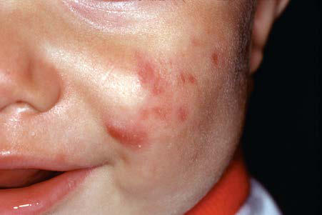
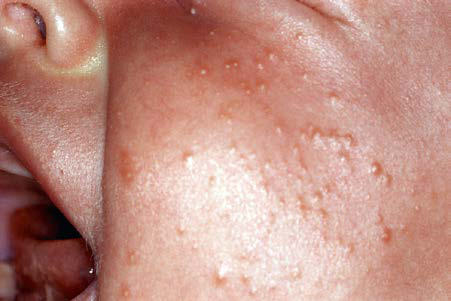

# Chapter 711: Tumors of the Skin

*Kari L. Martin*

<!-- p.5353 -->
Pyogenic Arthritis with Pyoderma Gangrenosum and Acne (PAPA Syndrome) (see Fig. 710.5, Chapter 204, and Chapter 702).

Chronic Recurrent Multifocal Osteomyelitis/Synovitis Acne Pustu losis Hyperostosis Osteitis (SAPHO) Syndrome (see Chapter 204).

*Visit Elsevier eBooks+ at eBooks.Health.Elsevier.com** for Bibliography.*

**Fig. 710.10** Inflammatory infantile acne.

**Fig. 710.9** Comedonal acne in a neonate.

See also Chapter 636.

**INFUNDIBULAR FOLLICULAR CYST** Infundibular follicular cysts (more commonly referred to as *epidermoid cysts* or *sebaceous cysts*) are the nodules most commonly seen in chil dren. Such a cyst is a sharply circumscribed, dome-shaped, firm, freely movable, skin-colored nodule (Fig. 711.1), often with a central dimple or punctum that is a plugged, dilated pore of a pilosebaceous follicle. Follicular cysts form most frequently on the face, neck, chest, or upper back and may periodically become inflamed and infected secondarily, particularly in association with acne vulgaris. The cyst wall may also rupture and induce an inflammatory reaction in the dermis. The wall of

*Kari L. Martin*

the cyst is derived from the follicular infundibulum. A mass of layered keratinized material that may have a cheesy consistency fills the cavity. Cysts may arise from occlusion of pilosebaceous follicles (acneiform cysts), implantation of epidermal cells into the dermis as a result of an injury that penetrates the epidermis (epidermal inclusion cysts), and rests of epidermal cells (epidermoid cysts). Multiple epidermoid cysts may be present in Gardner syndrome and nevoid basal cell carci noma syndrome. Excision of the cyst with removal of the entire sac and its contents is indicated, particularly if the cyst becomes recurrently inflamed. A fluctuant cyst should be incised and drained and, if there is surrounding erythema, treated with antibiotics or intralesional corti costeroids. After the inflammation subsides, the cyst may be removed.

**MILIUM** A milium is a 1- to 2-mm, firm, pearly white or yellowish subepidermal keratin cyst. Milia in newborns are discussed in Chapter 688. Second ary milia occur in association with subepidermal blistering diseases and after dermabrasion or other injury to the skin. They are reten tion cysts caused by hyperproliferation of injured epithelium and are indistinguishable histopathologically from primary milia. Those that develop after blistering usually arise from the eccrine sweat duct, but they may develop from the hair follicle, sebaceous duct, or epidermis. A milium body differs from an infundibular follicular cyst only in its small size and superficial location.

**FIBROFOLLICULOMAS** These lesions usually appear in late adolescence or in young adults and are characterized by multiple dome-shaped, clear-white papules appearing on the nose, cheeks, and neck, and at times the trunk or ears (Fig. 711.2). They are associated with the familial cancer syndrome of **Birt-Hogg-Dubé**, an autosomal dominant disorder that results from a pathogenic variant in the folliculin *(FLCN)* tumor suppressor gene. Associated features include pulmonary cysts, pneumothorax, renal cell carcinoma, and other benign or malignant tumors.

**PILAR CYST (TRICHILEMMAL CYST)** A pilar cyst may be clinically indistinguishable from an infundibular follicular cyst. It manifests as a smooth, firm, mobile nodule, predomi nantly on the scalp (Fig. 711.3). Pilar cysts occasionally develop on the face, neck, or trunk. A cyst may become inflamed and may occasionally suppurate and ulcerate. The cyst wall is composed of stratified squa mous epithelium with indistinct intercellular bridges. The peripheral cell layer of the wall shows a palisade arrangement, which is not seen in an epidermoid cyst. No granular layer is present. The cyst cavity con tains dense homogeneous eosinophilic keratinous material, and foci of calcification are seen in 25% of cases. The propensity for development of pilar cysts may be inherited in an autosomal dominant manner. More than one cyst generally develops in a patient. Numerous pilar and epidermoid cysts, desmoid tumors, fibromas, lipomas, or osteomas may be associated with colonic polyposis or adenocarcinoma in Gard ner syndrome. Pilar cysts shell out easily from the dermis.

**PILOMATRICOMA (PILOMATRIXOMA)** The second most common nodule seen in children, pilomatricoma is a benign tumor that manifests as a 3- to 30-mm, firm, solitary, deep dermal or subcutaneous tumor on the head, neck, or upper extremi ties. The overlying epidermis is usually normal. The tumor may occa sionally be located more superficially, however, tinting the overlying skin blue-red (Fig. 711.4). Multiple pilomatricomas are seen in myo tonic dystrophy, Gardner syndrome, Rubinstein-Taybi syndrome, and Turner syndrome. In general, however, pilomatricomas are not heredi tary. Histopathologically, irregularly shaped islands of epithelial cells with eosinophilic, anucleate “ghost cells” are embedded in a cellular stroma. Calcium deposits are found in 75% of tumors. Pilomatricomas are caused by pathogenic variants in β-catenin.

**TRICHOEPITHELIOMA** A 2- to 8-mm, smooth, round, firm, skin-colored papule, trichoepithelioma is derived from an immature hair follicle.

<!-- p.5355 -->

**Fig. 711.1** Flesh-colored cyst on the forehead.

**Fig. 711.2** Multiple dome-shaped, whitish papules on the nose and cheeks in a 31-yr-old carrier of an FLCN pathogenic variant. (From Men ko FH, van Steensel MAM, Giraud S, et al. Birt-Hogg-Dubé syndrome: diagnosis and management. Lancet. 2009;10:1199–1206, Fig. 1.)

**Fig. 711.3** Pilar cyst of the anterior scalp.

Trichoepitheliomas generally occur singly on the face in child hood or early adulthood. Multiple trichoepitheliomas are inherited autosomal dominantly (type 1: *CYLD* gene; type 2: 9p21 gene cur rently unidentified), appear in childhood or at puberty, and gradu ally increase in number on the nasofacial folds, nose, forehead, and upper lip; occasionally they occur on the scalp, neck, and upper trunk. Microscopically, these benign tumors are characterized by horn cysts composed of a fully keratinized center surrounded by basophilic cells in an adenoid network. Topical imiquimod therapy may be beneficial. Surgical excision has been used for therapy, as have cryotherapy, electrosurgery, and laser vaporization.

**Fig. 711.4** Pilomatricoma. Firm tumor with overlying bluish discolora tion of the skin.

**ERUPTIVE VELLUS HAIR CYSTS** Eruptive vellus hair cysts are 1- to 3-mm, asymptomatic, soft, skincolored follicular papules on the central chest (Fig. 711.5). They may become crusted or umbilicated. Abnormal vellus hair follicles become occluded at the level of the infundibulum, resulting in retention of hairs within an epithelium-lined cystic dilation of the proximal part of the follicle. Most cases are chronic, but spontaneous regression has been reported.

**STEATOCYSTOMA MULTIPLEX** An autosomal dominant (*KRT17* gene) condition, steatocystoma mul tiplex usually manifests in adolescence or early adulthood as numerous soft to firm cystic nodules that are adherent to the underlying skin and are 3 mm to 3 cm in diameter. When punctured, the cysts may drain oily or cheesy material. Sites of predilection include the sternal region, axillae, arms, and scrotal skin. The multiply folded cyst wall is lined on the luminal side with a thick, homogeneous, eosinophilic horny layer; there is no granular layer. Flattened sebaceous gland lobules are often visible in the cyst wall, and lanugo hairs may be present in a cystic cav ity that appears otherwise empty (a processing artifact).

**SYRINGOMA** The benign tumors known as syringomas are soft, small, skin-colored or yellowish-brown papules that develop on the face, particularly in the periorbital regions (Fig. 711.6). Other sites of predilection include the axillae and umbilical and pubic areas. They often develop dur ing puberty and are more frequent in females. Eruptive syringomas develop in crops over the anterior trunk during childhood or ado lescence. A syringoma is derived from an intraepidermal sweat gland duct. Syringomas are of cosmetic significance only. Sparse lesions may be excised, but they are often too numerous to remove.

**INFANTILE DIGITAL FIBROMA** Infantile digital fibroma is a smooth, firm, erythematous or skincolored nodule on the dorsal or lateral surface of a distal phalanx of a finger or toe. More than 80% of tumors occur in infancy or may be present at birth. Lesions may be solitary or multiple and may mani fest as “kissing” tumors on opposing digits. They are usually asymp tomatic, but flexion deformity of the digits may occur. Clinically the lesion resembles a fibroma, leiomyoma, angiofibroma, acquired digital fibrokeratoma, accessory digit, or mucous cyst. The diagnosis is con firmed by the finding of numerous spindle-shaped fibroblasts that contain small, round, dense eosinophilic cytoplasmic inclusion bodies composed of collections of actin microfilaments. Local recurrence after simple excision of this tumor has been reported in 75% of patients. Because the tumor does not metastasize and may regress spontane ously in 2-3 years, a course of expectant observation is advised. If func tional impairment or flexion deformity of the digit becomes apparent, prompt full excision of the tumor is indicated.

<!-- p.5356 -->

**Fig. 711.7** Dermatofibroma. Red-brown nodular variant.

A

B

**Fig. 711.8** A, Juvenile xanthogranuloma. A 4-mm, apricot-colored, dome-shaped, firm papule with overlying telangiectasias below the nasal columella. B, Pink-red rim in a “setting-sun” pattern seen by der moscopy. (From Bell KA, Marathe K, Burke KT, Cardis MA. A persistent pimple in a 5-year-old girl. J Pediatr. 2020;224:172–173, Figs. 1 and 2, p. 172).

**DERMATOFIBROMA** A benign dermal tumor, dermatofibroma may be pedunculated, nod ular (Fig. 711.7), or flat and is usually well circumscribed and firm but occasionally feels soft on palpation. The overlying skin is usually hyperpigmented; it may be shiny or keratotic and dimples when the tumor is pinched. Dermatofibromas range in size from 0.5 to 10.0 mm, arise most frequently on the limbs, and are usually asymptomatic but may occasionally be pruritic. They are composed of fibroblasts, young and mature collagen, capillaries, and histiocytes in varying propor tions, forming a nodule in the dermis that has poorly defined edges. The cause of these tumors is unknown, but trauma such as an insect bite or folliculitis appears to induce reactive fibroplasia. The differen tial diagnosis includes epidermal inclusion cyst, juvenile xanthogranu loma, hypertrophic scar, and neurofibroma. Dermatofibromas may be excised or left intact, according to the patient’s preference. They usually persist indefinitely.

**JUVENILE XANTHOGRANULOMA** A firm, dome-shaped, yellow, pink, or orange papule or nodule (Fig. 711.8), juvenile xanthogranuloma varies from 5 mm to approximately 4 cm in diameter. The average age at onset is 2 years. These nodules are 10 times more common in White than in Black individuals. Sites of

predilection are the scalp, face, and upper trunk, where they may erupt in profusion or remain as solitary lesions. Nodular lesions may appear on the oral mucosa. The diagnosis is usually made clinically. Mature lesions are characterized histopathologically by a dermal infiltrate of lipid-laden histiocytes, admixed inflammatory cells, and Touton giant cells. Clinically the lesions may resemble papulonodular urticaria pig mentosa, dermatofibromas, or xanthomas of hyperlipoproteinemia, but they can be distinguished from these entities histopathologically.

Affected infants are nearly always otherwise normal, and blood lipid values are not elevated. Café-au-lait macules are found on 20% of

**Fig. 711.5** Eruptive vellus hair cysts. Multiple papules on the chest.

**Fig. 711.6** Syringomas. Multiple yellow papules near the eye.

<!-- p.5357 -->
patients with juvenile xanthogranuloma. Xanthogranulomatous infil trates occur occasionally in the iris or other ocular tissues. This process may result in glaucoma, hyphema, uveitis, heterochromia iridis, iritis, or sudden proptosis. When seen in patients <2 years of age, multiple lesions and periocular location may heighten concerns for intraocu lar involvement. There appears to be an association among juvenile xanthogranuloma, neurofibromatosis, and childhood leukemia, most frequently juvenile chronic myelogenous leukemia. There is no need to remove the benign lesions of juvenile xanthogranuloma because most of them regress spontaneously in the first few years. Residual dyspig mentation and atrophy may result.

**LIPOMA** A benign collection of fatty tissue, lipoma appears on the trunk, neck, or proximal portions of the limbs. Lipomas are soft, compressible, lob ulated subcutaneous masses. Multiple lesions may occur occasionally, as in Gardner syndrome. Atrophy, calcification, liquefaction, or xan thomatous change may sometimes complicate their course. A lipoma is composed of normal fat cells surrounded by a thin connective tis sue capsule. Lipomas represent a cosmetic defect and may be surgi cally excised. Multiple lipomas, identical to those that occur singly, are inherited in an autosomal dominant fashion and often appear by the third decade in patients with familial multiple lipomatosis. Lipomas may appear intraabdominally, intramuscularly, and subcutaneously. Congenital lipomatosis manifests in the first few months of life as large subcutaneous fatty masses on the chest with extension into skeletal muscle. Congenital lipomatosis can also be a manifestation of **Proteus syndrome** (overgrowth/hyperplasia skin, connective tissue, patho genic variant in *AKT1*). Angiolipomas usually manifest as numerous painful subcutaneous nodules on the arms and trunk.

**CLOVES syndrome** (congenital lipomatous overgrowth, vascular malformations, epidermal nevi, and scoliosis/skeletal and spinal anom alies) is usually a sporadic disorder caused by a pathogenic variant in the **PIK3CA** gene with an asymmetric truncal lipomatous mass pres ent at birth. Additional features include macrodactyly, vascular mal formations (low flow), linear epidermal nevus, and renal anomalies.

The differential diagnosis includes Proteus, Klippel-Trenaunay, and Bannayan-Riley-Ruvalcaba syndromes.

*PIK3CA* somatic pathogenic variants and those in the related AKTmTOR pathway (*PIK3CA*-related overgrowth spectrum [PROS]) are associated with segmental overgrowth syndromes (Fig. 711.9; see also Fig. 691.6). In addition to regional/localized tissue overgrowth, there is a spectrum of malformations (hemimegaloencephaly, macrodactyly, lymphatic, muscle hemihypertrophy, epidermal nevi, capillary, poly dactyly, syndactyly).

**BASAL CELL CARCINOMA** Basal cell carcinoma is very rare in children in the absence of a predis posing condition, such as nevoid basal cell carcinoma syndrome, xero derma pigmentosum, nevus sebaceus of Jadassohn, arsenic intake, or exposure to irradiation. The lesions are smooth, pearly, pink telangiec tatic papules that enlarge slowly and may bleed or ulcerate. Sites of pre dilection are the face, scalp, and upper back. The differential diagnosis includes pyogenic granuloma, nevocellular nevus, epidermal inclusion cyst, closed comedo, dermatofibroma, and adnexal tumor. Depending on the site of occurrence and associated disease of the host, electro desiccation and curettage or simple excision of basal cell carcinoma is usually curative. When the tumor is recurrent, >2 cm in diameter, located on problematic anatomic areas such as the midface or ears, or is an aggressive histopathologic type, Mohs microscopically controlled surgery may be the most appropriate treatment.

**NEVOID BASAL CELL CARCINOMA SYNDROME (BASAL CELL NEVUS SYNDROME, GORLIN SYNDROME)** The autosomal dominant entity known as nevoid basal cell carci noma syndrome is caused by pathogenic variants in the *PTCH1, PTCH2* (“patched”), and *SUFU* genes. These tumor-suppressor genes, part of the hedgehog signaling pathway, are important in determin ing embryonic patterning and cell fate in a number of structures in the developing embryo. Pathogenic variants in these genes pro duce dysregulation of several genes involved in organogenesis and

A

B

D

C

**Fig. 711.9** Photographs and MRIs of participants with isolated LM, CLOVES, KTS, and FAVA. A, An 8-mo-old boy (LM1) with isolated LM. Note swelling in deltoid region without cutaneous vascular signs. Coronal and sagittal fat-saturated T2-weighted MRI demonstrates macrocystic LM (a multilocular cystic mass) involving the anterolateral aspects of the right shoulder without muscular infiltration (arrows); humeral head (asterisk). B, A 19-mo-old female (CL12) with CLOVES syndrome. Note asymmetric distribution of truncal lipomatous masses and bilateral lower extremity involve ment. Coronal fat-saturated T1-weighted MRI after contrast administration demonstrates moderate heterogeneous enhancement of the bilateral truncal masses (arrows). Axial T1-weighted MRI without contrast depicts truncal lipomatous overgrowth (arrows); segment VI of the liver (asterisk). C, A 3-yr-old boy (KT4) with KTS. Note capillary LM and overgrowth involving the right lower extremity. Coronal and axial fat-saturated T2-weighted MRI shows the persistent marginal vein system (bent arrows) and marked enlargement of the subcutaneous tissues due to a combination of lym phatic fluid and fat (straight arrow). There are also intramuscular venous malformations. D, A 9-yr-old boy (F8) with FAVA of the left gastrocnemius muscle; note absence of overgrowth and cutaneous vascular anomalies. Sagittal fat-saturated T1-weighted MRI after contrast administration demon strates the longitudinal distribution of the diffuse FAVA (arrows). Axial fat-saturated T2-weighted MRI with (upper) and without (lower) contrast. Note that the right head of the gastrocnemius muscle is diffusely replaced by a contrast-enhancing heterogeneous soft tissue lesion (arrows). CLOVES, Congenital lipomatous overgrowth with vascular, epidermal, and skeletal anomalies; FAVA, fibroadipose vascular anomaly; KTS, Klippel-Trenaunay syndrome; LM, lymphatic malformation. (From Luks VL, Kamitaki N, Vivero MP, et al. Lymphatic and other vascular malformative/overgrowth disor ders are caused by somatic pathogenic variants in PIK3CA. J Pediatr. 2015;166:1048–1054, Fig. 1, p. 1051.)

<!-- p.5359 -->
