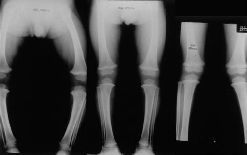
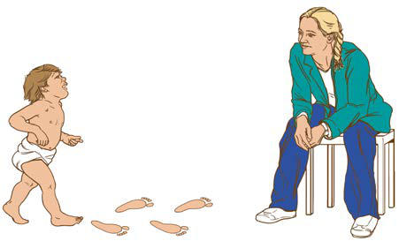

# Chapter 716: Torsional and Angular Deformities of the Limb

*Brendan A. Williams, Jennifer J. Winell, and Lawrence Wells*

<!-- p.5396 -->

## 716.1  Normal Limb Development Brendan A. Williams, Jennifer J. Winell, and Lawrence Wells

During the seventh week of intrauterine life, the lower limb rotates medially to bring the great toe toward the midline. The hip joint forms by the eleventh week; the proximal femur and acetabulum continue to develop until physeal closure in adolescence. The first component of rotation is the femoral neck, which is rotated approximately 40 degrees anteriorly at birth. This anterior rotation is referred to as **anteversion** (the angle between the axis of the femoral neck and the transcondylar axis). The increased anteversion results in increased internal rotation of the hip. In most children, femoral anteversion decreases to 15-20 degrees by 8-10 years of age. Conditions such as cerebral palsy that involve spasticity of the lower extremities can result in the persistence of fetal anteversion. This results in torsional abnormalities of the lower limb and gait disturbances. The second component of limb rotation is found in the tibia. Tibial torsion is the angular difference between the axis of the knee and the transmalleolar axis. Infants can have 30 degrees of medial rotation of the tibia. When skeletally mature, the rotation is between 5 degrees of medial rotation and 15 degrees of lateral rota tion (Fig. 716.1). Excessive medial rotation of the tibia is referred to as **medial tibial torsion**. This is very common and, although concerning to parents, very rarely requires treatment. The medial or lateral rota tion beyond ±2 SDs from the mean is considered abnormal rotation. The third component of rotational (axial) abnormalities of the lower extremity derives from the foot. Metatarsus adductus can cause the foot to curve medially, pointing the toes inward. It is assessed by observing the medial and lateral borders of the foot.

Torsional deformity may be simple, involving a single component, or complex, involving multiple components. Complex deformities may be additive (internal tibial torsion and internal femoral torsion are addi tive) or compensatory (external tibial torsion and internal femoral tor sion are compensatory).

The normal tibiofemoral angle at birth is 10-15 degrees of physi ologic varus. The alignment changes to 0 degrees by 18 months, and physiologic valgus up to 12 degrees is reached in between 3 and 4 years of age. The normal valgus of 7 degrees is achieved by 5-8 years of age (Fig. 716.2). Persistence of varus beyond 2 years of age may be patho logic and is seen in conditions such as Blount disease. Overall, 95% of developmental physiologic genu varum and genu valgum cases resolve with growth. Persistent genu valgum or valgus into adolescence is con sidered pathologic and deserves further evaluation.

*Visit Elsevier eBooks+ at eBooks.Health.Elsevier.com** for Bibliography.*

## 716.2  Limb Evaluation Brendan A. Williams, Jennifer J. Winell, and Lawrence Wells

When evaluating concerns regarding the limb, the provider should obtain a history documenting onset, progression, functional limita tions, previous treatment, evidence of neuromuscular disorder, and any significant family history. The examination should assess the exact

torsional profile and include (1) foot progression angle, (2) femoral anteversion, (3) tibial version with thigh-foot angle, and (4) assessment of foot adduction and abduction.

**FOOT PROGRESSION ANGLE** Limb position during gait is expressed as the **foot progression angle** and represents the angular difference between the axis of the foot with the direction in which the child is walking. Its value is usually esti mated by asking the child to walk in the clinic hallway (Fig. 716.3). Inward rotation of the foot is assigned a negative value, and outward rotation is designated with a positive value. The normal foot progres sion angle in children and adolescents is 10 degrees (range: −5 to 20 degrees). The foot progression angle delineates whether there is an intoeing or out-toeing gait.

**FEMORAL ANTEVERSION** Hip rotation is measured with the child in the prone position, the hip in neutral flexion or extension, thighs together, and the knees flexed to 90 degrees (Fig. 716.4). Both hips are assessed at the same time. Internal rotation of the hip is measured by rotating the leg ipsilaterally, and external rotation is measured by rotating the leg contralaterally. Excessive anteversion has increased internal rotation, whereas retro version has increased external rotation. The amount of anteversion can be approximately estimated by palpating the greater trochanter of the hip while internally rotating the limb. Femoral anteversion should be measured at the point when the greater trochanter is most prominent laterally during this rotation (Craig test).

**TIBIAL ROTATION** Tibial rotation is measured using the **transmalleolar angle.** The trans malleolar angle is the angle between the longitudinal axis of the thigh with a line perpendicular to the axis of the medial and lateral malleolus (Fig. 716.5). In the absence of foot deformity, the **thigh-foot angle** is preferred (Fig. 716.6). It is measured with the child lying prone. The angle is formed between the longitudinal axis of the thigh and the longi tudinal axis of the foot. It measures the tibial and hindfoot rotational sta tus. Inward rotation is assigned a negative value, and outward rotation is assigned a positive value. Inward rotation indicates medial tibial tor sion, whereas outward rotation represents lateral tibial torsion. Infants have a mean angle of −5 degrees (range: −35 to 40 degrees) as a conse quence of normal in utero position. In mid-childhood through adult life, the mean thigh-foot angle is 10 degrees (range: −5 to 30 degrees).

**FOOT SHAPE AND POSITION** The foot is observed for any deformities in prone and standing posi tion. The **heel bisector line** (HBL) is used to evaluate the foot adduc tion and abduction deformities. The HBL is a line that divides the heel in two equal halves along the longitudinal axis (Fig. 716.7). It normally extends through the center of the second toe. When the HBL points medial to the second toe, the forefoot is abducted, and when the HBL is lateral to the second toe, the forefoot is adducted. Other lowerextremity problems, such as heel varus or valgus, can make assessment of axial plane issues more difficult.

It is also important to screen children with these foot deformities for associated hip dysplasia and neuromuscular problems (e.g., cere bral palsy).

*Visit Elsevier eBooks+ at eBooks.Health.Elsevier.com** for Bibliography.*

## 716.3  Torsional Deformities Brendan A. Williams, Jennifer J. Winell, and Lawrence Wells

**FEMORAL ANTEVERSION In-toeing gait** most commonly results from excessive femoral antever sion. It occurs more commonly in females than males (2:1) in children 3-6 years of age and is congenital, resulting from persistent infantile

*Brendan A. Williams, Jennifer J. Winell, and Lawrence Wells*

<!-- p.5397 -->

<!-- p.5398 -->

<!-- p.5399 -->
anteversion. On examination, many children with this condition will have **generalized ligamentous laxity**. Gait examination reveals that the entire leg is inwardly rotated. Internal hip rotation is increased beyond 70 degrees, and consequently the external rotation is restricted to 10-20 degrees. Clinically, the patellae point inward when the foot is straight, and compensatory external rotation of the tibia is demonstrated. This is frequently mistaken as “genu valgum.” The amount of anteversion can be roughly estimated by palpating the greater trochanter of the hip

while internally rotating the limb. The point of maximal prominence of the greater trochanter laterally during this rotation corresponds to the degree of femoral anteversion.

Diagnosis is made clinically on examination; CT can provide objec tive measurements but is rarely indicated. The treatment is predomi nantly observation and reassurance. The torsion usually corrects with longitudinal growth by 8-10 years of age. Although rare, persistent deformity, unacceptable cosmesis, functional impairment, anteversion

**Medial Rotation**

**MR females**

80

60

40

20

0 1 3 5 7 9 11 Age (yr)

2 SD

A B

C D

E F

2 SD

13 15-19 30’s 50’s 70+

**Medial Rotation**

**MR males**

80

60

40

20

0 1 3 5 7 9 11 Age (yr)

2 SD

2 SD

13 15-19 30’s 50’s 70+

**Foot Progression Angle**

**FPA Rotational Profile**

**FPA**

**R L**

**MR**

**LR**

**TFA**

**Foot**

20

10

0

−10

1 3 5 7 9 11 Age (years)

2 SD

2 SD

13 15-19 30’s 50’s 70+

**Thigh–Foot Angle**

**TFA**

40

20

0

−20

−40

1 3 5 7 9 11 Age (yr)

2 SD

2 SD

13 15-19 30’s 50’s 70+

**Lateral Rotation**

**LR**

100

80

60

40

20

1 3 5 7 9 11 Age (yr)

2 SD

2 SD

13 15-19 30’s 50’s 70+

**Fig. 716.1** A-F, The rotational profile from birth to maturity is depicted graphically. All graphs include 2 SD from the mean for the foot progression angle (FPA) for femoral medial rotation (MR) and lateral rotation (LR) (for males and females), and the thigh-foot angle (TFA). (From Morrissey RT, Weinstein SL, eds. Lovell and Winter’s Pediatric Orthopaedics, 3rd ed. Philadelphia: Lippincott Williams & Wilkins; 1990.)

0°

Age (yr)

Varus

Valgus

5°

10°

15°

5°

10°

15°

20°

20°

1 2 3 4 5 6 7 8 9 10 11 12 13

A B

**Fig. 716.2** A, Development of the tibiofemoral angle during growth (after Salenius). B, Serial radiographs demonstrating normal transition from varus alignment at 14 months to neutral position at 25 months to valgus tibiofemoral alignment at 39 months. (From Wimberly RL. Disorders of the leg. In: Herring JA, ed. Tachdjian’s Pediatric Orthopaedics, 6th ed. Philadelphia: Elsevier; 2022: Fig 18.13.)

<!-- p.5400 -->
>45 degrees, and no external rotation beyond neutral are indications for operative intervention. Surgery involves a derotation osteotomy of the femur.

**MEDIAL TIBIAL TORSION** Medial (internal) tibial torsion manifests with **in-toeing gait.** It is commonly associated with metatarsus adductus, genu valgum, or femoral anteversion. This condition is usually seen during the second year of life. It is often noticed after the child begins to walk indepen dently. Many parents are concerned with a “bowed” appearance of the legs. Normally at birth, the medial malleolus lies behind the lateral

malleolus, but by adulthood, it is reversed, with the tibia in 15 degrees of external rotation. The treatment is observation and reassurance because spontaneous resolution with normal growth and development can be anticipated. Correction can be seen as early as 4 years of age and in some children by 8-10 years of age. Persistent deformity with func tional impairment is treated with supramalleolar derotation osteotomy, but this is rarely necessary.

**EXTERNAL FEMORAL TORSION** Femoral retrotorsion, when of idiopathic origin, is usually bilateral. The disorder is associated with an **out-toeing gait** and increased inci dence of degenerative arthritis. The clinical examination of external femoral torsion shows excessive hip external rotation and limitation of internal rotation. The hip will externally rotate up to 70-90 degrees and internally rotate to only 0-20 degrees. External femoral torsion can also follow a **slipped capital femoral epiphysis (SCFE)**. There should be a low threshold to perform radiographs of the hips in chil dren older than 10 years of age who present with hip or knee pain and decreased internal rotation of the hip on clinical examination. If a SCFE is detected, it is treated surgically. Occasionally, persistent femoral retroversion after SCFE can produce functional impair ment resulting in a severe out-toed gait and difficulty opposing one’s knees in the sitting position. The latter can be disabling to adoles cent females. Should this occur, a Southwick osteotomy or surgical realignment might be necessary.

**LATERAL TIBIAL TORSION** Lateral (external) tibial torsion is less common than medial rotation and is often associated with a **calcaneovalgus foot**. It can be compensa tory to persistent femoral anteversion or secondary to a tight iliotibial band. Natural growth rotates the tibia externally, and therefore external tibial torsion can become worse with time. Clinically, the patella faces outward when the foot is straight. The thigh-foot angle and the trans malleolar angle are increased. There may be associated patellofemoral instability with knee pain. Although some correction can occur with growth, extremely symptomatic children may need a supramalleolar osteotomy, which is usually done by 10-12 years of age.

**Fig. 716.3** Foot progression angle. The long axis of the foot is com pared with the direction in which the child is walking. If the long axis of the foot is directed outward, the angle is positive. If the foot is directed inward, the angle is negative and indicates in-toeing. (From Thomp son GH. Gait disturbances. In: Kliegman RM, ed. Practical Strategies in Pediatric Diagnosis and Therapy. Philadelphia: WB Saunders; 2004.)

A

B

**Fig. 716.4** Anteversion measured by medial rotation of hip (A) and lateral rotation of hip (B). In this patient, internal rotation is nearly 90 degrees, suggestive of excessive femoral anteversion.

**Fig. 716.5** Measurement of transmalleolar angle (TMA). (From Guler O, Isyar M, Karataş D, et al. Investigating the relationship between in ternal tibial torsion and medial collateral ligament injury in patients un dergoing knee arthroscopy due to tears in the posterior one third of the medial meniscus. Knee. 2016;23[4]:655–658, Fig 2.)

<!-- p.5401 -->
**METATARSUS ADDUCTUS** Metatarsus adductus (see Chapter 715.1) manifests with forefoot adduction and medial rotation of all metatarsals. Of children with metatarsus adductus, 10–15% have hip dysplasia. The prognosis is good because the majority get better with nonoperative intervention. Feet that correct actively with stimulation of the lateral border of the foot are treated with stretching exercises alone. Feet that are flexible and correctable to neutral with manipulation are treated with stretch ing, reverse last shoes, or serial casting. Feet that do not correct fully with conservative care or rigid deformities are treated with medial cap sulotomy of the first metatarsal cuneiform joint and soft tissue release by 2 years of age. Osteotomies of the base of the metatarsal may be performed after 6 years of age.

*Visit Elsevier eBooks+ at eBooks.Health.Elsevier.com** for Bibliography.*

## 716.4  Coronal Plane Deformities Brendan A. Williams, Jennifer J. Winell, and Lawrence Wells

Genu varum and genu valgum are common pediatric deformities of the knee. Figure 716.2 presents the age-appropriate normal values for knee angle. Tibial bowing is common during the first year, bowlegs are common during the second year, and knock-knees are most prominent between 3 and 4 years of age.

**GENU VARUM** Physiologic bowleg is a common torsional combination that is second ary to normal in utero positioning (Fig. 716.8). Spontaneous resolution with normal growth and development can be anticipated. Persistence of varus beyond 2 years of age may be pathologic. Causes of patho logic bowing include metabolic bone disease (vitamin D deficiency, rickets, hypophosphatasia), asymmetric growth arrest (trauma, infec tion, tumor, Blount disease), bone dysplasia (dwarfism, metaphyseal dysplasia), and congenital and neuromuscular disorders (Table 716.1). It is important to differentiate physiologic bowing from Blount disease (Table 716.2). Physiologic bowing should also be differentiated from rickets and skeletal dysplasia. Rickets has classic bony changes seen on plain radiographs with trumpeting widening and fraying of the metaphysis along with widening of the physis (see Chapter 69).

**TIBIA VARA** Idiopathic tibia vara, or **Blount disease**, is a developmental defor mity resulting from abnormal endochondral ossification of the medial aspect of the proximal tibial physis leading to varus angulation and medial rotation of the tibia (Fig. 716.9). The incidence is greater in Black patients and in overweight toddlers. It is also higher in patients who have an affected family member or started walking early in life. Idiopathic tibia vara has been classified into three types, depending on the age at onset: infantile (1-3 years of age), juvenile (4-10 years of age), and adolescent (11 years or older). The juvenile and adolescent forms are commonly combined as late-onset tibia vara. The exact cause of tibia vara remains unknown, although it is thought to result from abnormal growth of the physis due to excessive weight.

The **infantile** form of tibia vara is the most common. There is a pre dominance in Black females. Approximately 80% are bilateral with a prominent medial metaphyseal beak, internal tibial torsion, and leglength discrepancy. The characteristics of the **juvenile** and **adoles cent** (late-onset) forms include predominance in Black males, obesity, normal or greater than normal height, less frequent bilateral involve ment (approximately 50%), slowly progressive genu varum deformity, pain rather than deformity as the primary initial complaint, no pal pable proximal medial metaphyseal beak, minimal internal tibial tor sion, mild medial collateral ligament laxity, and mild lower extremity length discrepancy. The infantile group has the greatest potential for progression.

An anteroposterior (AP) standing radiograph of both lower extrem ities with patellae facing forward and a lateral radiograph of the involved extremity should be obtained (Fig. 716.10). Weight-bearing radiographs are preferred and allow maximal presentation of the clini cal deformity. The metaphyseal-diaphyseal angle (Drennan angle) can be measured and is useful in distinguishing between physiologic genu varum and early tibia vara (Fig. 716.11). This angle can aid in predict ing the risk of progression. Angles greater than 16 degrees carry an increased risk of progression, whereas those less than 10 degrees are likely to resolve spontaneously. Patients with Drennan angles of 11-16 degrees should be monitored for progressive tibia vara.

The Langenskiöld classification, which describes six stages on radio graphs for infantile Blount disease (Fig. 716.12), is the most widely

**Fig. 716.6** Thigh-foot angle. With the child in the prone position and the knees flexed and approximated, the long axis of the foot can be compared with the long axis of the thigh. The long axis of the foot bi sects the heel and the third or middle toe. A, External tibial torsion pro duces excessive outward rotation. B, Normal alignment is characterized by slight external rotation. C, Internal tibial torsion produces inward rotation. (From Zolkoske AC, Fehr SD. Gait disturbances. In: Kliegman RM, Toth H, Bordini BJ, Basel D, eds. Nelson Pediatric Symptom-Based Diagnosis, 2nd ed. Philadelphia: Elsevier; 2023: Fig 45.6.)

A B C

NORMAL **Fig. 716.7**  Schematic demonstration of heel bisector line.

<!-- p.5402 -->

<!-- p.5403 -->
cited classification system, although other radiographic and MRI-based systems have been described. Langenskiöld differentiates based on fragmentation of the epiphysis, beaking of the medial tibial epiphysis, depression of the medial tibial plateau, and formation of a bony bar. CT with three-dimensional reconstructions and MRI can also be useful to assess the meniscus; the articular surface of the proximal tibia, including the posteromedial slope; or the integrity of the proximal tibial physis.

Management is based on the stage of the disease, the age of the child, and the nature of presentation (primary or recurrent deformity). In chil dren younger than 3 years and Langenskiöld stage <3, bracing is effec tive and can prevent progression in 50% of patients. A maximal trial of 1 year of orthotic management is recommended. If complete correction is not obtained after 1 year or if progression occurs during this time, a corrective osteotomy is indicated. Surgical treatment is also indicated in children >4 years of age, those at Langenskiöld stage >3, and those with severe deformities. A proximal tibial valgus osteotomy and associated fibular diaphyseal osteotomy are usually the procedures of choice. In lateonset tibia vara, correction is also necessary to restore the mechanical axis of the knee. Hemiplateau elevation with correction of posteromedial slope has been established as a treatment modality in relapsed cases.

**GENU VALGUM (KNOCK-KNEES)** The appearance of symmetric bilateral genu valgum most pronounced around age 4 years of age is part of the normal physiologic process of leg development. However, variation of up to 15 degrees of valgus is possible until 6 years of age. The majority of physiologic valgus has a good chance of correction until this age. The intermalleolar distance with the knees approximated is normally <2 cm, and in a severe val gus deformity, it could measure >10 cm. Pathologic conditions leading to valgus are metabolic bone disease (e.g., rickets or renal osteodys trophy), skeletal dysplasia, posttraumatic physeal arrest, tumors, and infection. The increased valgus at the knee causes lateral deviation of the mechanical axis with stretching of the medial aspect of the knee leading to knee pain. Deformities >15 degrees and occurring after 6 years of age are unlikely to correct with growth and require surgi cal management. In the skeletally immature, medial tibial epiphyseal hemiepiphysiodesis or stapling (guided growth) is attempted for cor rection. In the skeletally mature, osteotomy is necessary at the center of rotation of angulation and is usually situated in the distal femur. Longlength AP radiographs of the leg in a weight-bearing stance are neces sary for preoperative planning.

*Visit Elsevier eBooks+ at eBooks.Health.Elsevier.com** for Bibliography.*

## 716.5  Congenital Angular Deformities of the Tibia and Fibula Brendan A. Williams, Jennifer J. Winell, and Lawrence Wells

**POSTEROMEDIAL TIBIAL BOWING** Congenital posteromedial bowing is typically associated with a cal caneovalgus foot and rarely with secondary valgus of the tibia. The exact cause is unknown. Early operative intervention is not indicated because this bowing generally corrects with growth. However, despite the correction of angulation, there can be residual shortening in the tibia and fibula. The mean growth inhibition is 12–13% (range: 5–27%). The mean leg length discrepancy at maturity is 4 cm (range: 3-7 cm). The diagnosis of bowing is confirmed on radiographs, which show the posteromedial angulation without any other osseous abnormalities. The calcaneovalgus deformity of the foot improves with stretching or modified shoe wear and occasionally ankle-foot orthosis. Predicted leg length discrepancy <4 cm is managed with age-appropriate epiphysio desis of the normal leg. Leg length discrepancy >4 cm is managed with combination of contralateral epiphysiodesis and ipsilateral lengthen ing. A corrective osteotomy for distal valgus may be required and can be done in the same setting while correcting leg length discrepancy.

B A

**Fig. 716.8** Genu varum. A, In recumbent position, tibia and femora are bowed, but the legs do not appear bowed. B, In erect position dur ing weight bearing and with ankles in apposition, the legs are bowed. (From Coley BD, ed. Caffey’s Pediatric Diagnostic Imaging, 13th ed. Philadelphia: Elsevier; 2019.)

#### **Table 716.1** Classification of Genu Varum (Bowlegs)

| Category / Parameter | Clinical Details & Findings |
| --- | --- |
| **PHYSIOLOGIC** | Asymmetric growth; Tibia vara (Blount disease); • Infantile; • Juvenile; • Adolescent; Focal fibrocartilaginous dysplasia; Physeal injury; Trauma; Infection; Tumor |
| **METABOLIC DISORDERS** | Vitamin D deficiency (nutritional rickets); Vitamin D–resistant rickets; Hypophosphatasia |
| **SKELETAL DYSPLASIA** | Metaphyseal dysplasia; Achondroplasia; Enchondromatosis; Modified from Thompson GH. Angular deformities of the lower extremities. In:; Chapman MW, ed. Operative Orthopedics, 2nd ed. Philadelphia: JB Lippincott; 1993:; Table 222-1, p. 3132. |

#### **Table 716.2** Differentiation of Leg Bowing

| Category / Parameter | Clinical Details & Findings |
| --- | --- |
| **BLOUNT DISEASE** | Gentle and symmetric deformity; Asymmetric, abrupt, and sharp; angulation; Metaphyseal-diaphyseal angle; <11 degrees; Metaphyseal-diaphyseal angle; >11 degrees; Normal appearance of the; proximal tibial growth plate; Medial sloping of the epiphysis; Widening of the physis; Fragmentation of the metaphysis; No significant lateral thrust; Significant lateral thrust |

<!-- p.5404 -->

<!-- p.5405 -->
**ANTEROMEDIAL TIBIAL BOWING (POSTAXIAL HEMIMELIA) Fibular hemimelia** is the most common cause of anteromedial bowing of the tibia. The fibular deficiency can occur with complete absence of fibula or with partial fibular development both proximally and distally. It is associated with deformities of femur, knee, tibia, ankle, and foot. The femur is short and has lateral condylar hypoplasia, causing patellar

instability and genu valgum deformity. The tibia has anteromedial bowing with reduced growth potential. The keys for management are addressing the ankle stability and foot deformities. The ankle resembles a ball-andsocket joint with lateral instability. The foot deformities are characterized by the absence of lateral digits, equinocavovarus foot, and tarsal coalition.

C B A

**Fig. 716.9** Blount disease in a 5-year-old child. A and B, Preoperative clinical appearance. Note the abrupt medial deviation of the tibia just be low the knee. Lateral “thrust” of the knee during weight bearing exacerbates the “limp.” C, Radiograph demonstrating abrupt angulation at the epiphyseal-metaphyseal junction and medial metaphyseal radiolucency and beaking with apparent lateral subluxation of the proximal end of the tibia. (From Johnston CE, Young M. Disorders of the leg. In: Herring JA, ed. Tachdjian’s Pediatric Orthopaedics, 6th ed. Philadelphia: Elsevier; 2022: Fig 18.14.)

**Fig. 716.10** Anteroposterior radiograph of both knees in Blount dis ease.

M-D angle

**Fig. 716.11** Metaphyseal-diaphyseal (M-D) angle. Draw a line on the radiograph through the proximal tibial physis. Draw another line along the lateral tibial cortex. Last, draw a line perpendicular to the shaft line as demonstrated in the diagram. (From Morrissey RT, Weinstein SL, eds. Lovell and Winter’s Pediatric Orthopaedics, 3rd ed. Philadelphia: Lip pincott Williams & Wilkins, 1990.)

<!-- p.5406 -->
Various surgical options have been described, and the treatment is tai lored to the patient’s needs and parents’ acceptance. A severely deformed foot may be best managed with Syme or Boyd amputation and prosthesis as early as 1 year of age. In the salvageable foot, leg length discrepancy can be treated with contralateral leg epiphysiodesis or ipsilateral limb lengthening.

**ANTEROLATERAL TIBIAL BOWING** Anterolateral tibial bowing is associated with **congenital pseudarthrosis of the tibia (CPT)**. Previous estimates suggest that 50–60% of patients with CPT have **neurofibromatosis**; however, this prevalence may be underes timated as the diagnostic criteria for neurofibromatosis often become evi dent after CPT has been diagnosed. Overall, less than 10% of patients with neurofibromatosis have this lesion. The pseudarthrosis or site of nonunion is typically situated at the middle third and distal third of the tibia. The Boyd’s classification identifies six types of CPT with increasing severity depending on the presence of cystic and dysplastic changes. The Paley clas sification is another frequently employed system (Fig. 716.13). The treat ment for this condition has been very frustrating with poor results. Bracing has been recommended to prevent fracture early in the course but does not usually obviate need for later surgical intervention. Numerous treatment protocols and surgical procedures have been described to achieve union, such as single- and dual-onlay grafting with rigid internal fixation, intra medullary nailing with or without bone grafting, and circular frame fixa

fibular autograft also has been used with varying results. Due to the rate of complications occurring during reconstructive treatment, a below-knee amputation with early rehabilitation is also an accepted treatment strategy for some of these patients.

**TIBIAL LONGITUDINAL DEFICIENCY** Tibial longitudinal deficiency, or tibial hemimelia, follows an autoso mal dominant inheritance pattern. Multiple classification systems have been described, all of which largely categorize patients based on which portion(s) of the tibia is deficient. The other associated anomalies are foot deformities, hip dysplasia, and symphalangism of the hand. Tra ditionally, treatment has been guided by the Jones classification, which describes presence of a proximal tibial anlage and a functional quad riceps mechanism. In type Ia deformity, the proximal tibial anlage is absent, and knee disarticulation with prosthesis is recommended. In types Ib and II, the tibial anlage is present, and the management con sists of an early Syme amputation, followed later by synostosis of the fibula with the tibia, and a below-knee prosthesis. Type III is rare, and the principal management is with Syme amputation and a prosthesis. Type IV deformity is associated with ankle diastasis, which requires stabilization of the ankle and correction of leg length discrepancy at a later stage. Due to the varied pathology of this condition and its rarity, treatment options and recommendations continue to evolve.

2A 2A AP LAT 1 1 AP LAT 2B 2B AP LAT 3 3 AP LAT

4A 4A AP LAT 4B 4B AP LAT 4C 4C AP LAT

**1 2**

**4**

**3**

**Fig. 716.13** Paley classification of congenital pseudoarthrosis of the tibia. Paley: type 1, no fractures; type 2, no fracture tibia, fracture fibula with fibula (2A) at station (2B) proximal migration; type 3, fracture tibia, no fracture fibula; type 4, fracture tibia and fibula with fibula (4A) at station (4B) proximal migration (4C) bone defect tibia with proximal migration fibula AP, Anteroposterior; LAT, lateral. (Reproduced with permission by the Paley Foundation.) (From Paley D. Congenital pseudarthrosis of the tibia: biological and biomechanical considerations to achieve union and prevent refracture. J Child Orthop. 2019;13:120–133.)

<!-- p.5407 -->
