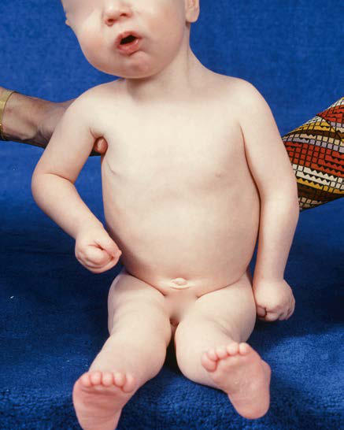
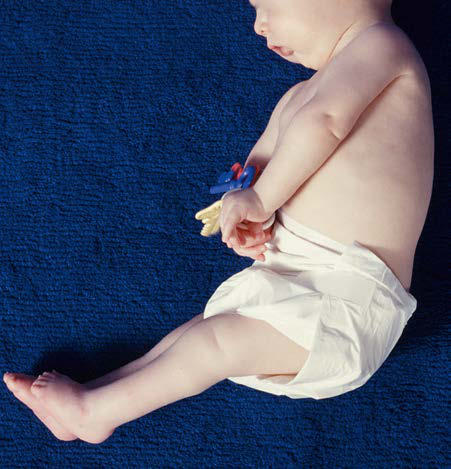

# Chapter 723: Arthrogryposis

*Christine M. Goodbody, Helen M. Horstmann, and Richard S. Davidson*

<!-- p.5485 -->
**Arthrogryposis multiplex congenita** refers to a heterogeneous group of muscular, neurologic, and connective tissue anomalies that present with two or more joint nonprogressive contractures at birth, as well as muscle weakness. It is associated with abnormal contraction of muscle fibers, causing reduced mobility with a decreased active and passive arc of motion. Arthrogryposis is not a specific diagnosis but a descriptive term with various etiologies and complex clinical features, including multiple congenital contractures of various limb joints. It is associated with over 300 different disorders encompassing malformation, mal function, and neurologic deficiency (see Chapter 648.10).

Approximately 1% of all births show some form of contractures of the joints ranging from unilateral clubfoot to amyoplasia (the most severe), a condition characterized by pervasive, crippling contrac tures involving many joints. The overall incidence of arthrogryposis is 1/5,000-10,000 live births with equal gender ratios. Although children with arthrogryposis may have many other problems, such as micrognathia and feeding issues, focus is on the orthopedic problems frequently seen in this group of children. In the absence of central nervous system lesions, many children have normal intelligence.

**ETIOLOGY** The main cause of arthrogryposis is fetal akinesia or decreased fetal movement. The associated pattern of abnormalities is often referred to as the **fetal akinesia deformation sequence**. This sequence manifests as multiple joint contractures, oligohydramnios, craniofacial anoma lies (e.g., micrognathia), and pulmonary hypoplasia because of lack of movement of the diaphragm and intercostal muscles. Intrinsic and extrinsic causes of fetal akinesia are categorized into six groups (Fig. 723.1) and include a multitude of disorders (Table 723.1).

**Neurologic Abnormalities** Neurologic abnormalities are present in 70–80% of cases. Patchy dam age to the anterior horn cells of the spinal cord can lead to charac teristic limb posturing of arthrogryposis. Neurologic disorders, such as spinal muscular atrophy and anterior horn disease, are associated

with arthrogryposis; however, the type of anterior horn cell involve ment is usually not from spinal muscular atrophy syndrome. Other less common neurologic disorders include neonatal myasthenia, myotonic dystrophy, olivo-ponto-cerebellar disorders, and neuronal migration anomalies.

**Muscular Abnormalities** These rare abnormalities affect the function and structure of the mus cles. **Amyoplasia**, the most common form of arthrogryposis, is associ ated with abnormally decreased fetal movement and is characterized by underdeveloped, contracted muscles causing joint deformity. The involved skeletal muscle is replaced by fatty or fibrous tissue. Some muscular diseases associated with arthrogryposis are muscular dystro phies, congenital myopathies (central core, nemaline, centronuclear), intrauterine myositis, and mitochondrial diseases.

**Limited Intrauterine Spacing** Uterine constraint is rarely the primary cause of arthrogryposis. Mater nal uterine anomalies will occasionally increase contractures of fetal limbs with arthrogryposis already existing. Other known causes are lack of amniotic fluid within the uterus, and tumors, such as fibroids, that can prevent movement by impinging on uterine space.

**Connective Tissue Abnormalities** When the tendons, bones, joints, and joint lining develop atypically, the resulting decrease in fetal movement causes congenital contrac tures. Diseases such as **diastrophic dysplasia**, **campomelic dysplasia**, and **metatropic dysplasia** result from connective tissue not developing properly. These are specific diagnoses resulting in limited joint motion and not true distal arthrogryposis. In some cases, the connective tissue develops normally but does not attach to the proper location around a bone or joint, and the subsequent abnormal movement results in distal joint involvement.

**Maternal Diseases** Maternal diseases, such as multiple sclerosis, diabetes mellitus, myas thenia gravis, maternal hyperthermia, infection (Zika virus), drugs, and trauma, are associated with an increased incidence of arthrogry posis. In approximately 10% of neonates born to mothers with myas thenia gravis, maternal antibodies enter the fetal circulation through the placenta, causing transient myasthenia gravis; this inhibits fetal acetylcholine receptors, which leads to damaged fetal muscles.

**Intrauterine Vascular Compromise** Abnormal fetal blood supply may be associated with arthrogryposis. This occurs when inadequate vascular supply to the fetus causes fetal hypoxia resulting in anterior horn cell death, which, in turn, decreases neurologic and myologic function. The result is fetal akinesia and sec ondary joint contractures. Multiple congenital contractures have been reported in individuals after bleeding throughout pregnancy or after a failed attempt at terminating the pregnancy.

**CLASSIFICATION** Arthrogryposis multiplex congenita is divided into subgroups with dif ferent signs, symptoms, and causes as a practical way to make a differen tial diagnosis. However, given the wide spectrum of disease presentation and etiology, no one classification system exists that is entirely compre hensive. Disorders involving primarily the limbs, such as amyoplasia and distal arthrogryposis, are the most common subgroups. Disorders involving limbs and other body parts typically represent a form of **multi ple pterygium syndrome***,* which is characterized by weblike membranes that form across joints, affecting a child’s ability to extend those joints and causing fixed flexion deformities. Disorders with limb involvement and abnormal neurologic function are caused by atypical central nervous system development, peripheral nervous system abnormalities, damaged or absent anterior horn cells, or a combination thereof.

**Amyoplasia,** also known as *classic arthrogryposis,* is a sporadic sym metric disorder that causes fibrotic replacement of the muscles. Symp toms include internally rotated and adducted shoulders, extended

*Christine M. Goodbody, Helen M. Horstmann, and Richard S. Davidson*

Anterior horn cell disease Other neurologic disorders

Myopathies and other

muscle disorders

Fetal crowding Maternal diseases

Vascular compromise

Connective tissue

abnormalities

**Multiple congenital contractures**

**Fetal hypokinesia or**

**restricted fetal**

**movement**

**Fig. 723.1** Etiology of arthrogryposis. (Data from Hall JG. Arthro gryposis multiplex congenital: etiology, genetics, classification, diag nostic approach, and general aspects. J Pediatr Orthop B. 1996;6:159– 166.)

<!-- p.5486 -->
elbows, pronated forearms, flexed fingers and wrists, dislocated hips, feet with severe equinovarus contractures, and extended knees. Involved muscles are hypoplastic and fibrotic. Often, patients have midfacial hemangioma. Intelligence is usually normal (Figs. 723.2 and 723.3). **Distal arthrogryposis** is an autosomal dominant disorder that pri marily affects the distal joints of the limbs. Characteristics of the upper limbs are medially overlapping fingers, clenched fists, ulnar deviation of fingers, camptodactyly, and hypoplasia. Lower limbs show talipes equinovarus, calcaneovalgus, vertical talus, or metatarsus varus (Fig. 723.4), in addition to limited motion at the involved joints. Ten dif ferent types of distal arthrogryposis have been categorized based on specific traits they share with each other (Table 723.2).

**MANAGEMENT OF ORTHOPEDIC PROBLEMS OF ARTHROGRYPOSIS** When a child is born with arthrogryposis, the many stiff or dislocated joints pose issues of timing and best practices of management. The overarching goal of management in the lower extremities are planti grade feet and joints that function to optimize ambulatory potential, whereas in the upper extremity, the aim is largely the ability to grasp, feed, and toilet independently. A child may have stiff elbows, dislocated hips; dislocated, hyperextended, or contracted knees; and clubfeet (Fig. 723.5). The stiffness and deformity need to be aggressively addressed through a combination of modalities. A team of clinicians, including therapists for the upper and lower extremities, orthotists, and orthope dic surgeons, will be involved.

Initially, passive range-of-motion exercises and judicious splinting directed and assisted by physical and occupational therapy will help to address the various deformities. Splinting and casting can be aug mented by a taping program that can be taught to the family so that the taping can be redone frequently to take advantage of improved range of motion. The ingenuity of the therapists and/or orthotists to create the right splints and braces using appropriate thermoplastics, neoprene, Velcro, and other materials can be effective (Fig. 723.6).

The therapeutic and orthopedic goal for the child with arthro grypotic limb deformities is to achieve maximal joint motion and to optimize joint position for function. In the lower extremities, the foot needs to be plantigrade. The knees need to have optimal motion for sitting and standing. Hips need to be stabilized, especially if the child has walking potential. In the upper extremities, in cases where there is extreme stiffness, the goals should include positioning of one arm for feeding and the other for toileting. Two-handed activities require some symmetry, which can be a challenging goal with extreme contractures and limited muscle strength. Serial casting may be beneficial in cor recting joint contractures. Although scoliosis is common, it usually does not become a problem until adolescence (see Chapter 720).

**FOOT PROBLEMS Clubfoot** deformities are the most commonly seen deformities with arthrogryposis (Fig. 723.7). A clubfoot has components of hindfoot equinus, midfoot varus, and forefoot adduction. Clubfeet in arthrogry posis tend to be more resistant to improvement than in idiopathic cases, but the traditional methods of treatment are nevertheless employed. Casting is begun shortly after birth in a method known as the Ponseti method. Casts are changed weekly until a plateau is reached, then heel cord lengthening is needed. Other deformities such as vertical talus are also seen and are addressed in a similar approach, although with case-appropriate differences in casting techniques (see Chapter 715).

Persistent stiffness often leads to more comprehensive soft tissue releases. This is typically done around age 6-12 months and is followed by 3 months of further casting and additional bracing as needed, espe cially as the foot is growing. When deformities are not corrected in early childhood, additional bony surgery may be needed later. Some of the approaches to this involve bony wedge osteotomies, lateral column lengthening, bone decancellation, or talectomy. Ring or multiaxial monolateral external fixation with or without osteotomies are used in late correction of residual deformities.

#### **Table 723.1** Associated Etiologies of Arthrogryposis

| Category / Parameter | Clinical Details & Findings |
| --- | --- |
| **ARTHROGRYPOSIS CAUSED BY NERVOUS SYSTEM DISORDERS** | • Focal anterior horn cell deficiency; • Generalized anterior horn cell deficiency; • Structural brain disorder/damage; • Uncertain location; (Spastic conditions are excluded) |
| **DISTAL ARTHROGRYPOSIS SYNDROMES** | • Type I dominant distal; • Type IIa dominant distal (Freeman-Sheldon syndrome); • Digitotalar dysmorphism; • Trismus pseudocamptodactyly; • Distal distribution, type not specified |
| **PTERYGIUM SYNDROMES** | • Multiple pterygium syndrome; • Lethal multiple pterygium syndrome; • Popliteal pterygium syndrome; • Ptosis, scoliosis, pterygia; • Antecubital webbing syndrome (Liebenberg) |
| **MYOPATHIES** | • Emery-Dreifuss muscular dystrophy; • Hypotonia, myopathy, mild contractures |
| **ABNORMALITIES OF JOINTS AND CONTIGUOUS TISSUE** | • Congenital contractural arachnodactyly; • Freeman-Sheldon syndrome; • Laxity or hypertonicity with intrauterine dislocation and; contractures; • Larsen syndrome; • Spondyloepimetaphyseal dysplasia with joint laxity; • Trisomy 18, extended breech position with bilateral hip; dislocation; • Siblings with bifid humeri, hypertelorism, and hip and knee joint; dislocations |
| **SKELETAL DISORDERS** | • Diastrophic dysplasia; • Parastremmatic dysplasia; • Kniest dysplasia; • Metatropic dysplasia; • Campomelic dysplasia; • Schwartz syndrome; • Fetal alcohol syndrome with synostoses; • Osteogenesis imperfecta with bowing/contractures |
| **INTRAUTERINE/MATERNAL FACTORS** | • Fetal alcohol syndrome with contractures; • Infections; • Untreated maternal systemic lupus erythematosus; • Intrauterine fetal constraint; • Deformity (pressure); • Amniotic fluid leakage; • Multiple pregnancies; • Intrauterine tumors; • Disruption (bands) |
| **MISCELLANEOUS** | • Pseudotrisomy 18 with contractures; • Roberts pseudothalidomide syndrome; • Deafness with distal contractures; • VACTERL association; • Multiple abnormalities and contractures not otherwise specified |
| **SINGLE JOINT** | • Campomelia; • Symphalangism; • “Trigger” finger; ARC, Arthrogryposis, renal tubular acidosis, cholestasis; VACTERL, vertebral defects,; imperforate anus, congenital heart disease, tracheoesophageal fistula, renal and limb; defects.; Modified from Mennen U, Van Heest A, Ezaki MB, et al. Arthrogryposis multiplex; congenita. J Hand Surg Br. 2005;30(5):468–474. Copyright 2005 The British Society for; Surgery of the Hand. |

<!-- p.5487 -->
Children with significant deformities are often in ankle foot orthoses through much of their lives to avoid deformity recurrence and to augment the standing base caused by weak leg muscles. A plantigrade, pain-free, stable foot is the goal of foot management. Foot stiffness is anticipated and unavoidable in arthrogryposis involving the foot.

**KNEE PROBLEMS** Knee issues in patients with arthrogryposis may include knee extension or flexion contracture, subluxation, and stiffness. Knee flexion contracture is more common in arthrogryposis and is often resistant to nonsurgical treatment. It can be structurally complex and associated with skin webbing known as pterygiums, which require Z-plasty lengthenings. In the case of a flexion contracture, the quadriceps musculature is often deficient and weak. When a trial of casting and splinting of the knee contractures is insufficient, surgical intervention with hamstring lengthenings and posterior knee capsular releases are often needed. Soft tissue relaxation by femoral shortening has also shown benefit.

In the case of knee hyperextension, the quadriceps are sometimes fibrotic and weak despite seeming to overpower the hamstrings. Casting and splinting should begin shortly after birth, which can be done in conjunction with clubfoot casting as needed following the principles of Ponseti. If splinting and therapy fail, lengthening of the quadriceps can be achieved through a number of surgical techniques that may include detachment of the rectus femoris and lengthening of the quadriceps either percutaneously or through a mini open procedure, which may minimize scarring.

Long-standing stiffness may lead to joint surface flattening and other bony abnormalities that can permanently reduce the arc of motion. Repositioning the arc of motion through bony osteotomies may improve sitting or standing. Follow-up bracing can help to com pensate for weak, fibrotic muscles of the legs. Use of guided growth plates and screws may also be of benefit.

**HIP PROBLEMS Teratologic hip dislocations** are common within the spectrum of arthrogryposis and usually require open reduction of the hip. Hips in a child with less upper-extremity involvement and more supple hips that are not pathologically stiff may respond to early treat ment with a Pavlik harness. Coexisting knee hyperextension should

**Fig. 723.2** Infant with stiff elbows, wrists, fingers, dislocated left hip, valgus stiff knees, and clubfeet.

**Fig. 723.3** Infant with stiff elbows, wrists, fingers, dislocated left hip, clubfeet, and micrognathia.

**Fig. 723.4** Infant with club feet, stiff knees, dislocated hips, stiff fin gers, and facial hemangioma.

<!-- p.5488 -->
first be treated with physical therapy and serial casting to allow for appropriate Pavlik harness fitting. However, careful observation of the hip during knee flexion is necessary because tightening of the quadriceps and hip flexors can push the hip into posterior disloca tion. Once some knee flexion has been achieved, the Pavlik harness can be useful in further flexing the knee and maintaining hip stabil ity in the infant. Most often, the hips are stiff and not reducible by closed means. For these, open reduction with pelvic reconstruction

and femoral osteotomy are commonly required, typically at 1 year of age. There is some controversy about reducing bilateral hip dis locations because a high failure rate can result in asymmetry of the pelvis, pain, leg length inequality, and stiffness. If a child has little

of Distal Arthrogryposes

#### **Table 723.2** A Classification System and Clinical Features

| Category / Parameter | Clinical Details & Findings |
| --- | --- |
| **DESCRIPTION** | and talipes equinovarus with possible concomitant; shoulder and hip contractures. The DA1 variant is; determined by a gene located on chromosome 9.; Freeman-Sheldon syndrome, where contractures; of fingers and toes are accompanied by kyphosis,; scoliosis, and malformations of the facial skeleton; with characteristic facial appearance: narrow mouth,; wide cheeks, an H-shaped chin dimple, small wide-; based nose, high palate, and small tongue. Growth; retardation, inguinal hernia, and cryptorchidism; have also been reported. Another name of this; syndrome is “whistling face” syndrome. The; Freeman-Sheldon syndrome is currently classified; as DA2A, as a separate DA2B subtype, known; as Sheldon-Hall syndrome has been described;; this syndrome combines clinical features of DA1; (hand and foot contractures) and some features of; DA2 (prominent nasolabial folds, slanted down-; facing eyes, and narrow mouth) and is currently; considered to be probably the most common type; of distal arthrogryposis.; is characterized by low stature and palatoschisis.; such as limited eye motion, ptosis, strabismus,; and the absence of typical hand flexion creases.; Chest wall muscle abnormalities have also been; observed, potentially causing restricted respiratory; movements and, consequently, pulmonary; hypertension.; sensorineural auditory abnormalities.; pseudocamptodactyly: wrists position in palmar; flexion with MCP joints in extension. Sometimes; accompanied by low stature and knee flexion; contractures.; contractures of small joints of the fingers. Patients; with this type of arthrogryposis are tall and slender,; phenotypically resembling Marfan syndrome but; without cardiovascular abnormalities.; From Kowalczyk B, Feluś J. Arthrogryposis: an update on clinical aspects, etiology, and; treatment strategies. Arch Med Sci. 2016;12(1):10–24. Table 1. |

**Fig. 723.5** Child with stiff elbows, wrists, knees, and clubfeet.

**Fig. 723.6** Infant with splints to extend metatarsophalangeal joints, wrists, and knees.

<!-- p.5489 -->
ambulatory potential, they may do as well retaining the bilateral hip dislocations and positioning the hips for sitting. Management deci sions should be made in conjunction with the family and guided by a pediatric hip surgeon.

**Ambulation** As would be expected, walking is more difficult for children with arthrogryposis because of the muscle weakness and limited joint motion. Children with arthrogryposis who walk have lower activity levels and take fewer steps than their peers. Not surprisingly, muscle fatigue and pain on exertion are common.

**UPPER EXTREMITY PROBLEMS** If splinting and a movement exercise program do not result in optimally functional upper extremities, surgical management may improve use of the arms of the child with arthrogryposis. A typical child with arthrogrypotic involvement of the upper extremities has internally rotated arms, extended elbows, flexed wrists, and thumbin-palm or clasp-thumb deformities (see Figs. 723.2 and 723.3).

Treatment is geared toward optimizing use of the arms and hands, particularly for critical activities of daily living, such as feeding and toileting. Therapy to improve motion of the joints is started imme diately after birth. Pediatric hand therapists are the optimal leaders of the mobility treatment program. Therapy is augmented by use of splints so that less-extensive surgery will ultimately be required. The elbow is the critical length adjuster of the arm, allowing the arm to reach out as is necessary for toileting or to approach the mouth for feeding. If necessary, lack of these motions can be com pensated for with modified silverware and other adaptive equip ment, including arm extenders for grabbing.

**Surgery of the Upper Extremity** Surgical correction of arthrogrypotic upper extremity contractures should be started after 1-3 months and completed by age 12 months so that the child can optimize his or her motor development. This allows for improved results by optimizing the joint growth remodeling plas ticity. One-stage procedures yield the best results. Delays in surgery result in more problems of intraarticular adhesions as well as fixed joint incongruity.

**Shoulder** Because of the rotational capacity of the shoulder, derotation osteot omy of the humerus is only occasionally needed. This is usually done in later childhood.

**Elbow** A stiff elbow that does not respond to therapy requires surgical intervention starting with soft tissue and capsular release. Capsu lotomy of the posterior elbow combined with a V-Y or Z recon structive lengthening of the triceps allows improved elbow flexion. Muscle transfer to the forearm can permit active elbow flexion; however, each child needs individual assessment as to an available flexor source. The triceps is commonly used, but caution must be exerted into the overall muscle balance because use of the triceps can create elbow flexion overpowering and an opposite contracture.

**Wrist** Wrist flexion deformity is improved with soft tissue balancing as well as partial carpectomies. The carpectomies need to be trapezoidal with more removed from the dorsum and the radial side to balance the wrist flexion contracture as well as the tendency for ulnar deviation. Thumb adduction may require an adductor release with an opponensplasty. Tendon transfers such as transfer of the extensor indicis pollicis to the extensor pollicis longus is helpful for improved function of the thumb in clasp thumb deformity.

Finger stiffness and wrist contractures often respond to therapy and bracing without need for surgery.

**Scoliosis** Scoliosis develops in some children with arthrogryposis, with the reported incidence ranging from 2.5–66%. Scoliosis can be congeni tal or paralytic. It is often accompanied by hip contractures associated with hip dislocation and compensatory lumbar lordosis. Curves <30 degrees can be treated initially with bracing in a thoracolumbar spi nal orthosis (TLSO brace). After 40 degrees, spinal fusion is generally warranted.

**Surgical Staging** Surgical treatment of the lower limbs usually begins distally and works proximally. The feet are corrected around 6 months of age, the knees around 8 months of age, and the hips around 12 months of age because pelvic osteotomy is often needed to stabilize the hips properly.

The upper extremities are corrected during infancy when the child is seen early. Hand, physical, and occupational therapy are a critical part of the team to optimize function before and after surgery. Further surgery during childhood may be needed to optimize functional use of the upper and lower extremities.

**Prognosis** Although most patients with arthrogryposis are ambulatory into adulthood, fewer are entirely independent, and many have pain or limitations in walking and standing. Surgical advancements in upper extremity positioning have improved function, and proce dures to correct lower extremity contractures, including not only surgery but also casting for clubfeet, have increased long-term ambulatory potential. However, there is significant variability in this population, and further work must be done to optimize inter vention techniques and their appropriate utilization.

*Visit Elsevier eBooks+ at eBooks.Health.Elsevier.com** for Bibliography.*

**Fig. 723.7** Clubfeet in infant with arthrogryposis.

<!-- p.5490 -->
