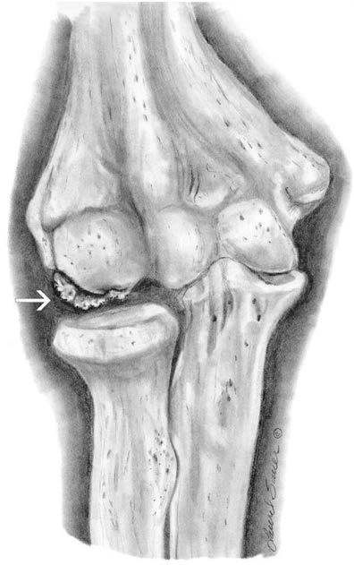
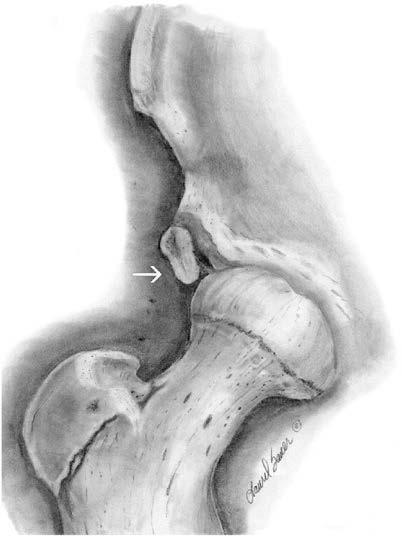

# Chapter 728: Management of Musculoskeletal Injury

*Gregory L. Landry and Andrew M. Watson*

<!-- p.5519 -->
1990. Participation in competitive sports is considered a privilege, not a right. *Knapp v Northwestern University* established that “difficult medical decisions involving complex medical problems can be made by respon sible physicians exercising prudent judgment (which will be necessarily conservative when definitive scientific evidence is lacking or conflicting) and relying on the recommendations of specialist consultants or guidelines established by a panel of experts.”

*Visit Elsevier eBooks+ at eBooks.Health.Elsevier.com** for Bibliography.*

Educational Background

#### **Table 727.4** Sports According to Risk of Impact and

| Category / Parameter | Clinical Details & Findings |
| --- | --- |
| **HIGH SCHOOL/COLLEGE** | Impact; expected; American football; Ice hockey; Lacrosse; Wrestling; Karate/judo; Fencing; Boxing; American football; Soccer; Ice hockey; Lacrosse; Basketball; Wrestling; Karate/judo; Downhill skiing; Squash; Fencing; Boxing; Impact may; occur; Soccer; Basketball; Field hockey; Downhill skiing; Equestrian; Squash; Cycling; Field hockey; Equestrian; Cycling; Baseball/softball; Gymnastics; Figure skating; Impact not; expected; Baseball/softball; Cricket; Golf; Riflery; Gymnastics; Volleyball; Swimming; Track and field; Tennis; Figure skating; Cross-country skiing; Rowing; Sailing; Archery; Weightlifting; Badminton; Cricket; Golf; Riflery; Volleyball; Swimming; Track and field; Tennis; Cross-country skiing; Rowing; Sailing; Archery; Weightlifting; Badminton; From Levine BD, Baggish AL, Kovacs RJ, et al. Eligibility and disqualification; recommendations for competitive athletes with cardiovascular abnormalities: Task force; 1: classification of sports: dynamic, static, and impact: a scientific statement from the; American Heart Association and American College of Cardiology. J Am Coll Cardiol.; 2015;66(21):2350–2355. |

**MECHANISM OF INJURY Acute Injuries** Sprains, strains, and contusions account for the majority of musculoskel etal injuries. A **sprain** is an injury to a ligament or joint capsule. Most

*Gregory L. Landry and Andrew M. Watson*

sprains are graded I-III. A *grade I* sprain is defined as mild damage to a ligament or ligaments without instability of the affected joint. A *grade II* sprain is considered a partial tear to the ligament, such that it exhib its excessive laxity but has a firm endpoint on examination. A *grade III* sprain is a complete tear of the ligament with instability to the affected joint and without a firm endpoint on examination. A **strain** is an injury to a muscle or tendon, and these are also graded I-III. *Grade I* muscle strains involve disruption of only a few muscle fibers, pain is mild to moderate, and range of motion and strength are at or near normal. *Grade II* strains represent a more significant, partial tear of the muscle and fre quently involve loss of range of motion and strength. *Grade III* strains are defined as complete rupture of the musculotendinous unit. On examina tion, *grade III* strains, and often *grade II* strains, present with ecchymosis and a palpable step-off at the site of injury. A **contusion** is a crush injury to any soft tissue. The history of the injury is especially helpful in assess ing musculoskeletal trauma. More severe injuries, including fractures or internal derangement of a joint, may have acute signs and symptoms such as immediate swelling, deformity, numbness or “give-way” weak ness, a loud painful pop, mechanical locking of the joint, or instability.

**Overuse Injuries** Overuse injuries are caused by repetitive microtrauma that exceeds the body’s rate of repair. This can occur in muscles, tendons, bone, bursae, cartilage, and nerves. Overuse injuries can occur in all sports but are more commonly seen in sports emphasizing repetitive motion such as swimming, running, tennis, baseball pitching, and gymnastics. Factors leading to overuse injuries can be categorized as extrinsic (i.e., train ing errors, poor equipment, or workout surface) and intrinsic (i.e., athlete’s anatomy or medical conditions). Training error is the most commonly identified factor. For example, at the beginning of the train ing program, athletes might violate the “10% rule” by increasing the duration or intensity of workouts by more than 10% per week. This may exceed the body’s capacity to recover between bouts of activity, leading to accumulated microtrauma that manifests as an overuse injury. Intrinsic factors include abnormal biomechanics that may be due to underlying anatomic causes (e.g., leg-length discrepancy, pes planus, pes cavus, tarsal coalition, valgus heel, external tibial torsion, and femoral anteversion), muscle imbalance, inflexibility, and medi cal conditions (deconditioning, nutritional deficits, amenorrhea, and obesity). To identify the cause of an overuse injury, the athlete should be questioned about the specifics of their training. Specifically, run ners, for example, should be asked about their shoes, orthotics, run ning surface, weekly mileage or time spent running per week, speed or hill workouts, and previous injuries and rehabilitation. When causative factors are identified, they can be modified or eliminated so that after rehabilitation the athlete does not suffer a recurrent overuse injury.

For athletes engaged in excessive training that causes an overuse injury, curtailing all exercise may not be necessary. Treatment incorpo rates a reduction of training load (relative rest) combined with a reha bilitation program designed to return athletes to their sport as soon as possible while minimizing risk of re-injury. Early identification of an overuse injury requires less alteration of the workout regimen. In addition, proper sleep, nutrition, and stress management can optimize recovery between bouts of activity, promoting physiologic adaptation and reducing the risk of accumulated damage that leads to injury.

It has become more commonplace for young athletes to *specialize* in a single sport and engage in year-round training. Families should be advised about the risks of specialization in young athletes because this is associated with burnout, decreased motivation and enjoyment, and increased risk of overuse injuries. This is especially evident among baseball pitchers, in whom repeated exposure to the highly repetitive and forceful throwing motion can damage the tissues in the elbow and shoulder in a growing athlete. These athletes and their parents should be counseled to diversify their sport participation at younger ages, which may increase their enjoyment and performance in sport, as well as reduce the risk of overuse injury.

The goals of treatment in overuse injuries are to control pain and spasm to rehabilitate flexibility, strength, endurance, and propriocep tive deficits (Table 728.1). In many overuse injuries, the role of inflam mation in the process is minimal. For most injuries to tendons, the term

<!-- p.5521 -->

#### **Table 728.1** Staging of Overuse Injuries

| Category / Parameter | Clinical Details & Findings |
| --- | --- |
| **TREATMENT** | Modification of activity, consider cross-training, home rehabilitation; program; Modification of activity, cross-training, home rehabilitation program; Significant modification of activity, strongly encourage cross-; training, home rehabilitation program, and outpatient physical; therapy; Discontinue activity temporarily, cross-training only, oral analgesic,; home rehabilitation program, and intensive outpatient physical; therapy; Prolonged discontinuation of activity, cross-training only, oral; analgesic, home rehabilitation program, and intensive outpatient; physical therapy |

*tendinitis* is no longer used because there is little or no inflammation on histopathology of the affected tendons. Rather, there is evidence of microscopic trauma to the tissue and a disorientation of the tendon fibers. Most of these entities are more appropriately called **tendinosis**; when the tendon tissue is scarred and when markedly abnormal, **ten dinopathy**. With tendinosis, there is less of a role for antiinflammatory medication in the treatment, except as an analgesic.

Novel treatments are emerging for the effective treatment of chronic tendinopathies. Under ultrasound guidance, pathologic areas of ten don tissue can be targeted with injections of autologous blood or platelet-rich plasma to stimulate a proinflammatory and more robust healing response. Platelet-rich plasma is a controversial therapy with a mixed body of evidence related to its effectiveness for certain acute and chronic tendinopathies; there is a lack of consensus regarding its role in the standard of care. Pathologic tissue can also be targeted with percutaneous needle fenestration or tenotomy, and tendon-fat pad adhesions can also be addressed through mechanical needle scraping or hydrodissection techniques using ultrasound.

**INITIAL EVALUATION OF THE INJURED EXTREMITY** Initially, the examiner should determine the quality of the peripheral pulses and capillary refill rate, as well as the gross motor and sensory function to assess for neurovascular injury. The first priorities are to maintain vascular integrity and skeletal stability.

**Criteria for immediate attention and rapid orthopedic consultation** include vascular compromise, nerve compromise, and open fracture. With the latter, the exposed wound should be covered with sterile salinesoaked gauze, the injured limb should be padded and splinted, and sys temic antibiotics should be administered. Pressure should be applied to any site of excessive bleeding. Additional criteria include deep lacera tion over a joint, unreducible dislocation, grade III (complete) tear of a muscle-tendon unit, and displaced, significantly angulated fractures.

**TRANSITION FROM IMMEDIATE MANAGEMENT TO RETURN TO PLAY** Rehabilitation of a musculoskeletal injury should be initiated on the day of the injury.

**Phase 1 Limit further injury, control swelling and pain, and minimize strength and flexibility losses.**** PRICE** principles (**P**rotection, **R**est, **I**ce, **C**om pression, and **E**levation) need to be applied. Crutches, air stirrups for ankle sprains, slings for arm injuries, and elastic wraps (4-8 inches) for compression are a helpful inventory of medical supplies. Ice can be

placed directly over the injury as tolerated for 20 minutes continuously 3 or 4 times per day until the swelling resolves. Compression limits further bleeding and swelling but should not be so tight that it limits perfusion. Elevation of the extremity promotes venous return and lim its swelling. A nonsteroidal antiinflammatory drug (NSAID) or acet aminophen are indicated for analgesia.

Pain-free isometric strengthening and range of motion exercises should be initiated as soon as tolerable. Pain inhibits full muscle con traction; deconditioning results if the pain and resultant disuse persist for days to weeks, thus delaying recovery. Education about the nature of the injury and the specifics of rehabilitation exercises, including handouts with written instructions and drawings demonstrating the exercises, are helpful.

**Phase 2 Improve strength and range of motion (e.g., flexibility) while allowing the injured structures to heal****.** Protective devices are removed when the patient’s strength and flexibility improve and activities of daily living are pain-free. Flexibility can then be addressed by a program of specific stretches, held for 15-30 seconds for three to five repetitions, once or twice daily. A physical therapist or athletic trainer is invaluable in guiding the athlete through this process. Protective devices might need to be used upon return to sports participation. Swimming, water jogging, and stationary cycling are good, low-impact aerobic exercises that can allow the injured lower extremity to be used pain-free while maintaining cardiovascular fitness.

**Phase 3 Achieve near-normal strength and flexibility of the injured structures and further improve or maintain cardiovascular fitness.** Strength and endurance are improved under controlled conditions using elas tic bands and closed kinetic chain exercises (movement of multiple joints and limb segments with foot fixed to a static surface, such as the floor or wall) at this point and then progressing next to using exercise equipment followed by free weights. Additional sensory proprioceptive training allows the athlete to redevelop the kinesthetic sense critical to joint function and stability during activity.

**Phase 4 Return to exercise or competition without restriction.** When the ath lete has reached normal range of motion, strength, proprioception, and endurance, the athlete can initiate sports-specific exercises. The athlete will transition from the rehabilitation program to functional rehabilita tion appropriate for the sport. Substituting sports participation for reha bilitation is inappropriate; rather, there should be progressive stepwise

<!-- p.5522 -->
functional return to a full activity or play program. For instance, a bas ketball player recovering from an ankle injury might begin a walk-runsprint-cut program before returning to competition. At any point in this progression, if pain is experienced, the athlete needs to stop, apply ice, avoid running for 1-2 days, continue to perform ankle stabilizing exercises, and then resume running at a lower intensity and progress accordingly.

**Relative Rest and Return-to-Play Guidelines** Relative rest refers to the concept that the athlete participates in reha bilitation and return to sport activities provided the injured structures do not hurt during or within 24 hours of the activity. Exercising beyond the pain threshold delays recovery.

**IMAGING** Traditional imaging modalities such as x-ray, ultrasound, MRI, and CT are well-established in the routine diagnostic workup of musculoskele tal injury. An obvious advantage of ultrasound is a lack of radiation. It is also better tolerated by younger children who may have difficulty com plying with MRI or CT protocols. Dynamic movement or stressing of a limb, joint, or structure can provide valuable diagnostic information and can easily be compared to the contralateral side for comparison. Snapping or popping sensations, suspected intramuscular hematomas, stress fractures, and prognostic scrutiny of strains, sprains, and ten dinopathies are all high-yield applications of diagnostic musculoskel etal sonography. Ultrasound imaging can also increase the accuracy of therapeutic injections, improving injection efficacy while simultane ously reducing adverse outcomes by erroneous needle placement.

**DIFFERENTIAL DIAGNOSES OF MUSCULOSKELETAL PAIN** Traumatic, rheumatologic, infectious, hematologic, psychologic, con genital, and oncologic processes—especially under the age of 12 years old —can result in a presenting complaint of musculoskeletal pain. Symptoms such as fatigue, weight loss, rash, multiple joint complaints, fever, chronic or recent illness, pain out of proportion to the nature of the injury, and persistent pain despite conservative care suggest a diag nosis other than sports-related trauma. The possibility of child abuse, including sexual abuse, should not be overlooked. Incongruity between the patient’s history and physical examination findings should lead to further evaluation. A negative review of systems with an injury history consistent with the physical findings suggests a sports-related etiology.

*Visit Elsevier eBooks+ at eBooks.Health.Elsevier.com** for Bibliography.*

## 728.1  Growth Plate Injuries Gregory L. Landry and Andrew M. Watson

Approximately 20% of pediatric sports injuries seen in the emer gency department are fractures, and 25% of those fractures involve an epiphyseal growth plate or physis (see Chapter 724). Growth in long bones occurs in three areas and is susceptible to injury. Immature bone can be acutely injured at the physis (e.g., Salter-Harris fractures, see Chapter 724.2), the articular surface (e.g., osteochondritis dissecans [OCD]), or the apophysis (e.g., avulsion fractures). Males suffer nearly twice as many physeal fractures as females, with the highest incidence of fracture occurring during peak height velocity (females: age 12 ± 2.5 years; males: age 14 ± 2 years). The physis is a pressure growth plate and is responsible for longitudinal growth in bone. The apophysis is a bony outgrowth at the attachment of a tendon and is a traction physis. The epiphysis is the end of a long bone, distal or proximal to the long bone, and contains articular cartilage at the joint.

**Physeal injuries** of the upper extremity are most commonly seen at the distal radius in the growing child or adolescent and are typically due to excessive force applied to the upper extremity. Injuries of this nature can be seen in athletes, including those participating in gymnastics, cheerleading, ice skating, hockey, and weightlifting. Mechanisms of

injury include falls onto an outstretched hand or repetitive dorsiflexion and axial loading through the distal radius (see Chapter 734). Chronic wrist pain can be seen in up to 79% of young gymnasts—particularly female gymnasts between the ages of 12-14 years—and is commonly termed **gymnasts’ wrist** (see Chapter 722). With repetitive axial load ing, temporary metaphyseal ischemia may be induced, preventing car tilage calcification and causing the physis to widen. With widening of the distal radial physis, microfractures can develop. Clinical features include radial wrist pain (particularly dorsal) that is aggravated with passive and active hyperextension activities and relieved with suspen sion of the offending activity. Tenderness or focal pain around the cir cumference of the distal radius is often noted. Differential diagnosis includes metacarpal fractures, scaphoid fracture and, in the older child or adolescent, de Quervain tenosynovitis. Juvenile idiopathic arthritis, malignancy, and infection need to be considered in a child with a pain ful, swollen wrist without a history of trauma. X-rays of the wrist can be helpful, particularly when compared to the contralateral extremity. Radiographs can show physeal widening with cystic changes involving the metaphyseal segment, breaking of the distal epiphysis, and, in later stages, positive ulnar variance (longer ulna compared to the radius). MRI is often helpful for stress fractures when radiographs are incon clusive and will show signs of stress reaction (bone marrow edema, periosteal reaction, etc.), even if a fracture line is not evident. PRICE principles are followed with nonnarcotic pain management. Salter- Harris fractures types I and II can be treated with closed reduction and immobilization. Ulnar-shortening osteotomy may be necessary in the athlete with significant ulnar positive variance. Physeal injuries at the knee (distal femur, proximal tibia) are rare, whereas those at the ankle (distal fibula most commonly) are more frequent—typically occurring as a result of an inversion injury—and predominantly consist of Salter- Harris I fractures.

Growth disturbance following a growth plate injury is a function of location of the physeal fracture. This influences the probability that a physeal bar will form, resulting in growth arrest. In the upper extrem ity, the areas making the largest contribution to longitudinal growth are the proximal humerus and distal radius and ulna; in the lower extremi ties, the distal femur and the proximal tibia and fibula are the greatest contributors to longitudinal growth. Injuries to these areas are more likely to cause growth disturbance compared with physeal injuries at the other end of these long bones. The type of physis fracture relative to the risk of growth disturbance is described by the Salter-Harris classifi cation system (see Table 724.1). A grade I injury is least likely to result in growth disturbance, and grade V is the most likely fracture to result in growth disturbance.

**Osteochondritis dissecans (OCD)** affects the subchondral bone and overlying articular surface (see Chapter 718.3). With avascu lar necrosis of subchondral bone, the articular surface can flatten, soften, or break off in fragments. The etiology may be related to repetitive stress injury in some patients. OCD most commonly pres ents in the lower extremities at the knee, affecting the lateral aspect of the medial femoral condyle in 70% of patients, the lateral femoral condyle in 20%, and the patella in 10%. In the upper extremities, it is most frequently seen at the elbow (Fig. 728.1)—affecting the capitellum—and is often associated with repetitive overhead throw ing or swinging activities (e.g., baseball). Other sites where OCD lesions are seen are the ankle (talus) and radial head. OCD clas sically affects athletes in their second decade. The most common presentation is poorly localized, vague joint pain. There is rarely a history of recent acute trauma. Some OCD lesions are asymptom atic and incidental—diagnosed on “routine” radiographs—whereas others manifest as joint effusion, pain, decreased range of motion, and mechanical symptoms (e.g., locking, popping, or catching). Activity usually worsens the pain.

Physical examination might show no specific findings. Sometimes tenderness over the involved condyle can be elicited by deep palpation. Diagnosis is usually made with plain radiographs. Treatment of OCD includes both nonoperative and surgical management (Chapter 718.3). Long-term sequelae can be seen in up to 25% with atypical lesions, older age, effusion, and lesions of large size.

<!-- p.5523 -->

<!-- p.5524 -->

**Fig. 728.1** Osteochondritis dissecans in the elbow. (Copyright Laurel Sauer, 2017.)

**Avulsion fractures** occur when a forceful muscle contraction dis lodges the apophysis from the bone. They occur most commonly around the hip (Fig. 728.2) and are typically treated nonsurgically if no significant displacement of the avulsed fragment is present. Acute fractures to other apophyses (i.e., knee and elbow) require urgent orthopedic consultation. Chronically increased traction at the muscleapophysis attachment can lead to repetitive microtrauma and pain at the apophysis. The most common areas affected are the knee (**Osgood- Schlatter** and **Sinding-Larsen-Johansson disease**), the ankle **(Sever disease)** (Fig. 728.3), the proximal fifth metatarsal **(Iselin disease)**, and the medial epicondyle **(Little Leaguer’s elbow)**. Traction apophysitis of the knee and ankle can often be treated in a primary care setting. The main goal of treatment is to minimize the intensity and incidence of pain and disability. Exercises that increase the strength, flexibility, and endurance of the muscles attached at the apophysis, using the relative rest principle, are appropriate. The use of a patellar strap can provide benefit in reducing the traction force placed upon the tibial apophysis during activity. Symptoms can last for 12-24 months if untreated. As growth slows, symptoms abate.

*Visit Elsevier eBooks+ at eBooks.Health.Elsevier.com** for Bibliography.*

## 728.2  Shoulder Injuries Gregory L. Landry and Andrew M. Watson

Shoulder pain associated with radiating symptoms down the arm should raise the possibility of a neck injury (see Chapter 730). Neck pain and tenderness or limitation of cervical range of motion requires cervical spine immobilization and transfer of the athlete for further evaluation. If there is no neck pain, tenderness, or limitation of motion of the cervical spine, the shoulder is likely the site of the primary injury.

**CLAVICLE FRACTURES** Clavicle fracture is one of the most common shoulder injuries (see Chapter 724.3). Injury is usually sustained by a fall on the lateral side of an adducted shoulder, on an outstretched hand, or by direct blow. Approximately 80% of fractures occur in the middle third of the clavicle. With younger children, plastic bowing of the clavicle may be present instead of an overt fracture but should be treated in the same fashion. Treatment is conservative and includes the use of an arm sling or figure-of-8 brace for comfort and protection. An arm sling is pre ferred because it is generally more comfortable and easier to apply with similar clinical outcomes. Healing time is shorter in comparison to that in adults—generally 3-6 weeks. An additional 2- to 3-week period of protection from contact/collision activities is recommended after clinical and radiographic healing is achieved to prevent re-injury. If nondisplaced, most medial and lateral clavicular fractures can be man aged similar to middle-third clavicular fractures. Displaced lateral and medial third fractures require orthopedic consultation because of a higher incidence of acromioclavicular (AC) osteoarthritis (lateral), and physeal involvement (medial). **Distal clavicular osteolysis** is likely an overuse injury associated with slow dissolution and resorption of

**Fig. 728.2** Anterior inferior iliac spine avulsion. (Copyright Laurel Sauer, 2017.)

**Fig. 728.3** Calcaneal apophysitis (Sever disease). (Copyright Laurel Sauer, 2017.)

<!-- p.5525 -->

<!-- p.5526 -->
bone. The cause of injury is unclear, appearing most consistent with a stress reaction or fracture at the site of considerable force. This lesion is commonly seen in weightlifting athletes and can be seen in older children. Nonoperative treatment, including activity limitations, ice, NSAIDs, and cortisone injections, can be helpful. For weightlifters, narrowing their hand spacing on the barbell and slowing descent phase of the bench press to end 4-6 cm above the chest are recommended activity modifications. For those not willing to modify weightlifting activity or those with persistent symptoms despite conservative care, surgery can be very successful and involves removal of the distal clav icle (approximately 1 cm) with no loss of strength and full return to activity anticipated.

**ACROMIOCLAVICULAR JOINT SEPARATION** An AC joint separation most commonly occurs when an athlete sus tains a direct blow to the acromion with the humerus in an adducted position, forcing the acromion inferiorly and medially. Force is directed toward the AC joint and coracoclavicular ligaments because of the inherent stability of the sternoclavicular joint. Patients have point tenderness at the AC joint, pain with lifting their arms above the level of their shoulder, and possibly an apparent step-off between the distal clavicle and the acromion (Fig. 728.4).

**Type I** AC joint injuries involve isolated sprain of the AC liga ment with the periosteal sleeve intact (Fig. 728.5). There is no vis ible deformity, and the radiographs are normal. Pain is elicited with adduction of the humerus across the chest and palpation of the AC joint. **Type II** injuries involve disruption of the AC and coracoclavic ular ligaments, as well as partial disruption of the periosteal sleeve. Radiographs may show slight widening of the AC joint, though the distance between the clavicle and the coracoid process is unchanged in comparison to the uninjured shoulder. Treatment of type I and type II AC injuries is conservative and consists of ice, NSAIDs, and a sling for immobilization. Shoulder range of motion exercises and strengthening of the rotator cuff, deltoid, and trapezius musculature

are incorporated early in the rehabilitative course once pain-free range of motion is achieved in order to prevent residual joint stiff ness. A short course of physical therapy may be helpful if range of motion limitations are present 2-4 weeks out from injury. Consid eration for return to play is made when the patient no longer has focal AC joint tenderness, exhibits full, painless range of motion, has strength sufficient to be functionally protected from a collision or fall, and can perform maneuvers required within their sport. Typi cally, return to play from a type I AC injury is 1-2 weeks, and 2-4 weeks for type II.

**Type III** AC joint injury is more severe, involving further tearing of the AC and coracoclavicular ligaments and disruption of the periosteal sleeve with instability of the distal clavicle because of deltotrapezial fas cial detachment. Radiographs will commonly show superior displace ment of the distal clavicle from the coracoid of 25–100%. The treatment of type III AC injuries is controversial. Many can be treated nonopera tively—similar to that described for types I and II AC injuries—if there is no damage to the overlying skin or neurovascular compromise to the injured limb. The patient should be counseled that this injury is likely to result in a noticeable defect to ascertain whether this is acceptable. Surgery for type III AC injuries is uncommon and primarily for ath letes involved with throwing sports or for cosmesis. **Types IV**, **V**, **and VI** AC joint injuries have progressive worsening of ligamentous and fascial disruption with varied locations of the clavicular displacement. These injuries should be referred to an orthopedist for consultation and operative repair.

**ANTERIOR GLENOHUMERAL DISLOCATION** The most common mechanism of injury causing an anterior glenohu meral dislocation is contact with the shoulder abducted to 90 degrees and forcefully externally rotated. Patients complain of severe pain and that their shoulder “popped out of place” or “shifted.” Patients with an unreduced anterior dislocation have a hollow region inferior to the acromion and a bulge in the anterior portion of the shoulder caused by anterior displacement of the humeral head. Abnormal sensation of the lateral deltoid region and the extensor surface of the proximal forearm should be assessed to evaluate for concomitant injury to the radial or musculocutaneous nerves, respectively.

Reduction of a dislocated shoulder should be made expediently, assuming that there is no crepitus to suggest a fracture. Numerous safe methods for closed reduction have been described, including the traction–counter traction technique, the **Stimson maneuver**, and the abduction maneuver. Postreduction radiographs are helpful and may show evidence of a posterior lateral humeral head impaction fracture **(Hill-Sachs lesion)**. Injuries to the surrounding soft tissues, including the anterior capsule and labrum, are best evaluated by MRI—often with an accompanying arthrogram of the glenohumeral joint. Once reduced, initial treatment of a dislocation includes placing the patient into an arm sling for comfort and protection. The duration of immobilization is controversial and may last from a few days to 6 weeks. The most significant risk after an acute traumatic dislocation is recurrence. Most sports medicine practitioners encourage early range of motion and strengthening exercises as tolerated. Rehabilitation focuses on progres sive strengthening of the rotator cuff, deltoid, and periscapular muscles at increasing degrees of abduction and external rotation. Strengthen ing of the rotator cuff muscles is extremely important because they are the dynamic stabilizers of the glenohumeral joint and are integral to the prevention of future dislocation. Plyometric exercises also may be incorporated near the end of rehabilitation to improve proprioceptive function in preparation for return to athletics. Patients can return to play when strength, range of motion, and proprioception are equal to the uninjured shoulder to the extent that they are able to protect the shoulder and perform sports-specific activities without pain. Sur gery is to be considered in cases of recurrent dislocations or in those individuals that fail to heal adequately after prolonged rehabilitation. Additionally, early operative repair should be considered for athletes participating in contact or collision sports that inherently have higher recurrence rates.

**Fig. 728.4** Palpitation of acromioclavicular joint. (From Anderson SJ. Sports injuries. Curr Probl Pediatr Adolesc Health. 2005;35:105–176.)

<!-- p.5527 -->
**ROTATOR CUFF INJURY** The muscles of the rotator cuff consist of the supraspinatus, infraspi natus, teres minor, and subscapularis. The function of these muscles is to rotate the humerus and stabilize the humeral head against the glenoid. The supraspinatus is most commonly injured, either by an acute traumatic injury or chronic tendinosis from overuse. Specifically, rotator cuff tendinosis commonly presents with the complaint of pain with overhead arc of motion, such as with throwing, lifting, or reach ing for objects above one’s head. Pain is often poorly localized about the shoulder, although it may be referred to the deltoid. The onset of pain is often insidious and is commonly associated with increased fre quency or duration of overhead throwing or lifting activities. Pain is exacerbated with overhead activities but is often present at rest as well; nighttime pain occurs in more severe cases. On exam, manual muscle testing of the rotator cuff muscles often produces pain and in some cases weakness in comparison to the uninjured shoulder. Supraspina tus tendinosis produces pain with active abduction against resistance in which the patient abducts the arm to 90 degrees, forward flexes to 30 degrees anterior to the parasagittal plane, and internally rotates the humerus.

The treatment of rotator cuff tendinosis includes relative rest from athletics or activities causing pain as well as the use of ice, analgesia, and/or NSAIDs. Strengthening of the rotator cuff and scapular stabi lizer musculature, modifications of technique, and core strengthening are important components of rehabilitation often supervised by a phys ical therapist. In the young athlete, rotator cuff pain is most commonly

a result of glenohumeral instability and not rotator cuff impingement syndrome. The latter is more commonly seen in adults and is caused by impingement of the rotator cuff by the bony structures superior to it. As a result, treatment focusing on stretching alone can make symptoms worse. Return to play often includes gradual increases in load placed upon the rotator cuff as the patient resumes prior activities, such as an interval throwing program in baseball.

**Glenoid labrum tears** may present in similar insidious fashion to rotator cuff tendinosis or may be associated with an acute traumatic dislocation. This frequently manifests with pain in the glenohumeral joint and may be associated with mechanical sensations of clicking or catching in the shoulder. This can frequently be reproduced on exam. One of the most common lesions is a superior labrum anterior and posterior (SLAP) lesion. Throwing athletes are at particular risk. The mechanism of injury is thought to be related to a traction injury along the long head of the biceps at its attachment at the superior glenoid labrum, occurring during the throwing cycle. Radiographs are usu ally normal. MRI with arthrogram is the best study to identify glenoid labrum pathology (Fig. 728.6).

**Proximal humeral stress fracture (epiphysiolysis)** is an uncom mon cause of proximal shoulder pain and is suspected when shoul der pain does not respond to routine measures. Gradual onset of deep shoulder pain occurs in a young athlete involved in repetitive overhead motion, such as in baseball, tennis, or swimming, but with no history of trauma. Tenderness is noted over the proximal humerus; the diag nosis is confirmed by detecting a widened epiphyseal plate on plain

Type III Type II Type I

Type IV Type V Type VI

**Fig 728.5**  Rockwood’s classification of acromioclavicular (AC) joint injuries in children. *Type 1*, sprain of the AC ligaments without disruption of the periosteal tube. *Type II*, partial disruption of the periosteal tube. This may produce some AC instability. *Type III*, large split in the periosteal tube al lowing superior displacement of the lateral clavicle. *Type IV*, large split in the periosteal tube *(large arrow)* with posterior displacement of the lateral clavicle through the trapezius muscle *(curved arrow)*. *Type V*, complete disruption of the periosteal tube with displacement of the clavicle through the deltoid and trapezius muscles into the subcutaneous tissues. *Type VI*, inferior dislocation of the distal clavicle below the coracoid process. *(Redrawn from Sanders JO, Rockwood CA, Curtis RJ. Fractures and dislocations of the humeral shaft and shoulder. In Rockwood CA, Wilkins KE, Beaty JH, eds. Fractures in Children. Vol 3. Philadelphia, PA: Lippincott-Raven; 1996:974.)*

<!-- p.5528 -->
radiographs, increased uptake on nuclear scan, or edema of the physis on MRI. Treatment is total rest from throwing for at least 6-8 weeks.

**Non–sports-related conditions** that need to be considered in any child with a painful shoulder include an undiagnosed Sprengel defor mity. This deformity involves the scapula, which fails to descend from its cervical region overlying the first through fifth ribs. Children often present with a shortened neckline and a lack of normal scapular tho racic motion. Malpositioning of a glenoid can cause limited forward flexion and abduction of the shoulder. An omovertebral bar is present in up to 50% of cases. This bar connects the superior medial angle of the scapula and the cervical spine and consists of fibrous cartilaginous tissue or bone. Other regional abnormalities can include scoliosis with a prominent scapula on the convex side, congenital rib anomalies, and undiagnosed Klippel-Feil syndrome. Winging of the scapula raises the question of facioscapulohumeral muscular dystrophy. Family histories can be most helpful. Primary bone tumors (see Chapter 550) common to the upper extremities include Ewing sarcoma of the scapula and osteogenic sarcoma of the proximal humerus, in addition to osteoblas tomas and chondroblastomas common to the diaphysis and epiphysis of long bones. The most common presenting manifestations of osteo sarcoma are pain, upper limb dysfunction, and swelling. Similar pre sentations can be seen in Ewing sarcoma, along with weight loss and fever. Symptoms not responding to conservative treatment require fur ther investigation and specialty consultation.

*Visit Elsevier eBooks+ at eBooks.Health.Elsevier.com** for Bibliography.*

## 728.3  Elbow Injuries Gregory L. Landry and Andrew M. Watson

**ACUTE INJURIES** The most commonly dislocated joint in childhood is the elbow. Radial head subluxation, or “nursemaid’s elbow,” comprises the majority of these (see Chapter 722). Posterior dislocation is the next most common type of **elbow dislocation**, typically resulting from falling backward onto an outstretched arm with the elbow in extension. The dislocation may be complete or incomplete—termed “perched”—with the trochlea subluxed upon the top of the coronoid process. The ulnar collateral

ligament (UCL) is commonly disrupted along with other components of the soft tissue capsule about the elbow. Fractures of the olecranon (>80% occurrence) or medial epicondyle may be present as well. An obvious deformity is visualized with the olecranon process displaced prominently behind the distal humerus. Careful examination of the distal radius and ulnar pulses to assess vascular integrity of the distal upper arm is important because of the potential for injury to the bra chial artery. Sensation to the distal extremity should also be assessed because of possible injury to the radial, median, and ulnar nerves. Reduction should be performed as soon as possible before significant swelling and muscle spasm potentially complicate the procedure. Lon gitudinal traction is applied to the forearm with gentle upward pressure on the distal humerus so that the coronoid process clears the trochlea. If reduction is unable to be performed, the arm should be placed in a padded splint and sling and the patient transported to an emergency facility.

**Supracondylar humeral fractures** can result from the same mecha nism of injury as elbow dislocations and can be difficult to distinguish on exam from a posterior dislocation because of significant swelling about the elbow joint. These, too, can be complicated by concomitant injury to the brachial artery and to a lesser extent the median, radial, and ulnar nerves. The injury typically occurs in the first decade of life, which is associated with peak hyperlaxity of the elbow joint in children between the ages of 5-8 years. An acute compartment syndrome can develop after these fractures, which is associated with a fat pad sign on radiographs (Fig. 728.7). These fractures should be referred for ortho pedic consultation and are discussed in more depth in Chapter 724.

Direct trauma to the elbow can cause bleeding and inflammation in the olecranon bursa resulting in **olecranon bursitis**. Aspiration is rarely required, and this injury can be managed with ice, compressive dressing, and analgesia (PRICE principles). An overlying elbow pad provides comfort during activity and prevents re-injury.

**Chronic Injuries** Overuse injuries in the upper extremities occur primarily in throw ing sports, sports that require repetitive wrist flexion or extension, or sports that demand weight-bearing on hands (gymnastics).

**Little Leaguer’s elbow** is a broad term for several different elbow problems. Throwing overhand creates valgus stress to the elbow with medial opening of the joint and lateral compressive forces. **Medial elbow pain** is a common complaint of young throwers, resulting from repetitive valgus overload of the wrist flexor-pronator muscle groups and their attachment on the medial apophysis. In preadolescents who still have maturing secondary ossification centers*,* traction apophysitis of the medial epicondyle is likely. Patients have tenderness along the medial epicondyle; pain is exacerbated by valgus stress or resisted wrist flexion and pronation. Wrist pain may be present in more severe cases. Radiographs may show widening of the growth plate at the medial

**Fig. 728.6** Coronal intermediate-weighted MRI showing superior labral tear (arrow) and tendinosis of the supraspinatus tendon (ar rowhead). There is no adjacent perilabral edema, suggesting chronic injury. (From Chang, I-Yuan J, Polster JM. Pathomechanics and mag netic resonance imaging of the thrower’s shoulder. Radiol Clin N Am. 2016;54[5]:801-805. Fig. 13.)

**Fig. 728.7** Deflection of the supracondylar fat pad with a joint effu sion (fat pad sign) (arrows) showing evidence of a fracture. (Copyright Laurel Sauer, 2017.)

<!-- p.5529 -->

<!-- p.5530 -->
apophysis in comparison to the uninjured elbow. Treatment includes no throwing for 4-6 weeks and pain-free strengthening and stretch ing of the flexor-pronator group followed by a 1-2 week progressive functional throwing program with careful rehabilitation. Incorpora tion of core strengthening and scapular stabilizing exercises, as well as addressing proper throwing mechanics (to reduce the load upon the medial elbow), are important components of the rehabilitation pro gram. Little Leaguer’s elbow has to be treated with a period of rest from throwing because of the risk of nonunion of the apophysis and chronic pain. If pain occurs acutely, an avulsion fracture of the medial epicon dyle must be considered. Radiographs should be taken in any thrower with acute elbow pain. If the medial epicondyle is avulsed (Fig. 728.8), orthopedic consultation is indicated.

In older adolescents and young adults with a fused apophysis, the structure at the elbow vulnerable to injury is the UCL. UCL sprains/ tears are common in sports requiring high-velocity throwing or over head activities. Medial elbow pain that is worst during the acceleration

phase of throwing is common. A loss of throwing velocity and control, as well as a sensation of elbow joint “opening” during throwing is also frequently described. On exam, focal tenderness to palpation over the UCL is present. Additionally, laxity may be appreciated with valgus stress of the elbow when flexed to 30 and/or 90 degrees. Radiographs are generally unremarkable. Diagnostic ultrasonography or MRI with arthrography is often necessary to assess the integrity of the UCL. Par tial tears can be treated with a period of time off from throwing (2-4 weeks) followed by careful progressive rehabilitation as discussed ear lier for medial elbow pain. If there is a complete tear, surgical repair is indicated if the athlete desires to continue a pitching career.

**Medial epicondylitis**, or golfer’s elbow**,** is another common cause of medial elbow pain in the individual with fused apophyses. It is com monly caused by overuse of the flexor pronator muscle groups at their origin at the medial humeral epicondyle. This occurs frequently in ath letics or activities with repetitive wrist flexion. Tenderness is noted over the medial epicondyle and exacerbated by passive wrist extension or resisted wrist flexion. Treatment includes rest from the inciting activity, ice, stretching and strengthening of the wrist flexors, forearm straps, counterforce bracing, and analgesia. Local injection of corticosteroids can be considered as an adjunctive treatment if initial conservative measures fail. Ulnar nerve dysfunction can be a complication of valgus overload and can occur with any of the diagnoses previously discussed. Persisting paresthesia or motor weakness in the ulnar nerve distribu tion should be evaluated with electromyography and nerve conduc tion studies. Diagnostic ultrasonography can also be of use to assess for focal thickening of the nerve, as a sign of irritation, as well as dynami cally visualizing the nerve through the arc of elbow flexion to assess for subluxation over the medial epicondyle (Fig. 728.9).

**Lateral elbow pain** can be caused by compression during the throw ing motion at the radiocapitellar joint. **Panner disease** is osteochon drosis of the capitellum that occurs between ages 7 and 12 years (Fig. 728.10). **OCD** of the capitellum occurs at age 13-16 years (see Fig. 728.1). Although patients with both conditions present with insidi ous onset of lateral elbow pain exacerbated by throwing, patients with OCD have mechanical symptoms (popping, locking) and, more com monly, decreased range of motion. Patients with Panner disease have no mechanical symptoms and often have normal range of motion. The prognosis of Panner disease is excellent, and treatment consists of rela tive rest (no throwing), brief immobilization, and repeat radiographs in 6-12 weeks to assess bone remodeling. In OCD, radiographs show a more focal lesion in the capitellum with eventual flattening and poten tially fragmentation. MRI can be very helpful in early diagnosis and with subsequent staging. A diagnosis of OCD requires orthopedic con sultation, with treatment depending on the severity of the lesion and fragmentation.

**Lateral epicondylitis**, or “tennis elbow,” is the most common over use elbow injury in adults but is relatively uncommon in children and adolescents (Fig. 728.11). It is a tendinosis of the extensor muscle origin at the lateral humeral epicondyle, which is commonly found in indi viduals performing activities requiring repetitive or prolonged grip. Tenderness is localized over the upper lateral epicondyle and is wors ened with passive wrist flexion or resisted wrist extension. Treatment includes relative rest, analgesia, and specific stretching and strengthen ing exercises for the elbow and forearm. As with medial epicondylitis, corticosteroid injection can be considered as an adjunctive treatment if initial conservative measures fail. Improper equipment (i.e., wrong grip size or overstrung racket) and poor technique can contribute to the onset of symptoms. Return to play should be gradual and progres sive to prevent re-injury.

Elbow injuries can be minimized but not necessarily prevented by preseason stretching and strengthening exercises. The importance of core strengthening and scapular stabilization with respect to prevent ing elbow and shoulder injuries in the throwing athlete cannot be over stated. The most important consideration for preventing elbow injuries in throwers is limitation of the number of pitches and advising play ers, coaches, and athletes that they should stop immediately when they experience elbow pain. If it persists, they need medical evaluation. It has been recommended that a young pitcher have age-specific limits

A

B

**Fig. 728.8** The many faces of little Leaguer’s elbow in a 14-yr-old pitcher. A, AP radiograph and coronal oblique fat-saturated T2- weighted MRI demonstrate features of chronic medial epicondyle stress injury (yellow arrow) as well as findings of capitellar osteochondritis dis secans (white arrowhead). Proximal medial ulnar collateral ligament edema/grade 1 sprain also noted at the humeral attachment (red arrow). B, Sagittal short tau inversion recovery and fat-saturated T1-weighted MR arthrogram images emphasize the classic features of injury to the “metaphyseal equivalent” bone deep to the disorganized and oblit erated secondary physis of the ossifying capitellum. (From Braithwaite KA, Marshall KW. The skeletally immature and newly mature throwing athlete. Radiol Clin N Am. 2016;54[5]:841–855. Fig. 11.)

<!-- p.5531 -->

**Fig. 728.10** Panner disease. Note fragmentation of the humeral capi tellum and flattening of the articular surface (arrow). (Copyright Laurel Sauer, 2017.)

on pitch counts, including the number of pitches thrown per game and per week, as well as maintaining appropriate days off between games pitched. A good rule of thumb is that the maximal number of pitches per game should be approximately 6 times the pitcher’s age in years.

Other less-common problems that cause elbow pain are ulnar neu ropathy/subluxation, tricipital or bicipital tendonitis (distal), olecra non apophysitis, and loose bodies. Non–sports-related injuries that need to be considered in the child with a painful elbow include undiag nosed congenital conditions such as radial dysplasia, including radial ulnar synostosis and mild persistent brachial plexus palsy. The elbow is not an uncommon site for inflammatory arthritides, including juvenile idiopathic arthritis, sepsis, hemophilia, and sickle cell disease. Neopla sia to consider includes osteoblastomas and chondroblastomas, which are common in the diaphysis and epiphysis of longer bones, in addition to osteosarcoma. As always, in the child with persistent symptoms who is not responding to conservative care, further diagnostic workup is indicated.

*Visit Elsevier eBooks+ at eBooks.Health.Elsevier.com** for Bibliography.*

## 728.4  Low Back Injuries Gregory L. Landry and Andrew M. Watson

**SPONDYLOLYSIS, SPONDYLOLISTHESIS, AND FACET SYNDROME Spondylolysis** Spondylolysis, a common cause of back pain in athletes, is a stress fracture of the pars interarticularis (see Chapter 720.6). It can occur at any vertebral level but is most likely at L5. Complete spondylolysis has never been found in the newborn. Its occurrence increases between the ages of 5.5 and 6.5 years to a rate of 5%. Prevalence in adolescent athletes evaluated for low back pain is 13–47%. Besides hyperexten sion that causes an acute fracture, the mechanism of injury is either a congenital defect or hypoplastic pars. This is exacerbated by repetitive lumbar extension loading. Ballet, weightlifting, gymnastics, and foot ball are examples of sports in which repetitive extension loading of the lumbar spine frequently occurs.

Patients often present with pain of insidious onset. However, there may be a precipitating injury, such as a fall, or a single episode of hyper extension. The pain is worse with extension, may radiate to the but tocks, and can eventually affect activities of daily living. Rest or supine positioning usually alleviates the pain.

On examination, the pain is reproduced with lumbar extension while standing, especially when standing on one leg (single-leg hyper extension test). Limited forward spinal flexion and tight hamstrings may be seen. Neurologic examination is generally normal. There is often well-localized tenderness to deep palpation just lateral to the involved spinous process.

The diagnosis can be confirmed by finding a pars defect on an oblique lumbar spine radiograph. The defect is rarely seen on anteroposterior

A

B

C

**Fig. 728.9** Ulnar nerve subluxation. Dynamic ultrasound imaging of the ulnar nerve (arrow) in the ulnar groove at the elbow. A, The ulnar nerve positioned appropriately in the ulnar groove with the elbow ex tended. With elbow flexion, (B) the nerve becomes perched upon the medial epicondyle. As the elbow moves into terminal flexion, (C) the nerve is completely dislocated anteriorly over the medial epicondyle. (Courtesy Nicholas Goyeneche, MD, ultrasound clinic files, Ochsner Clinic Medical Center.)

<!-- p.5532 -->

<!-- p.5533 -->
(AP) and lateral views. MRI or bone single-photon emission CT (SPECT) is needed to confirm diagnosis if radiographs are normal and spondylolysis is suspected. A plain CT scan can help identify the degree of bony involvement and is sometimes used to assess healing.

Treatment includes pain relief and activity restriction. Rehabilitation consisting of trunk strengthening, hip flexor stretching, and hamstring stretching is important in most cases. A thoracic lumbar sacral orthotic may be considered for symptom management in cases in which con servative measures fail, but the overall benefit of bracing on healing is unclear.

**Spondylolisthesis and Facet Syndrome** Spondylolysis, spondylolisthesis, and facet syndrome are injuries to the posterior elements of the vertebrae. Spondylolisthesis occurs when bilateral pars defects exist and forward displacement or slippage of a vertebra occurs upon the vertebra inferior to it (see Chapter 720.6). Facet syndrome has history and physical examination findings simi lar to those of spondylolysis. It is caused by instability or injury to the facet joint, posterior to the pars interarticularis and at the interface of the inferior and superior articulating processes. Facet syndrome can be established by identifying facet abnormalities on CT or by exclusion, if a radiograph and MRI rule out spondylolysis.

Treatment of posterior element injuries is conservative and directed at reducing the extension-loading activity, often for 2-3 months. Body mechanics, posture principals, core strengthening, and lumbar pelvic stabilization routines can be very helpful in the functional recovery of the motivated athlete. Walking, swimming, and cycling can be appro priate exercises during the rehabilitation phase. Rarely, spinal segmen tal fusion can be indicated in the athlete with spondylolisthesis and persistent symptomatic segmental instability despite conservative care.

**LUMBAR DISK HERNIATION, STRAIN, AND CONTUSION** Intervertebral disk injury in children and adolescents is uncommon. Symptoms include pain with prolonged standing and prolonged peri ods of lumbar flexion, such as sitting in a car. Presentation is variable,

and patients may report an acute pain onset with an obvious inciting event or an insidious onset with a history of heavy lifting or repeti tive axial load activities. In contrast to the selective motor and sen sory deficits often observed in adults with disk herniation, athletes younger than 20 years of age less commonly have pain or tenderness over the course of the sciatic nerve. Physical examination findings may be minimal but usually include pain with forward flexion and lateral bending. It is unusual to have a positive straight leg test or any neurologic deficit in the young athlete with an injured disk. There may be tenderness of the vertebral spinous process at the level of the disk injury. A general aching sensation in the lower back or upper buttocks may be present. MRI usually confirms a clinical diagnosis. Assuming the herniation is not large and the pain is not intractable, treatment is conservative with analgesia and physical therapy. Sur gery is rarely necessary.

**Acute lumbar strain or contusion** can be seen in the younger ath lete and is usually associated with precipitating activity often outside of the normal routine. Physical examination reveals tenderness in the paraspinal and lateral soft tissues often associated with recreating the mechanism of injury. Thoracic and lumbar strain in the school-age child is frequently associated with obesity, deconditioning, positive family history, and poorly supervised and equipped recreational activ ity. Up to 20% of youths have experienced back pain at some point in their life before the age of 15 years. The backpack is the most common cause of back pain of a benign nature in children, with up to 74% of school backpack–wearers experiencing pain. Back pain is more com mon with the heavy backpack (>10–20% of body weight), female sex, large body mass index, and single shoulder strap.

Treatment is conservative and includes analgesia, myofascial release, massage, and physical therapy, as tolerated. The natural history of acute back strain in adults is that 50% are better in 1 week, 80% in 1 month, and 90% in 2 months, regardless of therapy. The course of back pain in young athletes is likely similar given the elimination of obvious precipi tating influence and/or activities, as discussed previously.

**Sacroiliitis** manifests as pain over the sacroiliac joints; it is usually chronic but is occasionally associated with a history of trauma. Patients

**Fig. 728.11** A 22-yr-old tennis player with persistent lateral elbow pain despite 3 months of physical therapy. A, Coronal T1 sequence shows thickening and intermediate signal in the common extensor tendon (CET; arrow). B, Coronal T2 fat suppression (FS) (CET; arrow) and (C) axial proton density FS sequences reveal fluid signal within the CET and discontinuity of tendon fibers, consistent with a partial-thickness tear (CET; arrow). D, Corresponding long axis ultrasound image shows an anechoic fluid cleft (arrow) in the undersurface of the CET (arrowheads). (From Gustas CN, Lee KS. Current imaging concepts and image-guided treatments for the injured thrower’s elbow. Radiol Clin N Am. 2016;54[5]:817–839. Fig. 2.)

A B

C D

A B

C D

<!-- p.5534 -->
have a positive result with the **Patrick test**, performed in the supine posi tion by resting the foot of the affected side across the opposite knee (“fig ure-4” position), stabilizing the contralateral iliac crest, and externally rotating the hip on the affected side (pushing the knee down and lateral). Symptomatic improvement with knee-to-chest maneuvers and subse quent posterior pelvic tilt may be present. A radiograph of the sacroiliac joints is indicated, and if results are positive, exploration for a rheumato logic disease (ankylosing spondylitis [see Chapter 197], juvenile idiopathic arthritis [see Chapter 196], or inflammatory bowel disease [see Chapter 382]) is warranted. Treatment is with relative rest, NSAIDs, and physical therapy. Ankylos ing spondylitis is more likely if the onset of lower back pain is before 40 years of age, if there is morning stiffness demonstrating improvement with activity, a family history is present, there is clear benefit from antiinflam matory medication, and if the pain has a gradual onset having lasted longer than 3 months.

**OTHER CAUSES** Non–sports-related causes of low back pain in the young athlete are numerous and include infection (osteomyelitis, diskitis) and neopla sia (see Chapter 720.5). These should be considered in patients with fever, weight loss, other constitutional signs, or lack of response to ini tial therapy. Osteomyelitis of the lower back or pelvis is often, but not always, associated with fever. Undiagnosed Scheuermann disease needs to be considered with a history of chronic back pain; it is more com mon in males and younger adolescents and should be distinguished from symptomatic postural roundback and congenital decompensating kyphosis. Atypical Scheuermann disease or thoracolumbar apophysitis can progress and become the pediatric equivalent of an adult compres sion fracture. Benign tumors of the spine include osteoid osteoma, which presents with intense focal nighttime pain that is not activity related and is almost always relieved by aspirin or NSAIDs. Undiagnosed osteoblas toma, eosinophilic granuloma, aneurysmal bone cyst, and fibrous dys plasia are additional benign tumors not to be excluded. Malignant spinal tumors include Ewing sarcoma (onion skin appearance) and osteogenic sarcoma (sunburst pattern); both are associated with the *Codman tri angle*, which is the triangular area of new subperiosteal bone seen on radiographs when a tumor raises the periosteum away from the bone. Metastatic tumors of the spine include neuroblastoma, spinal cord tumors, leukemia, and lymphoma. Wilms tumor can also metastasize to the spine and be associated with hemihypertrophy. Referred pain to the spine always needs to be considered. Conditions that can refer pain include pyelonephritis, renal osteodystrophy, pneumonia, endocardi tis, cholecystitis, nephrolithiasis, pancreatitis, megacolon, constipation/ ileus, hiatal hernia/reflux, pelvic inflammatory disease, and sickle cell crisis. Undiagnosed pregnancy is a consideration in the age-appropriate female. Psychogenic pain and fibromyalgia can be seen in children. Child abuse can present in the spine, with soft tissue injuries more common than fractures. Posterior rib and spinous process fractures can be seen in up to 30% of abused children.

*Visit Elsevier eBooks+ at eBooks.Health.Elsevier.com** for Bibliography.*

## 728.5  Hip and Pelvis Injuries Gregory L. Landry and Andrew M. Watson

Injuries to the hip and pelvis represent a small percentage of sports injuries, but they are potentially severe and require prompt diagnosis. Hip pathology can manifest as knee pain with normal findings on knee examination.

In children, **transient synovitis** (see Chapter 719.2) is the most common nontraumatic cause of hip pain. It usually manifests with acute onset of a limp, with the child refusing to use the affected leg and painful range of motion on examination. There may be a history of minor trauma or a recent viral infection. This is a self-limiting condi tion that usually resolves in 48-72 hours.

**Legg-Calvé-Perthes disease** (avascular necrosis of the femoral head) also presents in childhood with insidious onset of limp and hip pain (see Chapter 719.3).

Until skeletal maturity (Table 728.2), younger athletes are suscep tible to apophyseal injuries (e.g., the anterior superior iliac spine). **Apophysitis** develops from overuse or from direct trauma. **Avulsion fractures** occur in adolescents playing sports requiring sudden, explo sive bursts of speed (see Fig. 728.2). Large muscles contract and create force greater than the strength of the attachment of the muscle to the apophysis. Biomechanical susceptibility of the pelvis allows separa tion to occur in the cartilaginous region between the apophysis and the adjoining bone. The most common sites of pelvic avulsion frac tures are the anterior superior iliac spine (sartorius and tensor fasciae lata), anterior inferior iliac spine (rectus femoris), lesser femoral tro chanter (iliopsoas), ischial tuberosity (hamstrings), and the iliac crest (abdominal muscles). Symptoms include localized pain and swelling with decreased strength and range of motion. Bilateral radiographs are important for comparison to assess for displacement, if any, of the frac ture fragment. Significant displacement or the presence of a large frag ment may require orthopedic consultation. Initial treatment includes ice, analgesics, rest, and pain-free range of motion exercises. Crutches are usually needed initially for ambulation. Surgery is not typically indicated because most of these fractures—even large or displaced ones—heal well. Direct contact to the bone around the hip and pelvis causes exquisitely tender subperiosteal hematomas called “**hip point ers**.” These injuries are more commonly seen around the anterior supe rior iliac spine and the iliac crest. Limited active range of motion can be identified about the hip, brought on by contracture of locally attached musculature such as hip flexors and hip abductors. Symptomatic care includes rest, ice, analgesia, and protection from re-injury.

**Slipped capital femoral epiphysis** usually occurs among 11- to 15-year-olds during the time of rapid linear bone growth (see Chapter 719.4) and often presents with complaints of pain in the groin area or, on occasion, referred pain felt at the knee. Bilateral hip radiographs confirm the diagnosis.

A **femoral neck stress fracture** can manifest as vague progressive hip pain in an endurance athlete. Females are at higher risk. This diag nosis should be suspected in the running athlete with vague anterior

#### **Table 728.2** Age of Appearance and Fusion of Apophyses in Hip and Pelvis

| Category / Parameter | Clinical Details & Findings |
| --- | --- |
| **RELATED MUSCLE GROUP(S)** | Anterior inferior iliac spine; 13-15; 16-18; Quadriceps; Anterior superior iliac spine; 13-15; 21-25; Sartorius; Lesser trochanter; 11-12; 16-17; Iliopsoas; Greater trochanter; 2-3; 16-17; Gluteal; Ischial tuberosity; 13-15; 20-25; Hamstrings; Iliac crest; 13-15; 21-25; Abdominal obliques; Latissimus dorsi; From Waite BL, Krabak BJ. Examination and treatment of pediatric injuries of the hip and pelvis. Phys Med Rehabil Clin N Am. 2008;19:305–318. |

<!-- p.5535 -->

<!-- p.5536 -->
thigh pain without a history of trauma or acute injury. On examina tion, there may be pain with passive stretch of the hip flexors and pain with hip rotation. If radiographs do not demonstrate a perios teal reaction consistent with a stress fracture, MRI may be indicated to confirm the suspected diagnosis and determine the location of the fracture. Orthopedic consultation is necessary in femoral neck stress fractures because of their predisposition to nonunion and displace ment with minor trauma or continued weight-bearing. These fractures carry increased risk of avascular necrosis of the femoral head. Whereas compression (inferomedial) side femoral neck stress fractures can typi cally be treated conservatively with non–weight-bearing, tension side (superolateral femoral neck) fractures may be at particular risk of pro gression and often require surgical fixation.

**Osteitis pubis** is an inflammation at the pubic symphysis that may be caused by excessive side-to-side rocking of the pelvis. It can be seen in an athlete in any running sport and is more common in sports requir ing additional use of the adductor muscles such as ice hockey, soccer, and inline skating. Athletes typically present with vague groin pain that may be unilateral or bilateral. On physical examination, there is tender ness over the symphysis and sometimes over the proximal adductors. Adduction strength testing causes discomfort. Radiographic evidence (irregularity, sclerosis, widening of the pubic symphysis with osteoly sis) may not be present until symptoms are present for 6-8 weeks; MRI is more sensitive to early changes. Relative rest for 6-12 weeks may be required. Some patients require corticosteroid injection as adjunc tive therapy. Ultrasound needle guidance may be used to improve the accuracy of the injection while simultaneously avoiding injury to sur rounding structures, such as the bladder, and vascular structures of the genitalia.

**Acetabular labrum tears** can occur in the hip, similar to glenoid labrum tears in the shoulder. Athletes may have a history of trauma and complain of sharp anterior hip pain associated with a clicking or catching sensation. Clinical diagnosis is often difficult; magnetic reso nance arthrography is the gold standard for diagnosis, but MRI may be useful as well.

**Snapping hip syndrome** is caused by the iliopsoas musculotendi nous unit riding over the pectineal eminence of the pelvis, anterior hip capsule, or the iliotibial band (ITB) over the greater trochanter. Lack of flexibility in these muscles results in snapping, as the musculo tendinous unit slides over the associated bony prominence. It is most commonly seen in ballet dancers and runners, and it can occur as an acute or, more commonly, overuse injury. Athletes present with either a painful or painless click or snap in the hip, usually located lateral or anterior and deep within the joint. Examination often reproduces the symptoms. Radiographs are not usually needed in the workup. Ultra sound examination can be useful to visualize the anatomic structures in question causing the snapping sensation. Core weakness may be present, leading to excessive movement about the hip girdle contribut ing to increased sliding of the tight muscle over the boney prominence. Treatment involves analgesia, relative rest, biomechanical assessment, core flexibility, and stretching/strengthening of the involved soft tis sue. Patients with concomitant greater trochanteric bursitis may ben efit from a corticosteroid injection into the inflamed bursa to improve pain control and facilitate rehabilitation. The athlete may return to activity as tolerated. Common soft tissue injuries around the hip and pelvis include strain and tendinosis of the hip flexors (groin) and ham strings in addition to quadriceps contusions and greater trochanteric bursitis.

The term **athletic pubalgia** is commonly used to describe a num ber of different pathologies that may cause lower abdominal or groin pain. Often called a sports hernia, this is a source of confusion as no true hernia exists through the inguinal canal or abdominal wall. The pathophysiology stems from tissue injury to the structures that comprise the pubic aponeurosis, most commonly the tendinous attachment of the abdominal and hip adductor musculature. Like a true hernia, pain may radiate into the anterior thigh, inguinal region, perineum, and/or scrotum. Physical exam may exhibit tenderness over, or adjacent to, the pubic ramus and/or reproduction of pain with resisted abdominal flexion or hip adduction. MRI, CT scan, and

bone scan can be helpful in ruling out other diagnoses but usually are negative. Some radiology departments may have MRI protocols specific for athletic pubalgia that provide more detailed imaging of the pathologic area. Patients who continue with symptoms despite conservative care, such as physical therapy, may be candidates for sur gical intervention.

**Femoroacetabular impingement** (FAI) may coexist with athletic pubalgia to produce groin pain. FAI is defined as an abnormal contact between the femoral neck and the acetabulum as a result of excessive bone on the acetabular rim, the femoral neck, or both. X-rays and MRI can be diagnostic. As in athletic pubalgia, a period of rest and rehabili tation should be attempted, and those who fail conservative treatment should be referred to a sports medicine specialist.

Undiagnosed **non–sports-related conditions** need to be consid ered. Differential diagnoses may include the epiphyseal dysplasias, congenital or developmental hip dysplasia, additional causes of avascu lar necrosis, including sickle cell disease, Gaucher disease, rheumatoid arthritis, and other collagen disorders and steroid therapy. Inguinal hernia should be recognized in those patients with groin pain exac erbated with coughing/Valsalva maneuver and a palpable mass in the groin. Traumatic hip dislocations are relatively rare in children but should not be overlooked. Leg-length discrepancies (usually >1 cm) can be symptomatic at the hip in an otherwise healthy child. Com mon tumors in the lower extremities include osteosarcoma along with osteoblastoma, aneurysmal bone cysts, and fibrous dysplasia (more common in the pelvis). Metastatic tumors to the lower extremities include neuroblastoma, lymphoma, and leukemic infiltration with joint arthralgia. Child abuse always needs to be considered in a young patient with musculoskeletal pain.

*Visit Elsevier eBooks+ at eBooks.Health.Elsevier.com** for Bibliography.*

## 728.6  Knee Injuries Gregory L. Landry and Andrew M. Watson

Knee pain is common among adolescents. Acute knee injuries that cause immediate disability and/or effusion are likely to be due to frac ture, patellar dislocation, anterior or posterior cruciate ligament injury, or meniscal tear. The mechanism of injury is usually a weight-bearing event. Physeal injuries tend to predominate in younger patients, whereas more skeletally mature adolescents tend to sustain ligamen tous injuries. If the knee swells more immediately (within several hours of injury), the swelling is likely caused by a hemarthrosis and more severe injury. The injury most likely to occur with a hemarthrosis is an **anterior cruciate ligament (ACL)** injury. This injury (rare in chil dren younger than 12 years) is usually caused by direct contact, landing off-balance from a jump, quickly changing direction while running, or hyperextension. Instability is often present but may be hard to detect in the presence of significant swelling. Females are more than twice as likely as males to disrupt their ACL, often during sports such as bas ketball or soccer. Occasionally, these injuries are associated with an avulsion injury of the anterior tibial spine. Most athletes with signifi cant ACL injury need orthopedic consultation with consideration of ACL reconstruction. Chronic ACL insufficiency may increase the risk of meniscal injury, early osteoarthritis, and further joint dysfunction. Physeal-sparing reconstructions with minimal risk of growth arrest or angular deformity have been reported with success in children younger than 12 years and adolescents.

**Posterior cruciate ligament (PCL)** injury occurs from a direct blow to the region of the proximal tibia when the knee is flexed, such as might occur with a dashboard injury or a fall to the knees in volleyball. PCL injuries are rare and are usually treated nonsurgically.

**Medial collateral ligament** injuries typically result from a valgus blow to the outside of the knee. Isolated **lateral collateral ligament** injuries are uncommon and result from significant varus knee stress. Because they are extra-articular, lateral collateral and medial collateral ligament injuries should not produce a significant knee effusion and

<!-- p.5537 -->

<!-- p.5538 -->
are generally less disabling. Isolated medial and lateral collateral inju ries are generally managed nonsurgically with conservative care and appropriate rehabilitation.

**Meniscal tears** generally occur by the same mechanisms as ACL injuries. They are often associated with less hemarthrosis, significant joint line pain, and increased pain with full knee flexion. MRI will usu ally yield the diagnosis; conservative care, including PRICE principles, is therapeutic for smaller injuries. Orthopedic consultation is indicated for meniscus tears in children and adolescents, and surgery may be indicated for larger tears, displaced tears, or those not healing with conservative care over 6-8 weeks. An isolated meniscal tear in a child younger than 10 years of age is unusual. The surgical choice is often repair of the meniscus rather than resection because of the increased potential in children for cartilaginous healing. Discoid meniscus (an anatomic variant covering lateral tibial plateau) should be considered in children younger than 12 years of age and those with a suspected meniscus injury without a history of notable trauma.

**Patellar dislocation** occurs most often as a noncontact injury when the quadriceps muscles forcefully contract to extend the knee while the tibia is externally rotated in relation to the femur. Patellar dislocation is the second most common cause of hemarthrosis. The patella is almost always dislocated laterally, and this motion tears the medial patellar retinaculum, causing bleeding in the joint. Recurrent episodes of patel lar instability are associated with less swelling. Patellar dislocations are often associated with genu valgum, external tibial torsion, and general ligamentous hyperlaxity. Exercises to strengthen the quadriceps, par ticularly the vastus medialis, and the use of patella-tracking braces may be helpful. Recurrent instability can require surgical intervention. Sur gical stabilization of the medial patellar tissues and lateral retinacular release can be helpful in more difficult cases.

**INITIAL TREATMENT OF ACUTE KNEE INJURIES** The physician should inspect for an effusion and obvious deformities; if any deformity is present, the physician should assess neurovascu lar status and transfer the patient for emergency care as indicated. If no gross deformities are present and neurovascular integrity is intact, initial maneuvers include full passive extension and gentle valgus and varus stress to the knee while in extension. *Any laxity to varus or valgus stress in full extension implies a multiligamentous injury*. Comparison to the noninjured knee is always helpful for assessing degrees of laxity and range of motion. The patient’s ability to contract the quadriceps should be noted. Pain occurring with quadriceps contraction, or the inability to contract the quadriceps muscle, implies an injury to the extensor mechanism. Tenderness over the medial patella, medial retinaculum, or above the adductor tubercle is associated with a patellar dislocation (usually lateral). Point tenderness is consistent with fracture or injury to the underlying structure. Meniscal tears usually manifest as tender ness along the joint line, accentuated with flexion of the knee beyond 90 degrees. Pain or limitation in either flexion or extension while rotat ing the tibia implies a meniscal injury. Ligament injury is manifested as pain or laxity with the appropriate maneuver (Fig. 728.12).

If a patient cannot weight-bear without pain, or has clinical signs of instability, significant swelling, or any other major concern, the knee should be immobilized and crutches provided. The Ottawa knee rule, which has been validated for children over 5 years of age, helps determine which patients with mild knee injuries require radiographs. X-rays should be obtained if *any* of the following apply: 55 years or older, point tenderness of fibular head, tenderness of the patella, inabil ity to flex knee to 90 degrees, or inability to bear weight (inability to take four steps) both immediately after the injury and in the emergency department.

**Lachman test**

**Apley compression test**

**Lateral pivot shift test**

**Anterior drawer test**

20°-30°

90°

Internal rotation

Valgus stress

and flexion

External

rotation

Valgus stress and extension

**McMurray test Fig. 728.12**  Examination maneuvers include the Lachman, anterior drawer, lateral pivot shift, Apley compression, and McMurray tests. The Lach man test, performed to detect anterior cruciate ligament (ACL) injuries, is conducted with the patient supine and the knee flexed 20-30 degrees. The anterior drawer test detects ACL injuries and is performed with the patient supine and the knee in 90 degrees of flexion. The lateral pivot shift test is performed with the patient supine, the hip flexed 45 degrees, and the knee in full extension. Internal rotation is applied to the tibia while the knee is flexed to 40 degrees under a valgus stress (pushing the outside of the knee medially). The Apley compression test, used to assess menis cal integrity, is performed with the patient prone and the examiner’s knee over the patient’s posterior thigh. The tibia is externally rotated while a downward compressive force is applied over the tibia. The McMurray test, used to assess meniscal integrity, is performed with the patient supine and the examiner standing on the side of the affected knee.

<!-- p.5539 -->
If the patella is dislocated, reduction may be achieved with gentle active assistive knee extension. Straight-leg immobilizers offer no structural support and are only used for comfort and reminding the patient to be careful with any weight-bearing. A derotational hinge brace may be indicated for stabilization, such as after an injury involv ing both the ACL and medial collateral ligament. The leg should be elevated, and an elastic wrap can be applied for compression (PRICE principles).

**CHRONIC INJURIES Patellofemoral Stress Syndrome** Patellofemoral stress syndrome (PFSS), or runner’s knee, is the most common cause of anterior knee pain. PFSS is also known as **patello femoral pain syndrome** or **patellofemoral dysfunction** (see Chapter 718.5). It is a diagnosis of exclusion used to describe anterior knee pain that has no other identifiable pathology. Chondromalacia may be seen in association with softening of the articular cartilage underneath the patellar surface. Pain is usually difficult to localize. Patients indicate a diffuse area over the anterior knee as the source, or they might feel as if the pain is originating from underneath the patella. Bilateral pain is common, and pain is often worse going up stairs, after sitting for prolonged periods, or after squatting or running. There should be a negative history for significant swelling or true mechanical symptoms, which would indicate a more serious injury. History of change in activ ity is common, such as altered training surface or terrain, increased training regimen, or performance of new tasks.

Examination should include evaluation of stance and gait for lower limb alignment, musculature, and midfoot hyperpronation. Flexibil ity of the hamstrings, iliotibial band, and gastrocnemius should be assessed, because stress is increased across the patellofemoral joint when these structures are excessively tight. Hip range of motion should be assessed to rule out hip pathology. Medial patellar tenderness or pain with compression of the patellofemoral joint confirms the diagno sis in the absence of a significant effusion and other positive findings. PFSS is a clinical diagnosis usually managed without imaging.

Treatment focuses on assessing and improving flexibility, strength, and gait abnormalities. In the presence of midfoot hyperpronation (ankle valgus), new shoes or the use of arch supports can improve patellofemoral mechanics and alleviate pain. Ice and analgesics can be used to help control pain. Reduced overall activity or training is impor tant initially in rehabilitation. Short arc quadriceps strengthening exer cises can be helpful: active knee extension with or without resistance between 0 and 30 degrees of knee flexion. Hip and core strengthening exercises are also beneficial. Therapeutic taping techniques to improve patella tracking within the trochlear groove can be helpful with the assistance of a sports physical therapist. The use of a patellar stabilizing brace with a lateral buttress to maintain patellar alignment may be of benefit in more chronic cases as well.

**Osgood-Schlatter Disease Osgood-Schlatter disease** is a traction apophysitis occurring at the insertion of the patellar tendon on the tibial tuberosity (see Chapter 718.4). Because it is also related to overuse of the extensor mecha nism, Osgood-Schlatter disease is treated like PFSS. A protective pad to protect the tibial tubercle from direct trauma can be used. Thera peutic taping of the tibial tubercle may provide comfort, along with well-fitted knee sleeves and/or straps. NSAIDs are often prescribed for comfort. Stretching focused on the quadriceps and hamstrings is rec ommended, and PRICE principles apply. Patients and parents should be made aware that resolution is usually slow, often requiring 12-18 months. Complications are rare and can include growth arrest with recurvatum deformity and rupture or avulsion of the patellar tendon/ tibial tubercle.

**Other Chronic Injuries Sinding-Larsen-Johansson disease** is a traction apophysitis occurring at the inferior pole of the patella. It occurs most often in volleyball and basketball athletes. Treatment is similar to PFSS and Osgood-Schlatter disease.

**Patellar tendinosis**, or jumper’s knee, is caused by repetitive micro trauma of the patellar tendon, usually at the inferior pole of the patella. In approximately 10% of cases, the quadriceps tendon above the patella is affected. It is associated with jumping sports but may occur in run ners as well. Treatment is similar to that for PFSS, with an emphasis on eccentric strengthening in physical therapy. Relative rest is more important in patellar tendinosis because chronic pain can be associated with irreversible changes in the tendon. In these cases, recalcitrant to rest, activity modifications, and physical therapy, there may be a role of biologic injections such as platelet-rich plasma to the pathologic area. Surgical techniques also have a good success rate if needed.

**Iliotibial band (ITB) friction syndrome** is the most common cause of chronic lateral knee pain. Generally, it is not associated with swelling or instability. It is from friction of the ITB along the lateral knee, result ing in bursitis. Tenderness is elicited along the ITB as it courses over the lateral femoral condyle or at its insertion at Gerdy’s tubercle along the lateral tibial plateau. Tightness of the ITB is also noted using the Ober test. To perform an Ober test, the athlete lies on one side, the inferior hip is flexed, and the superior hip is extended with the knee flexed. The examiner holds the superior foot in midair, and if the superior knee drops inferiorly toward the exam table, it implies a flexible ITB and a negative Ober test. If the knee and leg stay in midair, the Ober test is positive, suggesting a tight ITB. Treatment principles follow those for PFSS, except the emphasis is on improving flexibility of the ITB.

Other soft tissue injuries to be considered include prepatellar and pes anserine **bursitis**, plical syndromes, and Hoffa syndrome. The pes anserine bursa lies just under the conjoined tendon of the sartorius, gracilis, and semitendinosus muscles as it attaches medially to the proximal tibia. In **Hoffa syndrome**, the fat pad beneath the patella and posterior to the patella ligament becomes pinched with anterior pain on knee extension. These conditions are generally more common in adolescents, those with genu recurvatum, and long-distance runners. Undiagnosed non–sports-related conditions always need to be consid ered in the context of any child with a painful knee, particularly those younger than 12 years old. These include conditions such as OCD (see Chapter 718.3), which is most common on the lateral aspect of the medial femoral condyle. Inflammatory and infectious arthritis, Baker cyst (see Chapter 718.2), and hip pain referred to the knee are addi tional considerations. Tumors more common to the knee joint include osteogenic sarcoma (distal femoral and proximal tibial), Langerhans cell histiocytosis in the diaphysis, and eosinophilic granuloma in the epiphysis of long bones. Metastatic tumors to the lower extremities include neuroblastoma and lymphoma. As with any musculoskeletal injury in a child not responding to conservative care, more in-depth diagnostic pursuit for alternative pathology is mandatory.

*Visit Elsevier eBooks+ at eBooks.Health.Elsevier.com** for Bibliography.*

## 728.7  Lower Leg Exertional Pain: Shin Splints, Stress Fractures, and Chronic Compartment Syndrome Gregory L. Landry and Andrew M. Watson

Stress injury to the bones of the lower leg occurs on a continuum from mild injury (shin splints) to stress fracture. All occur by an overuse mechanism.

**Medial tibial stress syndrome**, or shin splints**,** manifests with pain along the medial tibia and is the most common overuse injury of the lower leg. The pain initially appears toward the end of exercise, and if exercise continues without rehabilitation, the pain worsens and occurs earlier in the exercise period. There is diffuse tenderness over the lower third to half of the distal medial tibia. Any focal tenderness of the tibia is suspicious for a **tibial stress fracture**. A stress fracture tends to be associated with more severe pain and is painful during the entire work out. Shin splints and stress fractures represent a continuum of stress injury to the tibia and are thought to be related to traction of the soleus

<!-- p.5540 -->

<!-- p.5541 -->
on the tibia. Eccentric contraction of the medial aspect of the soleus is required to control pronation from initial contact to mid-stance with running. This contraction increases the stress of the fascial origin of the soleus, possibly through Sharpey fibers, causing disruption to the tibial periosteum and fibrocartilaginous attachments.

The diagnosis can be made by history and physical examination. Findings on plain radiographs of the tibia are typically unremarkable with shin splints, as well as with tibial stress fractures within the first 2 weeks of injury. Beyond this time frame, radiographs may demonstrate periosteal reaction if a stress fracture is present but may still be unre markable. Sensitivity of plain radiographs can be increased by obtain ing four views of the tibia: AP, lateral, and both oblique views. MRI is the most sensitive test to diagnose stress injuries as it can reveal both a stress fracture and stress reaction in the affected bone. Stress reac tions may include bone marrow edema or periosteal reaction without a fracture line but represent an impending progression to a fracture if the offending stress is not reduced or eliminated.

The treatment of shin splints involves relative rest, correcting training errors, and addressing muscle imbalances and abnormal mechanical alignment. Orthotics and/or new shoes may be useful in patients who hyperpronate. Fitness can be maintained with non– weight-bearing activities, such as swimming, cycling, and water jog ging. With shin splints, after 7-10 days, patients can usually start on the walk-jog program. If pain worsens, 2-3 pain-free days are required before resuming the walk-jog program. Ice should be used daily, and an analgesic should be used for pain control. Stretching the plantar flexors and hamstrings and strengthening the ankle dorsiflexors may be useful. Therapeutic taping and wrapping techniques to support the soft tissue attachments have been useful in some when directed by a skilled sports therapist. Being pain free for 7-10 days is recommended before exercises are commenced. Individuals with pain at rest and who are not responsive to treatment require continued evaluation for stress fracture. Treatment of tibial stress fractures is similar but requires more prolonged avoidance of running and jumping, usually 6-8 weeks.

**Chronic compartment syndrome** occurs in an athlete in a run ning sport, usually during a period of heavy training. It is caused by muscle hypertrophy and increased intracompartmental pressure with exercise. There is typically a pain-free period of about 10 minutes at the beginning of a workout before onset of constant throbbing pain that is difficult to localize. It lasts for minutes to hours after exercise and is relieved by ice and elevation. Classically, there is numbness of the foot associated with high pressure within the corresponding muscle com partment. The most common compartment affected is the anterolateral compartment with compression of the fibular nerve followed by the deep posterior compartment. The physical examination in the office is often normal, but weakness of the extensor hallucis longus (antero lateral compartment) and decreased sensation between the first and second toe may be present. Symptoms may be elicited through exer cise in or near the examination room (jogging in place, stair climbing, etc.), and prompt evaluation after symptom onset may aid in diagno sis. Radiologic evaluation is typically negative and used primarily to rule out other conditions. Compartment pressure measurements are the test of choice. Treatment involves reduction of activity, antiinflam matory medication, orthotics (hyperpronation), heel cord stretching, light strengthening of distal musculature, optimal footwear, and crosstraining (swimming, cycling, and water jogging). Cryotherapy and superficial heat can also be of help. Persistent systems, despite conser vative care, may require fasciotomy.

**Popliteal artery entrapment syndrome** occurs when the popliteal artery is compressed by the medial head of the gastrocnemius muscle and the fascial band of the soleus with activity; the entrapment may be anatomic or functional (from hypertrophy). Patients may have clau dication and paresthesia (involvement of the tibial nerve), and calf swelling (primary venous obstruction). Most patients have exertional leg pain with no symptoms at rest; pain may be unilateral or bilateral depending on the type of entrapment syndrome. The tibial or dorsa lis pedis pulse may be reduced or absent with passive ankle dorsiflex ion with the knee extended. Doppler exam in the neutral and flexion position confirms the diagnosis in most patients; magnetic resonance

angiography or CT angiography may be needed if the Doppler exam is inconclusive. Surgical correction is the treatment of choice and involves medical gastrocnemius fasciotomy, take down of the soleus tibial attachments, and resection of the fibula soleus band. If the artery is injured, it requires bypass surgery.

*Visit Elsevier eBooks+ at eBooks.Health.Elsevier.com** for Bibliography.*

## 728.8  Ankle Injuries Gregory L. Landry and Andrew M. Watson

Ankle injuries are the most common acute athletic injury. Approxi mately 85% of ankle injuries are ankle sprains, and 85% of these are inversion injuries (foot planted with the lateral fibula moving toward the ground), 5% are eversion injuries (foot planted with the medial malleolus moving toward the ground), and 10% are combined.

**EXAMINATION AND INJURY GRADING SCALE** In obvious cases of fracture or dislocation, evaluating neurovascular status with as little movement as possible is the initial priority. If no deformity is obvious, the next step is inspection for edema, ecchymo sis, and anatomic variants. Key sites to palpate for tenderness are the entire length of the fibula; the medial malleolus; the base of the fifth metatarsal; the anterior, medial, and lateral joint lines; the navicular; and the Achilles tendon complex. Assessment of active range of motion (patient alone) in dorsiflexion, plantar flexion, inversion, and eversion along with gentle resisted range of motion can be helpful.

Provocative testing attempts to evaluate the integrity of the liga ments. In a patient with a markedly swollen, painful ankle, provocative testing is difficult because of muscle spasm and involuntary guarding. It is more useful on the field before much bleeding and edema have occurred. The anterior drawer test assesses for anterior translation of the talus and competence of the anterior talofibular ligament. The inversion stress test examines the competence of the anterior talofibu lar and calcaneofibular ligaments (Fig. 728.13). In the acute setting, the integrity of the tibiofibular ligaments and syndesmosis can be examined by the syndesmosis squeeze test. Pain at the ankle joint with squeezing the superior aspect of the lower leg implies injury to the interosseous membrane and syndesmosis between the tibia and fibula—suspicious for a high ankle sprain or more severe injury. Athletes with this injury cannot bear any weight and have severe pain with dorsiflexion and external rotation of the foot. Occasionally, the peroneal tendon dislo cates from the fibular groove simultaneously with an ankle sprain. To assess for peroneal tendon instability, the examiner applies pressure from behind the peroneal tendon with resisted eversion and plantar

**Fig. 728.13** Inversion stress tilt test for ankle instability. (From Her genroeder AC. Diagnosis and treatment of ankle sprains: a review. Am J Dis Child. 1990;144:809–814.)

<!-- p.5542 -->

<!-- p.5543 -->
flexion, and the tendon pops anteriorly. If either a significant syndes motic injury or an acute peroneal dislocation is suspected, orthopedic consultation should be sought.

**RADIOGRAPHS** AP, lateral, and mortise views of the ankle are obtained when patients have pain in the area of the malleoli, are unable to bear weight, or have focal bone tenderness over the distal tibia or fibula. The **Ottawa ankle rules** help define who requires radiographs (Fig. 728.14). A foot series (AP, lateral, and oblique views) should be obtained when patients have pain in the area of the midfoot or bone tenderness over the navicular or fifth metatarsal, and/or an inability to bear weight. It is important to differentiate an **avulsion fracture** of the fifth metatarsal base (danc er’s fracture) from the more distal **Jones fracture** of the proximal fifth metatarsal (located about 2 cm distal to the proximal end). The for mer is treated like an ankle sprain; the latter fracture has an increased risk of nonunion and requires orthopedic consultation. Injury to the deltoid ligament of the medial ankle is rare but should raise the ques tion of proximal fibular fracture. In this circumstance more proximal tibial imaging may be necessary. A **talar dome fracture** may present as an ankle sprain that does not improve. Radiographs on initial pre sentation can have subtle abnormalities. Any suspicion on the initial radiographs of a talar dome fracture warrants orthopedic consultation and further imaging. In the early adolescent, always look carefully at the tibial epiphysis. Nondisplaced Salter III fractures can be subtle and need to be recognized early and referred to an orthopedic surgeon promptly. Diagnostic ultrasound, when available at the point of care, can efficiently provide prognostic information by direct visualiza tion of injured ligaments. Additionally, dynamic stress can be applied during ligament visualization to assess for gaping of the joint, which is indicative of more complete tearing with an increased duration of expected recovery.

**INITIAL TREATMENT OF ANKLE SPRAINS** Ankle sprains need to be treated with PRICE principles. This should be followed for the first 48-72 hours after the injury to minimize bleeding and edema. For an ankle injury, this may consist of crutches and an elastic wrap, although other compression devices, such as an air stirrup splint, are also effective. This allows early weight-bearing with protec tion and can be removed for rehabilitation. It is important to start a rehabilitation program as soon as possible.

**Rehabilitation** Rehabilitation should begin the day of injury; for patients who have pain with movement, isometric strengthening can be started. Earlyphase intervention includes restoration of functional range of motion, strengthening with emphasis on peroneal musculature, and early sen sory proprioceptive training. Later intervention includes higher-level balance activities, advanced proprioception exercises, and endurance training. When determining when an athlete is ready for running, there must be full range of motion and nearly full strength compared to the uninjured side. While standing on the uninjured side only, the athlete is instructed to hop 8-10 times, if possible. When this can be achieved without pain on the injured side, the athlete can begin to run, starting out with jogging and gradually progressing in speed. The ath lete must stop if there is significant pain or limp. Finally, before return ing to sport, the athlete must be able to sprint and change directions off the injured ankle comfortably. Performing some sport-related tasks is also helpful in determining readiness for return to play.

Recurrent ankle injuries are more likely in patients who have not undergone complete rehabilitation. Ankle sprains are less likely in players wearing high-top shoes or lace-up ankle braces. Proper tap ing of the ankle with adhesive tape can provide functional support but loosens with use and is often unavailable. Surgery is a consideration for chronic mechanical instability with lateral complex ligamentous lax ity in the failure of more conservative care. Salter-Harris grade I distal fibular fractures need careful consideration, particularly in the child younger than 12 years of age. The physeal plates are generally the weak est link in the musculoskeletal chain and tend to slide or pull apart before the surrounding soft tissue and/or ligaments tear in this younger population.

**OTHER CAUSES OF ANKLE PAIN Toddler’s fracture** needs to be considered in young children with ankle pain, especially in those younger than 6 years (see Chapter 724.4). The proposed mechanism involves sheer stress with lack of displacement because of the periosteum that is relatively strong compared to the elas tic bone in younger children. Initial radiographs may be inconspicuous (a faint spiral oblique line) or even normal. The condition can be mis taken for osteomyelitis, transient synovitis, or even child abuse. Tod dler’s fracture usually occurs in the lower third of the tibia, whereas nonaccidental injury typically affects the upper two-thirds or midshaft

**Fig. 728.14** Ottawa ankle rules. (From Bachmann LM, Kolb E, Koller MT, et al. Accuracy of Ottawa ankle rules to exclude fractures of the ankle and mid-foot; systematic review. BMJ. 2003;326:417–419.)

**Lateral view**

Malleolar zone

Mid-foot zone **A** Posterior edge

or tip of lateral malleolus-6 cm

**C** Base of fifth

metatarsal

**D** Navicular

**B** Posterior edge

or tip of medial malleolus-6 cm

**Medial view**

A series of ankle x-ray films is required only if there is any pain in malleolar zone and any of these findings: • Bone tenderness at **A** • Bone tenderness at **B** • Inability to bear weight both immediately and in emergency department

A series of ankle x-ray films is required only if there is any pain in mid-foot zone and any of these findings: • Bone tenderness at **C** • Bone tenderness at **D** • Inability to bear weight both immediately and in emergency department

<!-- p.5544 -->
of the tibia. Other less common conditions that cannot be excluded include os fibulare, a congenital unfused secondary ossification center of the distal fibula. This can be seen in younger patients with recurrent ankle sprains, particularly as their body weight and activity increase during the early academic years. Undiagnosed tarsal coalitions can also be seen in the presence of ankle sprains in younger children (most commonly talocalcaneal and calcaneal navicular). Muscular strains and/or tendinoses are more prevalent in the older child and adoles cent, and include peroneal, posterior tibialis, and gastrocnemius/ Achilles types. Tarsal tunnel syndrome (entrapment of the posterior tibial nerve) is more prevalent in the adolescent/younger adult and is commonly associated with medial ankle pain and burning or tingling into the sole of the foot.

*Visit Elsevier eBooks+ at eBooks.Health.Elsevier.com**for a complete Bibliography.*

## 728.9  Foot Injuries Gregory L. Landry and Andrew M. Watson

**Metatarsal stress fractures** can occur in any running athlete. The his tory is often one of insidious pain with activity that is getting worse. Examination reveals point tenderness over the mid-shaft of the meta tarsal, most commonly the second or third metatarsal. Radiographs might not show the periosteal reaction before pain has been present for 2 weeks or more. Treatment is relative rest for 6-8 weeks. Shoes with good arch supports reduce stress to the metatarsals.

Vague dorsal foot pain in an athlete in a running sport can repre sent a **navicular stress fracture**. Unlike other stress fractures, it might not localize well on examination. If there is any tenderness around the navicular, a stress fracture should be suspected. This stress fracture can take many weeks to show up on plain radiographs, so MRI should be done to confirm the diagnosis. Because this fracture is at high risk of nonunion, immobilization and non–weight-bearing for 8-12 weeks is the usual treatment. A CT scan should be obtained to document full healing after the period of immobilization.

**Sever disease (calcaneal apophysitis)** occurs at the insertion of the Achilles tendon on the calcaneus and manifests as activity-related pain (see Fig. 728.3). It is more common in males, is often bilateral, and usually occurs between ages 8 and 13 years. Tenderness is elicited at the insertion of the Achilles tendon into the calcaneus, especially with squeezing the heel (positive squeeze test). Sever disease is asso ciated with tight Achilles tendons and mid-foot hyperpronation that puts more stress on the plantar flexors of the foot. Treatment includes relative rest, ice, massage, stretching, and strengthening the Achilles tendon. Correcting the mid-foot hyperpronation with orthotics, arch supports, or stabilizing shoe wear is important in most athletes with Sever disease. If the foot is neutral or there is mild hyperpronation, cushioned heel lifts can be helpful to unload the Achilles tendon and its insertion. With optimal management, symptoms frequently improve in 4-8 weeks. Generally, if there is no limp during the athletic activity, young athletes with Sever disease should be allowed to play.

**Plantar fasciitis** is an overuse injury resulting in degeneration of the plantar aponeurosis. Rare in prepubertal children, this diagnosis is more likely seen in the adolescent or young adult. Athletes report heel pain with activity that is worse with the first steps of the day or after several hours of non–weight-bearing. Tenderness is elicited on the medial calcaneal tuberosity. Relative rest from weight-bearing activ ity is helpful. Athletes get plantar fasciitis when shoes are worn with inadequate arch supports. New shoes or use of semirigid arch supports often lessen the pain. Stretching the calves and plantar fascia helps, assisted at times with therapeutic ultrasound treatment. Some patients benefit from night splints even though they can make sleep difficult. As long as there is no limping with athletic activity, the athlete may continue participation. Complete recovery is usually seen at 6 months.

Corticosteroid injection, extracorporeal shock-wave therapy, or injec tions of platelet-rich plasma can be considered in those cases recalci trant to conservative treatments.

**Calcaneal stress fracture** is seen in the older adolescent or young adult involved in a running sport. There is heel pain with any weightbearing activity. The physical examination reveals pain with squeezing the calcaneus. Sclerosis can show up on the AP and lateral radiographs after 2-3 weeks of pain. MRI may need to be performed to confirm the diagnosis in some cases. The calcaneus is an uncommon location for a stress fracture and is often associated with osteopenia. Treatment is rest from running and other weight-bearing activity for at least 8 weeks. Immobilization is rarely necessary.

**Pes planus**, or “flat feet,” may be termed “flexible” or “rigid.” Flex ible pes planus is usually asymptomatic and is the most common type found in children (see Chapter 715.5). Foot orthotics may be helpful for older children with foot pain or associated muscle cramping. Rigid pes planus is a congenital deformity associated with other anomalies in 50% of cases. It is caused by failure of the tarsal bones to separate, leaving a bony cartilaginous or fibrous bridge or coalition between two or more tarsal bones (see Chapter 715.6). Talocalcaneal coalitions are more symptomatic between 12 and 16 years of age, whereas calcaneo navicular coalitions are more symptomatic between 8 and 12 years of age. Symptoms are insidious with occasional acute arch, ankle, and mid-foot pain, which is at times brought on with sports-related activi ties. The hindfoot often does not align in its normal varus position on tiptoe maneuvers. Patients are predisposed to ankle sprains secondary to limited subtalar motion, and stress to the subtalar and transverse tarsal joints frequently causes pain. CT scans are diagnostic, and ini tial treatment is conservative with short leg casting and/or molded orthoses and rest. In the case of failure of conservative care, surgical intervention is usually necessary. Rigid cavus feet can also be associ ated with metatarsalgia, clawing, and intrinsic muscle atrophy, which are all possible in the young athlete (see Chapter 715.7). With a cavus foot, undiagnosed neurologic conditions, such a Charcot-Marie-Tooth disease, spinal dysraphism, Friedrich ataxia, or spinal tumor, need to be considered. Custom-molded orthotics may be helpful, and family history can be critical. Symptomatic, accessory navicular bones and sesamoiditis can be considered when these areas are painful and do not have evidence of fracture or prior trauma. These conditions are more common in the adolescent or younger adult and can be exacerbated with sporting activities.

Other conditions causing foot pain include **Lisfranc sprain** and/ or dislocation, which is more common in football linemen or other athletes requiring heavy loading on the mid-foot and forefoot joints, and gymnasts using the balance beam. The Lisfranc joint is the tarsal metatarsal articulation of the three cuneiform bones and the cuboid with the five proximal metatarsals. Turf toe can be seen, particularly in the older child and/or adolescent running on artificial or synthetic surfaces. It results from hyperextension through the first metatarsal phalangeal joint, spraining the ligaments surrounding the joint often in a football and/or soccer activity.

**Iselin apophysitis** is an apophysitis that occurs at the tuberosity of the fifth metatarsal. The apophysis at this site appears between the ages of 9 and 14 years and is located within the insertion of the peroneus brevis tendon. This condition can be a predisposing factor to dancer’s fracture (see Chapter 728.8). **Freiberg disease**, which involves the collapse of the articular service and subchondral bone, usually of the second metatarsal, and **Kohler disease**, which involves irregular ossification of the tarsal navicular joint with localized pain and increased density, should always be considered in the evaluation **osteochondroses of the foot** (see Chapter 715.8). Freiberg disease is more common in girls between the ages of 12 and 15 years, whereas Kohler disease occurs in younger individuals, age 2-9 years, and is frequently reversible with conservative care, including orthoses and casting.

*Visit Elsevier eBooks+ at eBooks.Health.Elsevier.com** Bibliography.*

<!-- p.5545 -->

<!-- p.5546 -->
