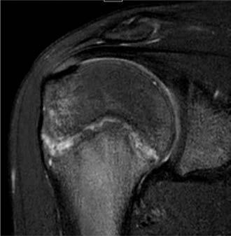
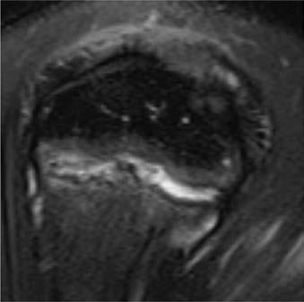

# Chapter 734: Specific Sports and Associated Injuries

*Gregory L. Landry and Andrew M. Watson*

<!-- p.5564 -->
**PERFORMANCE- ENHANCING SUBSTANCE DESIRED EFFECTS**

**MAJOR ADVERSE**

**EFFECTS**

**MINOR ADVERSE**

**EFFECTS STATUS**

**ROUTE OF ADMINISTRATION**

Human growth

hormone†

May increase lean

body mass and decrease fat mass

Carpal tunnel

syndrome, intracranial hypertension, CV disease, hyperlipidemia, insulin resistance

Arthralgias Banned by IOC

and International Federations

Injectable

Amphetamines/

stimulants‡,§

Increase in alertness

and metabolism; may increase strength, muscular power, speed, acceleration, aerobic power, anaerobic capacity, endurance

Arrhythmias, heat

exhaustion, seizures, myocardial infarction, sudden death

Agitation, GI upset,

nausea, headaches, insomnia, hallucinations

Banned by IOC,

NCAA, NFL

Oral, injectable,

inhalable

Erythropoietin/blood

doping

Increase in oxygen-

carrying capacity, endurance

Hypertension,

myocardial infarction, pulmonary embolism, immune reaction

Headaches Banned by IOC and

all major sporting bodies

Injectable

Beta-hydroxy-beta-

methylbutyrate

May increase lean

body mass, muscle strength, power; enhance recovery

Unknown Unknown Allowed Oral

Protein supplements Increase lean body

mass, improve healing

Unknown in previously

healthy athletes

Unknown Allowed Oral

*Including selective androgen receptor modulators and aromatase inhibitors or estrogen receptor modulators. †Including various growth factors (IGF-1, etc.). ‡Caffeine is commonly used and remains permitted by WADA. §Includes various beta-2-agonists prohibited by WADA, except when needed for therapy of asthma but within therapeutic limits. CV, Cardiovascular; GI, gastrointestinal; IOC, International Olympic Committee; LDH, lactate dehydrogenase; N/A, not applicable; NCAA, National Collegiate Athletic Association;

NFL, National Football League; WADA, World Anti-Doping Agency. Modified from Momaya A, Fawal M, Estes R. Performance-enhancing substances in sports: a review of the literature. Sports Med. 2015;45:517–531. Table 1.

#### **Table 733.1** Characteristics of Common Performance-Enhancing Substances—cont’d

**SPORTS PARTICIPATION, EARLY SPECIALIZATION, INJURY RISK, AND BURNOUT** It is estimated that 60 million youth, age 6-18 years, participate in orga nized athletics, with 44 million participating in multiple sports. It has also been estimated that 69% of females and 75% of males age 8-17 years participate in at least one organized sport team or club. Partici pating in sport gives children the opportunity to develop self-esteem and leadership skills, promote peer socialization, and improve general health and fitness. Some parents encourage their children to participate in a *single sport* because they think this will allow the athlete more time to focus on sport-specific skills and will increase the likelihood that their child will be selected for elite teams, a college scholarship, or pro fessional contract. They may also feel pressure from coaches. However,

only 0.2–0.5% of U.S. high school athletes rise to the professional level; Olympic-level athletes start training in their main sport at an older age than their less elite peers and on average participate in two other sports before, or in parallel with, their main sport. A study at the collegiate level revealed that 70% of surveyed athletes did not specialize in their sport until 12 years of age, and 88% participated in more than one sport at some point during childhood. *Multisport* athletes, in general, have a more diverse skill set, can transfer skills from one sport to another, have a decreased risk of **overuse injury**, have lower rates of **burnout**, and thus are less likely to quit sports at a younger age. Exposure to multiple sports also allows these athletes to identify the sport they most enjoy.

Risk of injury in sports increases with age and training volume. In general, there is an increased risk of injury if young athletes participate in more weekly organized sport hours than their age. When young ath letes exceed a 2:1 ratio of weekly hours in organized sports to weekly hours in unorganized free play, they are more likely to suffer a seri ous overuse injury. Overuse injuries unique to young athletes include apophyseal injuries and physeal stress injuries secondary to decreased muscle mass, increased joint hypermobility, and imbalances in growth and strength (see Chapter 728). Overuse injuries and fractures are more likely to occur during adolescent growth spurts as physes, apophyses, and articular surfaces in a rapid phase of growth are less resistant to tensile, shear, and compressive forces than either mature bone or more immature prepubescent bone, and because of decreased blood flow to

*Gregory L. Landry and Andrew M. Watson*

<!-- p.5566 -->
the physes. When this underlying vulnerable physiology is combined with overscheduling secondary to participation in a large number of competitive events at young ages, the risk of overuse injury increases. These events often include tournaments, which may consist of multiple games in a short period of time. This type of schedule does not allow enough time for rest and recovery.

**Sports specialization** is traditionally defined as “participating in a single sport for greater than eight months per year, choosing a single main sport, and/or quitting all other sports to focus on one sport.” Athletes who specialize early sometimes report increased anxiety and stress secondary to worrying about failure, trying to meet adult expec tations, or experiencing parental pressure to participate or perform at a certain level, and often feel as though they have a lack of control in sport decision-making. These feelings can contribute to burnout, which can lead to quitting sports early and ultimately increased inac tivity as an adult. To reduce the risk of overuse injury and burnout, one should limit weekly and yearly participation time, limit sport-specific repetitive movements, and ensure adequate rest and recovery periods. Thus it has been recommended that “intense training in a single sport to the exclusion of others should be delayed until adolescence in order to optimize success while minimizing injury, stress, and burnout.”

**FOOTBALL** Football is the sport with the greatest number of participants in the United States, especially at the high school level, and with the highest number and rate of injuries. Most of these injuries are relatively minor, and compared with injuries in many other sports, are less severe, as evi denced by fewer days lost from injury. Age, weight, and position played contribute to injury risk, with older and heavier players, running backs, and linebackers having higher injury rates. The most common football injuries include joint sprains, muscle strains, and contusions, with the lower extremities injured most frequently.

Although the majority of catastrophic sports injuries in the United States have occurred in football, these injuries are rare. Catastrophic injury is defined as a fatal injury or a severe injury with or without per manent severe functional disability. Disabling injuries include cervical spine and cerebral injuries.

Head and neck injuries in football include concussion, neck sprain, and brachial plexopathy. Compared to other sports, brain injury (con cussion) (see Chapter 729) occurs with the highest rate in football, a result of the frequent exposure to contact during practices and games, although more concussions occur in games than practices. When com pared to other sports, cervical spine injuries occur at higher rates in football given the increased risk of high-velocity contact, neck flexion, and axial loading. Proper blocking and tackling form with the neck extended rather than flexed is essential to help reduce the risk of cervi cal spine injury. Although not shown to reduce the concussion rate, helmets can help reduce facial and dental trauma and provide some protection from side head blows. A **“stinger”** or **“burner”** represents a brachial plexus neurapraxia (see Chapter 730). This is the most com mon nerve injury in football and results from traction, compression, or a direct blow to the upper cervical nerve roots of the brachial plexus caused by forceful lateral neck bending.

**Heat illness** is possible in pediatric athletes given physiologic fac tors, including increased heat production per body weight, less effi cient heat dissipation, and higher body temperatures associated with dehydration. Dehydration and associated electrolyte abnormalities and poor acclimatization increase the risk of heat illness. Heat illness risk can be reduced with proper hydration prepractice, during, and post practice, avoiding practice in high heat or humidity, wearing breath able, light-colored clothing, removing the helmet between plays, and avoiding certain medications such as antihistamines, anticholinergics, stimulants, and supplements (see Chapter 731).

Contusions to the arm or thigh muscles can result in the develop ment of a large hematoma if not treated aggressively in the acute stage, resulting in prolonged time away from football. Large hematomas and those allowed to persist are at risk for development of **myositis ossificans**.

**Low back pain** can be caused by **spondylolysis**, especially in play ers with repetitive hyperextension of the spine (see Chapter 720.6). Education on tackling mechanics, core strengthening, and hamstring flexibility are important in prevention of and/or recovery from a spon dylolysis injury. Shoulder trauma can cause glenohumeral joint dis locations, the majority of which are anterior dislocations and have a high rate of recurrence; acromioclavicular joint sprains; and fractures to the clavicle or humerus (see Chapter 724). Knee injuries (see Chap ter 728.6) are common and include **anterior cruciate ligament (ACL)** tears and, less frequently, medial collateral ligament (MCL) tears. Knee bracing in high school football players is controversial and lacks sig nificant evidence.

**Ankle sprains** occur frequently, with lateral ankle sprains resulting in less time away from the sport than high ankle sprains. The risk of re-injury may be reduced by rehabilitation, including strengthening and range of motion, and the use of a lace-up ankle brace (see Chap ter 728.8). **Turf toe**, a sprain to the first metatarsophalangeal joint, is caused by forceful dorsiflexion of the toe while wearing soft, light weight, flexible shoes. Calcaneal apophysitis at the insertion of the Achilles tendon on the calcaneus, also known as **Sever disease**, is an overuse injury that typically presents as heel pain in a cleated athlete who is still growing (typically age 7-10 years).

**BASEBALL/SOFTBALL** Baseball- and softball-related injury sites are most commonly the shoulder, elbow, ankle, and hip. Facial injuries and concussions are also seen. The most common mechanisms of injury include pitching repeti tion and being hit by a ball or a bat.

**Throwing injuries** of the shoulder and elbow are typically seen in pitchers secondary to overuse, with contributory factors, includ ing high pitch count, pitch type, and inadequate rest. **Little League shoulder** is a repetitive microtrauma injury to the open proximal humeral physis, and **Little League elbow** is a repetitive microtrauma injury to one or more of the six ossification centers in the elbow (see Chapter 728.3). Little League shoulder is the most common injury seen in softball windmill pitching, with similar shoulder stress as seen in overhand pitching. Poor core strength and alteration in biome chanics, especially when fatigued, may contribute to injury risk (Fig. 734.1). Age-related **pitch count** and rest guidelines, “Pitch Smart,” are available online and are endorsed by the Little League. Curve balls and sliders should not be thrown by players younger than 14 years of age. Current recommendations also advise against participating in multiple leagues and participating in year-round baseball, given the increased risk of injury with this volume of play. Adherence to the guidelines is the responsibility of the athlete, parents, and coaches. Counseling athletes (and coaches) to stop all throwing activities if the player experiences shoulder or elbow pain, with medical evaluation if no resolution with rest, is essential. If injured, a gradual return to throwing protocol under the direction of a physical therapist with additional focus on strengthening and throwing mechanics should be considered. Catchers are more vulnerable to traumatic sprains of the interphalangeal and metacarpal phalangeal joints, head injuries, including concussions from the ball striking the mask, and knee inju ries associated with the deep squatting posture. Knee savers are pads attached to the shin guards that increase the angle between the knee and thigh and prevent hyperflexion of the knees. No scientific studies have been done to assess their effectiveness.

Death or serious injury in baseball is rare but may result from direct contact by the ball or bat, causing serious head injury or **commotio cordis**, which is a direct blow to the chest during a critical time in the cardiac cycle resulting in a possibly fatal arrhythmia. Batting helmets, with consideration of faceguards, must be worn properly to help pre vent face and head injuries. Modifications to the hardness of baseballs used with younger athletes may also be helpful. Chest protectors have not been shown to reduce the risk of commotio cordis.

Sliding causes the most injuries in base runners, including head injury and lower limb injuries. If sliding is allowed, correct sliding tech nique must be taught because many injuries are secondary to timing

<!-- p.5567 -->
issues. Head-first sliding is controversial and is not recommended for players younger than 10 years of age.

**BASKETBALL/VOLLEYBALL** When combining male and female sports participation, basketball has one of the highest injury rates, even though it is considered a “safe sport” from a contact perspective. Common maneuvers of basketball and volleyball include jumping, pivoting, running, and sudden acceleration and decelera tion, which increase the risk for knee and ankle injuries. Similarly, injury to the fingers may result from the passing, catching, and striking of the ball inherent in these sports. Scaphoid fractures may result from falling on an outstretched hand. Injuries to the face and eyes can also occur.

Ankle sprains are the most common injury and are usually caused by inversion with plantar flexion, placing the lateral ligaments at risk. An avulsion fracture of the base of the fifth metatarsal at the inser tion of the peroneus brevis tendon is another sequela of inversion ankle injuries. A **high ankle sprain** or syndesmosis ligament injury typically results from an excessive external rotation in a dorsiflexed position, and these athletes have pain out of proportion to examination findings.

Foot pain may be secondary to calcaneal apophysitis (Sever disease), retrocalcaneal bursitis, posterior tibialis tendinosis, accessory tarsal navicular, sesamoiditis, blisters, subungual hematoma, and paronychia (see Chapter 704). Achilles tendinosis is also a common overuse injury.

Knee injuries include those caused by overuse, such as traction apophysitis at the insertion of the patella tendon on the tibial tubercle **(Osgood-Schlatter disease)** (see Chapter 718.4), traction apophysitis at the distal patella **(Sinding-Larsen-Johansson syndrome)** and patel lar tendinosis **(jumper’s knee)** (see Chapter 728.6).

**ACL** injury occurs in both male and female participants; however, among children 12-17 years old, the frequency of ACL injury in female participants is slightly higher. The exact reason for this discrepancy is unclear; however, some data suggest that female athletes do not exhibit the same neuromuscular adaptions that male athletes exhibit during pubertal growth spurts. Multiple studies on the effect of neuromuscular training and strengthening programs focused on ACL injury prevention in females suggest that these types of programs may reduce the risk of ACL injury. As with other jumping sports, other acute ligament sprains (MCL with or without ACL) can occur. For all participants, a program focused on the sport-specific strengthening of hip, core, and hamstring muscles to prevent dynamic valgus when landing can help to reduce knee injury rates.

The overhead nature of volleyball can result in overuse shoulder injuries, including rotator cuff tendinosis, shoulder impingement syn drome, labral tears, and glenohumeral instability. Players may want to limit the number of overhead spikes and serves they perform, simi lar to pitch count limits in baseball, to help reduce the risk of overuse

injuries. Finger injuries seen in both basketball and volleyball partici pants include sprains, dislocations, and fractures.

Eye injuries, although rare, can be reduced by wearing protective eyewear. Facial injuries typically result from an elbow or hand hit ting the opponent’s face during rebounding or defending. Head injury can occur in both sports when the player makes contact with another player, the floor, or equipment (such as the net pole in volleyball).

**TENNIS** Injury rates in high-level youth tennis players are higher than in adults. Tennis injuries occur twice as often in the lower extremity as in the upper extremity. Lower extremity injuries tend to be more acute, whereas upper extremity and trunk injuries tend to be more chronic, and the incidence of overuse injury is high. Overall injury rates are similar for males and females. However, male players age 5-10 years were more likely to sustain injuries to the head and neck and suffer injuries as a result of contact with the net, ball, or racket than other groups.

The most common injury in tennis players is to the ankle, although the knee and thigh are vulnerable as well. Lower extremity injuries are related to the frequent directional changes, creating significant concentric and eccentric loads. Overuse injuries include iliopsoas tendonitis or bursitis, patellofemoral stress syndrome, patellar tendinosis, Osgood-Schlatter dis ease, medial gastrocnemius strain **(**“**tennis leg**”**)**, Achilles tendonitis, and Sever disease. Stress fractures in the lower extremity in elite players are most common at the tarsal navicular, metatarsals, and tibia.

In the upper extremities, **tennis elbow** (lateral epicondylosis with extensor carpi radialis brevis tendinosis) and **extensor carpi ulnaris (ECU) tendinosis** with or without subluxation, are particularly preva lent in the recreational player and are thought to be most likely related to overuse and improper technique (see Fig. 728.11). With repetitive overload of the wrist flexor–pronator muscle groups, traction apophy sitis at the medial humeral epicondyle and medial epicondylar frag mentation of the humerus, especially in younger males, can occur. This can secondarily involve the ulnar collateral ligament and ulnar nerve. Shoulder pain often results from **labral injury**, a common site of injury for overhead athletes. Anteroposterior glenohumeral instability, gleno humeral internal rotation deficit with impingement, rotator cuff strain, and scapular dyskinesis are all possible. Wrist problems include an enlarged dorsal ganglion cyst, radiocarpal joint capsular impingement or synovitis, chronic degenerative tears of the triangular fibrocartilage complex, and acute fracture of the hook of the hamate. Stress fractures may occur in the metacarpals (second metacarpal in particular) and less commonly in the humerus, ulna, and radius.

It has been hypothesized that repeated loading during service, par ticularly using a “topspin” serve at a young age, may contribute to the

A B C

**Fig. 734.1** Little League shoulder MRI findings. A, Coronal oblique fat-saturated T2 weighted image in a 12-yr-old pitcher demonstrates diffuse proximal humeral primary physeal widening and undulation with bone marrow edema within the metaphysis and lateral epiphysis. B and C Sagittal oblique fat-saturated T2 weighted images obtained in a 13-yr-old pitcher demonstrate preservation of the normal anterior medial humeral physis (arrows) in contrast to the widened irregular physis posteriorly and laterally. (From Braithwaite KA, Marshall KW. The skeletally immature and newly mature throwing athlete. Radiol Clin N Am. 2016;54:841–855.)

<!-- p.5568 -->
development of **spondylolysis (pars interarticularis fracture)** or spondylolisthesis. However, the most common back injury in tennis is lumbar muscle strain.

**LACROSSE** Lacrosse is one of the fastest growing sports for both male and female youth, high school, and college level athletes. Protective equipment and rules are different for male and female players. Required equipment for male players includes mouth guard, helmet, gloves, and elbow and shoulder pads. Required equipment for female players includes eye wear and mouth guard. **Checking** is allowed in men’s lacrosse but is not permitted in youth or women’s games.

Injury rates are nearly three times higher in competition than in practice. The most common injuries for all players include lower extremity injuries, primarily ankle and knee sprains, and head injuries. Ankle sprains typically occur in the setting of cutting, dodging, and twisting activities. The likelihood of subsequent injury may be reduced with bracing. ACL tears are a common knee injury and typically occur in noncontact cutting or pivoting. Prepractice training should include balance, lower extremity strengthening, and neuromuscular feedback activities, as these have been proven to help reduce the ACL injury rate.

Head injury occurs in both male and female players. Player-toplayer contact is the typical mechanism for head injury in male play ers. Incidental contact with the stick is the typical mechanism for head injury in female players. Eyewear for female athletes has been shown to reduce the risk of significant eye injury.

Upper extremity injuries include **acromioclavicular sprains** and hand and thumb fractures, particularly in games that permit contact and check ing. Shoulder and elbow injuries are typically secondary to contact injury.

As with any sport with significant protective equipment that impedes heat loss, heat illness can occur. Players and coaches should be mindful of hydration, temperature, humidity, and duration of play. Commotio cordis is a rare but possible risk. The use of chest protectors has been evaluated and has not been shown to reduce risk.

**SWIMMING/DIVING** In competitive swimming, injuries to the shoulder are most common and are generally a result of chronic overuse. **Swimmer’s shoulder** is a general term for shoulder overuse in a swimmer and is typically a combination of subacromial impingement/bursitis and tendinosis of the rotator cuff and long head of the bicep tendon. Commonly, a narrowed subacromial space, increased laxity of the shoulder capsule, and relative weakness of the scapular stabilizers result in protracted shoulder posture, which con tributes over time to the insidious onset of shoulder pain and possible **scapulohumeral dyskinesis**. Freestyle, back, and butterfly strokes tend to exacerbate the pain. Prevention includes monitoring training load, proper technique, and strengthening exercises. The multiaxial instability of the glenohumeral joint common in swimmers is addressed with rehabilitation focusing on strengthening of the rotator cuff and scapular stabilizer mus culature. Knee and hip/groin pain can be exacerbated with breaststroke given the whip kick motion required in this stroke.

**Swimmer’s ear**, or **otitis externa**, presents with pain and often drainage from the external auditory canal. It is caused by bacterial, or less commonly, fungal infection of the external auditory canal as a result of chronic, excessive wetness (see Chapter 679).

**Diving** is a sport that many athletes start at a young age with early sportspecific, specialized training. The most common injury for divers is shoul der strain, given overhead activity and the significant force taken by the shoulder, which is dependent on the angle of entry into the water. Low back pain can be seen in divers and may be associated with lumbar hyper extension to compensate for limited shoulder flexibility when entering the water, which can lead to spondylolysis. Diving is also associated with a risk of cervical spinal cord injury secondary to axial loading; according to the National Spinal Cord Injury Statistical Center, diving is the fifth leading cause of spinal cord injury in the United States.

**SOCCER** Soccer enjoys a very high level of popularity and participation among youth worldwide. In the United States, the annual rate of injury in

soccer more than doubled between 1990 and 2014, and almost three million children were seen in U.S. emergency departments for injuries related to soccer during those years. Mechanisms of injury include non contact, body-to-body contact, falls, or ball-to-body contact. Although lower extremity injuries are by far the most common, younger children are more likely to injure an upper extremity, and upper extremity inju ries are most likely to be fractures. Torso and significant abdominal injuries can occur. Low back symptoms are relatively less common and are most often muscular in nature.

Injuries in youth soccer occur predominately in the lower extremity and include joint and ligament injuries, abrasions, contusions, mus cle strains, and fractures of the ankle, knee, and thigh. Ligamentous injuries to the ACL and MCL at the knee and the **anterior talofibular ligament** at the ankle can occur because of the cutting and pivoting maneuvers required during play or as a result of contact with another player. ACL injuries, particularly in females, have gained attention in recent years. ACL injuries are more common in high school girls’ soccer than in other girls’ sports. Risk factors may include genetics, hormones, age, sex, previous injury, and anthropomorphic factors. **Overuse syndromes** such as patellofemoral dysfunction, Osgood- Schlatter, Sinding-Larsen-Johansson, and Sever disease frequently occur. Hip problems include the **hip pointer (iliac crest contusion)**, iliac crest apophysitis, and chronic groin pain (muscle strain, **sports hernia**, **osteitis pubis**). The terms *sportsman’s hernia, inguinal insuffi ciency,* and *conjoint tendon tear* may comprise a constellation of differ ent pathologic processes producing similar groin pain. These injuries may occur with the combined forceful rotation of the torso and kicking motion. Femoral neck stress fractures, slipped femoral capital epiphy sis, and avulsion fractures of the pelvis or femur should also be con sidered in the differential. Neuromuscular factors, such as quadriceps dominance, muscle activation patterns and dynamic stability, may be modifiable; thus the American Academy of Pediatrics (AAP), and other organizations support neuromuscular training programs aimed at risk reduction for both sexes.

Concussion is common in soccer, primarily as a result of contact between players, player and goal post, and player and ground. Recent evidence suggests that intentional heading of the ball rarely results in a concussion, although the long-term effect of repeated subconcussive impacts for intentional heading remains unknown. The U.S. Soccer Concussion Initiative updated recommendations to reduce head injury risk in youth soccer players, including a ban on heading the ball for age 10 and under and limited heading of the ball for 11-13 year olds. It remains unknown if this has reduced the number or severity of con cussions. Padded headbands have not been shown to reduce the risk of concussion in youth soccer players.

**ICE HOCKEY** Ice hockey is a fast-paced collision sport associated with injuries caused by contact from other players, the ice, or the boards, as well as from the puck or stick. With injury rates similar to other high school fullcontact sports, concussions, contusions, fractures, ligament sprains, muscle strains, lacerations, joint separations, dislocations, and sub luxations are commonly reported. Injuries are more likely to occur in competition than in practice, and overall injury rates appear to be on the rise, possibly related to increased participation.

Concussion was the most commonly reported injury in U.S. high school ice hockey athletes, with head and face injuries accounting for 34% of all of the reported injuries. Injuries to the shoulder and arm are also common and include contusions, strains, acromioclavicular sepa rations, and clavicle fractures. Over 50% of upper extremity fractures occur in the forearm, wrist, and hand. Other specific hockey injuries include hip pain secondary to **femoroacetabular impingement (FAI)**, high ankle sprains, hip adductor strain, and osteitis pubis.

The role of factors such as age, size, level of skill, player position, and sex in injury risk is inconclusive, although evidence suggests that concussion may be more frequent in females and fractures more com mon in males.

**Body checking** is the single most common mechanism of injury. In Canada, 11- and 12-year-old Pee Wee hockey players who were allowed

<!-- p.5569 -->
to body check had a threefold greater risk of injury than those who were not. USA Hockey rules of play do not allow body checking in the 12-year and under youth leagues. Body checking is not allowed in girls’/women’s leagues of any age. The AAP recommends the expansion of nonchecking programs and the restriction of body checking to elite levels of boys’ play after 15 years of age. AAP recommendations also include the use of protective equipment (helmets and full-face shields or cages), rules to eliminate dangerous play with a zero-tolerance pol icy for head contact and body contact from behind, and safer play edu cation for coaches and athletes.

**FIELD HOCKEY** Field hockey is played worldwide by both male and female athletes. Protective equipment, including mouth, shin, and ankle guards, is rec ommended but not required. Players are twice as likely to be injured in game versus practice. Lower limb injuries, particularly inversion ankle sprains, are the most common. Bracing may help with ankle re-injury rates. Other lower extremity injuries include hamstring strain, ACL tears, and contusions. The most common upper limb injury occurs when the hand is struck by a stick or a ball, as field hockey does not require the use of padded gloves for protection. Head injury and facial lacerations occur at a very high rate and are typically caused by contact with the stick or ball. Injury types and rates may differ based on the position played; however, specific data are lacking.

Injury prevention is important in this sport and can be attained via the use of protective equipment, including permitted head or face pro tection, and sport-specific training, including balance, strengthening, and proprioceptive training activities.

**SKIING AND SNOWBOARDING** Injury frequency in skiing, snowboarding, and related winter sports has declined over the past several decades, largely secondary to improved equipment (boots, bindings, poles) and slope conditions. Of concern, however, is that severe head and spinal cord injuries are on the rise due to increased speed and the addition of acrobatic maneuvers (terrain parks, half pipes, aerial tricks). Head and neck injuries are the primary cause of fatal injury. Of the World Cup events, freestyle skiers (particu larly aerials and slope style) have a higher incidence of head injury than snowboard and alpine events. Overall, the risk of injury is higher in snowboarders, males, beginners, and those with improper equipment.

Lower extremity injuries are more commonly associated with skiing, while head, internal organ, upper extremity, and ankle injuries are more common in snowboarders. The most common lower extremity injury in skiing is ligamentous (ACL, MCL, and LCL) at the knee. Lower-extremity injuries in skiers also include contusions, knee dislocation, femur fractures, spiral fractures of the tibia **(“boot top” fractures)**, and high ankle sprains. Snowboarders are at a unique risk for fracture of the lateral process of the talus, which is often initially misdiagnosed as an ankle sprain.

Upper-extremity injuries are more common in snowboarding because both of the snowboarder’s feet are strapped onto the same board and, with out poles, there is an increased risk of falls on outstretched arms. Common injuries include distal radial, ulnar, and metacarpal fractures, sprains, and contusions. Other high-incidence upper extremity injuries in snowboard ing include shoulder soft tissue injuries, clavicle fractures, acromioclavicu lar sprains, and glenohumeral joint dislocations. A unique skiing injury is **skier’s thumb**, a sprain of the ulnar collateral ligament of the thumb, which typically results from a fall with the thumb in abduction and hyperexten sion around a ski pole. Phalanx fractures and bony avulsions can also be associated with this injury.

Snow sport athletes may experience visceral injuries to the spleen, liver, and kidney. Spine injuries, including fracture and strain, may also occur.

It is strongly advised that individuals of all ages wear helmets for skiing and snowboarding. Wrist protectors are also recommended for snowboarders. Care should be taken to ensure up-to-date and prop erly fitted and adjusted equipment. Preventive measures endorsed by the AAP include participation in formal instruction, such as in a ski school, having adequate supervision, and exercising responsible speed and technique. Cardiovascular fitness, endurance, and muscle strength are believed to be critical components in injury prevention; however, there is limited supportive literature.

**SKATEBOARDING** Injuries associated with skateboarding are predominantly acute, includ ing contusions, lacerations, sprains, and fractures, affecting the wrists, forearms, and to a lesser extent, the ankles and head. Fractures involv ing the upper extremities are more common in younger skateboarders, often from a fall onto an outstretched arm. Lower-extremity fractures and head injuries predominate in the adolescent population, which is likely because of higher complexity of the airborne maneuvers and tricks often attempted. Loss of balance leading to a fall when failing to perform a particular maneuver, especially when catching a wheel, is generally the primary cause of injury. These falls can occur at high velocities (up to 40 mph), placing the skateboarder at risk for serious injuries.

Traumatic brain injuries do occur within this sport; the incidence increases with age and is more common in males than females. In older children and adolescents, the neglected use of helmets and the increased speed of their skating contribute to this fact.

In addition to helmet use, other safety measures recommended include wrist guards as well as elbow and knee pads. The building of skateboard parks has been a recent strategy to remove skateboard ers from pedestrians, bicyclists, and motor vehicle traffic, while also encouraging adult supervision.

**CYCLING AND MOTOCROSS** Bicycle riding has been a beloved childhood recreational activity for decades. Cycling options have expanded to include a variety of events such as track and road racing as well as mountain biking, mountain bike terrain parks or “free-riding,” cyclo-cross, and freestyle BMX. As increased speed, jumps, and other human-made obstacles have been added, risk for injury has increased. Motocross, beginning as early as 4 years of age, adds further complexity as it uses two-wheeled motorized cycles racing through designed outdoor courses.

Recreational bicycling injuries include abrasions, lacerations, contu sions, and fractures. Head and face as well as genitourinary injuries are common. Helmet use is strongly encouraged to reduce the risk of serious head injury. Upper extremity fractures predominate in moun tain bikers and mountain terrain park riders. Risk of injury is increased in mountain biking males between 10 and 14 years and in those who admit to riding faster than usual. Motocross riders sustain more seri ous injuries. Head injuries include skull fractures and a variety of intra cranial bleeds that may occur even when using a helmet.

**WRESTLING** Wrestlers may have great fluctuations in weight to meet weightmatched competition standards. Such fluctuations are sometimes associated with fasting, dehydration, and then binging. Counseling wrestlers and their parents regarding impaired performance from these components of disordered eating, especially with respect to decreased speed and strength, is important to deter athletes from incorporating them into routine practice. Most states have rules in place to mitigate this risk by limiting the amount of weight loss for each wrestler.

Wrestling moves apply a variety of torques or forces to the extremi ties and spine, potentially resulting in a number of common injuries. Takedown maneuvers and subsequent impact with the mat can produce concussions, neck strain/sprain, or spinal cord injury. Spondylolysis (see Chapter 720.6) is a concern in wrestlers given repetitive lumbar extension.

**Stingers** and **burners**—also seen among football players—are caused by stretching or pinching of the brachial plexus (see Chapter 730). Overall, the two most common sites of injury in wrestling are the shoulder and knee.

At the shoulder, subluxation is common. This generally occurs ante riorly with the shoulder forcibly abducted and extended. Patients are commonly aware of their shoulder slipping in and out. Injuries to the hand are less common and typically include metacarpophalangeal and proximal interphalangeal joint sprains.

Knee injuries (see Chapter 728.6) are also common, and include **prepatellar bursitis**, medial and lateral collateral ligament sprains, and medial and lateral meniscus tears. Acute or recurrent traumatic impact to the mat can result in prepatellar bursitis. If the overlying skin is broken, septic bursitis may occur, resulting in swelling, redness, and

<!-- p.5570 -->
Dermatologic problems associated with wrestling include herpes simplex (see Chapter 299: **herpes gladiatorum**), impetigo (see Chap ter 706.1), staphylococcal furunculosis or folliculitis, superficial fungal infections, and contact dermatitis. Herpes gladiatorum and superficial bacterial skin infections are contraindications to wrestling until the lesions have resolved. Washing of the wrestling mats with appropriate antibacterial and antifungal solution is required after daily wrestling sessions to keep the mats disinfected and prevent the spread of derma tologic contagion.

**Auricular hematoma** is caused by friction or direct trauma to the auricle (see Chapter 683). If allowed to remain without evacuation, irreversible deformity of the auricle often results, termed cauliflower ear. Properly fitted headgear is the best means of prevention, and early aspiration of the accumulated blood may reduce the risk of deformity.

**RUNNING** Running for sport and exercise has increased in popularity for children and adolescents. Running problems are typically caused by overuse injury related to muscle imbalance; a minor skeletal deformity; repeti tive overload; and/or poor flexibility, strength, endurance, or proprio ception. With each step while running, the foot impact ranges from 3-8 times the athlete’s body weight. Errors in training, including increas ing the distance or intensity of workouts too rapidly, often result in injury to the runner. Minor variations (e.g., malalignment) in anatomy that do not cause problems at rest can predispose to injury at specific sites, such as **over-pronation** contributing to increased **patellofemoral stress**. Muscle fatigue, environmental temperature (see Chapter 731), and running surface (grass vs unyielding concrete) also contribute to injury. **Barefoot** or **minimalist running** shoes may promote greater weight distribution through the forefoot during running, and bio mechanical research suggests reduced joint forces through the knee and hip. However, increased forces can occur through the foot, ankle, and lower leg in individuals not accustomed to this style of running. Prevention of injuries is possible by muscle-strengthening exercises, incorporating periods of rest into training plans, and the use of goodquality running shoes that match an athlete’s foot type.

**Shin splints**, or **medial tibial stress syndrome**, is a descriptive term for pain located diffusely over the distal medial tibia and should be distinguished from tibia stress fracture and chronic exertional com partment syndrome. Medial tibial stress syndrome is a periosteal stress reaction at the insertion of the soleus muscle. It can be seen in new runners, runners that have markedly increased their training duration in a short period of time, and runners with higher body mass indices (BMIs). Continued loading and stress of medial tibial stress syndrome can lead to a **stress fracture**. Stress fractures in runners (see Chap ter 724.4) have been documented at the femoral neck, inferior pubic rami, subtrochanteric area, proximal femoral shaft, proximal tibia, fib ula, calcaneus, tarsal navicular, metatarsals, and sesamoids. The most common are in the metatarsals, tibia, and fibula. The anterior proxi mal tibia, femoral neck (tension or superior side), tarsal navicular, and sesamoids are most at risk for nonunion.

Muscle strains most frequently affect the hamstrings, followed by the quadriceps, hip adductors, soleus, and gastrocnemius muscles. Lower extremity tendon injuries are more common than apophyseal injuries in young, skeletally immature runners. Tendon injury is most common in the Achilles tendon, followed by the posterior tibial, peroneal, ilio psoas, and proximal hamstring tendons. Achilles tendinosis should be distinguished from retrocalcaneal bursitis.

Knee pain in the runner is frequently anterior in location and is commonly caused by **patellofemoral pain syndrome (runner’s knee**), which results from excessive dynamic, usually lateral, motion of the patella in relationship to the femoral intracondylar groove (see Chapter 728.6). The athlete’s body habitus (i.e., increased Q-angle, over-pronation) and presence of core and hip abductor weakness may contribute to this overuse injury. Posterior knee pain can be caused by gastrocnemius strain, while posteromedial pain may be caused by proximal tibial stress fracture or semimembranosus/semitendinosus tendinosis. Lateral knee pain is commonly caused by **iliotibial band syndrome** and less so by **popliteal tendinosis**, which may be precipi tated by running downhill. Iliotibial band syndrome may combine a

component of both bursitis and tendinosis owing to mechanical fric tion of the iliotibial band (an extension of the tensor fasciae latae) over the lateral femoral epicondyle. Vague knee pain that worsens with activity or traumatic event, particularly if associated with joint swell ing, should raise suspicion for **osteochondritis dissecans**, most com monly located at the lateral aspect of the medial femoral condyle.

**Chronic exertional compartment syndrome** can involve any of the muscle compartments, but the most common is the anterior compart ment. There is typically poorly localized throbbing pain that begins 10-15 minutes into a run. Pain typically prevents further training, thus limiting the risk of nerve injury (see Chapter 728.7).

**Plantar fasciitis** is an inflammation of the supporting structures of the longitudinal arch of the foot due to repetitive cyclic loading with foot strike. Pain is typically worst with the first step out of bed in the morning and with running and is located on the medial aspect of the heel. Pes planus and over-pronation are common in these patients. Cal caneal stress fracture should be considered, especially in the amenor rheic distance runner (see Chapter 732).

The **female and male athlete triads (or relative energy deficiency in sport)**, referring to abnormalities in energy availability, endocrine function, and bone health, are well documented in adolescent running literature and are important education topics for the runner, parents, and coaches (see Chapter 732).

**CHEERLEADING** Like other sports, cheerleading has become increasingly popular and evolved to become more competitive and athletic. Cheerleading can begin as early as 3-6 years of age and includes skill levels ranging from recreational to sideline, competition to professional. The sport includes advanced gymnastic tumbling and “stunts” involving athletes lifting and throwing other athletes overhead. This requires repetitive flexion, hyperextension, and rotation of the spine as well as compressive load ing on landings, and the risk of athlete contact and falls.

Stunting injuries account for the majority of injuries, with bases (the athletes who lift, throw, and catch another athlete) at higher risk of injury than fliers (athletes who are lifted and thrown). The primary mechanism of injury is contact with another athlete. Injuries sustained in tumbling are the second most common.

The overall injury rate in cheerleading is low at 1/1,000 athletic expo sures. However, injuries may be severe; of all female sports, the risk of catastrophic injury is the highest in cheerleading. Following a period of increasing incidence of injury, it appears that injury rates have stabilized.

Head and facial injury accounts for almost one third of injuries sus tained. Head trauma primarily results from falls while stunting or from a pyramid formation, which includes the base cheerleaders as well. After concussion, strains and sprains account for the most likely injuries, with ankle the most common site followed by wrist and trunk. Fractures are more likely to occur in the upper extremity. Overuse injuries are common.

Strategies to reduce the risk of injury include designating cheer leading as an official sport, ensuring athletes undergo preparticipa tion exams, participating in conditioning and strength training, using proper lifting technique, avoiding stunting over hard surfaces, and educating coaches and trainers about sport safety, including specific rules for the execution of technical skills. The American Association of Cheerleading Coaches and Administrators and others have also set up rules to limit the type of stunts performed, and the National Federa tion of State High School Associations annually updates rules for spirit events with the intent of improving cheerleading safety.

**GYMNASTICS** Typically, males and females begin gymnastics participation at 4-5 years of age. The highest level of competition is in the mid-teens followed by retirement, often by 20 years of age for females and mid-20s for males. Both acute and chronic injuries, with a high incidence of overuse-related injuries, are seen in gymnasts and commonly involve the wrists, shoulders, ankles, and back. Injury types and rates in the acrobatic and circus arts are similar to those seen in traditional gymnastics.

The injury rate is similar in male versus female gymnasts. Lowerextremity injuries are more common in female gymnasts, whereas upper body injuries occur with higher frequency in male gymnasts.

<!-- p.5571 -->
Apparatus competed upon accounts for this discrepancy, such as the horizontal bar and ring exercises for male gymnasts, which place a great deal of stress upon the shoulders, and floor exercise, vault, and balance beam for female gymnasts, stressing the feet and ankles. In addition to mechanical or traumatic injuries, female gymnasts may have delayed menarche and can be at risk for hypothalamic amenor rhea or oligomenorrhea, as well as low body weight for height, which is related to disordered eating. Despite the presence of these two compo nents of the **female athlete triad** (see Chapter 732), the third compo nent, reduced bone density or osteoporosis, is not commonly seen. In fact, bone density tends to be high in most gymnasts, which is thought to be secondary to their performance involving repetitive high-impact activities. Nevertheless, **stress fractures**, in both the upper and lower extremities, are a significant problem. The short stature associated with male and female gymnasts is probably caused by selection bias and not the result of gymnastics training.

The amount of weight bearing through the upper extremities in gymnastics can contribute to the development of both traumatic and overuse injuries. During upper extremity weight bearing, the wrist, particularly over the radial physis, is subjected to a force almost twice the athlete’s body weight and up to 16 times the body weight during high-impact loading activities. This, along with repetitive motion, axial compression, and torsional forces, contributes to the increasing fre quency of wrist pain and injury in gymnastics and acrobatics. Wrist pain and injury is also correlated with training intensity, based on skill level and number of hours of training per week. Wrist injuries typically seen include **distal radial epiphysitis (gymnast’s wrist)**, triangular fibrocartilage complex tears, scaphoid fractures, **scapholunate dis sociation**, dorsal ganglion cysts, and wrist sprains (see Chapter 722). Individualized training regimens, including gradual increase in train ing load and reduced training during growth spurts, as well as the use of wrist orthoses, should be considered for these athletes.

Ankle sprain remains the most common injury in gymnastics, sec ondary to forces seen in landing and dismounting. Ankle sprains that have not responded to conservative management should be further evaluated for osteochondral defects of the talar dome. Heel pain may be secondary to plantar fasciitis, Sever disease, or calcaneal stress frac ture. Patellar tendinopathy may contribute to knee pain in a gymnast.

Spine injuries are notable for a high incidence of **spondylolysis**, a stress fracture of the pars interarticularis, and, in less frequent cases, spondylolisthesis, both related to repetitive extension loading of spine (see Chapter 720.6). Other potential sources of back pain in a gymnast include intervertebral disk pathology, **Scheuermann disease** (juvenile kyphosis) (see Chapter 720.4), and mechanical back pain secondary to biomechanical imbalances.

**DANCE** Dance, including ballet, modern dance, or drill line, is a highly demanding activity that may be associated with delayed menarche in females and disordered eating in both female and male dancers (see Chapter 732). Acute injuries commonly involve the lower extremities. Overuse injuries are common, due to the repetitive nature of maneu vers incorporated into training and performance and occur at the same rate in amateur male and female dancers. Injuries seen in modern/ contemporary dance are similar in type and incidence to those seen in traditional ballet.

Frequently, kinetic chain dysfunction contributes to injury and should be considered when evaluating the dancer. Common mistakes in technique can cause injury, such as forcing excessive “turnout” (external rotation at the hip) in ballet resulting in undue stress placed upon the hip and knees (see Chapter 728.6).

Foot problems are common and include metatarsal stress frac tures, subungual hematomas, **sesamoiditis**, **tenosynovitis** (espe cially of the flexor digitorum longus**)**, plantar fasciitis, Achilles tendinitis, retrocalcaneal bursitis, calluses, and bunions (see Chap ter 728.7). A **dancer’s fracture** is an avulsion fracture of the dis tal shaft of the fifth metatarsal. This fracture is at risk for delayed

healing as a result of the tenuous blood supply in the area and may necessitate surgical fixation. Common ankle injuries and pain include acute sprains, anterior and posterior impingement syn dromes, and osteochondral defects of the talus. Soft tissue impinge ment between the lateral malleolus and talus can cause persistent pain after an inversion injury. Medial tibial stress syndrome (“shin splints”) and tibial stress fractures are noted in the lower leg. Achilles tendinopathy is seen due to the demands of running and jumping. Patellar malalignment or hypermobility can result in patellofemoral pain syndrome or, less frequently, patellar subluxation/dislocation. Patellar tendinopathy is widely reported. **Internal snapping hip syndrome**, caused by the iliopsoas tendon riding over the anterior hip capsule and iliopectineal eminence, and hip flexor (rectus femo ris and iliopsoas) tendinosis are commonly noted in traditional bal let. Gluteal region pain with sciatica may be a result of piriformis syndrome, which occurs because of the repetitive external hip rota tion required in ballet (see Chapter 728.5).

The proper time to allow a ballet dancer to go en pointe is a com mon question asked by dancers and parents alike. The average age to go en pointe is 12 years. A functional test should be part of that decision: if the young dancer is able to perform a passé steadily away from the barre and maintain an en pointe position without pain or instability, the dancer is likely ready to begin dancing en pointe. **Posterior impingement syndrome** of the ankle can be seen with dancing en pointe, given compression between bony or soft tissue structures during terminal plantarflexion. An **os trigonum** is com monly the cause of bony-related posterior impingement syndrome.

**ADAPTIVE SPORTS** Participation in sports and recreational activities helps to minimize deconditioning; improve strength, endurance, and cardiopulmonary fitness; and promote companionship, sense of achievement, and selfesteem (see Chapter 756). Participation can also support the devel opment of the child’s motor coordination and adjustment to physical limitations. However, children with disabilities tend to participate less in physical activity for myriad reasons, including lack of access to activities or opportunities for participation, lack of self-confidence, and fear of injury by the child, parent, or physician. Direction into appropriate sports/physical activity rather than excluding them should be guided by the child’s physical or mental challenge, physical abilities, preparticipation exam, and consideration of the American Academy of Orthopedic Surgeons “participation possibility chart,” which outlines recommended sports and recreation based on physical disability.

Fear of injury remains a barrier to participation for many; how ever, the risk of injury for an adaptive sport athlete is no greater than for an athlete without disability. Injuries in the adaptive sport athlete are influenced by the specific disability, equipment used, and pros thetic or orthotics worn. Acute soft tissue injuries, including skin abrasions, contusions, sprains, and strains, tend to be the most com mon injuries; fractures and dislocations tend to be uncommon, given the lower participation in contact sports. Overuse injuries commonly occur in this athlete population. Lower limb injuries are more com mon in athletes with amputations or cerebral palsy, and upper limb injuries are more common in spinal cord injury and wheelchairbased athletes. Appropriate training to support muscle balance and avoid muscle imbalance, as well as the management of **spasticity** and properly fitting prosthetics and orthotics can help to reduce the risk of overuse injuries. Pressure sores are common in wheelchair-based athletes and can be avoided with vigilant skin care and monitoring and weight shifting.

Consideration of the athlete’s disability and medications is essential because they may have increased propensity for abnormalities in, for example, thermoregulation, resulting in heat illness, and fluid and elec trolyte derangements. This should be discussed and monitored with the athlete, parents, athletic trainers, and coaches, as appropriate.

*Visit Elsevier eBooks+ at eBooks.Health.Elsevier.com** for Bibliography.*

<!-- p.5572 -->

<!-- p.5573 -->
Karlin AM, Murphy KP. Acute management and rehabilitation of sport-specific mus

culoskeletal injuries. In: Alexander MA, Matthews BJ, Murphy KP, eds. Pediatric Rehabilitation Principles and Practice. 5th ed. New York: Demos Medical; 2015. Raynier VM, Soule BJ, Pabion-Mouries JM. Sking and snowboarding injuries in snow

parks: a study based on self-reported practitioners statements. Wilderness Environ Med. 2020;31(2):181–197. Schoeb T, Peterhans L, Frohlich S, et al. Health problems in youth competitive alpine

skiing: a 12-month observation of 155 athletes around the growth spurt. Scand J Med Sci Sports. 2020;30(9):1758–1768. Steenstrup SE, Bere T, Bahr R. Head injuries among FIS world cup alpine and freestyle

skiers and snowboarders: a 7-year cohort study. Br J Sports Med. 2014;48(1):41–45.

**Skateboarding** Bandzar S, Funsch DG, Hermnson R, et al. Pediatric hoverboard and skateboard in

juries. Pediatrics. 2018;141(4):e20171253. Feletti F, Brymer E. Pediatric and adolescent injury bin skateboarding. Research ion

Sports Medicine. 2018;26:1543–8627. https://doi.org/10.1080/15438627. Hunter J. The epidemiology of injury in skateboarding. Med Sport Sci. 2012;58:142–

157. Karlin AM, Murphy KP. Acute management and rehabilitation of sport-specific mus

culoskeletal injuries. In: Alexander MA, Matthews BJ, Murphy KP, eds. Pediatric Rehabilitation Principles and Practice. 5th ed. New York: Demos Medical; 2015. Nathanson B, Ribeiro K, Henneman PL. An analysis of US emergency department

visits from falls from skiing, snowboarding, skateboarding, roller-skating, and Us ing Nonmotorized Scooters. Clin Pediatr (Phila). 2016;55(8):738–744.

**Cycling and Motocross** Caine DJ, Young K, Provance AJ. Pediatrics and adolescent injury in mountain bik

ing. Res Sports Med. 2018;26(suppl 1):71–90. Daniels DJ, Clarke MJ, Puffer R, et al. High occurrence of head and spine injuries

in the pediatric population following motocross accidents. J Neurosurg Pediatr. 2015;15(3):261–265. Embree TE, Romanow NTR, Djerboua MS, et al. Risk factors for bicycling injuries in

children and adolescents: a systematic review. Pediatrics. 2016;138(5):e20160282. Jospeh B, Azim A, Haider AA, et al. Bicycle helmets work when it matters the most.

Am J Surg. 2017;213(2):413–417. Romanow NT, Hagel BE, Nguyen M, et al. Mountain bike terrain park-related inju

ries: an emerging cause of morbidity. Int J Inj Contr Saf Promot. 2014;21(1):29–46. Singh N, Joe N, Amey J, et al. Cycling-related injuries and cycling promotion: a trau

ma service perspective. N Z Med J. 2019;m132(1494):41–48.

**Wrestling** Centers for Disease Control. Outbreak of skin lesions among high school wrestlers—

Arizona, 2014. MMWR Morb Mortal Wkly Rep. 2015;64(20):559–560. Demorest RA, Koutures C. Council on sports medicine and fitness. Pediatrics.

2016;138(6):e20163022. Hoge C, Pirrucio K, Cohen OG, Kelly 4th JD. Rising trends in wrestling-associated

injuries in females presenting to U.S. Emergency departments. West J Emerg Med. 2020;22(2):410–416. Karlin AM, Murphy KP. Acute management and rehabilitation of sport-specific mus

culoskeletal injuries. In: Alexander MA, Matthews BJ, Murphy KP, eds. Pediatric Rehabilitation Principles and Practice. 5th ed. New York: Demos Medical; 2015. Pirruccio K, Parisien RL, Olsen C, Kelly JD. Wrestling-related concussions and closed

head injuries predominantly occur in high school athletes. J Sports Med Phys Fit ness. 2021;61(3):407–412.

**Running** DiFiori JP, Benjamin HJ, Brenner JS, et al. Overuse injuries and burnout in youth

sports: a position statement from the American Medical Society for Sports Medi cine. Br J Sports Med. 2014;48(4):287–288.

Krabak BJ, Snitily B, Milani CJ. Running injuries during adolescence and childhood.

Phys Med Rehabil Clin N Am. 2016;27(1):179–202. Kraback BJ, Tenforde AS, Davis IS, et al. Youth distance running strategies for train

ing and injury reduction. Curr Sports Med Rep. 2019;18(2):53–59. Roth J, Neumann J, Tao M. Orthopaedic perspective on barefoot and minimalist run

ning. J Am Acad Orthop Surg. 2016;24(3):180–187.

**Cheerleading** Currie DW, Fields SK, Patterson MJ, et al. Cheerleading injuries in United States high

schools. Pediatrics. 2016;137(1). Hardy I, McFAull SR, Beaudin M, et al. Cheerleading injuries in children: what can

Be learned? Paediatr Child Health. 2017;22(3):130–133. Karlin AM, Murphy KP. Acute management and rehabilitation of sport-specific mus

culoskeletal injuries. In: Alexander MA, Matthews BJ, Murphy KP, eds. Pediatric Rehabilitation Principles and Practice. 5th ed. New York: Demos Medical; 2015. Naiyer N, Chounthiveth T, Smith GA. Pediatric cheerleading injuries treated in

emergency departments in the United States. Clin Pediatr. 2017;56(11):985–992.

**Gymnastics** Hart E, Meehan 3rd WP, Bae DS, et al. The young injured gymnast: a literature review

and discussion. Curr Sports Med Rep. 2018;17(11):366–375. Magrini D, Dahab KS. Musculoskeletal overuse injuries in the pediatric population.

Curr Sports Med Rep. 2016;15(6):392–399. Saluan P, et al. Injury types and incidence rates in precollegiate female gymnasts:

a 21-year experience at a single training facility. Orthop J Sports Med. 2015;3(4). Thomas RE, Thomas BC. A systematic review of injuries in gymnastics. Phys Sports

med. 2019;47(1):96–121. Westermann RW, et al. Evaluation of men’s and women’s gymnastics injuries: a 10-

year observational study. Sports Health. 2015;7(2):161–165.

**Dance** Giannini S, Buda R, Mosca M, et al. Posterior ankle impingement. Foot Ankle Int.

2013;34(3):459–465. Karlin AM, Murphy KP. Acute management and rehabilitation of sport-specific mus

culoskeletal injuries. In: Alexander MA, Matthews BJ, Murphy KP, eds. Pediatric Rehabilitation Principles and Practice. 5th ed. New York: Demos Medical; 2015. Moita JP, Nunos A, Esteves J, et al. The relationship between muscular strength and

dance injuries: a systematic review. Med Probl Perform Art. 2017;32(1):40–50. Rinonapoli G, Graziani M, Ceccarini P, et al. Epidemiology of injuries connected

with dance: a critical review on epidemiology. Med Glas. 2020;17(2):256–264. Smith PJ, Gerri BJ, Varner KE, et al. Incidence and prevalence of musculoskeletal injury

in ballet: a systematic review. Orthop J Sports Med. 2015;3(7):2325967115592621. Sobrino FJ, de la Cuadra C, Guillen P. Overuse injuries in professional bal

let: injury-based differences among ballet disciplines. Orthop J Sports Med. 2015;3(6):2325967115590114.

**Adaptive Sports** Karlin AM, Murphy KP. Acute management and rehabilitation of sport-specific mus

culoskeletal injuries. In: Alexander MA, Matthews BJ, Murphy KP, eds. Pediatric Rehabilitation Principles and Practice. 5th ed. New York: Demos Medical; 2015. Matsuwaka ST, Latzka EW. Summer adaptive sports technology, equipment and in

juries. Sports Med Arthosc Rev. 2019;27(2):48–55. Murphy NA, Carbone PS. Council on Children with Disabilities: promoting the par

ticipation of children with disabilities in sports, recreation, and physical activities. Pediatrics. 2008;121(5):1057–1061. Oh H, Johnson W, Syrop IP. Winter adaptive sports participation, injuries and equip

ment. Sports Med Arthrosc Rev. 2019;27(2):56–59. Wind WM, Schwend RM, Larson J. Sports for the physically challenged child. J Am

Acad Orthop Surg. 2004;12:126. 137.
