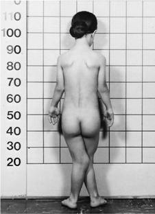

# Chapter 741: Other Inherited Disorders of Skeletal Development

*Julie E. Hoover-Fong and Daniah Albokhari*

<!-- p.5600 -->
∼4% of ARO is caused by pathogenic

∼4% of ARO is caused by pathogenic variants

#### **Table 740.3** Other Conditions with Hyperostotic Fragile Bones

| Category / Parameter | Clinical Details & Findings |
| --- | --- |
| **CA2** | ARO w/renal tubular acidosis (RTA) |
| **(OMIM 259730)** | Generalized osteosclerosis. Cerebral; calcifications are typical and may be; associated with ID.; Onset of ARO with RTA is usually later; than in infantile malignant form of ARO; and disease course is milder. |
| **OSTM1** | OSTM1-related ARO |
| **(OMIM 259720)** | variants in OSTM1. Extremely severe form; of ARO with CNS involvement that is; indistinguishable from most severe forms; of CLCN7-related ARO.; OSTM1-related ARO is frequently; associated with structural brain; anomalies. |
| **PLEKHM1** | PLEKHM1-related ARO |
| **(OMIM 611497)** | Very rare, can look like ADOII.; PLEKHM1-related ARO appears to be; very mild and can regress with ↑ age.; One person with PLEKHM1-related ARO; caused by a heterozygous pathogenic; variant has been described. |
| **SNX10** | SNX10-related ARO |
| **(OMIM 615085)** | in SNX10; in particular, “Västerbottenian; osteopetrosis” is caused by SNX10; pathogenic variants. Loss of vision, anemia,; and bone fragility are frequently observed,; warranting use of HSCT.; SNX10-related ARO appears to be slightly; less severe than CLCN7-related ARO. |
| **TCIRG1** | TCIRG1-related ARO |
| **(OMIM 259700)** | >50% of ARO is caused by pathogenic; variants in TCIRG1.; Higher frequency of neurodevelopmental; delay and seizures in CLCN7-related; ARO than in TCIRG1-related ARO.; Noncoding TCIRG1 variants can cause; milder phenotype that resembles ADOII. |
| **TNFRSF11A** | Osteoclast-poor ARO |
| **(OMIM 612301)** | Characterized by onset within first year of; life and typical ARO manifestations.; Investigation of bone biopsy is prerequisite; for reliable diagnosis.; TNFSF11 pathogenic variants cause a; slight T-cell defect, and TNFRSF11A; pathogenic variants can lead to; hypogammaglobulinemia similar to a; common variable immune deficiency.; It is crucial to rule out TNFSF11- and; TNFRSF11A-related ARO, as HSCT is not; successful in these persons. |
| **TNFSF11** | Osteoclast-poor ARO |
| **(OMIM 259710)** | ADOII, Autosomal dominant osteopetrosis type II; ARO, autosomal recessive osteopetrosis; CNS, central nervous system; ID, intellectual disability; HSCT, hematopoietic stem cell; transplantation; From Sobacchi C, Villa A, Schulz A, Kornak U. CLCN7-Related Osteopetrosis. 2007 Feb 12 [updated 2022 Jan 20]. In: Adam MP, Ardinger HH, Pagon RA, et al., eds. GeneReviews; [Internet]. Seattle (WA): University of Washington, Seattle; 1993–2022. |

Advances in understanding have led to the delineation of the genetic basis of disorders that were previously poorly understood. Some of these conditions are now classified into gene families based on their molecular and clinical findings, as outlined in the most recent nosol ogy and classification of genetic skeletal disorders and previous chap ters. Additional important skeletal dysplasias that do not fit into one of the previous categories are discussed in this chapter.

**ELLIS-VAN CREVELD SYNDROME** The Ellis-van Creveld syndrome, also known as **chondroectodermal dysplasia**, is a skeletal *and* an ectodermal dysplasia. This skeletal dys plasia presents at birth with short limbs, especially the middle and

distal segments, accompanied by postaxial polydactyly of the hands and sometimes of the feet (Fig. 741.1). Nail dysplasia and dental anom alies (including neonatal, absent, premature loss of teeth, and upper lip defects) constitute the ectodermal dysplasia. Additional common manifestations include atrial septal defects and other congenital heart defects.

Skeletal radiographs reveal short tubular bones with clubbed ends, especially the proximal tibia and ulna (Fig. 741.2). Carpal bones dis play extra ossification centers and fusion; cone-shaped epiphyses are evident in the hands. A bony spur is often noted above the medial aspect of the acetabulum.

Ellis-van Creveld syndrome is an autosomal recessive condition that occurs with increased frequency in the Amish and Finnish founder populations than in the general population. Pathogenic variants have been identified in one of two genes, *EVC (EVC1)* or *EVC2 (LIMBIN)*, which map in a head-to-head configuration to chromosome 4p. Disease-causing variants of *EVC2* are detected in the allelic condition **Weyers acrofacial dysostosis**. EVC and EVC2 proteins are thought to influence hedgehog signaling in cilia by con stitutively associating in a ringlike pattern in the ciliary transition zone and transducing extracellular signals to the nucleus via hedge hog signaling. Fgf18 may also play a significant role. This disorder is classified under the **ciliopathies** with major skeletal involvement (see Chapter 101.3).

*Julie E. Hoover-Fong and Daniah Albokhari*

<!-- p.5602 -->
A B

**Fig. 741.1** A, Ellis-van Creveld syndrome in a young female. Note short stature, joint contractures at the elbows, and marked genu val gum. B, Multiple digits (polydactyly) in a different patient with Ellis-van Creveld syndrome. (A from Zipes DP, Libby P, Bonow R, Braunwald E, eds. Braunwald’s Heart Disease: a textbook of cardiovascular medicine, 7th ed. Philadelphia: WB Saunders, 2004. Fig 70.6; B from Beerman LB, Kreutzer J, Allada V. Cardiology. In: Zitelli BJ, McIntire SC, Nowalk AJ, eds. Zitelli and Davis’ Atlas of Pediatric Physical Diagnosis, 6th ed. Philadelphia: Elsevier, 2012. Fig 5.6.)

Approximately 30% of patients die of cardiac or respiratory prob lems during infancy. Life span is otherwise normal; adult heights range from 119-161 cm.

**ASPHYXIATING THORACIC DYSTROPHY** See also Chapter 467.3.

**Fig. 741.2** Radiograph of lower extremities in Ellis-van Creveld syn drome. Tubular bones are short, and proximal fibula is short. Ossi fication is retarded in lateral tibia epiphyses, causing a knock-knee deformity.

Asphyxiating thoracic dystrophy, or **Jeune syndrome**, is an autoso mal recessive chondrodysplasia. Newborn infants present with a long, narrow thorax and respiratory insufficiency associated with pulmo nary hypoplasia. Neonates often die. Other neonatal manifestations include slightly short limbs and postaxial polydactyly. This condition results from a disturbance of primary cilia, most often from patho genic variants of the gene encoding cytoplasmic dynein 2 heavy chain 1 *(DYNC2H1).* This disorder is classified under **ciliopathies** with major skeletal involvement (see Chapter 101.3).

Skeletal radiographs show very short ribs with anterior expansion. Tubular limb bones are short with bulbous ends; cone-shaped epiphy ses occur in hand bones. The iliac bones are short and square with a spur above the medial aspect of the acetabulum (Fig. 741.3).

If infants survive the neonatal period, respiratory function usu ally improves as the rib cage grows. Surgery that produces lateral thoracic expansion improves rib growth and enhances chest wall dimensions. Progressive renal dysfunction often develops during childhood. Intestinal malabsorption and hepatic dysfunction have also been reported.

**SHORT-RIB POLYDACTYLY SYNDROMES** These conditions, which share the clinical features of constricted thoracic cage, short ribs, polydactyly, very short extremities, lethal ity during the newborn period and autosomal recessive inheritance. Pathogenic variants that map to cilia-related genes*—DYNC2H1, IFT80, IFT81, WDR34, WDR60, DYNC2LI1, NEK1, IFT122, WDR19, INTU, TRAF3IP1—*are found in this group of disorders.

**CARTILAGE-HAIR HYPOPLASIA-ANAUXETIC SPECTRUM DISORDERS** Cartilage-hair hypoplasia (CHH), also known as **metaphyseal chon drodysplasia–McKusick type,** is part of a spectrum of disorders with metaphyseal involvement that includes metaphyseal dysplasia without hypotrichosis and anauxetic dysplasia. All disorders are characterized by severe disproportionate short stature, which is usually recognized at birth; the short limbs can lead to prenatal detection. They all show autosomal recessive inheritance and are caused by pathogenic variants in *RMRP*, a gene coding for a large untranslated RNA component of an enzyme complex involved in processing mitochondrial RNA. Loss of this gene product interferes with processing of both messenger RNA and ribosomal RNA and correlates with the extent of bone dysplasia, whereas loss of messenger RNA processing correlates with the degree of hair hypoplasia, immunodeficiency, and hematologic abnormality. Molecular testing confirms the diagnosis, and prenatal diagnosis is available if the pathogenic variant is identified either in the patient or the parents.

CHH is recognized during the second year because of growth defi ciency affecting the limbs, accompanied by flaring of the lower rib cage, a prominent sternum, and bowing of the legs. The hands and feet are short, and the fingers are very short with extreme ligamentous laxity. The hair is thin, sparse, and light colored; the nails are hypoplastic; and the skin can be hypopigmented.

Radiographs show short tubular bones with flared, irregularly min eralized, and cupped metaphyses (Fig. 741.4). The knees are more affected than are the hips, and the fibula is disproportionately longer than the tibia. The metacarpals and phalanges are short and broad. Spi nal radiographs reveal mild platyspondyly.

Nonskeletal manifestations associated with CHH include immu nodeficiency (T-cell abnormalities, neutropenia, leukopenia, and sus ceptibility to varicella zoster virus infections; children also may have complications from smallpox and polio vaccinations), malabsorption, celiac disease, and Hirschsprung disease. Adults are at risk for malig nancy, especially non-Hodgkin lymphoma and skin tumors. Adult height ranges from 107-157 cm.

The highest birth prevalence is in the Amish and Finnish popula tions because of a founder effect. Carrier frequency in the Amish is 1:19 with 1 per 1,300 births affected compared to a carrier fre quency of 1:76 and 1 per 23,000 births affected in Finland. The exact prevalence in the general population is not known, but CHH

<!-- p.5603 -->
is relatively rare. However, two allelic conditions, metaphyseal dys plasia without hypotrichosis and anauxetic dysplasia, expand the phenotypic spectrum. Children with a growth disorder and abnor mal hair should be evaluated for *RMRP* pathogenic variants.

**TRPV4****-SPECTRUM DISORDERS** Pathogenic variants in *TRPV4* cause a spectrum of conditions including metatropic dysplasia, spondylometaphyseal dysplasia (SMD), Kozlowski type, brachyolmia, and familial digital arthropa thy with brachydactyly. Metatropic dysplasia and SMD, Kozlowski type are expanded on next. **Brachyolmia** is dominated by pro gressive scoliosis and platyspondyly on x-rays and familial digital arthropathy with brachydactyly, which is characterized by deform ing painful osteoarthritis of the interphalangeal, metacarpophalan geal, and metatarsophalangeal joints starting after the first decade of life. The rest of the skeleton is unaffected in this condition. It should also be noted that pathogenic variants in *TRPV4* are also responsible for a large group of neuromuscular disorders includ ing **Charcot-Marie-Tooth disease type 2C**, scapuloperoneal spinal muscular atrophy, and congenital distal spinal muscular atrophy. Though there is considerable overlap of the phenotypes of the con ditions within the skeletal group and the neuromuscular group, there are only rare instances currently recognized of individual patients with both features.

**METATROPIC DYSPLASIA** Metatropic dysplasia is an autosomal dominant disorder result ing from heterozygous pathogenic variants of transient receptor potential vanilloid family 4 (TRPV4), which encodes a calciumpermeable cation channel. Newborn infants present with a long narrow trunk and short extremities. A tail-like appendage some times extends from the base of the spine. Odontoid hypoplasia is common and may be associated with cervical instability. Kypho scoliosis appears in late infancy and progresses through childhood, often becoming severe enough to compromise cardiopulmonary function. The joints are large and become progressively restricted in mobility, except in the hands. Contractures often develop in the hips and knees during childhood. Although severely affected infants can die at a young age from respiratory failure, patients usu ally survive, although they can become disabled as adults from the

progressive musculoskeletal deformities. Adult heights range from 110-120 cm. Skeletal radiographs show characteristic changes dominated by severe platyspondyly and short tubular bones with expanded and deformed metaphyses that exhibit a dumbbell appearance (Fig. 741.5). The pelvic bones are hypoplastic and exhibit a halberd appearance because of a small sacrosciatic notch and a notch above the lateral mar gin of the acetabulum.

**Fig. 741.3** Asphyxiating thoracic dystrophy. Short ribs, long and narrow chest, small pelvis, trident acetabula, no platyspondyly (helps differentiate from thanatophoric dysplasia), cystic renal disease. (From Campeau P, Schlesinger AE. Skeletal dysplasias. [Updated 2017 Jan 30]. In: De Groot LJ, Chrousos G, Dungan K, et al., eds. Endotext [internet]. South Dartmouth, MA, 2000, MDText.com, Inc., Fig 6. Available at: https://www.ncbi.nlm.n ih.gov/books/NBK279130/)

**Fig. 741.4** Radiograph of lower extremities in cartilage-hair hypo plasia. The tubular bones are short, and the metaphyses are flared and irregular. The fibula is disproportionately long compared with the tibia. The femoral necks are short.

<!-- p.5604 -->
**SPONDYLOMETAPHYSEAL DYSPLASIA, KOZLOWSKI TYPE** Kozlowski type of spondylometaphyseal dysplasia is an autosomal dominant allelic disorder to metatropic dysplasia caused by *TRPV4* variants.

Kozlowski type of spondylometaphyseal dysplasia manifests in early childhood with mild short stature involving mostly the trunk and a waddling gait. The hands and feet may be short and stubby. Radio graphs show flattening of vertebral bodies. The metaphyses of tubular bones are widened and irregularly mineralized, especially at the proxi mal femur. The pelvic bones manifest mild hypoplasia. Scoliosis can develop during adolescence. The disorder is otherwise uncomplicated, and manifestations are limited to the skeleton. Adults reach heights of 130-150 cm.

**DISORDERS INVOLVING FILAMINS** Pathogenic variants of genes encoding filamin A and filamin B proteins have been detected in diverse disorders of skeletal development: fila min A pathogenic variants in otopalatodigital syndromes type 1 and 2, frontometaphyseal dysplasia, Melnick-Needles syndrome and terminal osseous dysplasia with pigmentary defects and filamin B pathogenic variants in Larsen syndrome and perinatal lethal atelosteogenesis types

1 and 3, spondylo-carpal-tarsal dysplasia and Boomerang dysplasia. Filamins functionally connect extracellular to intracellular structural proteins, thereby linking cells to their local microenvironment, which is essential for skeletal development and growth.

**JUVENILE OSTEOCHONDROSES** The juvenile osteochondroses are a heterogeneous group of dis orders in which regional disturbances in bone growth cause non inflammatory arthropathies. Table 741.1 summarizes the juvenile osteochondroses. Some have localized pain and tenderness (Frei berg disease, Osgood-Schlatter disease [see Chapter 718.4], osteo chondritis dissecans [see Chapter 718.3]), whereas others present with painless limitation of joint movement (Legg-Calvé-Perthes disease [see Chapter 719.3], Scheuermann disease [see Chapter 720.4]). Bone growth may be disrupted, leading to deformities. The diagnosis is usually confirmed radiographically, and treatment is symptomatic. The pathogenesis of these disorders is believed to involve ischemic necrosis of primary and secondary ossification centers. Although familial forms have been reported, these disor ders usually occur sporadically.

**CAFFEY DISEASE (INFANTILE CORTICAL HYPEROSTOSIS)** This is a rare disorder of unknown etiology characterized by corti cal hyperostosis with inflammation of the contiguous fascia and muscle. It is often sporadic, but both autosomal dominant and auto somal recessive forms have been reported. Pathogenic variants in *FAM111A* and *TBCE* have been identified in the autosomal dominant and recessive forms, respectively. **Sanjad-Sakati syndrome** (hypo parathyroidism, intellectual disability, dysmorphism) is also caused by pathogenic variants in *TBCE*. Caffey dysplasia is classified in the slender bone dysplasia group.

Prenatal and more often postnatal onsets have been described. Prenatal onset may be mild (autosomal dominant) or severe (auto somal recessive). Severe prenatal disease is characterized by typical bone lesions, polyhydramnios, hydrops fetalis, severe respiratory distress, prematurity, and high mortality. Onset in infancy (younger than 6 months; average: 10 weeks) is most common; manifestations include the sudden onset of irritability, swelling of contiguous soft tissue that precedes the cortical thickening of the underlying bones, fever, and anorexia. The swelling is painful with a woodlike indura tion but with minimal warmth or redness; suppuration is absent. There are unpredictable remissions and relapses; an episode can last 2 weeks to 3 months. The most common bones involved include the mandible (75%) (Fig. 741.6), the clavicle, and the ulna. If swelling is not prominent or visible, the diagnosis might not be evident.

Laboratory features include elevated erythrocyte sedimenta tion rate and serum alkaline phosphatase as well as, in some patients, increased serum prostaglandin E levels. There may be

A B

**Fig. 741.5** A, Radiograph of the lateral thoracolumbar spine in meta tropic dysplasia showing severe platyspondyly. B, Radiograph of lower extremities in metatropic dysplasia showing short tubular bones with widened metaphyses. The femurs have a dumbbell appearance.

#### **Table 741.1** Juvenile Osteochondroses

| Category / Parameter | Clinical Details & Findings |
| --- | --- |
| **AGE AT PRESENTATION** | Legg-Calvé-Perthes disease; Capital femoral epiphysis; 3-12 yr; Osgood-Schlatter disease; Tibial tubercle; 10-16 yr; Sever disease; Os calcaneus; 6-10 yr; Freiberg disease; Head of second metatarsal; 10-14 yr; Scheuermann disease; Vertebral bodies; Adolescence; Blount disease; Medial aspect of proximal tibial epiphysis; Infancy or adolescence; Osteochondritis dissecans; Subchondral regions of knee, hip, elbow, and ankle; Adolescence |

<!-- p.5605 -->
thrombocytosis and anemia. The radiographic features include soft tissue swelling and calcification and cortical hyperostosis (Fig. 741.7). All bones may be affected except the phalanges or vertebral bodies. The differential diagnosis includes other causes of hyperos tosis such as chronic vitamin A intoxication, prolonged prostaglan din E infusion in children with ductal dependent congenital heart disease, primary bone tumors, and scurvy.

Complications are unusual but include pseudoparalysis with limb or scapula involvement, pleural effusions (rib), torticollis (clavicle), mandibular asymmetry, bone fusion (ribs or ulna and radius), and bone angulation deformities (common with severe prenatal onset). Treatment includes indomethacin and prednisone (if there is a poor response to indomethacin).

**FIBRODYSPLASIA OSSIFICANS PROGRESSIVA** Fibrodysplasia ossificans progressiva (FOP) is a rare and severely disabling disorder characterized by progressive extraskeletal hetero topic bone formation in soft connective tissues including muscles, tendons, ligaments, fascia, and aponeuroses. With the exception of deformity of the large toes, infants are normal at birth. Episodes of painful soft tissue swelling with inflammation usually begin in early childhood initially involving the upper back and neck, and later the entire trunk and extremities. Repeated episodes (flare-ups) slowly transform the soft tissues into bands or plates of bone that span joints and progressively limit movement and mobility. Episodes are often triggered by injury, intramuscular injections, and viral infection. Most patients are wheelchair bound by their late teens. The average life span is approximately 40 years, with death usually resulting from complications of thoracic insufficiency.

FOP results from heterozygous activating pathogenic variants of the gene *(ACVR1)* encoding the bone morphogenetic protein (BMP) type I receptor, activin A receptor type I *(ALK2)*. Patients with clas sic FOP have the same missense *ACVR1* pathogenic variant, which enhances BMP signaling, which, in turn, induces inflammation and aberrant endochondral ossification through mechanisms that are poorly understood. Environmental factors, such as injury, play an important role in triggering these events. *ACVR1* pathogenic vari ants usually occur sporadically, but autosomal dominant transmis sion has rarely been observed. FOP is classified in the disorganized development of skeletal components group.

There is currently no definitive treatment for FOP. Supportive care includes avoidance of injury-prone physical activities, intra muscular injections including immunizations, and overstretching of the jaw during dental procedures. Corticosteroids and other anti inflammatory agents reduce inflammation and pain during flareups but are unable to prevent heterotopic bone formation. Studies in FOP animal models suggest that BMP type I kinase inhibitors and retinoic acid receptor γ agonists, which block chondrogenesis—the initial step in endochondral ossification—may be useful therapies in the future. An animal FOP study has indicated that mutant ALK2 responds to activin A, induces canonical BMP signaling, and leads to heterotopic bone formation, providing an additional possible therapeutic target. The retinoic acid receptor γ agonist palovarotene was approved by the US Food and Drug Administration in 2023 for treatment of FOP for females ages 8 years and older and for males ages 10 years and older.

*Visit Elsevier eBooks+ at eBooks.Health.Elsevier.com** for Bibliography.*

**Fig. 741.6** Facies in infantile cortical hyperostosis. In almost all cases, the changes have appeared before the fifth month of life. Unilateral swelling of the left cheek and left side of the jaw in an infant 12 weeks of age. (From Slovis T, ed. Caffey’s Pediatric Diagnostic Imaging, 11th ed. Philadelphia: Mosby, 2008.)

A B

**Fig. 741.7** A, Radiograph of a 5-mo-old infant showing hyperostosis of the mandible. B, Radiograph of a 5-mo-old infant showing hyper ostosis of both legs. (From Kamoun-Goldrat A, le Merrer M. Infantile cortical hyperostosis [Caffey disease]: a review. J Oral Maxillofac Surg. 2008;66:2145–2150. Figs. 1 and 2.)

<!-- p.5606 -->
