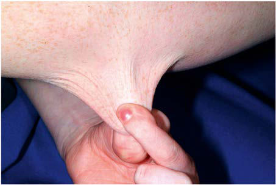

# Chapter 744: Ehlers-Danlos Syndrome

*Donald Basel*

<!-- p.5618 -->
In support of its relevance to humans, a retrospective study assessing the effect of ARBs in a small cohort of pediatric patients with MFS who had severe aortic root enlargement despite previous alternative medi cal therapy, showed that ARBs significantly slowed the rate of aortic root and sinotubular junction dilatation (both of which occur in MFS), whereas the distal ascending aorta (which does not normally become dilated in MFS) remained unaffected. Further evidence of a beneficial effect from losartan therapy has been provided by three prospective clinical trials demonstrating that losartan treatment alone or in combi nation with β-blockade slowed the progression of aortic root dilation in patients with MFS.

A comparison clinical trial assessing the therapeutic benefit of losartan versus atenolol in patients with MFS concluded that both drugs provided significant protection against aortic growth, with no significant difference in therapeutic effect between the two drugs despite the use of conventional dose losartan (FDA-approved dose for hypertension) and an atypically high dose of atenolol (average dose of atenolol was 1.5 times and the maximum dose was 2 times the FDA approved upper limit for the treatment of hypertension). Both treatment arms in this trial showed a very slow rate of aor tic root growth and a significant decline in aortic root *z* score over time, a performance superior to that observed in untreated Marfan patients or in patients treated with conventional dose atenolol (1–2 mg/kg/day). These data strongly suggest that both modalities have therapeutic roles in patients with MFS.

Additional prospective studies have demonstrated therapeutic benefit of ARBs. A meta-analysis integrating seven randomized prospective trials and over 1,500 patients concluded that ARBs are both efficacious and safe in MFS, either when used alone (in comparison to placebo) or in combination with β-blockers (in com parison to β-blockers alone). An 8-year follow-up of a Dutch study exploring the use of ARBs in adults with MFS suggested that this treatment not only suppressed pathologic aortic growth but also positively influenced important patient outcomes, including risk of surgery, aortic dissection, and all-cause mortality.

**PROGNOSIS** The major cause of mortality is aortic root dilatation, dissection, and rupture, with the majority of fatal events occurring in the third and fourth decades of life. A reevaluation of life expectancy in MFS suggested that early diagnosis and refined medical and sur gical management has greatly improved the prognosis for patients with the condition. Nevertheless, MFS continues to be associated with significant morbidity, and selected subgroups are refractory to therapy and continue to show early mortality. In a review of 54 patients diagnosed during infancy, 89% had serious cardiac pathol ogy, and cardiac disease was progressive despite standard care (22% died during childhood, 16% before age 1 year). In the classic form of MFS, it is estimated that more than 90% of individuals will have a cardiovascular event during their lifetime, placing both physical and mental stresses on patients and their families. Awareness of these issues and referral for support services can facilitate a positive perspective toward the condition.

**GENETIC COUNSELING** The heritable nature of MFS makes recurrence risk (genetic) coun seling mandatory. Fathers of these sporadic cases are, on average, 7-10 years older than fathers in the general population. This pater nal age effect suggests that these cases represent new dominant pathogenic variants with minimal recurrence risk to additional future offspring of the normal parents. Owing to rare reports of gonadal mosaicism in a phenotypically normal parent, the recur rence risk for parents of a sporadic case can be reported as low but not zero. Each child of an affected parent, however, has a 50% risk of inheriting the MFS pathogenic variant and thus being affected. Recurrence risk counseling is best accomplished by professionals with expertise in the issues surrounding the disorder.

*Visit Elsevier eBooks+ at eBooks.Health.Elsevier.com** for Bibliography.*

Ehlers-Danlos syndrome (EDS) is a heterogeneous group of heri table connective tissue disorders that are grouped into three broad pathoetiologic categories and more specifically divided into four teen subtypes (Table 744.1). Affected individuals are considered to have an overlapping phenotype of abnormally soft, extensible skin, which often heals poorly, in association with joint hypermobility and occasional instability believed to be rooted in a disruption of normal collagen function (Tables 744.2 and 744.3). All organ sys tems contain connective tissue elements, and many of these ele ments are involved in supporting the function of feedback receptors such as mechanoreceptors in lumen or vessel walls or stretch recep tors in tendons. The myriad of symptoms, variability of expression, modes of inheritance, and unique phenotypic elements distinguish the subtypes from one another while establishing their common origins. The hypermobility type (hEDS) is the most common form and has no clear molecular etiology.

The connective tissue matrix is complex (Fig. 744.1), and the interplay of cells, collagen and elastin fibers, proteins, and cell signaling molecules remains poorly understood. However, dys function at both structural and functional levels more than likely explains the complex medical associations typically encountered in this population, with complaints ranging from joint instability and tissue fragility to chronic pain, autonomic dysfunction, and chronic fatigue (see Table 744.3).

**CLASSIFICATION OF THE SIX MOST COMMON SUBTYPES OF EHLERS-DANLOS SYNDROME Classic (Genes: COL5a1, COL5a2, COL1a1; Previously EDS Type I—Gravis, EDS Type II—Mitis)** Classic EDS is the second most common form of EDS and is an auto somal dominant connective tissue disorder characterized by skin hyperelasticity (Fig. 744.2), widened atrophic scars (skin fragility), and joint hypermobility. Other features include easy bruising, which is often associated with hemosiderin staining of the tissues (partic ularly over regions exposed to frequent trauma, like the shins). The skin is “velvet” to the touch and is particularly fragile, with minor lacerations forming gaping wounds that leave broad, atrophic, pap yraceous (“cigarette paper”) scars (Fig. 744.3; see also Table 744.2). Additional cutaneous manifestations include molluscoid pseudotu mors over pressure points from accumulations of connective tissue and piezogenic papules (Fig. 744.4). Joints are hypermobile, often with joint instability (Fig. 744.5). Scoliosis frequently presents in adolescence, and mitral valve prolapse is common. Life expectancy is generally not reduced, although rare rupture of large arteries has been reported. Similar noncutaneous nonarticular comorbidities, as seen in hypermobile EDS, are found, in particular pain and gas trointestinal dysfunction (see Table 744.3). Premature birth caused by rupture of membranes of an affected offspring is not uncom mon. The diagnosis is made by clinical findings and sequencing of *COL5A1* and *COL5A2* genes.

**Hypermobile (Cause Unknown, Previously EDS Type III)** Hypermobile EDS (hEDS) is the most prevalent form of EDS with an estimated population frequency of between 0.75–3%. It is an autosomal dominant disorder, but the causative molecular pathoetiology remains elusive. Fewer than 3% of patients with a hEDS phenotype are associated with heterozygous tenascin X gene loss of function, and likewise, only a minority of cases are linked to other findings, such as the association with mosaic type 1 collagen

*Donald Basel*

<!-- p.5620 -->
Pereira L, et al. Genomic organization of the sequence coding for fibrillin, the defec

tive gene product in Marfan syndrome. Hum Mol Genet. 1993;2(10):1762. Putnam EA, Zhang H, Ramirez F, Milewicz DM. Fibrillin-2 (FBN2) mutations result

in the Marfan-like disorder, congenital contractural arachnodactyly. Nat Genet. 1995;11:456–458. Pyeritz RE. Maternal and fetal complications of pregnancy in the Marfan syndrome.

Am J Med. 1981;71:784–790. Pyeritz RE, Murphy EA, McKusick VA. Clinical variability in the Marfan syndrome(s).

Birth Defects Orig Artic Ser. 1979;15:155–178. Pyeritz RE, Fishman EK, Bernhardt BA, Siegelman SS. Dural ectasia is a common

feature of the Marfan syndrome. Am J Hum Genet. 1988;43:726–732. Ramos Arroyo MA, Weaver DD, Beals RK. Congenital contractural arachnodactyly. Re

port of four additional families and review of literature. Clin Genet. 1985;27:570–581. Rienhoff HY, et al. A mutation in TGFB3 associated with a syndrome of low muscle

mass, growth retardation, distal arthrogryposis and clinical features overlapping with Marfan and Loeys-Dietz syndrome. Am J Med Genet. 2013;161:2040–2046. Robinson PN, et al. Mutations of FBN1 and genotype-phenotype correlations in Mar

fan syndrome and related fibrillinopathies. Hum Mutat. 2002;20:153–161. Roman MJ, Devereux RB, Kramer-Fox R, O’Loughlin J. Two-dimensional echocar

diographic aortic root dimensions in normal children and adults. Am J Cardiol. 1989;64:507–512. Rossi-Foulkes R, et al. Phenotypic features and impact of beta blocker or calcium

antagonist therapy on aortic lumen size in the Marfan syndrome. Am J Cardiol. 1999;83:1364–1368. Rossiter JP, Repke JT, Morales AJ, et al. A prospective longitudinal evaluation of

pregnancy in the Marfan syndrome. Am J Obstet Gynecol. 1995;173:1599–1606. Sakai LY, Keene DR, Engvall E. Fibrillin, a new 350-kd glycoprotein, is a component

of extracellular microfibrils. J Cell Biol. 1986;103:2499–2509. Salim MA, Alpert BS, Ward JC, Pyeritz RE. Effect of beta-adrenergic blockade on aor

tic root rate of dilation in the Marfan syndrome. Am J Cardiol. 1994;74:629–633. Savolainen A, Kupari M, Toivonen L, et al. Abnormal ambulatory electrocardiograph

ic findings in patients with the Marfan syndrome. J Intern Med. 1997;241:221–226. Shores J, Berger KR, Murphy EA, Pyeritz RE. Progression of aortic dilatation and

the benefit of long-term beta-adrenergic blockade in Marfan’s syndrome. N Engl J Med. 1994;330:1335–1341. Shprintzen RJ, Goldberg RB. A recurrent pattern syndrome of craniosynostosis as

sociated with arachnodactyly and abdominal hernias. J Craniofac Genet Dev Biol. 1982;2:65–74. Silverman DI, et al. Family history of severe cardiovascular disease in Marfan syn

drome is associated with increased aortic diameter and decreased survival. J Am Coll Cardiol. 1995;26:1062–1067.

Silverman DI, et  al. Life expectancy in the Marfan syndrome. Am J Cardiol.

1995;75:157–160. Sisk HE, Zahka KG, Pyeritz RE. The Marfan syndrome in early childhood: analysis of

15 patients diagnosed at less than four years of age. Am J Cardiol. 1983;52:353–358. Spittell PC, et al. Clinical features and differential diagnosis of aortic dissection: ex

perience with 236 cases (1980 through 1990). Mayo Clin Proc. 1993;68:642–651. Streeten EA, Murphy EA, Pyeritz RE. Pulmonary function in the Marfan syndrome.

Chest. 1987;91:408–412. Testai FD, Gorelick PB. Inherited metabolic disorders and stroke part 2: homocyst

inuria, organic acidurias, and urea cycle disorders. Arch Neurol. 2010;67:148–153. Tsuji T. Marfan syndrome: demonstration of abnormal elastic fibers in skin. J Cutan

Pathol. 1986;13:144–153. van Andel MM, et al. Long-term clinical outcomes of losartan in patients with Mar

fan syndrome: follow-up of the multicentre randomized controlled COMPARE trial. Eur Heart J. 2020;41:4181–4187. van de Laar IM, et al. Mutations in SMAD3 cause a syndromic form of aortic aneu

rysms and dissections with early-onset osteoarthritis. Nat Genet. 2011;43:121–126. van de Laar IM, et  al. Phenotypic spectrum of the SMAD3-related aneurysms-

osteoarthritis syndrome. J Med Genet. 2012;49:47–57. Villeirs GM, Van Tongerloo AJ, Verstraete KL, et  al. Widening of the spinal ca

nal and dural ectasia in Marfan’s syndrome: assessment by CT. Neuroradiology. 1999;41:850–854. Wang L, et al. Mutations in myosin light chain kinase cause familial aortic dissec

tions. Am J Hum Genet. 2010;87:701–707. Wang M, Clericuzio CL, Godfrey M. Familial occurrence of typical and severe lethal

congenital contractural arachnodactyly caused by missplicing of exon 34 of fibril lin-2. Am J Hum Genet. 1996;59:1027–1034. Wang M, et al. Recurrent mis-splicing of fibrillin exon 32 in two patients with neona

tal Marfan syndrome. Hum Mol Genet. 1995;4:607–613. Wood JR, Bellamy D, Child AH, Citron KM. Pulmonary disease in patients with

Marfan syndrome. Thorax. 1984;39:780–784. Yamashita M, et al. TRAF6 mediates Smad-independent activation of JNK and p38

by TGF-beta. Mol Cell. 2008;31:918–924. Yetman AT, Bornemeier RA, McCrindle BW. Usefulness of enalapril versus pro

pranolol or atenolol for prevention of aortic dilation in patients with the Marfan syndrome. Am J Cardiol. 2005;95:1125–1127. Zhu L, et al. Mutations in myosin heavy chain 11 cause a syndrome associating tho

racic aortic aneurysm/aortic dissection and patent ductus arteriosus. Nat Genet. 2006;38:343–349.

<!-- p.5621 -->

#### **Table 744.1** Classification of Ehlers-Danlos Syndrome

| Category / Parameter | Clinical Details & Findings |
| --- | --- |
| **OTHER COMMENTS** | Classic; COL5A1, COL5A2 (usually; haploinsufficiency); Hyperextensibility,; bruising, velvety skin,; widened atrophic scars,; molluscoid pseudotumors,; spheroids; Hypermobility and; its complications,; joint dislocations |
| **AD** | Mitral valve prolapse,; hernias |
| **COL1A1** | Specific pathogenic; variant; c.934C>T |
| **AD** | Blue sclerae, short stature,; osteopenia/fractures; may; have late arterial rupture |
| **CLASSIC VARIANTS** | Cardiac valvular; Biallelic loss of function; for COL1A2; Classic EDS features |
| **AR** | Severe cardiac valve issues; as adult; Periodontal |
| **C1S** | Can have classic EDS; features; Can have; hypermobility |
| **AD** | Periodontitis, marfanoid; habitus, prominent eyes,; short philtrum; Classic-like |
| **AEBP1** | Hyperextensibility, marked; hypermobility, severe; bruising, velvety skin, no; scarring tendency; Joint hypermobility,; extensible and redundant; skin, abnormal scarring; Hypermobility; Hypermobility |
| **AR** | Parents (especially mothers); with one TNXB pathogenic; variant; can have joint; hypermobility; Biallelic loss of function; variants. Highly variable.; Hypermobility; Unknown; Mild hyperextensibility,; scarring, textural change; Hypermobility,; chronic joint; pain, recurrent; dislocations |
| **AD** | Sometimes confused with; joint hypermobility; syndrome; Vascular |
| **COL3A1** | Rare variants in COL1A1; Thin, translucent skin,; bruising, early varicosi; ties, acrogeria; Small joint; hypermobility |
| **AD** | Abnormal type III collagen; secretion; rupture of bowel,; uterus, arteries; typical; facies; pneumothorax; Kyphoscoliosis; PLOD (deficient lysyl; hydroxylase) |
| **FKBP14** | Soft, hyperextensible skin,; bruising, atrophic scars; Hypermobility |
| **AR** | Severe congenital muscle; hypotonia that improves a; little in childhood; congenital; kyphoscoliosis, scleral fragility; and rupture, marfanoid; habitus, osteopenia,; sensorineural hearing loss |
| **VARIANTS WITH KYPHOSCOLIOSIS** | Spondylocheiro; dysplastic form; SLC39A13, which; encodes the ZIP13 zinc; transporter; B4GALT7 or B3GALT6,; encoding galacto; syltransferase I or II,; key enzymes in GAG; synthesis; Similar to kyphoscoliotic; form |
| **AR** | Spondyloepimetaphyseal; dysplasia; can have bone; fragility and severe progres; sive kyphoscoliosis without; congenital hypotonia;; moderate short stature,; loose facial skin, wrinkled; palms with thenar and; hypothenar atrophy, blue; sclerae, curly hair, alopecia; Brittle cornea; syndrome; ZNF469 or PRDM5; Skin hyperextensibility; Joint; hypermobility |
| **AR** | Kyphoscoliosis; character; istic thin, brittle cornea,; ocular fragility, blue sclera,; keratoconus; Musculocontractural; CHST14 (encoding; dermatan; 4-O-sulfotransferase); DSE (encoding dermatan; sulfate epimerase); Fragile, hyperextensible; skin with atrophic scars; and delayed wound; healing; Hypermobility |
| **AR** | Progressive kyphoscoliosis;; adducted thumbs in infancy,; clubfoot, arachnodactyly,; contractures, characteristic; facial features, hemorrhagic; diathesis; Myopathic |
| **COL12A1** | Soft, hyperextensible; Hypermobile small; joints, large joint; contractures (hip,; knees, elbows); AD or AR; Characterized by muscle; hypotonia and weakness |

<!-- p.5622 -->
defects. There are currently no diagnostic biomarkers, and the inter- and intrafamilial variation has clouded the ability to clearly define large study populations with sufficient phenotypic align ment. An editorial highlighted the impact of sex hormones and associations of certain symptom complexes to environmental expo sures or “trigger events,” which begs the question of a more complex gene-environment or epigenetic influence.

The primary clinical finding in hEDS is generalized joint hyper mobility with less prominent skin manifestations. There is incon sistency in the literature as to what defines hypermobility, but generally a score of ≥6 on the Beighton hypermobility scale (Fig. 744.6, Table 744.4) would qualify as hypermobility in prepubertal children and adolescents, ≥5 for postpubertal individuals up to the age of 50, and ≥4 for all adults beyond the age of 50. Children <6 years of age generally tend toward a hypermobile state, and the Beighton score may not be a reliable indicator of connective tissue laxity in these children (Table 744.5). Joint instability with frequent

dislocations is common but not universal; joints are predisposed to osteoarthritis in adults.

Patients with hEDS have significant nonarticular comorbidities associated with functional disorders. These present as complex pain, dysautonomia, chronic fatigue, anxiety, and sleep dysfunction (see Table 744.3). The complexity of hEDS most likely originates from the fact that it is genetically heterogeneous and represents an overlapping spectrum of disorders. Although joint hypermobility is the common denominator, symptoms may range from isolated familial joint hyper mobility to the extreme multisystem disorder, which significantly impacts daily quality of life. Life expectancy is not reduced. Mild aor tic root dilatation has been reported in up to 20% of affected adults. However, this mild dilatation is nonprogressive and not associated with aortic root dissection.

**Vascular (vEDS) (Gene: COL3A1; Previously EDS Type IV)** vEDS is an autosomal dominant disorder that shows the most pro nounced dermal thinning of all types of EDS. Consequently, the skin is translucent, and the underlying venous network is prom inent, most notably over the chest region. The skin has minimal hyperextensibility but has a “velvet” texture and is often described as “doughy.” The joints show increased mobility, often with instability. Congenital club foot and hip dislocation are frequently associated. Tissue fragility and arterial rupture cause significant morbidity and mortality. The majority of affected individuals experience a major vascular event before 20 years of age. Premature birth, extensive ecchymoses from trauma, a high incidence of bowel rupture (espe cially the colon), uterine rupture during pregnancy (∼5% risk), rup ture of the great vessels (80% by 40 years of age), dissecting aortic aneurysm, and stroke all contribute to the increased morbidity and

#### **Table 744.1** Classification of Ehlers-Danlos Syndrome—cont’d

| Category / Parameter | Clinical Details & Findings |
| --- | --- |
| **OTHER COMMENTS** | Arthrochalasis; Exon 6 deletion of; COL1A1 or COL1A2; Hyperextensible, soft skin; with or without abnormal; scarring; Marked; hypermobility; with recurrent; subluxations |
| **AD** | Congenital hip dislocation,; arthrochalasis, multiplex; congenita, short stature; Dermatosparaxis; Type I collagen N-; peptidase ADAMTS2; Severe fragility, sagging,; redundant skin |
| **AR** | Also occurs in cattle; AD, Autosomal dominant; AR, autosomal recessive; EDS, Ehlers–Danlos syndrome; GAG, glycosaminoglycan.; From Malfait F, Francomano C, Byers P, et al. The 2017 International Classification of the Ehlers–Danlos syndromes. Am J Med Genet C Semin Med Genet. 2017;175(1):8–26. |

Classic Ehlers-Danlos Syndrome

#### **Table 744.2** Common and Uncommon Features of

| Category / Parameter | Clinical Details & Findings |
| --- | --- |
| **SKIN** | Hyperextensible; Velvety; Fragile, thin, poor tensile strength; Atopic scarring (“cigarette-paper” scars); Striae; Bruising and bleeding (hemosiderin staining of skin); Piezogenic papules, subcutaneous sphenoids; Wound dehiscence/incisional hernia |
| **MUSCULOSKELETAL/JOINTS** | Hypermobile ± joint dislocations; Pes planus; Chronic musculoskeletal pain, sprains; Late walking, hypotonia |
| **OTHER ORGAN INVOLVEMENT** | Chiari type I malformation; Gastrointestinal (nausea, reflux, constipation); Umbilical hernia; Hiatal hernia; Mitral valve prolapse; Aortic root dilation; CSF leak/headache; Pelvic organ prolapse; Premature rupture of fetal membranes; Cervical incompetence; Stress incontinence; Hyperkyphosis; Scoliosis; High arched palate; Femur anteversion (“W” sitting position); Hollow organ rupture, diverticula; Occipitoatlantoaxial hypermobility |

Hypermobility Spectrum Disorders

#### **Table 744.3** Associated Features in Ehlers-Danlos/

| Category / Parameter | Clinical Details & Findings |
| --- | --- |
| **AUTONOMIC AND NEUROLOGIC DYSFUNCTION** | Postural orthostatic tachycardia syndrome (POTS); Dizziness; Palpitations; Gastroparesis; Diarrhea; Constipation; Sleep dysfunction; Chronic fatigue; Headache (migraine, new daily headache); Urinary stress incontinence; Somatosensory amplification; Irritable bowel syndrome; Neuropathic pain |
| **MUSCULOSKELETAL PAIN** | Chronic regional pain syndrome; Fibromyalgia |

<!-- p.5623 -->
shortened life span associated with this condition. The median age of death is estimated at 50 years. Patients are generally counseled regarding the risks associated with pregnancy and advised to avoid activities that raise intracranial or intrathoracic pressure as a result of a Valsalva maneuver (such as weight training or trumpet play ing). Skin protection in childhood is important to minimize trauma (shin guards). Celiprolol, a β1 antagonist and a β2 agonist (vaso dilator), may reduce vascular events but is not approved by the U.S. Food and Drug Administration (FDA) for use in the United States. The diagnosis is clinical and confirmed by gene sequencing of *COL3A1.*

**Fig. 744.1** Complex connective tissue mac roenvironment illustrated by intermingled col lagen and elastin fibers, nerves, mast cells, and capillaries. Both structure and function can be impacted by an abnormal connective tissue ma trix. (Courtesy Netter Images, Image ID 13192. https://netterimages.com/loose-connective-tissue- ovalle-histology-figure-31-labeled-ovalle-histology- frank-h-netter-13192.html)

**Loose connective tissue**

Fat cells

Macrophage

Macrophage

Lymphocyte

Fibroblast

Mast cell

Monocyte

Plasma cell Eosinophil

Amorphous matrix

Collagen fibers

Elastic fibers

Reticular fibers

Capillary

Endothelial cell

Pericyte

Erythrocyte

**Fig. 744.2** Ehlers-Danlos syndrome (EDS). Skin hyperextensibility on the arm. (From Paller AS, Mancini AJ, eds. Hurwitz Clinical Pediatric Dermatology, 5th ed. Philadelphia: Elsevier, 2016: Fig. 6.1, p. 121.)

**Fig. 744.3** Ehlers-Danlos syndrome (EDS). The Gorlin sign is 5 times more common in EDS than in normal individuals. Note the scars on the forehead. (From Paller AS, Mancini AJ, eds. Hurwitz Clinical Pediatric Dermatology, 5th ed. Philadelphia: Elsevier, 2016: Fig. 6.2, p. 121.)

**Fig. 744.4** Piezogenic papules on the medial aspects of the heels in a 41-yr-old patient with Ehlers-Danlos syndrome (top) and his 2-yr-old daughter (bottom). (From Poppe H, Hamm H. Piezogenic papules in Ehlers-Danlos syndrome. J Pediatr. 2013;63:1788.)

<!-- p.5624 -->
**Kyphoscoliosis (Gene: PLOD [Lysyl Hydroxylase Deficiency]; Previously EDS Type VI)** The kyphoscoliotic form of EDS is distinguished by the severe kyphoscoliosis that develops early in childhood. It is an autoso mal recessive disorder with phenotypic overlap with the classical type of EDS in that the skin is soft and fragile, joints are hyper extensible, and easy bruising is notable from a young age. Unique

characteristics include marked hypotonia and keratoconus, with corneal fragility and globe rupture also reported. In addition, there is a higher risk for rupture of medium-sized arteries. The severity of the kyphoscoliosis may lead to restrictive lung disease with second ary pulmonary hypertension and reduced life expectancy. The diag nosis is clinical and confirmed by urine screening for an increased ratio of deoxypyridinoline to pyridinoline cross linking as well as gene sequencing of *PLOD.*

**Arthrochalasia (Gene: COL1a1, COL1a2; Previously EDS Types VIIA and B)** This type of EDS is inherited as an autosomal dominant disorder and characterized by severe joint instability in infancy. Joints show marked hyperextensibility with painless dislocation; the skin bruises easily and is soft and hyperextensible. Congenital hypotonia with gross motor delay is common, and kyphoscoliosis can develop in childhood. The diagnosis is clinical and confirmed by gene sequencing of *COL1A1* and *COL1A2.*

**Dermatosparaxis (Type 1 Collagen N-Peptidase; Previously EDS Type VIIC)** This type of EDS is a rare autosomal recessive condition charac terized by redundant skin that is soft, fragile, and bruises easily. Affected children often have a characteristic facial appearance, with skin sagging into jowls and fullness around the eyes (“puffy”). Premature rupture of membranes is common; closure of fonta nels is delayed. Additional unique features reported in this group include short limbs with brachydactyly (short fingers), frequent

**Fig. 744.5** Despite joint hyperextensibility, this patient does not meet Beighton score criteria for the extreme hypermobility seen with hyper mobile Ehlers-Danlos syndrome.

4. Passive apposition of the thumb to the flexor side of the forearm, while shoulder is 90° flexed, elbow extended and hand pronated. Score is positive if the whole thumb touches the flexor side of the forearm.

1. Passive dorsiflexion of the fifth metacarpophalangeal joint. Score is positive if ≥ 90°

2. Passive hyperextension of the elbow. Score is positive if ≥ 10°

3. Passive hyperextension of the knee. Score is positive if ≥ 10°

*Males positive if > 180° for measure 2. and 3.

Score: Positive Score: Negative

5. Forward flexion of the trunk, with the knees straight. Score is positive if the hand palms rest easily on the floor.

Score: Positive Score: Negative **Fig. 744.6**  Beighton score. The range of motion of several key small and large joints is measured to provide an overview of joint hypermobility. Instability is not assessed. Scoring: 2 points for each bilateral measure in Nos. *1* to *4* and 1 point for No. *5*, equaling a total possible score of 9. Hypermobility is considered significant with a score of ≥6 between the ages of 6 and 35. *(Modified from Smits-Engelsman B, Klerks M, Kirby A. Beighton Score: a valid measure for generalized hypermobility in children. J Pediatr 2011;158:119–123.e4.)*

<!-- p.5625 -->
hernias (umbilical, inguinal), blue sclerae, and bladder rupture. Joints are hypermobile. The diagnosis is confirmed by sequencing of *ADAMTS2.*

**DIFFERENTIAL DIAGNOSIS** EDS represents a portion of the hereditary connective tissue dis orders, many of which have unique features that enable clinical differentiation. The primary differential diagnosis would include Loeys-Dietz syndrome, which has features of both vEDS and Mar fan syndrome (see Chapter 743). EDS has also been confused with MASS syndrome (mitral valve prolapse, aortic root dilation, skeletal changes, skin changes), cutis laxa (see Chapter 745), and pseudox anthoma elasticum. In general, the skin of patients with cutis laxa hangs in redundant folds, whereas the skin of those with EDS is hyperextensible and snaps back into place when stretched. Other disorders that impact the integrity of the connective tissues—such as exposure to corticosteroids and osteogenesis imperfecta or mild myopathic disorders (Bethlem myopathy, Ullrich congenital mus cular dystrophy)—can be indistinguishable in the early stages of disease (Table 744.6).

**GENERAL APPROACH TO MANAGEMENT** In addition to the EDS type-specific therapies discussed under each disease, there are general approaches to help improve symptoms and avoid complications.

Musculoskeletal pain, which initially involves the joints, eventu ally may become generalized and requires a combination of physical therapy and nonpharmacologic approaches (Fig. 744.7). Physical therapy should focus on enhancing the strength of the muscles sup porting the affected joints. With severe recurrent sprains or dis locations, bracing may be necessary. Pain medication for low- to moderate-intensity pain could include nonsteroidal antiinflamma tory drugs (however, their platelet-inhibiting action may increase the risk of cutaneous bleeding). Higher-intensity pain may require other agents, such as selective serotonin receptor inhibitors or lowdose tricyclic antidepressants. Muscle relaxants or antiepileptic agents should be avoided because they may increase fatigue. Sur gery for joint dislocations should be avoided if possible as should prolonged periods of inactivity (which result in rapid muscle decon ditioning) (Table 744.7). If surgery is needed for any complication, the sutures should approximate the margins, suture tension should be avoided, and the sutures should be retained longer than usual. Other approaches to pain include cognitive behavioral therapy, acu puncture, and transepidermal electrical nerve stimulation (TENS).

Chronic fatigue should be approached by supporting good sleep hygiene and avoiding sedating medications (see Table 744.7). Patients at risk for arterial bowel or uterine rupture should be counseled about preventive measures, appropriate medications (see specific subtype), and early warning signs of organ rupture.

*Visit Elsevier eBooks+ at eBooks.Health.Elsevier.com** for Bibliography.*

Hypermobility

#### **Table 744.5** A Five-Part Questionnaire for Identifying

| Category / Parameter | Clinical Details & Findings |
| --- | --- |
| **General** | 1.	 Can you now (or could you ever) place your hands flat on the floor; without bending your knees?; 2.	 Can you now (or could you ever) bend your thumb to touch your; forearm?; 3.	 As a child did you amuse your friends by contorting your body; into strange shapes or could you do the splits?; 4.	 As a child or teenager did your shoulder or kneecap dislocate on; more than one occasion?; 5.	 Do you consider yourself double-jointed?; Answers in the affirmative to two or more questions suggest; hypermobility with sensitivity 80–85% and specificity 80–90%.; From Hakim A, Grahame R. Joint hypermobility. Best Pract Res Clin Rheumatol.; 2003;17:989–1004. Table 3. |

Score

#### **Table 744.4** The Nine-Point Beighton Hypermobility

| Category / Parameter | Clinical Details & Findings |
| --- | --- |
| **LEFT** | 1. Passively dorsiflex the fifth; metacarpophalangeal joint to ≥90 degrees; 1; 1; 2.	 Oppose the thenar aspect of the thumb to; the volar aspect of the ipsilateral forearm; 1; 1; 3.	 Hyperextend the elbow to ≥10 degrees; 1; 1; 4.	 Hyperextend the knee to ≥10 degrees; 1; 1; 5.	 Place hands flat on the floor without bending; the knees; 1; Total: 9; One point may be gained for each side for maneuvers 1-4, so the hypermobility score; will have a maximum of 9 points if all are positive.; From Hakim A, Grahame R. Joint hypermobility. Best Pract Res Clin Rheumatol.; 2003;17:989–1004, Table 1. |

with Joint Hypermobility

#### **Table 744.6** Genetic / Mendelian Conditions Presenting

| Category / Parameter | Clinical Details & Findings |
| --- | --- |
| **DISORDERS** | Ehlers-Danlos syndromes and related disorders; Fibrillinopathies (Marfan and Beals syndromes) and other disorders; of the transforming growth factor-b pathway (e.g., Loeys-Dietz; syndrome, Shprintzen-Goldberg syndrome); Hereditary cutis laxae |
| **SKELETAL DYSPLASIAS** | Achondroplasia and hypochondroplasia; Dysplasias with multiple dislocations (e.g., Larsen and Desboquis; syndromes, CST3-related and gPAPP-related disorders); Some spondyloepimetaphyseal dysplasias; Some COL2A1-related and COL11-related disorders; Diastrophic dysplasia; Trichorhinophalangeal dysplasia |
| **HEREDITARY MYOPATHIES** | COL6-related disorders; SEPN1-related and RYR1-related disorders; MYH7-related and TTN-related disorders; Limb girdle muscular dystrophy 2E with joint hypermobility and; contractures |
| **CHROMOSOMAL AND GENOMIC DISORDERS** | Trisomy 21; 47,XXY and 47,XXX; Some microdeletion and microduplication syndromes |
| **DISORDERS (SELECTED)** | RASopathies; Kabuki syndrome; FG syndrome; Fragile X syndrome; From Castori M, Hakim A. Contemporary approach to joint hypermobility and related; disorders. Curr Opin Pediatr. 2017;29:640–649. Table 3. |

<!-- p.5627 -->
