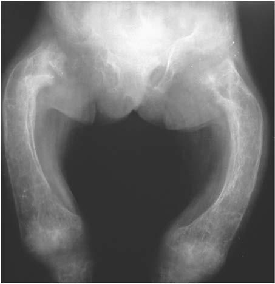

# Chapter 749: Osteoporosis

*Rebecca J. Gordon and Catherine M. Gordon*

<!-- p.5638 -->
Hyperphosphatasia is a set of conditions characterized by hyperphos phatasemia (elevated serum alkaline phosphatase [ALP]). Increases in alkaline phosphatase are most commonly because of hepatobiliary disease or bone disorders characterized by high osteoblast activity, including nutritional rickets. Distinguishing liver from bone etiologies requires fractionating alkaline phosphatase isoenzymes or measuring bone-specific alkaline phosphatase as well as other laboratory assess ments of liver function and bone turnover/vitamin D status. ALP activ ity varies by age and gender; therefore, specific reference ranges should be employed. It is usually higher in pediatric populations than adults, peaking at times of high bone formation including in the first 6 months and during pubertal growth.

In children younger than 5 years, marked increases in alkaline phos phatase without clinical or laboratory evidence of liver or bone dis ease is most often because of **benign transient hyperphosphatasemia** generally detected as an incidental finding during screening laboratory evaluations or evaluations performed to assess a specific complaint. The cause may be related to excess sialylation of alkaline phospha tase, which slows clearance. Cases often follow viral illness, including SARS-CoV-2 infection. Serum alkaline phosphatase values as high as 3,000-6,000 IU/L may be encountered. Liver and bone isoenzyme frac tions are both elevated; there are no other clinical or laboratory signs of hepatic or bone disease. Diagnosis is confirmed by a careful clinical history plus laboratory assessments of calcium, phosphorus, creatine, AST, ALT, GGT, bilirubin, PTH, and 25-hydroxyvitamin D. A CBC should also be drawn to rule out oncologic processes. Alkaline phos phatase should be followed serially (every 2-3 months) until resolution is documented. The condition usually resolves within 16 weeks without intervention and does not recur.

Juvenile Paget disease (familial hyperphosphatasemia, idiopathic hyperphosphatasia or IHH) is a rare autosomal recessive bone dis ease hallmarked biochemically by marked serum ALP activity eleva tion. Most cases are because of loss-of-function variants in the tumor necrosis factor receptor superfamily, member 11B gene (TNFRSF11B) that encodes osteoprotegerin (OPG). OPG inhibits osteoclastogenesis and osteoclast activity by preventing receptor activator of nuclear fac tor κ-B (RANK) ligand (RANKL) from binding to its receptor RANK. Affected children are asymptomatic at birth and gradually develop pro gressive long bone deformity (including kyphoscoliosis), bone pain, and significant fractures. X-rays show bowing and diaphyseal thicken ing, along with osteopenia (Fig. 748.1). Radiographically, the bony tex ture is variable; dense areas (showing a teased cotton-wool appearance) are interspersed with radiolucent areas and general demineralization. Long bones appear cylindrical, lose metaphyseal modeling, and con tain pseudocysts that show a dense, bony halo. Children with juvenile Paget disease have short stature, large skulls with a thickened cranium (widened diploë) that may be deformed, and progressive and profound hearing loss. There is substantial phenotype variability; some cases are diagnosed in infancy and others in late childhood. This disorder is dis tinct from adult Paget disease (osteitis deformans) because bone histol ogy reveals a lack of normal cortical bone remodeling and an absence of the classic mosaic pattern of lamellar bone found in the adult con dition. Given the rarity of this disorder, there is no strong evidence surrounding optimal clinical management; however, antiresorptive therapy with bisphosphonates is associated with clinical, biochemical, and radiographic improvement.

*Nourah N. Almutlaq and Linda A. DiMeglio*

**Fig. 748.1** Juvenile Paget disease showing bowing and thickening of the diaphyses and osteopenia. (From Slovis T, ed. Caffey’s Pediatric Diagnostic Imaging, 11th ed. Philadelphia: Mosby, 2008. Fig. 167–226, p. 2744.)

Other rare forms of hyperphosphatasia include **expansile skel etal hyperphosphatasia (ESH)** caused by dominant variants in the *TNFRSF11A* gene encoding receptor activator of RANK, which regu lates osteoclastogenesis, and **hyperphosphatasia-mental retardation syndrome** caused by recessive variants in *PIGV* in the glycosylphos phatidylinositol (GPI)-anchor biosynthesis pathway.

*Visit Elsevier eBooks+ at eBooks.Health.Elsevier.com** for Bibliography.*

Osteoporosis, the most common bone disorder in adults, is relatively uncommon in children and adolescents; the criteria that underlie this diagnosis in young patients are a source of debate. This disorder is characterized by diminished bone volume and a marked increase in the prevalence of fractures. In contrast to osteomalacia, which shows undermineralization and normal bone volume, histologic sections of bone in all forms of osteoporosis reveal a normal degree of mineral ization but a reduction in the volume of bone, especially trabecular bone (vertebral bone). The **diagnosis of osteoporosis in children and adolescents** requires evidence of skeletal fragility with: (1) a clinically significant fracture history, which is defined as at least two long bone fractures in children less than 10 years old, at least three long bone frac tures by 19 years old, or any vertebral fractures; and (2) low bone den sity, with age, sex, and ancestry-matched bone mineral density (BMD) Z-score ≤ –2.0, assessed by dual-energy x-ray absorptiometry (DXA).

*Rebecca J. Gordon and 
 Catherine M. Gordon*

<!-- p.5640 -->

#### **Table 749.1** Diagnoses That Confer Increased Risk for Osteoporosis

| Category / Parameter | Clinical Details & Findings |
| --- | --- |
| **Female Hypogonadism** | Turner syndrome; Hypothalamic amenorrhea (female athletic triad); Anorexia nervosa; Premature ovarian insufficiency; Depot medroxyprogesterone acetate therapy; Estrogen receptor α (ESR1) pathogenic variants; Hyperprolactinemia |
| **Male Hypogonadism** | Primary gonadal failure (Klinefelter syndrome); Secondary gonadal failure (idiopathic hypogonadotropic hypogonadism); Delayed puberty; Hyperthyroidism; Hyperparathyroidism; Hypercortisolism (therapeutic or Cushing disease); Growth hormone deficiency; Thyrotoxicosis |
| **INFLAMMATORY DISORDERS** | Dermatomyositis; Chronic hepatitis; Juvenile idiopathic arthritis; Systemic lupus erythematosus |
| **GASTROINTESTINAL DISORDERS** | Malabsorption syndromes (cystic fibrosis, celiac disease, biliary atresia); True or perceived lactose intolerance; Inflammatory bowel disease; Chronic obstructive jaundice; Primary biliary cirrhosis and other cirrhoses; Alactasia; Subtotal gastrectomy |
| **BONE MARROW DISORDERS** | Bone marrow transplant; Lymphoma; Leukemia; Hemolytic anemias (sickle cell anemia, thalassemia); Systemic mastocytosis |
| **CONNECTIVE TISSUE/BONE DISORDERS** | Idiopathic juvenile osteoporosis; Osteogenesis imperfecta; Ehlers-Danlos syndrome; Marfan syndrome; Homocystinuria; Fibrous dysplasia; Previous or recurrent low impact fractures; Early-onset osteoporosis with WNT1 pathogenic variants; X-linked osteoporosis with fractures with PLS3 pathogenic variants |
| **DRUGS** | Alcohol; Heparin; Glucocorticoids; Thyroxine; Anticonvulsants; Gonadotropin-releasing hormone agonists; Cyclosporine; Chemotherapy; Tobacco cigarettes |
| **MISCELLANEOUS DISORDERS** | Immobilization (cerebral palsy, spinal muscular atrophy, Duchenne; muscular dystrophy); Chronic renal disease; Glycogen storage disease type 1; Chronic hepatitis; Hypophosphatasia; Low calcium dietary intake; Gaucher disease; Severe congenital neutropenia |

Blood values of minerals (e.g., calcium, phosphorus), vitamin D metabolites, alkaline phosphatase, and parathyroid hormone are usu ally normal. Evaluation of bone mineral content and areal bone density by DXA is the clinical gold standard for measuring BMD. DXA evalua tion in patients 15 years of age or younger includes total body less head and lumbar spine, and in those 16 years and older includes lumbar spine and hip. In certain clinical scenarios, it may be useful to obtain alternative sites, such as the distal femur or forearm scan. Additional research modalities allow for the assessment of bone microarchitecture (e.g., trabecular versus cortical bone), quality, and strength, such as peripheral quantitative CT and trabecular bone score.

In the pediatric age group, osteoporosis may be primary or sec ondary (Table 749.1, Fig. 749.1). The primary osteoporoses can be divided into heritable disorders of connective tissue, including osteo genesis imperfecta (see Chapter 742), Bruck syndrome, osteoporosispseudoglioma syndrome, Ehlers-Danlos syndrome (see Chapter 744), Marfan syndrome (see Chapter 743), homocystinuria, and idiopathic juvenile osteoporosis. Secondary forms of osteoporosis include vari ous neuromuscular disorders, chronic illness, endocrine disorders, and drug-induced and inborn errors of metabolism, including lysinuric protein intolerance and Gaucher disease.

When no obvious primary or secondary cause can be detected, **idiopathic juvenile osteoporosis** should be considered, especially if the following clinical features are evident: onset before puberty, long bone and lower back pain, vertebral fractures, long bone and metatar sal fractures, a washed-out appearance of the spine and appendicular skeleton on standard radiographs, and improvement of bone density after puberty. Trabecular bones such as the spine and metatarsals are

particularly affected by atraumatic fractures. Several modes of therapy (including oral calcium supplements, calcitriol, bisphosphonates, and calcitonin) have been used with some success in individual conditions, but the effect of these treatments is difficult to gauge because sponta neous recovery occurs after the onset of puberty in more than 75% of cases.

**Osteoporosis-pseudoglioma syndrome** is an autosomal recessive disorder manifested by variable age at onset, low bone mass, fractures in childhood, and abnormal eye development. It is caused by patho genic loss of function variants in *LRP5*, which encodes the low-density lipoprotein receptor-related protein 5. Interestingly, gain-of-function pathogenic variants to this gene result in increased bone density.

The life-cycle implications of either significant demineralization or osteoporosis in childhood need to be stressed. Events in childhood influ ence peak bone mass, and late adolescence is a period of rapid bone mineral accretion. Peak bone mass is typically achieved by 20-25 years of age (depending on the bone measured), and the contribution during childhood is considerable. A number of measures influence bone mass including adequate calcium intake, vitamin D sufficiency, weight-bearing physical activity, and body mass index (BMI) within a healthy range. General recommendations include achieving the recommended daily allowance (RDA) of calcium for age. Excellent and convenient sources of dietary calcium include dairy products, but also bony fish, green veg etables, and calcium-supplemented drinks (e.g., orange juice). Yogurt and hard cheeses can be used in many lactase-deficient children. Also, a serum 25-hydroxyvitamin D level between 30-50 ng/mL in those with known threats to bone health can be beneficial to maximize calcium absorption and ensure normal range parathyroid hormone. Weight-bearing exercise

<!-- p.5641 -->
The apparently healthy child with a history of multiple fractures (excluding fractures secondary to severe trauma and crush fractures of fingers, toes, nose)

Exclude nonaccidental injury (particularly in infants)

•     Review for family history of fractures or osteoporosis •     Review of constitutional symptoms for underlying chronic medical condition •     Nutritional and physical activity assessment •     Examination: blue sclera, joint laxity, hyperflexibility, deformities •     Growth and pubertal assessment •     Investigations: calcium, phosphate, parathyroid hormone, 25(OH)D, renal function, alkaline phosphatase, celiac screen, urine calcium, and creatinine •     Lateral spine radiograph: to assess for presence of vertebral compression fractures •     Lumbar spine and total body bone densitometry

•     Repeat bone densitometry in 1 year to ensure z score is tracking or improving •     If further fractures occur, or z score decreases over time, refer for specialist review

Specialist assessment for underlying etiology and management of bone fragility Further testing may include •     Genetic testing (COL1A1, COL1A2, and related genes) •     Histomorphometry of transiliac bone biopsy sample to assess bone quality and turnover Depending on clinical picture, further pharmacological treatment with, for example, bisphosphonate therapy, may be considered

One or more of the following: 1.  ≥ 2 long bone fractures by 10 years of age 2.  ≥ 3 long bone fractures by 19 years of age 3.  ≥ 1 vertebral compression fracture (≥20% height loss of vertebral body)

**Initial Management** •     Ensure adequate vitamin D, calcium intake, and weight-bearing activity •     If a secondary diagnosis is able to be made, treat and minimize the factors contributing to increased bone fragility

**Referral criteria to an Endocrinologist/Bone Health Clinic** •     ≥1 vertebral compression fracture •     Z score ≤ −2.0 •     Bone pain •     Clinical features suggestive of a primary osteoporosis

Does the child meet any of the criteria for referral for specialist evaluation?

Yes

First-line evaluation

Pediatrician or family doctor

No

1.  < 2 long bone fractures by 10 years of age 2.  < 3 long bone fractures by 19 years of age 3.  Fractures that are explainable by the severity and exposure of the trauma

Ensure adequate vitamin D, calcium intake,

and weight-bearing activity Review again if further fractures occur

**Fig. 749.1** An algorithm for the management of a child presenting with a clinically significant fracture history. The algorithm outlines the initial eval uation, management, and when to consider referral for specialist review. (Data from Mayranpaa MK, Viljakainen HT, Toiviainen-Salo S, et al. Impaired bone health and asymptomatic vertebral compressions in fracture-prone children: a case-control study. J Bone Miner Res. 2012;27:1413–1424; and Bishop N, Arundel P, Clark E, et al. Fracture prediction and the definition of osteoporosis in children and adolescents: the ISCD 2013 pediatric official positions. J Clin Densitom. 2014;17:275–280.)

enhances bone formation and reduces bone resorption. Factors that can prevent acquisition of peak bone mass include the use of alcohol and tobacco. Because it appears that adult-onset osteoporosis stems primar ily from genetic factors, representing a complex trait interaction, specific interventions during childhood to augment bone mass are not available.

The treatment of secondary osteoporosis is best achieved by treating the underlying disorder when feasible (see Fig. 749.1). Hypogonadism should be treated with hormone replacement therapy, but in adolescent girls, nutritional issues should first be addressed and, ultimately, prescrip tion of transdermal over oral estrogen (see Chapter 732). Calcium intake should be increased to 1,500-2,000 mg/day. In glucocorticoid-induced osteoporosis, an emphasis is placed on the lowest possible dose to prevent disease activity (e.g., in children with inflammatory bowel disease) with alternate-day dosing or, when appropriate, topical (e.g., eczema) or inhaled (e.g., asthma) glucocorticoids. Special diets for inborn errors of metabo lism are also appropriate, as well as enzymatic replacement for diseases such as hypophosphatasia, a genetic disorder leading to deficient endog enous alkaline phosphatase production and defective bone mineralization. Screening for celiac disease should be carried out in unexplained cases of low bone mass, as adherence to a gluten-free diet can significantly enhance bone health in these patients (see Chapter 384).

Treatment with bisphosphonates that inhibit bone resorption in cer tain secondary (e.g., glucocorticoid-induced) and adult-onset osteopo rosis has been successful. Bisphosphonate therapy can also be beneficial for children and adolescents and has historically been used with osteo genesis imperfecta and cerebral palsy. The use of bisphosphonates has expanded to additional patient populations with secondary osteopo rosis, such as recurrent fractures and low bone mineral density, and high risk for skeletal fragility because of their underlying medical con ditions. In consultation with a metabolic bone expert, bisphosphonate treatment should be considered in the following patient populations: Duchenne muscular dystrophy, spinal muscular atrophy, and other nonambulatory patients (i.e., cerebral palsy, metabolic disorders). All modifiable risk factors should be addressed, including adequate cal cium intake; sufficient vitamin D; weight-bearing physical activity, such as time within a stander and physical therapy; healthy range BMI; and evaluation of overall heath (i.e., regular menstrual periods in ado lescent girls, no other endocrinopathies, and optimizing the treatment status of the underlying medical condition).

*Visit Elsevier eBooks+ at eBooks.Health.Elsevier.com** for Bibliography.*

<!-- p.5642 -->
