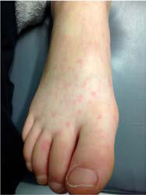

# Chapter 766: Rat Bite Fever

*David A. Hunstad*

<!-- p.5739 -->
**ETIOLOGY* Rat bite fever* is a generic term that has been applied to at least two distinct clinical syndromes, each caused by a different microbial agent. Rat bite fever caused by *Streptobacillus moniliformis* is most commonly reported in the United States as well as in Brazil, Canada, Mexico, Paraguay, Great Britain, and France; it has been identified elsewhere in Europe and in Australia. *S. moniliformis* is a gram-negative bacillus that is present in the nasopharyngeal flora of many laboratory and wild rats. Infection with *S. moniliformis* most commonly occurs following the bite of a rat; however, infection has also been reported in individu als who have been scratched by rats, in those who have handled dead rats, and in those who have ingested milk contaminated with the bac terium (termed **Haverhill fever**). Rat bite fever may also be transmitted by bites from wild mice. Rat bite fever caused by *Spirillum minus,* called **sodoku** (after the Japanese for “rat” and “poison”), is most commonly reported in Asia. *S. minus* is a small, spiral, aerobic gram-negative organism. Reports of rat bite fever from Africa are rare, suggesting under recognition rather than absence of the disease.

**CLINICAL COURSE** The incubation period for the streptobacillary form of rat bite fever is variable, ranging from 3-10 days. The illness is characterized by an *abrupt* onset of fever up to 41°C (105.8°F) in over 90% of reported cases, as well as severe throbbing headache, intense myalgias, chills, and vom iting. In virtually all instances, the lesion at the cutaneous inoculation

*David A. Hunstad*

A B

**Fig. 766.1** Morbilliform rash on the hands/palms (A) and feet (B) of a patient with rat bite fever. (From Vetter NM, Feder HM Jr, Ratzan RM. Rat bite fever caused by a kiss. Am J Emer Med. 2015;34:1190.e3– 1190.e4. Figs. 1 and 3.)

**Fig. 766.2** Hemorrhagic vesicles on the first and third toes of a pa tient with advanced rat bite fever. (From Elliott SP. Rat bite fever and Streptobacillus moniliformis. Clin Microbiol Rev. 22007;20:13–22. Fig. 3.)

high risk for rabies, and postexposure prophylaxis is uniformly indicated. For dogs, cats, and other animals that are known or cap tured, observation for 7-10 days by the local animal control depart ment is indicated, and rabies prophylaxis can be delayed as long as the animal remains asymptomatic. If a biting dog or cat has escaped, a decision about rabies prophylaxis can be based on the circum stances surrounding the bite and advice from local infectious dis ease specialists and/or health department officials. Worldwide, animal bites and contacts result annually in more than 10 million courses of rabies postexposure prophylaxis.

In human bites where the biter’s blood may have contaminated the wound, risk for hepatitis B, hepatitis C, and HIV infections should be considered (see Chapters 322 and 406).

**PREVENTION** It is possible to reduce the risk of animal bite injury with anticipa tory guidance. Parents should be routinely counseled during pre natal visits and routine health maintenance examinations about the risks of having potentially biting pets in the household. All patients should be cautioned against harboring exotic animals as pets. All young children should be closely supervised, particularly when in the presence of animals, and from a very early age should be taught to respect animals and to be aware of their potential to inflict injury. Reduction of the rate of human bite injuries, particularly in daycare centers and schools, can be achieved by good surveillance of the children and adequate teacher-to-child ratios.

*Visit Elsevier eBooks+ at eBooks.Health.Elsevier.com** for Bibliography.*

site has healed by the time that systemic systems first appear. Shortly after the onset of the fever, a polymorphous rash occurs in up to 75% of patients. In most patients, the rash consists of blotchy red maculo papular lesions that often have a petechial component; the distribution of the rash is variable, but it is typically most dense on the extremities (Fig. 766.1). Hemorrhagic vesicles may develop on the hands and feet and are very tender to palpation (Fig. 766.2).

Approximately 50% of patients have arthritis, which first manifests toward the end of the first week of disease; early on, the arthritis may be migratory. If untreated, fever, rash, and arthritis last from 14-21 days, often with a biphasic pattern to the fever and arthritis. A wide range of complications are reported in patients with rat bite fever, the most common being pneumonia, persistent arthritis, brain and soft tissue abscesses, and, less commonly, myocarditis or endocardi tis. The mortality rate in untreated rat bite fever is estimated to be 10–15%. The incubation period of sodoku is longer (14-21 days) than that of the streptobacillary form of disease. The hallmark of *Spirillum*-induced disease is fever associated with an indurated, often suppurative, non healing lesion at the bite site. Lymphadenitis and lymphadenopathy are invariably present in the regional nodes that drain the inoculation site, and many patients have a generalized macular rash most prominent

<!-- p.5742 -->
