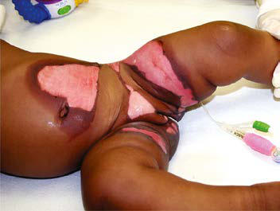

# Chapter 17: Abused and Neglected Children
> **Course:** Vikkypaedia Pediatric Basic Course (*Nelson Textbook of Pediatrics, 22nd Edition (2025)*)  
> **Part I:** The Field of Pediatrics  
> **Authors:** Howard Dubowitz and Wendy G. Lane  
> **Metrics:** 15,901 words · 7 tables/boxes · 2 figures · 1 genes · 8 flashcards · 5 MCQs  
> **Quick Navigation:** [🃏 Study 8 Flashcards](../flashcards/017_flashcards.md) · [📝 Take 5-Q MCQ Quiz](../mcqs/017_mcqs.md) · [📚 Part I Guide](../parts/Part_I.md) · [🧬 Syndrome & Genetics Atlas](../omim_gene_atlas.md) · [💊 Therapeutics Matrix](../therapies_matrix.md) · [🏠 Course Index](../../index.md)

## Key Chapter Topics & Subchapters
`17.1 Sexual Abuse` · `17.2 Factitious Disorder Imposed on Another: Medical Child Abuse (Munchausen Syndrome by Proxy)` · `17.1 Sexual Abuse Wendy G. Lane and Howard Dubowitz`

## Key Genetic & Molecular Targets
`TH`

## ⚡ High-Yield Nelson Pediatric Board Pearls
- Neglect is by far the most common form of maltreatment referred to CPS, involving 7 per 1,000 children.
- What can we do to keep them out of the hospital?” In sum, child maltreatment results from a complex interplay among risk and protective factors.
- The onus is on the clinician to carefully consider the differential diagnosis and not jump to conclusions.
- Bruises are the most common manifestation of physical abuse.
- Bruises are the most common injury to be missed or misdiagnosed among children who later present with fatal or near-fatal injuries.
- Most common in abused infants are rib, metaphyseal, and skull fractures.
- Few fractures are pathognomonic of abuse; all must be considered together with the history and child’s development.

---
## Full Chapter Text, Tables & Figures
# Chapter 17: Abused and Neglected Children

*Howard Dubowitz and Wendy G. Lane*

<!-- p.216 -->
The abuse and neglect (maltreatment) of children are pervasive problems worldwide, with short- and long-term physical and men tal health, cognitive, social, and economic consequences. Primary care professionals (PCPs) serving children have an important role in helping address this problem. In addition to their responsibil ity to identify maltreated children and help ensure their protection, health, and well-being, PCPs can also play vital roles related to pre vention, treatment, and advocacy. While securing a child’s safety is a priority, the child welfare system also aims to improve families’ functioning and enable them to adequately care for their children.

**DEFINITIONS** Abuse is defined as acts of commission, neglect as acts of omission. The U.S. government offers a minimal definition of child abuse as “any recent act or failure to act on the part of a parent or caretaker, which results in death, serious physical or emotional harm, sexual abuse or exploitation, or an act or failure to act which presents an imminent risk of serious harm.” Many states include other household members and a broader set of circumstances. Children may face situations in which no actual harm has occurred and no imminent risk of serious harm is evident, yet potential harm is a concern. Many states include *potential harm* in their child abuse laws. This is critical to preventing maltreat ment, although predicting harm is inherently difficult. Two aspects should be considered: the likelihood and the severity of the potential harm.

Physical abuse includes beating, shaking, burning, drowning, suf focating, and biting. Physical punishment remains controversial, although it is increasingly being prohibited. The Global Initiative to End All Physical Punishment of Children reported that 62 countries have banned physical punishment in all settings, including the home; 135 have done so for schools, and governments in 27 other countries have committed to full prohibition. In the United States, physical pun ishment in the home remains lawful in all states, and 20 still permit it in schools.

The threshold for when physical punishment should be consid ered as abuse is unclear. One can consider any injury beyond tran sient redness such as from a slap as abuse. Proponents of physical punishment suggest that if parents spank a child, it should be lim ited to the buttocks, be over clothing, and should never involve the head and neck. When parents use objects other than a hand, the potential for serious harm increases. Acts of serious violence (e.g., throwing a hard object, slapping an infant’s face) should be seen as abusive even if no injury ensues; significant potential harm exists. Although some PCPs think that hitting is acceptable under limited conditions, almost all prefer more constructive approaches to dis cipline. The American Academy of Pediatrics issued a policy state ment clearly opposing the use of physical punishment. Although many agree that hitting a child should never be accepted, and research has amply documented the potential harm, there remains a reluctance in the United States to label hitting as abuse—unless there is an injury. Clearly the emotional impact of being hit may leave the most worrisome and lasting scars, long after the bruises fade and the fractures heal.

Neglect refers to omissions in care resulting in actual or poten tial harm. Omissions include inadequate healthcare, education,

supervision, or protection from hazards in the environment and unmet physical needs (e.g., clothing, food) and inadequate emo tional support. A preferable alternative to focusing on caregiver omissions is to instead consider the *basic needs* (or rights) of chil dren (e.g., adequate food, clothing, shelter, healthcare, education, nurturance). Neglect occurs when a need is not adequately met and results in actual or potential harm, whatever the reasons. A broad definition concerned with children’s needs fosters a more compre hensive understanding of what contributes to neglect in addition to the potential parental role. A child-focused definition also offers a more constructive approach to ensure a child’s needs are adequately met in contrast to one that narrowly focuses on and blames par ents. A child whose health is jeopardized or harmed by not receiv ing necessary care experiences medical neglect. This view enables professionals to approach the problem in terms of what the child needs, rather than focusing on what parents did badly. Not all such situations necessarily require a referral to child protective services (CPS); less intrusive initial efforts may be appropriate.

Psychologic abuse includes verbal abuse and humiliation and acts that scare or terrorize a child. Although this form of abuse may be extremely harmful to children, resulting in problems such as depression, anxiety, poor self-esteem, and lack of empathy, CPS seldom becomes involved because of the difficulty in proving such allegations. PCPs should still carefully consider this form of mal treatment, even if the concern fails to reach a legal or agency thresh old for referral. These children and families can still benefit from counseling and other services. Many children experience more than one form of maltreatment; CPS is more likely to address psycho logic abuse in the context of other forms of maltreatment.

**INCIDENCE AND PREVALENCE** Abuse and neglect mostly occur behind closed doors and often remain a dark, well-kept secret. Rates of maltreatment are thus difficult to estimate. Nevertheless, the problem is globally prevalent.

**Global Situation** The World Health Organization (WHO) estimates that nearly 3 in 4 children, or 300 million children aged 2-4 years, regularly suffer physi cal punishment and/or psychologic violence at the hands of parents. In addition, as many as 1 in 5 women and 1 in 13 men report having been sexually abused as a child. Less international research has been done on child neglect. Nevertheless, neglect too is clearly a global prob lem. For example, a large study (n = 41,194) of Balkan countries found lifetime rates of neglect ranging from 23% in Romania to 48% in Bos nia. Among Hong Kong adults, 45% reported a history of childhood neglect. Rates as high as 94% of children for emotional neglect and 89% for physical neglect were found in Burundi, a country severely affected by civil war and political violence. Varying definitions, poli cies, and practices concerning child maltreatment preclude comparing rates across countries.

**United States** There were 4.4 million reports to CPS involving 7.9 million chil dren in the United States in 2019. Of the 656,000 children with substantiated reports (8.9 per 1,000 children), 75% experienced neglect (including 2.3% medical neglect), 17.5% physical abuse, 9.3% sexual abuse, and 6.8% psychologic maltreatment. Neglect is by far the most common form of maltreatment referred to CPS, involving 7 per 1,000 children. Although there had been a welcome decline in rates beginning in the early 1990s, rates increased in 2014 and 2015 and stayed stable until the COVID-19 pandemic, when reports of physical abuse increased. Medical personnel made 11% of all reports. Sources other than official CPS statistics indicate that the incidence of maltreatment is far greater than what gets reported to CPS. In a community survey, for example, 3% of parents reported using very severe violence (e.g., hitting with fist, burning, using gun or knife) toward their child in the prior year.

*Howard Dubowitz and Wendy G. Lane*

<!-- p.217 -->
**ETIOLOGY** Child maltreatment seldom has a single cause; rather, multiple and interacting biopsychosocial risk factors at four levels usually interact and contribute to the problem. At the individual level*,* a child’s disability or behavioral challenges or a parent’s depression or substance use pre dispose a child to maltreatment. At the familial level*,* intimate partner (or domestic) violence jeopardizes children’s health and development. Influential community factors include stressors such as dangerous neighborhoods with few supports or recreational facilities. Professional inaction may contribute to neglect, such as when the treatment plan is not clearly communicated or risk factors are ignored. Broad societal factors*,* such as poverty and its many associated burdens, also contrib ute significantly to maltreatment. The WHO estimates the rate of child homicide is approximately twofold higher in low-income compared to high-income countries (2.58 vs 1.21 per 100,000 population). Neverthe less, children at all income levels can be maltreated, and PCPs need to guard against biases concerning minoritized and low-income families.

In contrast, protective factors, such as family supports or a par ent’s concern for their child, may buffer risk factors and protect children from maltreatment. Deliberately identifying and incorpo rating protective factors is vital to intervening effectively. One can say to a parent who did not fill a prescription, for example, “I can see how much you love [child’s name]. What can we do to keep them out of the hospital?” In sum, child maltreatment results from a complex interplay among risk and protective factors. A single parent who has a colicky baby and who recently lost their job has multiple risk factors, but a loving grandparent may be protective. A good assessment and understanding of both risk and protective factors guide an appropriate response.

**OUTCOMES** All forms of child maltreatment jeopardize children’s physical and emotional health and their cognitive and social development, mani festing in a wide array of possible problems—in the short and the long term. Problems in adolescence and adulthood include health risk behaviors (e.g., smoking, alcohol, and substance use), men tal health problems (e.g., anxiety, depression, suicide attempt), and physical health problems (e.g., heart disease, cancer). Mal treated children are also at risk for becoming maltreating parents. The impact of neuroendocrine stress responses to child abuse and neglect on the developing brain may partly explain some of these sequelae.

Some maltreated children appear to be resilient and function rela tively well, perhaps owing to protective factors or interventions. Still, PCPs and parents need to be sensitive to the possibility of later prob lems (“sleeper effects”). The benefits of intervention have been found in even the most severely neglected children, such as those rescued from Romanian orphanages in the early 1990s, who were adopted— the earlier, the better. That said, resilience is a relative concept, and few severely maltreated children escape unscathed.

**CLINICAL MANIFESTATIONS** Child abuse and neglect can manifest in a myriad of ways (Table 17.1). A critical element of physical abuse is the lack of a plausible history other than inflicted trauma. The onus is on the clinician to carefully consider the differential diagnosis and not jump to conclusions.

Bruises are the most common manifestation of physical abuse. Features suggestive of abuse include (1) bruising in a preambulatory infant (occurring in just 2% of such infants), (2) bruising of padded and less exposed areas (buttocks, cheeks, ears, neck, genitalia), (3) pat terned bruising conforming to the shape of an object (Fig. 17.1), and (4) multiple bruises, especially if clearly of different ages. Earlier sug gestions for estimating the age of bruises, however, have long been discredited. It is very difficult to precisely age bruises. The **TEN-4 FACESp** mnemonic is useful for when to suspect abuse in children under 4 years of age: torso, ear, neck, frenulum, angle of jaw, cheeks [fleshy], eyelids, subconjunctivae, and patterned, as well as *any* bruise

in children under 4 months, helps identify suspicious bruises. This prediction rule is 95.6% sensitive and 87.1% specific for identifying abuse.

In nonmobile infants, bruises are considered a **sentinel injury** because of the low likelihood of noninflicted injury. Bruises are the most common injury to be missed or misdiagnosed among children who later present with fatal or near-fatal injuries. Other sentinel injuries include oropharyngeal injuries in children <6 months of age and subconjunctival hemorrhage in healthy children under 4 years of age.

Conditions such as birthmarks, including slate gray nevus (congeni tal dermal melanocytosis or Mongolian spots), can be confused with bruises and abuse. Other mimics are noted in Table 17.2. These skin markings are not tender and do not rapidly change color or size. An underlying medical explanation for bruises may exist, such as blood dyscrasias (hemophilia) or connective tissue disorders (Ehlers-Danlos syndrome). The history or examination usually provides clues to these conditions. Hemorrhagic edema of infancy and IgA vasculitis (Henoch-Schönlein purpura) is the most common vasculitis in young

#### **Table 17.1** Injury Patterns

| Category / Parameter | Clinical Details & Findings |
| --- | --- |
| **PATTERN OBSERVED** | Grip/grab; Relatively round marks that correspond to; fingertips and/or thumb; Closed-fist punch; Series of round bruises that correspond; to the knuckles of the hand; Slap; Parallel, linear bruises (usually petechial); separated by areas of central sparing; Belt/electrical cord; Loop marks or parallel lines of petechiae; (the width of the belt/cord) with central; sparing, may see triangular marks from; the end of the belt, small circular lesions; caused by the holes in the tongue of the; belt, and/or a buckle pattern; Rope; Areas of bruising interspersed with areas; of abrasion; Other objects/; household implements; Injury in shape of object/implement (e.g.,; rods, switches, and wires cause linear; bruising); Human bite; Two arches forming a circular or oval; shape, may cause bruising and/or; abrasion; Strangulation; Petechiae of the head and/or neck,; including mucous membranes; may see; subconjunctival hemorrhages; Binding/ligature; Marks around the wrists, ankles, or neck;; sometimes accompanied by petechiae; or edema distal to the ligature mark; Punishment by kneeling; on salt or other rough; substance; Abrasions/burns, especially to knees; Hair pulling; Traumatic alopecia; may see petechiae; on underlying scalp or swelling or; tenderness of the scalp (from subgaleal; hematoma); Tattooing or intentional; scarring; Abusive cases have been described but; can also be a cultural phenomenon; (e.g., Māori body ornamentation); may; also be a symbol of ownership in a; youth being sexually trafficked |

<!-- p.218 -->
children, and may be confused with abuse. The pattern and location of bruises caused by abuse are usually different from those caused by a coagulopathy. Noninflicted bruises are characteristically anterior and over bony prominences, such as shins and foreheads. However, the *presence of a medical disorder does not preclude abuse*.

Cultural practices can cause bruising. Cao gio, or coining, is a South east Asian folkloric therapy. A hard object is vigorously rubbed on the skin, causing petechiae or purpura. *Cupping* is another approach, popular in the Middle East. A heated glass is applied to the skin, often on the back. As it cools, a vacuum forms, leading to perfectly circular bruises. The context here is important, and such circumstances should not be considered abusive (see Chapter 12).

A careful history of bleeding problems in the patient and first-degree relatives is needed. If a bleeding disorder is suspected, a complete blood count, including platelet count, prothrombin time, and partial throm boplastin time, should be obtained. More extensive testing, such as for factors VIII, IX, and XIII activity and von Willebrand disease, should be considered in consultation with a hematologist.

Bites have a characteristic pattern of one or two opposing arches with multiple bruises. They can be inflicted by an adult, another child, an animal, or the patient. Forensic odontologists developed guidelines for distinguishing adult from child and human from animal bites. How ever, several recent studies have identified problems with the accuracy and consistency of bite mark analysis.

Burns may be inflicted, noninflicted, or the result of inadequate supervision. Scalding burns may result from immersion or splash. *Immersion burns,* when a child is forcibly held in hot water, show a clear delineation between the burned and healthy skin and uni form depth (Fig. 17.2). They may have a sock or glove distribution. Splash marks are usually absent, unlike when a child inadvertently encounters hot water. Symmetric burns are strongly suggestive of abuse, as are burns of the buttocks and perineum. Although most often noninflicted, splash burns may also result from abuse. Burns from hot objects such as curling irons, radiators, steam irons, metal grids, hot knives, and cigarettes leave patterns indicating the object (Fig. 17.3). A child is likely to try to rapidly escape from a hot object; thus burns that are extensive and deep reflect more than fleeting contact and suggest abuse.

Several conditions mimic abusive burns, such as brushing against a hot radiator, car seat burns, congenital insensitivity to pain syndromes, and folk remedies such as moxibustion. Impetigo may resemble ciga rette burns. Cigarette burns are usually 7-10 mm across, whereas impe tigo has lesions of varying size. Noninflicted cigarette burns are usually oval and superficial.

Neglect frequently contributes to childhood burns. Children left home alone may be burned in house fires. A parent taking drugs

may cause a fire and be unable to protect a child. Exploring children left unattended may pull hot liquids onto themselves. Liquids cool as they flow downward so that the burn is most severe and broad proximally, often in an inverted triangle pattern. If the child is wear ing a diaper or clothing, the fabric may absorb the hot water and cause burns worse than otherwise expected. Burns through clothing tend to have an irregular pattern. Some circumstances are difficult to foresee, and a single burn resulting from a momentary lapse in supervision should not automatically be construed as neglect.

Concluding whether a burn was inflicted depends on the history, burn pattern, and the child’s capabilities. A delay in seeking healthcare may result from the burn initially appearing minor, before blistering or becoming infected. This circumstance may represent reasonable behavior and should not be automatically deemed neglectful. A scene investigation by law enforcement is often valuable (e.g., testing the water temperature).

Fractures that strongly suggest abuse include those of the pos terior ribs, scapula, sternum, and spinous processes and classic metaphyseal lesions—especially in young children (Table 17.3). These fractures all require more force than would be expected from a minor fall or routine handling and activities of a child. Rib and sternal fractures rarely result from cardiopulmonary resuscitation, even when performed by untrained adults. The recommended twofinger or two-thumb technique for infants may, however, produce anterolateral rib fractures. Most common in abused infants are rib (Fig. 17.4), metaphyseal (Fig. 17.5), and skull fractures. Femo ral and humeral fractures in nonambulatory infants are also very worrisome for abuse. In contrast, with increasing mobility and running, toddlers can fall with enough rotational force to cause a spiral, femoral fracture. Multiple fractures in various stages of heal ing are suggestive of abuse. In some circumstances, such as when there are multiple or repeated fractures or a family history of such, underlying medical conditions need to be considered. Clavicular, femoral, supracondylar humeral, and distal extremity fractures in children older than 2 years are most likely noninflicted unless they are multiple or accompanied by other signs of abuse. Few fractures are pathognomonic of abuse; all must be considered together with the history and child’s development.

The differential diagnosis includes conditions that increase sus ceptibility to fractures, such as osteopenia and osteogenesis imper fecta, metabolic and nutritional disorders (e.g., scurvy, rickets), renal osteodystrophy, osteomyelitis, congenital syphilis, and neo plasia (see Table 17.2). Some have pointed to possible rickets and low but subclinical levels of vitamin D as being responsible for frac tures thought to be due to abuse. The evidence, however, refutes this supposition. Features of congenital or metabolic conditions

**Fig. 17.1** A variety of instruments may be used to inflict injury on a child. Often the choice of an instrument is a matter of convenience. Marks tend to silhouette or outline the shape of the instrument. The possibility of in tentional trauma should prompt a high degree of suspicion when injuries to a child are geometric, paired, mir rored, of various ages or types, or on relatively protected parts of the body. Early recognition of intentional trauma is important to provide therapy and prevent escalation to more serious injury.

Belt buckle Belt Looped cord

**MARKS from INSTRUMENTS**

Stick/whip

Fly swatter Coat hanger Board or spatula Hand/knuckles

Bite Sauce pan Paddles Hair brush Spoon

<!-- p.219 -->
associated with noninflicted fractures include family history of recurrent fractures after minor trauma, abnormally shaped cra nium, dentinogenesis imperfecta, blue sclera, impaired hearing, craniotabes, ligamentous laxity, bowed legs, hernia, and translucent skin. *Subperiosteal new bone formation* is a nonspecific finding seen in infectious, traumatic, and metabolic disorders. In young infants, new bone formation may be a normal physiologic finding; it is usu ally bilateral, symmetric, and less than 2 mm in depth.

The evaluation of a fracture should include a skeletal survey in children less than 24 months of age when abuse seems possible (Table 17.4). Multiple radiographs with different views are needed; “babygrams” (one or two films of the entire body) should be avoided. If a fracture is found or when the survey is normal but concern for an occult injury remains, a follow-up survey should be completed 2 weeks later, as it may reveal fractures not apparent initially. Omission of skull, spine, and pelvis films on repeat survey reduces radiation exposure while still capturing most occult fractures.

In corroborating the history and the injury, the age of a fracture can be crudely estimated (Table 17.5). Soft tissue swelling subsides in 2-21 days. Subperiosteal new bone is visible within 4-21 days. Loss of defi nition of the fracture line and visible soft callus formation occur on a similar timeline. Hard callus is visible between 14 and 90 days. These ranges are shorter in infancy and longer in children with poor nutri tional status or a chronic underlying disease. Fractures of flat bones such as the skull do not form a callus and cannot be aged, although soft tissue swelling indicates recency (i.e., within the prior week).

Abusive head trauma (AHT) results in significant morbidity and mortality. Abusive injury may be caused by direct impact, asphyxia, shaking, or a combination. Subdural hematomas (Fig. 17.6); retinal hemorrhages, especially when extensive and involving multiple lay ers; brain parenchymal injury; and fractures (often rib and classic metaphyseal lesions) strongly suggest AHT, especially when they occur together. Infants’ poor neck muscle tone and relatively large heads make them vulnerable to acceleration-deceleration forces if severely shaken, leading to AHT. Children may lack external signs of injury, even with serious intracranial trauma. The clinical presentation var ies, ranging from nonspecific lethargy, to vomiting (without diarrhea), changing neurologic status or seizures, or coma. In all preverbal chil dren, the possibility of AHT should be considered when children pres ent with these signs or symptoms.

Acute intracranial trauma is best evaluated via CT. CT helps iden tify bone and soft tissue injury. Some centers use fast-sequence MRI to reduce radiation exposure, but the sensitivity may not be as good as CT. MRIs are helpful in differentiating extraaxial fluid, determin ing the approximate time of injuries, assessing parenchymal injury, and identifying vascular anomalies. Neck imaging may identify spinal subdural blood and ligamentous, spinal cord, and nerve root injuries. MRIs are best obtained 5-7 days after an acute injury. Other causes of subdural hemorrhage in infants include arteriovenous malforma tions, coagulopathies, birth trauma, tumor, and infections (see Table 17.2). Glutaric aciduria type 1 can present with intracranial bleeding and should be considered. When AHT is suspected, possible injuries elsewhere—especially skeletal and abdominal—should be ruled out.

Retinal hemorrhages are an important marker of AHT (Fig. 17.7). When ever AHT is being considered, a dilated indirect eye examination by a pedi atric ophthalmologist should be performed. Although retinal hemorrhages can be found in other conditions, hemorrhages that are multiple, involve more than one retinal layer, and extend to the periphery are very suspi cious for abuse. The mechanism is likely repeated acceleration-deceleration caused by shaking. Traumatic retinoschisis points strongly to abuse.

With other causes of retinal hemorrhages, the pattern is usually dif ferent from that seen in child abuse. After birth, many newborns have them, but they disappear by 2-6 weeks. Coagulopathies (particularly leukemia), retinal diseases, carbon monoxide poisoning, and glutaric aciduria may be responsible. Severe noninflicted direct crush injury to the head can rarely cause an extensive hemorrhagic retinopathy. Car diopulmonary resuscitation rarely, if ever, causes retinal hemorrhages in infants and children; if present, there are only a few hemorrhages in the posterior pole. Hemoglobinopathies, diabetes mellitus, routine play, minor noninflicted head trauma, and vaccinations do not appear to cause retinal hemorrhage in children. Severe coughing or seizures rarely cause retinal hemorrhages that could be confused with AHT.

The dilemma frequently posed is whether minor, everyday forces can explain the findings seen in AHT. Simple linear skull fractures in the absence of other suggestive evidence can be explained by a short fall, although even that is unusual (1–2%); underlying brain injury from short falls is exceedingly rare. Timing of brain injuries in cases of abuse is not precise. In fatal cases, however, the trauma most likely occurred very soon before the child became symptomatic.

Other manifestations of AHT may be seen. *Raccoon eyes* are asso ciated with subgaleal hematomas after traction on the anterior hair and scalp or a blow to the forehead. Neuroblastoma can present simi larly. Bruises from attempted strangulation may be visible on the neck. Choking or suffocation can cause hypoxic brain injury, often with no external signs.

**Oral lesions** may present as bruised lips, bleeding, torn frenulum, and dental trauma or multiple caries (neglect).

Abdominal trauma also accounts for significant morbidity and mortality in abused children. Young children are especially vulner able because of their relatively large abdomens and lax abdominal musculature. A forceful blow or kick can cause hematomas of solid organs (liver, spleen, kidney) from compression against the spine, as well as hematomas (duodenal) or rupture (stomach) of hollow organs. Intra-abdominal bleeding may result from trauma to an organ or from

#### **Table 17.2** Mimics of Nonaccidental Trauma

| Category / Parameter | Clinical Details & Findings |
| --- | --- |
| **CUTANEOUS LESIONS** | Accidental trauma; Congenital coagulation defects (hemophilia, von Willebrand disease); Acquired coagulation defects (aplastic anemia, ITP, leukemia, vitamin; K deficiency); Ehlers-Danlos syndrome; Vitamin C deficiency; Impetigo; Vasculitis (IgA vasculitis: Henoch-Schönlein purpura); Dermal melanocytosis (Mongolian spots); Cupping; Coining; Spooning |
| **SKELETAL LESIONS** | Osteogenesis imperfecta; Obstetric trauma; Caffey disease; Rickets (not just low 25-hydroxy-vitamin D levels); Hyper-IgE syndrome; Recurrent multifocal osteomyelitis; Skeletal dysplasias |
| **HEAD TRAUMA** | Birth trauma; Hemophilia; Factor XIII deficiency; Vitamin K deficiency (malabsorption); Cobalamin C defect; Osteogenesis imperfecta; Ehlers-Danlos syndrome; Glutaric aciduria type I; Menkes syndrome; Vasculitis (primary CNS, systemic); Benign enlargement of subarachnoid spaces; ITP, Immune thrombocytopenic purpura; IgA, immunoglobulin A; IgE, immunoglobulin; E; CNS, central nervous system. |

<!-- p.220 -->
C D A B

**Fig. 17.2** Immersion injury patterns. A, Sparing of flexural creases. B, Immersion “sock” burn. C, Immersion “glove” burn. D, Immersion buttocks burn. (From Jenny C. Child abuse and neglect: diagnosis, treatment, and evidence. Philadelphia: Saunders;2011: Fig. 28-3, p. 225.)

**Fig. 17.3** Marks from heated objects cause burns in a pattern that dupli cates that of the object. Familiarity with the common heated objects that are used to traumatize children fa cilitates recognition of possible inten tional injuries. The location of the burn is important in determining its cause. Children tend to explore surfaces with the palmar surface of the hand and rarely touch a heated object repeat edly or for a long time.

Hot plate Light bulb Curling iron Car cigarette

lighter

Steam iron

Knife Grid Cigarette Forks Immersion

**BURN MARKS**

#### **Table 17.3** Specificity of Radiologic Findings

| Category / Parameter | Clinical Details & Findings |
| --- | --- |
| **HIGH SPECIFICITY*** | Classic metaphyseal lesions; Rib fractures, especially posteromedial; Scapular fractures; Spinous process fractures; Sternal fractures |
| **MODERATE SPECIFICITY** | Multiple fractures, especially bilateral; Fractures of different ages; Epiphyseal separations; Vertebral body fractures and subluxations; Digital fractures; Complex skull fractures; Pelvic fractures |
| **COMMON BUT LOW SPECIFICITY** | Subperiosteal new bone formation; Clavicular fractures; Long bone shaft fractures; Linear skull fractures; *Highest specificity applies in infants; From Kleinman PK. Diagnostic imaging of child abuse, 3rd ed. Cambridge, UK:; Cambridge University Press;2015: 24. |

**Fig. 17.4** High detail oblique view of the ribs of a 6-month-old infant shows multiple healing posteromedial rib fractures (arrowheads). The level of detail in the image is far greater that what would be present on a standard chest radiograph. (From Dwek JR. The radiographic approach to child abuse. Clin Orthop Relat Res. 2011;469:776–789, Fig. 4.)

<!-- p.221 -->
shearing of a vessel. More than one organ may be affected. Children may present with cardiovascular failure or an acute abdomen, often after a delay in care. Bilious vomiting without fever or peritoneal irrita tion suggests a duodenal hematoma, often the result of abuse.

The manifestations of abdominal trauma are often subtle, even with severe injuries. Bruising of the abdominal wall is unusual, and symp toms may evolve slowly. Delayed perforation may occur days after the injury; bowel strictures or a pancreatic pseudocyst can develop weeks or months later. PCPs should consider screening for occult abdomi nal trauma when other evidence of physical abuse exists. Screening should include liver and pancreatic enzyme levels and testing urine for blood. When results indicate possible injury or if there is concern about possible splenic, adrenal, or hepatic injury, an abdominal CT is indicated.

Neglect is the most prevalent form of child maltreatment, with potentially severe and lasting sequelae. It may manifest in many ways, depending on which basic needs are not adequately met. Nonadherence

to medical treatment, for example, may aggravate the condition, as may a delay in seeking healthcare. Inadequate food may manifest as impaired growth; inattention to obesity is also a problem. Poor hygiene may contribute to infected cuts or lesions. Inadequate supervision contributes to injuries and ingestions. Children’s needs for mental healthcare, dental care, and other healthcare may be inadequately met, manifesting as neglect. Educational needs, particularly for children with learning disabilities, are often not adequately met.

**GENERAL PRINCIPLES FOR ASSESSING POSSIBLE PHYSICAL ABUSE AND NEGLECT** The heterogeneity of circumstances in situations of child maltreatment precludes specific detailing of varied assessments. The following are useful general principles: • Given the complexity and possible ramifications of determining

child maltreatment, an **interdisciplinary assessment** is optimal, with input from all involved professionals. Consultation with a phy sician expert in child abuse pediatrics is recommended. • A thorough **history** should be obtained from the parent(s), optimal

ly via separate interviews. • Verbal children should be interviewed separately in a developmen

tally appropriate manner. **Open-ended questions** (e.g., “Tell me what happened”) are best. Some children need more directed

A C B Posterior

**Fig. 17.5** A, Metaphyseal fracture of the distal tibia in a 3-month-old infant admitted to the hospital with severe head injury. There is also periosteal new bone formation of the tibia, perhaps from previous injury. B, Bone scan of the same infant. The initial chest x-ray showed a single fracture of the right posterior fourth rib. A radionuclide bone scan performed 2 days later revealed multiple previously unrecognized fractures of the posterior and lateral ribs. C, Follow-up radiograph 2 weeks later showed multiple healing rib fractures. This pattern of fractures is highly specific for child abuse. The mechanism of these injuries is usually violent squeezing of the chest.

Children under 2 Years of Age*

#### **Table 17.4** Radiologic Skeletal Survey for Infants and

| Category / Parameter | Clinical Details & Findings |
| --- | --- |
| **General** | • Anteroposterior (AP) and lateral views of skull (Townes view; optional; add if any fracture seen); • Lateral spine (cervical spine [C-spine] may be included on skull; radiographs; AP spine is included on AP chest and AP pelvis views; to include entire spine); • AP view, right posterior oblique, left posterior oblique view of; chest-rib technique; • AP pelvis; • AP view of each femur; • AP view of each leg; • AP view of each humerus; • AP view of each forearm; • Posteroanterior (PA) view of each hand; • AP (dorsoventral) view of each foot; *Images are checked by a radiologist before the patient leaves. Poorly positioned; or otherwise suboptimal images should be repeated. Lateral views are added for; positive or equivocal findings in the extremities. Coned views of positive or equivocal; findings (i.e., at ends of long bones, ribs) may be obtained.; Adapted from Coley BD. Caffey’s pediatric diagnostic imaging, 12th ed. Philadelphia:; Mosby;2013: Box 144-1, p. 1588. |

Fractures*

#### **Table 17.5** Timetable of Radiologic Changes in Children’s

| Category / Parameter | Clinical Details & Findings |
| --- | --- |
| **1. SPNBF** | 4-10 days; 10-14 days; 14-21 days; 2. Loss of fracture line; definition, days; 10-14 days; 14-21 days; 3. Soft callus; 10-14 days; 14-21 days; 4. Hard callus; 14-21 days; 21-42 days; 42-90 days; The time points tend to increase from early infancy into childhood.; *Repetitive injuries may prolong all categories.; SPNBF, Subperiosteal new bone formation.; From Kleinman PK. Diagnostic imaging of child abuse, 3rd ed. Cambridge, UK:; Cambridge University Press;2015: p. 215. |

<!-- p.222 -->
questioning (e.g., “How did you get that bruise?”); others need multiple-choice questions. Leading questions must be avoided (e.g., “Did your daddy hit you?”). • A thorough **physical examination** is necessary. • Careful **documentation** of the history and physical is essential. Ver

batim quotes are valuable, including the question that prompted the response. Photographs are helpful. • For **abuse**, the assessment should answer these questions: What is

the evidence for concluding abuse? Have other diagnoses been ruled out? What is the likely mechanism of the injury? When did the in jury likely occur? • For **neglect**, the assessment should answer these questions: Do

the circumstances indicate that the child’s needs have not been ad equately met? Is there evidence of actual harm? Is there evidence of potential harm and on what basis? Suboptimal treatment adherence may not be ideal but lead to few or no consequences. What is the nature of the neglect? Is there a pattern of neglect? • It may be **difficult to be certain** regarding the likelihood of abuse or

neglect. The use of “possible” or “probable” is recommended when uncertain. Inadequacies in the care children receive naturally fall along a continuum, requiring a range of responses tailored to the in dividual family’s situation. Legal considerations or CPS practice may discourage PCPs from labeling many circumstances as neglect. Even if neglect does not meet a threshold for referring to CPS, profession als can still help ensure children’s needs are adequately met. • Are there indications of **other forms of maltreatment**? Has there

been prior CPS involvement? • A child’s **safety** is a paramount concern. What is the risk of immi

nent harm and of what severity? • What is contributing to the maltreatment? Consider the categories

described in the section on etiology. • What **strengths/resources** are there? This is as important as identi

fying problems. • What **treatment or services** do the child and family need? What

interventions have been tried and with what results? Knowing the nature of these interventions can be useful, especially from the par ent’s perspective. • What is the **prognosis**? Is the family motivated to improve the cir

cumstances and accept help, or are they resistant? Are needed re sources, formal and informal, available? • Are there **other children** in the home who should be assessed for

maltreatment?

**GENERAL PRINCIPLES FOR ADDRESSING PHYSICAL ABUSE AND NEGLECT** The heterogeneity of circumstances also precludes specific details regarding how to address different types of maltreatment. The follow ing are general principles: • Treat any medical problems. • Help ensure the child’s safety, often in conjunction with CPS; this is a

priority. In some instances, hospitalization is the prudent approach. • Convey concerns of maltreatment to parents, kindly but forthrightly.

Avoid blaming. It is natural to feel anger towards parents of mal treated children, but they need support and deserve respect. • Have a means of addressing the difficult emotions child maltreat

ment can evoke in us. Self-care is important. • Be empathic and state interest in helping or suggest another health

care professional. • Know the laws and/or local CPS policies on referring child maltreat

ment. In the United States, the legal threshold for referring is typi cally “reason to believe” (or “reason to suspect”); one does not need to be certain. Physical abuse and moderate to severe neglect warrant a referral. In less severe neglect, less intrusive interventions may be an appropriate initial response. For example, if an infant’s mild fail ure to gain sufficient weight is caused by an error in mixing the for mula, parent education and perhaps a visiting nurse should be tried. In contrast, severe growth faltering may require hospitalization, and, if the contributing factors are particularly serious (e.g., a psychotic mother), out-of-home placement may be needed. CPS can assess the home environment and provide valuable insights. • Referring child maltreatment to public agencies is never easy. Pa

rental inadequacy or culpability is at least implicit, and parents may become angry. PCPs should supportively inform families directly of the referral to CPS; it can be explained constructively as an effort to clarify the situation and provide help, as well as a professional (and legal) responsibility. Words matter, and “refer ral” avoids the stigma of “report,” and it is what we commonly

A B

**Fig. 17.6** CT scan indicating intracranial bleeding. A, Older blood. B, New blood.

**Fig. 17.7** Retinal hemorrhages. Arrows point to hemorrhages of varying sizes.

<!-- p.223 -->
do in healthcare. Explaining what the ensuing process is likely to entail (e.g., a visit from a CPS worker and sometimes a po lice officer) may ease a parent’s anxiety. Parents are frequently concerned that they might lose their child. PCPs can cautiously reassure parents that CPS is responsible for helping children and families and that, in most instances, children remain with their parents. When CPS does not accept a referral or when it is not substantiated, they may still facilitate supportive services such as food, shelter, parenting resources, and childcare. PCPs can be a useful liaison between the family and the public agencies and should try to remain involved after referring to CPS. • Help address contributory factors, prioritizing those that are most

important to the family and amenable to being remedied. Concrete needs should not be overlooked; accessing food programs, obtaining health insurance, enrolling children in preschool, and help finding housing can make a valuable difference. Parents may need their own problems addressed to enable them to adequately care for their chil dren. • Establish specific objectives (e.g., no hitting, diabetes will be

adequately controlled), with measurable outcomes (e.g., urine dipsticks, hemoglobin A1c). Similarly, advice should be specific and limited to a few reasonable steps. A written (and perhaps signed) contract can help establish the agreed-upon plan and help ensure it pans out. • Engage the family in developing the plan—solicit their input and

agreement. Motivational interviewing (MI) offers a fundamen tally different approach to working with parents (and older chil dren and teens), forging a partnership, and understanding their perceptions of an issue and how they think they can address it. Knowledge and skills regarding MI can enhance the effectiveness of PCPs (see Chapter 18). • Deliberately identify protective factors or strengths—within and

outside the family; there are always some. Incorporating these in one’s approach is a valuable way to engage parents and ensure plans get implemented. • Encourage informal supports (e.g., family, friends; invite fathers to

office visits). This is where most people get their support, not from professionals. Consider support available through a family’s reli gious affiliation. • Consider children’s specific needs. Too often, maltreated children do

not receive needed services. • Be knowledgeable about community resources and facilitate appro

priate referrals. Consider how to help ensure referrals pan out. • Provide support, follow-up, and review of progress, and adjust the

plan if needed. • Recognize that maltreatment often requires long-term intervention

with ongoing support and monitoring.

**PREVENTION OF PHYSICAL ABUSE AND NEGLECT** An important aspect of prevention is that many of the efforts to strengthen families and support parents should promote children’s health, development, well-being, and safety and prevent maltreat ment. Medical responses to child maltreatment have typically occurred after the fact; preventing the problem is preferable. PCPs can help in several ways. An ongoing relationship offers opportu nities to develop trust and knowledge of a family’s circumstances. Astute observation of parent–child interactions can reveal useful information.

Parent and child education regarding medical conditions helps to ensure implementation of the treatment plan and to prevent neglect. Possible barriers to treatment should be addressed. Practical strategies such as writing down the plan can help. In addition, anticipatory guid ance helps with positive parenting (see Chapter 20), diminishing the risk of maltreatment. Hospital-based programs that educate parents about caring for a crying infant and the risks of shaking may help pre vent AHT.

Screening for and addressing major psychosocial risk factors for maltreatment such as parental depression, substance use, intimate partner violence, major stress, and helping address identified prob lems, often via referrals, can help prevent maltreatment. Primary care offers excellent opportunities to screen briefly for psychosocial problems. The traditional organ system–focused review of systems can be expanded to probe areas such as feelings about the child, the parent’s own functioning, the relationship, possible depression, disciplinary approaches, stressors, and supports. The Safe Environ ment for Every Kid (SEEK) model offers an evidence-informed approach for pediatric primary care to identify and help address prevalent adverse childhood experiences (ACEs) (e.g., exposure to intimate partner violence, parental depression, or substance use) or social determinants of health (e.g., food insecurity, severe paren tal stress) that are also risk factors for child maltreatment. This approach should incorporate working with protective factors and use of MI principles in developing a plan jointly with the family.

Obtaining information directly from children or youth is also important, especially given that separate interviews with teens have become the norm. Any concerns identified on such screens require at least a brief assessment and initial management, which may lead to a referral for further evaluation and treatment. More frequent office visits can be scheduled for support and counseling while monitoring the situation. Other key family members (e.g., father, a grandparent) might be invited to participate, thereby encouraging informal support. Some practices arrange parent groups through which problems and solutions are shared. PCPs also need to rec ognize their limitations and facilitate referrals to other community resources.

**ADVOCACY** PCPs can assist in understanding what contributed to a child’s mal treatment. When advocating for the best interest of the child and family, addressing contributory factors at the individual, family, and community levels is optimal. At the individual level, an example of advocating on behalf of a child is explaining to a parent that an active toddler is behaving normally and not intentionally annoying the parent. Encouraging a parent to seek help dealing with a vio lent spouse, saying, for example, “You and your life are very impor tant”; asking about substance use; and helping parents obtain health insurance for their children are all forms of advocacy.

Efforts to improve family functioning, such as encouraging fathers’ involvement in the lives of their children, are also examples of advocacy. Remaining involved after a referral to CPS and helping ensure needed services are provided is advocacy as well. In the com munity, PCPs can be influential advocates for improving resources devoted to children and families. These include parenting pro grams, services for abused women and children, and recreational facilities. They can be strong advocates for policies and programs at the local, state, and national levels to benefit children and families. The problems underpinning child maltreatment, such as poverty, parental stress, substance use, and limited child-rearing resources, require policies and programs that enhance families’ abilities to care for their children at least adequately. Examples in the United States include Medicaid, the Supplemental Nutrition Assistance Program (SNAP), the Women, Infants, and Children (WIC) program, paid family and medical leave, the Earned Income Tax Credit (EITC), and childcare subsidies.

Child maltreatment is a complex problem without simple solu tions. Through partnerships with parents and colleagues in child protection, mental health, education, and law enforcement, PCPs can make an enormous difference in the lives of many children and families.

*Visit Elsevier eBooks+ at eBooks.Health.Elsevier.com** for Bibliography.*

<!-- p.224 -->

<!-- p.225 -->
Mills R, Alati R, O’Callaghan M, et al. Child neglect and cognitive function at 14 years

of age: findings from a birth cohort. Pediatrics. 2011;127:4–10. Naughton AM, Maguire SA, Mann MK, et al. Emotional, behavioral, and develop

mental features indicative of neglect or emotional abuse in preschool children: a systematic review. JAMA Pediatr. 2013;10:1–7. Proctor LJ, Dubowitz H. Child neglect: Challenges and controversies. In: Korbin JE

Krugman RD (Eds.). Handbook of Child Maltreatment (pp. 27–61). The Nether lands: Springer. https://doi.org/10.1007/978-94-007-7208-3-2. Turner HA, Vanderminden J, Finkelhor D, Hamby S. Child neglect and the broader

context of child victimization. Child Maltreatment. 2019;24(3):265–274. https:// doi.org/10.1177/1077559518825312. Vanderminden J, Hamby S, David-Ferdon C, Kacha-Ochana A, Merrick M, Simon

TR, et  al. Rates of neglect in a national sample: child and family characteris tics and psychological impact. Child Abuse Negl. 2019;88:256–265. https://doi. org/10.1016/j.chiabu.2018.11.014.

**Prevention** Avellar SA, Supplee LH. Effectiveness of home visiting in improving child health and

reducing child maltreatment. Pediatrics. 2013;132(2):S90–99. Butchart A, Kahane T, Harvey AP, et al. Preventing Child Maltreatment: A Guide to

Taking Action and Generating Evidence. Geneva: WHO and International Society for the Prevention of Child Abuse and Neglect; 2006. Dubowitz H, Feigelman S, Lane W. Pediatric primary care to help prevent child

maltreatment: the Safe Environment for Every Kid (SEEK) Model. Pediatrics. 2009;123:858–864. Dubowitz H, Lane WG, Semiatin JN, Magder LS. The SEEK model of pediatric pri

mary care: can child maltreatment be prevented in a low-risk population? Acad Pediatr. 2012;12(4):259–268. Flaherty EG, Stirling J. The Committee on Child Abuse and Neglect. The pediatri

cian’s role in child maltreatment prevention. Pediatrics. 2010;126(4):833–841. Lane WG. Prevention of child maltreatment. Pediatr Clin N Am. 2014;61:873–888. Macmillan HL, Wathen CN, Barlow J, et al. Interventions to prevent child maltreat

ment and associated impairment. Lancet. 2009;373(9659):250–266. Zolotor AJ, Runyan DK, Shanahan M, et al. Effectiveness of a statewide abusive head trau

ma prevention program in North Carolina. JAMA Pediatr. 2015;169(12):1126–1131.

**Professional Issues** Dubowitz H, Leventhal JM, eds. Child maltreatment. Pediatr Clin N Am. 2014;61(5). Flaherty EG, Sege R. Barriers to physician identification and reporting of child abuse.

Pediatr Ann. 2005;34(5):349–356. Flaherty EG, Sege RD, Griffith J, et al. From suspicion of physical child abuse to re

porting: primary care clinician decision-making. Pediatrics. 2008;122:611–619. Foreman DM, Williams J. Medical law and protection of children. BMJ.

2008;337:a1380. Jenny C. Supporting paediatricians who work in child maltreatment. Lancet.

2009;373:105–197. Lane WG, Dubowitz H. Identification and reporting of abusive fractures by ortho

paedic surgeons. Clin Orthop Related Res. 2007;261:219–225. Lane WG, Dubowitz H. Primary care pediatricians’ experience, comfort and compe

tence in the evaluation and management of child maltreatment: do we need child abuse experts? Child Abuse Negl. 2009;33:76–83.

**Outcomes** Anda RF, Felitti VJ, Bremner JD, et al. The enduring effects of abuse and related ad

verse experiences in childhood: a convergence of evidence from neurobiology and epidemiology. Eur Arch Psychiatry Clin Neurosci. 2006;256:174–186. Campbell JA, Walker RJ, Egede LE. Associations between adverse childhood ex

periences, high-risk behaviors, and morbidity in adulthood. Am J Prev Med. 2015;50:344–352.

Giovanelli A, Reynolds AJ, Mondi CF, Ou S. Adverse childhood experiences and

adult well-being in a low-income, urban cohort. Pediatrics. 2019;137:e20154016. Jonson-Reid M, Kohl PL, Drake B. Child and adult outcomes of chronic child mal

treatment. Pediatrics. 2012;129(5):839–845. Leeb RT, Lewis T, Zolotor AJ. Review of physical and mental health consequenc

es of child abuse and neglect and implications for practice. Am J Lifestyle Med. 2011;5:454–468. https://doi.org/10.1177/1559827611410266. Strathearn L, Giannotti M, Mills R, Kisely S, Najma J, Abajobir A. Long-term cogni

tive, psychological, and health outcomes associated with child abuse and neglect. Pediatrics. 2020;146(4):e20200438. https://doi.org/10.1542/peds.2020-0438. Turner RJ, Thomas CS, Brown TH. Childhood adversity and adult heath: evaluating

intervening mechanisms. Soc Sci Med. 2016;156:114–124.

**American Academy of Pediatrics Policy Statements** American Academy of Pediatrics, Section on Radiology. Diagnostic imaging of child

abuse. Pediatrics. 2009;123:1430–1435. Anderst JD, Carpenter SL, Abshire TC, and the Section on Hematology/Oncology

and Committee on Child Abuse and Neglect. Evaluation for bleeding disorders in suspected child abuse. Pediatrics. 2013;131:e1314. Carpenter SL, Abshire TC, Anderst JD, et al. The Section on Hematology/Oncology

and Committee on Child Abuse and Neglect: Evaluating for suspected child abuse: conditions that predispose to bleeding. Pediatrics. 2013;131(4):1357–1373. Christian CW. Block R, and the Committee on Child Abuse and Neglect. Abusive

head trauma in infants and children. Pediatrics. 2009;123(5):1409–1411. Christian CW. Sege R D and The Committee on Child Abuse and Neglect, The Com

mittee on Injury, Violence, and Poison Prevention, The Council on Community Pediatrics: Child fatality review. Pediatrics. 2010;126(3):592–596. Christian CW, and the AAP Committee on Child Abuse and Neglect. The evaluation

of suspected child physical abuse. Pediatrics. 2015;135(5):e1337–e1354. Fisher-Owens SA, Lukefahr JL, Rao Tate A. Oral and dental aspects of child abuse

and neglect. Pediatrics. 2017;140(2):e20171487. Flaherty EG. Stirling J, and The Committee on Child Abuse and Neglect. The pedia

trician’s role in child maltreatment prevention. Pediatrics. 2010;126(4):833–841. Hibbard R, Barlow J, MacMillan H, et al. Child Maltreatment and Violence Commit

tee: Psychological maltreatment. Pediatrics. 2012;130(2):372–378. Hibbard R, Desch L. American Academy of Pediatrics Committee on Child

Abuse and Neglect, et al: Maltreatment of children with disabilities. Pediatrics. 2007;119:1018–1025. Hymel KP. Committee on Child Abuse and Neglect, et al. Distinguishing sud

den infant death syndrome from child abuse fatalities. Pediatrics. 2006;118: 421–427. Jenny C. for the Committee on Child Abuse and Neglect. Evaluating infants and

young children with multiple fractures. Pediatrics. 2006;118:1299–1303. Levin AV, Christian CW. The Committee on Child Abuse and Neglect, Section on

Ophthalmology: The eye examination in the evaluation of child abuse. Pediatrics. 2010;126(2):376–380. Sege RD. Amaya-Jackson L and the American Academy of Pediatrics. Committee on

Child Abuse and Neglect, Council on Foster Care, Adoption, and Kinship Care. Clinical considerations related to the behavioral manifestations of child maltreat ment. Pediatrics. 2017;139:e20170100. Stirling J, the Committee on Child Abuse and Neglect. Beyond Munchausen syn

drome by proxy: identification and treatment of child abuse in a medical setting. Pediatrics. 2007;119(5):1026–1030. Stirling J. Committee on Child Abuse and Neglect and Section on Adoption and Fos

ter Care, et al. Understanding the behavioral and emotional consequences of child abuse. Pediatrics. 2008;122:667–673. Thackeray JD, Hibbard R, Dowd MD. The Committee on Child Abuse and Neglect,

and the Committee on Injury, Violence, and Poison Prevention: Intimate partner violence: the role of the pediatrician. Pediatrics. 2010;125(5):1094–1100.

<!-- p.226 -->

## 17.1  Sexual Abuse Wendy G. Lane and Howard Dubowitz

See also Chapter 162.

Approximately 18% of females and 7% of males in the United States are sexually abused at some point during childhood. Primary care professionals (PCPs) serving children can play several roles in addressing sexual abuse, including identification, referring to child protective services (CPS) and/or law enforcement, testing for and treating sexually transmitted infections, providing support and reassurance, and providing guidance to prevent future sexual abuse. In many jurisdictions throughout the United States, PCPs play a mostly triage role, with the definitive medical evaluation conducted by a child abuse specialist.

**DEFINITION Sexual abuse** has been defined as “the involvement of dependent, developmentally immature children and adolescents in sexual activi ties which they do not fully comprehend, to which they are unable to give consent, or that violate the social taboos of family roles.” Sexual abuse includes exposure to sexually explicit materials, oral-genital contact, genital-to-genital contact, genital-to-anal contact, and geni tal fondling. Any touching of “private parts” by parents or caregivers in a context other than necessary care is inappropriate. It is impor tant to note that sexual abuse does not have to involve direct touch ing or physical contact by the perpetrator. Showing pornography to a child, filming or photographing a child in sexually explicit poses, and encouraging or forcing a child to perform sex acts on another all constitute sexual abuse. When these acts occur for financial gain or in exchange for something of value, it is considered sexual exploitation. Recruiting, enticing, harboring, transporting, providing, obtaining, and/or maintaining a minor for the purpose of engaging in sexual acts are forms of sex trafficking (see Chapter 16), a subset of sexual exploitation.

Some legal definitions distinguish sexual abuse from sexual assault; the former being committed by a parent or caregiver or household member, and the latter being committed by someone without a custo dial or any relationship to the child. For this chapter, the term *sexual abuse* encompasses abuse, assault, and exploitation.

**PRESENTATION OF SEXUAL ABUSE** Because physical findings are uncommon and behavioral findings are often nonspecific, a more reliable means of identifying sexual abuse is through a child’s history. Some children provide a clear, spontaneous description of abuse to a trusted adult. Other children provide less clear histories, such as not wanting to visit a partic ular person’s home or vaguely saying “something bad happened.” Preschool-aged children and those with limited language skills may be developmentally unable to provide details about sexual acts or timing. Such lack of detail may unfortunately dissuade adults from trusting the account and referring. Because PCPs are mandated reporters, they should have a low threshold for referring young children.

Sexual abuse may be discovered when another person witnesses the abuse or discovers evidence such as sexually explicit photographs or videos. There are also children, with and without symptoms, who will not be identified at any point during their childhood, and perhaps never.

Behavioral changes may be the first indication of possible abuse. Children may exhibit **sexually explicit behavior** outside the norm for their age and developmental level. It can be tricky to distin guish normal from concerning behavior, especially given children’s increasing and prevalent exposure to sexual material and informa tion over recent decades. For preschool- and school-age children, behavior thought to be normal includes curiosity about their own body and differences between boys and girls. Touching their own genitals, masturbation, and undressing in front of others are also

common. Worrisome sexual behavior includes compulsive mastur bation (i.e., continuing in public areas even after being told to stop), attempting to perform sex acts on adults or other children, or asking adults or children to perform sex acts on them. Teen sexual behav ior thought to be normal includes interest in media with sexual themes, looking up sexual information on the internet, demanding more privacy, masturbation, and sexual contact with teens of the same or opposite sex. Worrisome teenage behaviors include sexual promiscuity, engaging in prostitution, and engaging in sexual acts with younger children or with animals. Sexting has become com mon among teenagers and requires a discussion between parents and teens about its risks. Sexting that involves extortion or traffick ing is very concerning; in many states trafficking requires mandated reporting to CPS.

It is important to recognize that in addition to sexual abuse, some sexualized behavior could also result from other exposure (e.g., a child who enters their parents’ bedroom at night to find their parents having sex), from neglect (e.g., parents watching pornographic movies where a child can see them), from exposure to sexual behavior by other chil dren who may have been abused or exposed to inappropriate sexual behavior or materials, or from information discussed and shared by peers.

A number of other behavior changes, although not specific for sexual abuse, are common among children who have been sexu ally abused. These include social withdrawal, acting out, increased clinginess or fearfulness, distractibility, learning difficulties, and behavioral regression such as secondary enuresis. Teenagers may become depressed, experiment with drugs or alcohol, or run away from home. Therefore sexual abuse should usually be considered when addressing a wide variety of child behavior and mental health problems.

Physical signs of sexual abuse are uncommon and are seen in only about 5% of children who undergo medical examination, usually soon after the abuse occurred. The absence of physical findings can often be explained by the type and timing of sexual contact. Abusive acts such as fondling or even digital penetration may not cause any injury. In addition, many children do not disclose abuse until days, weeks, months, or even years after the abuse occurred. Because geni tal injuries usually heal within days, injuries are generally not seen by the time a child presents for medical evaluation. Clearly, a normal genital exam does not rule out the possibility or probability of abuse and should not influence the decision to refer to CPS. Physical find ings that may indicate sexual abuse include genital or anal pain, ano genital bleeding, or discharge. Sexually transmitted infections (STIs), including gonorrhea, chlamydia, and trichomonas beyond the neo natal period, are highly suspicious for abuse. Pregnancy, too, may be the result of abuse. Rarely, there are physical signs of healed trauma, such as a complete hymenal transection (i.e., part of the posterior hymen is missing).

All 50 U.S. states mandate that professionals refer suspected sex ual abuse to CPS, and many require reporting of sex trafficking. The specific criteria or threshold for “reason to suspect” is generally not defined by state law. Clearly, referrals do not require certainty that abuse occurred. Therefore it may be appropriate to refer a child with worrisome sexual behavior when no alternative explanation is plausible and the child does not clearly confirm or deny abuse.

**THE ROLE OF THE PCP IN ASSESSING AND ADDRESSING POSSIBLE SEXUAL ABUSE Speaking with parents about possible abuse:** When a parent raises concern for sexual abuse, PCPs should have the child leave the room before obtaining additional information from the parent alone to avoid influencing the child. The child healthcare professional should gather details regarding the parent’s concern to help discriminate between possible sexual abuse and other behavioral or health issues. For exam ple, parents may be worried about a child’s normal sexual behavior, or they may assume that a nonspecific finding such as vulvar irritation is the result of abuse. In these situations, reassurance and treatment

<!-- p.227 -->
of the medical issue may suffice. PCPs should document the parental concerns, clearly indicating the source of the information. If a child reported abuse to a parent, documentation should include what ques tions the parent asked to elicit the disclosure or what triggered it. Addi tional evaluation should include a review of systems for behavioral and urogenital problems. Parents should be asked whether there are other children in the home, school, or childcare who may have been exposed to the alleged offender; this information should be shared with CPS, as these children may benefit from a precautionary interview or exam at the local child advocacy center (CAC). Parents who have expe rienced sexual abuse themselves may disclose this information to the child healthcare professional, and they may have a heightened concern about abuse of their children and the sequelae. In these situations, the PCP should discuss mental health services for the parent. Some states require reporting of sexual abuse even when the survivor is an adult.

**Speaking with children about possible abuse:** Children with sus pected sexual abuse may present to the PCP’s office with a clear his tory of abuse or more subtle indicators. A private, brief conversation between PCP and child provides an opportunity for the child to speak in their own words. Doing this may be especially important when the parent does not believe or support the child. Telling parents that a pri vate conversation is standard in such circumstances can be reassuring.

When speaking with a child, it is essential to **first establish rap port**, starting with general and open-ended questions; for example: “Tell me about school” and “What are your favorite things to do?” It helps to explain the purpose of the evaluation and why it is being done. For example, “Your mom is worried that someone may have hurt you and we want to make sure you’re healthy and safe.” Ques tions about sexual abuse should focus on **a minimally adequate history** (i.e., gathering enough information to determine if sexual abuse may have happened and whether there is a need to refer to CPS). If a referral is made to CPS, a multidisciplinary investigation will likely be initiated, including an extensive forensic interview. Questions should also be nonleading (e.g., avoid asking questions such as “who touched you there?”). It helps to explain that some times children are hurt or bothered by others and that one wonders whether that might have happened to the child. Open-ended ques tions, such as “Can you tell me more about that?” allow the child to add information and clarification in their own words. The PCP should document the child’s statements in quotation marks and the source. Documenting the questions that elicited the child’s response should clarify whether questions were leading or not. Very young children and those with developmental delay may lack the verbal skills to describe what happened. In this situation, the parent’s his tory may provide enough information to warrant a CPS referral without interviewing the child.

**Medical referral:** Because delayed disclosure is common, most children do not need an urgent expert medical evaluation (Fig. 17.8). Indications for one include recent abuse (i.e., within the past 3-5 days), current pain or bleeding, and severe child or parental emotional distress. It is optimal for children suspected of having been sexually abused to be evaluated in a child-friendly setting and by professionals skilled in this field. Because emergency depart ments may not have a child abuse expert and can be busy, noisy, and lacking in privacy, examination at an alternative location such as a CAC or outpatient clinic is preferable, when possible. If the exam is not urgent, it is best that the evaluation be done at a time when the child is not tired and cranky.

Referring PCPs should be familiar with the triage procedures in their communities, including the referral sites for both acute and nonacute evaluations, timeframes for when an evaluation is con sidered acute, and whether there are different referral sites for pre pubertal and postpubertal children. Depending on the jurisdiction, the site may be an emergency department, a CAC, or an outpatient clinic. For the *prepubertal child,* if abuse is thought to have occurred in the previous 72 hours and history suggests direct contact, foren sic evidence collection (e.g., external genital, vaginal, anal, and oral swabs, sometimes referred to as a *rape kit*) may be indicated, and the

child should be referred to a site equipped to do this. Some centers may have shorter or longer cutoffs (e.g., 24 hours or 5 days). If the last suspected incident of abuse occurred more than 72 hours prior, the likelihood of recovering forensic evidence is extremely low, making forensic evidence collection unnecessary. For *postpubertal females,* it is recommended that forensic evidence be collected up to 120 hours after the abuse—as for adult women. The extended timeframe relates to semen possibly remaining in the postpuber tal vaginal vault for more than 72 hours. Some jurisdictions extend the time for collecting forensic evidence up to 10-15 days if there has been penetration and possible ejaculation. The National Insti tute of Justice suggests considering a 9-day time frame based on one study.

**Physical examination of the child with suspected sexual abuse:** Children suspected of having been sexually abused may benefit from a brief evaluation and examination of their anogenital area to determine whether and when an expert medical evaluation is needed. Unfortunately, many physicians are unfamiliar with geni tal anatomy, particularly in the prepubertal girl (Figs. 17.9 and 17.10). Nevertheless, signs of trauma such as bruising, abrasions, and bleeding or of infection may be apparent. Because about 95% of children who undergo a medical evaluation after sexual abuse have normal exams, the role of the PCP is often simply to be able to distinguish a normal exam from findings indicative of common medical concerns (e.g., diaper dermatitis) or trauma, or to reas sure a parent whose preschooler is touching themself. Unsuspected injuries or medical problems such as labial adhesions, imperforate hymen, or urethral prolapse may be identified. In addition, reassur ance about the child’s physical health may often allay anxiety for the child and family.

When concerns about sexual abuse arise because of genital find ings or complaints, it is important to assess for and rule out medical problems that can be confused with abuse. Several genital findings may raise concern about abuse but often have alternative explana tions. For example, genital redness in a prepubertal child is usually caused by nonspecific vulvovaginitis, diaper dermatitis, or infection with a nonsexually transmitted organism such as staphylococcus or

Abuse suspected

Report to child protective

services and police

Abuse likely occurred within

past 72 hours (prepubertal) or 120

hours (postpubertal)

Yes

Yes

No

No

Send child to acute sexual abuse referral center for  urgent exam and possible forensic evidence collection

Acute symptoms, e.g., genital pain, or bleeding Acute psychiatric issues

Urgent exam not necessary. Nonacute exam should be performed by health professional with expertise in the medical evaluation of child sexual abuse.

**Fig. 17.8** Triage protocol for children with suspected sexual abuse.

<!-- p.228 -->
group A streptococcus. It is often apparent that the diffuse redness is unlikely to be the result of trauma. Lichen sclerosis is an uncom mon cause of redness and usually presents with vulvar and/or peri anal atrophy and hypopigmentation, often in a figure 8 pattern. Vaginal discharge can be caused by STIs, but also by poor hygiene, foreign body, the onset of puberty, or infection with *Salmonella, Shigella,* or *Yersinia*. Genital ulcers can be caused by herpes simplex virus (HSV) and syphilis, but also by Epstein-Barr virus, varicellazoster, Crohn’s disease, and Behçet’s disease. Genital bleeding can be caused by urethral prolapse, vaginal foreign body, or nonin flicted trauma.

The medical exam should begin with a general exam of the child. Doing so enables the child to become comfortable with the exam pro cess before the genital exam and may identify other evidence of mal treatment or health problems. For prepubertal children, the parent should be present to provide comfort and reassurance. Older children should be given the option of having a parent present. The American Academy of Pediatrics (AAP) recommends that whenever “private” parts are examined (i.e., genitals, breast, anus), a chaperone should be present. In prepubertal children, this can be a parent. For ado lescents, the chaperone should be a clinical staff member, unless the teen objects. If so, the PCP may have a parent be present if all three

A

D

F G

E

B C

Urethra

Membrane covering opening

**Fig. 17.9** Types of hymens. A, Crescentic. B, Annular. C, Redundant. D, Microperforate. E, Septated. F, Imperforate. G, Hymeneal tags. (A-D and G from McCann JJ, Kerns DL. The Anatomy of Child and Adolescent Sexual Abuse. St. Louis: InterCorp, 1999; E and F from Perlman SE, Nakajima ST, Hertweck SP. Clinical Protocols in Pediatric and Adolescent Gynecology. London: Parthenon Publishing Group, 2004. Figs. 25.5 and 25.9.)

<!-- p.229 -->
are amenable. The PCP may decline to do an exam if the teen refuses a chaperone.

The female genital exam is done with the child in the frog-leg supine position or the adolescent in the lithotomy position. Labial separation and labial traction, with gentle tugging apart and down of the labia majora, provide a view of the hymen. Any suspected abnormalities should be confirmed by also examining the child in the prone knee-chest position. Supine knee-chest is the best way to examine the anus. Internal vaginal and anal exams are rarely needed. If there is significant bleeding or a persistent discharge, a referral to an expert in child abuse is recommended.

**Referral to a child abuse specialist:** Referral to a child abuse spe cialist will help ensure that findings indicative or suggestive of abuse are appropriately identified and documented. It is considered the standard of care to use a colposcope or camera for the genital exam to magnify the genital and anal tissues for improved visualization and to take photographs or video as potential evidence and for peer review. Child abuse experts can identify mimics of sexual abuse, test for and treat STIs, and address child or parental concerns.

**Testing for STIs:** Testing for STIs is not indicated for most chil dren but is warranted in certain situations (Table 17.6). *Culture* was considered the gold standard for diagnosing vaginal gonorrhea (Chapter 238) and chlamydia (Chapter 272) infections in children. Nucleic acid amplification testing (NAAT) for gonorrhea and chla mydia by either vaginal swab or urine in prepubertal girls is as, or more, sensitive than culture. Guidelines from the Centers for Dis ease Control and Prevention (CDC) allow for such NAAT testing as an alternative to culture. Because obtaining vaginal swabs can be uncomfortable, particularly for prepubertal girls, urine testing is preferable, using a Food and Drug Administration (FDA)–approved assay. Although the FDA has not approved NAATs for the diagnosis of gonorrhea or chlamydia infections of the throat or anus, they may be used if the laboratory has performed internal validation with reference standards. Although little data on the use of urine NAAT testing in prepubertal boys are available, the CDC has indi cated that there is no reason to suspect that test performance in children and youth would be different from adults. Thus urine test ing of them too appears adequate.

For all NAAT testing in females and males, the child should *not* receive presumptive treatment at the time of testing. Instead, a posi tive NAAT test should be confirmed by repeating the test on the original sample or on a new sample. Whereas the CDC previously recommended confirmatory testing with a different FDA-approved assay, the 2021 Sexually Transmitted Infection Treatment Guide lines no longer require this. Gonorrhea and chlamydia in prepu bertal children rarely cause ascending infection; thus waiting for a definitive diagnosis before treatment holds little risk for pelvic inflammatory disease.

Testing for *Trichomonas vaginalis* is by culture, NAAT, or wet mount. Wet mount requires the presence of vaginal secretions, view ing must be immediate for optimal results, and sensitivity is only

Labia minora

Urethral opening

Hymen

Mound/bump on hymen

Fossa navicularis Posterior fourchette

Normal vestibular vascularity

Vaginal opening

Vestibular support band

Shallow hymen notches

a

b

Hymen transection (complete cleft)

Bruising on hymen

A B C

**Fig. 17.10** A, Photograph taken with a camera attached to colposcope at 10× magnification. Note the increased vascularity and redness in the vestibule adjacent to the hymen on the right and left. This is a normal finding and not to be mistaken for signs of trauma. B, Photograph taken with a camera attached to colposcope at 10×magnification shows the appearance of the hymen in an adolescent. Shallow notches in the hymen are evident at the 9 and 11 o’clock positions, as well as hymen transection at approximately 7 o’clock. There is no hymen tissue between arrow a and arrow b, confirming that the defect extends all the way through the hymen tissue. C, Photograph taken with a camera attached to a colposcope shows bruising of the hymen at the 7 to 8 o’clock position and the suggestion of a possible hymen laceration. Examination of additional positions and other examination techniques would be required to determine if a hymen laceration is also present at this location. (From Adams JA, Kellog ND, Moles R. Medical care for children who may have been sexually abused: an update for 2016. J Pediatr Adolesc Gynecol. 2015;17(4):255–263. Figs. 1, 2, and 4.)

Suspected Sexual Abuse

#### **Table 17.6** Indications for STI Screening in Children with

| Category / Parameter | Clinical Details & Findings |
| --- | --- |
| **General** | 1.	 The child has experienced penetration or has evidence of recent; or healed penetrative injury to the genitals, anus, or oropharynx.; 2.	 The child has been abused by a stranger.; 3.	 The child has been abused by an assailant known to be infected; with an STI or at high risk for STIs (e.g., injecting drug user, men; who have sex with men, persons with multiple sexual partners, or; person with a history of STIs).; 4.	 The child has a sibling, other relative, or another person in the; household with an STI.; 5.	 The child lives in an area with a high rate of STIs in the community.; 6.	 The child has signs or symptoms of STIs (e.g., vaginal discharge or; pain, genital itching or odor, urinary symptoms, or genital lesions; or ulcers).; 7.	 The child or parent requests STI testing.; 8.	 The child is unable to verbalize details of the assault.; STI, Sexually transmitted infection.; From Workowski KA, Bachmann LH, Chan PA, et al. Sexually transmitted infections; treatment guidelines, 2021. MMWR Recomm Rep. 2021;70(4):1–184. |

<!-- p.230 -->
44–68%; therefore false-negative tests are common. NAAT tests for *Trichomonas* should only be performed using FDA-approved prod ucts. Positive tests should be confirmed using the same sample or a repeat collection. Point-of-care tests for *Trichomonas*, done at the PCP’s office, have not been validated for prepubertal children and should not be used.

Obtaining a blood sample for HIV, syphilis, and hepatitis B test ing should be considered, particularly if there has been vaginal or anal penetration with pain, bleeding, or ejaculation. To limit pain ful procedures, some experts begin with genital, anal, and/or throat testing and do the blood testing if the earlier testing is positive. Because HIV testing identifies antibodies to the virus, it may take several months for seroconversion—repeat testing at 6 weeks and 3 months after the last suspected exposure is indicated. Repeat test ing for syphilis and hepatitis B is also recommended at the same intervals.

**INTERPRETATION OF FINDINGS History:** A clear disclosure of abuse by a child or adolescent, partic ularly with details that can be corroborated, is strong evidence that abuse has occurred. A strong denial could indicate that abuse did not occur, but could also be the result of fear, threats from the per petrator, or pressure from family members to remain silent. Limited language skills or a long length of time since the abuse occurred may limit the specificity of the disclosure. Alternatively, a vague dis closure may lead a parent to assume abuse when none has occurred. Infrequently, a child may be coached by a parent to describe abuse, sometimes in the context of a custody dispute. More commonly, an abusive parent will allege coaching to protect themself and enable ongoing access to the child.

**Findings indicative of trauma:** Abrasions, lacerations, and bruis ing of the labia, vulva, penis, scrotum, perianal tissues, or perineum indicate recent trauma. Hymenal bruising and lacerations and deep perianal lacerations (vs superficial fissures) indicate penetrating trauma. Anogenital scars indicate older trauma. Hymnal scars often appear as changes in the usual anatomy and pallor. It is noteworthy that such findings that are exactly midline are likely normal embry onic remnants. A complete transection of the hymen all the way to

the base below 3 and 9 o’clock in the supine position (i.e., absence or gap of hymenal tissue posteriorly) is considered diagnostic for penetrating trauma (see Fig. 17.10). For all these findings, the cause of injury must be elucidated through the child and parent history, as trauma may also be the result of a noninflicted injury or consensual sexual activity. If there is any concern that the finding may be the result of sexual abuse, CPS should be notified, and a medical evalu ation should be performed by a medical specialist with expertise in child sexual abuse.

**STIs:** A number of STIs raise serious concern for abuse (Table 17.7). In a prepubertal child, **gonorrhea**, **trichomonas**, or **syphi lis** beyond the neonatal period indicates that the child had contact with infected genital secretions, almost always as a result of sexual abuse. There is some evidence to indicate that **chlamydia** in chil dren up to 3 years of age may be perinatally acquired. Chlamydia in children older than 3 years is diagnostic of contact with infected genital secretions almost always because of abuse. **HIV** is diagnostic for sexual abuse if other means of transmission have been excluded. Because of the potential for human papillomavirus (HPV) transmis sion, either perinatally or through nonsexual contact, the presence of **genital warts** has a low specificity for sexual abuse. Nevertheless, the possibility of abuse should be briefly probed with the family, especially in children whose warts first appear beyond 5 years of age. **Type 1 or 2 herpes simplex virus (HSV)** in the anogenital area is concerning for sexual abuse, but not diagnostic given other possi ble routes of transmission. PCPs should consider referring patients with HPV and HSV to CPS.

**Integration of Information** Because most sexually abused children have normal exams, it is often not possible to make a diagnosis of sexual abuse by the exam alone. Ideally, the determination of abuse should be made as part of a multi disciplinary team process, where information from interviews, medi cal evaluation, forensic kit, and laboratory test results are integrated. Determinations by CPS as to whether abuse occurred may not align directly with a decision to prosecute alleged offenders because criminal cases require a higher level of proof (beyond a reasonable doubt) than do CPS cases, which rely on the preponderance of evidence (i.e., more likely than not).

Reporting of Sexual Abuse Among Infants and Prepubertal Children

#### **Table 17.7** Implications of Commonly Encountered Sexually Transmitted or Sexually Associated Infections for Diagnosis and

| Category / Parameter | Clinical Details & Findings |
| --- | --- |
| **SUGGESTED ACTION** | Gonorrhea*; Diagnostic†; Report†; Syphilis*; Diagnostic; Report† |
| **HIV§** | Diagnostic; Report†; Chlamydia trachomatis*; Diagnostic†; Report†; Trichomonas vaginalis*; Diagnostic; Report†; Anogenital herpes; Suspicious; Consider report†,¶; Condylomata acuminata (anogenital warts)*; Suspicious; Consider report†,¶,**; Anogenital molluscum contagiosum; Inconclusive; Medical follow-up; Bacterial vaginosis; Inconclusive; Medical follow-up; *If unlikely to be perinatally acquired and vertical transmission, which is rare, is excluded.; †Reports should be made to the local or state agency mandated to receive reports of suspected child abuse or neglect; §If unlikely to have been acquired perinatally or through transfusion.; ¶Unless a clear history of autoinoculation exists.; **Report if evidence exists to suspect abuse, including history, physical examination, or other identified infections. Lesions appearing for the first time in a child aged >5 yr are more; likely to have been caused by sexual transmission.; From Workowski KA, Bachmann LH, Chan PA, et al. Sexually transmitted infections treatment guidelines, 2021. MMWR Recomm Rep. 2021;70(4):1–184. Adapted from Kellogg N,; American Academy of Pediatrics Committee on Child Abuse and Neglect. The evaluation of sexual abuse in children. Pediatrics. 2005;116:506–512; Adams JA, Farst KJ, Kellogg ND.; Interpretation of medical findings in suspected child abuse: An update for 2018. J Pediatr Adolesc Gynecol. 2018;31:225–231. |

<!-- p.231 -->
**Recommendations for Children and Families** At the conclusion of the medical evaluation, the PCP should let the child and parent know that the child is physically healthy but should also explain to them why a normal exam does not rule out abuse. It is often helpful to reinforce that in most cases, what is most impor tant in determining whether sexual abuse occurred is what the child has said. When there are findings indicative of abuse, these should also be clearly explained. Of note, injuries to the anogenital area typically heal without complications, and most STIs respond well to treatment. Thus comforting and reassuring children and families is generally appropriate, even when injuries and/or infection occurs. PCPs should tell children that the abuse was not their fault and encourage parents to be supportive of their child. Although most children will not need medical follow-up, a visit with their PCP can be helpful to monitor psychosocial progress and to support the child and family. Some will need repeat HIV, syphilis, and hepatitis B testing. Hepatitis B and HPV vaccination (for children ≥9 years) should be given if the child has not been adequately vaccinated. Most children and their parents benefit from therapy or counseling. A mental health evaluation for other children in the home should be considered; the stress of coping with abuse and its ramifications can be difficult for the entire family. Parents are often very stressed by the sexual abuse of their child, even when it is uncertain what happened. This is compounded by the legal processes and implica tions. If emotional or behavior problems arise later, the PCP should try to refer the child to a mental health professional with experience in addressing trauma.

**SEXUAL ABUSE PREVENTION** PCPs can play a role in the prevention of sexual abuse by educating parents and children about sexual safety at well-child visits. During the genital exam the PCP can inform the child that only the doctor and select adult caregivers should be permitted to see their “private parts” and that a trusted adult should be told if anyone else attempts to do so. Parents and children should be encouraged to use correct terms (vagina, vulva, penis, breasts) to demystify the genitals. The pedia trician can teach parents, children, and youth how to minimize the opportunity for perpetrators to access children, for example, by limit ing one-adult/one-child situations outside the home (e.g., in daycare or school) and being sensitive to another adult’s unusual interest in young children. In addition, PCPs can model for parents talking with children about what to do if confronted with a potentially abusive situation. Some examples include telling children to say “no,” to leave, and to tell a parent and/or another trusted adult. Conversations with children of all ages can include a discussion of consent before touching another person. Conversations with teens can include information about statu tory rape and electronic dissemination of sexual photos, along with their risks. Finally, PCPs can encourage open communication between parents and children; children need to hear that their parent is there to protect them and will not be angry with them if they hear something bad. Instead, they need to know.

*Visit Elsevier eBooks+ at eBooks.Health.Elsevier.com** for Bibliography.*

## 17.2  Factitious Disorder Imposed on Another: Medical Child Abuse (Munchausen Syndrome by Proxy) Howard Dubowitz and Wendy G. Lane

*Munchausen syndrome* describes situations in which adults falsify their own symptoms to obtain healthcare. In *Munchausen syndrome by proxy,* a parent, typically a mother, simulates or causes signs and/or symptoms in her child, resulting in unnecessary healthcare. Several terms describing this phenomenon focus on the abuse or

neglect experienced by a child, including *pediatric condition falsi fication, caregiver-fabricated illness in a child,* and **medical child abuse (MCA**). **Factitious disorder imposed on another (FDIA)** is a *Diagnostic and Statistical Manual of Mental Disorders, Fifth Edi tion* (DSM-5) psychiatric diagnosis focused on the psychopathology in the responsible parent attempting to meet their own psychologic needs. FDIA may encompass all other titles. In some instances, such as partial suffocation, “child abuse” may be most appropriate.

Because milder forms of MCA often go undetected, its incidence is unclear, although 0.5-2 per 100,000 children is commonly cited, and it appears to be a global problem. The core dynamic is that a parent falsely presents a child for healthcare. This may be via fab ricating a history, such as reporting seizures or apnea that never occurred. A parent may directly cause a child’s illness, for example, by exposing a child to a toxin, medication, or infectious agent (e.g., injecting stool into an intravenous line) or smothering a child. Signs or symptoms may also be manufactured, such as when a parent withholds medication or alters laboratory samples or temperature measurements. Parents may also withhold information about nor mal procedures or testing done elsewhere. Preverbal children are usually involved, although older children may be convinced by par ents that they have a particular problem and become dependent on the increased attention; this may lead to feigning symptoms. They may also be coached to corroborate false histories. Each of these actions may lead clinicians to suspect a health problem and thus to provide unnecessary healthcare, including intrusive tests and surgeries.

**When to suspect FDIA/MCA?** Consideration of MCA may be triggered when the described symptoms, their course, test results, or response to standard treatment is incompatible with any known disease or condition. The reported symptoms may be repeatedly noted by only one parent or occur only when one caregiver is alone with the child. Other risk indicators include parents who appear to need a lot of attention from physicians or who insist that the child cannot cope without them. They may refuse to leave the bedside for days.

Parents with experience in a medical field may be adept at con structing plausible presentations, although the internet provides other parents with easy access to medical information. A convincing seizure history may be offered, as a normal electroencephalogram cannot fully rule out the possibility of a seizure disorder. Even after extensive testing fails to lead to a diagnosis or treatment proves inef fective, clinicians may think they are confronting a new or rare dis ease and may unwittingly contribute to unnecessary testing and to a parent’s belief that a real problem exists. Efforts to carefully pursue a diagnosis along with difficulty accepting uncertainty may lead cli nicians to persist with testing. Clinicians generally rely on and trust parents to provide an accurate history. As with other forms of child maltreatment, accurate diagnosis of MCA requires that profession als maintain a healthy skepticism under certain circumstances; this can be difficult. Clinicians, including mental health experts, may think that they are skilled at detecting deception. Most do poorly when attempting to do so during a clinical interview.

At a systems level, limited communication among treating pro fessionals may delay the diagnosis of MCA. The “problems” often recur repeatedly over several years. The time from first presenta tion until the diagnosis is made averages about 2 years. Ultimately, a diagnosis of MCA rests on clear evidence of a child repeatedly being subjected to unnecessary tests and treatment, primarily stemming from a parent’s exaggeration, fabrication, or induction of symptoms or signs suggesting an illness or condition.

**CLINICAL MANIFESTATIONS** Mothers are the most frequent perpetrators of MCA. They may present as devoted or even model parents who form close rela tionships with members of the healthcare team. Although appear ing very interested in their child’s condition, they may be distant emotionally. Negative test results may meet with disappointment, and they may insist on further evaluation. They may have a history

<!-- p.232 -->

<!-- p.233 -->
of Munchausen syndrome, though not necessarily diagnosed as such.

MCA varies in nature and severity. Males and females are equally involved. Most of the victims are infants and toddlers, but approxi mately 25% of cases occur in children over 6 years of age. Siblings are commonly affected. Approximately 6–9% of cases are fatal, with fatali ties most often the result of poisoning or suffocation. It is important to note that children who really do have health problems can also be victims of MCA; up to 30% of patients with MCA have been found to have a medical problem. Many medical or behavioral conditions can be falsified. The following are examples of relatively common ways MCA presents:

**Bleeding** may be caused by adding dyes to samples, adding blood (e.g., from the mother) to the child’s sample, or giving the child an anticoagulant (e.g., warfarin). Blood group testing may be needed.

**Seizures** are easy to fabricate and difficult to rule out. A par ent may report that another physician diagnosed seizures, and the myth may be perpetuated if there is no effort to confirm the original “diagnosis.” Alternatively, seizures may be induced by toxins, medi cations (e.g., insulin), water, or salt. Clinicians need to be familiar with the substances available to families and their risks.

**Apnea** may be falsified or created by partial suffocation. A history of a sibling with the same problem, perhaps dying from it, should raise concern. Parents of children hospitalized for a brief resolved unex plained event (BRUE) have been videotaped attempting to suffocate their child while in the hospital.

**Gastrointestinal** problems such as vomiting and diarrhea are com mon. Forced ingestion of medications such as ipecac may induce chronic vomiting, or laxatives may cause diarrhea. Toxicology testing is indicated in such circumstances.

**Allergies** may be fabricated. Sometimes, allergies may be diagnosed or considered, and a parent persists in viewing this as a problem even after it has subsequently been ruled out.

**Urinary tract infections and hematuria** account for about 25% of cases.

**Behavior problems** such as self-harm or harming others, learning disabilities, hyperactivity, or autism may be falsely described.

**EVALUATION AND DIAGNOSIS** It is critical that clinicians consider the possibility of MCA in their differential diagnosis when facing the previously noted presenta tions. Further, it helps to focus on the actual or potential harm to a child, rather than the parent’s possible motivation. Once MCA is suspected, gathering and critically reviewing **all** the child’s medical records from all sources is an onerous but critical first step, best done by someone knowledgeable about MCA. Child protective services (CPS) can help gather the records, and a hospital-based child protection team might be able to review the case. Important documentation at each health contact includes date, location, rea son for contact, reported signs/symptoms as stated by the caregiver, objective observations documented by the physician, conclusions/ diagnosis made, treatment provided, effectiveness of treatment, and other comments or observations. It is important to confer with other treating physicians about what specifically was conveyed to the family; they may have been reluctant to document concerns in the child’s record. A parent may report that a certain test was done at the insistence of a physician, when they, in fact, had demanded it. It is also sometimes necessary to confirm the exact basis for a given diagnosis, rather than simply accepting a parent’s account (e.g., seizure).

Depending on the nature of the presenting problem, hospitaliza tion may be needed. Verbal children should be interviewed alone, and the family history should probe for unusual and frequent ill nesses. Close observation of a child can be valuable. There may be

a history of poor appetite and vomiting, yet the child is observed to eat well without problems. Symptoms may only be described when the parent is present and otherwise noted to be absent. In some instances, such as BRUEs, covert video surveillance accompanied by monitoring (to rapidly intervene if a parent attempts to suffocate a child) can be valuable. In addition to helping clarify the diagnosis, video surveillance can identify a true medical problem. It is prudent to consult with risk management and hospital legal staff before ini tiating surveillance. Specimens should be carefully collected, with no opportunity for tampering with them. Similarly, temperature measurements should be closely observed.

Coordination among treating professionals is essential, especially as some may side with the parent and resent even the possibility of MCA being raised. Ideally, parents should not be informed of the evaluation for MCA until the diagnosis is made. Doing so could influence their behavior and jeopardize establishing the diagno sis. In summarizing the review of health records and gathering additional information, careful and chronologic documentation is important. This includes who witnessed symptoms, direct informa tion from other clinicians who made diagnoses, what guidance was given to the family, whether a parent insisted on testing or treat ment, and suspected tampering with equipment or records as well as other concerning behavior. It may be necessary to block parents at least temporarily from accessing part of the electronic health record.

The diagnosis of MCA hinges on a child receiving unnecessary healthcare that is actually or potentially harmful and that is instigated by a parent or caregiver. Three questions to be answered in considering MCA include: 1.	Are the history, signs, and symptoms credible? 2.	Is the child receiving unnecessary and harmful or potentially harm

ful medical care? 3.	If so, who is instigating the evaluations or treatments?

Comprehensive practice guidelines regarding MCA are available from the American Academy of Pediatrics (AAP) and the American Professional Society on the Abuse of Children (APSAC). In addition, consultation with a board-certified child abuse pediatrician is strongly recommended.

**Related circumstances:** In assessing possible MCA, several other circumstances should be considered in addition to a true health problem. Some parents may be extremely anxious and genuinely concerned about a possible problem. There may be many reasons underpinning the vulnerable child syndrome, such as the death of neighbor’s child or something read on the internet. Alternatively, parents may believe something told to them by a trusted clinician despite subsequent evidence to the contrary and efforts to correct the earlier misdiagnosis (e.g., persistent belief that the child has multiple food allergies). Secondary gain, such as qualifying for a disability benefit, may be the impetus for malingering. A child’s anxiety, especially in the context of complex medical conditions, may lead to psychosomatic symptoms and consideration of MCA. In addition, parents of such children may be extremely stressed, and this may contribute to an approach that is overly medicalized (e.g., reluctance to wean a child off medication). There is also a need to discern commonly used hyperbole (e.g., exaggerating the height of a fever) to evoke concern and perhaps justify a clinic visit. Whatever the possible underlying dynamics, children who receive unneces sary healthcare as a result of parental actions can be diagnosed with MCA.

**TREATMENT** MCA is a form of child abuse or neglect and needs to be referred to CPS even when one is less than certain of the diagnosis; law enforcement may also need to be involved. CPS staff often lack knowledge of and experience with MCA and may need to be edu cated regarding this condition. Once the diagnosis of MCA is
