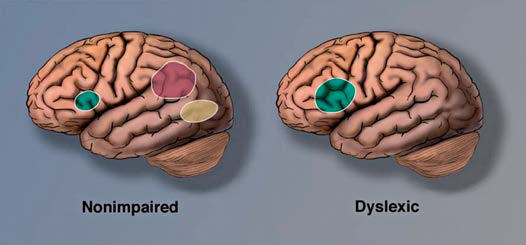

# Chapter 51: Dyslexia
> **Course:** Vikkypaedia Pediatric Basic Course (*Nelson Textbook of Pediatrics, 22nd Edition (2025)*)  
> **Part IV:** Learning and Developmental Disorders  
> **Authors:** Sally E. Shaywitz and Bennett A. Shaywitz  
> **Metrics:** 3,259 words · 0 tables/boxes · 1 figures · 0 genes · 7 flashcards · 5 MCQs  
> **Quick Navigation:** [🃏 Study 7 Flashcards](../flashcards/051_flashcards.md) · [📝 Take 5-Q MCQ Quiz](../mcqs/051_mcqs.md) · [📚 Part IV Guide](../parts/Part_IV.md) · [🧬 Syndrome & Genetics Atlas](../omim_gene_atlas.md) · [💊 Therapeutics Matrix](../therapies_matrix.md) · [🏠 Course Index](../../index.md)

## ⚡ High-Yield Nelson Pediatric Board Pearls
- Evidence suggests that children who receive careful medication management, accompanied by frequent treatment follow-up, all within the context of an educational, sup portive relationship with the primary care provider, are likely to experience behavioral gains.
- PROGNOSIS More than half of individuals with a childhood diagnosis of ADHD will manifest a mental health condition (e.g., anxiety, depression, substance use disorders) in adulthood.
- SECONDARY PREVENTION Parent training can lead to significant improvements in ADHD symptoms and oppositional behaviors in preschool and schoolage children with ADHD.
- DIAGNOSIS A large achievement gap between typical and dyslexic readers is evi dent as early as first grade and persists.
- Dyslexia is a clinical diagnosis, and history is especially critical.
- No single test score is pathognomonic of dys lexia.
- The diagnosis of dyslexia should reflect a thoughtful synthesis of all clinical data available.

---
## Full Chapter Text, Tables & Figures
# Chapter 51: Dyslexia

*Sally E. Shaywitz and Bennett A. Shaywitz*

<!-- p.460 -->
Two types of selective norepinephrine reuptake inhibitors are approved by the U.S. Food and Drug Administration (FDA) for the treatment of ADHD in children and adolescents: atomoxetine and viloxazine. These medications take up to 4 weeks to achieve effective ness and should be taken consistently to be effective. Both atomoxetine and viloxazine have common side effects of fatigue, decreased appe tite, nausea, vomiting, and irritability and a rare potential for suicidal thinking and behaviors for which the child must be monitored.

α2-Adrenergic agonist medications include guanfacine and cloni dine. Long-acting preparations of both have U.S. FDA approval for the treatment of ADHD in children ≥6 years old either as mono therapy or an adjunctive therapy with stimulant medication. Shortacting preparations are sometimes used off-label to treat young (<6-year-old) children with ADHD (especially those with coexist ing autism spectrum disorder or sleep disorders). α2-Adrenergic agonists may take up to 2 weeks to achieve an initial response. These medications can also treat motor and vocal tics and so may be a reasonable choice in a child with a coexisting tic disorder. Com mon side effects of α2-adrenergic agonists can include sedation, headaches, and hypotension, and they should be stopped gradually because abrupt discontinuation could result in rapid increase in blood pressure.

Medication alone may not be sufficient to treat ADHD in chil dren, particularly when children have additional psychiatric dis orders, developmental disabilities, or significant psychosocial challenges. When children do not respond to medication, it may be appropriate to refer them to a mental health specialist. Consulta tion with a child psychiatrist, developmental-behavioral pediatri cian, or psychologist can be beneficial to determine the next steps for treatment, including adding other components and supports to the overall treatment program. Evidence suggests that children who receive careful medication management, accompanied by frequent treatment follow-up, all within the context of an educational, sup portive relationship with the primary care provider, are likely to experience behavioral gains.

**PROGNOSIS** More than half of individuals with a childhood diagnosis of ADHD will manifest a mental health condition (e.g., anxiety, depression, substance use disorders) in adulthood. Approximately one third to two thirds of those diagnosed with ADHD in childhood will con tinue to manifest significant symptoms of ADHD in adulthood. In children with ADHD, a reduction in hyperactive behavior often occurs with age. Other symptoms associated with ADHD can become more prominent with age, such as inattention, impulsiv ity, and disorganization, and these exact a heavy toll on adolescent and young adult functioning. Adolescents and young adults with ADHD have an increased likelihood of risk-taking behaviors (early sexual activity, delinquent behaviors, motor vehicle accidents, sub stance use), seizures, psychosis, educational underachievement or employment difficulties, and relationship difficulties. With proper treatment, the risks associated with ADHD, including injuries, can be significantly reduced. Consistent treatment with medication and adjuvant therapies appears to lower the risk of adverse outcomes, such as substance abuse.

**SECONDARY PREVENTION** Parent training can lead to significant improvements in ADHD symptoms and oppositional behaviors in preschool and schoolage children with ADHD. To the extent that parents, teachers, physicians, and policymakers support efforts for earlier detection, diagnosis, and treatment, prevention of long-term adverse effects of ADHD on affected children’s functioning can be considered within the lens of secondary prevention of the long-term effects of untreated or ineffectively treated ADHD on children and youth.

*Visit Elsevier eBooks+ at eBooks.Health.Elsevier.com** for Bibliography.*

**DEFINITION** Dyslexia has always been defined as an unexpected difficulty in read ing, which has been codified in U.S. Federal law (First Step Act of 2018, PL: 115–391) as the most up-to-date, evidence-based definition of dyslexia: “The term *dyslexia* means an unexpected difficulty in reading for an individual who has the intelligence to be a much better reader, most commonly caused by a difficulty in the phonological process ing (the appreciation of the individual sounds of spoken language), which affects the ability of an individual to speak, read, and spell.” In typical readers, development of reading and intelligence quotient (IQ) are dynamically linked over time. In dyslexic readers, however, a developmental uncoupling occurs between reading and IQ (Fig. 51.1), such that reading achievement is significantly below what would be expected given the individual’s IQ.

The uncoupling between reading achievement and IQ provides the long-sought empirical evidence for the seeming paradox between cog nition and reading in individuals with developmental dyslexia, and this discrepancy is recognized in the federal definition as unexpected diffi culty in reading. However, clinicians may see other approaches to diag nosis. The *Diagnostic and Statistical Manual of Mental Disorders*, Fifth Edition (DSM-5) describes specific learning disorder with impairment in reading for children with reading skills significantly below those expected for the child’s age where the deficits are not explained by intellectual disability, sensory deficits, neurologic disorders, or psy chosocial adversity. This definition can be problematic in failing to differentiate primary problems with reading comprehension from the reading problems experienced by children with dyslexia despite strong evidence that the two are distinct. Further, excluding children with psychosocial adversity is concerning because children who struggle with reading due to psychosocial adversity suffer similar adverse longterm consequences and have been shown to benefit from interventions designed to help children with dyslexia.

*Sally E. Shaywitz and Bennett A. Shaywitz*

**Typical: IQ-Reading Linked**

**Dyslexia: IQ-Reading Diverge**

**Dyslexic**

IQ Reading

**Nonimpaired**

Grade in School 2 4 6 8 10 12 2 4 6 8 10 12

**Fig. 51.1** Uncoupling of reading and IQ over time: empirical evidence for a definition of dyslexia. Left, In typical readers, reading and IQ de velopment are dynamically linked over time. Right, In contrast, reading and IQ development are dissociated in dyslexic readers, and one does not influence the other. (Copyright Sally Shaywitz, MD. Adapted from Shaywitz S, Shaywitz J. Overcoming Dyslexia, 2nd ed. New York: Vin tage Books;2020: 103.)

<!-- p.462 -->
**EPIDEMIOLOGY** Dyslexia is the most common of the learning disabilities, affecting 80–90% of children identified as having a learning disability. Dyslexia may be the most common neurobehavioral disorder affecting children, with prevalence rates ranging from 20% in unselected populationbased samples to much lower rates in school-identified samples. The low prevalence rate in school-identified samples may reflect the reluctance of schools to screen, assess, and identify dyslexia. Dyslexia occurs with equal frequency in males and females in survey samples in which *all* children are assessed. Despite such well-documented find ings, schools continue to identify more males than females, probably reflecting the more rambunctious behavior of males who come to the teacher’s attention because of misbehavior, whereas females with read ing difficulty, who are less likely to be misbehaving, are also less likely to be noticed and identified by the schools. Dyslexia fits a dimensional model in which reading ability and disability occur along a *continuum.*

**PATHOGENESIS** Evidence from a number of lines of investigation indicates that dyslexia reflects deficits within the language system, and more specifically, within the **phonologic component** of the language system engaged in process ing the sounds of speech. Individuals with dyslexia have difficulty devel oping an awareness that spoken words can be segmented into smaller elemental units of sound (phonemes), an essential ability given that read ing requires that the reader map or link printed symbols to their sounds. Increasing evidence indicates that disruption of attentional mechanisms may also play an important role in reading difficulties.

Functional brain imaging in both children and adults with dyslexia demonstrates an inefficient functioning of left hemisphere posterior brain systems, a pattern referred to as the *neural signature of dyslexia* (Fig. 51.2). These differences can be observed before the start of formal reading instruction, suggesting they represent a biologic predisposition to reading difficulties as opposed to a result of inadequate instruction. Although functional magnetic resonance imaging (fMRI) consistently demonstrates differences between *groups* of dyslexic compared to typi cal readers, brain imaging is not able to reliably differentiate an *indi vidual* case of a dyslexic reader from a typical reader and thus is not useful in diagnosing dyslexia.

**CLINICAL MANIFESTATIONS** Reflecting the underlying phonologic weakness, children and adults with dyslexia manifest problems in both spoken and writ ten language. Spoken language difficulties are typically manifest by

mispronunciations, lack of glibness, speech that lacks fluency with many pauses or hesitations and “ums,” word-finding difficulties with the need for time to summon an oral response, and the inability to come up with a verbal response quickly when questioned; these reflect *sound-based,* not semantic or knowledge-based, difficulties.

Struggles in decoding and word recognition can vary according to age and developmental level. The cardinal signs of dyslexia observed in school-age children and adults are a labored, effortful approach to reading involving decoding, word recognition, and text reading. Lis tening comprehension is typically robust. Older children improve reading accuracy over time, but without commensurate gains in read ing fluency; they remain slow readers. Difficulties in spelling typically reflect the phonologically based difficulties observed in oral reading. Handwriting is often affected as well.

History often reveals early subtle language difficulties in dyslexic children. During the preschool and kindergarten years, at-risk children display difficulties playing rhyming games and learning the names for letters and numbers. Kindergarten assessments of these language skills can help identify children at risk for dyslexia. Although a dyslexic child enjoys and benefits from being read to, the child might avoid reading aloud to the parent or reading independently.

Dyslexia may coexist with attention-deficit/hyperactivity disor der (see Chapter 50); this comorbidity has been documented in both referred samples (40% comorbidity) and nonreferred samples (15% comorbidity).

**DIAGNOSIS** A large achievement gap between typical and dyslexic readers is evi dent as early as first grade and persists (Fig. 51.3). These findings pro vide strong evidence and impetus for early screening and identification of and early intervention for young children at risk for dyslexia. One source of potentially powerful and highly accessible screening informa tion is their teacher’s judgment about the child’s reading and readingrelated skills. Evidence-based screening can be carried out as early as kindergarten, and also in grades 1-3, by the child’s teacher. Their teach ers’ responses to a small set of questions (10-12 questions) predict a pool of children who are at risk for dyslexia with a high degree of accu racy. This evidence-based screening takes less than 10 minutes, is com pleted on a tablet, and is extremely efficient and economical. Children

**Fig. 51.2** A neural signature for dyslexia. Image on left shows left hemisphere brain systems in typical (nonimpaired) readers. The three systems for reading are an anterior system in the region of the inferior frontal gyrus (Broca’s area), serving articulation and word analysis, and two posterior systems: one in the occipitotemporal region serving word analysis and a second in the occipitotemporal region (the word-form area) serving the rapid, automatic, fluent identification of words. In dys lexic readers (right image), the two posterior systems are functioning inefficiently and appear underactivated. This pattern of underactiva tion in left posterior reading systems is referred to as the neural signa ture for dyslexia. (Copyright Sally Shaywitz, MD. Adapted from Shay witz S. Shaywitz J. Overcoming Dyslexia, 2nd ed. New York: Vintage Books;2020: 78.)

1

–2

–1

0

1

2

3

4

2 3 4 5 Grade in school

Reading

6 7

Typical readers

Dyslexic readers

8 9

**Fig. 51.3** Reading from grades 1 through 9 in typical and dyslexic readers. The achievement gap between typical and dyslexic readers is evident as early as first grade and persists through adolescence. (Copy right Sally Shaywitz, MD. Adapted from Shaywitz S. Shaywitz J. Over coming Dyslexia, 2nd ed. New York: Vintage Books;2020: 56.)

<!-- p.463 -->
found to be at risk will then have further assessment and, if diagnosed as dyslexic, should receive evidence-based intervention.

Dyslexia is a clinical diagnosis, and history is especially critical. The clinician seeks to determine through history, observation, and psycho metric assessment if there are unexpected difficulties in reading (based on the person’s intelligence, chronologic/grade, level of education, or professional status) and associated linguistic problems at the level of phonologic processing. No single test score is pathognomonic of dys lexia. The diagnosis of dyslexia should reflect a thoughtful synthesis of all clinical data available.

Dyslexia is distinguished from other disorders that can prominently feature reading difficulties by the unique, circumscribed nature of the *phonologic deficit,* one that does not intrude into other linguistic or cognitive domains. A core assessment for the diagnosis of dyslexia in children includes tests of language, particularly phonology; reading, including real and pseudowords; reading fluency; spelling; and tests of intellectual ability. Additional tests of memory, general language skills, and mathematics may be administered as part of a more comprehen sive evaluation of cognitive, linguistic, and academic function.

For informal screening, in addition to a careful history, the primary care physician in an office setting can listen to the child read aloud from the child’s own grade-level reader. Keeping a set of graded readers available in the office serves the same purpose and eliminates the need for the child to bring in schoolbooks. **Oral reading** is a sensitive measure of reading accuracy and fluency. The most consistent and telling sign of a reading disability in an accom plished young adult is slow and laborious reading and writing. In attempting to read aloud, most children and adults with dyslexia display an effortful approach to decoding and recognizing single words, an approach in children characterized by hesitations, mis pronunciations, and repeated attempts to sound out unfamiliar words. In contrast to the difficulties they experience in decoding single words, persons with dyslexia typically possess the vocabulary, syntax, and other higher-level abilities involved in comprehension.

**Fluency** forms the bridge between decoding, that is, reading a word accurately, and comprehension, understanding what is read. Fluent reading is reading accurately and rapidly, with good intona tion (prosody) indicating an understanding of the text. The failure either to recognize or to measure the lack of fluency in reading is perhaps the most common error in the diagnosis of dyslexia, espe cially in older children and accomplished young adults. Simple word identification tasks will not detect dyslexia in a person who is accomplished enough to be in honors high school classes or to graduate from college or obtain a graduate degree. Tests relying on the accuracy of word identification alone are inappropriate to use to diagnose dyslexia because they show little to nothing of the *struggle* to read. Because they assess reading accuracy but not automaticity or prosody, the types of reading tests used for school-age children might provide misleading data on bright adolescents and young adults. Among the most critical tests are those that are *timed;* they are the most sensitive in detecting dyslexia in a bright adult. Few standardized tests for young adult readers are administered under timed and untimed conditions; the *Nelson-Denny Reading Test* is an exception. The helpful *Test of Word Reading Efficiency* (TOWRE) examines simple word reading under timed conditions, and the Achievement Improvement Monitoring System (AIMSweb) and Dynamic Indicators of Basic Early Literacy Skills (DIBELS) mea sure reading connected text under timed conditions. Any scores obtained on testing must be considered relative to peers with the same degree of education or professional training.

**IS FAMILY HISTORY HELPFUL IN DIAGNOSING DYSLEXIA?** Although dyslexia is familial, family history is not effective as a screen ing measure for dyslexia and does not improve the classification accu racy provided by an evidence-based early screening measure.

Genome-wide association studies (GWASs) in children with dys lexia have demonstrated that a large number of genes are involved, each producing a small effect. Complex traits such as reading are the work of thousands of genetic variants working in concert (see Chapter 103). Thus pediatricians should be wary of recommending any genetic test to their patients that purports to diagnose dyslexia in infancy or before language and reading have even emerged. It is unlikely that a single gene or even a few genes will reliably identify people with dys lexia. Rather, dyslexia is best explained by multiple genes, each contrib uting a small amount toward the expression of dyslexia.

**MANAGEMENT** The management of dyslexia demands a life-span perspective. Early in life the focus is on **remediation** of the reading problem. Applying knowledge of the importance of early language, including phonologic skills and vocabulary, leads to significant improvements in children’s reading accuracy, even in predisposed children. As a child matures and enters the more time-demanding setting of middle and then high school, the emphasis shifts to the important role of providing accommodations. Based on the work of the National Reading Panel, evidence-based reading intervention methods and programs are iden tified. Effective intervention programs provide systematic instruction in five key areas: phonemic awareness, phonics, fluency, vocabulary, and comprehension strategies. These programs also provide ample opportunities for writing, reading, and discussing literature.

Taking each component of the reading process in turn, effective interventions improve phonemic awareness: the ability to focus on and manipulate phonemes (speech sounds) in spoken syllables and words. The elements found to be most effective in enhancing **pho nemic awareness**, reading, and spelling skills include teaching chil dren to manipulate phonemes with letters, focusing the instruction on one or two types of phoneme manipulations rather than multiple types, and teaching children in small groups. Providing instruction in phonemic awareness is necessary, but not sufficient, to teach children to read. Effective intervention programs include teach ing **phonics**, or making sure that the beginning reader understands how letters are linked to sounds (phonemes) to form letter-sound correspondences and spelling patterns. The instruction should be explicit and systematic; phonics instruction enhances children’s success in learning to read, and systematic phonics instruction is more effective than instruction that teaches little or no phonics or that teaches phonics casually or haphazardly. Important but often overlooked is starting children on reading connected text early on, optimally at or near the beginning of reading instruction. Read ing connected text is critical in building vocabulary and increas ing background knowledge—both important in improving reading comprehension.

**Fluency** is of critical importance because it allows the automatic, rapid recognition of words. Although it is generally recognized that fluency is an important component of skilled reading, it is often over looked in teaching. One approach is to have a child practice oral read ing with a teacher or parent providing positive and helpful feedback. Here practice is critical. Interventions for vocabulary development and reading comprehension are not as well established. The most effective methods to teach reading comprehension involve teaching vocabulary and strategies that encourage active interaction between the reader and the text. Emerging science indicates that it is not only teacher content knowledge but the teacher’s skill in engaging the student and focusing the student’s attention on the reading task at hand that is required for effective instruction.

The interventions described here can be provided in multiple set tings, but specialized schools for children with dyslexia that provide intensive intervention over 4 years or more have been very effective. Typically, these schools are costly, although increasingly offering scholarships. Some school districts are considering developing public schools specializing in educating children with dyslexia.

<!-- p.465 -->
