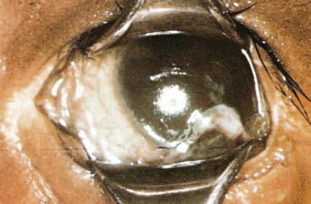
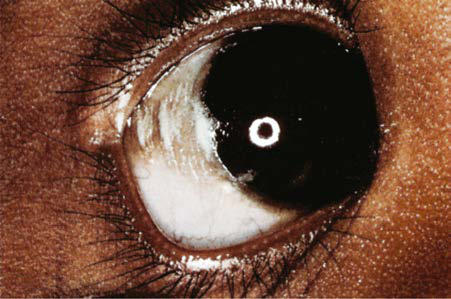

# Chapter 66: Vitamin A Deficiencies and Excess
> **Course:** Vikkypaedia Pediatric Basic Course (*Nelson Textbook of Pediatrics, 22nd Edition (2025)*)  
> **Part V:** Nutrition  
> **Authors:** Libo Tan and A. Catharine Ross  
> **Metrics:** 4,170 words · 2 tables/boxes · 2 figures · 0 genes · 8 flashcards · 5 MCQs  
> **Quick Navigation:** [🃏 Study 8 Flashcards](../flashcards/066_flashcards.md) · [📝 Take 5-Q MCQ Quiz](../mcqs/066_mcqs.md) · [📚 Part V Guide](../parts/Part_V.md) · [🧬 Syndrome & Genetics Atlas](../omim_gene_atlas.md) · [💊 Therapeutics Matrix](../therapies_matrix.md) · [🏠 Course Index](../../index.md)

## ⚡ High-Yield Nelson Pediatric Board Pearls
- Diagnosis Dark adaptation tests can be used to assess early-stage vitamin A deficiency.
- HYPERVITAMINOSIS A Chronic hypervitaminosis A results from excessive ingestion of preformed vitamin A (retinol or retinyl ester), generally for sev eral weeks or months.
- Hypervitaminosis A is most often caused by vitamin A–containing supplements or food faddism, including high intakes of organ meats.
- Vitamin A can be obtained from the diet from preformed vitamin A (retinyl esters, such as retinyl palmitate) primarily in foods of animal origin.

---
## Full Chapter Text, Tables & Figures
# Chapter 66: Vitamin A Deficiencies and Excess

*Libo Tan and A. Catharine Ross*

<!-- p.616 -->
**OVERVIEW OF VITAMIN A** Vitamin A is a fat-soluble micronutrient that cannot be synthesized de novo by mammals; thus it is an obligatory dietary factor. The term **vitamin A** is generally used to refer to a group of compounds that possess the biologic activity of all-*trans* retinol (Fig. 66.1). Vita min A is recognized as being essential for all vertebrates for normal vision, reproduction, cell and tissue differentiation, and immune system functions. Vitamin A plays critical roles in neonatal devel opment. It is required for normal embryonic development, hemato poiesis, and growth and differentiation of many types of cells.

Vitamin A can be obtained from the diet from preformed vitamin A (retinyl esters, such as retinyl palmitate) primarily in foods of animal origin. Organ meats (especially liver and kidney) are very rich in vitamin A, whereas other meats, milk, and cheese contain moderate levels. Other sources of vitamin A include several provi tamin A carotenoids, which are found naturally in many fruits and vegetables, especially yellow-orange vegetables (pumpkin, squash, sweet potato) and leafy green vegetables (chard, spinach, broccoli). One of the most abundant carotenoids is β-carotene. Several *culti vars,* or biofortified forms, of sweet potatoes have been introduced to elevate carotene intake in areas of the world where vitamin A deficiency still is prevalent. α-carotene and oxygenated carotenoids, such as β-cryptoxanthin, found in oranges, also possess vitamin A activity, but at a lower bioactivity. In the body, these precursors are

used for the synthesis of two essential metabolites of vitamin A. **All-****trans**** retinoic acid** is the form required for cell differentiation and regulation of gene transcription and is the most bioactive form of vitamin A; **11-****cis**** retinal** is the form required for vision as the light-absorbing chromophore of the visual pigments rhodopsin and iodopsin.

**METABOLISM OF VITAMIN A** Vitamin A compounds in foods must first be released through nor mal digestive processes. Retinyl esters must first be hydrolyzed in the intestinal lumen to liberate unesterified retinol for absorption across the mucosal barrier. Once in the enterocyte, most of the reti nol is reesterified, forming new retinyl esters for inclusion in chy lomicrons. Approximately 70–90% of dietary preformed vitamin A is absorbed provided there is approximately 10 g of fat in the meal; otherwise, the absorption efficiency is lower. Chronic intestinal dis orders or lipid malabsorption can result in vitamin A deficiency. Provitamin-A carotenoids are transported from the intestinal lumen into the enterocytes by specific transporters and then either incorporated intact into chylomicrons or cleaved to form *retinal,* a precursor for retinol; β-carotene becomes retinol through this process. The estimated efficiency of absorption of carotenoids is 20–50%, lower than for preformed vitamin A. Moreover, the effi ciency is reduced when the body’s vitamin A status is high, and because vitamin A status may vary, there is significant interindi vidual variability in absorption efficiency. The carotene cleavage enzyme β-carotene monooxygenase, present in the enterocyte and in other tissues at lower levels, exhibits certain single nucleotide polymorphisms (SNPs) that, at least in vitro, reduce the efficiency of conversion of β-carotene to retinol. Clinical studies suggest a similar effect in vivo.

Once retinol is esterified in the enterocyte, retinyl ester is then packaged into nascent chylomicrons, which are secreted into the lymphatic vessels, enter the systemic circulation, and are then transported to and taken up by various tissues. When vitamin A status is adequate, in most mammals, including humans, the liver

*Libo Tan and A. Catharine Ross*

A

Retinol

R = CH2OH, retinol R = CH2O-fatty acyl group, retinyl ester R = COOH, retinoic acid

**Dietary**

**forms:**

Preformed

vitamin A

Retinol

Intestinal hydrolysis

Intestinal cleavage Esterification

and storage

[chylomicron

transport, storage in liver, eyes (RPE), kidneys,

testes, etc.]

Hydrolysis, mobilization

Reduction

Oxidation Oxidation

Conjugation

reactions

Retinal RA

Deactivation products

Excretion

RE Oxidized metabolites

β-carotene and

provitamin A

carotenoids

**Absorption:**

**Intracellular metabolism:**

R

β-Carotene

B **Fig. 66.1**  A, Vitamin A structures. B, Overview of vitamin A metabolism. RA, All-*trans* retinoic acid; RE, retinyl ester; RPE, retinal pigment epithelium.

<!-- p.617 -->
is the major site of chylomicron vitamin A uptake and storage, with potentially high levels of retinyl esters within hepatic stellate cells (HSCs). As vitamin A status deteriorates into the deficient range, vitamin A stores are mobilized from the HSCs, such that the released retinol can be taken up and used by extrahepatic tissues. Circulat ing retinol is bound to a specific transport protein, retinol-binding protein (RBP), which in turn binds to the thyroid hormone trans port protein, transthyretin (TTR); this complex delivers plasma retinol (and the thyroid hormone) to a large number of vitamin A target tissues. The major physiologic mediator of retinol uptake by cells in many tissues is Stra6, a widely expressed multitransmem brane domain protein that functions as a cell surface receptor for retinol bound to RBP. Stra6 is not significantly expressed in the liver, but a homologous receptor may perform the similar function. Within target tissues, retinol is either esterified into retinyl esters for storage or oxidized into retinoic acid for function. In the eye, 11-*cis*-retinal is formed and bound to the protein rhodopsin (rods) or iodopsin (cones), where it functions as a light-sensing receptor.

**Inflammation Causing Low Plasma Retinol** Inflammation is a cause of reduced levels of plasma retinol as a result of reduced synthesis of RBP and TTR. This condition may mimic a lack of vitamin A, but will not be corrected by supplemen tation. In U.S. adults, those with moderately elevated levels of CRP, indicative of mild inflammation, had lower average plasma retinol levels. The extent to which inflammation is a factor in low plasma retinol in children is uncertain but likely significant in acute infec tious diseases such as measles, and possibly in chronic inflamma tory conditions such as cystic fibrosis.

**FUNCTIONS OF VITAMIN A AND MECHANISMS OF ACTION** Except for its role in vision, the pleiotropic actions of this micronu trient are mediated by all-*trans*-retinoic acid (RA), which is a ligand for specific nuclear transcription factors, **retinoic acid receptor (RAR)** and **retinoid X receptor (RXR**), that regulate the expres sion of several hundred genes. When an RAR is activated by RA, an RAR-RXR complex is formed, which binds to and activates spe cific DNA sequences present in retinoid-responsive genes, RAREs and RXREs. Genes can be either induced or repressed, depending on additional co-activators or co-repressors recruited to the RAR- RXR complex. Retinoid-regulated genes are involved in several fun damental biologic activities, including regulation of cell division, death, and differentiation. The term *retinoids* is now applied to both natural and synthetic compounds with vitamin A activity, although it is most often used in the context of vitamin A and RA acting at the gene level. Numerous synthetic retinoids have gained clinical acceptance in the treatment of skin disorders and certain cancers.

During embryonic development, RA is among the most important signaling molecules that determine body patterning (morphogenesis). Many physiologic processes are sensitive to a deficiency or excess of vitamin A or RA, including reproduction, growth, bone development, and the functions of the respiratory, gastrointestinal, hematopoietic, and immune systems. Vitamin A supplementation may be particu larly important in developing countries, where it reduces morbidity and mortality, presumably by enhancing immune function and host defense, from various infectious diseases, including measles (see Chap ter 293).

Vitamin A plays a critical role in vision, mediated by 11-*cis* reti nal. The human retina contains two distinct photoreceptor systems: the *rods,* in which rhodopsin senses light of low-intensity, and the *cones,* in which iodopsins detect different colors; 11-*cis*-retinal is the prosthetic group on both these visual proteins. The mechanism of vitamin A action is similar for rods and cones, based on *pho toisomerization* of 11-*cis* to all-*trans* retinal (change shape when

exposed to light), which initiates signal transduction via the optic nerve to the brain, resulting in visual sensation. After isomeriza tion (also known as *photobleaching*), a series of reactions serves to regenerate the 11-*cis* retinal for resynthesis of rhodopsin and iodop sin, as is necessary for an efficient visual process. Accessory cells, including retinal pigment epithelium (RPE) cells and Müller cells, are involved in this recycling process.

**VITAMIN A DEFICIENCY** If the growing child has a well-balanced diet and obtains vitamin A from foods rich in vitamin A or provitamin A (Table 66.1), the risk of vitamin A deficiency is small. However, even subclinical vitamin A deficiency can have serious consequences.

Deficiency states in developed countries are rare, except in some impoverished populations (see Chapter 62) or after mistakes in food preparation or with fad diets or restrictive/elimination diets, but are common in many developing countries and often associ ated with global malnutrition. In the clinical setting, vitamin defi ciencies can also occur as complications in children with various chronic disorders or diseases. Information obtained in the medi cal history related to dietary habits can be important in identifying the risk of such nutritional problems. Except for vitamin A, toxicity from excess intake of vitamins is rare. Table 66.1 summarizes the food sources, functions, and deficiency and excess symptoms of the vitamin.

**Vitamin A Status in Neonates** Neonates begin life with low levels of vitamin A in plasma, liver, and extrahepatic tissues compared with those in adults. Normal plasma levels of retinol are 20-50 μg/dL in infants and increase gradually as children become older. Median serum retinol values are 1.19 μmol/L in both males and females ages 4-8 years; 1.4 and 1.33 μmol/L in males and females, respectively, ages 9-13; and 1.71 and 1.57 μmol/L in males and females, ages 14-18 (for conversion, 1 μmol/L = 28.6 μg/dL). Values of 1.96 and 1.85 μmol/L are found in 19- to 30-year-old adult men and women, respectively. Figure 66.2 shows the distribution of serum retinol concentrations in U.S. chil dren. Few healthy children are severely vitamin A deficient, but the 5th percentile of children 4-8 years and 9-13 years of age, respec tively, in the National Health and Examination Survey (NHANES) fell below 1.05 μmol/L, which is interpreted as mild vitamin A deficiency.

Retinol levels are even lower in neonates in developing countries, where vitamin A intakes may be low and vitamin A deficiency is a common nutritional problem. Lower vitamin A stores and plasma retinol concentrations are also seen in low birthweight infants and in preterm newborns, and poor vitamin A status (plasma retinol concentrations <0.35 μmol/L) may contribute to the development of chronic lung disease, such as bronchopulmonary dysplasia (BPD; see Chapter 127).

**Clinical Manifestations of Vitamin A Deficiency** The most obvious symptoms of vitamin A deficiency are associated with changes in epithelial cell morphology and functions. In the intestines, mucus-secreting goblet cells are affected, and loss of an effective barrier against pathogens can cause diarrhea or impair ment of epithelial barrier function. Similarly, mucus secretion by the epithelium is essential in the respiratory tract for the disposal of inhaled pathogens and toxicants. Characteristic epithelial changes result from vitamin A deficiency, including proliferation of basal cells, hyperkeratosis, and formation of stratified cornified squa mous epithelium. Squamous metaplasia of the renal pelvis, ure ters, vaginal epithelium, and the pancreatic and salivary ducts can lead to increased infections in these areas. In the urinary bladder,

<!-- p.618 -->
loss of epithelial integrity can result in pyuria and hematuria. In the skin, vitamin A deficiency manifests as dry, scaly, hyperkera totic patches, typically on the arms, legs, shoulders, and buttocks. The combination of defective epithelial barriers to infection, low immune response, and lowered response to inflammatory stress, all from insufficient vitamin A, can cause poor growth and serious health problems in children.

The most characteristic and specific signs of vitamin A deficiency are *eye lesions,* but these may manifest rather late in the progression of vitamin A deficiency, develop insidiously, and rarely occur before age 2 years. An earlier symptom of vitamin A deficiency is delayed

dark adaptation as a result of reduced resynthesis of rhodopsin; this may progress to **night blindness**. Photophobia is a common symptom. The RPE, one of the structural elements of the retina, undergoes keratinization. When the RPE degenerates, the rods and cones have no support and eventually break down, resulting in blindness.

As vitamin A deficiency progresses, the corneal and conjunctival epithelial tissues of the eye become severely altered because of a lack of sufficient RA for normal epithelial cell differentiation. The cor nea protects the eye from the environment and is also important in light refraction. Stages in vitamin A deficiency include corneal kera tinization and opacity, susceptibility to infection, and formation of dry, scaly layers of cells (**xerophthalmia**) (Figs. 66.3 and 66.4). The conjunctival membrane undergoes keratinization and may develop foamy-appearing plaques (**Bitôt spots**; Fig. 66.5). When lympho cytes infiltrate the cornea in later stages of infection, it degenerates irreversibly (**keratomalacia** and **corneal ulceration**), resulting in irreversible blindness. These eye lesions are primarily diseases of

0.0

0.5

1.0

1.5

2.0

2.5

3.0

3.5

Serum retinol, micromole/liter

Age and sex groups 4–8 y M

Male, 5th Male, 50th Male, 95th

Female, 5th Female, 50th Female, 95th

F

9–13 y 14–18 y 19–30 y 31–50 y 51–70 y >71 y M F M F M F M F M F M F

**Fig. 66.2** Distribution of serum retinol concentrations in U.S. children and adults by age and sex in the National Health and Nutrition Exami nation Survey (NHANES).

**Fig. 66.3** Advanced xerophthalmia with an opaque, dull cornea and some damage to the iris in a 1-yr-old boy. (From Oomen HAPC. Vitamin A deficiency, xerophthalmia and blindness. Nutr Rev. 1974;6:161–166.)

#### **Table 66.1** Vitamin A Characteristics

| Category / Parameter | Clinical Details & Findings |
| --- | --- |
| **SOURCES** | Retinol (vitamin A1);; 1 μg retinol = 3.3 IU; vitamin A = 1 RAE; Provitamins A: the; plant pigments α-,; β-, and γ-carotenes; and cryptoxanthin; have partial retinol; activity: 12 μg β-; carotene, or 24 μg; other provitamin A; carotenoids = 1 μg; retinol; Fat-soluble; heat-; stable; destroyed by; oxidation, drying; Bile necessary for; absorption; Stored in liver; Protected by; vitamin E; In vision, as retinal,; for synthesis of the; visual pigments; rhodopsin and; iodopsin; In growth, reproduction,; embryonic and fetal; development, bone; growth, immune and; epithelial functions,; via retinoic acid as; a ligand for specific; nuclear transcription; factors, regulating; genes involved in; many fundamental; cellular processes; Nyctalopia; Photophobia,; xerophthalmia, Bitôt; spots, conjunctivitis,; keratomalacia leading; to blindness; Faulty epiphyseal; bone formation; Defective tooth; enamel; Keratinization of; mucous membranes; and skin; Stunted growth; Impaired resistance; to infection, anemia,; reproductive failure,; fetal abnormalities; Anorexia, slow; growth, drying and; cracking of skin,; enlargement of; liver and spleen,; swelling and pain of; long bones, bone; fragility, increased; intracranial pressure,; alopecia, carotenemia; Fetal abnormalities; Liver, fish liver oils; Dairy products,; except skim milk; Egg yolk, fortified; margarine, fortified; skim milk; Carotenoids from; plants: green; vegetables, yellow; fruits, and vegetables; RAE, Retinol activity equivalent. |

<!-- p.619 -->
the young and are a major cause of blindness in developing coun tries. Although rates of xerophthalmia have fallen, the number of affected children is still too high. Treatment with vitamin A, up to the stage of keratomalacia, is effective in rapidly repleting the indi vidual and saving vision.

Other clinical signs of vitamin A deficiency include poor overall growth, diarrhea, susceptibility to infections, anemia, apathy, intellec tual impairment, and increased intracranial pressure, with wide sepa ration of the cranial bones at the sutures. There may be vision problems

as a consequence of bone overgrowth causing pressure on the optic nerve.

**Malnutrition**, particularly protein deficiency, can cause vitamin A deficiency through impaired synthesis of retinol transport protein. In developing countries, subclinical or clinical zinc deficiency can increase the risk of vitamin A deficiency. There is also some evidence of marginal zinc intakes in U.S. children.

**Diagnosis** Dark adaptation tests can be used to assess early-stage vitamin A deficiency. Although Bitôt spots develop relatively early, those related to active vitamin A deficiency are usually confined to preschool-age children. Xerophthalmia is a very characteristic lesion of vitamin A deficiency. For detection of less severe defi ciency (marginal vitamin A status), methods include conjunctival impression cytology, relative dose response, and modified relative dose response tests. A diet history is useful in suggesting or ruling out low intake as a cause of symptoms. Marginal vitamin A sta tus is relatively prevalent among pregnant and lactating women in low-resource (and therefore poor dietary intake) areas of the world. Although plasma retinol level is not a completely accurate indica tor of vitamin A status, various guidelines have been proposed for categorizing vitamin A status based on serum retinol. In children, plasma retinol <0.35 μmol/L is considered *very deficient,* 0.35-0.7 μmol/L *deficient,* 0.7-1.05 μmol/L *marginal,* and >1.05 μmol/L *ade quate.* It has long been thought that a liver vitamin A concentra tion >20 μg/g is needed to support a normal rate of secretion of retinol-RBP into plasma, and therefore normal delivery of retinol to peripheral tissues.

**Epidemiology and Public Health Issues** Vitamin A deficiency and xerophthalmia still occur through out much of the developing, income-poor world and are linked to undernourishment and complicated by illness. Various public health programs to provide large doses of vitamin A periodically have been instituted. Vitamin A supplementation is considered part of the strategy of the World Health Organization (WHO) Millen nium Development Goals to reduce <5 year mortality. Neonatal supplementation may be most effective in populations with a high incidence of maternal vitamin A deficiency. Other strategies being tested include improving the content of β-carotene in staple foods through plant breeding (biofortification).

**Dietary Reference Intakes for the Healthy Population** Table 66.2 summarizes the dietary reference intakes for infants and children. Dietary reference intake values include the estimated aver age requirement (EAR), which is the mean biologic requirement for the nutrient for the age/sex-group of interest; the recommended dietary allowance (RDA), which is set to cover the physiologic needs of >97% of the population (thus the needs of many people are more than met by consuming the RDA); and the upper level

#### **Table 66.2** Dietary Reference Intakes for Vitamin A in Children

| Category / Parameter | Clinical Details & Findings |
| --- | --- |
| **COMMENTS** | 0-6 mo; 400; 600; The recommended intake for infants is an adequate intake, based; on the amount of vitamin A normally present in breast milk.; 7-12 mo; 500; 600; 1-3 yr; 300; 600; The UL applies only to preformed vitamin A (retinol).; 4-8 yr; 400; 900; 9-13 yr; 600; 1,700; 14-18 yr; 900, male; 700, female; 2,800; *μg retinol equivalents per day. |

**Fig. 66.5** Bitôt spots with hyperpigmentation seen in a 10-mo-old Indonesian boy. (From Oomen HAPC. Vitamin A deficiency, xerophthal mia and blindness. Nutr Rev 1974;6:161–166.)

**Fig. 66.4** Recovery from xerophthalmia, showing a permanent eye le sion. (From Bloch CE. Blindness and other disease arising from deficient nutrition [lack of fat soluble A factor]. Am J Dis Child. 1924;27:139.)

<!-- p.620 -->
of normal (UL), an intake level above which risk of adverse effects may increase; the UL pertains only to chronic consumption of preformed vitamin A. The RDA is expressed as retinol activ ity equivalents (RAEs; 1 RAE = 1 μg all-*trans* retinol; equivalents for provitamin-A in foods = 12 μg β-carotene, 24 μg α-carotene, or 24 μg β-cryptoxanthin). From infancy to age 18 years, the RDA increases as a result of increased body size, becoming higher for males than for females during adolescence. During pregnancy the RDA is 750-770 μg, and during lactation it increases to 1,200-1,300 μg to ensure sufficient vitamin A content during breastfeeding.

It is noteworthy that, especially for young children, the UL is only about two times higher than the RDA. This suggests that for children whose diet is good, care should be taken not to overuse dietary supple ments (vitamin-mineral supplements) containing preformed vitamin A and/or to avoid excessive consumption of foods that are very rich in vitamin A, such as liver.

**Vitamin A for Treatment of Deficiency** A daily supplement of 1,500 μg of vitamin A is sufficient for treat ing latent vitamin A deficiency, after which intake at the RDA level should be the goal. In children without overt signs of vitamin A deficiency but suspected low reserves of vitamin A, rates of morbid ity and mortality, as from viral infections such as measles, have been reduced by a weekly dose of vitamin A at the RDA level. More often, higher doses of 30-60 mg of retinol (100,000-200,000 IU/child) are given once or twice, under careful monitoring to avoid toxicity associated with excess vitamin A. Xerophthalmia is treated by giv ing 1,500 μg/kg body weight orally for 5 days, followed by intramus cular injection of 7,500 μg of vitamin A in oil, until recovery.

**HYPERVITAMINOSIS A** Chronic hypervitaminosis A results from excessive ingestion of preformed vitamin A (retinol or retinyl ester), generally for sev eral weeks or months. Hypervitaminosis A is most often caused by vitamin A–containing supplements or food faddism, including high intakes of organ meats. Chronic daily intakes of 15,000 μg and 6,000 μg can be toxic in adults and children, respectively. Because there is no antidote for hypervitaminosis A, and vitamin A is readily stored in liver and other tissues, it is most important to prevent tox icity. Symptoms may subside rapidly on withdrawal of the vitamin, but the rate of improvement depends on the amount of vitamin A stored in tissues. Extreme hypervitaminosis A is fatal. Signs of subacute or chronic toxicity can include headache; vomiting (early signs); anorexia; dry, itchy, desquamating skin; and seborrheic cuta neous lesions. With chronic hypervitaminosis A, one may observe fissuring at the corners of the mouth; alopecia and coarsening of the hair; bone abnormalities, including swelling and resorption; enlargement of the liver and spleen; diplopia; increased intracranial pressure; dryness of the mucous membranes; and desquamation of the palms and the soles of the feet. Radiographs may show *hyper ostosis* affecting several long bones, especially in the middle of the shafts (Fig. 66.6). Manifestations of hypervitaminosis A may also include nonspecific changes in affect, including severe headache, irritability, stupor, and limited motion. Serum levels of vitamin A are elevated, mostly in the form of retinyl esters carried in lipo proteins, which may result in tissue damage and release of liver enzymes into plasma. Hypercalcemia and/or liver cirrhosis may be present. Hypervitaminosis A is distinct from cortical hyperostosis (see Chapter 741).

In young children, signs of vitamin A toxicity include vomiting and bulging fontanels, neither of which is specific. Combined with anorexia, pruritus, and a lack of weight gain, vitamin A toxicity should be considered. Less common symptoms include diplopia, papilledema,

A B

**Fig. 66.6** Hyperostosis of the ulna and tibia in 21-mo-old infant, re sulting from vitamin A positioning. A, Long, wavy cortical hyperostosis of the ulna (arrow). B, Long, wavy cortical hyperostosis of the right tibia (arrow), with a striking absence of metaphyseal changes. (From Caffey J. Pediatric X-Ray Diagnosis, 5th ed. Chicago: Year Book;1967: 994.)

cranial nerve palsies, and other symptoms suggesting **pseudotumor cerebri**.

If high levels of vitamin A or synthetic retinoids are taken early in pregnancy, **severe congenital malformations** may occur in the fetus. **Teratogenicity** has been associated with therapeutic doses (0.5-1.5 mg/kg) of oral 13-*cis*-retinoic acid (e.g., Accutane), gen erally taken for the treatment of acne or cancer, during the first trimester of pregnancy. A high incidence (>20%) of spontaneous abortions and birth defects, including characteristic craniofacial abnormalities, has prompted the U.S. Food and Drug Administra tion (FDA) to enact more stringent prescription regulations for such drugs in women of childbearing age to attempt to reduce these birth defects.

Carotenoids, even in high doses, *are not* associated with toxic ity but can cause yellowing of the skin (**carotenodermia**), includ ing palms of the hands, and high levels in serum (carotenemia); this relatively benign state disappears slowly when carotene intake is reduced. Children with liver disease, diabetes mellitus, or hypo thyroidism are more susceptible. Food faddism, such as excessive consumption of carotene-rich foods and juices, may be a cause of carotenodermia.

*Visit Elsevier eBooks+ at eBooks.Health.Elsevier.com** for Bibliography.*

<!-- p.621 -->
