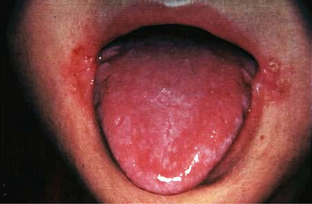

# Chapter 67: Vitamin B Complex Deficiencies and Excess
> **Course:** Vikkypaedia Pediatric Basic Course (*Nelson Textbook of Pediatrics, 22nd Edition (2025)*)  
> **Part V:** Nutrition  
> **Authors:** H.P.S. Sachdev and Dheeraj Shah  
> **Metrics:** 9,387 words · 4 tables/boxes · 1 figures · 18 genes · 8 flashcards · 5 MCQs  
> **Quick Navigation:** [🃏 Study 8 Flashcards](../flashcards/067_flashcards.md) · [📝 Take 5-Q MCQ Quiz](../mcqs/067_mcqs.md) · [📚 Part V Guide](../parts/Part_V.md) · [🧬 Syndrome & Genetics Atlas](../omim_gene_atlas.md) · [💊 Therapeutics Matrix](../therapies_matrix.md) · [🏠 Course Index](../../index.md)

## Key Chapter Topics & Subchapters
`67.1 Thiamine (Vitamin B1)` · `67.2 Riboflavin (Vitamin B2)` · `67.3 Niacin (Vitamin B3)` · `67.4 Vitamin B6 (Pyridoxine)` · `67.5 Biotin` · `67.6 Folate` · `67.7 Vitamin B12 (Cobalamin)` · `67.1 Thiamine (Vitamin B1) H.P.S. Sachdev and Dheeraj Shah` · `67.2 Riboflavin (Vitamin B2) H.P.S. Sachdev and Dheeraj Shah` · `67.3 Niacin (Vitamin B3) H.P.S. Sachdev and Dheeraj Shah` · `67.4 Vitamin B6 (Pyridoxine) H.P.S. Sachdev and Dheeraj Shah` · `67.5 Biotin H.P.S. Sachdev and Dheeraj Shah`

## Key Genetic & Molecular Targets
`ABCD4`, `ALDH7A1`, `HCFC1`, `LMBD1`, `MMAA`, `MMAB`, `MMACHC`, `MTHFR`, `PNPO`, `SLC19A2`, `SLC19A3`, `SLC52A1`, `SLC52A2`, `SLC52A3`, `THMD3`, `THTR1`

## ⚡ High-Yield Nelson Pediatric Board Pearls
- THIAMINE DEFICIENCY Deficiency of thiamine is associated with severely malnourished states, including malignancy and after surgery.
- Thiamine-responsive megaloblastic anemia (TRMA) syn drome is a rare autosomal recessive disorder characterized by megaloblastic anemia, diabetes mellitus, and sensorineural hear ing loss, responding in varying degrees to thiamine treatment.
- Another dependency state, biotin-thiamine–responsive basal ganglia disease (BTBGD), results from pathologic variants of the SLC19A3 gene.
- Hoarseness or aphonia caused by paralysis of the laryngeal nerve is a character istic sign.
- Diagnosis The diagnosis is often suspected based on clinical setting and com patible symptoms.
- The biochemical diagnostic criteria of thiamine deficiency consist of low erythrocyte transketolase activity and high thiamine pyrophosphate effect (normal range: 0–14%).
- MRI changes of nutritional and genetic thiamine deficiency in infants are characterized by bilateral symmetric hyperintensities of the basal ganglia and frontal lobe, in addition to the lesions in the mammillary bodies, periaque ductal region, and thalami described in adults.

---
## Full Chapter Text, Tables & Figures
# Chapter 67: Vitamin B Complex Deficiencies and Excess

*H.P.S. Sachdev and Dheeraj Shah*

<!-- p.622 -->

#### **Table 67.1** Water-Soluble Vitamins

| Category / Parameter | Clinical Details & Findings |
| --- | --- |
| **EAR**** | Thiamine; (vitamin B1); Coenzyme in carbohydrate; metabolism; Nucleic acid; synthesis; Neurotransmitter synthesis; Neurologic (dry; beriberi): irritability,; peripheral neuritis,; muscle tenderness,; ataxia; Cardiac (wet; beriberi):; tachycardia,; edema,; cardiomegaly,; cardiac failure; 3-5 mg/; day PO; thiamine; for 6 wk; Polished rice–; based diets; Malabsorptive; states; Severe; malnutrition; Malignancies; Alcoholism; Meat,; especially; pork; fish;; liver; Rice; (unmilled),; wheat germ;; enriched; cereals;; legumes; 0-6 mo: 0.2 mg/day; 7-12 mo: 0.3 mg/; day; 1-3 yr: 0.5 mg/day; 4-8 yr: 0.6 mg/day; 9-13 yr: 0.9 mg/day; 14-18 yr:; Females: 1.0 mg/; day; Males: 1.2 mg/day; 1-3 yr:; 0.4 mg/day; 4-8 yr: 0.5; mg/day; 9-13 yr: 0.7; mg/day; 14-18 yr:; Females: 0.9; mg/day; Males: 1.0; mg/day; Riboflavin; (vitamin B2); Constituent of flavoprotein; enzymes important; in redox reactions:; amino acid, fatty acid,; and carbohydrate; metabolism and cellular; respiration; Glossitis,; photophobia,; lacrimation,; corneal; vascularization,; poor growth,; cheilosis; 3-10 mg/; day PO; riboflavin; Severe; malnutrition; Malabsorptive; states; Prolonged; treatment with; phenothiazines,; probenecid, or; OCPs; Milk, milk; products,; eggs,; fortified; cereals,; green; vegetables; 0-6 mo: 0.3 mg/day; 7-12 mo: 0.4 mg/; day; 1-3 yr: 0.5 mg/day; 4-8 yr: 0.6 mg/day; 9-13 yr: 0.9 mg/day; 14-18 yr:; Females: 1.0 mg/; day; Males: 1.3 mg/day; 1-3 yr:; 0.4 mg/day; 4-8 yr: 0.5; mg/day; 9-13 yr: 0.8; mg/day; 14-18 yr:; Females: 0.9; mg/day; Males: 1.1; mg/day; Niacin; (vitamin B3); Constituent of NAD and; NADP, important in; respiratory chain, fatty; acid synthesis, cell; differentiation, and DNA; processing; Pellagra manifesting; as diarrhea,; symmetric scaly; dermatitis in sun-; exposed areas,; and neurologic; symptoms of; disorientation and; delirium; 50-300 mg/; day PO; niacin; Predominantly; maize-based; diets; Anorexia; nervosa; Carcinoid; syndrome; Meat, fish,; poultry; Cereals,; legumes,; green; vegetables; 0-6 mo: 2 mg/day; 7-12 mo: 4 mg/day; 1-3 yr: 6 mg/day; 4-8 yr: 8 mg/day; 9-13 yr: 12 mg/day; 14-18 yr:; Females: 14 mg/; day; Males: 16 mg/day; 1-3 yr: 5 mg/; day; 4-8 yr: 6 mg/; day; 9-13 yr: 9; mg/day; 14-18 yr:; Females: 11; mg/day; Males: 12; mg/day; Pyridoxine; (vitamin B6); Constituent of coenzymes; for amino acid and; glycogen metabolism,; heme synthesis, steroid; action, neurotransmitter; synthesis; Irritability,; convulsions,; hypochromic; anemia; Failure to thrive; Oxaluria; 5-25 mg/; day PO for; deficiency; states; 100 mg IM; or IV for; pyridoxine-; dependent; seizures; Prolonged; treatment; with INH,; penicillamine,; OCPs; Fortified; ready-to-; eat cereals,; meat, fish,; poultry, liver,; bananas,; rice,; potatoes; 0-6 mo: 0.1 mg/day; 7-12 mo: 0.3 mg/; day; 1-3 yr: 0.5 mg/day; 4-8 yr: 0.6 mg/day; 9-13 yr: 1.0 mg/day; 14-18 yr:; Females: 1.2 mg/; day; Males: 1.3 mg/day; 1-3 yr:; 0.4 mg/day; 4-8 yr: 0.5; mg/day; 9-13 yr: 0.8; mg/day; 14-18 yr:; Females: 1.0; mg/day; Males: 1.1; mg/day |

Vitamin B complex includes a number of water-soluble nutrients, including thiamine (vitamin B1), riboflavin (B2), niacin (B3), pyridox ine (B6), folate (B9), cobalamin (B12), biotin (B7), and pantothenic

acid (B5). *Choline* and *inositol* are also considered parts of the B com plex and are important for normal body functions, but specific defi ciency syndromes have not been attributed to a lack of these factors in the diet (Table 67.1).

B-complex vitamins serve as coenzymes in many metabolic path ways that are functionally closely related. Consequently, a lack of one of the vitamins has the potential to interrupt a chain of chemi cal processes, including reactions that are dependent on other vita mins, and ultimately can produce diverse clinical manifestations. Because diets deficient in any one of the B-complex vitamins are often poor sources of other B vitamins, manifestations of several vitamin B deficiencies usually can be observed in the same person. *It is therefore a general practice in a patient who has evidence of defi ciency of a specific B vitamin to treat with the entire B-complex group of vitamins.*

*H.P.S. Sachdev and Dheeraj Shah*

<!-- p.623 -->

#### **Table 67.1** Water-Soluble Vitamins—cont’d

| Category / Parameter | Clinical Details & Findings |
| --- | --- |
| **EAR**** | Biotin; (vitamin B7); Cofactor for carboxylases,; important in; gluconeogenesis, fatty; acid and amino acid; metabolism; Scaly periorificial; dermatitis,; conjunctivitis,; alopecia, lethargy,; hypotonia,; and withdrawn; behavior; 1-10 mg/day; PO biotin; Consumption; of raw eggs; for prolonged; periods; Parenteral; nutrition with; infusates; lacking biotin; Valproate; therapy; Liver, organ; meats, fruits; 0-6 mo: 5 μg/day; 7-12 mo: 6 μg/day; 1-3 yr: 8 μg/day; 4-8 yr: 12 μg/day; 9-13 yr: 20 μg/day; 14-18 yr: 25 μg/day; Not; established; Pantothenic; acid; (vitamin B5); Component of coenzyme; A and acyl carrier protein; involved in fatty acid; metabolism; Experimentally; produced; deficiency in; humans: irritability,; fatigue, numbness,; paresthesias; (burning feet; syndrome),; muscle cramps; Isolated; deficiency; extremely rare; in humans; Beef, organ; meats,; poultry,; seafood, egg; yolk; Yeast,; soybeans,; mushrooms; 0-6 mo: 1.7 mg/day; 7-12 mo: 1.8 mg/; day; 1-3 yr: 2 mg/day; 4-8 yr: 3 mg/day; 9-13 yr: 4 mg/day; 14-18 yr: 5 mg/day; Not; established; Folic acid; (vitamin B9); Coenzymes in amino; acid and nucleotide; metabolism as an; acceptor and donor of; 1-carbon units; Megaloblastic; anemia; Growth stunting,; glossitis; Neural tube defects; in progeny; 0.5-1 mg/day; PO folic; acid; Malnutrition; Malabsorptive; states; Malignancies; Hemolytic; anemias; Anticonvulsant; therapy; Enriched; cereals,; beans, leafy; vegetables,; citrus fruits,; papaya; 0-6 mo: 65 μg/day; 7-12 mo: 80 μg/day; 1-3 yr: 150 μg/day; 4-8 yr: 200 μg/day; 9-13 yr: 300 μg/day; 14-18 yr: 400 μg/; day; 1-3 yr:; 120 μg/day; 4-8 yr: 160; μg/day; 9-13 yr: 250; μg/day; 14-18 yr: 330; μg/day; Cobalamin; (vitamin |
| **B12)** | As; deoxyadenosylcobalamin,; acts as cofactor for; lipid and carbohydrate; metabolism; As methylcobalamin,; important for conversion; of homocysteine to; methionine and folic acid; metabolism; Megaloblastic; anemia, irritability,; developmental; delay,; developmental; regression,; involuntary; movements,; hyperpigmentation; 500-1,000 μg; IM or oral; vitamin B12; Vegan diets; Malabsorptive; states; Crohn disease; Intrinsic factor; deficiency; (pernicious; anemia); Organ meats,; seafood,; poultry, egg; yolk, milk,; fortified; ready-to-eat; cereals; 0-6 mo: 0.4 μg/day; 7-12 mo: 0.5 μg/; day; 1-3 yr: 0.9 μg/day; 4-8 yr: 1.2 μg/day; 9-13 yr: 1.8 μg/day; 14-18 yr: 2.4 μg/; day; 1-3 yr: 0.7 μg/; day; 4-8 yr: 1.0; μg/day; 9-13 yr: 1.5; μg/day; 14-18 yr: 2.0; μg/day; Ascorbic; acid; (vitamin C); Important for; collagen; synthesis, metabolism; of cholesterol and; neurotransmitters; Antioxidant functions and; nonheme iron absorption; Scurvy manifesting; as irritability,; tenderness; and swelling of; legs, bleeding; gums, petechiae,; ecchymoses,; follicular; hyperkeratosis,; and poor wound; healing; 100-200 mg/; day PO; ascorbic; acid for up; to 3 mo; Predominantly; milk-based; (non–human; milk) diets; Severe; malnutrition; Citrus fruits; and fruit; juices,; peppers,; berries,; melons,; tomatoes,; cauliflower,; leafy green; vegetables; 0-6 mo: 40 mg/day; 7-12 mo: 50 mg/; day; 1-3 yr: 15 mg/day; 4-8 yr: 25 mg/day; 9-13 yr: 45 mg/day; 14-18 yr:; Females: 65 mg/; day; Males: 75 mg/day; 1-3 yr: 13 mg/; day; 4-8 yr: 22; mg/day; 9-13 yr: 39; mg/day; 14-18 yr:; Females: 56; mg/day; Males: 63; mg/day; *For healthy breastfed infants, the values represent adequate intakes (AI), that is, the mean intake of apparently “normal” infants. For biotin and pantothenic acid also, the values; represent AI, as the RDA has not been established.; **Values have not been established for infants (0-12 mo).; PO, Orally; IM, intramuscularly; IV, intravenously; INH, isoniazid; NAD, nicotinamide adenine dinucleotide; NADP, nicotinamide adenine dinucleotide phosphate; OCP, oral; contraceptive pill; RDA, recommended dietary allowance (average daily nutrient intake level estimated to meet the requirements of nearly all the healthy individuals); EAR,; estimated average requirement (average daily nutrient intake level estimated to meet the requirements of 50% of the healthy individuals).; From The National Academies Press. Dietary Reference Intakes for Thiamin, Riboflavin, Niacin, Vitamin B6, Folate, Vitamin B12, Pantothenic Acid, Biotin, and Choline (https://www; .nap.edu/catalog/6015/dietary-reference-intakes-for-thiamin-riboflavin-niacin-vitamin-b6-folate-vitamin-b12-pantothenic-acid-biotin-and-choline) and Dietary Reference Intakes for; Vitamin C, Vitamin E, Selenium, and Carotenoids (https://www.nap.edu/catalog/9810/dietary-reference-intakes-for-vitamin-c-vitamin-e-selenium-and-carotenoids) |

## 67.1  Thiamine (Vitamin B1) H.P.S. Sachdev and Dheeraj Shah

Thiamine diphosphate, the active form of thiamine, serves as a cofac tor for several enzymes involved in carbohydrate catabolism such as pyruvate dehydrogenase, transketolase, and α-ketoglutarate. These

enzymes also play a role in the hexose monophosphate shunt that generates nicotinamide adenine dinucleotide phosphate (NADP) and pentose for nucleic acid synthesis. Thiamine is also required for the synthesis of acetylcholine (ACh) and γ-aminobutyric acid (GABA), which have important roles in nerve conduction. Thia mine is absorbed efficiently in the gastrointestinal (GI) tract and

<!-- p.624 -->
may be deficient in persons with GI or liver disease. The require ment of thiamine is increased when carbohydrates are taken in large amounts and during periods of increased metabolism, such as fever, muscular activity, hyperthyroidism, pregnancy, and lactation. Alco hol affects various aspects of thiamine transport and uptake, con tributing to the deficiency in alcoholics.

Pork (especially lean), fish, and poultry are good **dietary sources** of thiamine. Main sources of thiamine for vegetarians are rice, oat, wheat, and legumes. Most ready-to-eat breakfast cereals are enriched with thiamine. Thiamine is water soluble and heat labile; most of the vitamin is lost when the rice is repeatedly washed and the cooking water is discarded. The breast milk of a well-nourished mother provides adequate thiamine; breastfed infants of thiaminedeficient mothers are at risk for deficiency. Thiamine antagonists (coffee, tea, carbonated caffeinated beverages) and thiaminases (fermented fish) may contribute to thiamine deficiency. Most infants and older children consuming a balanced diet obtain an adequate intake of thiamine from food and do not require supplements.

**THIAMINE DEFICIENCY** Deficiency of thiamine is associated with severely malnourished states, including malignancy and after surgery. The disorder (or spectrum of disorders) is classically associated with a diet consisting largely of polished rice (**oriental beriberi**); it can also arise if highly

refined wheat flour forms a major part of the diet, in persons with alcoholic use disorder, and in food faddists (occidental beriberi). Thi amine deficiency has often been reported from inhabitants of refugee camps consuming the polished rice–based monotonous diets and in breastfed infants of mothers on a predominantly polished rice–based diet. Low thiamine concentrations are also noted during critical illnesses.

**Thiamine-responsive megaloblastic anemia (TRMA) syn drome** is a rare autosomal recessive disorder characterized by megaloblastic anemia, diabetes mellitus, and sensorineural hear ing loss, responding in varying degrees to thiamine treatment. The syndrome occurs because of pathologic variants of the *SLC19A2* gene, encoding a thiamine transporter protein, leading to abnor mal thiamine transportation and cellular vitamin deficiency (Table 67.2). Another dependency state, **biotin-thiamine–responsive basal ganglia disease (BTBGD)**, results from pathologic variants of the *SLC19A3* gene (see Table 67.2). It classically presents in chil dren with recurrent episodes of subacute encephalopathy mani festing as lethargy, dystonia, rigidity, dysphagia, and convulsions and responds to combined treatment with biotin (5-10 mg/kg/day) and thiamine (up to 40 mg/kg/day). An infantile form manifesting with acidosis, lethargy, poor feeding, and infantile spasms is also described. Other genetic disorders are noted in Table 67.2. Thia mine and related vitamins may improve the outcome in children with Leigh encephalomyelopathy.

#### **Table 67.2** Genetic Pathogenic Variants Affecting Thiamine Metabolism

| Category / Parameter | Clinical Details & Findings |
| --- | --- |
| **(DOSE)** | TRMA/Rogers; syndrome |
| **THTR1** | Birth to; adolescence; Megaloblastic anemia, diabetes mellitus,; sensorineural deafness, optic atrophy,; congenital heart defects, short stature; Thiamine (50-200 mg/; day); Biotin–thiamine-; responsive basal; ganglia disease |
| **THTR2** | Birth to; adolescence; Episodic encephalopathy associated; with febrile illness, seizures, external; ophthalmoplegia,; dysphagia, gait ataxia, bilateral lesions; of the basal ganglia; Biotin (5-10 mg/kg/day),; thiamine (up to 40 mg/; kg/day); Amish lethal; microcephaly/ |
| **THMD3** | SLC25A19 Mitochondrial TPP; carrier; Birth; Episodic encephalopathy associated with; lactic acidosis and alpha-ketoglutaric; aciduria,; microcephaly, delayed psychomotor; development, seizures, increased urinary; lactate; Phenobarbital (for; seizures) and physical; therapy; High-fat diet; Thiamine metabolism; dysfunction; syndrome 4/THMD4; (progressive; polyneuropathy; type) |
| **MTPC** | Adolescence; Episodic encephalopathy associated; with febrile illness, transient neurologic; dysfunction, residual weakness,; progressive axonal polyneuropathy,; bilateral striatal degeneration; High-dose (600 mg/day); thiamine may prevent; acute episodes; Thiamine metabolism; dysfunction; syndrome; 5 (episodic; encephalopathy; type) THMD5 |
| **TPK1** | Thiamine; phosphokinase; 1; Early; childhood; Episodic encephalopathy (Leigh-like); associated with high serum and CSF; lactate with progressive neurologic and; motor dysfunctions (gait disturbances,; ataxia, dystonia, and spasticity, which, in; some cases, may result in loss of ability to; walk) triggered by infections; Cognitive function usually preserved; some; developmental delay; some patients may; recover from some neurologic deficits; in; others, the outcome is fatal.; Oral thiamine; (100-200 mg/day); Modified from Dhir S, Tarasenko M, Napoli E, Giulivi C. Neurological, psychiatric, and biochemical aspects of thiamine deficiency in children and adults. Front Psychiatry. 2019;10:207, Table 1. |

<!-- p.625 -->
Inherited Thiamine Defects with Prominent Neurologic Involvement

#### **Table 67.3** Suggested Criteria for the Diagnosis of

| Category / Parameter | Clinical Details & Findings |
| --- | --- |
| **REQUIRED** | 1.	 Clinical criteria; a.	 SLCI9A3: Acute or recurrent episodes of encephalopathy; (decreased consciousness, irritability) with two or more of the; following: (a) dystonia, (b) hypotonia, (c) bulbar dysfunction, (d); ataxia, and (e) seizures. Of note, 16% of patients may have an; insidious onset of symptoms (psychomotor regression, clumsy; or abnormal gait, and stiff limbs).; b.	 SLC25AI9: Acute or recurrent episodes of encephalopathy with; (a) progressive peripheral neuropathy or (b) severe congenital; microcephaly with brain malformations.; c.	 TPK1: Acute or recurrent episodes of encephalopathy, with; two or more of the following: (a) dystonia, (b) hypotonia, (c); ataxia, (d) seizures, and (e) developmental delay. Of note,; some patients may have a nonepisodic early-onset global; developmental delay.; 2.	 Biochemical criteria; a.	 Normal total thiamine blood levels; b.	 Low free-thiamine in CSF and/or fibroblasts (SLC19A3); c.	 Low TPP in blood, muscle, and/or fibroblasts (TPK1); d.	 High excretion of alpha-ketoglutaric acid in urine (common in; TPK1 and SLC25A19, rare in SLC19A3); 3.	 Radiologic criteria; a.	 MRI pattern compatible with Leigh syndrome (SLC19A3,; SLC25A19, TPK1) or Wernicke encephalopathy (SLC19A3); i.	 SLC19A3: Symmetric T2W hyperintensity of caudate,; putamen, cortico/subcortical areas, and/or ventromedial; thalamus. No involvement of mammillary bodies. Diffuse; T2W hyperintensity of brain white matter (single adult; patient reported).; ii.	 SLC25A19: Symmetric T2W hyperintensity in the caudate; and putamen.; iii.	 TPK1: Symmetric T2W hyperintensity in basal ganglia and; cerebellum (dentate nuclei).; 4.	 Therapeutic criteria; a.	 Clinical improvement after thiamine supplementation |
| **SUPPORTIVE** | 1.	 Consanguinity; 2.	 Trigger event (e.g., infection, vaccination, trauma, intense physical; activity); 3.	 Absence of predisposing factors of beriberi or Wernicke; encephalopathy; 4.	 Absence of systemic features of mitochondrial disease; (cardiomyopathy, arrhythmia/conduction defects, renal; tubulopathy, or dysmorphic features); 5.	 Increased lactate in blood and/or CSF or presence of a lactate; peak on MRS; 6.	 Normal OXPHOS and PDHc activity in muscle and fibroblast; CSF, Cerebrospinal fluid; MRI, magnetic resonance imaging; OXPHOS, oxidative; phosphorylation: PDHc, pyruvate dehydrogenase complex; MRS, magnetic; resonance spectroscopy; TPP, thiamine pyrophosphate; T2W, T2-weighted.; From Marcé-Grau A, Martí-Sánchez L, Baide-Mairena H, Ortigoza-Escobar JD, Pérez-; Dueñas B. Genetic defects of thiamine transport and metabolism: A review of clinical; phenotypes, genetics, and functional studies. J Inherit Metab Dis. 2019;42(4):581–597,; Table 3, p. 586. |

**Clinical Manifestations** Thiamine deficiency can develop within 2-3 months of a deficient intake. Early symptoms of thiamine deficiency are nonspecific, such as fatigue, apathy, irritability, depression, drowsiness, poor mental concentration, anorexia, nausea, and abdominal discomfort. As the condition progresses, more specific manifestations of **beriberi** develop, such as peripheral neuritis (manifesting as tingling, burn ing, and paresthesias of the toes and feet), decreased deep tendon reflexes, loss of vibration sense, tenderness and cramping of the leg muscles, heart failure, and psychologic disturbances. Patients can have ptosis of the eyelids and atrophy of the optic nerve. Hoarseness or aphonia caused by paralysis of the laryngeal nerve is a character istic sign. Muscle atrophy and tenderness of the nerve trunks are followed by ataxia, loss of coordination, and loss of deep sensation. Later signs include increased intracranial pressure, meningismus, and coma. The clinical picture of nutritional thiamine deficiency is usually divided into a dry (**neuritic**) type and a wet (**cardiac**) type. The disease is wet or dry depending on the amount of fluid that accumulates in the body because of cardiac and renal dysfunc tion, even though the exact cause for this edema is unknown. Many cases of thiamine deficiency show a mixture of both features and are more properly termed **thiamine deficiency with cardiopathy and peripheral neuropathy**. A fulminant form of beriberi (**Shoshin beriberi**) manifesting acutely with severe metabolic acidosis, hypo tension, and cardiogenic shock has also been described.

The classic clinical triad of **Wernicke encephalopathy**—men tal status changes, ocular signs, and ataxia—is rarely reported in infants and young children with severe deficiency secondary to malignancies or feeding of defective formula. An epidemic of lifethreatening thiamine deficiency was seen in infants fed a defective soy-based formula that had undetectable thiamine levels. Manifes tations included emesis, lethargy, restlessness, ophthalmoplegia, abdominal distention, developmental delay, failure to thrive (mal nutrition), lactic acidosis, nystagmus, diarrhea, apnea, seizures, and auditory neuropathy. An acute presentation with tachycardia, aphonia/hoarse cry, pulmonary hypertension, and severe metabolic acidosis responding to parenteral thiamine has been reported in infants of mothers consuming polished and frequently washed rice.

Death from nutritional thiamine deficiency usually is secondary to cardiac involvement. The initial signs are cyanosis and dyspnea, but tachycardia, enlargement of the liver, loss of consciousness, and convulsions can develop rapidly. The heart, especially the right side, is enlarged. The electrocardiogram (ECG) shows an increased QT interval, inverted T waves, and low voltage. These changes, as well as the cardiomegaly, rapidly revert to normal with treatment, but without prompt treatment, cardiac failure can develop rapidly and result in death. In fatal cases of beriberi, lesions are principally located in the heart, peripheral nerves, subcutaneous tissue, and serous cavities. The heart is dilated, and fatty degeneration of the myocardium is common. Generalized edema or edema of the legs, serous effusions, and venous engorgement are often present. Degen eration of myelin and axon cylinders of the peripheral nerves, with Wallerian degeneration beginning in the distal locations, is also common, particularly in the lower extremities. Lesions in the brain include vascular dilation and hemorrhage.

**Diagnosis** The diagnosis is often suspected based on clinical setting and com patible symptoms. A high index of suspicion in children present ing with unexplained cardiac failure may sometimes be lifesaving. Objective biochemical tests of thiamine status include measure ment of erythrocyte transketolase activity and the thiamine pyro phosphate effect. The biochemical diagnostic criteria of thiamine deficiency consist of low erythrocyte transketolase activity and high thiamine pyrophosphate effect (normal range: 0–14%). Urinary excretion of thiamine or its metabolites (thiazole or pyrimidine)

after an oral loading dose of thiamine may also be measured to help identify the deficiency state. A diagnostic approach to genetic thia mine deficiencies is noted in Table 67.3. MRI changes of nutritional and genetic thiamine deficiency in infants are characterized by bilateral symmetric hyperintensities of the basal ganglia and frontal lobe, in addition to the lesions in the mammillary bodies, periaque ductal region, and thalami described in adults (Fig. 67.1).

<!-- p.626 -->
**Prevention** A maternal diet containing sufficient amounts of thiamine prevents thiamine deficiency in breastfed infants, and infant formulas mar keted in all developed countries provide recommended levels of intake. During complementary feeding, adequate thiamine intake can be achieved with a varied diet that includes meat and enriched or whole-grain cereals. When the staple cereal is polished rice, special efforts need to be made to include legumes and/or nuts in the ration. Thiamine and other vitamins can be retained in rice by **parboiling***,* a process of steaming the rice in the husk before mill ing. Improvement in cooking techniques, such as not discarding the water used for cooking, minimal washing of grains, and reduction of cooking time, helps to minimize the thiamine losses during the preparation of food. Thiamine supplementation should be ensured during total parenteral nutrition (TPN).

**Treatment** In the absence of GI disturbances, oral administration of thiamine is effective. Children with cardiac failure, convulsions, or coma should be given 10-50 mg of thiamine intramuscularly (IM) or intravenously (IV) daily for the first week. This treatment should then be followed by 3-5 mg/day of thiamine orally (PO) for at least 6 weeks. The response is dramatic in infants and in those having predominantly cardiovascu lar manifestations, whereas the neurologic response is slow and often incomplete. Epilepsy, mental disability, and language and auditory problems of varying degrees have been reported in survivors of severe infantile thiamine deficiency.

Patients with beriberi often have other B-complex vitamin defi ciencies; therefore all other B-complex vitamins should also be

administered. **Treatment of TRMA syndrome and other genetic pathogenic variants of thiamine metabolism require higher dos ages (****Table 67.2****).** The anemia responds well to thiamine admin istration, and insulin for associated diabetes mellitus can also be discontinued in many patients with TRMA syndrome. Patients with BTBGD need lifelong supplementation.

**THIAMINE TOXICITY** There are no reports of adverse effects from consumption of excess thiamine by ingestion of food or supplements. A few isolated cases of pruritus and anaphylaxis have been reported in patients after paren teral administration of vitamin B1.

*Visit Elsevier eBooks+ at eBooks.Health.Elsevier.com** for Bibliography.*

## 67.2  Riboflavin (Vitamin B2) H.P.S. Sachdev and Dheeraj Shah

Riboflavin is part of the structure of the coenzymes flavin adenine dinu cleotide (FAD) and flavin mononucleotide, which participate in oxidationreduction (redox) reactions in numerous metabolic pathways and in energy production via the mitochondrial respiratory chain. Specific trans porter proteins direct riboflavin intracellularly for these functions. Ribo flavin is stable to heat but is destroyed by light. Milk and dairy products, eggs, organ meats, legumes, and mushrooms are rich dietary sources of riboflavin. Most commercial cereals, flours, and breads are enriched with riboflavin.

**Fig. 67.1** MRI patterns in pa tients with inherited thiamine de fects. SLC19A3, Axial and coronal T2-weighted images show bilat eral symmetric involvement of the putamen and thalamus along with patchy cortical and subcortical hy perintensities. SLC25A19, Axial T2-weighted and T1-weighted im ages show cystic necrosis of the caudate and putamen. TPK1, Axial and coronal T2-weighted spin-echo images show involvement of the posterior putamen and dentate nuclei (gray arrow). (Modified from Ortigoza-Escobar JD, Alfadhel M, Molero-Luis M, et  al. Thiamine deficiency in childhood with atten tion to genetic causes: Survival and outcome predictors. Ann Neurol. 2017;82[3]:317-330, Fig. 3, p. 322.)

**SLC19A3 SLC25A19 TPK1**

<!-- p.627 -->

<!-- p.628 -->
**RIBOFLAVIN DEFICIENCY** The causes of riboflavin deficiency (**ariboflavinosis**) are mainly related to malnourished and malabsorptive states, including GI infections. Treatment with some drugs, such as probenecid, phenothiazine, doxo rubicin, or oral contraceptives (OCs), can also cause the deficiency. Phototherapy for hyperbilirubinemia can contribute to deficiency as the side chain of the vitamin is photochemically destroyed because it is involved in the photosensitized oxidation of bilirubin to more polar excretable compounds.

Brown-Vialetto-Van Laere syndrome (BVVLS) and Fazio-Londe syndrome are clinically overlapping conditions related to **riboflavin transporter deficiency (RTD)**. Pathologic variants (autosomal reces sive) of the *SLC52A1* (type 1), *SLC52A2* (type 2), and *SLC52A3* (type 3) genes, which encode intestinal human riboflavin transporter proteins, have been demonstrated in these disorders characterized by *progressive* neurologic deterioration, peripheral neuropathy, hypotonia, ataxia, sensorineural hearing loss (usually the first symptom), optic atrophy, pontobulbar palsy, and respiratory insufficiency. Age of onset is vari able; the later the onset, the milder the symptoms. Treatment with high doses (10-80 mg/kg/day) of riboflavin lead to clinical improvement in the majority of cases, especially if treated early in the disease course. Prophylaxis with riboflavin has been demonstrated to be effective in the reduction of frequency of headache in adult migraine; the evidence is insufficient in children and adolescents.

**Clinical Manifestations** Clinical features of nutritional riboflavin deficiency include cheilosis, glos sitis, keratitis, conjunctivitis, photophobia, lacrimation, corneal vascu larization, and seborrheic dermatitis. Cheilosis begins with pallor at the angles of the mouth and progresses to thinning and maceration of the epi thelium, leading to fissures extending radially into the skin (Fig. 67.2). In glossitis the tongue becomes smooth, with loss of papillary structure (Fig. 67.3). Normochromic, normocytic anemia may also be seen because of the impaired erythropoiesis. A low riboflavin content of the maternal diet has been linked to congenital heart defects, but the evidence is weak.

**Diagnosis** Most often, the diagnosis is based on the clinical features of angular cheilosis in a malnourished child, who responds promptly to riboflavin supplementa tion. A functional test of riboflavin status is done by measuring the activity of erythrocyte glutathione reductase (EGR), with and without the addition of FAD. An EGR activity coefficient (ratio of EGR activity with added FAD to EGR activity without FAD) of >1.4 is used as an indicator of deficiency. Urinary excretion of riboflavin <30 μg/24 hr also suggests low intake.

Riboflavin transporter deficiency may be detected by genetic testing.

**Prevention** Table 67.1 lists the recommended daily allowance of riboflavin for infants, children, and adolescents. Adequate consumption of milk, milk products, and eggs prevents riboflavin deficiency. Fortification of cereal products is helpful for those who follow vegan diets or who are consuming inadequate amounts of milk products for other reasons.

**Treatment** Treatment includes oral administration of 3-10 mg/day of ribofla vin, often as an ingredient of a vitamin B–complex mix. The child should also be given a well-balanced diet, including milk and milk products.

**RIBOFLAVIN TOXICITY** No adverse effects associated with riboflavin intake from food or sup plements have been reported, and the upper safe limit for consumption has not been established. Although the photosensitizing property of vitamin B2 suggests some potential risks, limited absorption in highintake situations precludes such concerns.

*Visit Elsevier eBooks+ at eBooks.Health.Elsevier.com** for Bibliography.*

## 67.3  Niacin (Vitamin B3) H.P.S. Sachdev and Dheeraj Shah

Niacin (nicotinamide or nicotinic acid) forms part of two cofactors, nico tinamide adenine dinucleotide (NAD) and nicotinamide adenine dinucleo tide phosphate (NADP), which are important in several biologic reactions, including the respiratory chain, fatty acid and steroid synthesis, cell differen tiation, and DNA processing. Niacin is rapidly absorbed from the stomach and the intestines and can also be synthesized from tryptophan in the diet.

Major dietary sources of niacin are meat, fish, and poultry for nonvegetar ians and cereals, legumes, and green leafy vegetables for vegetarians. Enriched and fortified cereal products and legumes also are major contributors to niacin intake. Milk and eggs contain little niacin but are good sources of tryptophan, which can be converted to NAD (60 mg tryptophan = 1 mg niacin).

**NIACIN DEFICIENCY Pellagra**, the classic niacin deficiency disease, occurs chiefly in popula tions where corn (maize), a poor source of tryptophan, is the major food stuff. A severe dietary imbalance, such as in anorexia nervosa and in war or famine conditions, also can cause pellagra. Pellagra is rare outside the African subcontinent; however, consumption of a highly restrictive diet, such as in autism, has led to some resurgence in high-income countries. Pellagra can also develop in conditions associated with disturbed tryp tophan metabolism, such as carcinoid syndrome and Hartnup disease.

**Fig. 67.3** Papillary atrophy, inflammation, and ulceration of the tongue as seen in riboflavin deficiency. (From Zappe HA, Nuss S, Becker K, et al. Riboflavin deficiency in Baltistan. http://www.rzuser.uni-heidelb erg.de/%7Ecn6/baltista/ribofl_e.htm.)

**Fig. 67.2** Clinical photograph of a child showing angular cheilosis with ulceration and crusting in riboflavin deficiency. (Courtesy National Insti tute of Nutrition, Indian Council of Medical Research, Hyderabad, India.)

<!-- p.629 -->

<!-- p.630 -->
**Clinical Manifestations** The early symptoms of pellagra are vague: anorexia, lassitude, weak ness, burning sensation, numbness, and dizziness. After a long period of deficiency, the classic triad of dermatitis, diarrhea, and dementia appears. **Dermatitis**, the most characteristic manifestation of pellagra, can develop suddenly or insidiously and may be initiated by irritants, including intense sunlight. The lesions first appear as symmetric areas of erythema on exposed surfaces, resembling sunburn, and might go unrecognized. The lesions are usually sharply demarcated from the surrounding healthy skin, and their distribution can change frequently. The lesions on the hands and feet often have the appearance of a glove or stocking (Fig. 67.4A). Similar demarcations can also occur around the neck (**Casal necklace**) (see Fig. 67.4B). In some cases, vesicles and bullae develop (wet type). In others there may be suppuration beneath the scaly, crusted epidermis; in still others the swelling can disappear after a short time, followed by desquamation (Fig. 67.5). The healed parts of the skin might remain pigmented. The cutaneous lesions may be preceded by or accompanied by stomatitis, glossitis, vomiting, and diarrhea. Swelling and redness of the tip of the tongue and its lateral margins is often followed by intense redness, even ulceration, of the entire tongue and the papillae. Central nervous system symptoms include depression, disorientation, insomnia, and delirium.

The classic symptoms of pellagra usually are not well developed in infants and young children, but anorexia, irritability, anxiety, and apathy are common. Young patients might also have sore tongues and lips and usually have dry scaly skin. Diarrhea and constipation can alternate, and anemia can occur. Children who have pellagra often have evidence of other nutritional deficiency diseases.

**Diagnosis** Because of lack of a good functional test to evaluate niacin status, the diagnosis of deficiency is usually made from the physical signs of glossi tis, GI symptoms, and a symmetric dermatitis. Rapid clinical response to niacin is an important confirmatory test. A decrease in the concentration and/or a change in the proportion of the niacin metabolites N1-methylnicotinamide and 2-pyridone in the urine provide biochemical evidence of deficiency and can be seen before the appearance of overt signs of defi ciency. Histopathologic changes from the affected skin include dilated blood vessels without significant inflammatory infiltrates, ballooning of the keratinocytes, hyperkeratosis, and epidermal necrosis.

**Prevention** Adequate intake of niacin is easily met by consumption of a diet that con sists of a variety of foods and includes meat, eggs, milk, and enriched or fortified cereal products. The dietary reference intake (DRI) is expressed in milligram niacin equivalents (NE) in which 1 mg NE = 1 mg niacin or 60 mg tryptophan. The DRI is summarized in Table 67.1.

A

B

**Fig. 67.5** Clinical manifestations of niacin deficiency before (A) and after (B) therapy. (From Weinsier RL, Morgan SL. Fundamentals of Clini cal Nutrition. St Louis: Mosby; 1993:99.)

**Fig. 67.4**  A, Symmetric, welldemarcated, erythematous, eroded plaques with desquamation over hands and forearms. B, Brownish plaques with desquamation in the distribution of neck collar (Casal neck lace) because of pellagra in a child with autism on highly restrictive diet. *(From Zaenglein A, Martin A, Carlson L, Williams KE. Pellagra secondary to selective eating in a child with autism. Pediatr Dermatol. 2020;37:698–700.)*

A B

<!-- p.631 -->
**Treatment** Children usually respond rapidly to treatment. A liberal and varied diet should be supplemented with 50-300 mg/day of niacin; in severe cases or in patients with poor intestinal absorption, 100 mg may be given IV. The diet should also be supplemented with other vitamins, especially other B-complex vitamins. Sun exposure should be avoided during the active phase of pellagra, and the skin lesions may be covered with soothing applications. Other coexisting nutrient deficiencies such as iron-deficiency anemia should be treated. Even after successful treat ment, the diet should continue to be monitored to prevent recurrence.

**NIACIN TOXICITY** No toxic effects are associated with the intake of naturally occurring nia cin in foods. Shortly after the ingestion of large doses of nicotinic acid taken as a supplement or a pharmacologic agent, a person often experi ences a burning, tingling, and itching sensation, as well as flushing on the face, arms, and chest. Large doses of niacin also can have nonspecific GI effects and can cause cholestatic jaundice or hepatotoxicity. Tolerable upper intake levels for children are 10 mg/day for 1-3 years, 15 mg/day for 4-8 years, 20 mg/day for 9-13 years, and 30 mg/day for 14-18 years.

*Visit Elsevier eBooks+ at eBooks.Health.Elsevier.com** for Bibliography.*

## 67.4  Vitamin B6 (Pyridoxine) H.P.S. Sachdev and Dheeraj Shah

Vitamin B6 includes a group of closely related compounds: pyri doxine, pyridoxal, pyridoxamine, and their phosphorylated derivatives. **Pyridoxal 5**′**-phosphate (PLP)** and, to a lesser extent, pyridoxamine phosphate function as coenzymes for many enzymes involved in amino acid metabolism, neurotransmitter synthesis, glycogen metabolism, and steroid action. If vitamin B6 is lacking, glycine metabolism can lead to oxaluria. The major excretory prod uct in the urine is 4-pyridoxic acid.

The vitamin B6 content of human milk and infant formulas is ade quate. Good food sources of the vitamin include fortified ready-to-eat cereals, meat, fish, poultry, liver, bananas, rice, and certain vegetables. Large losses of the vitamin can occur during high-temperature pro cessing of foods or milling of cereals, whereas parboiling of rice pre vents its loss.

**VITAMIN B6 DEFICIENCY** Because of the importance of vitamin B6 in amino acid metabo lism, high protein intake can increase the requirement for the vita min; the recommended daily allowances are sufficient to cover the expected range of protein intake in the population. The risk of deficiency is increased in persons taking medications that inhibit the activity of vitamin B6 (e.g., isoniazid, penicillamine, cortico steroids, phenytoin, carbamazepine), in young women taking oral progesterone-estrogen contraceptives, and in patients receiving maintenance dialysis.

**Clinical Manifestations** The vitamin B6 deficiency symptoms seen in infants are listlessness, irritability, seizures, vomiting, and failure to thrive. Peripheral neu ritis is a feature of deficiency in adults but is not usually seen in chil dren. EEG abnormalities have been reported in infants and in young adults in controlled depletion studies. Skin lesions include cheilo sis, glossitis, and seborrheic dermatitis around the eyes, nose, and mouth. Microcytic anemia can occur in infants but is not common. Oxaluria, oxalic acid bladder stones, hyperglycinemia, lymphopenia, decreased antibody formation, and infections also are associated with vitamin B6 deficiency.

Several types of vitamin B6 **dependence syndromes**, presum ably resulting from errors in metabolism or transport of PLP or

pyridoxine, respond to large doses of pyridoxine. These syndromes include pyridoxine-dependent epilepsy, a vitamin B6–responsive anemia, xanthurenic aciduria, cystathioninuria, and homocys tinuria. Pyridoxine-dependent epilepsy involves pathologic vari ants in the *ALDH7A1* gene causing deficiency of antiquitin, an enzyme involved in dehydrogenation of α-aminoadipic semialde hyde. Pathologic variants of the genes *PROSC*, which encodes a PLP binding protein, and *PNPO* encoding for the pyridoxamine 5-phosphate oxidase enzyme also cause epilepsy responsive to PLP or high doses of pyridoxine. Neonatal epileptic encephalopa thy and hypophosphatasia are associated with impaired import of PLP into the neuronal cells, and seizures occurring in these condi tions also respond to pyridoxine therapy.

**Diagnosis** The activity of aspartate (glutamic-oxaloacetic) transaminase (AST) and alanine (glutamic-pyruvic) transaminase (ALT) is low in vitamin B6 deficiency; tests measuring the activity of these enzymes before and after the addition of PLP may be useful as indicators of vitamin B6 status. Abnormally high xanthurenic acid excretion after tryptophan ingestion also provides evidence of deficiency. Plasma PLP assays are being used more often, but factors such as inflammation, renal func tion, and hypoalbuminemia can influence the results. Ratios between substrate-product pairs (e.g., PAr index, 3-hydroxykynurenine/xanth urenic acid ratio, oxoglutarate/glutamate ratio) may attenuate such influence. Quantification of a large number of metabolites, using mass spectrometry–based metabolomics, are being evaluated as functional biomarkers of pyridoxine status.

Vitamin B6 deficiency or dependence should be suspected in all infants with **seizures**. If more common causes of infantile seizures have been eliminated, 100 mg of pyridoxine can be injected, with EEG mon itoring if possible. If the seizure stops, vitamin B6 deficiency should be suspected. In older children, 100 mg of pyridoxine may be injected IM while the EEG is being recorded; a favorable response of the EEG sug gests pyridoxine deficiency.

**Prevention** Deficiency is unlikely in children consuming diets that meet their energy needs and contain a variety of foods. Parboiling of rice pre vents the loss of vitamin B6 from the grains. The dietary reference intake for vitamin B6 is shown in Table 67.1. Infants whose moth ers have received large doses of pyridoxine during pregnancy are at increased risk for seizures from pyridoxine dependence, and supple ments during the first few weeks of life should be considered. Any child receiving a pyridoxine antagonist, such as isoniazid, should be carefully observed for neurologic manifestations; if these develop, vitamin B6 should be administered or the dose of the antagonist should be decreased.

**Treatment** Intramuscular or intravenous administration of 100 mg of pyridoxine is used to treat convulsions caused by vitamin B6 deficiency. One dose should be sufficient if adequate dietary intake follows. For pyridoxinedependent children, daily doses of 2-10 mg IM or 10-100 mg PO may be necessary.

**VITAMIN B6 TOXICITY** Adverse effects have not been associated with high intakes of vita min B6 from food sources. However, ataxia and sensory neuropathy have been reported with dosages above 200 mg/day in adults taking vitamin B6 supplements for several months. Tolerable upper intake levels for children are 30 mg/day for 1-3 years, 40 mg/day for 4-8 years, 60 mg/day for 9-13 years, and 80 mg/day for 14-18 years.

*Visit Elsevier eBooks+ at eBooks.Health.Elsevier.com** for Bibliography.*

<!-- p.632 -->

<!-- p.633 -->

<!-- p.634 -->

<!-- p.635 -->

## 67.5  Biotin H.P.S. Sachdev and Dheeraj Shah

Biotin (vitamin B7 or vitamin H) functions as a cofactor for enzymes involved in carboxylation reactions within and outside mitochon dria. These biotin-dependent carboxylases catalyze key reactions in gluconeogenesis, fatty acid metabolism, and amino acid catabolism.

There is limited information on the biotin content of foods; biotin is believed to be widely distributed, making a deficiency unlikely. *Avidin* found in raw egg whites acts as a biotin antagonist. Signs of biotin deficiency have been demonstrated in persons who con sume large amounts of raw egg whites over long periods. Deficiency also has been described in infants and children receiving enteral and parenteral nutrition formula that lacks biotin. Treatment with valproic acid may result in a low biotinidase activity and/or biotin deficiency.

The clinical findings of biotin deficiency include scaly periorifi cial dermatitis, conjunctivitis, thinning of hair, and alopecia (Fig. 67.6). Central nervous system (CNS) abnormalities seen with biotin deficiency are lethargy, hypotonia, seizures, ataxia, and withdrawn behavior. Biotin deficiency can be successfully treated using 1-10 mg of biotin orally daily. The dietary reference intake for biotin is shown in Table 67.1. No toxic effects have been reported with very high doses.

**Biotin-responsive basal ganglia disease** or **biotin and thiamine– responsive basal ganglia disease** is a rare childhood neurologic dis order characterized by encephalopathy, seizures, extrapyramidal manifestations, altered signals in basal ganglia (bilateral involvement of caudate nuclei and putamen with sparing of globus pallidus) on MRI, and homozygous pathologic variation in the *SLC19A3* gene (see Table 67.2). Chapter 105 describes conditions involving deficiencies in the enzymes holocarboxylase synthetase and biotinidase that respond to treatment with biotin.

*Visit Elsevier eBooks+ at eBooks.Health.Elsevier.com** for Bibliography.*

## 67.6  Folate H.P.S. Sachdev and Dheeraj Shah

Folate exists in different chemical forms (Fig. 67.7). **Folic acid** (pteroyl glutamic acid) is the synthetic form used in fortified foods and supple ments. Naturally occurring folates in foods retain the core chemical

structure of pteroylglutamic acid but vary in their state of reduction, the single-carbon moiety they bear, or the length of the glutamate chain. These polyglutamates are broken down and reduced in the small intestine to dihydrofolates and tetrahydrofolates, which are involved as coenzymes in amino acid and nucleotide metabolism as acceptors and donors of 1-carbon units. Folate is important for CNS development during embryogenesis.

Rice and cereals are rich dietary sources of folate, especially if enriched. Beans, leafy vegetables, and fruits such as oranges and papaya are good sources as well. The vitamin is readily absorbed from the small intestine and is broken down to monoglutamate derivatives by mucosal polyglutamate hydrolases. A high-affinity proton-coupled folate transporter (PCFT) seems to be essential for absorption of folate in the intestine and in various cell types at low pH. The vitamin is also synthesized by colonic bacteria, and its half-life is prolonged by enterohepatic recirculation.

**FOLATE DEFICIENCY** Because of folate’s role in protein, DNA, and RNA synthesis, the risk of deficiency is increased during periods of rapid growth or increased cellular metabolism. Folate deficiency can result from poor nutrient content in the diet, inadequate absorption (celiac dis ease, inflammatory bowel disease), increased requirement (sickle cell anemia, psoriasis, malignancies, periods of rapid growth as in infancy and adolescence), or inadequate use (long-term treatment with high-dose nonsteroidal antiinflammatory drugs; anticonvul sants such as phenytoin and phenobarbital; methotrexate). Rare causes of deficiency are hereditary folate malabsorption, inborn errors of folate metabolism (methylene tetrahydrofolate reductase, methionine synthase reductase, and glutamate formiminotransfer ase deficiencies), and cerebral folate deficiency. A loss-of-function pathologic variant in the gene coding for PCFT is the molecular basis for hereditary folate malabsorption. A high-affinity blocking autoantibody against the membrane-bound folate receptor in the choroid plexus preventing its transport across the blood-brain bar rier is the likely cause of **infantile cerebral folate deficiency**.

**Clinical Manifestations** Folic acid deficiency results in megaloblastic anemia and hyperseg mentation of neutrophils. Nonhematologic manifestations include glossitis, listlessness, and growth retardation not related to anemia. An association exists between low maternal folic acid status and neu ral tube defects, primarily spina bifida and anencephaly, and the role of periconceptional folic acid in their prevention is well established (see Chapter 503.1).

**Hereditary folate malabsorption** manifests at 1-3 months of age with recurrent or chronic diarrhea, failure to thrive (malnutrition), oral ulcerations, neurologic deterioration, megaloblastic anemia, and oppor tunistic infections. **Cerebral folate deficiency** manifests at 4-6 months of age with irritability, microcephaly, developmental delay, cerebellar ataxia, pyramidal tract signs, choreoathetosis, ballismus, seizures, and blindness as a result of optic atrophy. 5-Methyltetrahydrofolate levels are normal in serum and red blood cells (RBCs) but greatly depressed in the cerebrospinal fluid (CSF).

**Diagnosis** The diagnosis of folic acid deficiency anemia is made in the pres ence of macrocytosis along with low folate levels in serum or RBCs. Normal serum folic acid levels are 5-20 ng/mL; with deficiency, levels are <3 ng/mL. Levels of RBC folate are a better indicator of chronic deficiency. The normal RBC folate level is 150-600 ng/mL of packed cells. The bone marrow is hypercellular because of erythroid hyper plasia, and megaloblastic changes are prominent. Large, abnormal neutrophilic forms (giant metamyelocytes) with cytoplasmic vacu olation also are seen.

Cerebral folate deficiency is associated with low levels of 5-methyltetrahydrofolate in CSF and normal folate levels in the plasma

A B

**Fig. 67.6** A, Scalp rash in an infant with biotin deficiency before treat ment with biotin. B, After 3 weeks of biotin treatment. (From Ito T, Ni shie W, Fujita Y, et al. Infantile eczema caused by formula milk. Lancet. 2013;381:1958.)

<!-- p.636 -->
and RBCs. Pathologic variants of the *PCFT* gene are demonstrated in hereditary folate malabsorption.

**Prevention** Breastfed infants have better folate nutrition than nonbreastfed infants throughout infancy. Consumption of folate-rich foods and food fortification programs are important to ensure adequate intake in children and in women of childbearing age. The dietary refer ence intakes (DRIs) for folate are 65 μg of dietary folate equiva lents (DFE) for infants 0-6 months of age and 80 μg of DFE for infants 6-12 months. (1 DFE = 1 μg food folate = 0.6 μg of folate from fortified food or as a supplement consumed with food = 0.5 μg of a supplement taken on an empty stomach.) For the DRIs in older children, see Table 67.1. All women desirous of becoming pregnant should consume 400-800 μg folic acid daily; the dose is 4 mg/day in those having delivered a child with a neural tube defect. To be effec tive, supplementation should be started at least 1 month before con ception and continued through the first 2-3 months of pregnancy. The benefit of periconceptional folate supplementation in preven tion of congenital heart defects, orofacial clefts, childhood cancers, and autism spectrum disorders are unclear. Preconceptional folate supplementation continued throughout pregnancy may marginally reduce the risk of delivering a preterm or small-for-gestational-age infant. Providing iron and folic acid tablets for prevention of ane mia in children and pregnant women is a routine strategy in at-risk populations. Mandatory fortification of cereal flours with folic acid

coupled with health education programs has been associated with a substantial reduction in incidence of neural tube defects in many countries.

**Treatment** When the diagnosis of folate deficiency is established, folic acid may be administered orally or parenterally at 0.5-1.0 mg/day. Folic acid therapy should be continued for 3-4 weeks or until a definite hemato logic response has occurred. Maintenance therapy with 0.2 mg/day of folate is adequate. Prolonged treatment with oral or parenteral folinic acid is required in cerebral folate deficiency, and the response may be incomplete. High-dose intravenous folinic acid may help in refractory cases. Treatment of hereditary folate malabsorption may be possible with intramuscular folinic acid; some patients may respond to highdose oral folinic acid therapy.

**FOLATE TOXICITY** No adverse effects have been associated with consumption of the amounts of folate normally found in fortified foods. Tolerable upper intake levels for children are 300 μg/day for 1-3 years, 400 μg/ day for 4-8 years, 600 μg/day for 9-13 years, and 800 μg/day for 14- 18 years. Excessive intake of folate supplements might obscure and potentially delay the diagnosis of vitamin B12 deficiency. Massive doses given by injection have the potential to cause neurotoxicity.

*Visit Elsevier eBooks+ at eBooks.Health.Elsevier.com** for Bibliography.*

Folic acid

Folinic acid

**5,10- MY-THF**

**10-F- THF**

Purine biosynthesis

**5-MTHF**

Homocysteïne methionine cycle

DHFR

**DHF**

**THF**

Thymidine synthesis

Methylation reactions

(SAM)

(pyrimidine)

**5,10- ME-THF**

DHFR

SHMT

MTHFR MTHFD MTHFD

Serine

Glycine

Food folates

MTFS

**Fig. 67.7** Simplified scheme of folate metabolism; 5-MTHF is the predominant form in which dietary folate enters the circulation. Synthetic folic acid first has to be metabolized in two steps to the biologically active form THF, whereas the biologically derived folinic acid is already reduced and easily converted to 5,10-methenyl-THF. Serine is an important one carbon donor and allows entry of THF into the active one-carbon pool of intermediates by way of 5,10-methylene-THF, which functions as a cofactor for the synthesis of thymidine. 5,10-Methylene-THF can be metabolized to 5-MTHF for the remethylation of homocysteine to methionine, or it can be converted to 10-formyl-THF for use in purine synthe sis.1 DHF, dihydrofolate; DHFR, dihydrofolate reductase; THF, tetrahydrofolate; 5-MTHF, 5-methyltetrahydrofolate; SAM, S-adenosylmethionine; 5,10-ME-THF, 5,10-methylene-THF; 5,10-MYTHF, 5,10-methenyl-THF; 10-F-THF, 10-formyl-THF; MTFS, 5,10-methenyltetrahydrofolate synthetase. (From Lubout CMA, Goorden SMI, van den Hurk K, et al. Successful treatment of hereditary folate malabsorption with intramuscular folinic acid. Pediatr Neurol. 2020;102:62-66, Fig. 2, p. 64.)

<!-- p.637 -->

<!-- p.638 -->

## 67.7  Vitamin B12 (Cobalamin) H.P.S. Sachdev and Dheeraj Shah

Vitamin B12, in the form of deoxyadenosylcobalamin, functions as a cofactor for isomerization of methylmalonyl-CoA to succinyl-CoA, an essential reaction in lipid and carbohydrate metabolism. Methyl cobalamin is another circulating form of vitamin B12 and is essential for methyl group transfer during the conversion of homocysteine to methionine. This reaction also requires a folic acid cofactor and is important for protein and nucleic acid biosynthesis. Vitamin B12 is important for hematopoiesis, CNS myelination, and mental and psy chomotor development (Fig. 67.8).

Dietary sources of vitamin B12 are almost exclusively from animal foods. Organ meats, muscle meats, seafood (mollusks, oysters, fish), poultry, and egg yolk are rich sources. Fortified ready-to-eat cereals and milk and their products are the important sources of the vitamin for vegetarians. Human milk is an adequate source for breastfeeding infants if the maternal serum B12 levels are adequate. Vitamin B12 is absorbed from ileum at alkaline pH after binding with intrinsic factor. Enterohepatic circulation, direct absorption, and synthesis by intesti nal bacteria are additional mechanisms helping to maintain the vita min B12 nutriture.

**VITAMIN B12 DEFICIENCY** Deficiency of vitamin B12 caused by inadequate dietary intake occurs primarily in persons consuming strict vegetarian or vegan diets. Prevalence of vitamin B12 deficiency is high in predomi nantly vegetarian or lactovegetarian populations. Breastfeeding infants of B12-deficient mothers are also at risk for significant defi ciency. Malabsorption of B12 occurs in celiac disease, ileal resec tions, Crohn disease, *Helicobacter pylori* infection, and autoimmune atrophic gastritis (pernicious anemia). Obesity, type 1 diabetes, and use of metformin and proton pump inhibitors histamine (H2) receptor antagonists and misuse of nitrous oxide—usually in the form of inhaling aerosol whipped cream (whippits)—may increase the risk of deficiency. **Hereditary intrinsic factor deficiency** and **Imerslund-Gräsbeck disease** are inborn errors of metabolism leading to vitamin B12 malabsorption. Pathologic variants of the hereditary intrinsic factor gene cause hereditary intrinsic factor deficiency, whereas pathologic variation in any of the two sub units (cubilin and amnionless) of the intrinsic factor receptor cause Imerslund-Gräsbeck disease. Maternal vitamin B12 deficiency may produce neonatal B12 deficiency, which may be detected by ele vated levels of homocysteine and methylmalonic acid on the new born screen.

Homocysteine

*cbIG*

*cbIX*

*cbIC cbIF*

*cbIJ*

*cbIE*

*cbIDv1*

*cbIDv2*

*cbID*

Methionine

Cbl

Cbl

**TC**

Cbl

**TC**

**TCbIR**

**MS**-MeCbl

**MS**-cob(II)alamin

**MMACHC**cob(II)alamin

cob(II)alamin

Methylmalonyl-CoA Succinyl-CoA

AdoCbl

**MSR**

**MMADHC**

**MMAA**

**MCM-**AdoCbl

**ATR**

**HCFC1**

**LMBD1**

**ABCD4**

*cbIB*

*cbIA*

*mut*

**Fig. 67.8** Scheme of cobalamin (Cbl) metabolism. The sites affected by methylmalonyl-CoA mutase deficiency (mut) and inborn errors of cobala min metabolism (cblA-cblG, cblJ, and cblX) are shown in red. The cblA disorder is caused by defects in the MMAA protein; the cblB disorder by defects in the cob(I)alamin adenosyltransferase (MMAB) protein; the cblC disorder by defects in the MMACHC protein; the cblD, cblD variant 1 (cblDv1), and cblD variant 2 (cblDv2) disorders are caused by defects in the MMADHC protein; cblE disorder is caused by defects in the methionine synthase reductase (MSR) protein; cblG disorder by defects in the methionine synthase (MS) protein; cblJ disorder by pathologic variants in the ABCD4 protein; cblX disorder by pathologic variation in the HCFC1 protein, and the mut disorder by defects in methylmalonyl-CoA mutase (MCM). The protein affected in the cblF disorder is unknown. MCM-AdoCbl, Holomethylmalonyl-CoA mutase (mutase with bound adenosylcobalamin); MS-cob(II)alamin, methionine synthase with bound cob(II)alamin; MS-MeCbl, holomethionine synthase (synthase with bound methylcobalamin); TC, transcobalamin. (From Orkin SH, Fisher DE, Ginsburg D, et al., eds. Nathan and Oski’s Hematology and Oncology of Infancy and Childhood, 8th ed. Philadelphia: Elsevier; 2015:318.)

<!-- p.639 -->
**Clinical Manifestations** The hematologic manifestations of vitamin B12 deficiency are similar to manifestations of folate deficiency and are discussed in Chapter 503.2. Irritability, hypotonia, developmental delay, devel opmental regression, and involuntary movements (predominantly coarse tremors) are the common neurologic symptoms in infants. Older children with vitamin B12 deficiency may show poor growth and poor school performance, whereas sensory deficits, paresthe sias, peripheral neuritis, and psychosis are seen in adolescents and adults (Fig. 67.9). Hyperpigmentation of the knuckles, palms, and soles is another common observation with B12 deficiency in chil dren and adolescents (Fig. 67.10).

**Diagnosis** See Chapter 503.2.

Vitamin B12 deficiency may be present with vitamin B12 levels in the normal or low normal range and without macrocytosis. Ancillary testing of methylmalonic acid and homocysteine levels may enhance the diagnosis.

**Treatment** The hematologic symptoms respond promptly to parenteral admin istration of 250-1,000 μg vitamin B12. Children with severe defi ciency and those with neurologic symptoms need repeated doses, daily or on alternate days in the first week, followed by weekly for the first 1-2 months and then monthly. Children with only hema tologic presentation recover fully within 2-3 months, whereas those with neurologic disease need at least 6 months of therapy. Children with a continuing malabsorptive state and those with inborn errors of vitamin B12 malabsorption need lifelong treatment. Daily treat ment with high-dose (500-1,000 μg) oral vitamin B12 preparations has also been shown to be equally effective in correcting biochemi cal vitamin B12 deficiency in a few trials in children, but data are inadequate to support use of the oral route in children with neuro logic manifestations and severe anemia. The sublingual route has recently been explored in infants and children and has been found

**Fig. 67.9** MRI of the cervical spine illustrating a long segment of T2 hyperintensity involving the dorsal column of virtually the entire cervi cal spinal cord consistent with a diagnosis of subacute combined de generation from vitamin B12 deficiency. (From Stockton L, Simonsen C, Seago S. Nitrous oxide-induced vitamin B12 deficiency. Proc [Bayl Univ Med Cent]. 2017;30[2]:171–172.)

A

B

**Fig. 67.10** Hyperpigmentation of (A) knuckles and (B) soles in an ado lescent female with severe anemia and vitamin B12 deficiency.

**Prevention** Vitamin B12 dietary reference intakes (DRIs) are shown in Table 67.1. In pregnancy the DRI is 2.6 μg/day and in lactation 2.8 μg/ day. Pregnant and breastfeeding women should ensure an adequate consumption of animal products to prevent cobalamin deficiency in infants. Strict vegetarians, especially vegans, should ensure regu lar consumption of vitamin B12. Food fortification with the vitamin helps to prevent deficiency in predominantly vegetarian popula tions. Though metabolic derangements suggestive of vitamin B12 deficiency are present in a high proportion of infants and children from low-income country settings, routine supplementation with vitamin B12 does not seem to significantly improve their growth, development, or hemoglobin status.

**Toxicity** Administration of therapeutic doses, both in oral and parenteral forms, is usually safe. Transient erythroderma and chromatu ria have been reported with administration of adult-equivalent doses of intravenous hydroxycobalamin in a child. Acneiform eruptions, palpitations, headache, and insomnia have been occa sionally reported in young adults receiving repeated high parenteral doses.

*Visit Elsevier eBooks+ at eBooks.Health.Elsevier.com** for Bibliography.*

<!-- p.640 -->
