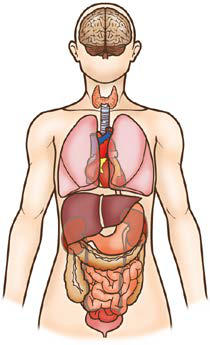

# Chapter 97: Patterns of Genetic Transmission
> **Course:** Vikkypaedia Pediatric Basic Course (*Nelson Textbook of Pediatrics, 22nd Edition (2025)*)  
> **Part VIII:** Human Genetics  
> **Authors:** Daryl A. Scott and Brendan Lee  
> **Metrics:** 8,115 words · 3 tables/boxes · 2 figures · 11 genes · 8 flashcards · 5 MCQs  
> **Quick Navigation:** [🃏 Study 8 Flashcards](../flashcards/097_flashcards.md) · [📝 Take 5-Q MCQ Quiz](../mcqs/097_mcqs.md) · [📚 Part VIII Guide](../parts/Part_VIII.md) · [🧬 Syndrome & Genetics Atlas](../omim_gene_atlas.md) · [💊 Therapeutics Matrix](../therapies_matrix.md) · [🏠 Course Index](../../index.md)

## Key Genetic & Molecular Targets
`BRCA1`, `BRCA2`, `DGUOK`, `FGFR3`, `FMR1`, `GAA`, `GJB2`, `MPV17`, `POLG`, `SHOX`, `UBE3A`

## ⚡ High-Yield Nelson Pediatric Board Pearls
- For example, a history of a distant maternally related cousin with intellec tual disability caused by fragile X syndrome can still place a male pro band at an elevated risk for this disorder.
- MENDELIAN INHERITANCE There are three classic forms of genetic inheritance: autosomal domi nant, autosomal recessive, and X-linked; these are referred to as men delian inheritance forms.
- Autosomal Dominant Inheritance Autosomal dominant inheritance is determined by the presence of one abnormal gene on one of the autosomes (chromosomes 1-22).
- In an autosomal dominant trait, a change in one of the paired genes affects the phenotype of an individual, even though the other copy of the gene is functioning correctly.
- The pedigree for autosomal dominant disorders demonstrates cer tain characteristics.
- Although not a characteristic per se, the finding of male-to-male transmission essentially confirms autosomal dominant inheritance.
- Vertical transmission can also be seen with X-linked traits.

---
## Full Chapter Text, Tables & Figures
# Chapter 97: Patterns of Genetic Transmission

*Daryl A. Scott and Brendan Lee*

<!-- p.953 -->
**FAMILY HISTORY AND PEDIGREE NOTATION** The family history remains the most important screening tool for pedi atricians in identifying a patient’s risk for developing a wide range of diseases, from multifactorial conditions such as diabetes and attentiondeficit/hyperactivity disorder, to single-gene disorders such as sickle cell anemia and cystic fibrosis. Through a detailed family history, the physician can often ascertain the mode of genetic transmission and the risks to family members. Because not all familial clustering of disease is caused by genetic factors, a family history can also identify common environmental and behavioral factors that influence the occurrence of disease. The main goal of the family history is to identify genetic sus ceptibility, and the cornerstone of the family history is a systematic and standardized pedigree.

A **pedigree** provides a graphic depiction of a family’s structure and medical history. It is important when taking a pedigree to be system atic and use standard symbols and configurations so that anyone can read and understand the information (Figs. 97.1-97.4). In the pediatric setting, the **proband** is typically the child or adolescent who is being evaluated. The proband is designated in the pedigree by an arrow.

A three- to four-generation pedigree should be obtained for every new patient as an initial screen for genetic disorders segregating within the family. The pedigree can provide clues to the inheritance pattern of these disorders and can aid the clinician in determining the risk to the proband and other family members. The closer the relationship of the proband to the person in the family with the genetic disorder, the greater is the shared genetic complement. **First-degree** relatives, such as a parent, full sibling, or child, share one half their genetic informa tion on average; first cousins share one eighth. Sometimes the person providing the family history may mention a distant relative who is affected with a genetic disorder. In such cases a more extensive pedi gree may be needed to identify the risk to other family members. For example, a history of a distant maternally related cousin with intellec tual disability caused by fragile X syndrome can still place a male pro band at an elevated risk for this disorder.

**MENDELIAN INHERITANCE** There are three classic forms of genetic inheritance: **autosomal domi nant, autosomal recessive,** and **X-linked**; these are referred to as **men delian inheritance** forms.

**Autosomal Dominant Inheritance** Autosomal dominant inheritance is determined by the presence of one abnormal gene on one of the **autosomes** (chromosomes 1-22). Autoso mal genes exist in pairs, with each parent contributing one copy. In an autosomal dominant trait, a change in one of the paired genes affects the phenotype of an individual, even though the other copy of the gene is functioning correctly. A **phenotype** can refer to a physical manifesta tion, a behavioral characteristic, or a difference detectable only through laboratory tests.

The pedigree for autosomal dominant disorders demonstrates cer tain characteristics. These disorders show a **vertical transmission** (parent-to-child) pattern and can appear in multiple generations (Fig. 97.5). An affected individual has a 50% chance of passing on the delete rious gene in *each* pregnancy and, therefore, of having a child affected by the disorder. This is referred to as the **recurrence risk** for the disor der. Unaffected individuals (family members who do not manifest the

trait and do not harbor a copy of the deleterious gene) do not pass the disorder to their children. Males and females are equally affected.

Although not a characteristic per se, the finding of male-to-male transmission essentially confirms autosomal dominant inheritance. Vertical transmission can also be seen with X-linked traits. However, because a father passes on his Y chromosome to a son, male-to-male transmission cannot be seen with an X-linked trait. Therefore male-tomale transmission eliminates X-linked inheritance as a possible expla nation. Although male-to-male transmission can occur with Y-linked genes as well, there are very few Y-linked disorders, compared with thousands having the autosomal dominant inheritance pattern.

Although parent-to-child transmission is a characteristic of auto somal dominant inheritance, many patients with an autosomal domi nant disorder have no history of an affected family member, for several possible reasons. First, the patient may have the disorder due to a **de novo** (new) pathogenic variant that occurred in the DNA of the egg or sperm that formed that individual. Second, many autosomal dominant conditions demonstrate **incomplete penetrance**, meaning that not all individuals who carry the pathogenic variant have phenotypic mani festations. In a pedigree, this can appear as a **skipped generation**, in which an unaffected individual links two affected persons (Fig. 97.6). There are many potential reasons that a disorder might exhibit incom plete penetrance including the effect of modifier genes, environmental factors, gender, and age. Third, individuals with the same autosomal dominant variant can manifest the disorder to different degrees. This is termed **variable expression** and is a characteristic of many autosomal dominant disorders.

Fourth, some spontaneous genetic pathogenic variants occur not in the egg or sperm that forms a child, but rather in a *cell* in the devel oping embryo or in a tissue after birth. Such events are referred to as **somatic pathogenic variants**. Because only a subset of cells in the body are affected, the change is said to be **mosaic**. The phenotypes caused by a somatic pathogenic variant can vary but are usually milder than if all cells were affected by the pathogenic variant. Some cancers typically arise from cells that have been affected by multiple somatic pathogenic variants. In **germline mosaicism,** the pathogenic variant occurs in a subset of cells that ultimately produce ova or sperm. An individual who is germline mosaic for a pathogenic variant might not have any manifestations of the associated disorder but may pass that change on to his or her offspring by producing ova or sperm that carry the pathogenic variant. Children whose bodies derive from those ova or sperm will carry the pathogenic variant in all of their cells unless the change undergoes a rare reversion of the somatic pathogenic variant. Recurrence of a dominantly inherited condition to apparently unaf fected parents can sometimes be explained by germline mosaicism for the dominantly transmitted variant in one of the parents.

**Autosomal Recessive Inheritance** Autosomal recessive inheritance requires deleterious variants in both copies of a gene to cause disease. Examples include cystic fibrosis and sickle cell disease. Autosomal recessive disorders are character ized by **horizontal transmission**, the observation of multiple affected members of a kindred in the same generation, but no affected fam ily members in other generations (Fig. 97.7). They are associated with a recurrence risk of 25% for carrier parents who have had a previ ous affected child. Male and female offspring are equally likely to be affected, although some traits exhibit differential expression between sexes. The offspring of consanguineous parents are at increased risk for rare, autosomal recessive traits due to the increased chance that both parents may carry a gene affected by a deleterious variant that they inherited from a common ancestor. **Consanguinity** between parents of a child with a suspected genetic disorder implies, but certainly does not prove, autosomal recessive inheritance. Although consanguineous unions are uncommon in Europe and the Americas, in other parts of the world (southern India, Japan, and the Middle East) as high as 50% of all children may be conceived in consanguineous unions. The risk of a genetic disorder in the offspring of a first-cousin union (6–8%) is about double the risk in the general population (3–4%).

*Daryl A. Scott and Brendan Lee*

<!-- p.954 -->
Key should contain all information relevant to interpretation of pedigree (e.g., define fill/shading) For clinical (non-published) pedigrees include: a) name of proband/consultand b) family names/initials of relatives for identification, as appropriate c) name and title of person recording pedigree d) historian (person relaying family history information) e) date of intake/update f) reason for taking pedigree (e.g., abnormal ultrasound, familial cancer, developmental delay, etc.) g) ancestry of both sides of family Recommended order of information placed below symbol (or to lower right) a) age; can note year of birth (e.g., b.1978) and/or death (e.g., d. 2007) b) evaluation (see Fig. 97.4) c) pedigree number (e.g., I-1, I-2, I-3) Limit identifying information to maintain confidentiality and privacy

Instructions:

Male Comments Female Gender not

specified

1. Individual

2. Affected individual

5. Deceased individual

6. Consultand

7. Proband

8. Stillbirth (SB)

9. Pregnancy (P)

10. Spontaneous abortion (SAB)

11. Termination of pregnancy (TOP)

12. Ectopic pregnancy (ECT)

Pregnancies not carried to term Affected Unaffected

3. Multiple individuals, number known

4. Multiple individuals, number unknown or unstated

Assign gender by phenotype (see text for disorders of sex development, etc.). Do not write age in symbol.

With ≥2 conditions, the individual’s symbol can be partitioned accordingly, each segment shaded with a different fill and defined in legend.

Key/legend used to define shading or other fill (e.g., hatches, dots, etc.). Use only when individual is clinically affected.

Number of siblings written inside symbol. (Affected individuals should not be grouped.)

“n” used in place of “?”.

Individual(s) seeking genetic counseling/testing.

Gestational age and karyotype below symbol. Light shading can be used for affected; define in key/legend.

If gestational age/gender known, write below symbol. Key/legend used to define shading.

Write ECT below symbol.

Other abbreviations (e.g., TAB, VTOP) not used for sake of consistency.

Include gestational age and karyotype, if known.

An affected family member coming to medical attention independent of other family members.

Indicate cause of death if known. Do not use a cross (†) to indicate death to avoid confusion with evaluation positive (+).

b.1925 30 y 4 mo

d. 35

SB 28 wk

LMP: 7/1/2007

47,XY,+21 20 wk 46, XX

SB 30 wk SB 34 wk

d. 4 mo d. 60’s

5 5 5

n n n

P P P

P P

17 wks female cystic hygroma

18 wks 47, XY,+18

ECT

<10 wks

**Fig. 97.1** Common pedigree symbols, definitions, and abbreviations. (From Bennett RL, French KS, Resta RG, et al. Standardized human pedigree nomenclature: update and assessment of the recommendations of the National Society of Genetic Counselors. J Genet Couns. 2008;17:424–433.)

<!-- p.955 -->
Every individual probably carries several rare, deleterious recessive pathogenic sequence variants. Because most pathogenic variants car ried in the general population occur at a very low frequency, it does not make economic sense to screen the entire population to identify the small number of persons who carry these variants. These vari ants typically remain undetected unless an affected child is born to a couple who both carry pathogenic variants affecting the same gene.

However, in some **genetic isolates** (small populations isolated by geography, religion, culture, or language), certain rare recessive patho genic variants are much more common than in the general popula tion. Even though there may be no known consanguinity, couples from these genetic isolates have a greater chance of sharing pathogenic alleles inherited from a common ancestor. Screening programs have been developed among some such groups to detect persons who carry common disease-causing variants and, therefore, are at increased risk for having affected children.

A variety of autosomal recessive conditions are more common among Ashkenazi Jews than in the general population. Couples of Ashkenazi Jewish ancestry should be offered prenatal or precon ception screening for Gaucher disease type one (carrier rate 1:14), cystic fibrosis (1:25), Tay-Sachs disease (1:25), familial dysautono mia (1:30), Canavan disease (1:40), glycogen storage disease type 1A (1:71), maple syrup urine disease (1:81), Fanconi anemia type C (1:89), Niemann-Pick disease type A (1:90), Bloom syndrome (1:100), mucolipidosis IV (1:120), and possibly neonatal familial hyperinsu linemic hypoglycemia.

The prevalence of carriers of certain autosomal recessive variants in some larger populations is unusually high. In such cases, **hetero zygote advantage** is postulated. The carrier frequencies of sickle cell disease in the African population and of cystic fibrosis in the north ern European population are much higher than would be expected from the rate of new pathogenic variants. In these populations,

If possible, male partner should be to left of female partner on relationship line.

Siblings should be listed from left to right in birth order (oldest to youngest).

Comments 1. Definitions

2. Relationship line (horizontal)

a. Relationships

b. Consanguinity If degree of relationship not obvious from pedigree, it should be stated (e.g., third cousins) above relationship line.

a. Genetic

- Multiple gestation

Monozygotic Dizygotic Unknown Trizygotic The horizontal line indicating monozygosity is placed between the individual’s line and not between each symbol. An asterisk (*) can be used if zygosity proven.

- Family history not available/ known for individual

- No children by choice or reason unknown

- Infertility

b. Adoption

Biologic parents shown.

3. Line of descent (vertical or diagonal)

A break in a relationship line indicates the relationship no longer exists. Multiple previous partners do not need to be shown if they do not affect genetic assessment.

1. relationship line

2. line of descent 3. sibship line

4. individual’s line

in

? ?

?

out by relative

Indicate reason, if known.

Indicate reason, if known.

Brackets used for all adoptions. Adoptive and biological parents denoted by dashed and solid lines of descent, respectively.

or

or

vasectomy

azoospermia endometriosis

tubal

**Fig. 97.2** Pedigree line definitions. (From Bennett RL, French KS, Resta RG, et al. Standardized human pedigree nomenclature: update and assessment of the recommendations of the National Society of Genetic Counselors. J Genet Couns. 2008;17:424–433.)

<!-- p.956 -->
heterozygous carriers may have had an advantage in terms of survival and reproduction over noncarriers. In sickle cell disease, the carrier state is thought to confer some resistance to malaria. In cystic fibro sis, the carrier state has been postulated to confer resistance to chol era or enteropathogenic *Escherichia coli* infections. Population-based **carrier screening** for cystic fibrosis is recommended for persons of northern European and Ashkenazi Jewish ancestry, and populationbased screening for sickle cell disease is recommended for persons of African ancestry.

If the frequency of an autosomal recessive disease is known, the fre quency of the heterozygote or carrier state can be calculated from the **Hardy-Weinberg formula:**

p2 + 2pq + q2 = 1

where *p* is the frequency of one of a pair of alleles and *q* is the fre quency of the other. For example, if the frequency of cystic fibrosis among White Americans is one in 2,500 (*p*2), then the frequency of the

heterozygote (2*pq*) can be calculated: If *p*2 = 1/2,500, then *p* = 1/50 and *q* = 49/50; 2*pq* = 2 × (1/50) × (49/50) = 98/2,500, or 3.92%.

**Pseudodominant Inheritance** Pseudodominant inheritance refers to the observation of apparent dominant (parent to child) transmission of a known autosomal reces sive disorder (Fig. 97.8). This occurs when a homozygous affected individual has a partner who is a heterozygous carrier. This is most likely to occur for relatively common recessive traits within a popula tion, such as sickle cell anemia or nonsyndromic autosomal reces sive hearing loss caused by deleterious variants in *GJB2*, the gene that encodes connexin 26.

**X-Linked Inheritance** X-linked inheritance describes the inheritance pattern of most dis orders caused by deleterious changes in genes located on the X chro mosome (Fig. 97.9). In X-liked disorders, males are more commonly

or

D represents egg or sperm donor S represents surrogate (gestational carrier) If the woman is both the ovum donor and a surrogate, in the interest of genetic assessment, she will only be referred to as a donor (e.g., 4 and 5); the pregnancy symbol and its line of descent are positioned below the woman who is carrying the pregnancy Available family history should be noted on the gamete donor and/or gestational carrier

Possible Reproductive Scenarios

1. Sperm donor

2. Ovum donor

3. Surrogate only

4. Surrogate ovum donor

5. Planned adoption

Comments

Couple in which woman is carrying pregnancy using donor sperm. No relationship line is shown between the woman carrying the pregnancy and the sperm donor.

Couple whose gametes are used to impregnate a woman (surrogate) who carries the pregnancy. The line of descent from the surrogate is solid because there is a biological relationship that may affect the fetus (e.g., teratogens).

Couple in which male partner’s sperm is used to inseminate (a) an unrelated woman or (b) a sister who is carrying the pregnancy for the couple.

Couple contracts with a woman to carry a pregnancy using ovum of the woman carrying the pregnancy and donor sperm.

Couple in which woman is carrying pregnancy using a donor egg and partner’s sperm. The line of descent from the birth mother is solid because there is a biologic relationship that may affect the fetus (e.g., teratogens).

Instructions:

D

P

P

P P

D

D

D

D

S

D

a) b)

or

P P

D

P

**Fig. 97.3** Assisted reproductive technology symbols and definitions. (From Bennett RL, French KS, Resta RG, et al. Standardized human pedigree nomenclature: update and assessment of the recommendations of the National Society of Genetic Counselors. J Genet Couns. 2008;17:424–433.)

<!-- p.957 -->
E is used for evaluation to represent clinical and/or test information on the pedigree a. E is to be defined in key/legend b. If more than one evaluation, use subscript (E1, E2, E3) and define in key c. Test results should be put in parentheses or defined in key/legend A symbol is shaded only when an individual is clinically symptomatic For linkage studies, haplotype information is written below the individual. The haplotype of interest should be on left and appropriately highlighted Repetitive sequences, trinucleotides, and expansion numbers are written with affected allele first and placed in parentheses If variant known, identify in parentheses

Instructions:

Definition

1. Documented evaluation (*) Use only if examined/evaluated by you or your research/clinical team or if the outside evaluation has been reviewed and verified.

2. Carrier—not likely to manifest disease regardless of inheritance pattern

3. Asymptomatic/presymptomatic carrier—clinically unaffected at this time but could later exhibit symptoms

4. Uninformative study (u)

5. Affected individual with positive evaluation (E+)

Symbol Scenario

Woman with negative echocardiogram.

Male carrier of Tay-Sachs disease by patient report (* not used because results not verified).

Woman age 25 with negative mammogram and positive BRCA1 DNA test.

Man age 25 with normal physical exam and uninformative DNA test for Huntington disease (E2).

Individual with cystic fibrosis and positive variant study; only one variant has currently been identified.

10 week male fetus with a trisomy 18 karyotype.

 

*

*

*

*

E+

Eu

E− (echo)

25 y

25 y

E1− (mammogram) E2+ (5385insC BRCA1)

E1− (physical exam) E2u (36n/18n)

Eu E+('F508)

E+('F508/u)

E+(CVS) 47,XY,+18

P

10 wk

**Fig. 97.4** Pedigree symbols of genetic evaluation and testing information. (From Bennett RL, French KS, Resta RG, et al. Standardized human pedigree nomenclature: update and assessment of the recommendations of the National Society of Genetic Counselors. J Genet Couns. 2008;17:424–433.)

1 2

1 2 3 4

1 2 3 4

5

5 6 7

6

**Fig. 97.5** Autosomal dominant pedigree. Pedigree showing typical inheritance of a form of achondroplasia (FGFR3) inherited as an autoso mal dominant trait. Black, Affected patients.

1 2

1 2

1 2 3 4

**Fig. 97.6** Incomplete penetrance. This family segregates a familial cancer syndrome, familial adenomatous polyposis. Individual II.3 is an obligate carrier (arrow), but there are no findings to suggest the dis order. This disorder is nonpenetrant in this individual. Black, Affected patients.

<!-- p.958 -->
affected than females. Female carriers of these disorders are generally unaffected, or if affected, they are affected more mildly than males. In each pregnancy, female carriers have a 25% chance of having an affected son, a 25% chance of having a carrier daughter, and a 50% chance of having a child that does not inherit the mutated X-linked gene. Because affected males pass their X chromosome to all their daughters and their Y chromosome to all their sons, they have a 50% chance of having a daughter who is a carrier. Male-to-male transmis sion excludes X-linked inheritance but is seen with autosomal domi nant and Y-linked inheritance.

A female occasionally exhibits signs of an X-linked trait similar to a male. This occurs rarely from homozygosity for an X-linked

trait or the presence of a sex chromosome abnormality (45,X or 46,XY female) but more commonly from skewed or nonrandom X-inactivation. **X chromosome inactivation** occurs early in devel opment and involves the random and irreversible inactivation of most genes on one X chromosome in female cells (Fig. 97.10). In some cases, a preponderance of cells inactivates the same X chro mosome, resulting in phenotypic expression of an X-linked patho genic variant if it resides on the active chromosome. This can occur because of chance, selection against cells that have inactivated the X chromosome carrying the normal gene, or an X chromosome abnormality that results in inactivation of the X chromosome car rying the normal gene.

In some X-linked disorders, both **hemizygous** males and **het erozygous** females who carry an affected X-linked gene have simi lar phenotypic manifestations. In these cases, an affected male will have a 50% chance of having an affected daughter and a 50% chance of having an unaffected son in each pregnancy, whereas half the male and female offspring of an affected mother will be affected (Fig. 97.11). Some X-linked conditions are lethal in a high per centage of males, such as **incontinentia pigmenti**. In such cases the pedigree typically shows only affected females and an overall female/male ratio of 2:1, with an increased number of miscarriages (Fig. 97.12).

**Y-LINKED INHERITANCE** There are few Y-linked traits. These demonstrate *only* male-to-male transmission, and only males are affected (Fig. 97.13). Most Y-linked genes are related to male sex determination and reproduction and are associated with infertility. Therefore it is rare to see familial transmis sion of a Y-linked disorder. However, advances in assisted reproductive technologies might make it possible to have familial transmission of male infertility.

**INHERITANCE ASSOCIATED WITH PSEUDOAUTOSOMAL REGIONS** There are pseudoautosomal regions on the X and Y chromosomes. Because these regions are made up of homologous sequences of nucleotides, genes that are located in these regions are present in equal numbers among both males and females. *SHOX* is one of the best-characterized disease genes located in these regions. Heterozy gous *SHOX* pathogenic variants cause **Leri-Weil dyschondrosteosis**, a rare skeletal dysplasia that involves bilateral bowing of the forearms with dislocations of the ulna at the wrist and generalized short stature. Homozygous *SHOX* pathogenic variants cause the much more severe **Langer mesomelic dwarfism**.

**DIGENIC INHERITANCE** Digenic inheritance explains the occasional occurrence of **retinitis pigmentosa (RP)** in children of parents who each carry a pathogenic variant in a different RP-associated gene (Fig. 97.14). Both parents have normal vision, as would be expected, but their offspring who are **double heterozygotes**—having inherited both variants—develop RP. Digenic pedigrees can exhibit characteristics of both autosomal dominant (vertical transmission) and autosomal recessive inheri tance (one in four recurrence risk). A couple in which the two unaf fected partners are carriers for variants in two different RP-associated genes that show digenic inheritance have a one in four risk of hav ing an affected child, similar to what is seen in autosomal recessive inheritance. However, their affected children, and affected children in subsequent generations, have a one in four risk of transmitting both variants to their offspring, who would be affected (vertical transmission).

**PSEUDOGENETIC INHERITANCE AND FAMILIAL CLUSTERING** Sometimes nongenetic causes of a particular disease in multiple fam ily members can produce a pattern that mimics genetic transmission. These nongenetic factors can include identifiable environmental fac tors, teratogenic exposures, or undetermined or undefined factors.

**Fig. 97.7** Autosomal recessive pedigree with parental consanguinity. Central dot, Carriers; Black, affected patients.

= *GJB2* carrier

**Fig. 97.8** Pseudodominant inheritance. Black, Affected (deaf); central dot shows carrier who is asymptomatic (unaffected).

**Fig. 97.9** Pedigree demonstrating X-linked recessive inheritance. Central dot, Carriers; black, affected patients.

<!-- p.959 -->
Examples of identifiable factors might include multiple siblings in a family having asthma because of exposure to cigarette smoke from their parents or having failure to thrive, developmental delay, and unusual facial appearance caused by exposure to alcohol during pregnancy.

In some cases, the disease is sufficiently common in the general population that some familial clustering occurs simply by chance. Breast cancer affects 11% of all women, and it is possible that several women in a family will develop breast cancer even in the absence of a specific genetic predisposition. However, hereditary breast cancer associated with pathogenic variants in *BRCA1* and *BRCA2* should be suspected in any individual who has a personal history of breast can cer with onset before age 50, early-onset breast and ovarian cancer at any age, bilateral or multifocal breast cancer, a family history of breast cancer or breast and ovarian cancer consistent with autosomal dominant inheritance, or a personal or family history of male breast

XmXp XmXp XmXp

XmXp

XmXp

XmXp XmXp XmXp

XmXp XmXp

XmXp XmXp

XmXp XmXp XmXp

XmXp XmXp

XmXp XmXp

XmXp XmXp XmXp

XmXp XmXp

XmXp XmXp

XmXp XmXp XmXp

XmXp XmXp

XmXp XmXp

**Fig. 97.10** X-inactivation. Black marks the active X chromosome. Color of the cell represents its active X chromosome is paternally (Xp, blue) or maternally (Xm, pink) derived.

**Fig. 97.11** Pedigree pattern demonstrating X-linked dominant inher itance. Black, Affected patients. Note there is no father-to-son transmis sion in this situation, and hemizygosity (i.e., X-linked gene in a male) is not lethal. In some X-linked dominant conditions, X-linked males have a more severe phenotype and might not survive. In that case, only females manifest the disease (see Fig. 97.12).

**Fig. 97.12** Pedigree of an X-linked dominant disorder with male lethality, such as incontinentia pigmenti. Black, Affected patients.

**Fig. 97.13** Y-linked inheritance. Black, Affected patients.

<!-- p.960 -->
cancer. In other cases, clustering within a family may be caused by undefined genetic factors or unidentified pathogenic sequence vari ants (nuclear or mitochondrial).

**NONTRADITIONAL INHERITANCE** Some genetic disorders are inherited in a manner that does not fol low classical mendelian patterns. Nontraditional inheritance is seen in mitochondrial disorders, triplet repeat expansion diseases, and imprinting defects.

**Mitochondrial Inheritance** An individual’s mitochondrial genome is entirely derived from the mother because sperm contain relatively few mitochondria, which are degraded after fertilization. It follows that **mitochondrial inheri tance** is, essentially, **maternal inheritance**. A female with a mito chondrially inherited genetic disorder can have affected offspring of either sex, but an affected father cannot pass on the disease to his off spring (Fig. 97.15). Mitochondrial DNA pathogenic variants are often deletions or point pathogenic variants. Overall, one person in 400 has a maternally inherited pathogenic mitochondrial DNA patho genic variant (see Chapter 108). In individual families, mitochondrial inheritance may be difficult to distinguish from autosomal dominant or X-linked inheritance, but in many cases, the sex of the transmit ting and nontransmitting parents can suggest a mitochondrial basis (Table 97.1).

Mitochondria are the cell’s suppliers of energy; the organs that are most affected by the presence of abnormal mitochondria are those that have the greatest energy requirements, such as the brain, muscle,

heart, and liver (see Chapters 107.4, 409, 638.2, and 651.4; Fig. 97.16). Common manifestations include developmental delay, seizures, car diac dysfunction, decreased muscle strength and tone, and hearing and vision problems.

Mitochondrial diseases can be highly variable in their clinical manifestations. This is partly because cells can contain multiple mitochondria, each bearing several copies of the mitochondrial genome. Thus a cell can have a mixture of normal and abnormal mitochondrial genomes, which is referred to as **heteroplasmy**. In contrast, **homoplasmy** refers to a state in which all copies of the mitochondrial genome carry the same sequence variant. Unequal segregation of mitochondria carrying normal and abnormal genomes and replicative advantage can result in varying degrees of heteroplasmy in the cells of an affected individual, including the individual ova of an affected female. Because of this, a mother may be asymptomatic and yet have children who are severely affected. The level of heteroplasmy at which disease symptoms typically appear can also vary based on the type of mitochondrial variant.

Detection of variants in the mitochondrial genome may require sampling of the affected tissue for DNA analysis. In some tissues, such as blood, testing for mitochondrial DNA variants may be inadequate because the variant may be found primarily in affected tissues such as muscle (Fig. 97.17). Growth and differentiation factor 15 (GDF-15) and blood lactate levels are screening tests for mitochondrial disorders. GDF-15 is only accurate in children ≥1 year of age and in the absence of heart, liver, or renal disease.

**Triplet Repeat Expansion Disorders** Triplet repeat expansion disorders are distinguished by the special dynamic nature of the disease-causing variant. Triplet repeat expan sion disorders include fragile X syndrome, myotonic dystrophy, Huntington disease, and spinocerebellar ataxias (Table 97.2 and Fig. 97.18). These disorders are caused by expansion in the num ber of 3-bp repeats. The fragile X gene, *FMR1,* normally has 5-40 CGG triplets. An error in replication can result in expansion of that number to a level in the gray zone between 41 and 58 repeats or to a level referred to as a **prepathogenic variant**, which comprises 59- 200 repeats. Some prepathogenic variant carriers, more often males, develop fragile X–associated tremor/ataxia syndrome (FXTAS) as adults. Female prepathogenic variant carriers are at risk for frag ile X–associated primary ovarian insufficiency (FXPOI). Persons, especially females, with a prepathogenic variant are also at risk for having the repeat expand further in subsequent meiosis, thus cross ing into the range of a **full pathogenic variant** (>200 repeats) in offspring. With this number of repeats, the *FMR1* gene becomes hypermethylated, and protein production is lost.

Some triplet expansions associated with other genes can cause disease through a mechanism other than decreased protein produc tion. In Huntington disease, the expansion causes the gene prod uct to have a new, toxic effect on the neurons of the basal ganglia. For most triplet repeat disorders, there is a clinical correlation to the size of the expansion, with a greater expansion causing more severe symptoms and having an earlier age of disease onset. The observation of increasing severity of disease and early age at onset in subsequent generations is termed **genetic anticipation** and is a defining characteristic of many triplet repeat expansion disorders (Fig. 97.19).

**Genetic Imprinting** The two copies of most autosomal genes are functionally equivalent. However, in some cases, only one copy of a gene is transcribed, and the second copy is silenced. This gene silencing is typically associ ated with methylation of DNA, which is an **epigenetic** modifica tion; it does not change the nucleotide sequence of the DNA (Fig. 97.20). In **imprinting**, gene expression depends on the *parent of origin* of the chromosome (see Chapter 99.7). Imprinting disorders result from an imbalance of active copies of a given gene, which can occur for several reasons. Prader-Willi and Angelman syndromes,

**Fig. 97.15** Pedigree of a mitochondrial disorder, exhibiting maternal inheritance. Black, Affected patients.

Aa BB

Aa BB

Aa Bb

Aa Bb

Aa BB

AA Bb

AA BB

AA Bb

AA BB AA BB

AA Bb

**Fig. 97.14** Digenic pedigree. Here, the disease alleles are a and b and they reside on distinct genetic loci or genes. For a person to have the disease, heterozygosity for variant alleles in both genes (A/a; B/b) is required. Black, Affected patients.

<!-- p.961 -->
two distinct disorders associated with developmental impairment, are caused by microdeletions of chromosome 15q11-12. The micro deletion in **Prader-Willi syndrome** is always on the *paternally* derived chromosome 15, whereas in **Angelman syndrome** it is on the *maternal* copy. *UBE3A* is the gene responsible for Angelman syndrome. The paternal copy of *UBE3A* is transcriptionally silenced in the brain, but the maternal copy continues to be transcribed. If an individual has a maternally derived deletion, an insufficient amount of UBE3A protein is produced in the brain, resulting in the neuro logic deficits seen in Angelman syndrome.

**Uniparental disomy (UPD)**, the rare occurrence of a child inheriting both copies of a chromosome from the *same parent*, is another genetic mechanism that can cause Prader-Willi and Angel man syndromes. Inheriting both chromosomes 15 from the mother is functionally the same as deletion of the paternal 15q12 region and results in Prader-Willi syndrome. Approximately 30% of cases of Prader-Willi syndrome are caused by maternal UPD15, whereas paternal UPD15 accounts for only 3% of Angelman syndrome (see Chapter 99.7). Pathogenic variants in *UBE3A* account for ∼11% of patients with Angelman syndrome and result in familial transmis sion. The least common cause is a pathogenic variant affecting the imprinting center, which results in an inability to correctly imprint

*UBE3A*. In a mother, inability to reset the imprinting on her pater nally inherited chromosome 15 imprint results in a 50% risk of passing on an incorrectly methylated copy of *UBE3A* to a child, who would then develop Angelman syndrome.

Other imprinted regions of clinical interest include the short arm of chromosome 11, where the genes for Beckwith-Wiedemann syn drome and nesidioblastosis map, and the long arm of chromosome seven with maternal UPD of 7q being associated with some cases of idiopathic short stature and Russell-Silver syndrome.

Imprinting of a gene can occur during gametogenesis or early embryonic development **(reprogramming)**. Genes can become inactive or active by various mechanisms including DNA methyla tion or demethylation or histone acetylation or deacetylation, with different patterns of (de)methylation noted on paternal or mater nal imprintable chromosome regions. Some genes demonstrate tissue-specific imprinting (see Fig. 97.20). There is a small but increased incidence of imprinting disorders, specifically Beckwith- Wiedemann and Angelman syndrome, following assisted reproduc tive technologies such as in vitro fertilization and intracytoplasmic sperm injection. The overall incidence of these disorders in chil dren conceived using assisted reproductive technologies is likely to be <1%.

#### **Table 97.1** Representative Examples of Disorders Caused by Pathogenic Variants in Mitochondrial DNA and Their Inheritance

| Category / Parameter | Clinical Details & Findings |
| --- | --- |
| **INHERITANCE** | Leber hereditary; optic neuropathy; Rapid optic nerve atrophy, leading; to blindness in young adult life;; sex bias approximately 50%; males with visual loss, only 10%; females; Substitution p.Arg340His in ND1; gene of complex I of electron; transport chain; other complex; I missense pathogenic variants; Homoplasmic (usually); Maternal; NARP, Leigh; disease; Neuropathy, ataxia, retinitis; pigmentosa, developmental; delay, intellectual disability lactic; academia; Point pathogenic variants in ATPase; subunit six gene; Heteroplasmic; Maternal |
| **MELAS** | Mitochondrial encephalomyopathy,; lactic acidosis, and strokelike; episodes; may manifest only as; diabetes mellitus or deafness; Point pathogenic variant in tRNALeu; Heteroplasmic; Maternal |
| **MERRF** | Myoclonic epilepsy, ragged red; fibers in muscle, ataxia,; sensorineural deafness; Point pathogenic variant in tRNALys; Heteroplasmic; Maternal; Deafness; Progressive sensorineural; deafness, often induced by; aminoglycoside antibiotics; m.1555A>G pathogenic variant in; 12S rRNA; Homoplasmic; Maternal; Nonsyndromic sensorineural; deafness; m.7445A>G pathogenic variant in; 12S rRNA; Homoplasmic; Maternal; Chronic progressive; external; ophthalmoplegia |
| **(CPEO)** | Progressive weakness of extraocular; muscles, cardiomyopathy,; ptosis, heart block, ataxia, retinal; pigmentation, diabetes; The common MELAS point; pathogenic variant in tRNALys;; large deletions similar to KSS; Heteroplasmic; Maternal if; point; pathogenic; variants; Pearson syndrome; Pancreatic insufficiency,; pancytopenia, lactic acidosis; Large deletions; Heteroplasmic; Sporadic,; somatic; pathogenic; variants; Kearns-Sayre; syndrome (KSS); PEO of early onset with heart; block, retinal pigmentation; 5-kb large deletion; Heteroplasmic; Sporadic,; somatic; pathogenic; variants; mtDNA, Mitochondrial DNA; rRNA, ribosomal RNA; tRNA, transfer RNA.; From Nussbaum RL, McInnes RR, Willard HF, eds. Thompson & Thompson Genetics in Medicine, 6th ed. Philadelphia: Saunders; 2001: p. 246. |

<!-- p.962 -->
**MULTIFACTORIAL AND POLYGENIC INHERITANCE** Multifactorial inheritance refers to traits that are caused by a com bination of inherited, environmental, and stochastic factors (Fig. 97.21). Multifactorial traits differ from polygenic inheritance, which refers to traits that result from the additive effects of multiple genes. Multifactorial traits segregate within families but do not exhibit a consistent or recognizable inheritance pattern. Characteristics include the following: • There is a similar rate of recurrence among all first-degree relatives

(parents, siblings, offspring of affected child). It is unusual to find a substantial increase in risk for relatives related more distantly than second degree to the index case. • The risk of recurrence is related to the incidence of the disease. • Some disorders have a sex predilection, as indicated by an unequal

male:female incidence. Pyloric stenosis, for example, is more com mon in males, whereas congenital dislocation of the hips is more common in females. With an altered sex ratio, the risk is higher for the relatives of an index case whose gender is less often affected than relatives of an index case of the more frequently affected gender. The risk to the son of an affected female with infantile pyloric stenosis is 18%, compared with the 5% risk for the son of an affected male. An affected female presumably has a greater genetic susceptibility, which can be passed on to offspring.

• The likelihood that both identical twins will be affected with the

same malformation is <100% but much greater than the chance that both members of a nonidentical twin pair will be affected. This con trasts with the pattern seen in mendelian inheritance, in which iden tical twins almost always share fully penetrant genetic disorders. • The risk of recurrence is increased when multiple family members

are affected. A simple example is that the risk of recurrence for uni lateral cleft lip and palate is 4% for a couple with one affected child and increases to 9% with two affected children. It is sometimes dif ficult to distinguish between a multifactorial and mendelian etiology in families with multiple affected individuals. • The risk of recurrence may be greater when the disorder is more

severe. For example, an infant who has long-segment Hirschsprung disease has a greater chance of having an affected sibling than the infant who has short-segment Hirschsprung disease. There are two types of multifactorial traits. One exhibits **continuous variation**, with “normal” individuals falling within a statistical range— often defined as having a value two standard deviations (SDs) above and/or below the mean—and “abnormals” falling outside that range. Examples include such traits as intelligence, blood pressure, height, and head circumference. For many of these traits, offspring values can be estimated based on a modified average of their parental values, with nutritional and environmental factors playing an important role.

Eye External ophthalmoplegia Ptosis Cataract Pigmentary retinopathy Optic atrophy

Hearing Bilateral sensorineural deafness

Gastrointestinal Dysphagia Pseudo-obstruction Constipation Hepatic failure

Peripheral nervous system Myopathy Axonal sensorimotor neuropathy

Central nervous system

Encephalopathy Strokelike episodes Seizures and dementia Psychosis and depression

Ataxia Migraine

Cardiac Hypertrophic cardiomyopathy

Dilated cardiomyopathy

Heart block Pre-excitation syndrome

Endocrine and diabetes

Diabetes mellitus Hypoparathyroidism

Hypothyroidism

Gonadal failure

Renal Renal tubular defects

Fanconi syndrome

**Fig. 97.16** The range of affected tissues and clinical phenotypes associated with pathogenic variants in mitochondrial DNA (mtDNA). (Modified from Chinnery PF, Turnbull DM. Mitochondrial DNA and disease. Lancet. 1999;345:SI17–SI21.)

<!-- p.963 -->
Patients with clinical suspicion of mitochondrial RC disorders

Common mtDNA variants

positive

•Determine heteroplasmy •Family member studies

negative

Blood

Muscle, Liver, or Skin

Leigh Myopathy

Cardiomyopathy Encephalo- Encephalo- Nephropathy

Encephaloand/or Hepatopathy

MNGIE

•PDH •COX assembly genes •CI subunits •CI assembly genes

•TK2 •ANT1 •SCO2 •ANT1 •TP •DGUOK •POLG •MPV17 •SCO1 •BCS1L •SUCLA2

•COX10

positive negative

•Family member studies

muscle, liver, skin

ETC mtDNA content

depletion high or normal

•POLG •DGUOK •TK2 •TP •TWINKLE •ANT1 •MPV17 •SUCLA2

positive •Family member studies

•mtDNA tRNA genes •Mito genome sequencing

positive

negative

negative

Isolated Complex Deficiency

•Sequence complex subunits •Sequence assembly genes

Generalized Complex Deficiency

•Depletion genes •PDH

Proliferated or Not Deficient

negative

negative

•mtDNA tRNA genes •Mito genome sequencing •mtDNA deletions by PCR

positive

negative

Cannot confirm

diagnosis

•POLG •ANT1 •TWINKLE

PEO

•POLG

Intractable Seizures

positive

**Fig. 97.17** Clinical algorithm for genetic diagnostic testing of mitochondrial DNA (mtDNA) and nuclear DNA (nDNA) genes in patients suspected of mitochondrial disorders (Baylor College of Medicine, Mitochondrial Diagnostics Laboratory). RC, Respiratory chain; MNGIE, mitochondrial neuro gastrointestinal encephalopathy; PEO, progressive external ophthalmoplegia; PDH, pyruvate dehydrogenase; CI, respiratory complex I; ETC, elec tron transport chain; PCR, polymerase chain reaction. (From Haas RH, Parikh S, Falk MJ, et al. The in-depth evaluation of suspected mitochondrial disease. Mol Genet Metab. 2008;94:16–37.)

#### **Table 97.2** Diseases Associated with Polynucleotide Repeat Expansions

| Category / Parameter | Clinical Details & Findings |
| --- | --- |
| **CATEGORY 1** | Huntington; disease; Loss of motor control,; dementia, affective disorder |
| **CAG** | 6-34; 36-100 or more; More often through; father; Exon; Spinal and bulbar; muscular atrophy; Adult-onset motor-neuron; disease associated with; androgen insensitivity |
| **CAG** | 11-34; 40-62; More often through; father; Exon; Spinocerebellar; ataxia type 1; Progressive ataxia, dysarthria,; dysmetria |
| **CAG** | 6-39; 41-81; More often through; father; Exon; Spinocerebellar; ataxia type 2; Progressive ataxia, dysarthria |
| **CAG** | 15-29; 35-59; —; Exon; Spinocerebellar; ataxia type three; (Machado-Joseph; disease); Dystonia, distal muscular; atrophy, ataxia, external; ophthalmoplegia |
| **CAG** | 13-36; 68-79; More often through; father; Exon; Continued |

<!-- p.964 -->

#### **Table 97.2** Diseases Associated with Polynucleotide Repeat Expansions—cont’d

| Category / Parameter | Clinical Details & Findings |
| --- | --- |
| **General** | Spinocerebellar; ataxia type 6; Progressive ataxia, dysarthria,; nystagmus |
| **CAG** | 4-16; 21-27; —; Exon; Spinocerebellar; ataxia type 7; Progressive ataxia, dysarthria,; retinal degeneration |
| **CAG** | 7-35; 38-200; More often through; father; —; Spinocerebellar; ataxia type 17; Progressive ataxia, dementia,; bradykinesia, dysmetria |
| **CAG** | 29-42; 47-55; —; Exon; Dentatorubral-; pallidoluysian; atrophy/Haw; River syndrome; Cerebellar atrophy, ataxia,; myoclonic epilepsy,; choreoathetosis, dementia |
| **CAG** | 7-25; 49-88; More often through; father; Exon |
| **CATEGORY 2** | Pseudoachondro; plasia, multiple; epiphyseal; dysplasia; Short stature, joint laxity,; degenerative joint disease |
| **GAC** | 5; 6-7; —; Exon; Oculopharyngeal; muscular; dystrophy; Proximal limb weakness,; dysphagia, ptosis |
| **GCG** | 6; 7-13; —; Exon; Cleidocranial; dysplasia; Short stature, open skull; sutures with bulging; calvaria, clavicular hypoplasia,; shortened fingers, dental; anomalies |
| **GCA** | 17; 27 (expansion; observed in; one family); —; Exon; Synpolydactyly; Polydactyly and syndactyly |
| **GCA** | 15; 22-25; —; Exon |
| **CATEGORY 3** | Myotonic; dystrophy (DM1;; chromosome 19); Muscle loss, cardiac; arrhythmia, cataracts,; frontal balding |
| **CTG** | 5-37; 100 to several; thousand; Either parent, but; expansion to; congenital form; through mother; 3′ untranslated; region; Myotonic; dystrophy (DM2;; chromosome 3); Muscle loss, cardiac; arrhythmia, cataracts,; frontal balding |
| **CCTG** | <75; 75-11,000; —; 3′ untranslated; region; Friedreich ataxia; Progressive limb ataxia,; dysarthria, hypertrophic; cardiomyopathy, pyramidal; weakness in legs |
| **GAA** | 7-2; 200-900 or; more; Autosomal recessive; inheritance, so; disease alleles; are inherited from; both parents; Intron; Fragile X syndrome |
| **(FRAXA)** | Intellectual impairment,; large ears and jaws,; macroorchidism in males |
| **CGG** | 6-52; 200-2,000 or; more; Exclusively through; mother; 5′ untranslated; region; Fragile site (FRAXE); Mild intellectual impairment |
| **GCC** | 6-35; >200; More often through; mother; 5′ untranslated; region; Spinocerebellar; ataxia type 8; Adult-onset ataxia, dysarthria,; nystagmus |
| **CTG** | 16-37; 107-127; More often through; mother; 3′ untranslated; region; Spinocerebellar; ataxia type 10; Ataxia and seizures |
| **ATTCT** | 12-16; 800-4,500; More often through; father; Intron; Spinocerebellar; ataxia type 12; Ataxia, eye movement; disorders; variable age at; onset |
| **CAG** | 7-28; 66-78; —; 5′ untranslated; region; Progressive; myoclonic; epilepsy type 1; Juvenile-onset seizures,; myoclonus, dementia; 12-bp repeat; motif; 2-3; 30-75; Autosomal recessive; inheritance, so; transmitted by; both parents; 5′ untranslated; region; From Jorde LB, Carey JC, Bamshad MJ, White, RL. Medical Genetics, 3rd ed. St Louis: Mosby; 2006: p. 82. |

<!-- p.965 -->
**exon* intron intron* 59

AUG pre-mRNA

(CGG)n>200

*Fragile X syndrome*

**(CGG)****n**

Transcriptional

silencing = loss-of-

function

variant

Loss of RNA binding

= impaired translational repression of

target RNAs

(GAA)n≥200

*Friedreich*

*ataxia*

**(GAA)****n**

Impaired transcriptional

elongation

= loss of frataxin function

Increased Fe in mitochondria,

reduced heme

synthesis, reduced activity of Fe-S complex containing proteins

(CTG)n≥50

*Myotonic dystrophy 1*

**(CUG)****n**

Expanded CUG

repeats in the RNA confer novel

properties on the RNA

Expanded CUG repeats bind increased amounts of RNA-binding proteins → impaired RNA

splicing of key proteins

(CCTG)n≥75

*Myotonic dystrophy 2*

**(CCUG)****n**

(CAG)n≥40 *Huntington*

*disease*

**(CAG)****n**

Expanded polyglutamine

tracts in the huntingtin

protein confer novel properties on the protein

Increased and/or promiscuous protein:protein interactions with transcription factors → loss of their function

(CGG)n60 to 200

*Fragile X tremor/ataxia*

*syndrome*

2 to 5-fold increase in *FMR*1 mRNA

= ? gain-of- RNA function

Neuronal intranuclear

inclusions

stop

39 39 UTR 59 UTR

**Fig. 97.18** The locations of the trinucleotide repeat expansions and the sequence of each trinucleotide in five representative trinucleotide repeat diseases, shown on a schematic of a generic pre–messenger RNA (mRNA). The minimal number of repeats in the DNA sequence of the affected gene associated with the disease is also indicated, as well as the effect of the expansion on the mutant RNA or protein. (From Nussbaum RL, McInnes RR, Willard HF, eds. Thompson & Thompson Genetics in Medicine, 8th ed. Philadelphia: Elsevier; 2016; based partly on an unpublished figure from John A. Phillips III, Vanderbilt University.)

55 yr

40 yr

48 yr 50 yr

37 yr 39 yr

**Fig. 97.19** Myotonic dystrophy pedigree illustrating genetic anticipation. In this case the age at onset for family members affected with an autoso mal dominant disease is lower in more recent generations. Black, Affected patients.

<!-- p.966 -->
**G A**

**T**

**G A**

**T**

**G A**

**T**

**G A**

**T**

**T C**

**T**

**T C**

**T**

**T C**

**T**

**T C**

**T**

**Individual I Individual II**

**Fig. 97.20** Tissue-specific DNA methylation and epigenetic heterogeneity among individuals. A subset of the DNA methylation patterns within a cell is characteristic of that cell type. Cell type–specific and tissue-specific DNA methylation patterns are illustrated by organ-to-organ variations in the clusters of methylated cytosine-phosphate-guanine bases (CpGs) within the same individual. Despite overall consistency in tissue-specific DNA methylation patterns, variations in these patterns exist among different individuals. Methylated CpGs are indicated by a filled circle and unmethyl ated CpGs by an open circle. Single nucleotide polymorphisms (SNPs) are indicated by the corresponding base. (Redrawn from Brena RM, Huang THM, Plass C. Toward a human epigenome. Nat Genet. 2006;38:1359–1360.)

Genetic dominant

fully penetrant

Incompletely

penetrant

Polygenic

Multifactorial

Environmental

Nature vs nurture

Genetic load

Environmental effect **Fig. 97.21**  The progressive decrease in the genetic load contribut ing to the development of a disease creates a smooth transition in the distribution of illnesses on an etiologic diagram. In theory, no dis eases are completely free from the influence of both genetic and en vironmental factors. (*From Bomprezzi R, Kovanen PE, Martin R. New approaches to investigating heterogeneity in complex traits. J Med Genet. 2003;40:553–559.*)

With other multifactorial traits, the distinction between normal and abnormal is based on the **qualitative** presence or absence of a particu lar trait. Examples include pyloric stenosis, neural tube defects, con genital heart defects, and cleft lip and cleft palate. Such traits follow a **threshold model** (see Fig. 97.15). A distribution of liability because of genetic and nongenetic factors is postulated in the population. Indi viduals who exceed a threshold liability develop the trait, and those below the threshold do not.

The balance between genetic and environmental factors is demon strated by neural tube defects. Genetic factors are implicated by the increased recurrence risk for parents of an affected child compared with the general population, yet the recurrence risk is about 3%, less than what would be expected if the trait was caused by a single, fully penetrant pathogenic variant. The role of nongenetic environmental factors is shown by the recurrence risk decreasing up to 87% if the mother-to-be takes 4 mg of folic acid daily starting 3 months before conception.

*Visit Elsevier eBooks+ at eBooks.Health.Elsevier.com** for Bibliography.*

<!-- p.967 -->
