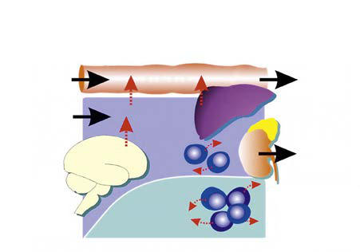

# Chapter 98: Integration of Genetics into Pediatric Practice
> **Course:** Vikkypaedia Pediatric Basic Course (*Nelson Textbook of Pediatrics, 22nd Edition (2025)*)  
> **Part VIII:** Human Genetics  
> **Authors:** Brendan Lee and Nicola Brunetti-Pierri  
> **Metrics:** 9,807 words · 5 tables/boxes · 1 figures · 18 genes · 8 flashcards · 5 MCQs  
> **Quick Navigation:** [🃏 Study 8 Flashcards](../flashcards/098_flashcards.md) · [📝 Take 5-Q MCQ Quiz](../mcqs/098_mcqs.md) · [📚 Part VIII Guide](../parts/Part_VIII.md) · [🧬 Syndrome & Genetics Atlas](../omim_gene_atlas.md) · [💊 Therapeutics Matrix](../therapies_matrix.md) · [🏠 Course Index](../../index.md)

## Key Chapter Topics & Subchapters
`98.1 Genetic Counseling` · `98.2 Principles of Management and Treatment of Genetic Disorders ` · `98.1 Genetic Counseling Brendan Lee and Pilar L. Magoulas` · `98.2 Principles of Management and Treatment of Genetic Disorders`

## Key Genetic & Molecular Targets
`ALAS1`, `BCL11A`, `CFTR`, `CYP2C19`, `CYP2C9`, `CYP2D6`, `DDC`, `FGF23`, `FGFR3`, `G6PD`, `MTHFR`, `NAT2`, `PCSK9`, `SLCO1B1`, `SMN1`, `SMN2`

## ⚡ High-Yield Nelson Pediatric Board Pearls
- DIAGNOSTIC TESTING Diagnostic genetic testing helps to aggregate a set of signs and symp toms (phenotype) for disease diagnosis.
- We also recognize the relatively frequent co-occurrence of multiple disorders, each caused by distinct pathogenic variants, in patients with complex or “blended” fea tures.
- It requires testing an extended family and is vulnerable to several pitfalls, such as genetic recombination, genetic heterogeneity, and incorrect diagnosis in the proband or family member.
- Exome and genome sequencing also offer the potential for identifying new disease-gene associations as well as the ability to detect clinical presentations caused by more than one altered gene (i.e., oligogenic phenotypes).
- Therefore a negative DNA test does not neces sarily exclude a diagnosis.
- Clinical utility is the degree to which the results of a test guide clini cal management.
- For genetic testing, clinical utility includes establish ing a diagnosis that obviates the need for additional workup or guiding surveillance or treatment.

---
## Full Chapter Text, Tables & Figures
# Chapter 98: Integration of Genetics into Pediatric Practice

*Brendan Lee and Nicola Brunetti-Pierri*

<!-- p.968 -->
Genetic testing involves analyzing genetic material to obtain informa tion related to a person’s health status using chromosomal (cytoge netic) analysis (see Chapter 99) and nucleic acid (primarily DNA but also RNA)-based testing.

**DIAGNOSTIC TESTING** Diagnostic genetic testing helps to aggregate a set of signs and symp toms (phenotype) for disease diagnosis. The list of disorders for which specific genetic tests are available is extensive and growing. The website http://www.ncbi.nlm.nih.gov/gtr/ provides one database of reported available tests.

Single-gene disorders can be tested by at least three different approaches: linkage analysis (a classical approach now rarely used), chromosome microarray (CMA), and direct pathogenic variant analysis, usually by DNA sequencing (Table 98.1). Linkage analysis is used if the responsible gene is mapped but not yet identified, or if it is impracti cal to find specific pathogenic variants, usually because of the large size and large number of different pathogenic variants in some genes. CMA can be used to detect large, multigene deletions or duplications **(copy number variations, or CNVs)**. In addition, with increasing resolu tion, single-gene or smaller intragenic deletions or duplications can be detected by CMA, although it is important to note that coverage of each gene varies by array type used. *Direct DNA pathogenic variant identifica tion is readily available with the advent of the complete human genome sequence next-generation sequencing (NGS) tools.* We also recognize the relatively frequent co-occurrence of multiple disorders, each caused by distinct pathogenic variants, in patients with complex or “blended” fea tures. This may include partial to minimal clinical manifestations in a substantial percentage of individuals harboring pathogenic variants in known disease genes that remain undiagnosed. The ability to simultane ously sequence hundreds to thousands of genes (via NGS approaches) has provided insight into this complexity of disease pathogenesis.

**Linkage testing** involves tracking a genetic trait through a family using closely linked polymorphic markers as a surrogate for the trait

(Fig. 98.1). It requires testing an extended family and is vulnerable to several pitfalls, such as genetic recombination, genetic heterogeneity, and incorrect diagnosis in the proband or family member. **Genetic recombination** occurs between any pair of loci, with the frequency being proportional to the distance between them. This problem is min imized using very closely linked markers and, if possible, using markers that flank the specific gene. **Genetic heterogeneity** can be problematic for a linkage-based test if there are multiple distinct genomic loci that can cause the same phenotype, resulting in the risk that the locus tested for is not the one responsible for disease in the family. **Incorrect diag nosis** in the proband also leads to tracking the wrong gene. Linkage testing remains useful for several genetic conditions, but it has been superseded by the availability of DNA sequencing of either single gene, panel, or exome sequencing.

**CMAs** can detect CNVs in a patient’s DNA (see Chapter 99). CMA provides a level of genetic resolution between that available with DNA sequencing (single nucleotide) and that available with chromosome analysis (∼5 million base pairs). CMA can resolve deletions or dupli cations of several kilobases within one gene. In theory, this approach can detect deletion and duplication pathogenic variants that would be missed by either chromosome analysis or direct pathogenic vari ant testing by DNA sequencing. However, because the specific resolu tion and coverage of different CMA platforms can vary tremendously for different gene regions, the sensitivity for detecting deletions and duplications can vary for different diseases and laboratories. The high est resolution used is detection of a deletion or duplication at the single exon level.

**Direct DNA-based pathogenic variant testing** avoids the pitfalls of linkage testing by detecting the specific gene pathogenic variant (i.e., sequence change). The specific approach used is customized to the biology of the gene being tested. In some disorders, one or a few distinct pathogenic variants occur in all affected individuals and a spe cific assay for that variant could be used. This is the case in sickle cell anemia, in which the same single-base substitution occurs in every one with the disorder. In other conditions, many possible pathogenic variants may account for the disorder in different individuals. In cystic fibrosis, for example, >1,000 distinct pathogenic variants have been found in the *CFTR* gene. Pathogenic variant analysis is challenging because no single technique can detect all possible pathogenic variants (e.g., single nucleotide variation [SNV]), small (several nucleotide) insertion-deletions (“indels”), CNV (larger deletion or duplications), complex structural variations (e.g., translocations, inversions, etc.), DNA repeat expansions (e.g., variable repeat expansions), and epi genetic alterations (e.g., changes in DNA methylation without chang ing the underlying DNA sequence). However, with high-throughput DNA sequencing technology, the most frequently used approach is to

*Brendan Lee and Nicola Brunetti-Pierri*

#### **Table 98.1** Approaches for Genetic Testing

| Category / Parameter | Clinical Details & Findings |
| --- | --- |
| **SAMPLE REQUIREMENTS** | Linkage analysis; Depends on location of; polymorphic markers; near putative disease; gene; Possible when specific; disease-causing genetic; pathogenic variant is not; identifiable or found; Can give only diagnostic; probability based on; likelihood of genetic; recombination between; presumed DNA; pathogenic variant and; polymorphic markers; Requires multiple; family members with; documented Mendelian; pattern of inheritance; within family; Chromosome; microarray (CMA); Several hundred base; pairs to several; hundreds of kilobases; Able to detect small; deletion or duplications; within one or more genes; Can miss small deletions; or insertions depending; on the resolution of the; array used; Single patient sample; sufficient, but having sample; from biological parents can; help with interpretation; Direct DNA-based; testing (e.g., DNA; sequencing); Single–base-pair; changes; High specificity if previously; described deleterious; pathogenic variant is; found; Can miss deletion or; duplication of a segment; of gene; Single patient sample; sufficient, but having; sample from biological; parents and siblings; (affected or unaffected) can; help with interpretation |

<!-- p.969 -->
directly sequence DNA segments “captured” and amplified from DNA isolated from peripheral blood white blood cells. The limitation of this approach is that only amplified DNA segments are sequenced and are usually restricted to the *coding exonic* regions of a gene. Because patho genic variants sometimes occur in the *noncoding* and *intronic* regions, failure to detect a pathogenic variant does not fully exclude the diagno sis. In addition, deleted genes or regions may not be detected.

**NGS** tests panels of genes that target disease symptoms (e.g., epilepsy, brain malformations, sensorineural deafness, or skeletal dysplasias) or the majority of the exome **(exome sequencing**). **Genome sequencing**, where both *coding* and *noncoding* sequences are sequenced, can pro vide even more information. However, clinical interpretation is limited predominantly to the coding sequences of the approximately 20,000 human genes, the “digital exome,” as it is extracted electronically from genome data. Genome sequencing, compared with exome sequencing, also has the advantage of providing improved detection of CNV, struc tural variation, and repeat expansions, although this is highly depen dent on the bioinformatics algorithms used in interpretation.

With NGS, the challenge is the interpretation of enormous genetic variation within a single individual. Direct sequencing of tens to hundreds of genes in NGS panels offers a potentially higher sensitiv ity because the “depth” of read is higher without complicating high discovery rate of **variants of unknown sequences (VUS)** (Fig. 98.2). Exome and genome sequencing also offer the potential for identifying new disease-gene associations as well as the ability to detect clinical presentations caused by more than one altered gene (i.e., oligogenic phenotypes).

An important ethical consideration is the reporting of *incidental findings,* whether medically actionable or not medically actionable in a patient. For example, exome and genome sequencing may identify pathogenic variants that cause aminoglycoside-sensitive hearing loss, which would be medically actionable but unrelated to the primary indication for which the test was ordered. At the same time, the dis covery of apolipoprotein E variants in a child that increase Alzheimer disease risk susceptibility would not typically be medically actionable. Therefore counseling for patients undergoing these tests is important so that only requested results are reported back to the patient. Guidelines continue to evolve for reporting of incidental findings from exome and genome sequencing by the American College of Medical Genetics and Genomics (www.acmg.net). Practice and recommendations continue to vary among international genetic organizations revealing incidental findings to patients, and many strongly advocate the engagement of the patient and family in the decision. Some groups require revealing to

the patient and/or family significant diseases (actionable) with a spe cific and successful treatment or prevention strategy (Table 98.2).

Genetic testing is interpreted by three factors: analytic validity, clini cal validity, and clinical utility. **Analytical validity** is test accuracy: Does the test correctly detect the presence or absence of pathogenic variant? Most genetic tests have a very high analytical validity assuming human error has not occurred. Human errors are possible, and unlike most medical tests, a genetic test is unlikely to be repeated because it is assumed that the result will not change over time. Therefore human errors can go undetected for long periods of time. *In addition, variants may be reinterpreted over time as our knowledge base of disease-causing pathogenic variants and genes increases.*

**Clinical validity** is the degree to which the test correctly predicts presence or absence of disease. False-positive and false-negative test results can occur. **False-positive results** are more likely for predic tive tests than for diagnostic tests. An important contributing fac tor is **nonpenetrance**, where an individual with an at-risk genotype might not clinically express the condition. Another factor is the find ing of a **VUS**. Detection of a base sequence variation in an affected patient does not prove that it is the cause of the patient’s disorder. Exome sequencing of an individual may identify more than 30,000 VUS and more than 3,000,000 VUS for genome sequencing. Various lines of evidence are used to establish pathogenicity. These include the absence of the variant in large populations of control individuals, finding the variant in affected individuals, demonstration or infer ence that the variant alters the function of the gene product, noting that the amino acid altered by the pathogenic variant is conserved in evolution, and segregation of the variant with disease in a fam ily. For many variants, it is possible to be certain whether the vari ant is pathogenic or benign, but for others it might be impossible to definitively assign causality or noncontribution with 100% confi dence. For these reasons, they are noted as **VUS.* Notably, interpreta tion of pathogenicity for a specific VUS may change over time as our knowledge base increases, underscoring the importance of counseling and reinterpretation.*

**False-negative results** reflect an inability to detect a pathogenic variant in an affected patient. This occurs principally in disorders with genetic heterogeneity—**allelic** (different pathogenic variants occur in one causative gene) or **locus** (>1 gene can cause a disease) heterogeneity. It is often difficult to detect all possible pathogenic variants within a gene because pathogenic variants vary, both in loca tion within the gene and in the type of variant. Direct sequencing can miss gene deletions or rearrangements (i.e., structural variants), and pathogenic variants may be found within noncoding sequences such as introns or promoter. Therefore a negative DNA test does not neces sarily exclude a diagnosis.

**Clinical utility** is the degree to which the results of a test guide clini cal management. For genetic testing, clinical utility includes establish ing a diagnosis that obviates the need for additional workup or guiding surveillance or treatment. Test results may also be used as a basis for genetic counseling. For some disorders, genetic testing is possible, but the test results do not add to the clinical assessment. If the diagnosis and genetic implications are already clear, it might not be necessary to pursue genetic testing.

**Predictive genetic testing** involves performing a test in a person at risk for developing a genetic disorder **(presymptomatic)**, usually on the basis of family history, yet who does not manifest signs or symptoms. This is usually done for disorders that display age-dependent penetrance (e.g., the likelihood of manifesting signs and symptoms increases with age, as in cancer genetic syndromes or Huntington disease).

A major caution with predictive testing is that the presence of a gene pathogenic variant does not necessarily mean that the disease will develop. Many of the disorders with age-dependent penetrance display *incomplete penetrance*. A person who inherits a pathogenic variant may never develop signs of the disorder. There is concern that a posi tive DNA test could result in stigmatization of the person and might not provide information that will guide medical management. Stig matization might include psychologic stress, but it could also include

Disease gene

A

C

B

A B C

1 2 2

2 3 1

1 2 2

2 1 2

1 2 2

3 2 4

2 1 2

3 2 4

fetus

**Fig. 98.1** Use of linkage analysis in prenatal diagnosis of an autoso mal recessive disorder. Both parents are carriers, and they have one affected son. The numbers below the symbols indicate alleles at three polymorphic loci: A, B, and C. Locus B resides within the disease gene. The affected son inherited the 1-2-2 chromosome from his father and the 2-1-2 chromosome from his mother. The fetus has inherited the same chromosome from the father but the 3-2-4 chromosome from the mother and therefore is most likely to be a carrier.

<!-- p.970 -->
discrimination, including denial of health, life, or disability insurance, or employment (see Chapter 95).

It is generally agreed that predictive genetic tests should be per formed for children only if the results of the test will benefit the medical management during childhood; otherwise, the test should be deferred until the individual understands the risks and benefits of testing and can provide their own informed consent. Individual states offer vary ing degrees of protection from discrimination on the basis of genetic testing. A major milestone in the prevention of genetic discrimination was the passage of the **Genetic Information Nondiscrimination Act** (GINA) in 2008, which is a U.S. federal law that prohibits discrimina tion in health coverage or employment based on genetic information. *Of note, it does not* protect against refusal of life insurance.

**Predispositional genetic testing** is available with the goal of pre dicting risk of disease. The rationale for predispositional testing is that the results would lead to strategies aimed at risk reduction as part of a *personalized approach* to healthcare maintenance. This might include avoidance of environmental exposures that would increase risk of dis ease (cigarette smoking and α1-antitrypsin deficiency), medical sur veillance (familial breast cancer and mammography), or in some cases, pharmacologic treatment (statins and hypercholesterolemia).

Common disorders are multifactorial in etiology, and many dif ferent genes may contribute to risk of any specific condition (see Chapter 103). Most genetic variants found to correlate with risk of a common disease add small increments of relative risk and, in most cases, too little to guide management based on a single variant.

Statistical models for predicting risk based on a collection of DNA variants has been integrated into approaches such as *polygenic risk scores*. By combining the relative risk conferred by a group of DNA variants, the goal is to quantify a larger proportion of risk for a spe cific disease. These predictions are confounded by the source of data

from which they are generated, and current population genetic data have limitations including lack of ethnic diversity and population stratification.

**PHARMACOGENETICS** Polymorphisms in drug metabolism genes can result in distinctive patterns of drug absorption, metabolism, excretion, or effective ness. Knowledge of individual genotypes can guide pharmacologic therapy, allowing customization drug choice and dosage to avoid toxicity and provide a therapeutic response. Well-known exam ples include testing for polymorphisms within the methylene tetrahydrofolate reductase *(MTHFR)* gene for susceptibility of potentially increased toxicity to methotrexate antimetabolite therapy and thiopurine *S*-methyltransferase (*TPMT)* to avoid adverse effects with 6-mercaptopurine therapy (Fig. 98.3).

**Pediatric Pharmacogenomics** Pharmacogenomics is the study of how variants contribute to interindi vidual variability in drug response. The finding that drug responses can be influenced by the patient’s genetic profile offers great hope for realiz ing *individualized* pharmacotherapy, in which the relationship between genotype and phenotype (either disease and/or drug response) is predic tive of drug response. In addition to genetic differences, environmen tal factors (e.g., diet, concomitant drug or toxic exposure), physiologic variables (age, sex, pregnancy), and patient adherence all contribute to variations in drug metabolism and response. Interindividual differ ences in children are further complicated by the changing patterns of gene expression occurring during the developmental processes from birth through adolescence. Combining these genetic and nongenetic individual-specific variables, it is expected that children will benefit from the promise of precision medicine, e.g., identifying the right drug for the right patient at the right time and dosing (Fig. 98.4).

Examples of pharmacogenomic traits include specific adverse drug reactions, such as prolonged respiratory muscle paralysis due to succinyl choline, hemolysis associated with antimalarial therapy, carbamazepineinduced Stevens-Johnson syndrome, isoniazid-induced neurotoxicity, and others (Table 98.3). The pharmacokinetic properties of a drug are determined by genes that control drug absorption, distribution, metabo lism, and excretion. Drug-metabolizing enzymes and drug transporters play a particularly important role in this process. One of the better rec ognized clinical manifestations of pharmacogenomic variability in drug biotransformation is an increased risk of concentration-dependent tox icity caused by reduced clearance and consequent tissue drug accumu lation. Equally important is the lack of efficacy caused by variations in metabolism of prodrugs that require biotransformation to be converted into a pharmacologically active form. The pharmacogenomics of drug receptors and other target proteins involved in signal transduction or disease pathogenesis are also expected to contribute to interindividual variability in drug disposition and response.

**Specimen Library preparation**

**Next-gen sequencing**

**Raw data processing**

**Nucleic**

**acid** extraction

**Variant calling**

Variant calling: SNVs, indels, CNVs, SVs Date visualization Variant validation Annotation Integrated consideration of segregation analysis, linkage, association testing, pathway modeling, interaction analysis, additional functional studies Variant assigned as benign, uncertain, or pathogenic

1.

2. 3. 4. 5.

6.

1.

2.

3.

4.

5. 6.

Machine formatted base calls Nucleotide formatted base calls Mapping an alignment to a reference human genome sequence Marking of duplicate sequencing reads Base quality calibration Analysis-ready reads

1. Fragment analysis (single read) 2. Paired-end analysis 3. Mate-pair analysis

Target enrichment if for targeted panel Fragmentation if needed End repair, A-tailing, linker modification amplification

1.

2.

3.

DNA or RNA 1. Blood or other tissue 2. Germ line or somatic (eg, tumor)

**Fig. 98.2** Overview of the next-generation DNA sequencing workflow. CNV, Copy number variant; Indels, insertions and deletions; SNV, single nucleotide variant; SV, structural variant. (Adapted from Casey G, Conti D, Haile R, et al. Next generation sequencing and a new era of medicine. Gut. 2013;62[6]:920–932.)

Assigned to One of Four Categories

#### **Table 98.2** Variants That Are Incidental Findings Are

| Category / Parameter | Clinical Details & Findings |
| --- | --- |
| **General** | Childhood onset; Medically actionable*; Childhood onset; Not medically actionable†; Adult onset; Medically actionable*; Adult onset; Not medically actionable†; *“Medically actionable” refers to a variant in a gene in which knowledge of the; particular variant will affect medical decision-making, such as initiation of a treatment; or family planning.; †“Not medically actionable” refers to variants that increase the individual’s risk for a; disease in which no treatment is proven to significantly change the disease natural; history.; From Bick D, Dimmock D. Whole exome and whole genome sequencing. Curr Opin; Pediatr. 2011;23:594–600. |

<!-- p.971 -->
Individuals are classified as “fast,” “rapid,” or “extensive” metabo lizers at one end and “slow” or “poor” metabolizers at the other end of the continuum. For biotransformation, fetuses and newborns may be phenotypically “slow” or “poor” metabolizers for certain drugmetabolizing pathways because of their stage of development, and they may acquire a phenotype consistent with their genotype at some point later in the developmental process. Moreover, not all infants acquire drug metabolism activity at the same rate, and there is inter individual variability in the trajectory (i.e., rate and extent) of drug biotransformation capacity (Fig. 98.5). The primary organ respon sible for drug metabolism is the liver, although the kidney, intestine, lung, adrenals, blood (phosphatases, esterases), and skin can also bio transform certain compounds. Drug biotransformation is character ized by three important features: (1) broad substrate specificity, in which a single isozyme may metabolize a large variety of chemically diverse compounds; (2) many different enzymes may be involved in the biotransformation of a single drug (enzyme multiplicity); and (3) a given drug may undergo several different types of reactions. Drug biotransformation reactions are classified into phase I reactions that

introduce or reveal (through oxidation, reduction, or hydrolysis) a functional group within the substrate drug molecule that serves as a site for phase II reactions. These reactions involve conjugation with endogenous substrates (such as acetate, glucuronic acid, glutathi one, glycine, and sulfate), making the compound more water soluble to be excreted in urine. A supergene family with at least 16 pri mary cytochrome P450 (CYP) enzymes are quantitatively the most important phase I enzymes and catalyze the metabolism of many lipophilic endogenous (steroids, fatty acids, fat-soluble vitamins, prostaglandins, leukotrienes, thromboxanes) and exogenous com pounds, including a multitude of drugs and environment toxins. The specific CYP isoforms responsible for the majority of human drug metabolism are CYP1A2, CYP2C9, CYP2C19, CYP2D6, CYP2E1, and CYP3A4. These enzymes are the products of genes that in some cases are polymorphically expressed, with allelic variants producing enzymes generally resulting in either no or reduced catalytic activ ity. At birth the activities of drug-oxidizing enzymes in the liver are reduced, which results in slow clearance (and prolonged elimination) of several substrate drugs (e.g., phenytoin, caffeine, diazepam). Phase

**Fig. 98.3**  Thiopurine *S*-methyltransferase (TPMT) polymorphism. A, 6-Mercaptopurine (6MP) undergoes metabolism to thioguanine nucleotides (TGNs) to exert its cytotoxic ef fects. TPMT and xanthine oxidase reduce the amount of 6MP available for the bioactivation pathway to TGNs. TPMT can also methylate 6-thioinosine 5′-monophosphate (TIMP) to gen erate a methylated compound capable of inhib iting de novo purine synthesis. B, Distribution of TPMT activity in humans. Of the population, 89% has high activity, whereas 11% has interme diate activity. Approximately 1 in 300 individu als homozygous for two loss-of-function alleles has very low activity. C, Correlation between the TPMT genotype and intracellular TGN con centrations. In TPMT-poor metabolizers, more 6MP is available to go down the bioactivation pathway to form TGNs; this situation is asso ciated with an increased risk of myelosuppres sion. D, The most common variant TPMT allele is the result of two pathogenic variants that give rise to an unstable protein product that undergoes proteolytic degradation. Each box represents an exon. Non-coding sequences are shown as white boxes and colored boxes indicate coding sequences. 6TU, 6-Thiouric acid; MeMP, 6-methylmercaptopurine; HPRT, 6-thiomethylinosine 5-monophosphate; MeT IMP, hypoxanthine-guanine phosphoribosyl transferase; wt, wild type; mut, mutant; Ala, ala nine; Thr, threonine; Tyr, tyrosine; Cys, cysteine. (*Modified from Relling MV, Dervieux T. Pharma cogenetics and cancer therapy. Nat Rev Can cer. 2001;11:99–108.*)

SCH3

6TU (inactive)

MeTIMP

Inhibition of de novo

purine synthesis

Anti-leukemic effect

Myelosuppression

TGNs TIMP

DNA incorporation

TPMT

TPMT

XO

6MP

HPRT

MeMP (inactive)

N

N

ribose P

N

N

SH

N

N

ribose P P P

N

N

SH

N

N

ribose P

N

N

SH

HO

H2N

OH

N

N H N

N

SH

N

N H N

N

SCH3

N

N H N

N

wt/wt

wt/mut mut/

mut

10

0

2

4

Percent of population

8

6

0 10 5 15 20 25 30 TPMT activity

TPMT*1 (wild-type)

TPMT*3A

460 G>A Ala→Thr

719 A>G Tyr→Cys

wt/wt wt/mut mut/mut TPMT genotype:

3000

0

1000

Intracellular TGN

concentration

2000

Myelosuppression ↑ Risk secondary cancer

↓ Toxicity ↑ Risk of relapse

A

B

D

C

<!-- p.972 -->
II enzymes include arylamine *N*-acetyltransferases (NAT1, NAT2), uridine diphospho-glucuronosyltransferases (UGTs), epoxide hydro lase, glutathione *S*-transferases (GSTs), sulfotransferases (SULTs), and methyltransferases (catechol *O*-methyltransferase, thiopurine *S*-methyltransferase, several *N*-methyltransferases). Phase II enzyme activity is decreased in the newborn and increases into childhood. Conjugation of compounds metabolized by isoforms of UGT (e.g., morphine, bilirubin, chloramphenicol) is reduced at birth but can exceed adult values by 3-4 years of age.

Membrane transporters are involved in drug disposition and actively transport substrate drugs between organs and tissues. They include organic anion transporters (OATs), organic anion–trans porting polypeptides (OATPs), organic cation transporters (OCTs), and the adenosine triphosphate–binding cassette (ABC) transport ers, such as P-glycoprotein and the multidrug-resistant proteins. Drug transporters are expressed at numerous barriers, such as intestinal epithelial cells, hepatocytes, renal tubular cells, and the blood-brain barrier (Fig. 98.6). Transporters are often determinants of drug resistance, and many drugs work by affecting the function of transporters. Polymorphisms in the genes encoding these trans porters might affect drug absorption, distribution, metabolism, and excretion.

## 98.1  Genetic Counseling Brendan Lee and Pilar L. Magoulas

Genetic counseling is a communication process in which the genetic contribution to health, specific risks of transmission of a trait, and options to manage the condition are explained to individuals and their family members (Table 98.4). Genetic counselors are specialized healthcare providers trained in the psychosocial aspects of counsel ing and the science of medical genetics who may serve as members of medical teams in many different specialties. The genetic counselor is expected to present information in a neutral, nondirective manner while providing resources and psychosocial support to the individual and family to cope with decisions that are made (see Table 98.4).

In the prenatal setting, a common indication for genetic counseling is to assess risk of occurrence or recurrence of having a child with a genetic condition and to discuss management or treatment options that might be available before, during, or after the pregnancy, such as preimplanta tion genetic testing, noninvasive prenatal screening, prenatal diagnosis or fetal intervention, and perinatal management. In pediatric and adult genetics practices, the goals of genetic counseling are to help establish a diagnosis in an individual, provide longitudinal care and psychosocial support to the family, and discuss the genetic basis and inheritance of the condition as it relates to immediate and distant family members.

The genetic counseling role has expanded, particularly with advances in understanding the genetics of adult-onset or common and rare disease therapeutics. In the former context, genetic counseling has a major role in risk assessment for cancer, especially breast, ovarian, or colon cancer, for which well-defined risk models and genetic tests are available to assess risk to an individual. In the latter, the genetic coun selor may discuss developments in rare disease therapeutics and make appropriate referral for medical therapies.

There are several situations in which genetic counseling plays a particularly important role. The first situation is the **prenatal diag nosis** of a congenital anomaly or genetic disease. The need for infor mation is urgent because a family must often make time-sensitive decisions about treatment and management options, such as fetal intervention or continuation of a pregnancy in the context of fetal anomalies. Risks to the mother must also be considered. The second type of situation occurs when a child is born with a life-threatening **congenital anomaly** or suspected **genetic disease**. Decisions must be made immediately on how much support should be provided to the child and whether certain types of therapy should be attempted. The third situation arises when there are concerns about a **genetic con dition** affecting one later in life. This may occur in an adolescent or young adult with a family history of an adult-onset genetic disorder (e.g., Huntington disease, hereditary breast/ovarian cancer), in an individual with a suspected yet undiagnosed genetic condition, or if a couple with a personal or family history of a genetic condition (or a carrier) is planning a family. In these situations, it is often neces sary to have several meetings with a family to discuss possible testing, screening, and management options. Urgency is not as much of an issue as being sure that they have as much information and as many options as are available. Last, with the advent of genomic testing in all areas of clinical care, **pretest genetic counseling** before testing is essential to provide individuals with accurate information regarding the types of results they may receive. During this process, individuals are also given the option of what type of results they want reported back to them, such as medically actionable results unrelated to the primary indication for testing and incidental findings.

**GENETIC COUNSELING ELEMENTS** Components of a genetic counseling session and providing accurate information to families requires the following: • Taking a targeted family history and constructing a pedigree that

diagrams the patient’s relatives (including miscarriages, abortions, stillbirths, deceased persons) with their sex, age, ethnicity, and state of health, up to and including third-degree relatives.

Treatment Outcome

Minimal Excessive

Toxicity

Failure Success

Treat with alternative

drug

Drug C Treat with alternative

drug Treat with alternative

drug or dose

Treat with conventional

drug and dose Drug B

**Fig. 98.4** The promise of genomic medicine to human health and disease. The goal of personalized medicine is to identify subgroups of patients who will respond favorably to a given drug with mini mum side effects, as well as those who will not respond or who will show toxicity with standard doses. A further benefit of pharmaco genomics is to select the most appropriate alternative drug for pa tients who cannot be treated successfully with conventional drugs and doses. (Adapted from Yaffe SJ, Aranda JV. Neonatal and Pedi atric Pharmacology, 3rd ed. Philadelphia: Lippincott Williams & Wilkins; 2004.)

<!-- p.973 -->
• Gathering information from hospital records about the affected in

dividual and, in some cases, about other family members. • Documenting prenatal, pregnancy, and delivery histories. • Reviewing the latest available medical, laboratory, and genetic infor

mation concerning the disorder. • Reviewing a careful physical examination of the affected individual

(photographs, measurements) and of apparently unaffected individ uals in the family (typically performed by a physician rather than a genetic counselor). • Reviewing genetic testing and screening options. • Establishing or confirming the diagnosis by the diagnostic tests

available. • Providing psychosocial support to the individual and family

throughout the diagnostic process. • Giving the family information about support groups and local and

national resources. • Providing new information to the family as it becomes available (a

Genetic counseling sessions often include anticipatory guidance regarding the occurrence or risk of occurrence of a specific condition, knowledge of the diagnosis of the particular condition, natural history of the condition, genetic aspects of the condition, risk of recurrence, prenatal diagnosis and reproductive options, therapies and referrals, and provision of support resources.

**The Diagnostic Process** If a specific diagnosis is made and confirmed, this should be discussed with the family and information provided in writing. Often, however, the disorder fits into a spectrum (e.g., one of many types of arthrogry posis) or the diagnosis is clinical rather than confirmed with molecular testing. In these situations, the family needs to understand the limits of the diagnostic process and present knowledge, and that additional research will probably lead to better information in the future.

Although it is not always possible to make an exact diagnosis, having a diagnosis *as accurate as possible* is important. Estimates of recurrence risk for various family members depend on an accurate diagnosis that

#### **Table 98.3** Examples of Effects of Gene Polymorphisms on Drug Response

| Category / Parameter | Clinical Details & Findings |
| --- | --- |
| **BCHE** | Butyrylcholinesterase; Succinylcholine; Prolonged paralysis |
| **CYP2C9** | Cytochrome P450 2C9; Warfarin; Individuals having ≥1 reduced function alleles require; lower doses of warfarin for optimal anticoagulation,; especially initial anticoagulant control. |
| **CYP2C19** | Cytochrome P450 2C19; Clopidogrel; Individuals having ≥1 loss-of-function alleles have; reduced capacity to form pharmacologically active; metabolite of clopidogrel and reduced antiplatelet; effect. |
| **CYP2D6** | Cytochrome P450 2D6; Codeine; Poor metabolizers (individuals with two loss-of-; function alleles) do not metabolize codeine to; morphine and thus experience no analgesic effect.; Ultrarapid metabolizers (individuals with ≥3 functional; alleles) may experience morphine toxicity. |
| **G6PD** | Glucose-6-phosphate dehydrogenase; Primaquine (others); Hemolysis |
| **HLA-A*3101** | Human leukocyte antigen A31; Carbamazepine; Carriers of HLA-A*3101 allele have increased risk of; SJS and TEN from carbamazepine. |
| **HLA-B*1502** | Human leukocyte antigen B15; Allopurinol; Han Chinese carriers of HLA-B*1502 allele have; increased risk of SJS and TEN from carbamazepine. |
| **HLA-B*5701** | Human leukocyte antigen B57; Abacavir; Flucloxacillin; Carriers of HLA-B*5701 allele have increased risk; of hypersensitivity reactions to abacavir- and; flucloxacillin-induced liver injury. |
| **HLA-B*5801** | Human leukocyte antigen B58; Allopurinol; Carriers of HLA-B*5801 allele have increased risk of; severe cutaneous adverse reactions to allopurinol,; including hypersensitivity reactions, SJS, and TEN. |
| **NAT2** | N-Acetyltransferase 2; Isoniazid, hydralazine; Individuals homozygous for “slow acetylation”; polymorphisms are more susceptible to isoniazid; toxicity, or hydralazine-induced systemic lupus; erythematosus. |
| **SLCO1B1** | Organic anion–transporting protein (OATP) |
| **1B1** | Simvastatin; Carriers of the SLCO1B1*5 allele are at increased risk; for musculoskeletal side effects from simvastatin. |
| **TPMT** | Thiopurine S-methyltransferase; Azathioprine; 6-Mercaptopurine; Individuals homozygous for an inactivating; pathogenic variant have severe toxicity if; treated with standard doses of azathioprine or; 6-mercaptopurine; rapid metabolism causes; undertreatment. |
| **UGT1A1** | Uridine diphospho-glucuronosyltransferase |
| **1A1** | Irinotecan; UGT1A1*28 allele is associated with decreased; glucuronidation of SN-38, the active metabolite of; irinotecan, and increased risk of neutropenia. |
| **VKORC1** | Vitamin K oxidoreductase complex 1; Warfarin; Individuals with a haplotype associated with reduced; expression of VKORC1 protein (therapeutic target; of warfarin) require lower doses of the drug for; stable anticoagulation.; SJS, Stevens-Johnson syndrome; TEN, toxic epidermal necrolysis. |

<!-- p.974 -->
considers the likelihood that a particular finding is isolated, associated with a syndrome, or nonsyndromic (e.g., isolated cleft lip and palate). When a specific diagnosis cannot be made (as in many cases of mul tiple congenital anomalies), the various possibilities in the differential diagnosis should be discussed with the family and empirical informa tion provided. If available, specific diagnostic tests should be discussed. Often, empirical recurrence risks can be given even without a specific laboratory-based diagnosis. At the same time, even negative laboratory testing can further modify this risk.

**Natural History of the Condition** It is important to discuss the natural history of the specific genetic dis order in the family. Affected persons and their families have questions regarding the prognosis and potential management or therapy that can be answered only with knowledge of the natural history. If there are other possible diagnoses, their natural history may also be discussed. If the disorder is associated with a spectrum of clinical outcomes or complications, the range of possible outcomes and variability of the condition, as well as treatment and referral to the appropriate special ist, should be addressed.

**Genetic Aspects of the Condition and 
 Recurrence Risk** The genetic aspects and risk of recurrence are important because all family members should be informed of their reproductive choices. The genetic basis of the disorder can be explained with visual aids (e.g., diagrams of chromosomes and inheritance patterns). It is important to provide accurate occurrence and recurrence risks for various members of the family, including unaffected individuals. If a definite diagnosis cannot be made, it is necessary to use empiri cal recurrence risks. Genetic counseling gives patients the neces sary information to understand the various options and to make their own informed decisions regarding pregnancy, adoption, assis tive reproductive technologies, prenatal diagnosis, screening, car rier detection, or termination of pregnancy. It may be necessary to have more than one counseling session. Even if a specific molecular diagnosis has been made and a well-defined inheritance pattern has been described for the condition, it is important to recognize that the principles of incomplete penetrance, variable expressivity, and germline/somatic mosaicism can contribute uncertainty to the recurrence risk and severity of a potentially affected pregnancy con ception or child.

**Prenatal Diagnosis and Prevention** Many different methods of prenatal screening and diagnosis are available, depending on the specific genetic disorder (see Chapter 117). The use of ultrasonography allows prenatal screening of ana tomic abnormalities such as congenital heart defects. Amniocentesis and chorionic villus sampling are used to obtain fetal tissue for analy sis of chromosomal abnormalities, biochemical disorders, and DNA studies. Maternal blood or serum sampling is used for some types of screening, including noninvasive prenatal screening by direct analy sis of cell-free fetal DNA found in maternal blood, which is used for screening of conditions such as trisomy 21 and other aneuploidies. In addition, this source of cell-free fetal DNA has also been used clini cally for DNA sequencing for selected dominant de novo conditions in the fetus that may occur with increased frequency with increasing paternal age. Current tests of fetal DNA from maternal blood should be considered screening tests, and invasive testing like amniocentesis or chorionic villus sampling should be considered for confirmatory diagnostic testing.

80

100

60

5 Birth 15 10 20 25

5 Birth 15 10 20 25

20

40

80

100

60

0

0

20

40

Activity Activity

Adult Child

Age (yr)

Infant

**Fig. 98.5** “Developmental” phenotypes. Variability in developmen tal changes in gene expression and functional enzyme activity are su perimposed on pharmacogenetic determinants. Top, Developmental profile of a theoretical drug-metabolizing enzyme over a 25-year span in 20 individuals. Bottom, At maturity (adults), allelic variation within the coding region of the gene gives rise to two distinct phenotypes: high activity in 92% of the population (“extensive metabolizers”; red circles) and low activity in 8% of the population (“poor metabolizers”; yellow circles). However, there is also interindividual variability in the rate at which functional activity is acquired after birth. For example, the two phenotypes may not be readily distinguishable in newborn infants. Furthermore, there may be discrete periods during childhood in which the genotype-phenotype relationship may differ from that observed in adults (e.g., developmental stages at which enzyme activ ity appears to be greater in children than in adults). (Adapted from Leeder JS. Translating pharmacogenetics and pharmacogenomics into drug development for clinical pediatric and beyond. Drug Discov Today. 2004;9:567–573.)

Oral intake

**Intestinal efflux** P-gp, MRP2, MRP1,

OCT1, OATP3,

NTCP

**Brain transport**

P-gp, OAT3, MRP1, MRP5,

OATP1

**Renal secretion** OAT1, OAT3, OCT1,

OCT2, OATP,

P-gp, MRP1

**Biliary excretion** P-gp, MRP3, MRP2, sPGP

**Hepatic uptake** OATP2, OATP8, OATP-B, OCT1, NTCP, OAT2, OAT3

*Intestine*

*Vascular*

*space*

*Interstitial*

*space*

Fecal Excretion

Urinary Excretion

**Fig. 98.6** Schematic diagram of important transport proteins and their known locations in humans. Spheres correspond to drug mol ecules. (From American Pharmacists Association. Ritschel WA, Kearns GL, eds. Handbook of Basic Pharmacokinetics Including Clinical Ap plications, 7th ed. Washington, DC: American Pharmacists Association, 2009. p 45.)

<!-- p.975 -->
**Therapies and Referral** Some genetic disorders require the care of multiple specialists. Many genetic conditions have diagnosis and management guidelines to aid in the treatment and management of these complex patients. Preven tion of known complications is a priority, so close follow-up with the necessary specialists involved in the child’s care is essential to identify any potentially concerning issues early. The psychologic adjustment of the family might also require specific intervention. Some challenges may involve when to discuss the diagnosis of a chronic disease with the patient, siblings, and other family members or friends. The decision to do so should always involve the parents and an assessment of the maturity and capacity of the child or adolescent.

Alternative medicines or nontraditional therapies are often brought to attention by parents after exhaustive internet searches. Such treat ments should not necessarily be dismissed since the physician and genetic counselor should serve as an important resource for helping parents navigate the maze of nonstandard treatments. Instead, the relative merits of treatments should be framed in the context of cost and benefit, scientific rationale, evidence from controlled and observa tional studies, the placebo effect, safety of the treatment, and the gaps in our own scientific knowledge base.

**Support Groups** A large number of community and online lay disease–specific sup port groups have been formed to provide information and to fund research on specific genetic and nongenetic conditions. An important part of genetic counseling is to give information about these groups to patients and to suggest a contact person for the families. Many groups have established websites and social media platforms with very helpful information. With the rise of social media and its ability to connect

families with rare syndromes from around the world, it is important to stress to families that their individual disease course will be unique and significant biases of reporting occur on such platforms. This should be balanced by the benefit of sharing potential important natural history elements of the underlying rare disease.

**Follow-Up** Families should be encouraged to continue to ask questions and keep up with new information about the specific disorder. New develop ments often influence the diagnosis and therapy of specific genetic disorders.

**Nondirective Counseling** Genetic counseling is usually nondirective; choices about reproduction are left to the family to decide what is right for them. The role of the counselor (physician, genetic counselor, nurse, medical geneticist) is to provide information in understandable terms and outline the range of options available.

## 98.2  Principles of Management and Treatment of Genetic Disorders

*Brendan Lee and Nicola Brunetti-Pierri*

**TREATMENT OF GENETIC DISEASES** Genetic conditions are often chronic disorders. Some are amenable to curative therapies, although there has been a rapid increase in the number of treatable disorders. Based on ongoing preclinical and clini cal investigations, new therapies for a growing number of diseases are expected to become available in the near future. Surgical management is available for many conditions that are associated with congenital anomalies or predisposition to tumors. All patients and families should be provided information about the disorder, genetic counseling, antici patory guidance, and appropriate medical surveillance.

Resources for patients include the National Organization of Rare Disor ders (www.rarediseases.org), the Genetic Alliance (www.geneticalliance. org), the National Library of Medicine (www.nlm.nih.gov/medlineplus/ geneticdisorders.html), and a large number of disease-specific websites. A current listing of federally and privately funded clinical trials, includ ing many for genetic diseases, is available at www.ClinicalTrials.gov.

Specific medical therapies for genetic disorders can be classified into **physiologic** and **replacement** therapies. Another approach to *correct protein misfolding* induced by missense pathogenic variants is through use of small molecules that specifically bind to mutant proteins, stabiliz ing their conformation, thereby preventing early degradation, and allow ing proper cellular trafficking and localization. This strategy has found successful applications for therapy of cystic fibrosis caused by specific *CFTR* pathogenic variants, including the F508del (see Chapter 454).

**PHYSIOLOGIC THERAPIES** Physiologic therapies attempt to ameliorate the phenotype of a genetic disorder by modifying the physiology of the affected individual. The underlying defect itself is not altered by treatment. Physiologic therapies are used in the treatment of **inborn errors of metabolism** (see Chapter 104). These include dietary manipulations, such as reducing phenylala nine intake by persons with phenylketonuria, coenzyme supplementa tion for some patients with methylmalonic acidemia and mitochondrial diseases, stimulation of alternative pathways to excrete ammonia for those with urea cycle disorders, phototherapy to increase excretion of neurotoxic unconjugated bilirubin in Crigler-Najjar syndrome, bisphos phonate treatment for those with osteogenesis imperfecta to reduce bone fractures, and avoiding cigarette smoking by persons with α1-antitrypsin deficiency or specific foods and drugs by persons with glucose-6phosphate dehydrogenase deficiency or acute intermittent porphyria. Physiologic treatments can be highly effective, but they usually need to be maintained for a lifetime because they do not affect the underlying genetic disorder. Many of these treatments are most effective early in life

#### **Table 98.4** Indications for Genetic Counseling

| Category / Parameter | Clinical Details & Findings |
| --- | --- |
| **Advanced parental age** | • Maternal age ≥35 years; • Paternal age ≥40 years |
| **Previous child with or family history of:** | • Congenital abnormality; • Dysmorphology; • Intellectual disability; • Isolated birth defect; • Metabolic disorder; • Chromosome abnormality; • Single-gene disorder |
| **Adult-onset genetic disease (presymptomatic testing)** | • Cancer; • Huntington disease |
| **Pregnancy screening abnormality** | • Maternal serum α-fetoprotein |
| **Maternal first-trimester screen** | • Maternal triple or quad screen or variant of this test; • Fetal ultrasonography |
| **Noninvasive prenatal testing (NIPT)** | • Fetal karyotype |
| **Heterozygote screening based on ethnic risk** | • Sickle cell anemia; • Tay-Sachs, Canavan, and Gaucher diseases; • Thalassemias |

<!-- p.976 -->
before irreversible damage has occurred. This is the rationale for com prehensive newborn screening for inborn errors of metabolism.

Many physiologic therapies use small-molecule pharmaceuticals (e.g., to remove ammonia in those with urea cycle disorders). **Phar macologic treatments** directly target a defective cellular pathway that is altered by an abnormal or a missing gene product. One approach is the inhibition of an enzyme reaction that is upstream of the defi cient enzyme to prevent accumulation of the toxic metabolites, such as the nitisinone (NTBC) for therapy of tyrosinemia type I. A simi lar approach focuses on partially reducing the synthesis of the sub strate of the abnormal enzyme or its precursors in lysosomal storage disorders (see Chapter 106.4). Other examples include targeting the FGFR3 signaling pathway by the C-type natriuretic peptide in achon droplasia, FGF23 by the monoclonal antibody burosumab in X-linked hypophosphatemia, or the angiopoietin-like protein 3 (ANGPTL3) by the monoclonal antibody evinacumab in homozygous familial hypercholesterolemia.

**REPLACEMENT THERAPIES** Replacement therapies include replacement of a missing metabolite, an enzyme, an organ, or even a specific gene.

**Enzyme Replacement** Enzyme replacement therapy is a component of the treatment of cys tic fibrosis to manage intestinal malabsorption. Pancreatic enzymes are easily administered orally, because they must be delivered to the gastrointestinal tract. Recombinant alkaline phosphatase coupled to a bone-targeting motif is available for intravenous therapy of hypophos phatasia, a skeletal disorder caused by alkaline-phosphatase deficiency.

Enzyme replacement strategies are effective for several lysosomal storage disorders. Enzymes are targeted for the lysosome by modifica tion with mannose-6-phosphate, which binds to a specific receptor. This receptor is also present on the cell surface, so lysosomal enzymes with exposed mannose-6-phosphate residues can be infused into the blood and are taken into cells and delivered to lysosomes. Enzyme replacement therapies are available for Gaucher disease and Fabry disease, most of the mucopolysaccharidoses (MPS I, II, IVA, VI, VII), acid lipase deficiency, α-mannosidosis, neuronal ceroid lipofuscinosis late infantile (CLN2), and Pompe disease, and are being tested for MPS IIIA and IIIB, meta chromatic leukodystrophy, and Niemann-Pick disease type B. Other examples include enzyme replacement therapy with pegylated recombi nant phenylalanine ammonia lyase for phenylketonuria that is effective at reducing blood phenylalanine concentrations in most patients, such that most of them can come off a phenylalanine-restricted diet.

One complication of enzyme replacement therapy is antibody response to the infused recombinant enzyme. The magnitude of this response is not always predictable and varies depending on the enzyme preparation and the disease. In most cases, the patient’s antibody response does not affect the treatment’s efficacy (e.g., Gaucher disease), but in other situations it may be a significant hurdle (e.g., Pompe dis ease and phenylketonuria).

**Transplantation** Cell transplantation and organ transplantation are potentially effective approaches to replacement of a defective gene. Aside from transplanta tion to replace damaged tissues, transplantation of stem cells, liver, or bone marrow is also used for several diseases, mainly inborn errors of metabolism, and hematologic or immunologic disorders. A successful transplant can be essentially curative, although there may be significant risks and side effects (see Chapters 177-181). Cell and tissue transplanta tion is effective in many clinical scenarios, but there is always short-term morbidity, often associated with either surgical (liver) or preparative (bone marrow) regimens, and long-term morbidity related to chronic immunosuppression and graft failure. Bone marrow transplantation is the best example of stem cell therapy, but much effort also is focused on identifying, characterizing, expanding, and using other tissue stem cells for regenerative therapies. In contrast to transplantation from a healthy donor, the infused cells are the patient’s own cells in ex vivo gene therapy of hematopoietic stem cells. Therefore, although it requires preparative

myeloablation akin to regular bone marrow transplantation from healthy donors, engraftment of genetically modified hematopoietic stem cells is devoid of risks of rejection or graft-versus-host disease. Increasingly, this approach is combined with gene therapy after genetic correction of autologous stem cells.

**Gene Therapy** Another approach focuses on replacing or correcting a defective gene **(gene therapy)**. In theory, if one can target the specific tissue that has a deficiency in the gene or gene product, this can offer a less invasive means of achieving a cure for a genetic disorder compared to trans plantations. Ultimately, gene therapy depends on the unique interac tion of the disease pathophysiology, which is specific to the patient, and the gene delivery vehicle.

Gene-transfer vehicles include viral and nonviral vectors administered through ex vivo or in vivo approaches. In ex vivo approaches the patient’s cells are removed and after gene correction or replacement are infused into the patient. An example of this is the US Food and Drug Administration (FDA)-approved chimeric antigen receptor (CAR) T-cell therapy for lym phomas and leukemias. In the in vivo approaches the gene therapy vector is directly injected into the body by either systemic (e.g., intravenous) or localized (e.g., intracerebral, intraocular) injections. Most human clinical trials have used viral vectors because of their efficiency of gene delivery to tissues. In some diseases, such as X-linked and adenosine deaminase– deficient severe combined immunodeficiency, chronic granulomatous dis ease, and Wiskott-Aldrich syndrome, clinical gene therapy is a viable and effective option. Ex vivo gene transfer of hematopoietic stem cells can be considered at least as effective to allogenic hematopoietic stem cell trans plantation in presymptomatic patients with X-linked adrenoleukodystro phy, metachromatic leukodystrophy and Hurler syndrome.

In vivo gene therapy is also promising for Leber congenital amaurosis by intraocular delivery, and hemophilias and several inborn errors of liver metabolism by systemic intravenous injection. In  vivo gene therapy is FDA approved for treatment of a specific RPE65-deficient form of retinitis pigmentosa using adeno-associated virus (AAV)-mediated expression of the normal RPE65 gene via subretinal injections. In vivo AAV-mediated gene therapy is also an approved treatment that has significantly changed the early course of the disease and improved motor function in children with spinal muscular atrophy (SMA) (see Chapter 652.2). Although patients with SMA typically present with muscle atrophy, respiratory fail ure, and die before 2 years of age, treated patients have remained healthy and attained motor milestones that are typically not achieved in any of the untreated patients. Similar efficacy has also been achieved by intrathecal delivery of antisense oligonucleotides (ASOs) correcting *SMN2* splicing. Brain-directed gene therapy is available for aromatic L-amino acid decar boxylase (AADC) deficiency by intracerebral injections of an AAV-based vector. Systemic intravenous AAV-based gene therapy vectors have been approved for both hemophilia A and B.

**Gene editing** with *direct correction* of a disease-causing patho genic variant is another possible approach to genetic therapy. Various nucleases with specific DNA-recognition sequences are available for genome editing; they include zinc finger nucleases (ZFNs), transcription activator–like effector nucleases (TALENs), and clustered regularly interspaced short palindromic repeat (CRISPR)/CRISPR-associated nine (Cas9). They all permit perma nent gene modification of genes in cells. This is achieved by DNA site-specific double-strand breaks (DSBs) induced by the endonu clease and a template encompassing the wild-type sequence to be used as a substrate for repair by **homology-directed repair (HDR)**. Following site-specific DSB, DNA repair is mediated by either non homologous end joining (NHEJ) or HDR that repairs DNA in the presence of a donor sequence (Fig. 98.7A and B). NHEJ repairs the DSB by joining the two ends of the DSB, often introducing small insertions or deletions (indels) at the DSB site that generally inactivate gene function (see Fig. 98.7A). Compared with NHEJ, HDR is less efficient and requires a donor DNA template (see Fig. 98.7C). The wild-type copy of the mutated gene can be integrated into the endogenous locus or into “safe harbors” that allow high expression levels of the therapeutic gene (see Fig. 98.7A). Based on

<!-- p.977 -->
these features, genome editing has the potential to overcome several limitations of gene replacement therapy. First, genotoxicity due to ectopic activation of nearby protooncogenes or knockout of tumor suppressor genes does not occur with on-target editing. Second, genome editing allows physiologic regulation of the expression of the corrected gene in contrast to gene replacement therapy. Third, gene editing is maintained in proliferating cells, and it overcomes the dilution effect due to cell division that is observed with gene replacement therapy by nonintegrating vectors such as AAV vectors.

Genome editing tools have corrected the gene defect in several preclinical murine models and are in clinical trials. ZFNs have been used ex vivo to disrupt CCR5 expression in human T cells to induce resistance to HIV infection. ZFNs and CRISPR/Cas9 are being used to boost fetal hemoglobin in β-thalassemia and sickle cell disease by disrupting the enhancer of the *BCL11A* gene, which suppresses fetal hemoglobin production. Moreover, ZFN-mediated targeted introduc tion of therapeutic genes downstream of the highly active albumin promoter in hepatocytes is currently under clinical investigation for several diseases.

**RNA-Targeted Therapy Antisense oligonucleotides (ASOs)** are short synthetic nucleic acids that hybridize with cellular RNA using classic base pairing to modu late gene expression. To ensure specificity, their sequences are com plementary to their target sequences (Fig. 98.8). Through binding to pre-mRNA or mRNA, ASOs can posttranscriptionally regulate protein

synthesis by mechanisms including modification of pre-mRNA pro cessing and splicing, competitive inhibition, steric blockade of trans lational machinery, and degradation of the target RNA. Clinical ASOs have been developed for treatment of Duchenne muscular dystrophy and SMA, respectively (Table 98.5). In SMA, *SMN1* and *SMN2* genes are identical (99% homology), except for an 11-nucleotide sequence in exon seven that alters splicing (see Chapter 652.2). Splicing of the *SMN2* pre-mRNA leads to the exclusion of exon seven, generating a truncated, unstable protein that is rapidly degraded. Therefore *SMN2* cannot compensate for *SMN1* loss in SMA. The ASO designed to cor rect *SMN2* splicing by promoting the inclusion of exon seven allows SMN2 to compensate for the loss of expression caused by the *SMN1* pathogenic variant. ASOs are also effective for treatment of homozy gous familial hypercholesterolemia and have been also designed to inhibit HTT mRNA to reduce concentrations of mutant huntingtin in Huntington disease.

Conjugation of siRNA with GalNAc to target the asialoglycoprotein receptor is an efficient strategy to facilitate cell uptake and to increase siRNA liver accumulation (see Fig. 98.8). A GalNAc-siRNA targeting the mRNA for aminolevulinate synthase 1 (ALAS1), the first enzyme in the heme synthesis pathway, has been developed for treatment of acute hepatic porphyria, and a similar strategy targeting glycolate oxidase is effective at reducing oxalate levels for treatment of primary hyperox aluria type 1.

Lipid nanoparticles (LNPs) are spherical structures with a com position very similar to cell membranes and are suitable carriers for

5’ 3’

DNA double strand break

Indel DNA donor

sequence

Targeted insertion (e.g., Factor IX

into the albumin locus) Indel of nucleotides (e.g.,

inactivation of CCR5 or

BCL11A enhancer) A

CRISPR/Cas9

5’ 3’

DNA double strand break

Targeted deletion (e.g., exons of

dystrophin with pathogenic

variant, triplet expansion)

Mutated

DNA deletion

**Pathogenic variant**

B

5’ 3’

DNA double strand break

Donor sequence

**Pathogenic variant**

C **Fig. 98.7**  A, Double-strand breaks can be repaired by nonhomologous end-joining (NHEJ) repair mechanisms, giving rise to small insertions and deletions (Indel) that can disrupt gene expression *(blue)*. B, Two double-strand breaks can also be corrected by NHEJ and can eliminate the DNA carrying the pathogenic variant *(pink)* located between the two breaks. C, Double-strand breaks can be repaired by homology-directed repair mechanisms in the presence of a donor template allowing the incorporation of a donor sequence *(yellow)* that correct the mutated gene. CRISPR/ Cas9, Clustered regularly interspaced short palindromic repeat/CRISPR-associated nine (Cas9).

<!-- p.978 -->
Promoter PolyA

AAV ssDNA

ITR

Transgene

ITR

OH HO

HO

NHAc

H N

H N O O

O

O O O

N

O

O

OH

–

O

P

O OH HO

Base

Base

HO

O

O

O P O

O

O

OH

NHAc

NH

H N

H N N H

O O

O

OH HO

HO

NHAc

H N O O

O

O

C12 tether

Scaffold

(GalNAc)3 carbohydrate moiety

**GalNAc-siRNA**

**AAV LNP ASO**

O

O

O

O

–

O

O OH

2'

**Fig. 98.8** Approved delivery technologies for in vivo gene therapy. Four platform technologies have been clinically approved for gene-based therapies of genetic diseases: adeno-associated virus (AAV) vector containing a 4.7-kb single-stranded DNA with inverted terminal repeats (ITRs), antisense oligonucleotides (ASO) therapeutics, lipid nanoparticle (LNP) containing siRNA or mRNA including key lipid components, and N-acetyl galactosamine-short-interfering RNA (GALNAc-siRNA) therapeutics made of a trivalent ligand with terminal GalNAc moieties covalently linked to siRNA at the 3′-end of the sense strand.

#### **Table 98.5** Approved In Vivo Gene-Based (DNA and RNA) Therapies for Genetic Disorders

| Category / Parameter | Clinical Details & Findings |
| --- | --- |
| **ASO** | Eteplirsen; Dystrophin (exon 51); Duchenne muscular dystrophy; Intrathecal; Golodirsen; Dystrophin (exon 53); Duchenne muscular dystrophy; Subcutaneous; Casimersen; Dystrophin (exon 45); Duchenne muscular dystrophy; Subcutaneous; Inotersen; Transthyretin (TTR); TTR-mediated amyloidosis; Subcutaneous; Nusinersen; Survival of motor neuron two (SMN2); Spinal muscular atrophy; Intrathecal; Mipomersen; Apolipoprotein B-100; Hypercholesterolemia; Subcutaneous; Volanesorsen; Apolipoprotein CIII; Familial chylomicronemia; Subcutaneous |
| **GALNAc-sIRNA CONJUGATES** | Givosiran |
| **ALAS1** | Acute hepatic porphyrias; Subcutaneous; Inclisiran |
| **PCSK9** | Hypercholesterolemia; Subcutaneous; Lumasiran; Glycolate oxidase; Primary hyperoxaluria type 1; Subcutaneous |
| **LNP-RNA** | Patisiran; TTR siRNA; TTR-mediated amyloidosis; Intravenous |
| **AAV VECTORS** | Voretigene neparvovec-rzyl |
| **RPE65 (AAV2)** | Leber congenital amaurosis; Subretinal; Onasemnogene abeparvovec |
| **SMN1 (AAV9)** | Spinal muscular atrophy; Intravenous; Eladocagene exuparvovec |
| **DDC (AAV2)** | AADC deficiency; Bilateral intraputaminal infusions; Valoctocogene roxaparvovec; Factor VIII (AAV5); Hemophilia A; Intravenous; Etranacogene dezaparvovec; Factor IX (AAV5); Hemophilia B; Intravenous |

<!-- p.980 -->
