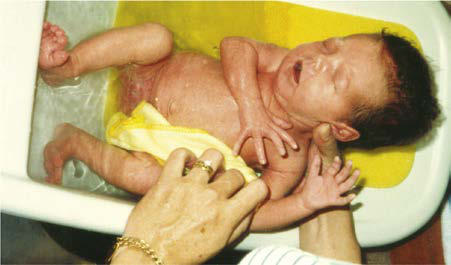

# Chapter 101: Signaling Pathway Disorders
> **Course:** Vikkypaedia Pediatric Basic Course (*Nelson Textbook of Pediatrics, 22nd Edition (2025)*)  
> **Part VIII:** Human Genetics  
> **Authors:** Chad R. Haldeman-Englert and Anne M. Slavotinek  
> **Metrics:** 5,057 words · 6 tables/boxes · 2 figures · 31 genes · 8 flashcards · 5 MCQs  
> **Quick Navigation:** [🃏 Study 8 Flashcards](../flashcards/101_flashcards.md) · [📝 Take 5-Q MCQ Quiz](../mcqs/101_mcqs.md) · [📚 Part VIII Guide](../parts/Part_VIII.md) · [🧬 Syndrome & Genetics Atlas](../omim_gene_atlas.md) · [💊 Therapeutics Matrix](../therapies_matrix.md) · [🏠 Course Index](../../index.md)

## Key Chapter Topics & Subchapters
`101.1 RAS/MAPK Pathway` · `101.2 Sonic Hedgehog Pathway` · `101.3 Ciliopathies` · `101.4 Craniosynostoses` · `101.1 RAS/MAPK Pathway Chad R. Haldeman-Englert and Anne M. Slavotinek` · `101.2 Sonic Hedgehog Pathway Chad R. Haldeman-Englert` · `101.3 Ciliopathies Chad R. Haldeman-Englert` · `101.4 Craniosynostoses Chad R. Haldeman-Englert`

## Key Genetic & Molecular Targets
`ALMS1`, `AR`, `BRAF`, `DHCR7`, `EFNB1`, `FGFR1`, `FGFR2`, `FGFR3`, `GLI1`, `GLI3`, `HRAS`, `IFT80`, `KRAS`, `LZTR1`, `MAP2K1`, `NF1`

## ⚡ High-Yield Nelson Pediatric Board Pearls
- The second major benefit of an accurate diagnosis is that it provides data for recurrence risk estimates.
- Genetic disorders may have direct effects on only one member of the family, but the diagnosis of the con dition can have implications for the entire family.
- The RASopathies comprise a clinically defined group of conditions caused by germline pathogenic variants in genes encoding the components or regulators of the renin-angiotensin system (RAS)/mitogen-activated pro tein kinase (MAPK) pathway.
- The RASopathies are patterns of anomalies caused by pathogenic variants in genes that encode components or regulators of the RAS/MAPK pathway (indicated by dashed lines).
- Approximately 30–75% of the cases are familial, and the condition typically exhibits autosomal dominant inheri tance, although the LZTR1 gene can be associated with autosomal dominant or autosomal recessive inheritance.
- Other distinctive phenotypes include NS-like disorder with loose anagen hair caused by SHOC2 variants and NS-like disorder with or without JMML caused by CBL variants.
- DIAGNOSIS Initial suspicion of a RASopathy generally depends on recognition of one or more characteristic features associated with the various condi tions.

---
## Full Chapter Text, Tables & Figures
# Chapter 101: Signaling Pathway Disorders

*Chad R. Haldeman-Englert and Anne M. Slavotinek*

<!-- p.1011 -->
junction abnormalities and monitoring for both is appropriate. One of the many benefits of an early and accurate diagnosis is that **antici patory guidance and medical monitoring** of patients for syndromespecific medical risks can improve their quality of life and prolong it. When a diagnosis is made, the treating physicians can access published information on the natural history and management of the disorder through the medical literature, genetics reference texts, and databases. Providing access to disorder-specific patient support groups can also provide immense benefit to patients and families.

The second major benefit of an accurate diagnosis is that it provides data for **recurrence risk** estimates. Genetic disorders may have direct effects on only one member of the family, but the diagnosis of the con dition can have implications for the entire family. One or both parents may be carriers, and siblings may be carriers or may want to know their genetic status when they reach their reproductive years. Recurrence risk provision is an important component of genetic counseling and should be included in all evaluations for families affected with birth defects or other inherited disorders (see Chapter 98).

*Visit Elsevier eBooks+ at eBooks.Health.Elsevier.com** for Bibliography.*

An increasing number of defined molecular genetic etiologies explain many multiple congenital anomaly (MCA) syndromes. Several themes have emerged: (1) many clinical disorders that were believed to repre sent a single entity have multiple genetic etiologies, often within genes that are functionally related; (2) many disorders believed to be distinct have common underlying genetic bases; and (3) teratogens and genetic disorders with similar clinical features can often be understood in the context of shared underlying pathology.

It is useful to consider MCA syndromes as members of a group of disor ders based on shared or overlapping clinical findings and related causative genes that act in the same developmental or metabolic pathway.

## 101.1  RAS/MAPK Pathway Chad R. Haldeman-Englert and Anne M. Slavotinek

The RASopathies comprise a clinically defined group of conditions caused by germline pathogenic variants in genes encoding the components or regulators of the renin-angiotensin system (RAS)/mitogen-activated pro tein kinase (MAPK) pathway. This pathway is one of the most important signaling pathways in human development (Fig. 101.1). Signaling is ini tiated when one of several growth factors or cytokines binds extracellu larly to a transmembrane receptor tyrosine kinase (RTK), which transmits the signal to activate of one of several intracellular RAS proteins, such as HRAS, KRAS, or NRAS. Phosphorylation then occurs in a stepwise manner to one or more RAF proteins (ARAF, BRAF, and/or CRAF), and subsequently to MEK1 and/or MEK2, and then ERK1 and/or ERK2. Acti vation of ERK1/2 has downstream targets including transcription factors,

*Chad R. Haldeman-Englert and 
 Anne M. Slavotinek*

Growth factor

**NRAS**

**RTK**

**p120GAP**

**-GTP**

**CS**

**-GTP**

**SHOC2 Legius syndrome**

**CFC**

**SHC**

**SHP2**

**UB**

**CBL**

**PP1C**

**SPRED1 NF-1**

**CM-AVM**

**NS**

**NSML**

**Neurofibromin**

**Numerous**

**nuclear effectors**

**Numerous**

**cytosolic effectors**

**CRAF BRAF**

**MEK1 MEK2**

**ERK1 ERK2**

**RAS SOS1 GRB2 -GTP**

**KRAS**

**-GTP**

**HRAS**

Cell membrane

**Fig. 101.1** The RAS/MAPK signal transduction pathway. The MAPK signaling pathway of protein kinases is critically involved in cellular proliferation, differentiation, motility, apoptosis, and senescence. The RASopathies are patterns of anomalies caused by pathogenic variants in genes that encode components or regulators of the RAS/MAPK pathway (indicated by dashed lines). These disorders include neurofi bromatosis type one (NF1), Noonan syndrome (NS), Noonan syndrome with multiple lentigines (NSML), capillary malformation–arteriovenous malformation syndrome (CM-AVM), Costello syndrome (CS), cardiofaci ocutaneous syndrome (CFC), and Legius syndrome. RAS/MAPK, RAS protein family/mitogen-activated protein kinase. (From Rauen KA. The RASopathies. Annu Rev Genom Hum Genet. 2013;14:355–369.)

membrane proteins, and other protein kinases that direct cellular growth and differentiation.

More than 20 genes implicated in RAS/MAPK signaling have been implicated in human disorders, most with some degree of clinical over lap. Common RASopathies include **Noonan syndrome (NS),** NS with multiple lentigines, Costello syndrome, cardiofaciocutaneous (CFC) syndrome, neurofibromatosis type one (NF1), Legius syndrome, and capillary malformation–arteriovenous malformation syndrome (Table 101.1). NS represents the canonical RASopathy and is an autosomal dom inant disorder resulting from pathogenic variants in several genes in the RAS/MAPK pathway. NS occurs in an estimated 1 in 1,000- 2,500 live births. Approximately 30–75% of the cases are familial, and the condition typically exhibits autosomal dominant inheri tance, although the *LZTR1* gene can be associated with autosomal dominant or autosomal recessive inheritance. Pathogenic variants in RAS/MAPK genes are found in ∼70% of individuals with NS, with missense variants activating the *PTPN11* gene that encodes the nonreceptor protein tyrosine phosphatase SHP-2; this is observed in 50% of affected individuals. Pathogenic variants involving *SOS1* occur in 10–13% of affected individuals; variants in *RAF1* and *RIT1* each occur in 5% of patients, and variants in *KRAS*, *BRAF*, *MAP2K1, LZTR1,* and *NRAS* and duplications of the 12q24 region containing the *PTPN11* gene are rare. The strong clinical overlap between NS and other RASopathies, such as CFC syndrome, is due to the involvement of the same pathway and often identical genes in pathogenesis.

Common features in NS comprise short stature, a characteris tic pattern of facial anomalies including ptosis, wide-spaced eyes with down-slanting palpebral fissures, epicanthal folds, anomalous and low-set ears and micrognathia, congenital heart disease, chest deformities with pectus excavatum and/or pectus carinatum, a short or wide neck with a low posterior hairline, and cryptorchidism

<!-- p.1013 -->

#### **Table 101.1** Genes and Features of the RAS/MAPK Pathway

| Category / Parameter | Clinical Details & Findings |
| --- | --- |
| **CLINICAL PHENOTYPE** | Noonan syndrome |
| **RIT1** | Phosphatase; RasGEF; Kinase; GTPase; GTPase; Scaffolding; E3 ubiquitin ligase; GTPase; Craniofacial dysmorphic features, including a; broad forehead, hypertelorism, down-slanting; palpebral fissures, ptosis, a high-arched palate,; and low-set, posteriorly rotated ears; congenital; heart defects; short stature; undescended; testicles; ophthalmologic abnormalities; bleeding; disorders; normal neurocognitive function or; mild impairment; predisposition to cancer; Noonan syndrome with; multiple; lentigines |
| **RAF1/CRAF** | Phosphatase; Kinase; Same as Noonan syndrome, but with possible; development of multiple skin lentigines as; individuals age; unclear predisposition to; cancer; Capillary malformation–; arteriovenous; malformation |
| **RASA1** | p120-RasGAP; RasGAP; Multifocal capillary malformations, which may be; associated with arteriovenous malformations; and fistulae; unclear predisposition to cancer; Costello syndrome |
| **HRAS** | GTPase; Craniofacial features similar to those of Noonan; syndrome but potentially more coarse;; congenital heart defects; failure to thrive; short; stature; ophthalmologic abnormalities; multiple; skin manifestations, including papilloma; normal; neurocognitive function or mild impairment;; hypotonia; predisposition to cancer; Cardiofaciocutaneous; syndrome |
| **KRAS** | Kinase; Kinase; Kinase; GTPase; Craniofacial features similar to those of Noonan; syndrome; congenital heart defects; failure; to thrive; short stature; ophthalmologic; abnormalities; multiple skin manifestations,; including progressive formation of nevi; normal; neurocognitive function or mild impairment;; hypotonia; unclear predisposition to cancer; Neurofibromatosis type 1 |
| **NF1** | Neurofibromin; RasGAP; Café-au-lait maculae; intertriginous freckling;; neurofibromas and plexiform neurofibromas;; iris Lisch nodules; osseous dysplasia; optic; pathway glioma; normal neurocognitive; function or mild impairment; predisposition; to other cancers; Legius syndrome |
| **SPRED1** | SPROUTY-related,; EVH1 domain–containing; protein 1; Café-au-lait maculae; intertriginous freckling;; macrocephaly; normal neurocognitive function; or mild impairment; no apparent predisposition; to cancer; Modified from Rauen KA. The RASopathies. Annu Rev Genom Hum Genet. 2013;14:355–369. Table 3. |

(Table 101.2 and Fig. 101.2). The pattern of congenital heart disease typically involves right-sided lesions, most frequently presenting with pulmonary valvular stenosis and hypertrophic cardiomyopa thy, but atrial and ventricular septal defects, branch pulmonary artery stenosis, tetralogy of Fallot, and coarctation of the aorta have all been described. Children with NS can manifest developmental delays in association with hypotonia and may have challenges with articulation and coordination. High-frequency sensorineural hear ing loss is common and should be considered in patients with lan guage delays. Hepatosplenomegaly, low levels of clotting factors XI and XII, and primary lymphatic anomalies have also been noted; patients may rarely develop acute lymphoblastic leukemia or juve nile myelomonocytic leukemia (JMML). Puberty may be delayed, and an adult height that reaches the lower limit of the typical range can be achieved by the end of the second decade. Other distinctive phenotypes include NS-like disorder with loose anagen hair caused by *SHOC*2 variants and NS-like disorder with or without JMML caused by *CBL* variants.

**DIAGNOSIS** Initial suspicion of a RASopathy generally depends on recognition of one or more characteristic features associated with the various condi tions. Genetic testing includes a panel of genes including those in the RAS/MAPK pathway. Multigene panel testing is preferred over singlegene analysis due to the many overlapping symptoms seen in RASopa thy disorders. Genetic testing can often be performed on blood, saliva, or a buccal swab. If a gene in the RAS/MAPK pathway is found to have a pathogenic or likely pathogenic variant, this would provide molecu lar confirmation of the clinical diagnosis.

**TREATMENT** Management of NS is noted in Table 101.3. Human growth hormone will improve growth velocity in many individuals with NS and short stature; it is recommended for those who fall below the third percen tile for height. MEK inhibitors, such as trametinib, have been used to treat refractory lymphedema or chylous effusions and possibly severe cardiac hypertrophy.

<!-- p.1014 -->
**NEUROFIBROMATOSIS** NF1 is a multisystem disorder that primarily abstractly involves the skin and peripheral nervous system (see Chapter 636.1). NF1 is associ ated with marked clinical variability. NF1 is inherited in an autosomal dominant manner. The disorder is caused by pathogenic variants in the *NF1* gene, which encodes neurofibromin and functions as a regulator of RAS signaling (see Table 101.1 and Fig. 101.1).

**LEGIUS SYNDROME** Legius syndrome is a RASopathy caused by pathogenic variants in *SPRED1,* which encodes an HRAS regulator. Individuals with Legius syndrome present with typical multiple café-au-lait macules inherited as an autosomal dominant trait but do not develop the serious medical complications of NF1.

*Visit Elsevier eBooks+ at eBooks.Health.Elsevier.com** for Bibliography.*

## 101.2  Sonic Hedgehog Pathway Chad R. Haldeman-Englert

The Hedgehog signaling pathway plays numerous tissue-specific criti cal roles during embryogenesis and postnatal life. Disruption of spe cific steps in this pathway result in a variety of related developmental disorders and anomalies (Fig. 101.3). Activation of this pathway in the child or adult may lead to abnormal cellular proliferation and cancer. Three genes, Sonic (SHH), Indian (IHH), and Desert (DHH), comprise the hedgehog family, with SHH being the most widely expressed. These

genes encode secreted signaling molecules important in cellular differ entiation, proliferation, and survival. Secreted SHH acts as a *ligand* for specific cellular receptors to have a signal transduced by other compo nents of the pathway to regulate downstream gene transcription. The SHH ligand is expressed in the embryo in regions important for devel opment of the brain, face, limbs, and the gut.

Deleterious sequence variants in *SHH* can cause **holoprosenceph aly** (see Fig. 100.7), a variably severe, midline defect associated with clinical effects ranging from cyclopia to a single maxillary incisor with close spacing of the ocular orbits. The SHH protein is processed by pro teolytic cleavage to an active N-terminal form, which is then further modified by the addition of cholesterol. The steroidal alkaloid cyclo pamine exerts a teratogenic effect by inhibiting cholesterol modifica tion of SHH and can result in holoprosencephaly in sheep. In humans, a defect in cholesterol biosynthesis involving the recessive delta-7dehydrocholesterol reductase gene *(DHCR7)* results in **Smith-Lemli- Opitz syndrome** (SLOS) (see Chapter 106).

In addition to microcephaly and holoprosencephaly, patients with SLOS (see Fig. 101.3) display syndactyly, classically of the second and third toes, postaxial polydactyly of the hands and feet, an upturned or anteverted nose, ptosis, and cryptorchidism.

The cholesterol-modified active form of SHH binds to its transmem brane receptor Patched (PTCH1). This SHH-PTCH1 complex then inhibits the activity of the transmembrane protein Smoothened (SMO). Because SMO normally acts to suppress downstream targets, the GLI family of transcription factors, inhibition of SMO by PTCH1 results in activation of GLI1, GLI2, and GLI3. Pathogenic variants resulting in activation of *SMO* can be oncogenic, particularly in basal cell carci nomas and medulloblastomas. In addition, *PTCH1* and its orthologue, *PTCH2*, act as tumor suppressors, and somatic, inactivating sequence variants can be associated with loss of tumor suppressor function. Relatedly, germline inactivating variants in *PTCH1* result in **Gorlin syndrome** (see Fig. 101.3), an autosomal dominant disorder charac terized by a broad face, dental anomalies, rib defects and shortened

Syndrome

#### **Table 101.2** Clinical Findings Associated with Noonan

| Category / Parameter | Clinical Details & Findings |
| --- | --- |
| **General** | Short stature; Failure to thrive (use of specific Noonan syndrome growth curves is; recommended); Tall forehead; Epicanthal folds; Ptosis; Blue-green irides; Wide-spaced eyes; Low nasal bridge, upturned nose; Down-slanting palpebral fissures; Low-set and posteriorly rotated ears; Dental malocclusion; Low posterior hairline; Pectus excavatum; Pectus carinatum superiorly; Scoliosis; Pigmented villonodular synovitis (polyarticular); Cubitus valgus; Pulmonary valve stenosis (dysplastic valve); Hypertrophic cardiomyopathy; Atrial septal defect, ventricular septal defect; Lymphedema; Nevi, lentigines, café-au-lait spots; Cryptorchidism; Small penis; Delayed puberty; Bleeding disorders, including thrombocytopenia and coagulation; factor deficiencies; Leukemia, myeloproliferative disorders, other malignancies; Cognitive delay |

A

B C

**Fig. 101.2** Noonan syndrome. A, Newborn. B, Toddler. C, Affected male. Note the down-slanting palpebral fissures, low-set ears, elevated left shoulder secondary to scoliosis, and wide-spaced nipples. (From Jones KL, Jones MC, Del Campo M, eds. Smith’s Recognizable Patterns of Human Malformation, 8th ed. Philadelphia: Elsevier; 2022: Fig. 1AC, p. 150 and Fig. 2A, p. 151; A and B courtesy Dr. Jacqueline Noonan, University of Kentucky, Lexington, Kentucky.)

<!-- p.1015 -->

<!-- p.1016 -->
metacarpals; basal cell nevi that can undergo malignant transforma tion; and an increased risk of cancers, including medulloblastomas and rhabdomyosarcomas. *GLI1* amplification has been found in sev eral human tumors, including glioblastoma, osteosarcoma, rhabdo myosarcoma, and B-cell lymphomas. Likewise, pathogenic variants in *GLI3* can cause **Greig cephalopolysyndactyly syndrome** (GCPS), **Pallister-Hall syndrome (**PHS), postaxial polydactyly type A (and A/B), and preaxial polydactyly type IV (see Fig. 101.3). GCPS consists of wide-spaced eyes, syndactyly, additional digits on the radial border of the hand or inner aspect of the foot, termed preaxial polydactyly, and broad thumbs and halluces. PHS is an autosomal dominant disor der characterized by postaxial polydactyly, syndactyly, hypothalamic

hamartomas, imperforate anus, and occasionally holoprosencephaly. GLI3 binds to CBP, the protein that is haploinsufficient in **Rubinstein- Taybi syndrome**.

Disorders that are caused by pathogenic variants in genes that function together in a developmental pathway typically have overlap ping clinical manifestations. The overlapping features result from the embryonic tissues in which SHH is important for development, includ ing the brain, face, limbs, and gut as previously noted. Brain defects are present in holoprosencephaly (see Fig. 100.7), SLOS, and PHS. Facial anomalies are found in holoprosencephaly, SLOS, Gorlin syndrome, GCPS, and PHS. Limb defects occur in SLOS, Gorlin syndrome, GCPS, PHS, and the polydactyly syndromes. Overexpression, or acti vating sequence variants, affecting the SHH pathway results in cancer,

#### **Table 101.3** Management of Noonan Syndrome

| Category / Parameter | Clinical Details & Findings |
| --- | --- |
| **IF SYMPTOMATIC** | General; Complete physical and neurologic; examination; medical genetics; consultation to confirm diagnosis,; consider molecular genetic testing; and genetic counseling; Yearly complete physical and; neurologic examination; return to; geneticist if genotype negative or; for multisystem assessment; genetic; counseling at adolescence or when a; young adult; Orchiopexy by age 1 year for; cryptorchidism; if lymphoedema,; refer to specialty clinic; brain; and cervical spine MRI if; intracranial pressure increases;; electroencephalogram and referral to; neurologist if seizures suspected; Developmental; Multidisciplinary developmental; assessment; Developmental screening yearly for; children age 5-18 years; Neuropsychologist testing if screening; abnormal; referral to early intervention; if delays detected before age 3 years;; individual education plan for children; age 5-18 years with delays; Dental; First dental assessment between age 1; year and 2 years; Yearly dental assessment; —; Growth and feeding; Plot growth on curves for Noonan; syndrome; Plot growth on curves for Noonan; syndrome 3 times per year until age; 3 years, then yearly; Refer to gastroenterologist for feeding; problems or recurrent vomiting, or; if evidence of growth failure without; comorbid cause exists; thyroid; function tests if signs or symptoms of; hypothyroidism; Cardiovascular; Cardiac examination,; electrocardiogram, echocardiogram; Follow up on the basis of initial; findings. If initial assessment normal,; repeat every 5 years; —; Ophthalmologic; Baseline eye examination Baseline; audiology examination; Repeat every 2 years, sooner if; indicated; —; Audiologic; Baseline audiology examination; Repeat if recurrent otitis media or; speech delay; Refer to ear, nose, and throat specialist; for recurrent otitis media or serous; otitis; hearing aids or classroom; interventions for hearing loss; Hematologic; Complete blood cell count with; differential, and prothrombin time or; activated partial thromboplastin time; Repeat complete blood cell count with; differential and prothrombin time or; activated partial thromboplastin time; if age 6-12 months at initial screen; Preoperatively: complete blood; cell count with differential and; prothrombin time or activated partial; thromboplastin time, second tier; (in consultation with hematologist); factor IX, XI, and XII concentrations,; von Willebrand factor, platelet; aggregation; Prothrombin time or activated partial; thromboplastin time if bleeding; abnormal or persistent, refer to; hematologist; complete blood; cell count with differential for; splenomegaly; complete blood; cell count with differential; and liver function studies for; hepatosplenomegaly; Renal; Kidney ultrasound; —; —; Skeletal; Clinical assessment of spine with; radiology if indicated by examination; Repeat spinal examination yearly; through adolescence; radiology and; referral to orthopaedic specialist if; abnormal; —; From Roberts AE, Allanson JE, Tartaglia M, Gelb BD. Noonan syndrome. Lancet. 2013;381:333–342. |

<!-- p.1017 -->
including basal cell carcinomas, medulloblastomas, glioblastomas, and rhabdomyosarcomas.

*Visit Elsevier eBooks+ at eBooks.Health.Elsevier.com** for Bibliography.*

## 101.3  Ciliopathies Chad R. Haldeman-Englert

Cilia are microtubule-containing organelles that project from the sur face of most human cells. Three types of cilia exist in humans: motile cilia, nodal cilia, and primary cilia. Motile cilia typically contain a sweeping motion and play important roles in the respiratory epithe lium (see Chapter 455 for discussion of structure of cilia and their role in primary ciliary dyskinesia and respiratory disorders). Nodal cilia play a very brief role during embryonic development, and their whirling flow in the Henson’s node during gastrulation is central in determining the left-right body axis. Defects in this process manifest as alterations in body orientation, including situs inversus and heterotaxy (see Chapter 480.11).

Primary cilia are nonmotile and are present in nearly all cells. The membrane of each cilium is continuous with the plasma mem brane. There are unique differences in its membrane that allow cilia to detect changes in the extracellular environment to func tion as mechanoreceptors, osmosensors, and chemosensors and

convey this information via various intracellular signaling path ways to regulate diverse cellular processes (proliferation, polar ity, nerve growth, differentiation, and tissue maintenance). These pathways may include Hedgehog (HH), G-protein–coupled recep tors (GPCRs), Wingless and Int-1 (WNT), RTKs, and transforming growth factor β (TGF-β).

Pathogenic changes to genes that control the function and signaling within the cilia give rise to conditions called *ciliopathies.* Given the extent of cilia located throughout the human body, symptoms associated with ciliopathies can be variable and extensive. Defects can occur to many different organs during fetal development through adulthood. Organ systems generally affected in ciliopathies include the brain, eyes, liver, kid neys, and skeleton (Fig. 101.4). There are many well-described ciliopathy effects, including retinitis pigmentosa, hearing loss, infertility, primary ciliary dyskinesia, polycystic kidney disease, and nephronophthisis, as well as a number of syndromes including Joubert, Bardet-Biedl, Meckel- Gruber, and orofaciodigital syndromes (Table 101.4).

The diagnosis of a ciliopathy is generally based on recognition of the clinical features followed by either targeted gene testing, a multi gene panel, or exome/genome sequencing. If a diagnosis is established with molecular testing, additional studies may be indicated to evaluate for additional medical and developmental concerns. Surveillance for potential changes to the kidneys, liver, and eyes should be routinely performed.

*Visit Elsevier eBooks+ at eBooks.Health.Elsevier.com** for Bibliography.*

**Fig. 101.3** Signaling components and clinical features of the sonic hedgehog (SHH) signal ing pathway. Deleterious sequence variants in genes that function together in a develop mental pathway typically have overlapping clinical manifestations. Several components of the SHH pathway have been identified and their relationships elucidated. Pathogenic vari ants in several members of this pathway result in phenotypes with facial anomalies, as seen in holoprosencephaly, Smith-Lemli-Opitz syn drome, Gorlin syndrome, Greig cephalopoly syndactyly syndrome, Pallister-Hall syndrome, and Rubinstein-Taybi syndrome. CNS, Central nervous system.

Smith-Lemli-Opitz Syndrome • Microcephaly • Intellectual disability • Short, upturned nose • Hypospadias • Postaxial polydactyly

Holoprosencephaly • Microcephaly • Intellectual disability • Failure of CNS lateralization • Hypotelorism

Rubinstein-Taybi Syndrome • Microcephaly • Intellectual disability • Prominent beaked nose • Broad thumbs • Hirsutism

Greig Cephalopolysyndactyly Syndrome • Macrocephaly • Hypertelorism • Pre- and postaxial polydactyly

Pallister-Hall Syndrome • Hypothalamic

hamartoma • Short, upturned nose • Central and postaxial polydactyly • Bifid epiglottis

Gorlin Syndrome • Macrocephaly • Wide-set eyes • Basal cell carcinoma • Rib anomalies

Cholesterol

GLI-1 GLI-2 GLI-3 • CBP

GLI1 PTC1 HNF3β

N-SHH

N-SHH•Chol

Smoothened

Twist

Sonic Hedgehog

Cleavage

Holoprosencephaly

Smith-Lemli-Opitz

Gorlin Syndrome

Greig Syndrome

Pallister-Hall Syndrome

Rubinstein-Taybi

P

at

c

h

e

d

1

<!-- p.1018 -->

<!-- p.1019 -->

**Fig. 101.4** Ciliopathies of motile and/or nonmotile cilia encompass most human organ systems. Different organ systems or tissues are affected in diverse ciliopathies, with the most common phenotypic mani festations for each organ. Ciliopathies caused primarily by defects in motile cilia are in orange, those in nonmotile (prima ry) cilia are in blue, and those associated with defects in nodal cilia are in green. NPHP, Nephronophthisis; PKD, polycystic kidney disease. (Modified from Reiter JF, Leroux MR. Genes and molecular path ways underpinning ciliopathies. Nat Rev Molec Cell. 2017;18:533–547. Fig. 2.)

Eyes

Motile cilia Non-motile cilia Both types of cilia

Retinal dystrophy

Nose Anosmia

Ears Hearing loss

Energy homeostasis Central obesity

Organ placement

Organ laterality defects

Brain

• Ataxia • Epilepsy • Mental disability • Brain malformations

Hydrocephalus

Congenital heart defects

Facial anomalies

Heart

Chronic respiratory problems

Renal anomalies (PKD, NPHP)

Respiratory system

Kidney

Hepatic disease (liver fibrosis) Liver

Skeleton Skeletal anomalies (polydactyly, rib cage)

Infertility Reproductive

system • Hypogonadism • Genital anomalies

#### **Table 101.4** Childhood Diseases and Syndromes Associated with Motile and Primary/Sensory Ciliopathies

| Category / Parameter | Clinical Details & Findings |
| --- | --- |
| **MOTOR** | Primary ciliary dyskinesia; Chronic bronchitis, rhinosinusitis, otitis media,; laterality defects, infertility, CHD |
| **PRIMARY/SENSORY** | Autosomal recessive polycystic kidney disease |
| **PKHD1** | Nephronophthisis; RFD, interstitial nephritis, CHF, RP |
| **NPHP1-8, ALMS1, CEP290** | Bardet-Biedl syndrome; Obesity, polydactyly, ID, RP, renal anomalies,; anosmia, CHD |
| **BBS1-12, MKS1, MKS3, CEP290** | Meckel-Gruber syndrome; RFD, polydactyly, ID, CNS anomalies, CHD,; cleft lip, cleft palate |
| **MKS1-6, CC2D2A, CEP290, TMEM216** | Joubert syndrome; CNS anomalies, ID, ataxia, RP, polydactyly,; cleft lip, cleft palate |
| **CEP290, TMEM216** | Alström syndrome; Obesity, RP, DM, hypothyroidism,; hypogonadism, skeletal dysplasia,; cardiomyopathy, pulmonary fibrosis |
| **ALMS1** | Orofaciodigital syndrome type I; Polydactyly, syndactyly, cleft lip, cleft palate,; CNS anomalies, ID, RFD |
| **OFD1** | Ellis van Creveld syndrome; Chondrodystrophy, polydactyly, ectodermal; dysplasia, CHD |
| **EVC, EVC2** | Jeune asphyxiating thoracic dystrophy; Narrow thorax, RFD, RP, dwarfism, polydactyly |
| **IFT80** | Sensenbrenner syndrome; Dolichocephaly, ectodermal dysplasia, dental; dysplasia, narrow thorax, RFD, CHD |
| **IFT122, IFT43, WDR35** | Short rib–polydactyly syndromes; Narrow thorax, short limb dwarfism,; polydactyly, renal dysplasia |
| **WDR35, DYNC2H1, NEK1** | CHD, Congenital heart disease; CHF, congenital hepatic fibrosis; CNS, central nervous system; DM, diabetes mellitus; ID, intellectual disabilities; RFD, renal fibrocystic disease; RP,; retinitis pigmentosa.; From Ferkol TW, Leigh MW. Ciliopathies: the central role of cilia in a spectrum of pediatric disorders. J Pediatr. 2012;160:366–371. |

<!-- p.1020 -->

<!-- p.1021 -->
Frontal Bone

Anterior Fontanelle

Posterior Fontanelle

Occipital Bone

Synostotic Trigonocephaly

**Bicoronal**

Synostotic Brachycephaly Synostotic Anterior Plagiocephaly Deformational Posterior Plagiocephaly

**Unicoronal (All Sutures Open)**

**Sagittal Metopic Lambdoid**

Synostotic Scaphocephaly Synostotic Posterior Plagiocephaly

Lambdoid Suture

Sagittal Suture

Front

Back

Right Left

Coronal Suture

Metopic (Frontal) Suture

**Types of Craniosynostosis**

Parietal Bone

**Fig. 101.5** Types of craniosynostosis. (From Buchanan EP, Xue Y, Xue AS, Olshinka A, Lam S. Multidisciplinary care of craniosynostosis. J Multidiscip Healthcare. 2017;10:263–270. Fig. 1. Dove Medical Press Ltd.)

## 101.4  Craniosynostoses Chad R. Haldeman-Englert

To permit appropriate brain growth, the cranial sutures do not com pletely fuse until adulthood. Growth of the skull occurs perpendicular to the direction of each suture. Craniosynostosis arises when one or more cranial sutures prematurely ossify, which usually becomes appar ent between the third trimester of pregnancy and the first year of life (see Chapter 631.10). The shape of the skull is often the clue to the affected suture (Fig. 101.5). Most patients with craniosynostosis do not have additional syndromic features; this may depend on the sutures involved. Patients with bicoronal or multisuture craniosynostosis often have an associated genetic syndrome, whereas patients with isolated sagittal cra niosynostosis do not have features of an identifiable genetic cause.

Craniosynostosis can result from reduced intrinsic factors (poor brain growth), increased extrinsic forces (primiparity, multiple preg nancy, fetal position, high birth weight), or genetic abnormalities lead ing to uncontrolled cranial bone growth. Genes commonly associated with syndromic craniosynostosis include three fibroblast growth factor receptor genes *(FGFR1*, *FGFR2*, *FGFR3)*, *TWIST1*, and *EFNB1*. *FGFR1*,

*FGFR2*, and *FGFR3* are associated with recognizable conditions such as Crouzon, Pfeiffer, Apert, and Muenke syndromes; *TWIST1* with Saethre-Chotzen syndrome; and *EFNB1* with craniofrontonasal syn drome. Distinguishing between the FGFR-related craniosynostosis syndromes can often be made based on additional features, particularly of the hands and feet (see Chapter 631.10).

Other pathogenic gene variants have been identified in patients with syndromic and nonsyndromic craniosynostosis (Table 101.5). Given the overlap of clinical features of many of the craniosynostosis con ditions, appropriate genetic testing for patients with craniosynostosis could include either a multigene panel or exome/genome sequencing. The diagnosis is made based on the genetic abnormality and clinical features.

Management of patients with craniosynostosis is often complex and performed with a multidisciplinary team of various specialists, including audiology, dentistry, genetics, neurosurgery, ophthalmology, orthodontics, otolaryngology, pediatrics, plastic surgery, and speech therapy (see Chapter 631.10).

*Visit Elsevier eBooks+ at eBooks.Health.Elsevier.com** for Bibliography.*

<!-- p.1022 -->
Affected Individuals

#### **Table 101.5** Core Genes For Which Specific Types of Variants Are Associated with Craniosynostosis in More Than Half of

| Category / Parameter | Clinical Details & Findings |
| --- | --- |
| **ASXL1 (612990)** | AD (n); Bohring-Opitz; syndrome (605039); —; Metopic; Forehead nevus flammeus, ulnar; deviation and flexion of wrists; and metacarpophalangeal joints,; severe intellectual disability |
| **AR** | —; —; Coronal; Thin eyebrows, small ears, variable; short stature |
| **AR** | 3MC syndrome 2; (265050); —; Metopic; Hypertelorism, blepharoptosis,; arched eyebrows, cleft lip/palate,; hearing loss, radioulnar synostosis,; genital and vesicorenal anomalies |
| **EFNB1 (300035)** | XLD (male sparing); Craniofrontonasal; syndrome (304110); 0.8; Coronal; Hypertelorism, notched nasal tip,; chest anomalies, longitudinal; splitting of nails; heterozygous; females more severely affected; than hemizygous males |
| **AD** | ERF-related; craniosynostosis; (600775); 1.1; Multisuture; Exorbitism, midface hypoplasia,; Chiari type I malformation, postnatal; onset of craniosynostosis |
| **AD** | Pfeiffer syndrome; (101600); —; Coronal; Mild craniofacial features, broad; medially deviated thumbs and; halluces, cutaneous syndactyly,; specific amino acid substitution; p.Pro252Arg |
| **FGFR1** | AD (n); Osteoglophonic; dysplasia (166250); —; Multisuture; Prominent brow ridges, depressed; nasal bridge, rhizomelic dwarfism,; localized lytic lesions of metaphyses |
| **FGFR2 (176943)** | AD (n); Apert syndrome; (101200); 3.6; Coronal, multisuture; Midface hypoplasia, dilated cerebral; ventricles, complex syndactyly of; the hands and feet |
| **FGFR2** | AD (n); Beare-Stevenson; syndrome (123790); *; Multisuture; Choanal atresia, prominent umbilical; stump, furrowed scalp/neck skin,; acanthosis nigricans in survivors |
| **AD** | Crouzon syndrome; (123500); 2.4; Multisuture, coronal,; sagittal; Exorbitism, midface hypoplasia,; beaked nose (“crouzonoid” facies),; clinically normal hands and feet |
| **FGFR2** | AD (n); Pfeiffer syndrome; (101600); 0.8; Multisuture; Broad thumbs and halluces; in; severe cases, cloverleaf skull, brain; anomalies, tracheal sleeve, fused; elbows |
| **FGFR2** | AD (n); Bent bone dysplasia; (614592); *; Coronal; Osteopenia, reduced mineralization; of the calvaria, bent long bones;; perinatal lethal |
| **AD** | Muenke syndrome; (602849); 4.0; Coronal; Defined by specific amino acid; substitution p.Pro250Arg; may; include sensorineural hearing loss,; mild brachydactyly, cone-shaped; epiphyses; AD (n); Crouzon/acanthosis; nigricans (612247); 0.4; Multisuture; Crouzonoid facies, choanal stenosis,; hydrocephalus, acanthosis; nigricans; specific amino acid; substitution p.Ala391Glu; AD (n); Thanatophoric; dysplasia II (187601); *; Multisuture; Lethal skeletal dysplasia, micromelic; limb shortening, straight femora;; specific amino acid substitution; p.Lys650Glu |
| **AD** | Philadelphia; craniosynostosis; (185900); —; Sagittal; Cutaneous and osseous syndactyly |

<!-- p.1023 -->
Affected Individuals—cont’d

#### **Table 101.5** Core Genes For Which Specific Types of Variants Are Associated with Craniosynostosis in More Than Half of

| Category / Parameter | Clinical Details & Findings |
| --- | --- |
| **AR** | Craniosynostosis and; dental anomalies; (614188); —; Multisuture; Maxillary hypoplasia, delayed; tooth eruption, supernumerary; teeth, minor digit abnormalities,; conductive hearing loss |
| **AR** | Carpenter syndrome 2; (614796); —; Metopic; Hypertelorism, arched eyebrows,; lateralization defects, brachydactyly,; syndactyly, preaxial polydactyly |
| **AD** | Boston craniosynostosis; (604757); —; Sagittal, coronal,; multisuture; None diagnostic; syndrome defined; by specific amino acid substitutions; p.Pro148His, p.Pro148Leu |
| **AR** | Antley-Bixler syndrome; (201750); —; Bicoronal,; multisuture; Choanal stenosis, radiohumeral; synostosis, bowed femora,; multiple joint contractures,; genital abnormalities; abnormal; steroidogenesis |
| **AR** | Carpenter syndrome 1; (201000); —; Multisuture; Obesity, cardiac defects,; polysyndactyly, brachydactyly,; genu valgum, hypogenitalism,; umbilical hernia, learning disability |
| **RUNX2 (600211)** | AD (n); —; —; Multisuture; None diagnostic; syndrome defined; by specific gene duplication |
| **SKI (164780)** | AD (n); Shprintzen-Goldberg; syndrome (182212); —; Sagittal, multisuture; Hypertelorism, micrognathia,; high-arched palate, arachnodactyly,; joint contractures, pectus deformity,; aortic root aneurysm, mitral valve; prolapse, learning disability |
| **AD** | TCF12-related; craniosynostosis; (615314); 1.3; Coronal; Resembles mild Saethre-Chotzen; syndrome; diagnosis defined; by presence of mutations in the; gene, ∼50% nonpenetrance |
| **AD** | Saethre-Chotzen; syndrome (101400); 3.6; Coronal; Low frontal hairline, hypertelorism,; eyelid ptosis, down-slanting; palpebral fissures, blocked tear; ducts, small ears with prominent; crus helicis |
| **AR** | Cranioectodermal; dysplasia 2 (613610); —; Sagittal; Facial dysmorphism, narrow thorax,; short long bones, brachydactyly,; sparse hair, hypoplastic teeth,; cystic kidneys, hepatic fibrosis |
| **ZIC1 (600470)** | AD (n); ZIC1-related; craniosynostosis; 0.2; Coronal; Severe learning disability; The prevalence figures are for percent total craniosynostosis cases with specified mutation, from the cohort attending the Craniofacial Unit, Oxford, born between 1998 and 2008 (n =; 531) and surgically treated before end of 2013.; *Usually lethal at birth.; AD, Autosomal dominant; AR, autosomal recessive; XLD, X-linked dominant; (n), usually arises by new mutation.; From Twigg SRF, Wilkie AOM. A genetic-pathophysiological framework for craniosynostosis. Am J Hum Genetics. 2015;97:359–377. Table 1. |

<!-- p.1024 -->
