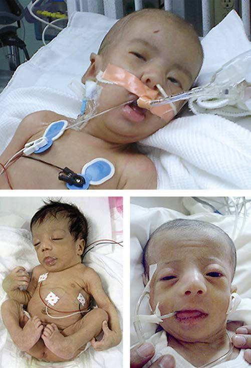

# Chapter 106: Defects in Metabolism of Lipids
> **Course:** Vikkypaedia Pediatric Basic Course (*Nelson Textbook of Pediatrics, 22nd Edition (2025)*)  
> **Part IX:** Metabolic Disorders  
> **Authors:** Nelson 22e Contributors  
> **Metrics:** 33,061 words · 20 tables/boxes · 1 figures · 68 genes · 8 flashcards · 5 MCQs  
> **Quick Navigation:** [🃏 Study 8 Flashcards](../flashcards/106_flashcards.md) · [📝 Take 5-Q MCQ Quiz](../mcqs/106_mcqs.md) · [📚 Part IX Guide](../parts/Part_IX.md) · [🧬 Syndrome & Genetics Atlas](../omim_gene_atlas.md) · [💊 Therapeutics Matrix](../therapies_matrix.md) · [🏠 Course Index](../../index.md)

## Key Chapter Topics & Subchapters
`106.1 Disorders of Mitochondrial Fatty Acid β- Oxidation` · `106.2 Disorders of Very Long Chain Fatty Acids and Other Peroxisomal Functions ` · `106.3 Disorders of Lipoprotein Metabolism and Transport` · `106.4 Lipidoses (Lysosomal Storage Disorders)` · `106.5 Mucolipidoses` · `106.1 Disorders of Mitochondrial Fatty Acid β-Oxidation Jerry Vockley` · `106.2 Disorders of Very Long Chain Fatty Acids and Other Peroxisomal Functions Michael F. Wangler` · `106.3 Disorders of Lipoprotein Metabolism and Transport Lee A. Pyles` · `106.4 Lipidoses (Lysosomal Storage Disorders) Margaret M. McGovern and Robert J. Desnick` · `106.5 Mucolipidoses Margaret M. McGovern and Robert J. Desnick`

## Key Genetic & Molecular Targets
`ABCD1`, `ABCG5`, `ABCG8`, `ACADM`, `ACADS`, `ACADVL`, `ACOX1`, `AGPS`, `APOA1`, `APOC3`, `AR`, `ARSA`, `ASAH1`, `CLN3`, `CLN5`, `CLN6`

## ⚡ High-Yield Nelson Pediatric Board Pearls
- The most common early presentation is an acute epi sode of life-threatening coma, hepatic encephalopathy, and hypoglyce mia with or without hyperammonemia induced by a period of fasting or illness in the first 2-4 years of life.
- Fatty acid oxidation disorders are easily overlooked because the only specific clue to the diagnosis may be the finding of inappropri ately low concentrations of plasma or urinary ketones in an infant who has hypoglycemia unless specialized metabolic testing is performed.
- Newborn screening programs using tandem mass spectrometry detect characteristic plasma acylcarnitine profiles in most of these disorders, allowing early and presymptomatic diagnosis.
- Screening programs have demonstrated that all the fatty acid oxidation disorders combined are among the most common inborn errors of metabolism, at least in predominantly White populations.
- DEFECTS IN THE β-OXIDATION CYCLE Medium-Chain Acyl-CoA Dehydrogenase Deficiency Medium-chain acyl-CoA dehydrogenase (MCAD) deficiency is the most common fatty acid oxidation disorder.
- A diagnosis of MCAD has occasionally been documented in previously healthy teenage and adult individuals, indi cating that even patients who have been asymptomatic in infancy are still at risk for metabolic decompensation if exposed to sufficient periods of fasting.
- Prior to routine newborn screening testing, as many as 25% of MCADdeficient patients died or suffered severe brain injury from their first epi sode.

---
## Full Chapter Text, Tables & Figures
# Chapter 106: Defects in Metabolism of Lipids

<!-- p.1107 -->

## 106.1  Disorders of Mitochondrial Fatty Acid β-Oxidation Jerry Vockley

Mitochondrial β-oxidation of fatty acids is an essential energyproducing pathway. It is particularly important during prolonged periods of reduced caloric intake such as fasting or gastrointestinal ill ness or increased energy expenditure during physiologic stress such as febrile illness. Under these conditions, the body switches from using predominantly *carbohydrate* to predominantly *fat* as its major fuel. Fatty acids are also important fuels for exercising skeletal muscle and are the preferred substrate for normal cardiac metabolism. In these tis sues, fatty acids are completely oxidized to carbon dioxide and water. The end products of hepatic fatty acid oxidation are the ketone bod ies 3-*hydroxybutyrate* and *acetoacetate.* These compounds cannot be oxidized by the liver but are exported to serve as important fuels in peripheral tissues, particularly the brain, where ketone bodies can par tially substitute for glucose during periods of fasting.

Genetic defects have been identified in almost all the known steps in the fatty acid oxidation pathway; all are recessively inherited (Table 106.1).

Clinical manifestations characteristically involve tissues with a high β-oxidation flux, including liver, skeletal, and cardiac muscle, and are age dependent. The most common early presentation is an acute epi sode of life-threatening coma, hepatic encephalopathy, and hypoglyce mia with or without hyperammonemia induced by a period of fasting or illness in the first 2-4 years of life. After about age 6 years, muscle symptoms predominate in the disorders of long-chain fatty acid oxida tion, including myopathy, fatiguability, and recurrent rhabdomyolysis. The latter is often brought on by excess activity or exercise. Cardio myopathy can occur at any age in individuals with long-chain defects and may be exacerbated with acute episodes of illness. Patients with fatty acid oxidation defects are often asymptomatic when well. Acutely presenting disease may be misdiagnosed as **Reye syndrome** or, if fatal, as **sudden unexpected infant death**. In some circumstances, clinical manifestations appear to arise from toxic effects of fatty acid metabo lites rather than inadequate energy production. These circumstances include certain long chain fatty acid oxidation disorders (deficiencies of long chain 3-hydroxyacyl dehydrogenase **[LCHAD]**, carnitine pal mitoyltransferase-IA **[CPT-IA]**, or mitochondrial trifunctional protein [**MTP**; also known as *TFP*]) in which the presence of a homozygous affected fetus increases the risk of a life-threatening illness in the het erozygote mother, resulting in **acute fatty liver of pregnancy** (AFLP) or **preeclampsia with HELLP** (hemolysis, elevated liver enzymes, low platelets) syndrome. The mechanism of these obstetric complica tions is likely accumulation of toxic intermediates. Malformations of the brain and kidneys have been described in severe deficiencies of electron transfer flavoprotein **(ETF)**, ETF dehydrogenase **(ETF-DH)**, and carnitine palmitoyltransferase-II **(CPT-II)**, which might reflect in utero toxicity of fatty acid metabolites or a developmental role for these enzymes. Progressive retinal degeneration, peripheral neuropathy, and chronic progressive liver disease have been identified in LCHAD and MTP deficiency.

Fatty acid oxidation disorders are easily overlooked because the only specific clue to the diagnosis may be the finding of inappropri ately *low* concentrations of plasma or urinary ketones in an infant who has hypoglycemia unless specialized metabolic testing is performed. Genetic defects in ketone body utilization may also be overlooked because ketonemia is an expected finding with fasting hypoglycemia.

Newborn screening programs using tandem mass spectrometry detect characteristic plasma acylcarnitine profiles in most of these disorders, allowing early and presymptomatic diagnosis. Screening programs have demonstrated that all the fatty acid oxidation disorders combined are among the most common inborn errors of metabolism, at least in predominantly White populations.

Figures 106.1 and 106.2 outline the steps involved in the oxidation of a typical long chain fatty acid. In the *carnitine cycle,* long chain fatty acids are transported across the barrier of the inner mitochondrial membrane as acylcarnitine esters. Medium-chain fatty acids, which are commonly provided as medium-chain triglyceride supplementation in infants who are failing to thrive, can bypass the carnitine cycle and enter the mitochondrial β-oxidation cycle directly. Within the mito chondria, successive rounds of the four-step *β**-oxidation cycle* convert the **coenzyme A (CoA)**–activated fatty acids to acetyl-CoA units. Two or three different chain-length-specific isoenzymes are needed for each of these β-oxidation steps to accommodate the different chain-length fatty acyl-CoA species. The electrons generated in the first β-oxidation step (acyl-CoA dehydrogenase) are carried by the *electron transfer pathway* to the *electron transport chain* at the level of coenzyme Q for adenosine triphosphate production, whereas electrons generated from the third step (3-hydroxyacyl-CoA dehydrogenase) enter the *electron transport chain* at the level of complex 1. Most of the acetyl-CoA gener ated from fatty acid β-oxidation in the liver flows through the *pathway of ketogenesis* to form 3-hydroxybutyrate and acetoacetate, whereas in muscle and heart, the fatty acids are completely oxidized to CO2 and water through oxidative phosphorylation. It has been demonstrated that the enzymes of fatty acid oxidation physically and functionally interact with each other and those of the mitochondrial electron trans port chain.

**DEFECTS IN THE β****-OXIDATION CYCLE Medium-Chain Acyl-CoA Dehydrogenase Deficiency** Medium-chain acyl-CoA dehydrogenase **(MCAD)** deficiency is the most common fatty acid oxidation disorder. The disorder shows a strong founder effect; most patients have a northwestern European ancestry, and the majority of these patients have at least one copy of a common MCAD missense pathogenic variant, an A-G transition at cDNA position 985 (c.985A>G) that changes a lysine to glutamic acid at residue 329 (p.Lys329Glu).

**Clinical Manifestations** Previously undiagnosed affected patients usually present in the first 3 months to 5 years of life with episodes of acute illness triggered by prolonged fasting (>12-16 hours). Signs and symptoms include vomit ing and lethargy, which rapidly progress to coma or seizures and car diorespiratory collapse. Sudden unexpected infant death may occur. The liver may be slightly enlarged with fat deposition. Episodes are rare until the infant is beyond the first few months of life, presumably because of more frequent feedings at a younger age. Affected older infants are at higher risk of symptoms as they begin to fast through the night or are exposed to fasting stress during an intercurrent childhood illness. Presentation in the first days of life with neonatal hypoglycemia has been reported in newborns who were fasted inadvertently or were being breastfed exclusively and thus are at higher risk because of early reduced caloric intake. A diagnosis of MCAD has occasionally been documented in previously healthy teenage and adult individuals, indi cating that even patients who have been asymptomatic in infancy are still at risk for metabolic decompensation if exposed to sufficient periods of fasting. An unknown number of patients may remain asymptomatic. Prior to routine newborn screening testing, as many as 25% of MCADdeficient patients died or suffered severe brain injury from their first epi sode. Most patients are diagnosed in the newborn period by **blood spot acylcarnitine screening** (part of newborn screening), allowing the ini tiation of early intervention and prevention of most signs and symptoms.

**Laboratory Findings** During acute episodes, hypoglycemia is usually present. Plasma and urinary ketone concentrations are inappropriately low **(hypoketotic**

<!-- p.1108 -->
↓ Total and free carnitine; normal acylcarnitines,

↓ Intracellular C14-C18 fatty acids; ↓ fatty acid

#### **Table 106.1** Mitochondrial Fatty Acid Oxidation Disorders: Clinical and Biochemical Features

| Category / Parameter | Clinical Details & Findings |
| --- | --- |
| **LABORATORY FINDINGS** | Carnitine transporter |
| **SLC22A5** | Cardiomyopathy, skeletal myopathy, liver disease,; sudden death, endocardial fibroelastosis, cardiac; arrhythmia; acylglycine, and organic acids; prenatal and; newborn possible diagnosis reported; Long chain fatty acid; transporter |
| **FATP1-6** | Rare, acute liver failure in childhood requiring liver; transplantation; oxidation; disease-causing pathogenic variants; have not been identified in patients; Carnitine palmitoyl; transferase-IA |
| **CPTIA** | Liver failure, renal tubulopathy, and sudden death; reported; maternal preeclampsia; HELLP syndrome; association described in a few patients; Normal or ↑ free carnitine; normal acylcarnitines,; acylglycine, and organic acids; newborn; screening diagnosis reported; Carnitine acylcarnitine; translocase |
| **SLC25A20** | Chronic progressive liver failure, persistent ↑ NH3,; hypertrophic cardiomyopathy; Normal or ↓ free carnitine, abnormal; acylcarnitine profile; newborn screening; diagnosis reported; Carnitine palmitoyl; transferase-II |
| **CPT2** | Early and late onset types; liver failure,; encephalopathy, skeletal myopathy,; cardiomyopathy, renal cystic changes; adult form; with acute rhabdomyolysis, myoglobinuria; Normal or ↓ free carnitine; abnormal; acylcarnitine profile; newborn screening; diagnosis possible; Short chain acyl-CoA; dehydrogenase |
| **ACADS** | Biochemical phenotype only; no consistent clinical; phenotype; Normal or ↓ free carnitine; elevated urine; ethylmalonic acid; inconsistently abnormal; acylcarnitine profile; Medium-chain acyl-CoA; dehydrogenase |
| **ACADM** | Hypoglycemia, hepatic encephalopathy, sudden death;; maternal preeclampsia, HELLP syndrome association; described rarely, possible long QT interval; Normal or ↓ free carnitine, ↑ urine acylglycine,; plasma C6-C10 free fatty acids, ↑ C8-C10; acyl-carnitine; newborn screening diagnosis; possible; Very long chain acyl-CoA; dehydrogenase (VLCAD) |
| **ACADVL** | Dilated cardiomyopathy, arrhythmias, hypoglycemia,; and hepatic steatosis; late-onset, stress-induced; rhabdomyolysis, episodic myopathy; Normal or ↓ free carnitine; ↑ plasma C14:1, C14; acylcarnitine; ↑ plasma C10-C16 free fatty; acids; prenatal and newborn screening; diagnosis possible; ETF dehydrogenase* |
| **ETFDH** | Nonketotic fasting hypoglycemia, congenital; anomalies, milder forms of liver disease,; cardiomyopathy, and skeletal myopathy; Normal or ↓ free carnitine; increased ratio; of acyl:free carnitine, ↑ blood acylcarnitines;; characteristic urine organic acids and; acylglycines; newborn screening diagnosis; possible; ETF-α* |
| **ETFA** | Nonketotic fasting hypoglycemia, congenital; anomalies, liver disease, cardiomyopathy; skeletal; myopathy also described; Normal or ↓ free carnitine; increased ratio of; acyl:free carnitine; ↑ acylcarnitines; urine; organic acid and acylglycines; newborn; screening diagnosis possible; ETF-β* |
| **ETFB** | Fasting hypoglycemia, congenital anomalies, liver; disease, cardiomyopathy; skeletal myopathy also; described; Normal or ↓ free carnitine; increased ratio of; acyl:free carnitine, ↑ blood acylcarnitines;; urine organic acid and acylglycines; newborn; screening diagnosis possible; Short chain l-3-; hydroxyacyl-CoA; dehydrogenase (SCHAD) |
| **HAD1** | Hyperinsulinemic hypoglycemia, cardiomyopathy,; myopathy; Normal or ↓ free carnitine, elevated free fatty; acids, inconsistently abnormal urine organic; acid, ↑ 3-OH glutarate, ↑ plasma C4-OH; acylcarnitine; newborn screening diagnosis; possible; Long chain l-3-hydroxyacyl-; CoA dehydrogenase |
| **HADHA** | Maternal preeclampsia, HELLP syndrome, and AFLP; association described frequently; see MTP later for; clinical manifestations; Normal or ↓ free carnitine, increased ratio of; acyl:free carnitine, ↑ free fatty acids, ↑ C16-; OH and C18-OH carnitines; newborn screening; diagnosis possible |
| **HADHB** | Severe cardiac and skeletal myopathy, hypoglycemia,; acidosis, hyper NH3, sudden death, elevated liver; enzymes, retinopathy; maternal preeclampsia,; HELLP syndrome, and AFLP association described; frequently; Normal or ↓ free carnitine, increased ratio of; acyl:free carnitine, ↑ free fatty acids, ↑ C16-; OH and C18-OH carnitines; newborn screening; diagnosis possible; Long chain 3-ketoacyl-CoA; thiolase |
| **HADHB** | Severe neonatal presentation, hypoglycemia,; acidosis, ↑ creatine kinase, cardiomyopathy,; neuropathy, and early death; Normal or ↓ free carnitine, increased ratio of; acyl:free carnitine, ↑ free fatty acids, ↑ 2-trans,; 4-cis-decadienoylcarnitine; newborn screening; diagnosis possible; Short chain 2,3-enoyl-CoA; hydratase |
| **ECHS1** | Leigh disease, lactic acidosis, seizures, cystic; degeneration of white matter, microcephaly,; metabolic acidosis, extrapyramidal dystonia, dilated; cardiomyopathy; Abnormal organic acids, 2-methacrylglycine,; 2-methyl-2,3 dihydroxybutyrate, also S-(2-; carboxypropyl)cysteine, S-(2-carboxyethyl); cysteamine; acylcarnitine shows ↑ C4OH; (inconsistently) |

<!-- p.1109 -->
Respiratory Chain

Plasma membrane Transporter

?

OCTN2

CPT II

TRANS

e−

TCA cycle

ETF-DH

ETF

MCAD SCAD

SHORT- & MEDIUM-CHAIN

β-OXIDATION

CARNITINE

CYCLE

LONG-CHAIN β-OXIDATION

KETONE SYNTHESIS

Hydratase

3-Hydroxacyl CoA

3-OH-ACD SCHAD

Medium-chain fatty acid Carnitine

Carnitine

LC acylcarnitine

LC acylcarnitine

LC fatty acyl CoA

C8-4 Acyl CoA

3-Ketoacyl CoA Acetyl CoA

HMG-CoA synthase

C14-C10 Acyl

CoA 2,3(C16-10) Enoyl CoA

HMG CoA lyase TFP

ETF-DH

ETF

VLCAD

LCAD

HMG CoA Leucine

Inner mitochondrial

membrane

Outer mitochondrial

membrane

Acetoacetate

β-Hydroxybutyrate

Enoyl CoA

Thiolase

Cytosol

Long-chain free fatty acid (C16-palmitate)

Long-chain free fatty Acyl CoA + carnitine

CPT I

#### **Table 106.1** Mitochondrial Fatty Acid Oxidation Disorders: Clinical and Biochemical Features—cont’d

| Category / Parameter | Clinical Details & Findings |
| --- | --- |
| **LABORATORY FINDINGS** | 2,4-Dienoyl-CoA reductase |
| **DECR1** | Only one patient described, hypotonia in the; newborn, mainly severe skeletal myopathy and; respiratory failure; hypoglycemia is rare; Normal or ↓ free carnitine, ↑ acyl:free carnitine; ratio, normal urine organic acids and; acylglycines; HMG CoA synthetase |
| **HMGCS2** | Hypoketosis and hypoglycemia, rarely myopathy; ↑ Total plasma fatty acids; enzyme studies in; biopsied liver may be diagnostic; genetic; testing preferred; HMG CoA lyase |
| **HMGCL** | Hypoketosis and hypoglycemia, rarely myopathy; Normal free carnitine, ↑ C5-OH, and; methylglutaryl-carnitine; enzymes studies in; fibroblasts may be diagnostic; Monocarboxylate; transporter 1 (MCT1) |
| **SLC16A1** | Severe fasting-induced ketoacidosis, rarely hypoglycemia; Profound ketoacidosis; no specific biomarkers; yet identified; *Also known as glutaric acidemia type II or multiple acyl-CoA dehydrogenase defect (MADD).; AFLP, Acute fatty liver of pregnancy; CoA, coenzyme A; ETF, electron transport flavoprotein; HELLP, hemolysis, elevated liver enzymes, low platelets; MTP, mitochondrial trifunctional; protein; NH3, ammonia.; From Shekhawat PS, Matern D, Strauss AW. Fetal fatty oxidation disorders, their effect on maternal health and neonatal outcome: impact of expanded newborn screening on their; diagnosis and management. Pediatr Res. 2005;57:78R–84R. |

**Fig. 106.1** Mitochondrial fatty acid oxidation. Carnitine enters the cell through the action of the organic cation/carnitine transporter (OCTN2). Palmitate, a typical 16-carbon long chain (LC) fatty acid, is transported across the plasma membrane and can be activated to form an LC fatty acyl coenzyme A (CoA). It then enters into the carnitine cycle, where it is transesterified by carnitine palmitoyltransferase-I (CPT-I), translocated across the inner mitochondrial membrane by carnitine/acylcarnitine translocase (TRANS), and then reconverted into an LC fatty acyl-CoA by carni tine palmitoyltransferase-II (CPT-II) to undergo β-oxidation. Very LC acyl-CoA dehydrogenase (VLCAD/LCAD) leads to the production of (C16-C10) 2,3-enoyl CoA. Mitochondrial trifunctional protein (MTP) contains the activities of enoyl CoA hydratase (hydratase), 3-OH-hydroxyacyl-CoA dehy drogenase (3-OH-ACD), and β-ketothiolase (thiolase). Acetyl-CoA, a reduced form of flavin adenine dinucleotide (FADH), and a reduced form of nicotinamide adenine dinucleotide (NADH) are produced. Medium- and short chain fatty acids (C8-4) can enter the mitochondrial matrix independ ent of the carnitine cycle. Medium-chain acyl-CoA dehydrogenase (MCAD), short chain acyl-CoA dehydrogenase (SCAD), and short chain hydroxy acyl-CoA dehydrogenase (SCHAD) are required. Acetyl-CoA can then enter the Krebs (TCA) cycle. Electrons are transported from FADH to the res piratory chain via the electron transfer flavoprotein (ETF) and the electron transfer flavoprotein dehydrogenase (ETF-DH). NADH enters the electron transport chain through complex I. In the liver, acetyl-CoA can be converted into hydroxymethylglutaryl (HMG) CoA by β-hydroxy-β-methylglutaryl- CoA synthase (HMG CoA synthase) and then the ketone body acetoacetate by the action of β-hydroxy-β-methylglutaryl-CoA lyase (HMG-CoA lyase).

<!-- p.1110 -->
**hypoglycemia)**. Because of the hypoketonemia, there is little or no metabolic acidosis, which is typically present in children with hypogly cemia not caused by fatty acid oxidation disorders. Liver function tests (LFTs) are abnormal, with elevations of liver enzymes (alanine trans aminase, aspartate transaminase), elevated blood ammonia, and pro longed prothrombin and partial thromboplastin times. Liver biopsy at times of acute illness shows microvesicular or macrovesicular steatosis from triglyceride accumulation. During fasting stress or acute illness, urinary organic acid profiles by gas chromatography/mass spectrom etry show inappropriately low concentrations of ketones and elevated levels of medium-chain dicarboxylic acids (adipic, suberic, and sebacic

acids) that derive from microsomal and peroxisomal omega oxida tion of accumulated medium-chain fatty acids. Plasma and tissue con centrations of total carnitine are reduced to 25–50% of normal, and the fraction of total esterified carnitine is increased. This pattern of **secondary carnitine deficiency** is seen in most fatty acid oxidation defects and reflects competition between increased acylcarnitine levels and free carnitine for transport at the renal tubular plasma membrane. Significant exceptions to this rule are the plasma membrane carnitine transporter, CPT-IA, and β-hydroxy-β-methylglutaryl-CoA (HMG- CoA) synthase deficiencies, which do not manifest secondary carnitine deficiency.

Diagnostic metabolite patterns for MCAD deficiency include increased plasma C6:0, C8:0, C10:0, and C10:1 acylcarnitine species and increased urinary acylglycines, including hexanoylglycine, suberylgly cine, and 3-phenylpropionylglycine. Newborn screening, performed in all states in the United States and in many other countries, can detect presymptomatic MCAD deficiency based on these abnormal acylcar nitines in filter paper blood spots. The diagnosis can be confirmed by demonstrating the common Ala985Gly pathogenic variant or sequenc ing the MCAD gene. A second common variant, Thr199Cys, has been detected in infants identified by newborn screening. Interestingly, this allele has not been seen to date in symptomatic MCAD patients, likely because of the significant residual activity of this milder pathogenic variant.

**Treatment** Acute illnesses should be promptly treated with intravenous (IV) flu ids containing 10% dextrose to correct or prevent hypoglycemia and to suppress lipolysis as rapidly as possible (see Chapter 113). Chronic therapy consists of avoiding fasting. This usually requires simply adjusting the diet to ensure that overnight fasting periods are limited to <6 hours in infants under 6 months of age, <8 hours for infants 6-24 months of age, and <12 hours for older children. Restricting dietary fat or treatment with carnitine is unnecessary. There is likely no need for active therapeutic intervention for individuals with the Thr199Cys variant.

**Prognosis** Up to 25% of previously undiagnosed patients may die during their first attack of illness. There is often a history of a previous sibling death that is presumed to be from an unrecognized MCAD deficiency. Some patients may sustain permanent brain injury during an attack of profound hypoglycemia. For survivors without brain damage and essentially all babies identified by newborn screening, the prognosis is excellent because progressive cognitive impairment or cardiomyopathy does not occur in MCAD deficiency. Fasting tolerance improves with age, and the risk of decompensation decreases. Because as many as 35% of affected patients have never had an episode, testing of siblings of affected patients is important to detect asymptomatic family members who did not receive newborn screening.

**Very Long Chain Acyl-CoA Dehydrogenase Deficiency** Very long chain acyl-CoA dehydrogenase **(VLCAD)** deficiency is the second most common diagnosed disorder of fatty acid oxidation. It was originally termed “long chain acyl-CoA dehydrogenase deficiency” before the existence of the inner mitochondrial membrane-bound VLCAD was known. *All patients previously diagnosed as having long chain acyl-CoA dehydrogenase deficiency have* VLCAD *gene defects.* Patients with VLCAD deficiency have no ability to oxidize physiologic long chain fatty acids and are usually more severely affected than those with MCAD deficiency, who have a milder oxidative defect. VLCAD deficiency presents earlier in infancy and has more chronic problems with muscle weakness or episodes of muscle pain and rhabdomyolysis. Cardiomyopathy may be present during acute attacks provoked by fast ing. The left ventricle may be hypertrophic or dilated and may show poor contractility on echocardiography. Sudden unexpected death has occurred in several patients, but most who survive the initial epi sode show improvement, including normalization of cardiac function.

CPT-1

CPT-2

Palmitate

TRANS Carnitine Cycle Inner mitochondrial membrane

Electron transport chain

ACD

CO CoA C15

CO CoA C15

CO CH CH CoA CH2 R

Hydratase

Thiolase

HMG CoA synthase

Acetyl CoA

NAD NADH

FAD ETF

Electron Transfer

ETF-DH

FADH2

CO CH CHOH CoA

OH 3 ACD

CH2 R

CO CHO CoA CH2 CH2

CO CoA C13 Acetyl CoA

CO CoA C11

Acetyl CoA

CO CoA C9

Acetyl CoA

CO CoA C7

Acetyl CoA

CO CoA C5

Acetyl CoA

Acetyl CoA

CO CoA

Acetyl CoA

Hydroxymethylglutaryl CoA

HMG CoA lyase

Acetoacetate

β-Hydroxybutyrate

β-Oxidation Cycle

Leucine Ketone Synthesis

C3

R

CO carnitine C15

CO carnitine C15

**Fig. 106.2** Pathway of mitochondrial oxidation of palmitate, a typi cal 16-carbon long chain fatty acid. Enzyme steps include carnitine palmitoyltransferase (CPT) 1 and 2, carnitine/acylcarnitine translocase (TRANS), electron transfer flavoprotein (ETF), ETF dehydrogenase (ETF- DH), acyl-CoA dehydrogenase (ACD), enoyl CoA hydratase (hydratase), 3-hydroxy-acyl-CoA dehydrogenase (3-OH-ACD), β-ketothiolase (thiolase), β-hydroxy-β-methylglutaryl-CoA (HMG-CoA) synthase, and lyase.

<!-- p.1111 -->
Other physical and routine laboratory features are similar to those of MCAD deficiency, including secondary carnitine deficiency. The uri nary organic acid profile shows a nonketotic dicarboxylic aciduria with increased levels of C6-12 dicarboxylic acids. Diagnosis may be sug gested by an abnormal acylcarnitine profile with plasma or blood spot C14:0, 14:1, 14:2 acylcarnitine species. However, the specific diagnosis requires pathogenic variant analysis of the *VLCAD* gene. Newborn screening by tandem mass spectrometry of dried blood spots is effec tive in identifying early/severe disease, though it can miss milder, later-onset cases. A common mild variant is identified by a newborn screen that typically predicts later-onset disease. Treatment has tradi tionally been based primarily on avoidance of fasting for >8-12 hours depending on age, along with supplementation with medium-chain triglycerides. Triheptanoin (Dojolvi) has been approved as a treatment for VLCAD deficiency and for all other disorders of long-chain fatty acid oxidation. The odd-chain fat heptanoate (C7) released from this triglycerol provides acetyl-CoA for the tricarboxylic acid cycle *and* propionyl-CoA, which is metabolized through methylmalonyl-CoA to succinyl-CoA and succinate. This anaplerotic effect essentially elimi nates hypoglycemia in long-chain fatty acid oxidation disorder patients and significantly improves heart function in patients with cardiomy opathy. However, although heptanoin does reduce the incidence, rhab domyolysis remains a major problem in treated patients. This finding led to the recognition of previously unrecognized inflammation as a component of these disorders, likely caused by the accumulation of a high level of proinflammatory long-chain complex lipids. Patients can develop a secondary carnitine deficiency; however, the need for replacement therapy remains unclear. If the free carnitine level in blood is <10 μM, supplementation with 25-50 mg/kg of oral carnitine (with a maximum of 1,000 mg/day) may be helpful, especially in the face of cardiomyopathy or significant muscular symptoms.

**Short Chain Acyl-CoA Dehydrogenase Deficiency** A small number of patients with two null pathogenic variants in the short chain acyl-CoA dehydrogenase (SCAD) gene have been described with a variable phenotype. Most individuals classified as being SCAD deficient actually have polymorphic DNA changes in the *SCAD* gene; two common polymorphisms are Gly185Ser and Arg 147Trp, present in biallelic fashion in 7% of the population. Although SCAD deficiency was originally reported with a wide range of symp toms, it was likely a result of the frequency of the common polymor phisms in unrelated disease rather than a true causal relationship. Long-term follow-up of infants identified by newborn screening has failed to demonstrate a convincing, consistent phenotype, and thus SCAD deficiency is best described as a biochemical phenotype rather than a disease. The diagnosis is indicated by elevated levels of butyrylcarnitine (C4-carnitine) on newborn blood spots or plasma and increased excretion of urinary ethylmalonic acid and butyrylgly cine. These metabolic abnormalities are most pronounced in patients with null pathogenic variants and are variably present in patients who are homozygous for the common polymorphisms. In the context of metabolic abnormalities consistent with SCAD deficiency in patients with significant clinical problems, a thorough evaluation for *another* unrelated diagnosis is indicated. There is no need for treatment of individuals with SCAD deficiency.

**Long Chain 3-Hydroxyacyl-CoA Dehydrogenase/ Mitochondrial Trifunctional Protein Deficiency** The LCHAD enzyme is part of the MTP, which also contains two other steps in β-oxidation: long chain 2,3-enoyl CoA hydratase and long chain β-ketothiolase. MTP is a heterotetrameric protein composed of two α and two β chains derived from distinct contiguous genes, *HADHA* and *HADHB,* that share a common promoter. In some patients, only the LCHAD activity of the MTP is affected **(LCHAD deficiency)**, whereas others have deficiencies of all three activities **(MTP deficiency)**.

**Clinical manifestations** include attacks of acute hypoketotic hypo glycemia similar to VLCAD deficiency; however, patients often show evidence of more severe disease, including cardiomyopathy, muscle cramps and weakness, and abnormal liver function (cholestasis).

Pigmented retinopathy leading to blindness, progressive liver failure, peripheral neuropathy, and rhabdomyolysis are also present, with retinopathy being more severe in isolated LCHAD deficiency and neuropathy worse in combined MTP defects. Life-threatening obstet ric complications (AFLP, HELLP syndrome) have been observed in heterozygous mothers carrying homozygous fetuses affected with LCHAD/MTP deficiency. Sudden unexpected infant death may occur, especially in populations where tandem mass spectrometry newborn screening is not routine. The **diagnosis** is indicated by elevated levels of blood spot or plasma 3-hydroxy acylcarnitines of chain lengths C16-C18. The urinary organic acid profile in patients may show increased levels of 3-hydroxydicarboxylic acids of chain lengths C6-C14. Secondary car nitine deficiency is common. A common pathogenic variant in the α subunit, E474Q, is seen in more than 60% of isolated LCHAD-deficient patients. This pathogenic variant in the fetus is especially associated with the obstetric complications, but other pathogenic variants in either subunit may also be linked to maternal illness.

**Treatment** is similar to that for VLCAD deficiency; that is, avoiding fasting stress, triheptanoin, and potentially carnitine. Docosahexae noic acid may slow the retinal changes but does not prevent them. None of these therapeutic measures likely affect the development or progression of peripheral neuropathy. Liver transplantation has been attempted in patients with severe liver failure but does not amelio rate the metabolic abnormalities or prevent the myopathic or retinal complications.

**Short Chain 3-Hydroxyacyl-CoA Dehydrogenase Deficiency** Very few patients with proven pathogenic variants of short chain 3-hydroxyacyl-CoA dehydrogenase **(SCHAD)** have been reported. Most cases with recessive pathogenic variants of the SCHAD gene have presented with episodes of hypoketotic hypoglycemia that was caused by *hyperinsulinism*. In contrast to those with other forms of fatty acid oxidation disorders, these patients required specific ther apy with diazoxide for hyperinsulinism to avoid recurrent hypogly cemia. A single patient with compound heterozygous pathogenic variants presented with fulminant hepatic failure at age 10 months. The SCHAD protein has a nonenzymatic function in which it directly interacts with glutamate dehydrogenase (GDH) to inhibit its activity. In the absence of SCHAD protein, this inhibition is removed, lead ing to upregulation of GDH enzyme activity, a recognized cause of *hyperinsulinism,* usually from activating pathogenic variants of the *GDH* gene. Severe deficiency of SCHAD protein often presents pre dominantly as **protein-sensitive hypoglycemia** rather than as fasting hypoglycemia. It appears that if SCHAD protein is present, inhibi tion of GDH is maintained even when there is no SCHAD enzyme activity; these patients may present with a more traditional fatty acid oxidation defect. Specific metabolic markers for SCHAD defi ciency include elevated plasma C4-hydroxy acylcarnitine and urine 3-hydroxyglutaric acid. Successful newborn screening for SCHAD deficiency has been recorded, but the sensitivity of the process has not yet been established.

**Treatment** of SCHAD-deficient patients with hyperinsulinism is with diazoxide. There is insufficient experience with the nonhyperinsulinemic form of SCHAD deficiency at present to recommend treatment modalities, but prevention of fasting seems advisable.

**Short Chain 2,3-Enoyl-CoA Hydratase Deficiency** This rare disorder, resulting from pathogenic variants in the *ECHS1* gene, was identified through exome sequencing. The disorder affects a shared pathway of short chain fatty acid and valine metabolism. The clinical phenotypes are more characteristic of mitochondrial disorders of pyruvate metabolism with predominantly a **Leigh-like disease** (see Chapters 108 and 638.2) with profound and often-fatal lactic acidosis. No treatment modalities or specific biomarkers have been established. Several patients were found to excrete increased levels of meth acrylylglycine, a highly reactive and potentially toxic intermediate; 2-methyl-2.3 dihydroxybutyrate; *S*-(2-carboxypropyl) cysteine; and *S*- (2-carboxpropyl) cysteamine.

<!-- p.1112 -->
**DEFECTS IN THE CARNITINE CYCLE Plasma Membrane Carnitine Transport Defect 
 (Primary Carnitine Deficiency)** Primary carnitine deficiency is the only genetic defect in which carni tine deficiency is the *cause,* rather than the consequence, of impaired fatty acid oxidation. The most common presentation is progressive **car diomyopathy** with or without **skeletal muscle weakness** beginning at age 1-4 years. A smaller number of patients may present with fasting hypoketotic hypoglycemia in the first year of life, before the cardiomy opathy becomes evident. Cardiac arrythmias are often seen. A com mon pathogenic variant causes late-onset disease in the Faroe Islands with sudden death caused by cardiomyopathy and/or arrhythmia. The underlying defect involves the high-affinity plasma membrane sodium gradient–dependent carnitine transporter encoded by the *SLC22A5* gene that is expressed at high levels in heart, muscle, and kidney. This transporter is responsible both for maintaining intracellular carnitine concentrations 20- to 50-fold higher than plasma concentrations and for renal conservation of carnitine.

**Diagnosis** of the carnitine transporter defect is aided by patients having extremely reduced carnitine levels in plasma and muscle (1–2% of normal). Heterozygote parents have plasma carnitine levels approxi mately 50% of normal. Fasting ketogenesis may be normal because liver carnitine transport is normal, but it may become impaired if dietary carnitine intake is interrupted. The fasting urinary organic acid profile may show a hypoketotic dicarboxylic aciduria pattern if hepatic fatty acid oxidation is impaired but is otherwise unremarkable. The defect in carnitine transport can be demonstrated clinically by the severe reduc tion in renal carnitine threshold or by in vitro assay of carnitine uptake using cultured fibroblasts or lymphoblasts. *SLC22A5* sequencing is the most common method to confirm the diagnosis. A common relatively severe pathogenic variant has been described in the Chinese popula tion in Taiwan. **Treatment** with pharmacologic doses of oral carnitine (100-300 mg/kg/day) is highly effective in correcting the cardiomyopa thy and muscle weakness, as well as any impairment in fasting keto genesis. Muscle total carnitine concentrations remain <5% of normal on treatment.

**Carnitine Palmitoyltransferase-IA Deficiency** Several dozen infants and children have been described with a deficiency of the liver and kidney CPT-I isozyme (CPT-IA). **Clinical manifesta tions** include fasting-induced hypoketotic hypoglycemia, occasionally with extremely abnormal LFTs and, rarely, with renal tubular acidosis. The heart and skeletal muscles are not involved because the muscle isozyme is unaffected. Fasting urinary organic acid profiles sometimes show a hypoketotic C6-C12 dicarboxylic aciduria but may be normal. Plasma acylcarnitine analysis demonstrates mostly free carnitine with very little acylated carnitine. This observation has been used to iden tify CPT-IA deficiency on newborn screening by tandem mass spec trometry. CPT-IA deficiency is the only fatty acid oxidation disorder in which plasma total carnitine levels may be elevated, often to 150–200% of normal. This phenomenon is explained by the absence of inhibitory effects of long chain acylcarnitines on the renal tubular carnitine trans porter in CPT-IA deficiency. The enzyme defect can be demonstrated in cultured fibroblasts or lymphoblasts. CPT-IA deficiency in the fetus has been associated in a single case report with AFLP in the mother. A common variant in the *CPTIA* gene (c.1436C>t, p.Pro479Leu) has been identified in individuals of Inuit background in the United States, Canada, and Greenland. This variant is associated with an increased risk for sudden infant death syndrome (SIDS) in the Inuit population. The variant can be detected by newborn screening; enzyme activity is reduced by 80%, and regulation by malonyl-CoA is lost. It has not been established whether this variant is a pathologic enzyme variant or an adaptation to ancient Inuit high-fat diets. Another pathogenic variant is common in the Ashkenazi Jewish population and leads to infantile symptoms. **Treatment** for the severe form of CPT-IA deficiency that is found in non-Inuit populations is similar to that for VLCAD defi ciency, with avoidance of situations where fasting ketogenesis is neces sary and use of triheptanoin to provide an anaplerotic fuel source. The need for treatment of the Inuit variant has not yet been determined.

**Carnitine:Acylcarnitine Translocase Deficiency** This defect of the inner mitochondrial membrane carrier protein for long chain acylcarnitines blocks the entry of long chain fatty acids into the mitochondria for oxidation. The clinical phenotype of this disor der is driven by a typically severe and generalized impairment of fatty acid oxidation. Most newborn patients present with attacks of fastinginduced hypoglycemia, hyperammonemia, and cardiorespiratory collapse. All symptomatic newborns have had evidence of cardiomy opathy and muscle weakness. Several patients with a partial translo case deficiency and milder disease without cardiac involvement have also been identified. No distinctive urinary or plasma organic acids are noted, although increased levels of plasma long chain acylcarnitines of chain lengths C16-C18 are reported, not distinguishable from the pattern seen in CPT-II deficiency (see later). **Diagnosis** can be con firmed using genetic analysis. Functional carnitine:acylcarnitine trans locase activity can be measured in cultured fibroblasts or lymphoblasts. **Treatment** is similar to that of VLCAD deficiency and is particularly effective in reducing the hyperammonemia that is often otherwise per sistent in severe patients.

**Carnitine Palmitoyltransferase-II Deficiency** Three forms of CPT-II deficiency have been described. A **severe neona tal lethal** presentation associated with a profound enzyme deficiency, and early death has been reported in newborns with hypoglycemia and hyperammonemia in association with dysplastic kidneys, cerebral malformations, and mild facial anomalies. A milder defect is associ ated with an **adult presentation** of episodic rhabdomyolysis. The first episode usually does not occur until late childhood or early adulthood. Attacks are frequently precipitated by prolonged exercise. There is ach ing muscle pain and myoglobinuria that may be severe enough to cause renal failure. Hypoglycemia has not been described, but fasting may contribute to attacks of myoglobinuria. Muscle biopsy shows increased deposition of neutral fat. This adult myopathic presentation of CPT- II deficiency is associated with a common *CPT2* pathogenic variant, c.338C>T, p.Ser113Leu, seen as a recurrent pathogenic variant in the Ashkenazi Jewish population. This pathogenic variant produces a heatlabile protein that is unstable to increased muscle temperature during exercise that may contribute to the myopathic presentation. A third **intermediate form** of CPT-II deficiency presents in infancy or early childhood with fasting-induced hepatic failure, cardiomyopathy, and skeletal myopathy with hypoketotic hypoglycemia but is not associ ated with the severe developmental changes seen in the neonatal lethal presentation. This pattern of illness is similar to VLCAD deficiency, and management is identical. It is often caused by the presence of one severe pathogenic variant in combination with the mild c.338C>T variant.

**Diagnosis** of all forms of CPT-II deficiency can be made by a com bination of molecular genetic analysis and demonstrating deficient enzyme activity in muscle or other tissues and in cultured fibroblasts. Severe and intermediate disease can be identified through newborn screening, but patients homozygous for the common mild variant typi cally have normal newborn screens.

**DEFECTS IN THE ELECTRON TRANSFER PATHWAY Electron Transfer Flavoprotein and Electron Transfer Flavoprotein Dehydrogenase Deficiencies (Glutaric Acidemia Type 2, Multiple Acyl-CoA Dehydrogenation Defects)** Electron transfer flavoprotein (ETF) and electron transfer flavoprotein dehydrogenase (ETF-DH) function to transfer electrons into the mito chondrial electron transport chain from dehydrogenation reactions catalyzed by VLCAD, MCAD, SCAD, and glutaryl-CoA dehydroge nase, four enzymes involved in branched-chain amino acid (BCAA) oxidation and sarcosine and dimethylglycine dehydrogenases. Defi ciencies of ETF or ETF-DH produce illness that combines the features of impaired fatty acid oxidation and impaired oxidation of several amino acids. Complete deficiencies of either protein are associated with severe illness in the newborn period, characterized by acidosis, hypoketotic hypoglycemia, coma, hypotonia, cardiomyopathy, and

<!-- p.1113 -->
an unusual odor of sweaty feet caused by isovaleryl-CoA dehydro genase inhibition. Some affected neonates have had congenital facial dysmorphism and polycystic kidneys similar to those in severe CPT-II deficiency, which suggests that toxic effects of accumulated metabo lites may occur in utero. Most severely affected infants do not survive the neonatal period. Disorders of cellular or mitochondrial riboflavin transport or flavin adenine dinucleotide (FAD, an essential cofactor for the acyl-CoA dehydrogenases) have been identified with similar bio chemical profiles to ETF and ETF-DH deficiency but with more vari able features.

**Diagnosis** can be made from the newborn blood spot acylcarnitine profile and urinary organic acids; both tests show abnormalities cor responding to disruptions in the oxidation of fatty acids (ethylmalo nate and C6-C10 dicarboxylic acids), lysine (glutarate), and BCAAs (isovaleryl-, isobutyryl-, and 2-methylbutyrylglycine). The diagnosis can be confirmed by genetic testing of *ETFA, ETFB,* and *ETFDH*. If no pathogenic variants in these genes are identified, additional testing for the riboflavin transport and FAD synthesis genes should be pursued.

Partial deficiencies of ETF and ETF-DH produce a disorder that may mimic MCAD deficiency or other milder long-chain fatty acid oxidation defects with attacks of fasting hypoketotic coma. The uri nary organic acid profile reveals primarily elevations of dicarboxylic acids and ethylmalonate, derived from short chain fatty acid interme diates. Secondary carnitine deficiency is present. Some patients with mild forms of ETF/ETF-DH deficiency may benefit from treatment with high doses of *riboflavin,* a precursor of the various flavoproteins involved in electron transfer.

**DEFECTS IN THE KETONE SYNTHESIS PATHWAY** The final steps in production of ketones from mitochondrial fatty acid β-oxidation convert acetyl-CoA to acetoacetate through two enzymes of the HMG-CoA pathway (see Fig. 106.2).

**β****-Hydroxy-****β****-Methylglutaryl-CoA (HMG-CoA) 
 Synthase Deficiency** See Chapter 103.6.

HMG-CoA synthase is the rate-limiting step in the conversion of acetyl-CoA derived from fatty acid β-oxidation in the liver to ketones. The presentation of deficiency is one of fasting hypoketotic hypoglyce mia without evidence of impaired cardiac or skeletal muscle function. The urinary organic acid profile shows only a nonspecific hypoketotic dicarboxylic aciduria. Plasma and tissue carnitine levels are normal, in contrast to all the other disorders of fatty acid oxidation. A separate synthase enzyme, present in cytosol for cholesterol biosynthesis, is not affected. The HMG-CoA synthase defect is expressed only in the liver and kidney and cannot be demonstrated in cultured fibroblasts. The **diagnosis** can be made by genetic testing. *Avoiding fasting is usually a successful treatment.*

**β****-Hydroxy-****β****-Methylglutaryl-CoA Lyase Deficiency 
 (3 Hydroxy-3-Methylgutaric Aciduria)** See Chapter 105.6.

**DEFECTS IN KETONE BODY UTILIZATION** The ketone bodies β-hydroxybutyrate and acetoacetate are the end products of hepatic fatty acid oxidation and are important metabolic fuels for the brain during fasting. Three defects in utilization of ketones in brain and other peripheral tissues present as episodes of **hyperke totic coma**, with or without hypoglycemia.

**Monocarboxylate Transporter-1 Deficiency** About 10 patients have been described with recurrent episodes of potentially lethal ketoacidosis, with or without hypoglycemia, caused by a deficiency of monocarboxylate transporter 1 (MCT1), a plasma membrane carrier encoded by *SLC16A1* that is required to transport ketones into tissues from plasma. Although the first cases identified were homozygous for inactivating pathogenic variants of *SLC16A1,* heterozygous carriers can also be affected. Affected patients develop severe ketoacidosis provoked by fasting or infections in their first years

of life; hypoglycemia is not always present. The differential includes ketotic hypoglycemia associated with milder forms of glycogen stor age disease, such as phosphorylase or phosphorylase kinase deficiency (see Chapter 107). **Treatment** for acute episodes includes IV dextrose to suppress lipolysis and inhibit ongoing ketogenesis. Long-term treat ment includes avoidance of prolonged fasting stress. The **diagnosis** should be suspected by unusually severe ketosis and delayed suppres sion of ketones after starting treatment with dextrose. There are no spe cific metabolic markers or newborn screening methods. The diagnosis can be established by genetic sequencing of *SLC16A1*.

**Succinyl-CoA:3-Ketoacid-CoA Transferase Deficiency** See Chapter 103.6.

The characteristic presentation of succinyl-CoA:3-ketoacid-CoA transferase **(SCOT)** deficiency is an infant with recurrent episodes of severe ketoacidosis induced by fasting. Plasma acylcarnitine and urine organic acid abnormalities do not distinguish SCOT deficiency from other causes of ketoacidosis. **Treatment** of episodes requires infusion of glucose and large amounts of bicarbonate until metabolic stability is reestablished. Patients usually exhibit inappropriate, persistent hyper ketonemia even between episodes of illness. SCOT is responsible for activating acetoacetate in peripheral tissues, using succinyl CoA as a donor to form acetoacetyl-CoA. Deficient enzyme activity can be dem onstrated in the brain, muscle, and fibroblasts from affected patients. The gene has been cloned, and numerous pathogenic variants have been characterized. The diagnosis is usually established by sequencing analysis of the *OXCT1* gene that encodes the SCOT enzyme.

**β****-Ketothiolase Deficiency** See Chapter 105.6.

*Visit Elsevier eBooks+ at eBooks.Health.Elsevier.com** for Bibliography.*

## 106.2  Disorders of Very Long Chain Fatty Acids and Other Peroxisomal Functions Michael F. Wangler

**PEROXISOMAL DISORDERS** Disorders of very long chain fatty acids (VLCFAs) fall within the broader group of peroxisomal diseases. The peroxisomal diseases are genetically determined disorders caused either by the failure to form or maintain the peroxisome or by a defect in the function of a single protein that is localized to the peroxisome. These disorders cause seri ous disability in childhood and occur more frequently and present a wider range of phenotypes than recognized in the past. Many, but not all, peroxisomal disorders are associated with elevations of VLCFAs.

**Etiology** Peroxisomal disorders are subdivided into two major categories (Table 106.2). In the **peroxisomal biogenesis disorders (PBDs)**, the basic defect is the failure to import one or more proteins into the organelle. In the other group, defects affect a single peroxisomal protein (**single- enzyme defects**). The *peroxisome* is present in all cells except mature erythrocytes and is a subcellular organelle surrounded by a single membrane; there are >50 peroxisomal enzymes. Some enzymes are involved in the production and decomposition of hydrogen peroxide and others in lipid and amino acid metabolism. Peroxisomal enzymes have a unique system to ship them to the peroxisome that uses spe cific **peroxisome targeting sequences** (PTSs). These enzymes are first synthesized in their mature form on free polyribosomes and float free in the cytoplasm until their specific PTS is recognized. Most peroxi somal matrix proteins contain a **PTS1**, a short amino acid sequence at the carboxyl terminus. In addition, the amino-terminal–located **PTS2** is critical for the import of enzymes involved in plasmalogen

<!-- p.1114 -->

<!-- p.1115 -->
and branched-chain fatty acid metabolism. The peroxisome biogenesis machinery then recognizes, binds, and targets PTS-containing proteins to the peroxisome. This process involves a complex series of reactions mediated by at least 23 distinct proteins. These proteins, referred to as *peroxins,* are encoded by the *PEX* genes. Pathogenic genetic variants in these genes are the cause of PBDs.

**Epidemiology** Except for X-linked adrenoleukodystrophy (ALD), all the peroxisomal disorders listed in Table 106.2 are inherited as *autosomal recessive dis eases*. ALD is the most common peroxisomal disorder, with an esti mated incidence of 1 in 17,000 live births. The combined incidence of the other peroxisomal disorders is estimated to be 1 in 50,000 live births, although with broader newborn screening, it is expected that the actual incidences of all the disorders of VLCFAs will be more accu rately established.

**Pathology** Absence or reduction in the number of peroxisomes is pathogno monic for disorders of peroxisome biogenesis. In most cases, a close examination of cells in these patients reveals membranous sacs that lack the normal complement of matrix proteins; these are peroxisome “ghosts,” and they indicate the inability of the cell to properly localize peroxisomal proteins. Pathologic changes are observed in most organs and include profound and characteristic defects in neuronal migra tion, micronodular cirrhosis of the liver, renal cysts, chondrodysplasia punctata, sensorineural hearing loss, retinopathy, congenital heart dis ease, and dysmorphic features.

**Pathogenesis** Clinical pathologic changes of the PBDs are secondary to the under lying peroxisome biogenesis defect. As a result, multiple peroxisomal enzymes fail to function in the PBDs (Table 106.3). PBDs include the Zellweger spectrum disorders **(PBD-ZSD)** and one form of rhizomelic chondrodysplasia punctata **(PBD-RCDP)**, which are distinguished by clinical phenotype and differences in the extent of biogenesis abnor mality. In PBDs, enzymes that are synthesized cannot be properly located to the peroxisome and are thus degraded abnormally quickly because they are unprotected outside the peroxisome. However, it has yet to be clarified as to how specific peroxisome defects lead to each of the pathologic manifestations.

Pathogenic variants in 14 different *PEX* genes have been identi fied in PBDs. For PBD-RCDP, *PEX7* pathogenic variants are the most

common, but rarer *PEX5* pathogenic variants are seen. The pattern and severity of pathologic features vary with the nature of the import defects and the degree of import impairment leading to the severity spectrum of PBD-ZSD. These gene defects lead to disorders named prior to recognizing their relationship to the peroxisome, namely, Zell weger syndrome, neonatal ALD, infantile Refsum disease, and RCDP. The first three disorders are considered to be a form of *clinical continuum,* with Zellweger syndrome the most severe **(severe PBD-ZSD)**, infantile Refsum disease the least severe **(mild PBD-ZSD)**, and neonatal ALD being intermediate **(intermediate PBD-ZSD)**. For PBD-ZSD, 13 genes can be affected to result in autosomal recessive disease *(PEX1, PEX2, PEX3, PEX5, PEX6, PEX10, PEX11B, PEX12, PEX13, PEX14, PEX16, PEX19, PEX26)*. Specific gene defects cannot be distinguished by clini cal features. Clinical severity varies with the degree to which protein import is impaired. Pathogenic variants that completely abolish import are often associated with the severe PBD-ZSD or Zellweger phenotype, whereas a missense variant, in which some degree of import function is retained, leads to the somewhat milder presentations. A defect in *PEX7* or, very rarely, *PEX5*, which depend on peroxisomal import that use PTS2, is associated with RCDP. *PEX7* defects that leave the import partially intact are associated with milder phenotypes, some of which resemble classic (adult) Refsum disease.

The genetic disorders that involve single peroxisomal enzymes usu ally have clinical manifestations that are more restricted and relate to the single biochemical defect. The primary adrenal insufficiency of ALD is caused by an accumulation of VLCFAs in the adrenal cortex, and the peripheral neuropathy in adult Refsum disease is caused by the accumulation of phytanic acid in Schwann cells and myelin.

**PBD-ZSD** Newborn infants with *severe* PBD-ZSD, previously described as **Zellweger syndrome**, show striking and consistent recognizable abnormalities. Of central diagnostic importance are the typical facial appearance (large anterior fontanelle, wide sutures, high forehead, hypoplastic supraorbital ridges, flat face, and broad nasal bridge; Fig. 106.3), severe weakness and hypotonia, neonatal seizures, and eye abnormalities. Because of the hypotonia and craniofacial appearance, Down syndrome may be suspected in neonates. Infants with severe PBD-ZSD rarely live more than a few months. More than 90% show postnatal growth failure. Table 106.4 lists the main clinical abnormalities.

Patients with *intermediate* PBD-ZSD, previously described as **neonatal ALD**, show fewer, less prominent craniofacial features. Neonatal seizures occur frequently. Psychomotor developmental delay is pres ent; function remains in the range of severe intellectual disability, and development may regress after 3-5 years of age, likely from progressive leukodystrophy. Hepatomegaly, impaired liver function, pigmentary degeneration of the retina, and severely impaired hearing are invariably present. Adrenocortical function is usually impaired and may require adrenal hormone replacement. Chondrodysplasia punctata and renal cysts are absent.

Patients with *mild* PBD-ZSD, previously described as **infantile Refsum disease**, have survived to adulthood. They can walk, although gait may be ataxic and broad based. Cognitive function is generally

Disorders, and Genes

#### **Table 106.2** Peroxisomal Disorder Classification,

| Category / Parameter | Clinical Details & Findings |
| --- | --- |
| **GENES** | Peroxisome biogenesis disorder–Zellweger; spectrum disorders (PBD-ZSD); Zellweger syndrome (severe PBD-ZSD); Neonatal adrenoleukodystrophy; (intermediate PBD-ZSD); Infantile Refsum disease (mild PBD-ZSD) |
| **PEX16, PEX19, PEX26** | Rhizomelic chondrodysplasia punctata,; types 1 and 5 (RCDP1 and RCDP5); PEX7 and PEX5,; respectively |
| **SINGLE-ENZYME DEFECTS** | X-linked adrenoleukodystrophy |
| **ABCD1** | Acyl-CoA oxidase deficiency |
| **ACOX1** | D-Bifunctional protein deficiency |
| **HSD17B4** | 2-Methylacyl-CoA racemase deficiency |
| **AMACR** | Rhizomelic chondrodysplasia punctata,; types 2 and 3 (RCDP2 and RCDP3) |
| **AGPS, GNPAT** | Adult Refsum disease |

Zellweger Spectrum Disorders

#### **Table 106.3** Abnormal Laboratory Findings Common to

| Category / Parameter | Clinical Details & Findings |
| --- | --- |
| **General** | Defective oxidation and abnormal accumulation of very long chain; fatty acids; Peroxisomes absent to reduced in number; Catalase in cytosol; Deficient synthesis and reduced tissue levels of plasmalogens; Deficient oxidation and age-dependent accumulation of phytanic; acid; Defects in certain steps of bile acid formation and accumulation of; bile acid intermediates; Defects in oxidation and accumulation of l-pipecolic acid; Increased urinary excretion of dicarboxylic acids |

<!-- p.1116 -->
impaired, but accurate assessment is limited, usually by the presence of both vision and hearing impairment. Almost all have some degree of sensorineural hearing loss and pigmentary degeneration of the retina. They have moderately dysmorphic features that may include epicanthal folds, a flat nose bridge, and low-set ears. Early hypotonia and hepatomegaly with impaired function are common. Levels of plasma cholesterol and high-density and low-density lipoprotein are often moderately reduced. Chondrodysplasia punctata and renal corti cal cysts are absent. Postmortem study in these mild PBD-ZSD cases reveals micronodular liver cirrhosis and small, hypoplastic adrenals. The brain shows no malformations, except for severe hypoplasia of the cerebellar granule layer and ectopic locations of the Purkinje cells in the molecular layer.

Some patients with PBD-ZSD have milder and atypical phenotypes. They may present with peripheral neuropathy or with retinopathy, impaired vision, or cataracts in childhood, adolescence, or adulthood and have been considered to have Charcot-Marie-Tooth disease or Usher syndrome. Some patients with *PEX16* variants present with cer ebellar ataxia. Some patients have survived to the fifth decade.

**Rhizomelic Chondrodysplasia Punctata** RCDP is characterized by the presence of stippled foci of calcification within the hyaline cartilage and is associated with short stature, cata racts (72%), and multiple malformations caused by contractures. Verte bral bodies have coronal clefting filled by cartilage that results from an embryonic arrest. Disproportionate short stature affects the proximal

parts of the extremities (rhizomelia; Fig. 106.4A). Radiologic abnor malities consist of shortening of the proximal limb bones, metaphy seal cupping, and disturbed punctate ossification (Fig. 106.4B). Height, weight, and head circumference are less than the third percentile, and these children have a severe intellectual disability. Skin changes such as those observed in ichthyosiform erythroderma are present in approxi mately 25% of patients. RCDP can be caused by pathogenic variants in one of four genes *(PEX5, PEX7, AGPS, GNPAT)*. Defects in *PEX7,* which most frequently lead to the RCDP phenotype, may also lead to a milder phenotype with clinical manifestations similar to those of adult Refsum disease, a later-onset disorder described later.

**Isolated Defects of Peroxisomal Fatty Acid Oxidation** In the group of single-enzyme defects, acyl-CoA oxidase and bifunc tional enzyme deficiency involve a single enzymatic step in peroxi somal fatty acid oxidation. **Defects of bifunctional enzyme** are found in approximately 15% of patients who are initially suspected of having PBD-ZSD. Patients with isolated **acyl-CoA oxidase deficiency** have a somewhat milder phenotype that resembles mild or intermediate PBD-ZSD or Usher syndrome and typically comes to attention because of the development of an early childhood leukodystrophy.

**Fig. 106.3** Zellweger syndrome. Three affected neonates. Note the hypotonia, high forehead with shallow supraorbital ridges, anteverted nares, and mild micrognathia, as well as the talipes equinovarus and contractures at the knees. (From Shaheen R, Al-Dirbashi OY, Al-Hassnan ZN, et al. Clinical, biochemical and molecular characterization of peroxi somal diseases in Arabs. Clin Genet. 2011;79[1]:60–70.)

Zellweger Syndrome

#### **Table 106.4** Main Clinical Abnormalities in

| Category / Parameter | Clinical Details & Findings |
| --- | --- |
| **%** | High forehead; 58; 97; Flat occiput; 13; 81; Large fontanelle(s), wide sutures; 55; 96; Shallow orbital ridges; 33; 100; Low/broad nasal bridge; 23; 100; Epicanthus; 33; 92; High-arched palate; 35; 95; External ear deformity; 39; 97; Micrognathia; 18; 100; Redundant skin fold of neck; 13; 100; Brushfield spots; 5; 83; Cataract/cloudy cornea; 30; 86; Glaucoma; 7; 58; Abnormal retinal pigmentation; 6; 40; Optic disc pallor; 17; 74; Severe hypotonia; 94; 99; Abnormal Moro response; 26; 100; Hyporeflexia or areflexia; 56; 98; Poor sucking; 74; 96; Gavage feeding; 26; 100; Epileptic seizures; 56; 92; Intellectual disability; 45; 100; Impaired hearing; 9; 40; Nystagmus; 30; 81; From Heymans HAS. Cerebro-hepato-renal (Zellweger) syndrome: Clinical and; biochemical consequences of peroxisomal dysfunctions. Thesis, University of; Amsterdam, 1984. |

<!-- p.1117 -->
**Isolated Defects of Plasmalogen Synthesis* Plasmalogens* are lipids in which the first of three glycerol carbons is linked to an alcohol rather than a fatty acid. They are synthesized through a complex series of reactions, the first two steps of which are catalyzed by the peroxisomal enzymes dihydroxyacetone phos phate alkyl transferase (DHAPT, encoded by the gene *GNPAT*) and synthase (AGPS, encoded by the gene *AGPS*). Deficiency of either of these enzymes leads to RCDP types 2 and 3, respectively, phenotypes that are clinically indistinguishable from each other and from the per oxisomal import disorder RCDP1. This latter disorder is caused by a defect in *PEX7,* the receptor for PTS2 upon which DHAPT and AGPS are dependent for peroxisomal import. RCDP1 shares the severe defi ciency of plasmalogens with these single-enzyme disorders but also has defects of phytanic oxidation. The fact that these single genetic disor ders are associated with the full phenotype of RCDP suggests that a deficiency of plasmalogens is sufficient to produce it.

**Adult (Classic) Refsum Disease** The defective enzyme (phytanoyl-CoA hydroxylase, encoded by the *PHYH* gene) is localized to the peroxisome. The manifestation of Refsum disease includes impaired vision from retinitis pigmentosa, anosmia, ichthyosis, peripheral neuropathy, ataxia, and occasionally cardiac arrhythmias. In contrast to infantile Refsum disease, cogni tive function is normal, and there are no congenital malformations. Refsum disease often does not manifest until young adulthood, but visual disturbances such as night blindness, ichthyosis, and periph eral neuropathy may already be present in childhood and adoles cence. Early diagnosis is important because institution of a phytanic acid–restricted diet can reverse the peripheral neuropathy and pre vent the progression of the visual and central nervous system (CNS) manifestations. Adult Refsum disease may also be caused by defects in *PEX7.*

**2-Methylacyl-CoA Racemase Deficiency (AMACR)** This disorder is caused by an enzyme defect that leads to the accu mulation of the branched-chain fatty acids (phytanic and pristanic acid) and bile acids. Individuals present with typically an adult-onset peripheral neuropathy and may also have pigmentary degeneration of the retina.

**Atypical Autosomal Dominant Disorders** Peroxisomal disorders are classically autosomal recessive in family pedigrees. X-linked adrenoleukodystrophy is a key exception. Several other exceptions of rare dominant inheritance of peroxisomal disease manifesting as neurologic disease have emerged for a few peroxisomal genes, including *ACOX1, PEX6*, and *DNM1L.*

**Laboratory Findings** Clinical suspicion would be followed by specific biochemical determi nation of an abnormality and then confirmation through genetic test ing targeted to specific genes. However, an extended gene panel and exome and genome testing have been used to identify pathogenic vari ants or variants of uncertain significance (VUS) in peroxisomal genes. *These patients still require biochemical testing for confirmation.* In addi tion, newborn screening for X-linked ALD using dried blood spots on filter paper in states across the United States and many parts of Europe also identifies other forms of peroxisomal deficiency. Early recognition of peroxisomal disorders in newborns will be a clinical reality.

Whether based on clinical suspicion, an abnormal newborn screen, or reported genetic variants, the biochemical characterization of per oxisomal disorders is a necessary step and uses the generally available testing strategy listed in Table 106.5. Measurement of plasma VLCFA levels is the most common assay. It must be emphasized that although plasma VLCFA levels are elevated in many patients with peroxisomal disorders and the same defect is the indirect basis for the newborn screen assay, this is not always the case. The most important exception is RCDP, in which VLCFA levels are normal but plasma phytanic acid levels are increased and red blood cell (RBC) plasmalogen levels are reduced. In other peroxisomal disorders, the biochemical abnormali ties are still more restricted. Therefore a panel of tests is recommended and includes plasma levels of VLCFAs and phytanic, pristanic, and pipecolic acids and RBC levels of plasmalogens. Tandem mass spec trometry techniques also permit convenient quantitation of bile acids in plasma and urine. This panel of tests can be performed on very small amounts of venous blood and permits detection of most peroxisomal disorders.

Definition of the molecular defect either through gene panel testing or exome sequencing in the *proband* is essential for carrier detection and speeds prenatal diagnosis. Characterization of the pathogenic variant may be of prognostic value in patients with *PEX1* defects. This defect is present in approximately 60% of PBD patients, and about half the *PEX1* defects have the G843D allele, which is associated with a significantly milder phenotype than found in other pathogenic variants.

**Diagnosis** Several noninvasive laboratory tests permit precise and early diagno sis of peroxisomal disorders (see Table 106.5). The challenge in PBDs is to differentiate them from the large variety of other conditions that can cause hypotonia, seizures, failure to thrive, or dysmorphic features. Experienced clinicians readily recognize classic Zellweger syndrome by its clinical manifestations. However, more mildly affected PBD-ZSD patients often do not show the full clinical spectrum of disease and may be identifiable only by laboratory assays. Clinical features that warrant diagnostic assessment include intellectual disability; weakness and hypotonia; dysmorphic features; neonatal seizures; retinopathy, glaucoma, or cataracts; hearing deficits; enlarged liver and impaired liver function; and chondrodysplasia punctata. The presence of one or more of these abnormalities increases the likelihood of this diagnosis. Atypical milder forms presenting as peripheral neuropathy have also been described.

Some patients with the isolated defects of peroxisomal fatty acid oxi dation resemble those with ZSD and can be detected by the demonstra tion of abnormally high levels of VLCFAs.

Patients with RCDP must be distinguished from patients with *other* causes of chondrodysplasia punctata. RCDP is suspected clinically because of the shortness of limbs, developmental delays, and ichthyo sis. The most decisive laboratory test is the demonstration of abnor mally low plasmalogen levels in RBCs and an alteration in *PEX7*.

A B

**Fig. 106.4** A, Newborn infant with rhizomelic chondrodysplasia punc tata. Note the severe shortening of the proximal limbs, the depressed bridge of the nose, hypertelorism, and widespread scaling skin lesions. B, Note the marked shortening of the humerus and epiphyseal stippling at the shoulder and elbow joints. (Courtesy John P. Dorst, MD.)

<!-- p.1118 -->
**Complications** Patients with severe PBD-ZSD have multiple disabilities involving muscle tone, swallowing, cardiac abnormalities, liver disease, and sei zures. These conditions are treated symptomatically, but the prognosis is poor, and most patients succumb in the first years of life. Similarly, individuals with RCDP have multiple systemic and neurologic issues. In addition, they may develop spinal cord compression at any level of the spine.

**Treatment** The most effective therapy is the dietary treatment of adult Refsum dis ease with a phytanic acid–restricted diet. However, this only applies to this specific condition.

For patients with the somewhat milder variants of the peroxisome import disorders, success has been achieved with multidisciplinary early intervention, including physical and occupational therapy, hear ing aids or cochlear implants, augmentative and alternative communi cation, nutrition, and support for the families. Although most patients continue to function in the impaired range, some make significant gains in self-help skills, and several are in stable condition in their teens or even early 20s.

Attempts to mitigate some of the secondary biochemical abnormali ties include the oral administration of docosahexaenoic acid (DHA). The DHA level is greatly reduced in patients with disorders of peroxisome biogenesis, and this therapy normalizes DHA plasma levels. Although there were anecdotal reports of clinical improvement with DHA therapy, a randomized placebo-controlled study failed to find benefit.

**Genetic Counseling** Most of these disorders can be diagnosed prenatally. Prenatal testing using chorionic villus sampling or amniocentesis enables genetic test ing when the alteration is known, but biochemical measurements may be made using the same tests as described for postnatal diagnosis (see Table 106.5). Because of the 25% recurrence risk with autosomal reces sive inheritance, couples with an affected child should be advised about the availability of prenatal and preconception diagnosis.

**ADRENOLEUKODYSTROPHY** ALD is an X-linked disorder associated with the accumulation of satu rated VLCFAs and a progressive dysfunction of the adrenal cortex and nervous system. It is the most common peroxisomal disorder.

**Etiology** The key biochemical abnormality in ALD is the tissue accumulation of saturated VLCFAs, with a carbon chain length of 24 or more. Excess hexacosanoic acid (C26:0) is the most striking and characteristic fea ture. This accumulation of fatty acids is caused by genetically deficient peroxisomal degradation of fatty acid. The defective gene *(ABCD1)* codes for a peroxisomal membrane protein (ALDP, the ALD protein). Many alterations in *ABCD1* have been determined to be pathogenic,

with over half these being private or unique to the family. There is no genotype-phenotype correlation, as wide ranges of clinical severity can occur within a family across multiple individuals with the same patho genic variant. A curated database of pathogenic variants is maintained (www.x-ald.nl). The mechanism by which the ALDP defect leads to VLCFA accumulation appears to be a disruption of transport of satu rated fatty acids into the peroxisome, with resultant continued progres sive elongation of fatty acids.

**Epidemiology** The incidence of ALD in males is 1 in 21,000, and the combined inci dence of ALD males and heterozygous females in the general popu lation is estimated to be 1 in 17,000. All ethnicities are affected. The various phenotypes often occur in members of the same kindred.

**Pathology** Characteristic lamellar cytoplasmic inclusions can be demonstrated on electron microscopy in adrenocortical cells, testicular Leydig cells, and nervous system macrophages. These inclusions probably consist of cholesterol esterified with VLCFA. They are most prominent in cells of the zona fasciculata of the adrenal cortex, which at first are distended with lipids and subsequently atrophy.

The nervous system displays two types of ALD lesions. In the severe cerebral form, demyelination is associated with an inflammatory response manifested by the accumulation of perivascular lymphocytes that is most intense in the involved region. In the slowly progressive adult form, **adrenomyeloneuropathy** (AMN), the main finding is a distal axonopathy that affects the long tracts in the spinal cord. In this form the inflammatory response is mild or absent.

**Pathogenesis** The adrenal dysfunction is probably a direct consequence of the accu mulation of VLCFAs. The cells in the adrenal zona fasciculata are distended with abnormal lipids. Cholesterol esterified to VLCFA is relatively resistant to adrenocorticotropic hormone (ACTH)–stimu lated cholesterol ester hydrolases, and this limits the capacity to con vert cholesterol to active steroids. In addition, C26:0 excess increases the viscosity of the plasma membrane, which may interfere with receptor and other cellular functions.

There is no defined correlation between the neurologic phenotype and the nature of the pathogenic variant or the severity of the biochem ical defect as assessed by plasma VLCFA levels or between the degree of adrenal involvement and nervous system involvement. The severity of the illness and rate of progression correlate with the intensity of the inflammatory response. The inflammatory response may be partially cytokine mediated and may involve an autoimmune response triggered in an unknown way by the excess of VLCFAs. Mitochondrial damage and oxidative stress also appear to contribute. Approximately half the patients do not experience the inflammatory response, although the basis of this difference is not understood.

#### **Table 106.5** Diagnostic Biochemical Abnormalities in Peroxisomal Disorders

| Category / Parameter | Clinical Details & Findings |
| --- | --- |
| **PBD-ZSD** | ↑↑; ↑*; ↑*; ↓ |
| **RCDP** | Nl; ↑; Nl; ↓↓ |
| **ALD** | ↑; Nl; Nl; Nl; ACoX; ↑; Nl; Nl; Nl; Bifunctional enzyme deficiency; ↑; ↑; ↑; Nl |
| **AMACR** | Nl; ↑; ↑; Nl; Refsum disease; Nl; ↑; ↑; Nl; *Phytanic acid and pristanic acid accumulation is age dependent, and normal (Nl) levels may be seen in infants and young children.; VLCFA, Very long chain fatty acids; ZSD, Zellweger spectrum disorder; RCDP, rhizomelic chondroplasia punctata; ALD, adrenoleukodystrophy; ACoX, acyl-CoA oxidase deficiency;; AMACR, 2-methylacyl-CoA racemase deficiency. |

<!-- p.1119 -->
**Clinical Manifestations** There are five relatively distinct ALD phenotypes, three of which pres ent in childhood with symptoms and signs. In all the phenotypes, development is usually normal in the first 3-4 years of life.

In the **childhood cerebral form** of ALD, symptoms most often are first noted between ages 4 and 8 years. The most common initial mani festations are hyperactivity, inattention, and worsening school perfor mance in a child who had previously been a good student. *Auditory discrimination* is often impaired, although tone perception is preserved. This may be evidenced by difficulty in using the telephone and greatly impaired performance on intelligence tests in items that are presented verbally. Spatial orientation is often impaired. Other initial symptoms are disturbances of vision, ataxia, poor handwriting, seizures, and strabismus. Visual disturbances are often caused by involvement of the parietooccipital cortex rather than eye or optic tract abnormali ties, which leads to variable and seemingly inconsistent visual capacity. Seizures occur in most patients and may represent the first manifesta tion of the disease. Some patients present with increased intracranial pressure. Impaired cortisol response to ACTH stimulation is present in 85% of patients, and mild hyperpigmentation is noted. In most patients with this phenotype, adrenal dysfunction is recognized only after the condition is diagnosed because of the cerebral symptoms. Cerebral childhood ALD tends to progress rapidly with increasing spasticity and paralysis, visual and hearing loss, and loss of ability to speak or swal low. The mean interval between the first neurologic symptom and an apparently unresponsive wakeful state is 1.9 years. Patients may con tinue in this apparently unresponsive wakeful state for ≥10 years.

**Adolescent ALD** designates patients who experience neurologic symptoms between ages 10 and 21 years. The manifestations resemble those of childhood cerebral ALD except that progression is slower. Approximately 10% of patients present acutely with status epilepticus, adrenal crisis, acute encephalopathy, or coma.

**AMN** first manifests in late adolescence or adulthood as a progres sive paraparesis caused by long tract degeneration in the spinal cord. Approximately half the affected males also have involvement of the cerebral white matter.

The **Addison-only** phenotype is an important condition. Of male patients with Addison disease, 25% may have the biochemical defect of ALD. Many of these patients have intact neurologic systems, whereas others have subtle neurologic signs. Many acquire AMN in adulthood.

The term **asymptomatic ALD** is applied to persons who have the biochemical defect of ALD but are free of neurologic or endocrinal dis turbances. Almost all persons with the gene defect eventually become neurologically symptomatic.

Approximately 50% of female heterozygotes acquire a syndrome that resembles AMN but is milder and of later onset. Adrenal insufficiency and cerebral disease are rare.

Cases of typical ALD have occurred in relatives of those with AMN. One of the most difficult problems in the management of ALD is the common observation that affected individuals in the same family may have quite different clinical courses. For example, in one family, an affected male may have severe classic ALD culminating in death by age 10 years, and another brother will have the later-onset AMN.

**Laboratory and Radiographic Findings** The most specific and important laboratory finding is the demonstra tion of abnormally high levels of VLCFAs in plasma, RBCs, or cultured skin fibroblasts. Positive results are obtained in all male patients with ALD and in approximately 85% of female carriers of ALD. Pathogenic variant analysis is the most reliable method for the identification of carriers. Simply finding a variation in ABCD1 is not adequate for mak ing the diagnosis of ALD. It must be shown to segregate with elevated VLCFA levels.

**Neuroimaging** Patients with childhood cerebral or adolescent ALD have characteristic white matter lesions on MRI. In 80% of patients, the lesions are sym metric and involve the splenium of the corpus callosum and periven tricular white matter in the posterior parietal and occipital lobes. Many

will show a garland of contrast enhancement adjacent and anterior to the posterior hypodense lesions (Fig. 106.5). This zone corresponds to the zones of intense perivascular lymphocytic infiltration where the blood-brain barrier breaks down. In 10–15% of patients, the initial lesions are frontal. Unilateral lesions that produce a mass effect sugges tive of a brain tumor may occur rarely. MRI provides a clearer delinea tion of normal and abnormal white matter than does CT and is the preferred imaging modality.

**Impaired Adrenal Function** More than 85% of patients with the childhood form of ALD have ele vated levels of ACTH in plasma and a subnormal rise of cortisol levels in plasma after IV injection of ACTH.

**Newborn Screening and Diagnosis** Diagnosis of asymptomatic males is available by newborn screening, which allows for early diagnosis of ALD years before the manifesta tions of disease. Males then enter a program of surveillance for adrenal insufficiency and early detection of potential cerebral disease. Females identified through these programs should also have confirmatory test ing, genetic counseling for the family, and screening of other at-risk males. Females do not generally require any other monitoring in child hood. This early screening paradigm allows for early surveillance of ALD neurologic symptoms, which are difficult to distinguish from the more common attention-deficit disorders or learning disabilities of school-age children. Early diagnosis could lead to early cortisol treatment for adrenal problems, which could be life-threatening. Early bone marrow transplant is likely to result as a benefit of screening. For positive newborn screens or for individuals with clinical suspicion of ALD, confirmatory VLCFA testing and genetic counseling should be provided.

**The Earliest Manifestations of Childhood 
 Cerebral ALD** Rapid progression, signs of dementia, or difficulty in auditory dis crimination suggest ALD. Even in early stages, neuroimaging shows abnormal changes. Other leukodystrophies or multiple sclerosis may sometimes mimic these radiographic findings, although early ALD has more of a predilection for the posterior brain than its mimics. Defini tive diagnosis depends on demonstration of VLCFA excess, which occurs only in ALD and the other peroxisomal disorders.

Cerebral forms of ALD, especially if asymmetric, may be misdi agnosed as gliomas or other mass lesions. Individuals have received brain biopsy and, rarely, other therapies before the correct diagnosis was made. Measurement of VLCFAs in plasma is the most reliable dif ferentiating test.

Adolescent or adult cerebral ALD can be confused with psychiatric disorders, dementing disorders, multiple sclerosis, or epilepsy. The first clue to the diagnosis of ALD may be the demonstration of characteristic white matter lesions by neuroimaging; VLCFA assays are confirmatory.

ALD *cannot* be distinguished clinically from other forms of Addison disease; it is recommended that assays of VLCFA levels be performed

A B

**Fig. 106.5** Characteristic MRI findings in cerebral adrenoleukodystro phy. A, Symmetric T2-weighted MRI abnormalities involve the posterior white matter, including the corpus callosum. B, Contrast administration reveals a garland of enhancement.

<!-- p.1120 -->
in all male patients with Addison disease. ALD patients *do not* usually have antibodies to adrenal tissue in their plasma.

**Complications** An avoidable complication is the occurrence of adrenal insufficiency. The most difficult neurologic problems are those related to bed rest, contracture, coma, and swallowing disturbances. Other complications involve behavioral disturbances and injuries associated with defects of spatial orientation, impaired vision and hearing, and seizures.

**Treatment** Corticosteroid replacement for adrenal insufficiency or adrenocortical hypofunction is effective. It may be lifesaving and may increase general strength and well-being, but it does not alter the course of the neuro logic disability.

**Bone Marrow Transplantation** Bone marrow transplantation (BMT) or hematopoietic stem cell therapy (HSCT) benefits patients who show early evidence of the inflammatory demyelination characteristic of the rapidly progressive neurologic disability in young males and adolescents with the cerebral ALD phenotype. BMT carries risk, and patients must be evaluated and selected with care. The mechanism of the beneficial effect is incom pletely understood. Bone marrow–derived cells do express ALDP, the protein that is deficient in ALD; approximately 50% of brain microglial cells are bone marrow derived. The favorable effect may be caused by modification of the brain inflammatory response. Follow-up of young males and adolescents who had early cerebral involvement has shown stabilization. On the other hand, BMT does not arrest the course in those who already had severe brain involvement and may acceler ate disease progression under these circumstances. The ALD MRI score and the use of performance measures on IQ testing have shown some predictive ability for boys likely to benefit from this procedure. Transplant is not recommended in patients with performance IQ sig nificantly <80. Unfortunately, in more than half the patients who are diagnosed because of neurologic symptoms, the illness is so advanced at diagnosis that they are not candidates for transplant.

Consideration of BMT is most relevant in neurologically asymptom atic or mildly involved patients. Screening at-risk relatives of symptomatic patients identifies these patients most frequently. Screening by measure ment of plasma VLCFA levels in patients with Addison disease may also identify candidates for BMT. Because of its risk (10–20% mortality) and because up to 50% of untreated patients with ALD do not develop inflam matory brain demyelination, transplant is not recommended in patients who are free of demonstrable brain involvement on MRI. MRI is also of key importance for the crucial decision of whether transplant should be performed. MRI abnormalities precede clinically evident neurologic or neuropsychologic abnormalities. The brain MRI should be monitored at 6-month intervals in neurologically asymptomatic young males and adolescents age 3-15 years. If the MRI is normal, BMT is not indicated. If brain MRI abnormalities develop, the young male should be evaluated by a center familiar with transplant for ALD. This should include MRI, neurologic, and neuropsychologic evaluations. It is not known whether BMT has a favorable effect on the noninflammatory spinal cord involve ment in adults with the adrenomyeloneuropathy phenotype.

Autologous hematopoietic stem cell gene therapy **(elivaldogene autotemcel)** is approved for patients 4-17 years of age to slow the neu rologic progression of early, active cerebral adrenoleukodystrophy.

**Supportive Therapy** The progressive behavioral and neurologic disturbances associated with the childhood form of ALD are extremely difficult for the family. ALD patients require the establishment of a comprehensive manage ment program and partnership among the family, physician, visiting nursing staff, school authorities, and counselors. In addition, parent support groups (e.g., United Leukodystrophy Foundation) are often helpful. Communication with school authorities is important because under the provisions of Public Law 94-142, children with ALD qualify for special services as “other health impaired” or “multi-handicapped.”

Depending on the rate of progression of the disease, special needs might range from relatively low-level resource services within a regular school program to home- and hospital-based teaching programs for children who are not mobile.

Management challenges vary with the stage of the illness. The early stages are characterized by subtle changes in affect, behavior, and atten tion span. Counseling and communication with school authorities are of prime importance. Changes in the sleep–wake cycle can be benefited by the judicious use of nighttime sleep medications.

As the leukodystrophy progresses, the modulation of muscle tone and support of bulbar muscular function are major concerns. Baclofen in gradually increasing doses (5 mg twice a day to 25 mg four times a day) is an effective pharmacologic agent for the treatment of acute episodic painful muscle spasms. Other agents may also be used, with care taken to monitor the occurrence of side effects and drug inter actions. As the leukodystrophy progresses, bulbar muscular control is lost. Although initially this can be managed by changing the diet to soft and pureed foods, most patients eventually require a gastrostomy tube. At least 30% of patients have focal or generalized seizures that usually readily respond to standard anticonvulsant medications.

**Genetic Counseling and Prevention** Genetic counseling and appropriate monitoring are of crucial impor tance. Extended-family screening should be offered to all at-risk rela tives of symptomatic patients; one program led to the identification of >250 asymptomatic affected males and 1,200 women heterozygous for ALD. The plasma assay permits reliable identification of affected males in whom plasma VLCFA levels are increased already on the day of birth. Identification of asymptomatic males permits institution of ste roid replacement therapy when appropriate and prevents adrenal crisis, which may be fatal. Monitoring of brain MRI also permits identification of patients who are candidates for BMT at a stage when this procedure has the greatest chance of success. Plasma VLCFA assay is recommended in all male patients with Addison disease. ALD has been shown to be the cause of adrenal insufficiency in >25% of boys with Addison disease of unknown cause. Identification of women heterozygous for ALD is more difficult than that of affected males. Plasma VLCFA levels are normal in 15–20% of heterozygous women, and failure to note this has led to serious errors in genetic counseling. DNA analysis permits accurate identification of carriers, provided that the pathogenic variant has been defined in a family member, and this is the procedure recommended for the identification of heterozygous women.

Prenatal diagnosis of affected male fetuses can be achieved by determi nation of the known pathogenic variant or by the measurement of VLCFA levels in cultured amniocytes or chorionic villus cells. Whenever a new patient with ALD is identified, a detailed pedigree should be constructed and efforts made to identify all at-risk female carriers and affected males. These investigations should be accompanied by careful and sympathetic attention to social, emotional, and ethical issues during counseling.

*Visit Elsevier eBooks+ at eBooks.Health.Elsevier.com** for Bibliography.*

## 106.3  Disorders of Lipoprotein Metabolism and Transport Lee A. Pyles

**EPIDEMIOLOGY OF BLOOD LIPIDS AND 
 CARDIOVASCULAR DISEASE** There is a strong association between average intake of saturated fats, plasma cholesterol, and mortality from coronary heart disease (CHD). Of all common chronic diseases, none is so clearly influenced by both environmental *and* genetic factors as CHD. This multifactorial disorder is strongly associated with increasing age and male gender, although it is increasingly apparent that heart disease is underrecog nized in women. Tobacco use confers a twofold higher lifetime risk.

<!-- p.1121 -->

<!-- p.1122 -->
Sedentary activity and high intake of processed sugars leading to adi posity increase risk through differences in the plasma levels of athero genic lipoproteins. Family history reflects the combined influence of lifestyle and genetic predisposition to early heart disease. Risk of pre mature heart disease associated with positive family history is 1.7 times higher than in families with no such history.

**Atherosclerosis** begins during childhood. The Johns Hopkins Pre cursors Study demonstrated that White male medical students with blood cholesterol levels in the lowest quartile showed only a 10% inci dence of CHD 3 decades later, whereas those in the highest quartile had a 40% incidence. The Pathobiological Determinants of Atherosclerosis in Youth Study demonstrated a significant relationship between the weight of the abdominal fat pad and the extent of atherosclerosis found at autopsy on individuals 15-34 years of age. The Bogalusa Heart Study of more than 3,000 Black and White children and adolescents has pro vided the most comprehensive longitudinal data relating the presence and severity of CHD risk factors with semi-quantifiable severity of ath erosclerosis. Coronary atherosclerosis was present in 8.5% of military autopsies performed after combat or unintentional injuries.

The *fetal origins hypothesis* is based on the observation that infants born with low birthweight have a higher incidence of heart disease as adults. Epidemiologic studies support the idea that prenatal and early postnatal conditions may affect adult health status. Children who are large for gestational age at birth and exposed to an intrauterine envi ronment of either diabetes or maternal obesity are at increased risk of eventually developing **metabolic syndrome** (insulin resistance, type 2 diabetes, obesity, CHD). Breastfeeding preterm infants confers a longterm cardioprotective benefit 13-16 years later. Those adolescents who were breastfed as infants had lower C-reactive protein (CRP) concen trations and a 14% lower low-density lipoprotein (LDL)/high-density lipoprotein (HDL) ratio than formula-fed infants. The impact of early nutrition and other lifestyle variables on gene expression via *epigenetics* is one mechanism by which adult metabolism and body composition may be influenced.

Secondary causes of hyperlipidemia may be the result of drugs (cyclosporine, corticosteroids, isotretinoin, protease inhibitors, alco hol, thiazide diuretics, β-blocking agents, valproate) or various diseases (nephrotic syndrome, hypothyroidism, Cushing syndrome, anorexia nervosa, obstructive jaundice). Psychotropic medications, including second-generation antipsychotics such as olanzapine, are also associ ated with dyslipidemia, obesity, and insulin resistance.

**BLOOD LIPIDS AND ATHEROGENESIS** Numerous epidemiologic studies demonstrate the association of hypercholesterolemia, referring to elevated total, non-HDL, and LDL

blood cholesterol, with atherosclerotic disease. Atherosclerosis affects primarily the coronary arteries but may also involve the aorta, arteries of the lower extremities, and carotid arteries.

The early stage of development of atherosclerosis is thought to begin with vascular endothelial dysfunction and intima-media thickness, which has been shown to occur in preadolescent children with risk factors such as obesity or familial hypercholesterolemia. The complex process of penetrating the intimal lining of the vessel may result from a variety of insults, including the presence of highly toxic oxidized LDL particles. Lymphocytes and monocytes penetrate the damaged endo thelial lining, where they become macrophages laden with LDL lipids and then become foam cells. Such accumulation is counterbalanced by HDL particles capable of removing lipid deposits from the vessel wall. Fundamental to plaque formation is an inflammatory process (elevated CRP) involving macrophages and the arterial wall. The deposition of lipid within the subendothelial lining of the arterial wall appears mac roscopically as fatty streaks, which may to some degree be reversible. A later stage of plaque development involves disruption of arterial smooth muscle cells stimulated by the release of tissue cytokines and growth factors. The *atheroma* is composed of a core of fatty substance separated from the lumen by collagen and smooth muscle (Fig. 106.6). Growth of the atherosclerotic plaque may result in ischemia of the tis sue supplied by the artery. Chronic inflammation within the atheroma results in plaque instability and subsequent rupture. Platelet adherence leads to clot formation at the site of rupture, resulting in myocardial infarction (MI) or a cerebrovascular accident (CVA), depending on the site of thrombosis or thromboembolism.

**PLASMA LIPOPROTEIN METABOLISM AND TRANSPORT* Lipoproteins* are soluble complexes of lipids and proteins that effect transport of fat absorbed from the diet, or synthesis by the liver and adipose tissues, for utilization and storage. Dietary fat is transported from the small intestine as chylomicrons. Lipids synthesized by the liver as very low-density lipoproteins (VLDLs) are catabolized to intermediate-density lipoproteins (IDLs) and LDLs. HDL is funda mentally involved in VLDL and chylomicron metabolism and choles terol transport. Nonesterified free fatty acids are metabolically active lipids derived from lipolysis of triglycerides stored in adipose tissue and bound to albumin for circulation in the plasma (Fig. 106.7).

Lipoproteins consist of a central core of triglycerides and cholesteryl esters surrounded by phospholipids, cholesterol, and proteins (Fig. 106.8). The density of the several classes of lipoproteins is inversely proportional to the ratio of lipid to protein, which is generally denser (Fig. 106.9).

**Fig. 106.6** The early stage of development of atherosclerosis begins with penetration of the intimal lining of the vessel by inflammatory cells. Deposition of lipid within the subendothelial lining of the arterial wall eventually leads to disruption of smooth muscle cells to form an atheromatous lipid core that impinges on the lumen. Chronic inflammation leads to plaque instability, setting the stage for plaque rupture and complete occlusion of the vessel lumen by clot formation.

Artery

Monocyte/ Macrophage

Intima

Tunica

media

Adventitia

Smooth muscle cells

Smooth muscle cells

Endothelium

Lumen

Subendothelial layer

Endothelium

Lipid core

<!-- p.1123 -->
Constituent proteins known as *apolipoproteins* are responsible for a variety of metabolic functions in addition to their structural role, including as cofactors or inhibitors of enzymatic pathways and media tors of lipoprotein binding to cell surface receptors (Table 106.6). **ApoA** is the major apolipoprotein (Apo) of HDL. **ApoB** is present in LDL, VLDL, IDL, and chylomicrons. ApoB-100 is derived from the liver, whereas apoB-48 comes from the small intestine. ApoC-I, C-II, and C-III are small peptides important in triglyceride metabolism. Loss of function and disruptive pathogenic variants of the *APOC3* gene are associated with low levels of triglycerides and a reduced risk of ischemic CHD. Likewise, **apoE**, which is present in VLDL, HDL, chylomicrons, and chylomicron remnants, plays an important role in the clearance of triglycerides.

**Transport of Exogenous (Dietary) Lipids** All dietary fat except medium-chain triglycerides is efficiently carried into the circulation by way of lymphatic drainage from the intestinal

mucosa. Triglyceride and cholesteryl esters combine with apoA and apoB-48 in the intestinal mucosa to form chylomicrons, which are carried into the peripheral circulation via the lymphatic system. HDL particles contribute apoC-II to the chylomicrons, required for the acti vation of *lipoprotein lipase* (LPL) within the capillary endothelium of adipose, heart, and skeletal muscle tissue. Free fatty acids are oxidized, esterified for storage as triglycerides, or released into the circulation bound to albumin for transport to the liver. After hydrolysis of the tri glyceride core from the chylomicron, apoC particles are recirculated back to HDL. The subsequent contribution of apoE from HDL to the remnant chylomicron facilitates binding of the particle to the hepatic LDL receptor (LDL-R). Within the hepatocyte, the chylomicron rem nant may be incorporated into membranes, resecreted as lipoprotein

**Fig. 106.7** The exogenous, endogenous, and re verse cholesterol pathways. The exogenous path way transports dietary fat from the small intestine as chylomicrons to the periphery and the liver. The endogenous pathway denotes the secretion of very low-density lipoprotein (VLDL) from the liver and its catabolism to intermediate-density lipoprotein (IDL) and low-density lipoprotein (LDL). Triglycerides are hydrolyzed from the VLDL particle by the action of lipoprotein lipase (LPL) in the vascular bed, yielding free fatty acids (FFAs) for utilization and storage in muscle and adipose tissue. High-density lipoprotein (HDL) metabolism is responsible for the transport of excess cholesterol from the peripheral tissues back to the liver for excretion in the bile. Nascent HDL-3 particles derived from the liver and small intestine are esterified to more mature HDL-2 particles by enzyme- mediated movement of chylomicron and VLDL into the HDL core, which is removed from the circulation by endocytosis.

Chylomicron

Chylomicron

Peripheral

tissues Small Intestine

Lymphatics

Chylomicron

remnant

IDL

VLDL

FFA

LPL

Muscle Adipose

Vascular bed

VLDL

HDL 2 HDL 3

LDL **Exogenous**

**pathway**

**Endogenous**

**pathway**

Liver

**Reverse cholesterol**

**transport**

Cholesterol ester

**Low-Density Lipoprotein**

Unesterified cholesterol

APOB-100

Phospholipid

**Fig. 106.8** Schematic of low-density lipoprotein. Lipoprotein consists of a central core of cholesteryl esters surrounded by phospholipids, cholesterol, and protein.

5

1.00

1.006

1.06

1.10

1.20

1.02

Density g/mL

10 20 40 Diameter, mm

HDL

LDL

IDL

VLDL

60 80 1,000

**Fig. 106.9** The density of the several classes of lipoprotein is inversely proportional to the ratio of lipid to protein. As lipid is less dense than protein, the more lipid contained in the particle increases its size and decreases its density. HDL, High-density lipoprotein; LDL, low-density lipoprotein; IDL, intermediate-density lipoprotein; VLDL, very low- density lipoprotein.

<!-- p.1124 -->
back into the circulation, or secreted as bile acids. Normally, all dietary fat is disposed of within 8 hours after the last meal, an exception being individuals with a disorder of chylomicron metabolism. **Postprandial hyperlipidemia** is a risk factor for atherosclerosis. Abnormal transport of chylomicrons and their remnants may result in their absorption into the blood vessel wall as *foam cells,* caused by the ingestion of choles teryl esters by macrophages, the earliest stage in the development of fatty streaks.

**Transport of Endogenous Lipids from the Liver** The formation and secretion of VLDL from the liver and its catabolism to IDL and LDL particles describe the *endogenous* lipoprotein path way. Fatty acids used in the hepatic formation of VLDL are derived primarily by uptake from the circulation. VLDL appears to be trans ported from the liver as rapidly as it is synthesized, and it consists of triglycerides, cholesteryl esters, phospholipids, and apoB-100. Nascent particles of VLDL secreted into the circulation combine with apoC and apoE. The size of the VLDL particle is determined by the amount of triglyceride present, progressively shrinking in size as triglyceride is hydrolyzed by the action of LPL, yielding free fatty acids for utilization or storage in muscle and adipose tissue. Hydrolysis of approximately 80% of the triglyceride present in VLDL particles produces IDL par ticles containing an equal amount of cholesterol and triglyceride. The remaining remnant IDL is converted to LDL for delivery to peripheral tissues or to the liver. ApoE is attached to the remnant IDL particle to allow binding to the cell and subsequent incorporation into the lyso some. Individuals with a deficiency of either apoE2 or hepatic triglyc eride lipase accumulate IDL in the plasma.

LDL particles account for approximately 70% of the plasma choles terol in normal individuals. LDL receptors are present on the surfaces of nearly all cells. Most LDL is taken up by the liver, and the rest is transported to peripheral tissues such as the adrenal glands and gonads for steroid synthesis. Dyslipidemia is greatly influenced by LDL-R activity. The efficiency with which VLDL is converted into LDL is also important in lipid homeostasis. The normal newborn LDL level of 50 mg/dL is probably adequate for steroid synthesis throughout the life cycle.

**High-Density Lipoprotein and Reverse Cholesterol Transport** Because hepatic secretion of lipid particles into the bile is the only mechanism by which cholesterol can be removed from the body, trans port of excess cholesterol from the peripheral cells is a vitally impor tant function of HDL. HDL is heavily laden with apoA-I–containing lipoproteins, which is nonatherogenic, in contrast to B lipoproteins. Cholesterol-poor nascent HDL particles secreted by the liver and small intestine are esterified to more mature HDL-2 particles by the action of the enzyme lecithin-cholesterol acyltransferase **(LCAT)**, which facili tates movement of chylomicrons and VLDL into the HDL core. HDL-2 may transfer cholesteryl esters back to apoB lipoproteins mediated by

cholesteryl ester transfer protein (CETP), or the cholesterol-rich par ticle may be removed from the plasma by endocytosis, completing reverse cholesterol transport. Low HDL may be genetic (deficiency of apoA-I) or secondary to increased plasma triglyceride.

**LCAT deficiency** results in diminished maturation of HDL par ticles, affecting their ability to do reverse cholesterol transport. This reduces its protective effect on atherosclerosis. There are rare reports, however, of less-than-expected severity of atherosclerosis despite low HDL secondary to LCAT deficiency, suggesting that the relationship may, for unknown reasons, be variable.

**HYPERLIPOPROTEINEMIAS Hypercholesterolemia** See Table 106.7.

**Familial Hypercholesterolemia** Familial hypercholesterolemia (FH) is a monogenic autosomal domi nant disorder characterized by strikingly elevated LDL cholesterol (LDL-C), premature cardiovascular disease (CVD), and tendon xan thomas. It is predominantly associated with defects of LDL-R activ ity but also includes defects in the genes for apoB *(APOB)* and the proprotein convertase subtilisin/kexin type 9 (PCSK-9), a protein important in LDL endocytosis. Of the almost 1,200 *LDLR* pathogenic variants described, some result in failure of synthesis of the LDL-R (receptor negative) and others cause defective binding or release at the lipoprotein-receptor interface. Receptor-negative pathogenic variants result in more severe phenotypes than receptor-defective pathogenic variants. Data from the Netherlands has confirmed the importance of LDL reduction in FH; the major adverse coronary event risk for affected siblings with statin treatment begun at age 10 years mirrored that of unaffected siblings rather than the risk profile of the affected parent.

**Homozygous Familial Hypercholesterolemia** FH homozygotes inherit two abnormal LDL receptor genes, resulting in markedly elevated plasma cholesterol levels ranging between 500 and 1,200 mg/dL. Triglyceride levels are normal to mildly elevated, and HDL levels may be slightly decreased. The condition occurs in 1 in 500,000 persons. Receptor-negative patients have <2% normal LDL-R activity, whereas those who are receptor defective may have as much as 25% normal activity and consequently a better prognosis. However, the prognosis is poor regardless of the specific LDL-R aberration. Severe atherosclerosis involving the aortic root and coro nary arteries is present by early to middle childhood. These children usually present with **xanthomas**, which may cause thickening of the Achilles tendon or extensor tendons of the hands, or cutaneous lesions on the hands, elbows, knees, or buttocks (Figs. 106.10-106.12). Corneal arcus may be present. Family history is informative because prema ture heart disease is strongly prevalent among relatives of both parents. The diagnosis may be confirmed genetically or by measuring LDL-R

#### **Table 106.6** Characteristics of the Major Lipoproteins

| Category / Parameter | Clinical Details & Findings |
| --- | --- |
| **APOLIPOPROTEINS** | Chylomicrons; Intestine; 80-1,200; <0.95; 1-2; 98-99 |
| **A-IV, B-48** | Chylomicron remnants; Chylomicrons; 40-150; <1.0006; 6-8; 92-94 |
| **VLDL** | Liver, intestine; 30-80; 0.95-1.006; 7-10; 90-93 |
| **VLDL** | 25-35; 1.006-1.019; 11; 89 |
| **VLDL** | 18-25; 1.019-1.063; 21; 79 |
| **HDL** | Liver, intestine VLDL,; chylomicrons; 5-20; 1.125-1.210; 32-57; 43-68 |
| **C-III D, E** | HDL, High-density lipoproteins; IDL, intermediate-density lipoproteins; LDL, low-density lipoproteins; VLDL, very low-density lipoproteins. |

<!-- p.1125 -->
activity in cultured skin fibroblasts. Phenotypic expression of the dis ease may also be assessed by measuring receptor activity on the surface of lymphocytes by using cell-sorting techniques.

Untreated homozygous patients rarely survive to adulthood. Symp toms of coronary insufficiency may occur early, and sudden death is common. LDL apheresis to remove LDL particles selectively from the

#### **Table 106.7** Hyperlipoproteinemias

| Category / Parameter | Clinical Details & Findings |
| --- | --- |
| **ESTIMATED INCIDENCE** | Familial hypercholesterolemia |
| **LDL** | Tendon xanthomas, CHD |
| **AD** | 1 in 500; Familial defective ApoB-100 |
| **LDL** | Tendon xanthomas, CHD |
| **AD** | 1 in 1,000; Autosomal recessive hypercholesterolemia |
| **LDL** | Tendon xanthomas, CHD |
| **AR** | <1 in 1,000,000; Sitosterolemia |
| **LDL** | Tendon xanthomas, CHD |
| **AR** | <1 in 1,000,000; Polygenic hypercholesterolemia |
| **CHD** | 1 in 30?; Familial combined hyperlipidemia |
| **AD** | 1 in 200; Familial dysbetalipoproteinemia |
| **LDL, TG** | Tuberoeruptive xanthomas,; peripheral vascular; disease |
| **AD** | 1 in 10,000; Familial chylomicronemia (Frederickson type I) |
| **TG ↑↑** | Eruptive xanthomas,; hepatosplenomegaly,; pancreatitis |
| **AR** | 1 in 1,000,000; Familial hypertriglyceridemia (Frederickson type IV) |
| **AD** | 1 in 500; Familial hypertriglyceridemia (Frederickson type V) |
| **TG ↑↑** | Xanthomas ± CHD |
| **AD** | —; Familial hepatic lipase deficiency |
| **AR** | <1 in 1,000,000; AD, Autosomal dominant; AR, autosomal recessive; CHD, coronary heart disease; LDL, low-density lipoproteins, TG, triglycerides; VLDL, very low-density lipoproteins. |

A

B

C

**Fig. 106.10** Homozygous familial hypercholesterolemia. Tendon xan thomas in a 5-year-old boy with homozygous FH noted at the knee (A), wrist (B), and Achilles (C). (Modified from Macchiaiolo M, Gagliardi MG, Toscano A, et al. Homozygous familial hypercholesterolaemia. Lancet. 2012;379:1330.)

**Fig. 106.11** Striate palmar xanthomata. (From Durrington P. Dyslipi daemia, Lancet. 2003;362:717–731.)

**Fig. 106.12** Eruptive xanthomata on extensor surface of forearm. (From Durrington P. Dyslipidaemia, Lancet. 2003;362:717–731.)

<!-- p.1126 -->
circulation is recommended for many children because it slows the progression of atherosclerosis. Liver transplantation is also successful in decreasing LDL-C levels, but complications related to immunosup pression are common. HMG-CoA reductase inhibitors may be mod estly effective depending on the specific class of LDL-R defect present. Combination therapy with *ezetimibe,* selectively blocking cholesterol adsorption in the gut, usually results in further decline in LDL lev els and has replaced the use of bile acid sequestrants. Clinical trials using microsomal triglyceride transfer protein inhibition with *lomi tapide* (an oral agent) resulted in significant reduction of all apoB lipoproteins, including LDL, but hepatic fat deposition as a side effect limits this pharmacologic approach. *Mipomersen* (subcutaneous injec tion), an antisense oligonucleotide that binds to the apolipoprotein B mRNA, reduces the synthesis of apoB and thus also VLDL and LDL. LDL cholesterol levels may decline approximately 25% with this treat ment. Adverse effects include flulike symptoms, hepatic steatosis, and cirrhosis.

**Heterozygous Familial Hypercholesterolemia** Heterozygous FH is the most common single-gene disorder associated with acute coronary syndromes and atherosclerotic CHD in adults. Its prevalence is approximately 1 in 250 individuals worldwide, but the frequency may be greater in select populations, such as French Cana dians, Afrikaners, Ashkenazi Jews, and Christian Lebanese, as a result of the founder effect of unique pathogenic variants. Heart disease accounts for more than half of all deaths in Western society, with the pathogenesis having both environmental and genetic influences.

Because heterozygous FH is a dominant condition with nearly full penetrance, 50% of first-degree relatives of affected individuals will have the disease, as will 25% of second-degree relatives. An estimated 20 million people have FH worldwide. Symptoms of CHD usually occur at the mean age of 45-48 years in males and a decade later in females. Genetic testing of both adult and pediatric patients who fulfill clinical diagnostic criteria for the diagnosis of heterozygous FH is vari ably positive dependent on the population under investigation.

One cannot overemphasize the importance of family history for sus pecting the possibility of FH, especially given the low rate of cholesterol screening for children in primary care offices. Because the risk of CHD in individuals with FH can be up to 20 times greater than in the gen eral population, guidelines have advocated for universal screening for cholesterol in childhood. There is also an interest in genetic testing for persons with suspected FH because of variability in phenotype based on genotype.

Plasma levels of LDL-C also do not allow unequivocal diagnosis of FH heterozygotes; values are generally twice normal for age because of one absent or dysfunctional allele. The U.S. MED-PED *(Make Early Diagnosis–Prevent Early Death)* Program has formulated diagnostic criteria.

Similar criteria with minor variations exist in the United Kingdom (Simon Broome criteria) and Holland (Dutch Lipid Clinic Network criteria). Within well-defined FH families, the diagnosis is reliably established according to LDL cutoff points. More stringent criteria are required to establish the diagnosis in previously undiagnosed families, requiring strong evidence of an autosomal inheritance pattern and higher LDL cutoff points. At a total cholesterol level of 310 mg/dL, only 4% of adults in the general population would have FH, whereas 95% of adults who were first-degree relatives of known cases would have the disease.

Very high cholesterol levels in children should prompt extensive screening of adult first- and second-degree relatives (“reverse cascade” cholesterol screening). In the general population, a child younger than age 18 years with total plasma cholesterol of 270 mg/dL and/or LDL-C of 200 mg/dL has an 88% chance of having FH (Table 106.8). *Formal clinical diagnosis of FH is based on the presence of two or more family members having elevated LDL-C levels* (the 95th percentile LDL-C level cutoff points for children vary with age and are lower than for adults; Table 106.9). The criteria for probable FH in a child whose first-degree relative has known FH require only modest elevation of total choles terol to 220 mg/dL (LDL-C 160 mg/dL; see Table 106.8). The challenge

of childhood FH diagnosis is heightened by the lack of clinical stigmata such as xanthomata that are employed in the Simon Broome and Dutch Lipid Clinic Network schema and highlights the needed shift toward genetic diagnosis.

**Treatment** of children with FH should begin with a rigorous lowfat diet. Diet alone is rarely sufficient for decreasing blood cholesterol levels to acceptable levels (LDL-C <130 mg/dL). Ezetimibe blocks cho lesterol adsorption in the gastrointestinal (GI) tract and has a low risk of side effects. Data suggest that ezetimibe will lower total cholesterol by 20-30 mg/dL. *HMG-CoA reductase inhibitors (statins) are the drug of choice for treatment of FH because of their remarkable effectiveness and acceptable risk profile.* This class of drugs in children over age 10 years is as effective in children as in adults, and the risks of elevated hepatic enzymes and myositis are no greater than in adults. Another class of drugs, the proprotein convertase subtilisin/kexin type 9 (PCSK-9) inhibitors, are monoclonal antibodies (mAbs) that block the action of PCSK-9 to downregulate the LDL-R. These agents boost LDL-R lev els and result in a marked decrease in plasma LDL-C levels. PCSK-9 inhibitors have a role in adults intolerant of statins and those with sub therapeutic statin effect. *Use of evolocumab in children over age 10 is FDA approved.* In addition, tobacco avoidance and cessation of use of tobacco in the family should be stressed from the time of diagnosis.

**Familial Defective ApoB-100** Familial defective apoB-100 is an autosomal dominant condition indistinguishable from heterozygous *LDLR* FH. LDL cholesterol lev els are increased, triglycerides are normal, adults often develop tendon xanthomas, and premature CHD occurs. Familial defective apoB-100 is caused by a pathogenic variant in the receptor-binding region of apoB-100, the ligand of the LDL receptor, with an estimated frequency of 1 in 700 people in Western cultures. It is usually caused by mis sense substitution of apoB-100 (p.Arg3527Gln, previously numbered p.Arg3500Gln), which results in reduced ability of the LDL-R to bind LDL-C, thus impairing its removal from the circulation. Specialized laboratory testing can distinguish familial defective apoB-100 from FH, but this is not necessary, except in research settings, because treat ment is the same.

**Autosomal Recessive Hypercholesterolemia** This rare condition, caused by a defect in LDL-R–mediated endocyto sis in the liver, clinically presents with severe hypercholesterolemia at levels intermediate between those found in homozygous and heterozy gous FH. It is disproportionately present among Sardinians, reported in other Mediterranean populations, and is modestly responsive to treatment with HMG-CoA reductase inhibitors.

**Sitosterolemia** A rare autosomal recessive condition characterized by excessive intes tinal adsorption of plant sterols, sitosterolemia is caused by pathogenic variants in the adenosine triphosphate (ATP)–binding cassette trans porter system (*ABCG5* or *ABCG8*), which is responsible for limiting adsorption of plant sterols in the small intestine and promotes biliary excretion of the small amounts adsorbed. Plasma cholesterol levels may be severely elevated, resulting in tendon xanthomas and prema ture atherosclerosis. Other features include hemolytic anemia, macro thrombocytopenia (large platelets, reduced number), and hemorrhage. Diagnosis can be confirmed by measuring elevated plasma sitosterol levels. Treatment with HMG-CoA reductase inhibitors is not effective, but cholesterol adsorption inhibitors, such as ezetimibe, and bile acid sequestrants are effective.

**Polygenic Hypercholesterolemia** Primary elevation in LDL-C among children and adults is most often polygenic; the small effects of many genes are affected by environmen tal influences (diet). Plasma cholesterol levels are modestly elevated; triglyceride levels are normal. Polygenic hypercholesterolemia aggre gates in families sharing a common lifestyle but does not follow pre dictable hereditary patterns found in single-gene lipoprotein defects. Treatment of children with polygenic hypercholesterolemia is directed

<!-- p.1127 -->
toward adoption of a healthy lifestyle: reduced total and saturated fat consumption and at least 1 hour of physical activity daily. Cholesterollowering medication is rarely necessary.

**Hypercholesterolemia with Hypertriglyceridemia Familial Combined Hyperlipidemia** This autosomal dominant condition is characterized by moderate ele vation in plasma LDL-C and triglycerides and reduced plasma HDL- C. Familial combined hyperlipidemia (FCHL) is the most common primary lipid disorder, affecting approximately 1 in 200 people. Fam ily history of premature heart disease is typically positive; the formal diagnosis requires that at least two first-degree relatives have evidence of one of three variants of dyslipidemia: (1) >90th percentile plasma LDL-C, (2) >90th percentile LDL-C and triglycerides, and (3) >90th percentile triglycerides. Individuals can switch from one phenotype to another. Xanthomas are not a feature of FCHL. Elevated plasma apoB levels with increased small, dense LDL particles support the diagnosis.

Children and adults with FCHL have coexisting adiposity, hyper tension, and hyperinsulinemia, suggesting the presence of **metabolic syndrome**. Formal diagnosis in adults, as defined by the National Cholesterol Education Program (NCEP) Adult Treatment Panel III, identifies six major components: abdominal obesity, atherogenic dys lipidemia, hypertension, insulin resistance with or without impaired glucose tolerance, evidence of vascular inflammation, and prothrom botic state. An estimated 30% of overweight adults fulfill criteria for the diagnosis of metabolic syndrome, including 65% of those with FCHL. *There is no official definition of metabolic syndrome for children.* Abso lute cutoffs for diagnosis in children do not account for continuous variables in aging, sexual maturation, and race/ethnicity.

FCHL and type 2 diabetes share many features of metabolic syn drome, suggesting that they are less distinct entities than originally conceptualized. Genetic association studies reveal evidence for a com mon genetic background. The resultant metabolic overlap is associated with ectopic fat accumulation and insulin resistance. The mechanisms associating visceral adiposity with metabolic syndrome and type 2 dia betes are not fully understood. It is assumed that hypercholesterolemia

and, with less certainty, hypertriglyceridemia confer risk for CVD in patients with FCHL. When features of metabolic syndrome are included in logistic models, shared etiologic features such as increased visceral adiposity become apparent. Visceral adiposity increases with age, and its importance in children as a risk factor for heart disease and diabetes is limited by the relative paucity of data. Body mass index (BMI) remains the surrogate for adiposity in the pediatric clinical setting.

*The cornerstone of management is lifestyle modification*. This includes a diet low in saturated fats, *trans* fats, and cholesterol, as well as reduced consumption of processed sugars. Increased dietary intake of fruits and vegetables is important, as is 1 hour of moderate physical activity daily. Compliance among children and their parents is often a problem, but small incremental steps are more likely to succeed than aggressive weight loss strategies. It is very important that the child’s caregivers participate in the process. Plasma triglyceride levels are usually quite responsive to dietary restriction, especially reduction in the amount of sweetened drinks consumed. Blood cholesterol levels may decrease by 10–15%, but if LDL-C remains >160 mg/dL, drug therapy should be considered.

**Familial Dysbetalipoproteinemia (Type III Hyperlipo proteinemia)** Familial dysbetalipoproteinemia (FDBL) is caused by pathogenic vari ants in *APOE,* which, when exposed to environmental influences (e.g., high-fat high-caloric diet, excessive alcohol intake), results in a mixed type of hyperlipidemia. Patients tend to have elevated plasma choles terol and triglycerides to a relatively similar degree. HDL-C is typically normal, in contrast to other causes of hypertriglyceridemia associated with low HDL. This rare disorder affects approximately 1 in 10,000 persons. ApoE mediates removal of chylomicron and VLDL remnants from the circulation by binding to hepatic surface receptors. The poly morphic *APOE* gene expresses in three isoforms: *apoE3, apoE2,* and *apoE4. E4* is the “normal” allele present in the majority of the popula tion. The *apoE2* isoform has lower affinity for the LDL receptor, and its frequency is approximately 7%. Approximately 1% of the population is

According to Cholesterol Levels and Closest Relative with FH

#### **Table 106.8** Percentage of Youths Younger than Age 18 years Expected to Have Familial Hypercholesterolemia (FH)

| Category / Parameter | Clinical Details & Findings |
| --- | --- |
| **THIRD** | 180; 122; 7.2; 2.4; 0.9; 0.01; 190; 130; 13.5; 5.0; 2.2; 0.03; 200; 138; 26.4; 10.7; 4.9; 0.07; 210; 147; 48.1; 23.6; 11.7; 0.19; 220; 155; 73.1; 47.5; 27.9; 0.54; 230; 164; 90.0; 75.0; 56.2; 1.8; 240; 172; 97.1; 93.7; 82.8; 6.3; 250; 181; 99.3; 97.6; 95.3; 22.2; 260; 190; 99.9; 99.5; 99.0; 57.6; 270; 200; 100.0; 99.9; 99.8; 88.0; 280; 210; 100.0; 100.0; 100.0; 97.8; 290; 220; 100.0; 100.0; 100.0; 99.6; 300; 230; 100.0; 100.0; 100.0; 99.9; 310; 240; 100.0; 100.0; 100.0; 100.0; Chol, Cholesterol; LDL, low-density lipoprotein.; From Williams RR, Hunt SC, Schumacher MC, et al. Diagnosing heterozygous familial hypercholesterolemia using new practical criteria validated by molecular genetics. Am J Cardiol.; 1993;72:171–176. |

<!-- p.1128 -->

#### **Table 106.9** Plasma Cholesterol and Triglyceride Levels in Childhood and Adolescence: Means and Percentiles

| Category / Parameter | Clinical Details & Findings |
| --- | --- |
| **95TH** | Cord; 14; 34; —; —; 84; 42; 68; —; —; 103; 17; 29; —; —; 50; 13; —; —; 35; 60 |
| **1-4 YR** | Male; 29; 56; 68; 85; 99; 114; 155; 170; 190; 203; —; —; —; —; —; —; —; —; —; —; Female; 34; 64; 74; 95; 112; 112; 156; 173; 188; 200; —; —; —; —; —; —; —; —; —; — |
| **5-9 YR** | Male; 28; 52; 58; 70; 85; 125; 155; 168; 183; 189; 63; 93; 103; 117; 129; 38; 42; 49; 56; 74; Female; 32; 64; 74; 103; 126; 131; 164; 176; 190; 197; 68; 100; 115; 125; 140; 36; 38; 47; 53; 73 |
| **10-14 YR** | Male; 33; 63; 74; 94; 111; 124; 160; 173; 188; 202; 64; 97; 109; 122; 132; 37; 40; 46; 55; 74; Female; 39; 72; 85; 104; 120; 125; 160; 171; 191; 205; 68; 97; 110; 126; 136; 37; 40; 45; 52; 70 |
| **15-19 YR** | Male; 38; 78; 88; 125; 143; 118; 153; 168; 183; 191; 62; 94; 109; 123; 130; 30; 34; 39; 46; 63; Female; 36; 73; 85; 112; 126; 118; 159; 176; 198; 207; 59; 96; 111; 29; 137; 35; 38; 43; 52; 74; *Note that different percentiles are listed for high-density lipoprotein (HDL) cholesterol.; LDL, Low-density lipoprotein.; Data for cord blood from Strong W. Atherosclerosis: its pediatric roots. In Kaplan N, Stamler J, eds. Prevention of Coronary Heart Disease. Philadelphia: Saunders; 1983. Data for children 1-4 yr from Tables 6, 7, 20, and 21, and all other data; from Tables 24, 25, 32, 33, 36, and 37 in Lipid Research Clinics Population Studies Data Book, Vol 1, “The Prevalence Study,” NIH Publication No. 80-1527. Washington, DC: National Institutes of Health; 1980 |

<!-- p.1129 -->
homozygous for *apoE2/E2,* the most common pathogenic variant asso ciated with FDBL, but only a minority expresses the disease. Expres sion requires precipitating illnesses such as diabetes, obesity, renal disease, or hypothyroidism. Individuals homozygous for *apoE4/E4* are at risk for late-onset Alzheimer disease and dementia from repeated sports-related head injuries.

Most patients with FDBL present in adulthood with distinctive xan thomas. Tuberoeruptive xanthomas resemble small, grapelike clusters on the knees, buttocks, and elbows. Prominent orange-yellow discolor ation of the creases of the hands (palmar xanthomas) is also typically present. Atherosclerosis, often presenting with peripheral vascular dis ease, usually occurs in the fourth or fifth decade. Children may present with a less distinctive rash and generally have precipitating illnesses.

The diagnosis of FDBL is established by lipoprotein electrophore sis, which demonstrates a broad beta band containing remnant lipo proteins. Direct measurement of VLDL by ultracentrifugation can be performed in specialized lipid laboratories. A VLDL/total triglyceride ratio >0.30 supports the diagnosis. *APOE* genotyping for *apoE2* homo zygosity can be performed, confirming the diagnosis in the presence of the distinctive physical findings. A negative result does not necessarily rule out the disease, as other pathogenic variants in *APOE* may cause even more serious manifestations.

Pharmacologic treatment of FDBL is necessary to decrease the likeli hood of symptomatic atherosclerosis in adults. HMG-CoA reductase inhibitors, nicotinic acid, and fibrates are all effective. FDBL is quite responsive to recommended dietary restriction.

**Hypertriglyceridemias** The familial disorders of triglyceride-rich lipoproteins include both common and rare variants of the Frederickson classification system. These include familial chylomicronemia (type I), familial hypertriglyc eridemia (type IV), and the more severe combined hypertriglyceri demia and chylomicronemia (type V). Hepatic lipase deficiency also results in a similar combined hyperlipidemia.

**Familial Chylomicronemia (Type I Hyperlipidemia)** This rare single-gene defect, like FH, is caused by pathogenic vari ants affecting clearance of apoB-containing lipoproteins. A defi ciency or absence of lipoprotein lipase *(LPL)* or its cofactor apoC-II *(APOC2)*, which facilitates lipolysis by LPL, causes severe elevation of triglyceride-rich plasma chylomicrons. HDL-C levels are decreased. Clearance of these particles is greatly delayed, so the plasma is noted to have a turbid appearance even after prolonged fasting (Fig. 106.13). Chylomicronemia caused by LPL deficiency is associated with modest elevation in triglycerides, whereas this is not the case when the cause is deficient or absent apoC-II. Both are autosomal recessive conditions with a frequency of approximately 1 in 1 million. The disease usually presents during childhood with acute pancreatitis. Eruptive xanthomas on the arms, knees, and buttocks may be present, and there may be hepatosplenomegaly. The diagnosis is established by assaying triglyc eride lipolytic activity. **Treatment** of chylomicronemia is by vigorous dietary fat restriction supplemented by fat-soluble vitamins. Mediumchain triglycerides that are adsorbed into the portal venous system may augment total fat intake, and administration of fish oils may also be beneficial.

**Familial Hypertriglyceridemia (Type IV 
 Hyperlipidemia)** Familial hypertriglyceridemia (FHTG) is an autosomal dominant dis order of unknown etiology that occurs in approximately 1 in 500 indi viduals. It is characterized by elevation of plasma triglycerides >90th percentile (250-1,000 mg/dL range), often accompanied by slight elevation in plasma cholesterol and low HDL. FHTG does not usually manifest until adulthood, although it can be detected in approximately 20% of affected children. In contrast to FCHL, FHTG is not thought to be highly atherogenic. It is most likely caused by defective breakdown of VLDL or, less often, by overproduction of this class of lipoproteins.

The diagnosis should include the presence of at least one first-degree relative with hypertriglyceridemia. FHTG should be distinguished

from FCHL and FDBL, which require more vigorous treatment to prevent coronary or peripheral vascular disease. The differentiation is usually possible on clinical grounds, in that lower LDL-C levels accom pany FHTG, but measurement of normal apoB levels in FHTG may be helpful in ambiguous situations.

A more severe hypertriglyceridemia characterized by increased lev els of chylomicrons and VLDL particles (Frederickson **type V**) may occasionally be encountered. Triglyceride levels are often >1,000 mg/ dL. The disease is rarely seen in children. In contrast to chylomicro nemia (Frederickson **type I**), LPL or apoC-II deficiency is not pres ent. These patients often develop eruptive xanthomas in adulthood, whereas **type IV** hypertriglyceridemia individuals do not. Acute pancreatitis may be the presenting illness. As with other hypertriglyc eridemias, excessive alcohol consumption and estrogen therapy can exacerbate the disease.

Secondary causes of *transient hypertriglyceridemia* should be ruled out before making a diagnosis of FHTG. A diet high in simple sug ars and carbohydrates or excessive alcohol consumption, as well as estrogen therapy, may exacerbate hypertriglyceridemia. Adolescents and adults should be questioned about excessive consumption of soda and other sweetened drinks, as it is common to encounter people who drink supersized drinks or multiple 12 oz cans of sweetened drinks daily. Cessation of this practice often results in a dramatic fall in tri glyceride levels and weight among those who are obese. HDL-C levels will tend to rise as BMI stabilizes.

Pediatric diseases associated with hyperlipidemia include hypothy roidism, nephrotic syndrome, biliary atresia, glycogen storage disease, Niemann-Pick disease (NPD), Tay-Sachs disease, systemic lupus ery thematosus, hepatitis, and anorexia nervosa (Table 106.10). Certain medications exacerbate hyperlipidemia, including isotretinoin (Accu tane), thiazide diuretics, second-generation antipsychotic agents, oral contraceptives, corticosteroids, β blockers, immunosuppressants, and protease inhibitors used in HIV treatment.

Treatment of hypertriglyceridemia in children rarely requires medi cation unless levels >1,000 mg/dL persist after dietary restriction of fats,

**Fig. 106.13** Milky plasma from a patient with acute abdominal pain. (From Durrington P. Dyslipidaemia, Lancet. 2003;362:717–731.)

<!-- p.1130 -->
sugars, and carbohydrates, accompanied by increased physical activity. In such patients the aim is to prevent episodes of pancreatitis. The com mon use of fibrates (fenofibric acid) and niacin in adults with hypertri glyceridemia is not recommended in children. HMG-CoA reductase inhibitors are variably effective in lowering triglyceride levels, and there is considerably more experience documenting the safety and effi cacy of this class of lipid-lowering medications in children. In adults, the U.S. Food and Drug Administration (FDA) has approved prescrip tion (Lovaza, Vascepa) and nonprescription fish oils as adjuncts to diet in the treatment of severe hypertriglyceridemias.

**Hepatic Lipase Deficiency** Hepatic lipase deficiency is a very rare autosomal recessive condition caused by pathogenic variants in *LMF1* resulting in elevation in both plasma cholesterol and triglycerides. Hepatic lipase hydrolyzes tri glycerides and phospholipids in VLDL remnants and IDL, preventing their conversion to LDL. HDL-C levels tend to be increased rather than decreased, suggesting the diagnosis. Laboratory confirmation is established by measuring hepatic lipase activity in heparinized plasma.

**Disorders of High-Density Lipoprotein Metabolism Primary Hypoalphalipoproteinemia** Isolated low HDL-C is a familial condition that often follows a pattern suggestive of autosomal dominant inheritance but may occur indepen dent of family history. It is the most common disorder of HDL metabo lism. It is defined as HDL-C <10th percentile for gender and age with normal plasma triglycerides and LDL-C. Whether it is associated with more rapid atherosclerosis is uncertain. Primary hypoalphalipopro teinemia appears to be related to a reduction in apoA-I synthesis and increased catabolism of HDL. Secondary causes of low HDL-C, such as metabolic syndrome, and rare diseases such as LCAT deficiency and Tangier disease must be ruled out.

**Familial Hyperalphalipoproteinemia** This is an unusual condition conferring decreased risk for CHD among family members. Plasma levels of HDL-C exceed 80 mg/dL.

**Familial Apolipoprotein A-I Deficiency** Pathogenic variants in the *APOA1* gene may result in complete absence of plasma HDL. Nascent HDL is produced in the liver and small intestine. Free cholesterol from peripheral cells is esterified by LCAT, enabling formation of mature HDL particles. ApoA-I is required for normal enzymatic functioning of LCAT. The resultant accumulation of free cholesterol in the circulation eventually leads to corneal opacities, planar xanthomas, and premature atherosclerosis. Some patients, how ever, may have pathogenic variants of *APOA1* that result in very rapid catabolism of the protein not associated with atherogenesis, despite HDL-C levels in the 15-30 mg/dL range.

**Tangier Disease** This autosomal dominant disease is associated with HDL-C levels <5 mg/dL. It is caused by pathogenic variants in *ABCA1,* which encodes a protein that facilitates the binding of cellular cholesterol to apoA-I. This results in free cholesterol accumulation in the reticuloendothe lial system, manifested by tonsillar hypertrophy of a distinctive orange color and hepatosplenomegaly. Intermittent peripheral neuropathy may occur from cholesterol accumulation in Schwann cells. Diagno sis should be suspected in children with enlarged orange tonsils and extremely low HDL-C levels.

**Familial Lecithin–Cholesterol Acyltransferase 
 Deficiency** Pathogenic variants of *LCAT* interfere with the esterification of cho lesterol, thereby preventing formation of mature HDL particles. This is associated with rapid catabolism of apoA-I. Free circulating choles terol in the plasma is greatly increased, which leads to corneal opacities and HDL-C levels <10 mg/dL. Partial LCAT deficiency is known as “fish-eye” disease because of the corneal opacities. Complete deficiency causes hemolytic anemia and progressive renal insufficiency early in adulthood. This rare disease is not thought to cause premature ath erosclerosis. Laboratory confirmation is based on a demonstration of decreased cholesterol esterification in the plasma.

**Cholesteryl Ester Transfer Protein Deficiency** Pathogenic variants of the *CETP* gene result in cholesteryl ester transfer protein (CETP) deficiency. CETP facilitates the transfer of lipoproteins from mature HDL to and from VLDL and chylomicron particles, thus ultimately regulating the rate of cholesterol transport to the liver for excretion in the bile. About half of mature HDL-2 particles are directly removed from the circulation by HDL receptors on the surface of the liver. The other half of cholesteryl esters in the core of HDL exchange with triglycerides in the core of apoB lipoproteins (VLDL, IDL, LDL) for transport to the liver. Homozygous deficiency of CETP has been observed in subsets of the Japanese population with extremely high HDL-C levels (>150 mg/dL).

**Conditions Associated with Low Cholesterol** Disorders of apoB-containing lipoproteins and intracellular cholesterol metabolism are associated with low plasma cholesterol.

**Abetalipoproteinemia** This rare autosomal recessive disease is caused by pathogenic variants in the *MTTP* gene that encodes the microsomal triglyceride trans fer protein necessary for the transfer of lipids to nascent chylomi crons in the small intestine and VLDL in the liver. This results in an absence of chylomicrons, VLDL, LDL, and apoB and very low levels of plasma cholesterol and triglycerides. Fat and fat-soluble vitamin malabsorption, diarrhea, and failure to thrive present in early child hood. Spinocerebellar degeneration, secondary to vitamin E defi ciency, manifests in loss of deep tendon reflexes progressing to ataxia and lower-extremity spasticity by adulthood. Patients with abetalipo proteinemia also acquire a progressive pigmented retinopathy associ ated with decreased night and color vision and eventual blindness. The neurologic symptoms and retinopathy may be mistaken for Friedreich ataxia. Differentiation from Friedreich ataxia is suggested by the pres ence of malabsorption and acanthocytosis on peripheral blood smear

#### **Table 106.10** Secondary Causes of Hyperlipidemia

| Category / Parameter | Clinical Details & Findings |
| --- | --- |
| **HYPERCHOLESTEROLEMIA** | Hypothyroidism; Nephrotic syndrome; Cholestasis; Anorexia nervosa; Drugs: progesterone, thiazides, carbamazepine (Tegretol),; cyclosporine |
| **HYPERTRIGLYCERIDEMIA** | Glycogen storage disease type 1; Obesity; Type 2 diabetes; Alcohol; Renal failure; Sepsis; Stress; Cushing syndrome; Pregnancy; Hepatitis; AIDS, protease inhibitors; Drugs: anabolic steroids, β blockers, estrogen, thiazides, Accutane |
| **REDUCED HIGH-DENSITY LIPOPROTEIN** | Smoking; Obesity; Type 2 diabetes; Malnutrition; Drugs: β blockers, anabolic steroids |

<!-- p.1131 -->
in abetalipoproteinemia. Many of the clinical manifestations of the dis ease are a result of malabsorption of fat-soluble vitamins, such as vita mins E, A, and K. *Early treatment with supplemental vitamins, especially E, may significantly slow the development of neurologic sequelae.* Vita min E is normally transported from the small intestine to the liver by chylomicrons, where it is dependent on the endogenous VLDL path way for delivery into the circulation and peripheral tissues. Parents of children with abetalipoproteinemia have normal blood lipid and apoB levels.

**Familial Hypobetalipoproteinemia** Familial homozygous hypobetalipoproteinemia is associated with symptoms very similar to those of abetalipoproteinemia, but the inher itance pattern is autosomal dominant caused by pathogenic variants in *APOB*. It is distinguishable from abetalipoproteinemia in that hetero zygous parents of probands have plasma LDL-C and apoB levels less than half of normal. However, few symptoms or sequelae are associated with the heterozygous condition.

The selective inability to secrete apoB-48 from the small intestine results in a condition resembling abetalipoproteinemia or homozygous hypobetalipoproteinemia. Sometimes referred to as **Anderson disease** or chylomicron retention disease, caused by recessive alterations of the *SAR1B* gene, the failure of chylomicron absorption causes steator rhea and fat-soluble vitamin deficiency. The blood level of apoB-100, derived from normal hepatocyte secretion, is normal in this condition.

**Smith-Lemli-Opitz Syndrome** Smith-Lemli-Opitz syndrome **(SLOS)** is an autosomal recessive dis order that includes microcephaly, polydactyly, holoprosencephaly, seizures and developmental delay. Phenotypic variance ranges from microcephaly, cardiac and brain malformation, and multiorgan sys tem failure to only subtle dysmorphic features and mild developmen tal delay. It is associated with low plasma cholesterol and accumulated precursors (Tables 106.11 and 106.12) (see Chapter 628.2). Pathogenic variants in the *DHCR7* (7-dehydrocholesterol-Δ7 reductase) gene result in deficiency of the microsomal enzyme DHCR7, which is nec essary to complete the final step in cholesterol synthesis. Hypotheses to connect the role of cholesterol synthesis in SLOS congenital malfor mations have implicated the ligand sonic hedgehog (SHH), for which developmental signaling activity is dependent on cholesterol modifi cation. The incidence of SLOS is estimated to be 1 in 20,000-60,000 births.

Spontaneous abortion of SLOS fetuses may occur. **Type II** SLOS often leads to death by the end of the neonatal period. Survival is unlikely when the plasma cholesterol level is <20 mg/dL. Laboratory measure ment should be performed by gas chromatography, because standard techniques for lipoprotein assay include measurement of cholesterol precursors, which may yield a false-positive result. Milder cases may not present until late childhood. **Treatment** includes supplemental dietary cholesterol (egg yolk) and HMG-CoA reductase inhibition to prevent the synthesis of toxic precursors proximal to the enzymatic block.

**Disorders of Intracellular Cholesterol Metabolism Cerebrotendinous Xanthomatosis** This autosomal recessive disorder presents in late adolescence with tendon xanthomas, cataracts, and progressive neurodegeneration. It is caused by tissue accumulation of bile acid intermediates that are shunted into production of cholestanol that in turn result from patho genic variants in the gene for sterol 27-hydroxylase *(CYP27A1)*. This enzyme is necessary for normal mitochondrial synthesis of bile acids in the liver. Early treatment with chenodeoxycholic acid reduces cho lesterol levels and prevents the development of symptoms.

**Wolman Disease and Cholesterol Ester Storage 
 Disease** These autosomal recessive disorders are caused by pathogenic variants in *LIPA* that result in lack of lysosomal acid lipase. After LDL choles terol is incorporated into the cell by endocytosis, it is delivered to lyso somes, where it is hydrolyzed by lysosomal lipase. Failure of hydrolysis

because of complete absence of the enzyme causes accumulation of cholesteryl esters within the cells. Hepatosplenomegaly, steatorrhea, and failure to thrive occur during early infancy, leading to death by the end of the first year. In cholesterol ester storage disease, a less severe form than Wolman disease, there is low but detectable acid lipase activ ity (see Chapter 106.4).

**Niemann-Pick Disease Type C** This disorder of intracellular cholesterol transport is characterized by accumulation of cholesterol and sphingomyelin in the CNS and reticu loendothelial system. Death from this autosomal recessive neurologic disease usually occurs by adolescence (see Chapter 106.4).

**Lipoprotein Patterns in Children and Adolescents** Derived primarily from the Lipid Research Clinics Population Stud ies, Table 106.9 shows the distribution of lipoprotein levels in Ameri can youth at various ages. Total plasma cholesterol rises rapidly from a mean of 68 mg/dL at birth to a level approximately twice that by the end of the neonatal period. A very gradual rise in total cholesterol level occurs until puberty, when the mean level reaches 160 mg/dL. Total cholesterol falls transiently during puberty in males because of a small decrease in HDL-C and in females secondary to a slight fall in LDL-C. Blood cholesterol levels track reasonably well as individuals age.

High blood cholesterol tends to aggregate in families, a reflection of genetic and environmental influences.

Acceptable total cholesterol among children and adolescents is <170 mg/dL; borderline is 170-199 mg/dL; and high is >200 mg/dL. Accept able LDL-C is <110 mg/dL; borderline is 110-129 mg/dL; and high is >130 mg/dL. HDL-C should be >40 mg/dL.

**Blood Cholesterol Screening** A lipid profile should be checked for all children between ages 9 and 11 years and then another between ages 17 and 21 years because choles terol levels may vary after puberty. However, if a child would have met the selective criteria from the previous risk-based guidelines (prema ture coronary artery disease [CAD] in a parent or grandparent, a par ent with cholesterol >240 mg/dL), screening can occur as early as age 2

Lemli-Opitz Syndrome: Frequent Anomalies (>50% of Patients)

#### **Table 106.11** Major Clinical Characteristics of Smith-

| Category / Parameter | Clinical Details & Findings |
| --- | --- |
| **CRANIOFACIAL** | Microcephaly; Blepharoptosis; Anteverted nares; Retromicrognathia; Low-set, posteriorly rotated ears; Midline cleft palate; Broad maxillary alveolar ridges; Cataracts (<50%) |
| **SKELETAL ANOMALIES** | Syndactyly of toes II/III; Postaxial polydactyly (<50%); Equinovarus deformity (<50%) |
| **GENITAL ANOMALIES** | Hypospadias; Cryptorchidism; Sexual ambiguity (<50%) or XY sex reversal |
| **DEVELOPMENT** | Prenatal and postnatal growth retardation; Feeding problems; Intellectual disability; Behavioral abnormalities; From Haas D, Kelley RI, Hoffmann GF. Inherited disorders of cholesterol biosynthesis.; Neuropediatrics. 2001;32:113–122. |

<!-- p.1132 -->
years. Data also suggest that obtaining a nonfasting lipid profile can be just as useful in detecting severe genetic dyslipidemias as a fasting lipid profile and thus can be used as first-line screening in children. Fasting lipid profiles may also be used depending on parental, child, and clini cian preference, especially if there is concern for hypertriglyceridemia, because triglycerides are affected more by fasting status. Abnormal lipid panels should be repeated, and especially when the concern is the triglycerides, the second panel should be obtained ≥2 weeks later in the fasted state. Treatment other than lifestyle modification is not initiated based on a single lipid panel determination.

**Risk Assessment and Treatment of Hyperlipidemia** The NCEP recommends a population-based approach toward a healthy lifestyle applicable to all children and an individualized approach directed at those children at high risk (Fig. 106.14). The important focus on maintenance of a healthy lifestyle rather than aggressive weight reduction is recommended by the American Academy of Pedi atrics (AAP).

All children with dyslipidemias are stratified according to the pres ence of high-level or moderate-level risk factors to determine their ulti mate treatment. **High-level risk factors** are defined as hypertension requiring drug therapy (blood pressure ≥99th percentile + 5 mm Hg), current cigarette smoker, BMI at the ≥97th percentile, the presence of type 1 or type 2 diabetes mellitus, chronic kidney disease, postorthop tic heart transplant, and/or Kawasaki disease with current aneurysms. **Moderate-level risk factors** are defined as hypertension that does not require drug therapy, BMI at the ≥95th percentile but <97th percen tile, HDL-C <40 mg/dL, Kawasaki disease (and possibly multisystem inflammatory syndrome in children [MIS-C]) with regressed coronary aneurysms, chronic inflammatory disease, HIV infection, and/or the presence of nephrotic syndrome.

The initial treatment for dyslipidemia in a child always begins with a 6-month trial of lifestyle modification, namely, improvements in dietary and physical activity patterns. Being overweight confers a special risk of CVD because of the strong association with insulin resistance syn drome (metabolic syndrome). Although there is no standardized definition of metabolic syndrome for youth, it is likely that half of all severely obese children are insulin resistant. Data from the CARDIAC project noted that 49% of fifth-grade children with the hyperpigmented rash, acanthosis nigricans, had three or more factors for insulin resis tance syndrome when using the definition classically used for adults, including evidence of insulin resistance, hypertension, HDL-C <40 mg/dL, and triglycerides >150 mg/dL, in addition to obesity.

The Cardiovascular Health Integrated Lifestyle Diet-1 **(CHILD-1)** diet is the first level of dietary change to be recommended for all chil dren with dyslipidemias. The CHILD-1 diet is specially designed for children with risk factors for CAD and focuses on limiting dietary cholesterol to 300 mg/day, limiting sugary drink consumption, using reduced-fat/skim milk, avoiding foods high in *trans*-type fats, limit ing foods high in sodium, and encouraging consumption of foods high in fiber. Specific recommendations depend on the child’s age. Ameri can Heart Association (AHA) diet guidelines for all persons of all ages recommend these measures plus avoidance of highly processed foods. Specific amounts or percentages of saturated vs monosaturated or polyunsaturated fats are not addressed.

The use of the Cardiovascular Health Integrated Lifestyle Diet-2 **(CHILD-2)** diet is recommended if the CHILD-1 diet alone is unsuc cessful. Although similar in many aspects to the CHILD-1 diet, the CHILD-2 diet is geared toward a specific dyslipidemia type; the **CHILD-2 LDL** diet is recommended for children with elevated LDL levels and the **CHILD-2 TG** diet for those presenting with elevated tri glycerides. The basic recommendations of calorie consumption for the CHILD-2 diet are as follows: only 25–30% of calories from fat, ≤7% of calories from saturated fat, 10% of calories from monounsaturated fat, and <200 mg/day of cholesterol. If the CHILD-2 LDL diet is recom mended, the use of plant sterols and water-soluble fiber is emphasized. If the CHILD-2 TG diet is recommended, increasing consumption of omega-3 fatty acids and complex rather than simple carbohydrates is emphasized.

If followed, these dietary recommendations will provide adequate calories for optimal growth and development without promoting obe sity. Compliance on the part of children and their caregivers is chal lenging. *Children learn eating habits from their parents*. Successful adoption of a healthier lifestyle is much more likely to occur if meals and snacks in the home are applicable to the entire family rather than an individual child. A regular time for meals together as a family is desirable. Grandparents and other nonparental caregivers sometimes need to be reminded not to indulge the child who is on a restricted diet. Additionally, the rise in obesity is prompting some school districts to restrict sweetened drink availability and offer more nutritious cafeteria selections.

Changes in physical activity habits are also an important part of the initial lifestyle modification. The National Association for Sport and Physical Education recommends that children should accumulate at least 60 minutes of age-appropriate physical activity on most days of the week. Extended periods (≥2 hr) of daytime inactivity are discour aged, as is >2 hours of television and other forms of screen time.

**Pharmacologic Therapy.**  See Tables 106.13 and 106.14. Pharmacologic therapy with cholesterol-lowering medication is the cornerstone of treatment for children who fail to respond to 6 months of rigorous lifestyle modification. It should be considered when one of the following conditions are met (also shown in Fig. 106.14): • LDL cholesterol remains >190 mg/dL • LDL cholesterol remains >160 mg/dL with the presence of one high-

level risk factor *and/or* at least two moderate-level risk factors • LDL cholesterol remains >130 mg/dL with the presence of at least

two high-level risk factors, one high-level risk factor, *and* at least two moderate-level risk factors, *or* evidence of CAD **HMG-CoA reductase inhibitors**, also known as “statins,” are remarkably effective in lowering LDL-C levels and reducing plaque

Organs in Severely Affected Smith-Lemli-Opitz Patients

#### **Table 106.12** Characteristic Malformations of Internal

| Category / Parameter | Clinical Details & Findings |
| --- | --- |
| **CENTRAL NERVOUS SYSTEM** | Frontal lobe hypoplasia; Enlarged ventricles; Agenesis of corpus callosum; Cerebellar hypoplasia; Holoprosencephaly |
| **CARDIOVASCULAR** | Atrioventricular canal; Secundum atrial septal defect; Patent ductus arteriosus; Membranous ventricular septal defect |
| **URINARY TRACT** | Renal hypoplasia or aplasia; Renal cortical cysts; Hydronephrosis; Ureteral duplication |
| **GASTROINTESTINAL** | Hirschsprung disease; Pyloric stenosis; Refractory dysmotility; Cholestatic and noncholestatic progressive liver disease |
| **PULMONARY** | Pulmonary hypoplasia; Abnormal lobation |
| **ENDOCRINE** | Adrenal insufficiency; From Haas D, Kelley RI, Hoffmann GF. Inherited disorders of cholesterol biosynthesis.; Neuropediatrics. 2001;32:113–122. |

<!-- p.1133 -->
inflammation, thereby reducing the likelihood of a sudden coronary event in an at-risk adult within weeks of starting the medication. As a class, they work by blocking the intrahepatic biosynthesis of choles terol, thereby stimulating the production of more LDL receptors on the cell surface and facilitating the uptake of LDL-C from the bloodstream. The NCEP Adult Treatment Panel advocates aggressive lowering of LDL to <70 mg/dL in individuals with known CAD. This informa tion is relevant because a child who fulfills criteria for consideration of

cholesterol-lowering medication will almost always have inherited the condition from one of the child’s parents. Not infrequently, when pro viding care for the child, questions arise about screening and treatment of parents or grandparents. Statins are equally effective in children, capable of lowering LDL-C levels by 50% when necessary. They are considered first-line therapy for children who meet criteria for phar macologic therapy. They also will effect a modest reduction in triglyc erides and an inconsistent increase in HDL-C. Their side effect profile, mainly liver dysfunction and rarely rhabdomyolysis with secondary renal failure, should be taken into consideration before prescribing the drug. However, there has been no evidence that complications are any more frequent in children than in adults, and skeletal muscle dis comfort seems to be somewhat less of a problem. Drug interactions may occur as well, so careful attention should be paid to a child’s active prescriptions to avoid potentiation of the side effects. Children should have liver enzymes monitored regularly and creatine phosphokinase measured if muscle aches or weakness occurs. Liver (muscle) enzymes may be allowed to rise threefold before discontinuing the drug. There is a suggested link between the use of statins and increased risk of developing type 2 diabetes mellitus in adults, but these results have not been replicated in children. Sex hormones have been measured in chil dren receiving statins and are unchanged. It should be reemphasized that children with modest elevations in cholesterol, such as that seen in polygenic hypercholesterolemia, are not, as a rule, candidates for statins because of their side effect profile and the childhood response to lifestyle modifications. Statins should be started at the lowest effective dose and allowed at least 8 weeks to achieve their peak effect. If LDL levels are not at goal, which in children who are treated is generally established to be <130 mg, the medication may be titrated upward with careful monitoring of side effects.

Other cholesterol-lowering medications, such as nicotinic acid and fibrates, have been used far less often in children than bile acid seques trants and statins. Nicotinic acid and fibrates have been used selectively in children with marked hypertriglyceridemia (>500 mg/dL) at risk for acute pancreatitis, though dietary restriction of complex sugars (stress ing elimination of sugar-sweetened beverages) and carbohydrates will usually result in significant lowering of triglyceride levels. Guidelines recommend treatment of LDL-C as the initial priority, and after LDL levels are at goal, then if triglycerides remain between 200 and 499 mg/ dL and non-HDL cholesterol ≥145 mg/dL, pharmacologic treatment to reduce triglyceride levels is indicated. Omega-3 fatty acid supple mentation, available in both over-the-counter and prescription form, is a safe and useful treatment thought to reduce triglyceride levels by decreasing the hepatic synthesis of triglycerides. LDL-C levels in adults

↓ Cholesterol and VLDL synthesis Elevated LDL 5-80 mg every night at bedtime ↑ Hepatic LDL receptors

#### **Table 106.13** Drugs Used for the Treatment of Hyperlipidemia

| Category / Parameter | Clinical Details & Findings |
| --- | --- |
| **STARTING DOSE** | HMG-CoA reductase inhibitors; (statins); Bile acid sequestrants:; ↑ Bile and excretion; Elevated LDL; Cholestyramine; 4-32 g daily; Colestipol; 5-40 g daily; Nicotinic acid; ↓ Hepatic VLDL synthesis; Elevated LDL; 100-2,000 mg three times daily; Elevated TG; Fibric acid derivatives: |
| **↑ LPL** | Elevated TG; 600 mg twice daily; Gemfibrozil |
| **↓ VLDL** | Fish oils; ↓ VLDL production; Elevated TG; 3-10 g daily; Cholesterol absorption inhibitors:; Ezetimibe; ↓ Intestinal absorption cholesterol; Elevated LDL; 10 mg daily; PCSK-9 inhibitor; Evolocumab; Upregulation of hepatic LDL; receptors to enhance removal of; LDL from circulation; Refractory or intolerant to statin; 140 mg every 2 weeks or 420 mg; subcutaneous injection monthly; LDL, Low-density lipoprotein(s); LPL, lipoprotein lipase; TG, triglycerides; VLDL, very-low-density lipoprotein. |

Drugs

#### **Table 106.14** Adverse Effects of Cholesterol-Lowering

| Category / Parameter | Clinical Details & Findings |
| --- | --- |
| **STATINS** | Myalgia, myositis, transaminase elevations, hepatic dysfunction,; increased risk of diabetes mellitus; Rare: Rhabdomyolysis, hemorrhagic stroke |
| **EZETIMIBE** | Diarrhea, arthralgia, rhabdomyolysis, hepatitis, pancreatitis,; thrombocytopenia |
| **PCSK9 INHIBITORS** | Nasopharyngitis, upper respiratory tract infection, influenza, back; pain, injection site reactions, rash, allergic skin reactions, cognitive; effects, antidrug antibodies |
| **BILE ACID SEQUESTRANTS** | Constipation, heartburn, nausea, eructation, bloating; Adverse effects are more common with colestipol and cholestyramine; and may diminish over time. |
| **FIBRIC ACID DERIVATIVES** | Gastrointestinal (GI) disturbances, cholelithiasis, hepatitis, myositis |
| **NIACIN** | Skin flushing, pruritus, GI disturbances, blurred vision, fatigue,; glucose intolerance, hyperuricemia, hepatic toxicity, exacerbation; of peptic ulcers; Adverse effects, especially flushing, occur more frequently with; immediate-release products.; Rare: Dry eyes, hyperpigmentation |
| **FISH OIL** | Eructation, dyspepsia, unpleasant aftertaste; From The Medical Letter. Lipid-lowering drugs. Med Lett. 2016;58:133–140, Table 2, p. 136. |

<!-- p.1134 -->
of about 70 mg/dL were recently associated with coronary artery ath eromatous plaque reduction and reversal of CAD. Knowledge in this area will continue to evolve.

Ezetimibe has proved to be useful in the pediatric population because of its efficacy and low side effect profile. Ezetimibe reduces plasma LDL-C by blocking sterol absorption in enterocytes. The drug is mar keted as an adjunct to statins when adults are not achieving sufficient blood lipid lowering with statins alone. Sufficient reports documenting its effectiveness without side effects support recommending ezetimibe instead of a statin when moderate hypercholesterolemia is encountered or apprehension from parents makes using a statin difficult.

*Visit Elsevier eBooks+ at eBooks.Health.Elsevier.com** for Bibliography.*

## 106.4  Lipidoses (Lysosomal Storage Disorders) Margaret M. McGovern and Robert J. Desnick

The lysosomal lipid storage diseases are diverse disorders each caused by an inherited deficiency of a lysosomal hydrolase leading to the intralysosomal accumulation of the enzyme’s particular substrate (Tables 106.15 and 106.16). With the exceptions of Wolman disease and cholesterol ester storage disease (see Chapter 106.3), the lipid substrates share a common structure that includes a ceramide back bone (2-N-acylsphingosine) from which the various sphingolipids are derived by substitution of hexoses, phosphorylcholine, or one or more

Fasting lipid profile (FLP) × 2*, average results

TG ≥500 mg/dL,

→ Consult lipid

specialist

LDL-C ≥250 mg/dL,

→ Consult lipid

specialist

LDL-C ≥130, <250 mg/dL** → **Target LDL-C**

TG ≥100, <500 mg/dL, <10 y ≥130, <500 mg/dL, 10–19 y **Target TG**

Exclude secondary causes Evaluate for other risk factors (RFs) Start Cardiovascular Health Integrated Lifestyle Diet (CHILD 1) → CHILD 2-LDL + lifestyle change × 6 months***

FLP

**LDL-C** <130 mg/dL → Continue CHILD 2-LDL → Repeat FLP q. 12 months

**LDL-C** ≥130 to 189 mg/dL

Family history (FHx) (–)

No other RFs

→ Continue CHILD 2-LDL, Follow q. 6 m with FLP,

FHx/RF update

**LDL-C** ≥190 mg/dL

→ Initiate statin therapy

**LDL-C** ≥160 to 189 mg/dL

FHx (+) or 1 high-level RF or ≥2 moderate-level RFs

→ Initiate statin therapy

**LDL-C** ≥130 to 159 mg/dL

+ 2 high-level RFs **or** 1 high-level + ≥2 moderatelevel RFs OR clinical CVD

→ Initiate statin therapy

Follow with FLPs, related chemistries

→ LDL-C still ≥130 mg/dL, TG <200 mg/dL, refer to lipid specialist for addition of

second lipid-lowering agent → In high LDL-C patients, if non-HDL-C ≥145 mg/dL after effective LDL-C treatment,

→ Target TG

Obtain FLPs at least 2 weeks but no more than 3 months apart. Use of drug therapy is limited to children ≥10 y with defined risk profiles. In a child with LDL-C >190 mg/dL and other RFs, trial of CHILD 2-LDL may be abbreviated.

  **Fig. 106.14**  Dyslipidemia treatment algorithm: Target LDL-C (low-density lipoprotein cholesterol). Note: Values given are in mg/dL. To convert to SI units, divide results for total cholesterol (TC), low-density lipoprotein cholesterol (LDL-C), high-density lipoprotein cholesterol (HDL-C), and non– HDL-C by 38.6; for triglycerides (TG), divide by 88.6. *(From U.S. Department of Health and Human Services, National Institutes of Health, National Heart, Lung, and Blood Institute. Expert Panel on Integrated Guidelines for Cardiovascular Health and Risk Reduction in Children and Adolescents. NIH Publication No. 12-7486A, Oct. 2012, Fig 9-1.)*

<!-- p.1135 -->

<!-- p.1136 -->
sialic acid residues on the terminal hydroxyl group of the ceramide molecule. The pathway of sphingolipid metabolism in nervous tissue (Fig. 106.15) and in visceral organs (Fig. 106.16) is known. Each cata bolic step, with the exception of the catabolism of lactosylceramide, has a genetically determined metabolic defect and a resultant disease. Because sphingolipids are essential components of all cell membranes, the inability to degrade these substances and their subsequent accu mulation results in the physiologic and morphologic alterations and characteristic clinical manifestations of the lipid storage disorders (see Tables 106.15 and 106.16). Progressive lysosomal accumulation of gly cosphingolipids in the CNS leads to neurodegeneration, whereas stor age in visceral cells can lead to organomegaly, pulmonary infiltration, skeletal abnormalities, and other manifestations.

Diagnostic assays for the identification of affected individuals has relied on the measurement of the specific enzymatic activity in isolated leukocytes or cultured fibroblasts or lymphoblasts. An approach to differentiating these disorders is noted in Figure 106.17. In addition, next generation sequencing of lysosomal genes as well as metabolomic/ protomic approaches have helped determine a specific diagnosis. For most disorders, carrier identification and prenatal diagnosis are avail able; a specific diagnosis is essential to permit genetic counseling. The characterization of the genes that encode the specific enzymes required for sphingolipid metabolism permit the development of therapeutic options, such as recombinant enzyme replacement therapy, as well as the potential of cell or gene therapy. Identification of specific diseasecausing pathogenic variants improve diagnosis, prenatal detection, and carrier identification. For several disorders (Gaucher, Fabry, and NPD), it has been possible to make genotype-phenotype correlations that predict disease severity and allow more precise genetic counseling. Inheritance is autosomal recessive except for X-linked Fabry disease.

**GM****1**** GANGLIOSIDOSIS** GM1 gangliosidosis most frequently presents in early infancy but has been described in patients with juvenile- and adult-onset subtypes (Fig. 106.18, Table 106.17). Inherited as an autosomal recessive trait, each subtype results from a different gene pathogenic variant that leads to the deficient activity of β-galactosidase, a lysosomal enzyme encoded by the gene *GLB1*. Although the disorder is characterized by the patho logic accumulation of GM1 gangliosides in the lysosomes of both neural and visceral cells, GM1 ganglioside accumulation is most marked in the brain. In addition, keratan sulfate, a mucopolysaccharide, accumulates in liver and is excreted in the urine of patients with GM1 gangliosidosis.

The clinical manifestations of the infantile form of GM1 gangliosi dosis may be evident in the newborn as hepatosplenomegaly, edema, and skin eruptions (angiokeratoma). It most frequently presents in the first 6 months of life with developmental delay followed by progressive psychomotor retardation and the onset of tonic-clonic seizures. Typical facies is characterized by low-set ears, frontal bossing, a depressed nasal bridge, and an abnormally long philtrum. Up to 50% of patients have a macular cherry red spot. Hepatosplenomegaly and skeletal abnor malities similar to those of the mucopolysaccharidoses (see Chapter 109), including anterior beaking of the vertebrae, enlargement of the sella turcica, and thickening of the calvarium, are present. By the end of the first year of life, most patients are blind and deaf, with severe neu rologic impairment characterized by decerebrate rigidity. Death usually occurs by 3-4 years of age. The *juvenile-onset* form of GM1 gangliosidosis is clinically distinct, with a variable age at onset. Affected patients pres ent primarily with neurologic symptoms including ataxia, dysarthria, intellectual disabilities, and spasticity. Deterioration is slow; patients may survive through the fourth decade of life. These patients lack the visceral involvement, facial abnormalities, and skeletal features seen in type 1 dis ease. *Adult-onset* patients have been described who present with gait and speech abnormalities, dystonia, and mild skeletal abnormalities. There is no specific treatment for any form of GM1 gangliosidosis.

The diagnosis of GM1 gangliosidosis should be suspected in infants with typical clinical features and is confirmed by the demonstration of biallelic pathogenic variants in *GLB1* and, as needed, demonstration of deficiency of β-galactosidase activity in peripheral leukocytes. Other disorders that share some of the features of the GM1 gangliosidoses

include Hurler disease (mucopolysaccharidosis type I), I-cell disease, and NPD type A, each of which can be distinguished by the demonstra tion of their specific genetic variants and enzymatic deficiencies. Car riers of the disorder are detected by the measurement of the enzymatic activity in peripheral leukocytes or by identifying the specific gene pathogenic variants. Prenatal diagnosis is accomplished by testing of known pathogenic variants or by determination of the enzymatic activ ity in cultured amniocytes or chorionic villi. Currently only supportive therapy is available for patients with GM1 gangliosidosis.

**THE GM****2**** GANGLIOSIDOSES** The GM2 gangliosidoses include the autosomal recessive Tay-Sachs disease and Sandhoff disease. Each results from the deficiency of βhexosaminidase activity and the lysosomal accumulation of GM2 gan gliosides, particularly in the CNS. Both disorders have been classified into infantile-, juvenile-, and adult-onset forms based on the age at onset and clinical features. β-Hexosaminidase occurs as two isozymes: β-hexosaminidase A, which is composed of one α and one β subunit, and β-hexosaminidase B, which has two β subunits. β-Hexosaminidase A deficiency results from pathogenic variants in the α subunit and causes Tay-Sachs disease, whereas pathogenic variants in the β-subunit gene result in the deficiency of both β-hexosaminidases A and B and cause Sandhoff disease. Both are autosomal recessive traits, with Tay- Sachs disease having a predilection for the Ashkenazi Jewish popula tion, where the carrier frequency is about 1/25.

More than 100 pathogenic variants in *HEXA* have been identified for Tay-Sachs disease. Most are associated with the infantile forms of disease. Three pathogenic variants account for >98% of mutant alleles among Ashkenazi Jewish carriers, including one allele associated with the adult-onset form. Pathogenic variants that cause the subacute or chronic forms result in enzyme proteins with residual enzymatic activi ties, the levels of which correlate with the severity of the disease.

Patients with the infantile form of Tay-Sachs disease have clinical manifestations in infancy including loss of motor skills, increased startle reaction, and macular pallor and retinal cherry red spots (see Table 106.15). Affected infants usually develop normally until 4-5 months of age, when decreased eye contact and an exaggerated startle response to noise (hyperacusis) are noted. Macrocephaly, not asso ciated with hydrocephalus, may develop. In the second year of life, seizures develop, which may be refractory to anticonvulsant therapy. Neurodegeneration is relentless, with death occurring by the age of 4 or 5 years. The juvenile- and later-onset forms initially present with ataxia and dysarthria and may not be associated with a macular cherry red spot.

The clinical manifestations of Sandhoff disease are similar to those for Tay-Sachs disease. Infants with Sandhoff disease have hepatospleno megaly, cardiac involvement, and mild bony abnormalities. The juvenile form of this disorder presents as ataxia, dysarthria, and intellectual deterioration, but without visceral enlargement or a macular cherry red spot. More than 50 pathogenic variants in *HEXB* have been identified for Sandhoff disease.

The diagnosis of infantile Tay-Sachs disease and Sandhoff disease is usually suspected in an infant with neurologic features and a cherry red spot. Definitive diagnosis is made by genetic testing or by determina tion of enzyme activities in peripheral leukocytes. The two disorders can be distinguished enzymatically, because in Tay-Sachs disease only the β-hexosaminidase A isozyme is deficient, whereas in Sandhoff dis ease both the β-hexosaminidase A and B isozymes are deficient. At-risk pregnancies for both disorders can be prenatally diagnosed by testing known pathogenic variants or determining enzyme levels in fetal cells obtained by amniocentesis or chorionic villus sampling. Identification of carriers in families is also possible by genetic or enzymatic deter mination. For Tay-Sachs disease, carrier screening of all couples in which at least one member is of Ashkenazi Jewish descent is recom mended before the initiation of pregnancy to identify couples at risk. The incidence of Tay-Sachs disease has been markedly reduced since the introduction of carrier screening programs in the Ashkenazi Jewish population. Newborn screening may be possible by measuring specific glycosphingolipid markers or the relevant enzymatic activities in dried

<!-- p.1137 -->
β-Hexosaminidases A and B − − (+)

#### **Table 106.15** Clinical Findings in Lysosomal Storage Diseases

| Category / Parameter | Clinical Details & Findings |
| --- | --- |
| **MUCOLIPIDOSES** | Mucolipidoses II, I-cell disease; N-Acetylglucosaminylphosphotransfe; rase; (+); ++; +; Mucolipidosis III, Pseudo-Hurler; N-Acetylglucosaminylphosphotransfe; rase; −; +; (+); Mucolipidosis IV; Unknown; −; −; + |
| **SPHINGOLIPIDOSES** | Fabry disease; α-Galactosidase; −; −; −; Farber disease; Ceramidase; −; −; (+); Galactosialidosis; β-Galactosidase and sialidase; (+); ++; ++; GM1 gangliosidosis; β-Galactosidase; (+); ++; +; GM2 gangliosidosis (Tay-Sachs; disease, Sandhoff disease); Gaucher type I; Glucocerebrosidase; −; −; ++; Gaucher type II; Glucocerebrosidase; (+); −; ++; Gaucher type III; Glucocerebrosidase; (+); −; +; Niemann-Pick type A; Sphingomyelinase; (+); −; ++; Niemann-Pick type B; Sphingomyelinase; −; −; ++; Metachromatic leukodystrophy; Arylsulfatase A; −; −; −; Krabbe disease; β-Galactocerebrosidase; −; −; − |
| **LIPID STORAGE DISORDERS** | Niemann-Pick type C; Intracellular cholesterol transport; −; −; (+); Wolman disease; Acid lipase; (+); −; +; Ceroid lipofuscinosis, infantile; (Santavuori-Hantia); Palmitoyl-protein thioesterase (CLN1); −; −; −; Ceroid lipofuscinosis, late infantile; (Jansky-Bielschowsky); Pepstatin-insensitive peptidase (CLN2);; variants in Finland (CLN5), Turkey; (CLN7), and Italy (CLN6); −; −; −; Ceroid lipofuscinosis, juvenile; (Spielmeyer-Vogt); CLN3, membrane protein; −; −; −; Ceroid lipofuscinosis, adult (Kufs,; Parry); CLN4, probably heterogeneous; (+); −; − |
| **OLIGOSACCHARIDOSES** | Aspartylglucosaminuria; Aspartylglucosaminase; −; +; (+); Fucosidosis; α-Fucosidase; −; ++; (+); α-Mannosidosis; α-Mannosidase; −; ++; +; β-Mannosidosis; β-Mannosidase; −; +; (+); Schindler disease; α-N-Acetylgalactosaminidase; −; −; −; Sialidosis I; Sialidase; (+); −; −; Sialidosis II; Sialidase; (+); ++; +; ++, prominent; +, often present, (+), inconstant or occurring later in the disease course; –, not present.; GAG, glycosaminoglycans.; Modified from Hoffmann GF, Nyhan WL, Zschoke J, et al. Storage Disorders in Inherited Metabolic Diseases. Philadelphia: Lippincott Williams & Wilkins; 2002:346–351. |

<!-- p.1138 -->
**CARDIAC INVOLVEMENT CARDIAC FAILURE**

**MENTAL DETERIORATION MYOCLONUS SPASTICITY**

**PERIPHERAL NEUROPATHY**

**CHERRY RED SPOT**

**CORNEAL CLOUDING ANGIOKERATOMATA**

++ ++ − − − − (+) −

− (+) − − − − + −

− (+) − − − − − −

+ − − − − − + ++

++ + − − + (+) − −

+ ++ (+) + − + + +

(+) ++ − (+) − (+) + +

− ++ + + − ++ − −

− − − − − − − −

− ++ + + − − − −

− + (+) (+) − − − −

− + (+) − (+) (++) − −

− − − − (+) (+) − −

− ++ − + ++ (+) − −

− ++ − + ++ (+) − −

− + − − − (+) − −

(+) − − − − (+) − −

− + + + − − − −

− + + + − − − −

− + − (+) − − − −

− + − − − − − −

(+) + − − − − (+) (+)

+ ++ + + − − − (+)

− ++ − (+) − − ++ (+)

− + − + + − − (+)

− + + + − − − −

− − ++ + + ++ (+) −

+ ++ (+) − − ++ − +

#### **Table 106.15** Clinical Findings in Lysosomal Storage Diseases—cont’d

<!-- p.1139 -->

#### **Table 106.16** Lysosomal Storage Disorders in the Newborn Period: Genetic and Clinical Characteristics of Neonatal Presentation

| Category / Parameter | Clinical Details & Findings |
| --- | --- |
| **FEATURES** | Niemann-Pick A disease; Early infancy; Frontal bossing; Difficulty feeding, apathy,; deafness, blindness,; hypotonia; Brownish-yellow skin,; xanthomas; Niemann–Pick C disease; Birth to 3 mo; Normal; Developmental delay,; vertical gaze paralysis,; hypotonia, later spasticity; –; Gaucher disease type 2; In utero to 6 mo; Normal; Poor suck and swallow,; weak cry, squint, trismus,; strabismus, opsoclonus,; hypertonic, later flaccidity; Congenital ichthyosis,; collodion skin; Krabbe disease; 3-6 mo; Normal; Irritability, tonic spasms with; light or noise stimulation,; seizures, hypertonia, later; flaccidity; Increased CSF; protein level; GM1 gangliosidosis; Birth; Coarse; Poor suck, weak cry, lethargy,; exaggerated startle,; blindness, hypotonia, later; spasticity; Gingival hypertrophy,; edema, rashes; Farber disease type I; 2 wk to 4 mo; Normal; Progressive psychomotor; impairment, seizures,; decreased reflexes,; hypotonia; Joint swelling with nodules,; hoarseness, lung disease,; contractures, fever,; granulomas, dysphagia,; vomiting, increased; CSF protein level; Farber disease types II and III; Birth to 9 mo (≤20 mo); Normal; —; Joint swelling with nodules,; hoarseness; Farber disease type IV (neonatal); Birth; Normal; Nodules not consistent findings; Corneal opacities (1/3); Congenital sialidosis; In utero to birth; Cognitive, edema; Intellectual impairment,; hypotonia; Neonatal ascites, inguinal; hernias, renal disease; Galactosialidosis; In utero to birth; Coarse; Intellectual impairment,; occasional deafness,; hypotonia; Ascites, edema, inguinal; hernias, renal disease,; telangiectasias; Wolman disease; First weeks of life; Normal; Cognitive deterioration; Vomiting, diarrhea, steatorrhea,; abdominal distention,; failure to thrive, anemia,; adrenal calcifications; Infantile sialic acid storage disease; In utero to birth; Coarse,; dysmorphic; Intellectual impairment,; hypotonia; Ascites, anemia, diarrhea,; failure to thrive; I-cell disease; In utero to birth; Coarse; Intellectual impairment,; deafness; Gingival hyperplasia,; restricted joint mobility,; hernias; Mucolipidosis type IV; Birth to 3 mo; Normal; Intellectual impairment,; hypotonia; —; Mucopolysaccharidosis type VII; In utero to childhood; Variable; coarseness; Mild to severe intellectual; impairment; Hernias |

<!-- p.1140 -->
**EYE FINDINGS DEFECT**

**GENE LOCATION/MOLECULAR**

**FINDINGS**

**ETHNIC PREDILECTION**

Cherry-red spot (50%) Sphingomyelinase deficiency *SMPD1* gene at 11p15.4; 3 of 18 variants

account for approximately 92% of mutant alleles in the Ashkenazi population

1:40,000 in Ashkenazi Jews with a carrier frequency of 1:60

– Abnormal cholesterol esterification *NPC1* gene at 18q11 accounts for >95% of

cases; *HE1* gene variants may account for remaining cases

Increased in French

Canadians of Nova Scotia and Spanish Americans in the Southwest United States

– Glucocerebrosidase deficiency 1q21; large number of variants known; five variants account for approximately 97% of mutant alleles in the Ashkenazi population but approximately 75% in the non-Jewish population

Panethnic

Optic atrophy Galactocerebrosidase deficiency 14q 24.3-q32.1; >60 variants with some common variants in specific populations

Increased in Scandinavian

countries and in a large Druze kindred in Israel

Cherry red spot (50%) β-Galactosidase

deficiency

3pter-3p21; heterogeneous variants; common variants in specific populations

Panethnic

Grayish opacification

surrounding the retina in some patients, subtle cherry red spot

Lysosomal acid

ceramidase

8p21.3-22; nine disease-causing variants identified

Panethnic

Normal macula, corneal

opacities

— 8p21.3-p22 Panethnic

— — Unknown Panethnic

Corneal clouding Neuraminidase deficiency *NEU 1* gene (sialidase) at 6p21 Panethnic

Cherry red spot, corneal

clouding

Absence of a protective protein that

safeguards neuraminidase and β-galactosidase from premature degradation

20q13.1 Panethnic

— Lysosomal acid lipase deficiency 10q23.2-q23.3; variety of variants identified Increased in Iranian Jews and

in non-Jewish and Arab populations of Galilee

— Defective transport of sialic acid out of the

lysosome

*SLC17A5* gene at 6q Panethnic

Corneal clouding Lysosomal enzymes lack mannose

6-phosphate recognition marker and fail to enter the lysosome (phosphotransferase deficiency, 3-subunit complex [α2 β2 γ2])

Enzyme encoded by two genes; α and

β subunits encoded by gene at 12p; γ subunit encoded by gene at 16p

Panethnic

Severe corneal clouding,

retinal degeneration, blindness

Unknown; some patients with partial

deficiency of ganglioside sialidase

*MCOLN1* gene at 19p13.2-13.3 encoding

mucolipin 1; two founder variants accounting for 95% of mutant alleles in the Ashkenazi population

Increased in Ashkenazi Jews

Variable corneal clouding β-Glucuronidase deficiency *GUSB* gene at 7q21.2-q22; heterogeneous

variants

Panethnic

#### **Table 106.16** Lysosomal Storage Disorders in the Newborn Period: Genetic and Clinical Characteristics of Neonatal Presentation—cont’d

<!-- p.1141 -->
blood spots. There is no treatment available for Tay-Sachs disease or Sandhoff disease. The FDA has approved an investigational new drug application to initiate adeno-associated virus vector gene (beta hexosa minidase A and B) therapy for Tay-Sachs and Sandhoff disease.

**GAUCHER DISEASE** This disease is a multisystemic lipidosis characterized by hematologic abnormalities, organomegaly, and skeletal involvement, the latter usu ally manifesting as bone pain and pathologic fractures (see Table 106.15 and 106.16). It is the most common lysosomal storage disease and the most prevalent genetic defect among Ashkenazi Jews. There are three clinical subtypes delineated by the absence or presence and progression of neurologic manifestations: type 1 or the adult, non-neuronopathic form; type 2, the infantile or acute neuronopathic form; and type 3, the juvenile or subacute neuronopathic form. All are autosomal recessive traits. Type 1, which accounts for 99% of cases, has a striking predilec tion for Ashkenazi Jews, with an incidence of about 1/1,000 and a car rier frequency of about 1/18.

Gaucher disease results from the deficient activity of the lysosomal hydrolase, acid β-glucosidase, which is encoded by the gene *GBA*. The enzymatic defect results in the accumulation of undegraded glycolipid substrates, particularly glucosylceramide, in cells of the reticuloendothe lial system. This progressive deposition results in infiltration of the bone marrow, progressive hepatosplenomegaly, and skeletal complications. Four pathogenic variants—p.Asn370Ser, p.Leu444Pro, c.84insG, and IVS2+1G>A—account for about 95% of mutant alleles among Ashkenazi Jewish patients, permitting screening for this disorder in this popula tion. Genotype-phenotype correlations have been noted, providing the

molecular basis for the clinical heterogeneity seen in Gaucher disease type 1. Patients who are homozygous for the p.Asn370Ser pathogenic variant tend to have a later onset, with a more indolent course than patients with one copy of p.Asn370Ser and another common allele.

Clinical manifestations of type 1 Gaucher disease have a vari able age at onset, from early childhood to late adulthood, with most symptomatic patients presenting by adolescence. At presentation, patients may have bruising from thrombocytopenia, chronic fatigue secondary to anemia, hepatomegaly with or without elevated LFT results, splenomegaly, and bone pain. Occasional patients have pul monary involvement at the time of presentation. Patients presenting in the first decade frequently are not Jewish and have growth retar dation and a more malignant course. Other patients may be discov ered fortuitously during evaluation for other conditions or as part of routine examinations; these patients may have a milder or even a benign course. In symptomatic patients, splenomegaly is progressive and can become massive. Most patients develop radiologic evidence of skeletal involvement, including an Erlenmeyer flask deformity of the distal femur. Clinically apparent bony involvement, which occurs in most patients, can present as bone pain, a pseudo-osteomyelitis pattern, or pathologic fractures. Lytic lesions can develop in the long bones, including the femur, ribs, and pelvis; osteosclerosis may be evident at an early age. Bone crises with severe pain and swelling can occur. Bleeding secondary to thrombocytopenia may manifest as epistaxis or bruising and is frequently overlooked until other symp toms become apparent. With the exception of the severely growthstunted child, who may experience developmental delay secondary to the effects of chronic disease, development and intelligence are normal.

**Fig. 106.15** Pathways in the metabolism of sphingolipids found in nervous tissues. The name of the enzyme catalyzing each reaction is given with the name of the substrate acted on. Inborn errors are depicted as bars crossing the reactions arrows, and the name of the associated defect or defects is given in the nearest box. The gangliosides are named according to the nomenclature of Svennerholm. Anomeric configurations are given only at the largest starting compound. Gal, galactose; glc, glucose; NAcgal, N-acetylgalactosamine; NANA, N-acetylneuraminic acid; PC, phosphorylcholine.

glc-ceramide

GM1 gangliosidosis, Krabbe disease

GM2 gangliosidosis (Tay-Sachs, Sandhoff, and others)

GM1 gangliosidosis

GM1 ganglioside β-galactosidase

GM3 ganglioside neuraminidase

β-Hexosaminidase A

Gaucher disease

Farber disease

Glucosylceramide β-glucosidase

ceramide glc gal NANA NAcgal

glc-ceramide gal

NANA

glc-ceramide gal

NANA

Lactosylceramide β-galactosidase Niemann-Pick disease

PC-ceramide

Sphingomyelinase

glc-ceramide

ceramide sphingosine + fatty acid Ceramidase

Krabbe disease

gal-ceramide

Galactosylceramide

β-galactosidase

Metachromatic leukodystrophy

ceramide

Sulfatide Sulfatase

glc-ceramide gal

NAcgal

gal gal

α NANA

β

gal

SO4

β

β β β gal

α NANA

α NANA

Polysialogangliosides

NAcgal

Neuraminidase

<!-- p.1142 -->
The pathologic hallmark of Gaucher disease is the Gaucher cell in the reticuloendothelial system, particularly in the bone marrow (Fig. 106.19). These cells, which are 20-100 μm in diameter, have a char acteristic wrinkled paper appearance resulting from the presence of intracytoplasmic substrate inclusions. The cytoplasm of the Gaucher cell reacts strongly positive with the periodic acid–Schiff stain. The presence of this cell in bone marrow and tissue specimens is highly suggestive of Gaucher disease, although it also may be found in patients with granulocytic leukemia and myeloma.

Gaucher disease type 2 is much less common and does not have an ethnic predilection. It is characterized by a rapid neurodegenerative course with extensive visceral involvement and death within the first years of life. It presents in infancy with increased tone, strabismus, and organomegaly. Failure to thrive and stridor caused by laryngospasm are typical. After a several-year period of psychomotor regression, death occurs secondary to respiratory compromise. Gaucher disease type 3 presents as clinical manifestations that are intermediate to those seen in types 1 and 2, with a presentation in childhood and death by age 10- 15 years. It has a predilection for the Swedish Norrbottnian population, among which the incidence is about 1/50,000. Neurologic involvement is present. Type 3 disease is further classified as types 3a and 3b based on the extent of neurologic involvement and whether there is progres sive myotonia and dementia (type 3a) or isolated supranuclear gaze palsy (type 3b).

Gaucher disease should be considered in the differential diagnosis of patients with unexplained organomegaly, who bruise easily, have bone pain, or have a combination of these conditions. Bone marrow exami nation usually reveals the presence of Gaucher cells. All suspected

diagnoses should be confirmed by genetic testing or by determina tion of the acid β-glucosidase activity in isolated leukocytes or cul tured fibroblasts. In Ashkenazi Jewish individuals, the identification of carriers can be achieved best by molecular testing for the common pathogenic variants. Testing should be offered to all family members, keeping in mind that heterogeneity, even among members of the same kindred, can be so great that asymptomatic affected individuals may be diagnosed. Prenatal diagnosis is available by determination of the specific family pathogenic variants and/or enzyme activity of chorionic villi or cultured amniotic fluid cells.

Treatment of patients with Gaucher disease type 1 includes enzyme replacement therapy, with recombinant acid β-glucosidase (imiglu cerase). Most extraskeletal symptoms (organomegaly, hematologic indices) are reversed by enzymes (60 IU/kg) administered by intra venous infusion every other week. Monthly maintenance enzyme replacement improves bone structure, decreases bone pain, and induces compensatory growth in affected children. A small number of patients have undergone bone marrow transplantation, which can be curative but results in significant morbidity and mortality from the procedure, making the selection of appropriate candidates lim ited. Although enzyme replacement does not alter the neurologic progression of patients with Gaucher disease types 2 and 3, it has been used in selected patients as a palliative measure, particularly in type 3 patients with severe visceral involvement. Alternative treat ments, including the use of agents designed to decrease the synthe sis of glucosylceramide by chemical inhibition of glucosylceramide synthase, are available for patients who cannot be treated by enzyme replacement.

**Fig. 106.16** Pathways in the degradation of sphingolipids found in visceral organs and red or white blood cells. See also the legend for Figure 106.15. Fuc, fucose; NAcglc, N-acetylglucosamine.

GM1 gangliosidosis, Krabbe disease

GM2 gangliosidosis, certain types

GM2 gangliosidosis (Sandhoff)

GM3 ganglioside neuraminidase

GM1 gangliosidosis

β-galactosidase

Fucosidosis

Blood group O glycosphingolipid

α-fucosidase

β-hexosaminidase (probably A and B)

Gaucher disease

Farber disease

Glucosylceramide β-glucosidase

glc-ceramide gal

glc-ceramide gal gal gal

Lactosylceramide β-galactosidase

Trihexosylceramide α-galactosidase

glc-ceramide

ceramide sphingosine + fatty acid Ceramidase

Niemann-Pick disease

PC-ceramide

Sphingomyelinase

Fabry disease

glc-ceramide

Fabry disease

α-galactosidase

NAcglc

Blood group A glycosphingolipid

α-galactosaminidase

ceramide glc gal α NAcgal

fuc

β α β β β gal NAcglc

Globoside β-hexosaminidase A and B

ceramide glc NAcgal

α β β β gal gal

Blood group B glycosphingolipid

ceramide glc gal α gal

fuc

β α β β β gal NAcglc

ceramide glc α β β gal NANA

ceramide glc gal fuc gal NAcglc

glc-ceramide gal gal NAcglc

<!-- p.1143 -->
**NIEMANN-PICK DISEASE** Type A NPD is a fatal disorder of infancy characterized by failure to thrive, hepatosplenomegaly, and a rapidly progressive neurodegenera tive course that leads to death by 2-3 years of age. Type B disease is a non-neuronopathic form observed in children and adults. Type C disease is a neuronopathic form that results from defective cholesterol transport. All subtypes are inherited as autosomal recessive traits and display variable clinical features (see Tables 106.15 and 106.16).

NPD types A and B result from the deficient activity of acid sphingo myelinase, a lysosomal enzyme encoded by the gene *SMPD1*. The enzy matic defect results in the pathologic accumulation of sphingomyelin, a

ceramide phospholipid, and other lipids in the monocyte-macrophage system as the primary pathologic site. The progressive deposition of sphingomyelin in the CNS results in the neurodegenerative course seen in type A and in non-neural tissue in the systemic disease manifesta tions of type B, including progressive lung disease in some patients. A variety of pathogenic variants in *SMPD1* that cause types A and B NPD have been identified.

The clinical manifestations and course of type A NPD is uniform and characterized by a normal appearance at birth. Hepatosplenomegaly, moderate lymphadenopathy, and psychomotor retardation are evident by 6 months of age, followed by neurodevelopmental regression and death by 3 years. With advancing age, the loss of motor function and the deterioration of intellectual capabilities are progressively debilitat ing with spasticity and rigidity and in later stages. Affected infants lose contact with their environment. In contrast to the stereotyped type A phenotype, the clinical presentation and course of patients with type B disease are more variable. Most are diagnosed in infancy or childhood when enlargement of the liver or spleen, or both, is detected during a routine physical examination. At diagnosis, type B NPD patients usu ally have evidence of mild pulmonary involvement, usually detected as a diffuse reticular or finely nodular infiltration on the chest radiograph. Pulmonary symptoms usually present in adulthood. In most patients, hepatosple-nomegaly is particularly prominent in childhood, but with increasing linear growth, the abdominal protuberance decreases and becomes less conspicuous. In mildly affected patients, the splenomeg aly may not be noted until adulthood, and there may be minimal dis ease manifestations.

In some type B patients, decreased pulmonary diffusion caused by alveolar infiltration becomes evident in late childhood or early

**Fig. 106.17** Algorithm of the clinical evaluation recommended for an infant with a suspected lysosomal storage disease. GAGs, Glycosamino glycans; NIHF, nonimmune hydrops fetalis. (From Staretz-Chacham O, Lang TC, LaMarca ME, et al. Lysosomal storage disorders in the newborn. Pediatrics. 2009;123:1191–1207.)

**Presentation:** Coarse facial features, organomegaly, skeletal dysplasia,

severe skin changes, or NIHF

Screen urine for

GAGs and/or oligosaccharides

**Consider:**

MPSs

**Consider:** Mucolipidosis 1, I-cell disease

(ML2), GM1 or GM2

gangliosidoses, stalidosis, galactostalidosis,

ISSD, or Pompe

**Consider:** Fabry, Farber, Gaucher,

Krabbe, Niemann-Pick,

Schindler, Wolman, or

prosaposin deficiency

Enzyme analysis

of leukocytes or cultured fibroblasts/

lymphoblasts

Electrophoresis for

GAG analysis

Follow up

Test different tissue,

esp. in Pompe,

stalidosis

Genetic analysis of

relevent genes; consultation for future pregnancies

No enzyme

defect detected

Enzyme defect

detected

Elevated GAG

No elevation Low index of

suspicion

High index of

suspicion

Elevated oligosaccharides

Take detailed family

history for familial diseases, consanguinity,

recurrent fetal loss

Type II Slow progression, clinical variability

Late-infantile Juvenile

Type III

Adult

Type I Infantile, rapid progression

**3y 2y**

**Clinical classification**

**1y 6 mo 0 10 y**

**Fig. 106.18** Classification of GM1 gangliosidosis according to occur rence of the first symptom. (From Arash-Kaps L, Komlosi K, Seegräber M, et al. The clinical and molecular spectrum of GM1 gangliosidosis. J Pediatr. 2019;215:152–157.)

<!-- p.1144 -->
adulthood and progresses with age. Severely affected individuals may experience significant pulmonary compromise by 15-20 years of age. Such patients have low Po2 values and dyspnea on exertion. Lifethreatening bronchopneumonias may occur, and *cor pulmonale* has been described. Severely affected patients may have liver involvement leading to life-threatening cirrhosis, portal hypertension, and ascites. Clinically significant pancytopenia caused by secondary hypersplen ism may require partial or complete splenectomy; this should be avoided if possible because splenectomy frequently causes progres sion of pulmonary disease, which can be life-threatening. In general, type B patients do not have neurologic involvement and have a nor mal IQ. Some patients with type B disease have cherry red maculae or haloes and subtle neurologic symptoms that can include peripheral neuropathy.

Type C NPD patients often present with prolonged neonatal jaundice, appear normal for 1-2 years, and then experience a slowly progressive and variable neurodegenerative course. Their hepato¬splenomegaly is less severe than that of patients with types A or B NPD, and they may survive into adulthood. The underlying biochemical defect in type C patients is an abnormality in cholesterol transport, leading to the accumulation of sphingomyelin and cholesterol in their lysosomes and a secondary partial reduction in acid sphingomyelinase activity (see Chapter 106.3).

In type B NPD patients, splenomegaly is usually the first manifesta tion detected. The splenic enlargement is noted in early childhood. In very mild disease, the enlargement may be subtle and detection may be delayed until adolescence or adulthood. The presence of the charac teristic NPD cells in bone marrow aspirates supports the diagnosis of

type B NPD. Patients with type C NPD, however, also have extensive infiltration of NPD cells in the bone marrow, and thus all suspected cases should be evaluated genetically or enzymatically to confirm the clinical diagnosis by measuring the acid sphingomyelinase activity level in peripheral leuko¬cytes, cultured fibroblasts, or lymphoblasts, or a combination of these cells. Patients with types A and B NPD have markedly decreased enzyme levels (1–10%), whereas patients with type C NPD have normal or mildly decreased acid sphingomyelinase activities. Without known genetic causes, the enzymatic identification of NPD carriers is problematic. In families in which the specific genetic lesion has been identified, however, family members can be accurately tested for heterozygote status by DNA analysis. Prenatal diagnosis of types A and B NPD can be made by genetic testing and reliably by the measurement of acid sphingomyelinase activity in cultured amniocytes or chorionic villi. Historically, the diagnosis of Niemann-Pick type C has relied on the demonstration of the cholesterol transport defect in cultured fibroblasts by filipin staining but is now readily accomplished by genetic testing of the *NPC1* and *NPC2* genes and the measurement of oxidative cholesterol metabolites. There is no conclusive treatment for types A and B NPD. Orthotopic liver transplantation in an infant with type A disease and amniotic cell transplantation in several type B NPD patients have been attempted with little or no success. Bone mar row transplantation in a small number of type B NPD patients has been shown to be successful in reducing the spleen and liver volumes, the sphingomyelin content of the liver, the number of Niemann-Pick cells in the marrow, and radiologically detected infiltration of the lungs. In one patient, liver biopsies taken up to 33 months after transplantation showed only a moderate reduction in stored sphingomyelin. Lung transplantation has not been performed in any severely compromised patient with type B disease, although two patients who underwent whole lung lavages with variable results have been reported. Enzyme replacement therapy (ERT) with recombinant human acid sphingo myelinase (olipudase alpha) is in clinical trials for the treatment of NPD type B. A 26-week phase 1b study in adult patients with NPD B established initial proof of concept in this patient group. In a phase 1/2 pediatric trial (ASCEND-Peds/NCT02292654) in children with chronic acid sphingomyelinase deficiency (ASMD), olipudase alfa was generally well-tolerated with improvements in disease pathology, and a phase 1/2 clinical trial in pediatric patients and a randomized phase 2/3 trial in adults (ASCEND) with ASMD documented improvement in lung function and spleen size.

Clinical trials of miglustat (Actelion, Basel, Switzerland) have been performed, and the drug has been approved in Europe for the treat ment of type C disease. Treatment of type A disease with bone marrow transplantation has not been successful, presumably because of severe neurologic involvement.

#### **Table 106.17** Symptoms and Biochemical Signs in Three Clinical Forms of GM1 Gangliosidosis

| Category / Parameter | Clinical Details & Findings |
| --- | --- |
| **CLINICAL SYMPTOMS** | Coarse facial features; +; –; –; Cherry red macula spot; –/+; –; –; Cardiomyopathy; –/+; –/+; –; Hepatosplenomegaly; –/+; –; –; Cognitive decline; +; +; +; Dystonia; –/+; –/+; –/+; Ataxia; –/+; –/+; –/+; Pyramidal signs; +; +; – |
| **LABORATORY SIGNS** | Increased oligosaccharides; +; –/+; –/+; Increased ASAT; –/+; –/+; –; Increased chitotriosidase activity; >1,000; >100–1,000; na; na, Not applicable.; From Arash-Kaps L, Komlosi K, Seegräber M, et al. The clinical and molecular spectrum of GM1 gangliosidosis. J Pediatr. 2019;215:152–157, Table II. |

**Fig. 106.19** Cells from the spleen of a patient with Gaucher disease. A characteristic spleen cell is shown engorged with glucocerebroside.

<!-- p.1145 -->
**FABRY DISEASE** Fabry disease is an X-linked inborn error of glycosphingolipid metabolism characterized by angiokeratomas (telangiectatic skin lesions); hypohidrosis; corneal and lenticular opacities; acropares thesias; and vascular disease of the kidney, heart, and/or brain (see Table 106.15). The classic phenotype is caused by deficient activity of the enzyme α-galactosidase A and has an estimated prevalence of approximately 1/50,000 males. Later-onset affected males with residual α-galactosidase A activity may present with cardiac and/or renal disease, including hypertrophic cardio¬myopathy and renal failure, and is more prevalent than the classic phenotype. Heterozy gous females for the classic phenotype can be either asymptomatic or as severely affected as the males—the variability is a result of random X-inactivation. The disease results from pathogenic vari ants in α-galactosidase A encoded by the X-linked *GLA* gene. The enzymatic defect leads to the systemic accumulation of neutral glycosphingolipids, primarily globotriaosylceramide, particularly in the plasma and lysosomes of vascular endothelial and smooth muscle cells. The progressive vascular glycosphingolipid deposition in classically affected males results in ischemia and infarction, lead ing to the major disease manifestations. The cDNA and genomic sequences encoding α-galactosidase A have identified more than 500 different pathogenic variants in the α-galactosidase A gene that are responsible for this lysosomal storage disease, including amino acid substitutions, gene rearrangements, and mRNA splic ing defects.

Affected males with the classic phenotype have the skin lesions, acroparesthesias, hypohidrosis, and ocular changes, whereas males with the later-onset phenotypes lack these findings and present with cardiac and/or renal disease in adulthood (Table 106.18). The classic angiokeratomas usually occur in childhood and may lead to early diagnosis (Fig. 106.20). They increase in size and number with age and range from barely visible to several millimeters in diam eter. The lesions are punctate, dark red to blue-black, and flat or slightly raised. They do not blanch with pressure, and the larger ones may show slight hyperkeratosis. Characteristically, the lesions are most dense between the umbilicus and knees, in the “bathing trunk area,” but may occur anywhere, including the oral mucosa. The hips, thighs, buttocks, umbilicus, lower abdomen, scrotum, and glans penis are common sites, and there is a tendency toward sym metry. Variants without skin lesions have been described. Sweating is usually decreased or absent. Corneal opacities and characteristic lenticular lesions, observed under slit-lamp examination, are pres ent in affected males and in about 90% of heterozygotes. Conjunc tival and retinal vascular tortuosity is common and results from the systemic vascular involvement.

Pain is the most debilitating symptom in childhood and adoles cence. Fabry crises, lasting from minutes to several days, consist of agonizing, burning pain in the hands, feet, and proximal extremi ties and are usually associated with exercise, fatigue, fever, or a combination of these factors. These painful acroparesthesias usu ally become less frequent in the third and fourth decades of life, although in some men, they may become more frequent and severe. Attacks of abdominal or flank pain may simulate appendicitis or renal colic.

The major morbid symptoms result from the progressive involve ment of the vascular system. Early in the course of the disease, casts, red cells, and lipid inclusions with characteristic birefringent “Maltese crosses” appear in the urinary sediment. Proteinuria, isos thenuria, and gradual deterioration of renal function and devel opment of azotemia occur in the second through fourth decades. Cardiovascular findings may include hypertension, left ventricular hypertrophy, anginal chest pain, myocardial ischemia or infarction, and heart failure. Mitral insufficiency is the most common valvu lar lesion. Abnormal electrocardiographic and echocardiographic findings are common. Cerebrovascular manifestations result from multifocal small vessel involvement. Other features may include

chronic bronchitis and dyspnea, lymphedema of the legs with out hypoproteinemia, episodic diarrhea, osteoporosis, retarded growth, and delayed puberty. Death most often results from ure mia or vascular disease of the heart or brain. Before hemodialysis or renal transplantation, the mean age at death for affected men was 40 years. Patients with the later-onset phenotype with residual α-galactosidase A activity have cardiac and/or renal disease. The

in Fabry Patients (Newborn to 4 Yr)

#### **Table 106.18** Summary of Reported Clinical Manifestations

| Category / Parameter | Clinical Details & Findings |
| --- | --- |
| **SYMPTOM** | Storage of globotriaosylceramide found; in organs on biopsy; Prenatal; Corneal whorls/verticillata; Prenatal/newborn; Gastrointestinal problems, including; nausea, vomiting, diarrhea,; constipation, and abdominal pain; 1.0 yr; Slow growth in boys (mean height/; weight <50th percentile); 2.0 yr; Intermittent acroparesthesia/; neuropathic pain triggered by stress,; heat, fatigue, or exercise; 2.0 yr; Hypohidrosis or anhidrosis; 2.5 yr; Fabry crises of agonizing neuropathic; pain typically begin in the hands and; feet and may radiate proximally; 2.5 yr; Heat, cold, and/or exercise intolerance; 3.5 yr; Retinal vascular tortuosity; 4.0 yr; Tinnitus/vertigo; 4.0 yr; Low glomerular filtration rate; 4.0 yr; T-wave inversion on electrocardiogram; 4.0 yr; Trivial cardiac valve disease; 4.0 yr; Angiokeratoma; 4.4 yr; From Laney DA, Peck DS, Atherton AM, et al. Fabry disease in infancy and early child; hood: A systematic literature review. Genetics Med. 2015;17(5):323–330, Table 2. |

**Fig. 106.20** Typical angiokeratomas. Angiokeratomas are quite large and easily recognizable, but if only a few lesions exist or they are restricted only to the genitals or umbilical regions, they can be easily missed. (From Zarate VA, Hopkin RJ. Fabray’s disease. Lancet. 2008;372:1427.)

<!-- p.1146 -->
cardiac manifestations include hypertrophy of the left ventricular wall and interventricular septum and electrocardiographic abnor malities consistent with cardiomyopathy. Others have had hyper trophic cardiomyopathy or myocardial infarction, or both.

The diagnosis in classically affected males is most readily made from the history of painful acroparesthesias, hypohidrosis, the presence of characteristic skin lesions, and the observation of the characteristic corneal opacities and lenticular lesions. The disor der is often misdiagnosed as rheumatic fever, erythromelalgia, or neurosis (Table 106.19). The skin lesions must be differentiated from the benign angiokeratomas of the scrotum (Fordyce disease) or from angiokeratoma circumscriptum. Angiokeratomas identical to those of Fabry disease have been reported in fucosidosis, aspar tylglycosaminuria, late-onset GM1 gangliosidosis, galactosialidosis, α-N-acetylgalactosaminidase deficiency, and sialidosis. Later-onset

patients have been identified among patients on hemodialysis and among patients with hypertrophic cardiomyopathy or who have suf fered cryptogenic strokes. Later-onset patients lack the early classic manifestations such as the angiokeratomas, acroparesthesias, hypo hidrosis, and corneal opacities. The diagnosis of classic and lateronset patients is confirmed biochemically by the demonstration of markedly decreased α-galactosidase A activity in plasma, isolated leukocytes, or cultured fibroblasts or lymphoblasts.

Heterozygous females may have corneal opacities, isolated skin lesions, and intermediate activities of α-galactosidase A in plasma or cells. Rare female heterozygotes may have manifestations as severe as those in affected males. Asymptomatic at-risk females in families affected by Fabry disease, however, should be optimally diagnosed by the direct analysis of their family’s specific pathogenic variant. Prenatal detection of affected males can be accomplished by the demonstration of deficient α-galactosidase A activity or the family’s specific gene pathogenic variant in chorionic villi obtained in the first trimester or in cultured amniocytes obtained by amnio centesis in the second trimester of pregnancy. Fabry disease can be detected by newborn screening, and pilot studies have been con ducted in Italy and Taiwan.

Treatment for Fabry disease may include the use of phenytoin and/ or carbamazepine to decrease the frequency and severity of the chronic acroparesthesias and the periodic crises of excruciating pain. Renal transplantation and long-term hemodialysis are lifesaving procedures for patients with renal failure.

Recombinant α-galactosidase is a safe and effective ERT of choice for Fabry disease at a dose of 1 mg/kg every other week. It has been shown to clear microvascular endothelial deposits of globotriaosylceramide from the kidneys, heart, and skin in patients with Fabry disease with stabilization of renal disease, regression of hypertrophic cardiomyopa thy, reduction of pain, and improvement in quality of life. Migalastat, a protein-folding chaperone therapy, is an oral treatment for Fabry that can both be used as a first-line therapy in ERT-naïve patients and as an alternative to ERT in patients with a migalastat-amenable pathogenic variant.

**FUCOSIDOSIS** This is a rare autosomal recessive disorder caused by the deficient activity of α-fucosidase and the accumulation of fucose-containing glycosphingolipids, glycoproteins, and oligosaccharides in the lysosomes of the liver, brain, and other organs (see Table 106.15). α-Fucosidase is encoded by the *FUCA1* gene, and specific patho genic variants are known. Although the disorder is panethnic, most affected patients are from Italy and the United States. There is wide variability in the clinical phenotype, with the most severely affected patients presenting in the first year of life with developmental delay and somatic features similar to those of the mucopolysaccharidoses. These features include frontal bossing, hepatosplenomegaly, facial features, and macroglossia. The CNS storage results in a relent less neurodegenerative course, with death in childhood. Patients with milder disease have angiokeratomas and longer survival. No specific therapy exists for the disorder, which can be diagnosed by the demonstration of pathogenic variants in *FUCA1* or deficient αfucosidase activity in peripheral leukocytes or cultured fibroblasts. Carrier identification studies and prenatal diagnosis are possible by determination of the enzymatic activity or the specific family pathogenic variants.

**SCHINDLER DISEASE** Schindler disease is an autosomal recessive neurodegenera tive disorder that results from the deficient activity of α-Nacetylgalactosaminidase and the accumulation of sialylated and asialoglycopeptides and oligosaccharides (see Table 106.15). The enzyme is encoded by the gene *NAGA*. The disease is clinically heterogeneous, and two major phenotypes have been identified. Type I disease is an infantile-onset neuroaxonal dystrophy. Affected

#### **Table 106.19** Common Misdiagnoses for Fabry Disease

| Category / Parameter | Clinical Details & Findings |
| --- | --- |
| **INFLAMMATORY** | Systemic lupus erythematous; Rheumatic fever; Fibromyalgia; Dermatomyositis; Raynaud phenomenon; Raynaud syndrome; C1 esterase deficiency; TNF receptor–associated periodic syndrome (TRAPS); Joint and recurrent fever syndromes (juvenile idiopathic arthritis,; familial Mediterranean fever); Erythromelalgia |
| **NEUROLOGIC** | Porphyria; Guillain-Barre syndrome; Hereditary neuropathies; Nutritional neuropathies; Uremic neuropathy; Diabetic neuropathy; Polyneuropathy; Meniere disease; Complex regional pain syndromes; Multiple sclerosis; Mitochondrial disorders; Migraine |
| **GASTROINTESTINAL/NUTRITION** | Irritable bowel syndrome; Appendicitis; Metabolic bone disease (rickets, uremia, scurvy); Crohn disease; Celiac disease; Peptic ulcer disease |
| **OTHER** | Growing pains; Chronic overlapping pain syndrome; Malingering; Coronary heart disease; Osler-Weber-Rendu disease; Cardiomyopathy; Gaucher disease; MELAS, Mitochondrial encephalopathy lactic acidosis, strokelike symptoms; CADASIL,; cerebral autosomal dominant arteriopathy with subcortical infarcts and leukoen; cephalopathy. |

<!-- p.1147 -->
infants have normal development for the first 9-15 months of life followed by a rapid neurodegenerative course that results in severe intellectual disability, cortical blindness, and frequent myoclonic seizures. Type II disease is characterized by a variable age at onset, mild retardation, and angiokeratomas. There is no specific therapy for either form of the disorder. The diagnosis is by demonstration of the enzymatic deficiency in leukocytes or cultured skin fibroblasts or specific gene pathogenic variants.

**METACHROMATIC LEUKODYSTROPHY (MLD)** This is an autosomal recessive white matter disease caused by a defi ciency of arylsulfatase A (ASA) encoded by the gene *ARSA,* which is required for the hydrolysis of sulfated glycosphingolipids. Another form of MLD is caused by a deficiency of a sphingolipid activator protein (SAP1) encoded by the gene *PSAP,* which is required for the formation of the substrate-enzyme complex. The deficiency of this enzymatic activity results in the white matter storage of sulfated glycosphingolipids, which leads to demyelination and a neurode generative course. Pathogenic variants fall into two groups that cor relate with disease severity.

The clinical manifestations of the late infantile form of MLD, which is most common, usually present between 12 and 18 months of age as irritability, inability to walk, and hyperextension of the knee, causing genu recurvatum. The clinical progression of the disease relates to the pathologic involvement of both central and peripheral nervous systems, giving a mixture of upper and lower motor neuron and cognitive and psychiatric signs. Deep tendon reflexes are diminished or absent. Gradual muscle wasting, weak ness, and hypotonia become evident and lead to a debilitated state. As the disease progresses, nystagmus, myoclonic seizures, optic atrophy, and quadriparesis appear, with death in the first decade of life (see Table 106.15). The juvenile form of the disorder has a more indolent course with an onset that may occur as late as 20 years of age. This form of the disease presents with gait disturbances, mental deterioration, urinary incontinence, and emotional difficulties. The adult form, which presents after the second decade, is similar to the juvenile form in its clinical manifestations, although emotional difficulties and psychosis are more prominent features. Dementia, seizures, diminished reflexes, and optic atrophy also occur in both the juvenile and adult forms. The pathologic hallmark of MLD is the deposition of metachromatic bodies, which stain strongly posi tive with periodic acid–Schiff and Alcian blue, in the white mat ter of the brain. Neuronal inclusions may be seen in the midbrain, pons, medulla, retina, and spinal cord; demyelination occurs in the peripheral nervous system. Bone marrow transplantation has resulted in normal enzymatic levels in peripheral blood but there is no clear evidence for clinical efficacy in terms of the neurologic course; supportive care remains the primary intervention. Lentivi ral transduced ex vivo autologous stem and progenitor cells with human arylsulfatase cDNA treatment has resulted in sustained and clinically important benefits in children with early onset disease. Cognitive function has been preserved, as has motor development in preliminary trials.

The diagnosis of MLD should be suspected in patients with the clinical features of leukodystrophy. Decreased nerve con¬duction velocities, increased cerebrospinal fluid protein, metachromatic deposits in sampled segments of the sural nerve, and metachromatic granules in urinary sediment are all suggestive of MLD. Confirma tion of the diagnosis is based on the demonstration of pathogenic variants in *ARSA* or reduced activity of ASA in leukocytes or cul tured skin fibroblasts. Sphingolipid activator protein deficiency is diagnosed by genetic testing of *PSAP* or by measuring the concen tration of SAP1 in cultured fibroblasts using a specific antibody to the protein. Carrier detection and prenatal diagnosis are available for all forms of the disorder.

**MULTIPLE SULFATASE DEFICIENCY** This is an autosomal recessive disorder that results from the enzy matic deficiency of at least nine sulfatases including arylsulfatases A, B, and C and iduronate-2-sulfatase. The specific defect has been shown to be an enzyme in the C-α-formylglycine generating sys tem encoded by the gene *SUMF1,* which introduces a common posttranslational modification in all of the affected sulfatases and explains the occurrence of these multiple enzyme defects. Because of the deficiency of these enzymes, sulfatides, mucopolysaccha rides, steroid sulfates, and gangliosides accumulate in the cerebral cortex and visceral tissues, resulting in a clinical phenotype with features of leukodystrophy as well as those of the mucopolysac charidoses. Severe ichthyosis may also occur. Carrier testing and prenatal diagnosis by measurement of the enzymatic activities can be performed. There is no specific treatment for multiple sulfatase deficiency other than supportive care.

**KRABBE DISEASE** This condition, also called *globoid cell leukodystrophy,* is an autoso mal recessive fatal disorder of infancy. It results from the deficiency of the enzymatic activity of galactocerebrosidase encoded by the *GALC* gene, leading to white matter accumulation of galactosylceramide, which is normally found almost exclusively in the myelin sheath. Both peripheral and central myelin are affected, resulting in spasticity and cognitive impairment coupled with deceptively normal or even absent deep tendon reflexes. Specific disease-causing pathogenic variants are known. The infantile form of Krabbe disease is rapidly progressive, and patients present in early infancy with irritability, seizures, and hyperto nia (see Table 106.16). Optic atrophy is evident in the first years of life, and cognitive development is severely impaired. As the disease pro gresses, optic atrophy and severe developmental delay become appar ent; affected children exhibit opisthotonos and typically die before 3 years of age. A second, late infantile form of Krabbe disease also exists, and patients present after the age of 2 years. Affected individuals, how ever, have a disease course similar to that of the early infantile form.

The diagnosis of Krabbe disease relies on the demonstration of the specific pathogenic variants or by enzymatic deficiency in white blood cells or cultured skin fibroblasts. Carrier identification and prenatal diagnosis are available. The development of methods to measure GALC activity on dried blood spots has led to the inclusion of Krabbe dis ease in the newborn screening programs of some states. Treatment of infants with Krabbe disease with umbilical cord blood cell transplan tation has been reported in prenatally identified asymptomatic new borns and symptomatic infants. The long-term outcome of umbilical cord blood cell transplantation is being evaluated; transplanted infants develop neurologic manifestations at a slower rate but succumb to a neurologic demise.

**FARBER DISEASE** This is a rare autosomal recessive disorder that results from the defi ciency of the lysosomal enzyme acid ceramidase and the accumula tion of ceramide in various tissues, especially the joints. Symptoms can begin as early as the first year of life with painful joint swelling and nodule formation (Fig. 106.21), which is sometimes diagnosed as rheu matoid arthritis. As the disease progresses, nodule or granulomatous formation on the vocal cords can lead to hoarseness and breathing dif ficulties; failure to thrive is common. In some patients, moderate CNS dysfunction is present (see Table 106.16). Patients may die of recurrent pneumonias in their teens; there is currently no specific therapy. The diagnosis of this disorder should be suspected in patients who have nodule formation over the joints but no other findings of rheumatoid arthritis. In such patients, ceramidase activity should be determined in cultured skin fibroblasts or peripheral leukocytes. Various diseasecausing pathogenic variants have been identified in the gene encoding acid ceramidase *(ASAH1)*. Carrier detection and prenatal diagnosis are

<!-- p.1148 -->
available. There is no specific treatment, but a recombinant human acid ceramidase is under development.

**WOLMAN DISEASE AND CHOLESTEROL ESTER STORAGE DISEASE (CESD)** These are autosomal recessive lysosomal storage diseases that result from the deficiency of lysosomal acid lipase and the accumulation of cholesterol esters and triglycerides in histiocytic foam cells of most visceral organs. Wolman disease is the more severe clinical phenotype and is a fatal disorder of infancy. Clinical features become apparent in the first weeks of life and include failure to thrive, relentless vomit ing, abdominal distention, steatorrhea, and hepatosplenomegaly (see Table 106.15). There usually is hyperlipidemia. Hepatic dysfunction and fibrosis may occur. Calcification of the adrenal glands is pathogno monic for the disorder. Death usually occurs within 6 months.

CESD is a less severe disorder that may not be diagnosed until adulthood. Hepatomegaly can be the only detectable abnormality, but affected individuals are at significant risk for premature atherosclerosis. Adrenal calcification is not a feature.

Lysosomal acid lipase is encoded by the *LIPA* gene. Diagnosis and carrier identification can be performed by genetic testing or by mea suring acid lipase activity in peripheral leukocytes or cultured skin fibroblasts. Prenatal diagnosis can use pathogenic variants or enzyme levels in cultured chorionic villi or amniocytes. Pharmacologic agents to suppress cholesterol synthesis, in combination with cholestyramine and diet modification, have been used in patients with CESD (see Chapter 106.3). Sebelipase alfa (Kanuma) is a commercially available recombinant human lysosomal acid lipase that is approved in the Euro pean Union (EU), the United States, and Japan as a long-term ERT for patients diagnosed with LAL deficiency.

*Visit Elsevier eBooks+ at eBooks.Health.Elsevier.com** for Bibliography.*

## 106.5  Mucolipidoses Margaret M. McGovern and Robert J. Desnick

I-cell disease (mucolipidosis II [ML-II]) and pseudo-Hurler poly dystrophy (mucolipidosis III [ML-III]) are rare autosomal recessive

disorders that share some clinical features with Hurler syndrome (see Chapter 109). These diseases result from the abnormal trans port of newly synthesized lysosomal enzymes that are normally targeted to the lysosome by the presence of mannose-6-phosphate residues and recognized by specific lysosomal membrane receptors. These mannose-6-phosphate recognition markers are synthesized in a two-step reaction that occurs in the Golgi apparatus and is mediated by two enzymatic activities. The enzyme that catalyzes the first step, the UDP-N-acetylglucosamine:lysosomal enzyme *N*-acetylglucosamine-1-phosphotransferase, is defective in both ML-II and ML-III, which are allelic disorders resulting from pathogenic variants in the GlcNAc-phosphotransferase alpha/ beta-subunits precursor gene *(GNPTAB).* This enzyme deficiency results in the lack of mannose-6-phosphate tagging of lysosomal enzymes to result in disrupted targeting to the lysosome, and they are consequently secreted into the extracellular matrix. Because the lysosomal enzymes require the acidic medium of the lysosome to function, patients with this defect accumulate a variety of dif ferent substrates because of the intracellular deficiency of all lyso somal enzymes. The diagnosis of ML-II and ML-III can be made by genetic testing of the *GNPTAB* gene, determination of the serum lysosomal enzymatic activities, which are elevated, or by the dem onstration of reduced enzymatic activity levels in cultured skin fibroblasts. Direct measurement of the phosphotransferase activity is possible as well. Prenatal diagnosis is available for both disorders using familial pathogenic variants or by measurement of lysosomal enzymatic activities in amniocytes or chorionic villus cells; carrier identification studies are available for both disorders using cultured skin fibroblasts. Neonatal screening by tandem mass spectroscopy may detect I-cell disease.

**I-CELL DISEASE** This disorder shares many of the clinical manifestations of Hurler syndrome (see Chapter 109), although there is no mucopolysac chariduria and the presentation is earlier (see Table 106.16). Some patients have clinical features evident at birth, including coarse facial features, craniofacial abnormalities, restricted joint move ment, and hypotonia. Nonimmune hydrops may be present prena tally. The remainder of patients present in the first year with severe psychomotor retardation, coarse facial features, and skeletal mani festations that include kyphoscoliosis and a lumbar gibbus. Patients may also have congenital dislocation of the hips, inguinal hernias, and gingival hypertrophy. Progressive, severe intellectual disability leads to death in early childhood. No treatment is available.

**PSEUDO-HURLER POLYDYSTROPHY** Pseudo-Hurler polydystrophy is a less severe disorder than I-cell disease, with later onset and survival to adulthood reported. Affected children may present around the age of 4 or 5 years of age with joint stiffness and short stature. Progressive destruction of the hip joints and moderate dysostosis multiplex are evident. Radiographic evidence of low iliac wings, flattening of the proximal femoral epiphyses with valgus deformity of the femoral head, and hypoplasia of the anterior third of the lumbar vertebrae are char acteristic findings. Ophthalmic findings include corneal clouding, retinopathy, and astigmatism; visual complaints are uncommon (see Tables 106.15 and 106.16). Some patients have learning dis abilities or mental retardation. Treatment, which should include orthopedic care, is symptomatic.

*Visit Elsevier eBooks+ at eBooks.Health.Elsevier.com** for Bibliography.*

**Fig. 106.21** Forearm of an 18-month old girl with Farber disease. Note the painful joint swelling and the nodule formation. The infant was suspected of having rheumatoid arthritis.

<!-- p.1149 -->

<!-- p.1150 -->
