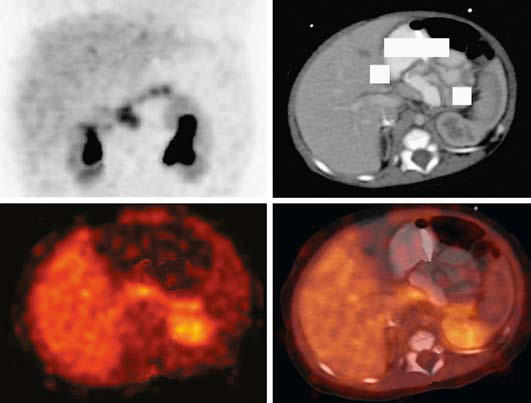

# Chapter 113: Hypoglycemia
> **Course:** Vikkypaedia Pediatric Basic Course (*Nelson Textbook of Pediatrics, 22nd Edition (2025)*)  
> **Part IX:** Metabolic Disorders  
> **Authors:** Katherine Lord and Diva D. De León-Crutchlow  
> **Metrics:** 8,650 words · 9 tables/boxes · 2 figures · 28 genes · 8 flashcards · 5 MCQs  
> **Quick Navigation:** [🃏 Study 8 Flashcards](../flashcards/113_flashcards.md) · [📝 Take 5-Q MCQ Quiz](../mcqs/113_mcqs.md) · [📚 Part IX Guide](../parts/Part_IX.md) · [🧬 Syndrome & Genetics Atlas](../omim_gene_atlas.md) · [💊 Therapeutics Matrix](../therapies_matrix.md) · [🏠 Course Index](../../index.md)

## Key Genetic & Molecular Targets
`ABCC8`, `AKT2`, `AR`, `CACNA1D`, `FBP1`, `G6PC`, `GCK`, `GLUD1`, `HADH`, `HK1`, `HNF1A`, `HNF4A`, `HRAS`, `INS`, `KCNJ11`, `KDM6A`

## ⚡ High-Yield Nelson Pediatric Board Pearls
- Colors show the normal range (green), the range for symptoms caused by activation of sympathetic nervous system (yellow), and the range for impaired neuronal function (red). (From Stanescu DL, Stanley CA.
- Advances in understanding the mechanism of transitional neonatal hypoglycemia and implications for management.
- Transitional asymptomatic hypoglycemia is likely caused by a persistence of fetal pancreatic β-cell fuel metabolism, which allows for the secretion of insulin at lower glu cose concentrations to support insulin-mediated fetal growth.
- CLINICAL MANIFESTATIONS Clinical features of hypoglycemia fall into two categories: (1) symp toms and signs associated with the activation of the autonomic ner vous system and epinephrine release (autonomic symptoms) and (2) symptoms and signs caused by decreased cerebral glucose use (neu roglycopenic symptoms).
- DIAGNOSIS Infants and children with a suspected hypoglycemia disorder require a timely and comprehensive diagnostic workup to establish the underlying cause and to initiate specific treatment, prevent hypoglycemia, and mini mize the risk of brain damage and neurologic dysfunction.
- A thorough history and physical exam may provide clinical clues to the underlying diagnosis.
- The results from the critical sample then allow for narrowing of the dif ferential and guide additional testing.

---
## Full Chapter Text, Tables & Figures
# Chapter 113: Hypoglycemia

*Katherine Lord and Diva D. De León-Crutchlow*

<!-- p.1245 -->
Glucose plays a central role in fuel metabolism and energy storage in the body. It provides 38 mol of adenosine triphosphate (ATP) per mole of glucose oxidized. Glucose is also essential for energy metabo lism in the brain, where it is the preferred substrate. Its use accounts for nearly all the brain’s oxygen consumption. Cerebral transport of glucose is a glucose transporter-1 (GLUT-1)–facilitated diffusion process that is dependent on blood glucose concentration and not reg ulated by insulin. *Low concentrations of blood glucose result in cerebral 
 glucopenia, energy failure, and brain injury.* An elaborate regulatory system has evolved to maintain glucose homeostasis and prevent plasma glucose from falling precipitously to levels that impair brain function. The defense against hypoglycemia includes the autonomic nervous system and hormones that act in concert to enhance glucose production through glycogenolysis and gluconeogenesis, while simul taneously limiting peripheral glucose use, which conserves glucose for cerebral metabolism. With prolonged fasting, fat stores are mobi lized via lipolysis, and fatty acid oxidation in the liver results in the generation of ketone bodies, an alternative fuel source for the brain (Fig. 113.1). Hypoglycemia results from a failure in one or several of these fasting mechanisms that normally integrate glucose homeostasis.

**DEFINITION** Hypoglycemia is defined as a plasma glucose concentration low enough to cause signs and symptoms of brain dysfunction (Fig. 113.2). However, a numerical value can be difficult to define because the brain responses to hypoglycemia occur across a range of plasma glucose

concentrations. In young children, signs and symptoms of hypogly cemia are suggestive but nonspecific; thus the reliance on signs and symptoms to indicate hypoglycemia in this age-group may be prob lematic (Table 113.1).

In older children, evidence of hypoglycemia is based on **Whipple’s triad**: (1) signs and symptoms consistent with hypoglycemia, (2) a low plasma glucose concentration, and (3) resolution of the symptoms with normalization of the plasma glucose concentration.

*Katherine Lord and Diva D. De León- Crutchlow*

↓ Insulin (when plasma glucose < 80-85 mg/dL)

↑ Glucagon ↑ Epinephrine ↑ Cortisol ↑ Growth hormone (when plasma glucose < 65–70 mg/dL)

↓ Peripheral glucose utilization

↑ Endogenous glucose production (via glycogenolysis, gluconeogenesis)

↑ Lipolysis ↑ Lipid oxidation

↑ Gluconeogenesis (precursors: glycerol, lactate, amino acids)

↑ Glycogenolysis ↑ Glucose release

↑ Glucose release

↑ Glycerol

↑ Free fatty acids

↑ Ketogenesis

**Euglycemia**

**Fig. 113.1** The metabolic response to fasting. With fasting, declining glucose levels result in suppression of insulin and a rise of the counter- regulatory hormones. These changes in hormone levels lead to increased glucose output from the liver via glycogenolysis and gluconeogenesis. With prolonged fasting, counter-regulatory hormones stimulate lipolysis, which results in generation of glycerol (a key precursor in the gluconeo genic pathway) and, through ketogenesis, ketone bodies, a critical alternative fuel.

Insulin suppressed

Target for treatment

Neurogenic

symptoms

**Good**

**30**

**Caution**

**Danger**

Target for terminating provocative

tests Neuroglycopenic

symptoms

Neurogenic responses:

Cortisol and growth hormone

Neuroglycopenic responses

Glucagon and epinephrine

**100**

**70**

**50 50**

**Fig. 113.2** Interpreting glucose levels and glucose treatment targets. Glucose thresholds are shown for suppression of insulin secretion, neu rogenic (neuroendocrine hormone-mediated) responses, and neurogly copenic (impaired cognition) responses. Colors show the normal range (green), the range for symptoms caused by activation of sympathetic nervous system (yellow), and the range for impaired neuronal function (red). (From Stanescu DL, Stanley CA. Advances in understanding the mechanism of transitional neonatal hypoglycemia and implications for management. Clin Perinatol. 2022;49:55–72, Fig. 2.)

<!-- p.1246 -->
**SIGNIFICANCE AND SEQUELAE** Brain metabolism uses the majority of endogenous hepatic glucose production in neonates, infants, and children. Because the brain grows most rapidly in the first year of life and a larger proportion of glucose turnover is used for brain metabolism, hypoglycemia in infants and children can affect brain development and function and can result in developmental delays and learning disabilities. The brain also has the capacity to absorb and oxidize ketone bodies. However, the capacity of the liver to produce ketone bodies is limited in the immediate newborn period. This is especially restricted in the presence of **hyperinsulin ism (HI)**, which acutely inhibits hepatic glucose output, lipolysis, and ketogenesis, thereby depriving the brain of any alternative fuel sources. Furthermore, although the brain can metabolize ketones, these alter native fuels cannot completely replace glucose as an essential central nervous system (CNS) fuel. The deprivation of the brain’s major energy source during hypoglycemic events has predictable adverse conse quences on brain metabolism and growth. These arise from decreased brain oxygen consumption and increased breakdown of endogenous structural brain components, with impairment and loss of functional membrane integrity.

The major long-term sequelae of hypoglycemia are developmental delays, learning disabilities, epilepsy, and behavioral issues. A prospec tive cohort study of neonates at risk for hypoglycemia found that at 4 years of age, children who had experienced symptomatic hypogly cemia during the neonatal period had a two- to threefold increased risk of low executive and visual-motor function with greater impair ment in children with severe or recurrent episodes. Cross-sectional studies in children with HI have found that 26–48% of children with both transient and persistent forms of HI have abnormal neurodevel opment. Children with HI have the highest risk of neurologic dam age given the severity of the hypoglycemia in the condition and their inability to generate ketones as an alternative fuel for the brain. In addi tion, hypoglycemia associated with hypoxic-ischemic encephalopathy increases the risk of CNS sequalae. However, there are no precise data

relating the duration or severity of hypoglycemia to subsequent neu rologic development of children in a predictable manner. Nonetheless, early detection of hypoglycemia and effective treatment are critical to mitigating the risk of brain damage and developmental delays. Many neonates may have asymptomatic hypoglycemia identified by routine screening or laboratory testing. Although asymptomatic hypoglycemia in an otherwise healthy newborn is usually benign and transient, there remains a risk that if untreated (glucose gel, human milk, formula feed ings), the hypoglycemia may become symptomatic. Hypoglycemia in older children may also produce long-term neurologic defects through neuronal death, mediated in part by cerebral excitotoxins released dur ing hypoglycemia.

**PHYSIOLOGIC MECHANISMS OF GLUCOSE HOMEOSTASIS** Fetal glucose is derived entirely from the mother through placentalfacilitated diffusion; therefore fetal glucose concentration reflects, but is slightly lower than, maternal glucose levels. After birth, plasma glu cose decreases, reaching a nadir at about 2 hours of life and remaining below the normal adult range of 70-100 mg/dL for the first 3-4 days of life; this is known as *transitional hypoglycemia*. A study of healthy, fullterm infants found a mean plasma glucose concentration of 59 ± 11 mg/dL during the first 48 hours of life, which then increased to 83 ± 13 mg/dL during days 4-5 of life (Fig. 113.3). Transitional asymptomatic hypoglycemia is likely caused by a persistence of fetal pancreatic β-cell fuel metabolism, which allows for the secretion of insulin at lower glu cose concentrations to support insulin-mediated fetal growth. Beyond this transitional period, plasma glucose concentration and mecha nisms that regulate glucose homeostasis in neonates are the same as in older children and adults.

During fasting, mechanisms responsible for the maintenance of glucose homeostasis include glycogenolysis, gluconeogenesis, lipol ysis, and fatty acid oxidation, as well as the hormones that regulate the activation of these processes (see Fig. 113.1). Plasma glucose concentrations are maintained by both metabolism of the nutrients consumed in the immediate postprandial period and then by gly cogenolysis and gluconeogenesis starting 2-4 hours after the meal. The liver of a 10-kg child contains 20-25 g of glycogen, which is suf ficient to meet normal glucose requirements of 4-6 mg/kg/minute during an overnight fast. Glucose production during this time is augmented by gluconeogenesis (see Fig. 113.1). Defects in glycoge nolysis or gluconeogenesis may not be manifested in infants until the frequent feeding pattern at 3- to 4-hour intervals ceases and infants sleep through the night, a situation usually present by 3-6 months of age.

With prolonged fasting, the glycogen stores are depleted, and energy metabolism is more dependent on fatty acid and ketone oxi dation. **Lipolysis** generates fatty acids, which undergo β-oxidation in the liver to generate ketone bodies. Peripheral tissues use free fatty acids (FFAs) and ketones, whereas the CNS can use ketones for a

0

0

6

5

4

3

2

1

24 48 72 96 120

90th percentile

50th percentile 10th percentile

Age (hours)

Plasma glucose concentration

120

mg/dL mmol/L

100

80

60

40

20

0

#### **Table 113.1** Manifestations of Hypoglycemia in Childhood

| Category / Parameter | Clinical Details & Findings |
| --- | --- |
| **NERVOUS SYSTEM AND EPINEPHRINE RELEASE*** | Anxiety; Perspiration; Palpitation (tachycardia); Pallor; Tremulousness; Weakness; Hunger; Nausea; Emesis |
| **FEATURES ASSOCIATED WITH CEREBRAL GLUCOPENIA** | Headache; Mental confusion; Visual disturbances (↓ acuity, diplopia); Inability to concentrate; Dysarthria; Staring; Paresthesias; Dizziness; Amnesia; Ataxia; Refusal to feed; Somnolence, lethargy; Seizures; Coma; Stroke, hemiplegia, aphasia; Decerebrate or decorticate posture; *Some of these features will be attenuated if the patient is receiving β-adrenergic; blocking agents. |

**Fig. 113.3** Glucose percentiles in healthy term infants. (Modified from Harris DL, Weston PJ, Gamble GD, Harding JE. Glucose profiles in healthy term infants in the first 5 days: the Glucose Well Babies (GLOW) study. J Pediatr. 2020;223:34–41, Fig. 2.)

<!-- p.1247 -->
portion of its energy needs. Defects in β-oxidation and ketogenesis may not manifest until fasting exceeds the overnight period or, with illnesses, result in catabolism, fasting, and increased body energy requirements.

Amino acid precursors for gluconeogenesis are derived primarily from muscle protein. The muscle bulk of infants and small children is substantially smaller relative to body mass than that of adults, whereas glucose requirements per unit of body mass are greater in children. Therefore the ability to compensate for glucose deprivation by gluconeo genesis is more limited in infants and young children, as is the ability to withstand fasting for prolonged periods. The ability of muscle to generate alanine, the principal gluconeogenic amino acid, may also be limited.

The switch from glycogen synthesis during and immediately after meals to glycogen breakdown and later gluconeogenesis is governed by hormones, with insulin of central importance (see Fig. 113.1). After a meal, plasma insulin concentrations increase to peak levels of 5- to 10-fold greater than their normal baseline concentration, which serves to lower the plasma glucose through the enhancement of peripheral glucose uptake, activation of glycogen synthesis, and inhibition of gluconeogenesis. In addition, lipogenesis is stimu lated, whereas lipolysis and ketogenesis are curtailed. During fast ing, plasma insulin concentrations fall, and together with the rise of counter-regulatory hormones, result in maintenance of plasma glu cose concentration (see Fig. 113.1).

These **counter-regulatory hormones**—glucagon, growth hor mone, cortisol, and epinephrine—act synergistically and in concert to increase plasma glucose concentrations by activating glycogeno lytic enzymes (glucagon, epinephrine); inducing gluconeogenic enzymes (glucagon, cortisol); inhibiting glucose uptake by muscle (epinephrine, growth hormone, cortisol); mobilizing amino acids from muscle for gluconeogenesis (cortisol); activating lipolysis and thereby providing glycerol for gluconeogenesis and fatty acids for ketogenesis (epinephrine, cortisol, growth hormone, glucagon); and inhibiting insulin release and promoting growth hormone and gluca gon secretion (epinephrine).

**CLINICAL MANIFESTATIONS** Clinical features of hypoglycemia fall into two categories: (1) symp toms and signs associated with the activation of the autonomic ner vous system and epinephrine release **(autonomic symptoms)** and (2) symptoms and signs caused by decreased cerebral glucose use **(neu roglycopenic symptoms)** (see Table 113.1). In newborns and infants, symptoms and signs of hypoglycemia may be subtler and include cyanosis, apnea, hypothermia, hypotonia, irritability, jitteriness, poor feeding, lethargy, and seizures. *It is important to note that neonates and infants are frequently asymptomatic when hypoglycemic*.

**DIAGNOSIS** Infants and children with a suspected hypoglycemia disorder require a timely and comprehensive diagnostic workup to establish the underlying cause and to initiate specific treatment, prevent hypoglycemia, and mini mize the risk of brain damage and neurologic dysfunction. The Pediatric Endocrine Society provides guidelines that outline which children and adolescents should be evaluated for a hypoglycemia disorder:

u	 Older children and adolescents who demonstrate Whipple’s triad

u	 Infants and younger children (who cannot communicate symptoms)

with plasma glucoses <60 mg/dL on laboratory-quality assays

u	 Neonates at high risk of a persistent hypoglycemic disorder

u	 Glucose screening is recommended for those born large for gesta

tional age, a history of perinatal stress, premature or postmature delivery, infants of diabetic mothers, family history of hypoglyce mia disorder, or a congenital syndrome associated with hypogly cemia.

u	 A persistent hypoglycemia disorder should be ruled out in those

with severe hypoglycemia (symptomatic or requiring intravenous [IV] dextrose), inability to maintain plasma glucose >50 mg/dL (up to 48 hours of life) or >60 mg/dL (after 48 hours of life), family his tory of a genetic form of hypoglycemia, and those with a congenital syndrome associated with hypoglycemia.

The etiology of hypoglycemia varies based on the age of the child, associated clinical and laboratory features, and more detailed diagnos tic testing, including gene panels or whole exome sequencing (Tables 113.2, 113.3, 113.4, and 113.5). A thorough history and physical exam may provide clinical clues to the underlying diagnosis (see Table 113.2). Evaluation for hypoglyce mia disorders requires obtaining blood and urine at the time of hypo glycemia, ideally when the plasma glucose is <50 mg/dL. This “**critical sample**” is used to measure hormones, which regulate glucose metabo lism, and metabolic fuels (Table 113.6, Fig. 113.4). The critical sample can be obtained during a spontaneous episode of hypoglycemia or dur ing a supervised diagnostic fast. Given the likelihood of hypoglycemia, a **diagnostic fast** should be performed in a hospital setting with close supervision and placement of an IV catheter to facilitate obtaining the critical sample. Point-of-care glucose (and β-hydroxybutyrate if avail able) should be followed closely, so the samples can be obtained as soon as the plasma glucose falls below 50 mg/dL. The evaluation of neonates should not occur during the first 48-72 hours of life to avoid the period of transitional hypoglycemia.

After the critical sample is obtained and before the child is allowed to eat, a **glucagon stimulation test** should be performed to assess for hyperinsulinism. While the child is still hypoglycemic, 1 mg of gluca gon is administered, and glucose is measured by a point-of-care meter every 10 minutes for a total of 40 minutes. A greater than 30-point rise in plasma glucose concentration is consistent with insulin excess or hyperinsulinism. If children do not have an increase in their glucose during the first 20 minutes of the test, the test should be terminated and the child should be given juice or IV dextrose as rescue therapy.

The levels of alternative fuels at the time of hypoglycemia (βhydroxybutyrate, FFAs, and lactate) allow for the classification of the hypoglycemia disorders into four distinct groups (see Fig. 113.4). The results from the critical sample then allow for narrowing of the dif ferential and guide additional testing. Interpretation of the critical sample results has several important caveats. Low cortisol and growth hormone levels on the critical sample are not diagnostic of a hormone deficiency, and in most cases, the appropriate (specific) stimulation testing is needed if these levels are low. Additionally, a low or undetect able insulin level does not rule out hyperinsulinism. Insulin concentra tions can be affected by hemolysis, and assays have variable sensitivity for detecting insulin. Other biomarkers of insulin effect, such as βhydroxybutyrate (to evaluate ketogenesis), FFAs (to evaluate lipolysis), and the glycemic response to glucagon (to evaluate glycogenolysis), should be used to assess for hyperinsulinism.

#### **Table 113.2** Clinical Features of Hypoglycemia Disorders

| Category / Parameter | Clinical Details & Findings |
| --- | --- |
| **BIRTH HISTORY** | Large for gestational age; Congenital HI, BWS; Small for gestational age; Perinatal stress HI; Maternal gestational diabetes; Infant of diabetic mother,; dominant KATP -HI |
| **FAMILY HISTORY** | Sudden infant death; Fatty acid oxidation disorder; Diabetes*; HNF4A-HI, HNF1A-HI, dominant |
| **PHYSICAL EXAM** | Hepatomegaly; Glycogen storage disease; Congenital heart disease; Perinatal stress HI, Kabuki or; Turner syndrome; Midline defect; Hypopituitarism; Macroglossia |
| **BWS** | Hyperpigmentation; Primary adrenal insufficiency; Short stature; Growth hormone deficiency,; glycogen storage disease; *Specifically, non–type 1 diabetes diagnosed at a younger age in lean individuals.; HI, Hyperinsulinism; BWS, Beckwith-Wiedemann syndrome; KATP, ATP-sensitive potas; sium channel; HNF, hepatocyte nuclear factor. |

<!-- p.1248 -->

#### **Table 113.3** Classification of Hypoglycemia in Infants and Children

| Category / Parameter | Clinical Details & Findings |
| --- | --- |
| **NEONATAL TRANSITIONAL (ADAPTIVE) HYPOGLYCEMIA** | Associated with inadequate substrate or immature enzyme function; in otherwise normal neonates; Prematurity; Small for gestational age; Normal newborn |
| **Transient Neonatal Hyperinsulinism** | Infant of diabetic mother; Small for gestational age; Discordant twin; Birth asphyxia; Infant of toxemic mother |
| **Counter-Regulatory Hormone Deficiency** | Panhypopituitarism; Isolated growth hormone deficiency; Adrenocorticotropic hormone deficiency; Addison disease (including congenital adrenal hypoplasia, adrenal; leukodystrophy, triple A syndrome, ACTH receptor deficiency, and; autoimmune disease complex); Epinephrine deficiency |
| **Glycogenolysis and Gluconeogenesis Disorders** | Glucose-6-phosphatase deficiency (GSD Ia); Glucose-6-phosphate translocase deficiency (GSD Ib); Amylo-1,6-glucosidase (debranching enzyme) deficiency (GSD III); Liver phosphorylase deficiency (GSD VI); Phosphorylase kinase deficiency (GSD IX); Glycogen synthetase deficiency (GSD 0); Fructose-1,6-diphosphatase deficiency; Pyruvate carboxylase deficiency; Galactosemia; Hereditary fructose intolerance |
| **Fatty Acid Oxidation Disorders** | Carnitine transporter deficiency (primary carnitine deficiency); Carnitine palmitoyltransferase-1deficiency; Carnitine translocase deficiency; Carnitine palmitoyltransferase-2 deficiency; Secondary carnitine deficiencies; Very long-, long-, medium-, and short-chain acyl-CoA dehydrogenase; deficiency |
| **Substrate-Limited Causes** | Ketotic hypoglycemia; Poisoning—drugs; Salicylates; Alcohol; Oral hypoglycemic agents; Insulin; Propranolol; Pentamidine; Quinine; Disopyramide; Ackee fruit (unripe)—hypoglycin; Litchi-associated toxin (toxic hypoglycemic syndrome); Vacor (rat poison); Trimethoprim-sulfamethoxazole (with renal failure); L-Asparaginase and other antileukemic drugs |
| **Liver Disease** | Reye syndrome; Hepatitis; Cirrhosis; Hepatoma |
| **AMINO ACID AND ORGANIC ACID DISORDERS** | Maple syrup urine disease; Propionic acidemia; Methylmalonic acidemia; Tyrosinosis; Glutaric aciduria; 3-Hydroxy-3-methylglutaric aciduria |
| **SYSTEMIC DISORDERS** | Sepsis; Carcinoma/sarcoma (secreting—insulin-like growth factor II); Heart failure; Malnutrition; Malabsorption; Antiinsulin receptor antibodies; Antiinsulin antibodies; Neonatal hyperviscosity; Renal failure; Diarrhea; Burns; Shock; Chiari malformation; Postsurgical complication; Pseudohypoglycemia (leukocytosis, polycythemia); Excessive insulin therapy of insulin-dependent diabetes mellitus; Factitious disorder; Nissen fundoplication (dumping syndrome); Falciparum malaria; GSD, Glycogen storage disease; HI, hyperinsulinemia; KATP, regulated potassium channel. |

**MANAGEMENT Acute Treatment** A child presenting with hypoglycemia should be rapidly treated with oral carbohydrates or IV dextrose to normalize their plasma glucose (>70 mg/dL). If the child is asymptomatic or has mild symptoms and is capable of oral intake, the hypoglycemia can be treated with 15 grams of rapid-acting carbohydrates, such as 4 ounces of juice or two graham crackers. If a child is symptomatic or unable to tolerate oral intake (risk of aspiration, impending depressed level of consciousness), 2 mL/kg of dextrose 10% water (D10W) should be administered. After adminis tration of the bolus, the child should be placed on an IV dextrose infu sion (for infants, a glucose infusion rate of 5-6 mg/kg/minute and for older children 2-3 mg/kg/minute) to prevent recurrent hypoglycemia. Plasma glucose via point-of-care testing should be monitored every 15- 20 minutes until it is >70 mg/dL, and then checks may be spaced once stable levels are demonstrated.

In an asymptomatic child with a plasma glucose <50 mg/dL, a critical sample can be obtained if the appropriate supplies and tubes are readily

Hyperinsulinemic Hypoglycemia

#### **Table 113.4** Endocrine and Metabolic Causes of

| Category / Parameter | Clinical Details & Findings |
| --- | --- |
| **TRANSIENT** | Infant of diabetic mother; Perinatal asphyxia; Rhesus hemolytic disease; Intrauterine growth restriction |
| **OTHERS** | Postprandial hyperinsulinemic hypoglycemia; Insulinoma; Munchausen by proxy; Exercise-induced hyperinsulinemic hypoglycemia; Modified from Güemes M, Rahman SA, Kapoor RR, et al. Hyperinsulinemic hypoglyce; mia in children and adolescents: recent advances in understanding of pathophysiology |

<!-- p.1249 -->
**Ongoing Management** Treatment goals of hypoglycemia disorders include maintaining euglycemia (plasma glucose >70 mg/dL), promoting normal devel opment, and monitoring for medication side effects. Once the diag nostic evaluation identifies a specific hypoglycemia disorder, tailored treatment should be initiated promptly. Effective treatment allows the child to maintain euglycemia, both while eating an age-appropriate diet and fasting overnight. Continuous or forced feeds should not be used as treatment for hypoglycemia, as they result in long-term oral aversion and excessive weight gain. Additionally, hypoglycemia should not routinely be treated with steroids or cornstarch unless indicated as a treatment for specific disorders, such as adrenal insuf ficiency or glycogen storage disease. Home glucose monitoring is required for all children with hypoglycemia disorders and is particu larly important during times of illnesses, as this may provoke addi tional hypoglycemia.

Management of individual hypoglycemia disorders is given in more detail in the following sections and in Table 113.7.

**DISORDERS OF HYPOGLYCEMIA** Disorders of hypoglycemia can be classified by the metabolic fuel response to fasting (see Fig. 113.4).

**Insulin-Mediated Disorders** Insulin-mediated disorders (see Table 113.4) are characterized by low plasma β-hydroxybutyrate and FFAs and a positive glycemic response to glucagon (Table 113.8).

**Hyperinsulinism** HI is the most common cause of *persistent hypoglycemia* in infants and children. HI is caused by dysregulated insulin secretion by the pan creatic β-cells, resulting in severe and recurrent hypoglycemia (Fig. 113.5). HI can be categorized into three main forms: (1) perinatal stress-induced, (2) congenital or monogenic (see Table 113.4), and (3) syndromic (see Table 113.5).

Perinatal stress-induced HI (PSHI), the most common form of HI, occurs in the setting of stress on the fetus in utero or during delivery.

#### **Table 113.5** Syndromic Forms of Hyperinsulinemic Hypoglycemia*

| Category / Parameter | Clinical Details & Findings |
| --- | --- |
| **PRENATAL AND POSTNATAL OVERGROWTH (MACROSOMIA)** | Beckwith-Wiedemann; (11p15); Macroglossia, abdominal wall defects, ear lobe pits/creases,; hemihypertrophy, tumor risk; IUGR if associated with; placental; mesenchymal dysplasia; Sotos; NSD1 (5q35); Macrocephaly, frontal bossing, pointed chin, developmental; delay, tumor risk; Simpson-Golabi-Behmel; GPC3 (Xq26), GPC4 (Xp22); Coarse facial features, broad feet, polydactyly, cryptorchidism,; hepatomegaly, tumor risk; Perlman; DIS3L2 (2q37); Inverted V-shaped upper lip, prominent forehead,; developmental delay, hypotonia, tumor risk |
| **POSTNATAL GROWTH FAILURE (SHORT STATURE)** | Kabuki; KMT2D (12q13), KDM6A (Xp11.3); Arched eyebrows, long eyelashes, developmental delay, fetal; finger pads, scoliosis, heart defects, hypotonia; Costello; HRAS (11p15); Deep palmar/plantar creases, developmental delay, coarse; facial features, heart abnormalities, papillomas, tumor risk |
| **CHROMOSOMAL ABNORMALITY** | Mosaic Turner; Loss of X in some cells; Milder Turner syndrome phenotype (short stature, coarctation; of aorta, gonadal dysgenesis); Patau; Trisomy 13; Developmental delay, microphthalmia, heart and neural; defects |
| **CONGENITAL DISORDERS OF GLYCOSYLATION** | Types 1a, 1b, and 1d; PMM2 (16p13.2), MPI (15q24.1), ALG3 (3q27.1); Developmental delay, hypotonia, growth failure |
| **CONTIGUOUS GENE DELETION AFFECTING THE ABCC8 GENE** | Usher; 11 genes; Hearing loss, visual impairment |
| **ABNORMALITIES IN CALCIUM HOMOEOSTASIS** | Timothy; CACNA1C (12p13.33); Long QT syndrome, syndactyly, developmental delay, immune; deficiency |
| **INSULIN RECEPTOR PATHOGENIC VARIANT** | Insulin resistance syndrome; (leprechaunism); INS (19p13); Hypoglycemia and hyperglycemia, prenatal and postnatal; growth restriction, elfin-like features, hirsutism |
| **OTHER SYNDROMES** | Congenital central; hypoventilation syndrome; PHOX2B (4p13); Central hypoventilation, “box-shaped” face,; neurocristopathies (Hirschsprung disease, tumor risk); IUGR, intrauterine growth restriction.; *Various developmental syndromes have been described with the gene/s linked to the condition and the common clinical features.; Modified from Güemes M, Rahman SA, Kapoor RR, et al. Hyperinsulinemic hypoglycemia in children and adolescents: recent advances in understanding of pathophysiology and; management. Rev Endo Metab Dis. 2020;21:577–597, Table 2. |

<!-- p.1250 -->
In a study of 514 neonates at risk of hypoglycemia, 19% of late-preterm and small-for-gestational-age (SGA) infants had recurrent hypoglyce mia, which is concerning for PSHI. Common causes of PSHI include intrauterine growth restriction, being born SGA, maternal preeclamp sia, birth asphyxia, and congenital heart disease. *Most infants with PSHI respond to diazoxide, although a subset, particularly those with liver dysfunction and hypoxic ischemic encephalopathy, may fail to respond*. PSHI typically resolves within the first 3-6 months of life.

**Congenital HI** is the result of genetic defects in the insulin secre tory pathways of the β-cell. It is estimated to occur in 1:28,000-50,000 live births but may be as high as 1:3,000 in populations with a high frequency of consanguinity. The most common and severe type of con genital HI is caused by inactivating pathogenic variants of *ABCC8* and *KCNJ11,* which encode the ATP-sensitive potassium (KATP) channel of the β-cell. Infants born with KATP-HI are commonly large for gestation age and have high glucose requirements (glucose infusion rate [GIR] >10 mg/kg/min) (see Fig. 113.5). However, the spectrum of presen tation is wide, and some infants have normal birthweights and lower glucose requirements. In addition to fasting hypoglycemia, children with this type of HI have protein-induced hypoglycemia, in which isolated protein ingestion leads to increased insulin secretion and low plasma glucose. KATP-HI is most frequently unresponsive to treatment

with diazoxide, the only approved drug for HI, which acts on the KATP channel.

KATP-HI has two distinct histologic forms: a **diffuse form**, in which β-cells throughout the pancreas show evidence of hyperactivity, and a focal form, characterized by a localized area of β-cell overgrowth or adenomatosis. The diffuse form is caused by biallelic recessive pathogenic variants in *ABCC8* or *KCNJ11* or, less commonly, mono allelic dominant pathogenic variants of these genes. **Focal HI** occurs as a result of a “two-hit” mechanism: a paternally inherited recessive pathogenic variant in *ABCC8* or *KCNJ11* combined with somatic loss of the maternal 11p15 region, resulting in paternal uniparental isodi somy. Infants with the focal form are cured with resection of the focal lesion. In contrast, those with the diffuse form may require a pal liative near-total pancreatectomy if intensive medical therapy fails to control the hypoglycemia (Fig. 113.6). Given the different treatment approaches and outcomes for the diffuse and focal forms of KATP-HI, distinguishing between the two is critical and is best done through genetic testing. A paternally inherited recessive pathogenic variant in *ABCC8* or *KCNJ11* has a 94% positive predictive value for focal KATP-HI.

In children with genetic testing consistent with the focal form, an 18-fluoro L-3,4-dihydroxyphenylalanine positron emission tomogra phy (18F-DOPA PET) scan is used before surgery to localize the focal lesion (see Fig. 113.6). Frozen section evaluation of biopsies taken during surgery is used to confirm the presence of the focal lesion and guides the extent of the resection. Children with the focal form of HI should receive care at specialized centers with 18F-DOPA PET access and a multidisciplinary team of endocrinologists, surgeons, patholo gists, and radiologists with expertise in HI. Children with the diffuse form also benefit from care at these centers because their management and the decision to pursue intensive medical therapy or a near-total pancreatectomy are complex.

The second most common form of congenital HI is caused by **domi nant activating pathogenic variants of GLUD1**, which encodes **glu tamate dehydrogenase** (GDH). This protein regulates the first step of amino acid–stimulated insulin secretion in the β-cell. Children with GDH-HI or hyperinsulinism-hyperammonemia syndrome (HI/HA) have fasting hypoglycemia, significant protein-induced hypoglyce mia, and elevated plasma ammonia concentration. Seizures, attentiondeficit disorder, and learning disabilities also occur in this form of HI, and these neurologic issues do not seem to correlate with the degree of hypoglycemia or ammonia elevation. *This form of HI responds well to diazoxide*.

**Activating pathogenic variants of GCK**, which encodes **glucoki nase**, cause an autosomal dominant form of congenital HI. Glucoki nase is the key enzyme triggering glucose-mediated insulin secretion. Children with GCK-HI have fasting hypoglycemia of variable severity and diazoxide responsiveness. Severe cases may require a near-total pancreatectomy.

Pathogenic variants in *HNF4A* and *HNF1A,* which encode the tran scription factors hepatic nuclear factors 4-alpha and 1-alpha, cause a dominant form of diazoxide-responsive HI. These infants may be large for gestational age and have high GIR requirements at birth. The HI resolves within the first several years of life. However, some individu als experience progressive β-cell failure and progress to an early-onset diabetes, known as *maturity-onset diabetes of the young (MODY).*

Syndromes associated with HI are increasingly being recognized (see Table 113.5). Beckwith-Wiedemann syndrome (BWS), an imprint ing disorder, is characterized by macroglossia, lateralized overgrowth, omphalocele, and a predisposition to embryonal tumors (Fig. 113.7). Hyperinsulinism occurs in approximately 50% of infants with BWS, although most cases are mild and resolve within the first several weeks of life. These cases are typically responsive to diazoxide. Children with BWS caused by paternal uniparental isodisomy of 11p can have severe and persistent HI, which does not respond to diazoxide and may

β-hydroxybutyrate Low levels suggest insulin excess (most

#### **Table 113.6** Hypoglycemia Diagnostic Evaluation

| Category / Parameter | Clinical Details & Findings |
| --- | --- |
| **INTERPRETATION** | Comprehensive; metabolic panel; Low HCO3 suggests elevation of ketones; or lactate; Elevated liver function tests may indicate |
| **GSD** | commonly HI) or FAO disorder; Elevated levels suggest GSD, hormone; deficiency, or ketone utilization disorder; Insulin; C-peptide; Detectable levels consistent with insulin; excess; Detectable insulin with undetectable; c-peptide is consistent with exogenous; insulin; Cortisol; Growth hormone; Low levels concerning for hormone; deficiency; need stimulation testing to; confirm; Lactate; Elevated levels concerning for disorder of; gluconeogenesis; Ammonia; Elevation can be seen in forms of HI and; in IEM; Acylcarnitine profile; Free and total carnitine; Urine organic acids; Abnormalities suggestive of FAO disorder |
| **IGF-BP1** | Low levels suggest insulin excess |
| **GLUCAGON STIMULATION TEST** | Administer 1 mg of glucagon IV or IM when plasma glucose <50 mg/dL; Check point-of-care glucose every 10 min for 40 min; If glucose does not increase 20 points in 20 min, terminate test and; feed child; Interpretation: Increase in glucose by 30 points is consistent with; insulin excess; HCO3, Bicarbonate; GSD, glycogen storage disorder; HI, hyperinsulinism; FAO, fatty; acid oxidation; IEM, inborn errors of metabolism. |

<!-- p.1251 -->
require a pancreatectomy. Other syndromes known to be associated with HI include Kabuki, Turner, and Rubinstein-Taybi. HI in these syndromes presents with variable degrees of severity and responsive ness to diazoxide.

After establishing a diagnosis of HI, a trial of diazoxide, the firstline agent for the treatment of HI, should be undertaken (Fig. 113.8). Diazoxide opens the KATP channel, inhibiting insulin secretion. Chil dren are considered responsive to diazoxide if the cardinal feature of HI, hypoketotic hypoglycemia, is corrected. This is assessed by demonstrating that the child can maintain plasma glucose >70 mg/

dL both while feeding and during an overnight fast and/or plasma βhydroxybutyrate concentration increases to >2 mmol/L before plasma glucose decreases below 50-60 mg/dL during fasting. *Failure to respond to diazoxide strongly suggests K**ATP**-HI, and those children require expe dited genetic testing for ABCC8 and KCNJ11 to determine their risk for focal HI*. Thus the assessment of the response to diazoxide has impor tant therapeutic and diagnostic implications.

Somatostatin analogs are used off-label as second-line agents for the treatment of diazoxide-unresponsive diffuse HI. Octreotide requires multiple daily injections, and its effectiveness is limited by

Hypoglycemia: PG ≤50 mg/dL

Maternal & infant history, physical exam

Obtain critical labs if blood sugar <50 mg/dL from glucometer: serum glucose

(to confirm hypoglycemia), GH, cortisol, insulin, FFA, β OHB, lactate, urinary ketones

Acidosis

High lactate Ketosis No ketosis & no FFA No ketones, high FFA

Short fasting period

**Glycogen storage disease**

• Glucose-6-phosphatase deficiency (type 1 GSD)

**Defects in glycogenolysis**

(type 3, 6, 9 GSD)

**Normal fasting child Ketotic hypoglycemia Growth hormone or    cortisol deficiency**

**Ethanol ingestion**

**IDDM or insulin therapy**

**Oral hypoglycemic agents**

**SGA & birth asphyxia**

**Neonatal hypopituitarism**

**Infants of diabetic mothers**

**Congenital hyperinsulinism**

**Insulinoma**

**Transient neonatal**

**   hypoglycemia**

**AKT2**** pathogenic variant**

**Genetic defects in fatty acid oxidation and/or ketogenesis**

**Defects in hepatic**

**gluconeogenesis**

• Fructose-1.6diphosphatase deficiency

• Pyruvate carboxylase deficiency • Phosphoenolpyruvate deficiency

Moderate fasting period Short to moderate fasting period Prolonged fasting period

No acidosis

• Debrancher • Liver phosphorylase • Phosphorylase kinase deficiencies

**Fig. 113.4** Diagnostic algorithm for determining the etiology of hypoglycemia in children. OHB, Hydroxybutyrate; FFA, free fatty acid; GH, growth hormone, GSD, glycogen storage disease; PG, plasma glucose; IDDM, insulin-dependent diabetes mellitus. (Modified from Melmed S, Auchus RJ, Goldfine AB, Koenig RJ, Rosen CJ. Williams Textbook of Endocrinology. 14th ed. Elsevier; 2020:1547, Fig. 38.14.)

<!-- p.1252 -->
tachyphylaxis. A long-acting analog, lanreotide, is administrated monthly in children greater than 1 year old and can be an effective and more convenient alternative to octreotide. Somatostatin ana logs should not be used in neonates or infants less than 2 months old because they are associated with fulminant necrotizing entero colitis. Continuous intragastric dextrose administered via gastros tomy tube is used in combination with a somatostatin analog and allows for an age-appropriate feeding schedule.

**Infants Born to Diabetic Mothers** See Chapter 147.1.

Gestational diabetes affects approximately 2% of pregnant women, and 1 in 1,000 pregnant women have insulin-dependent diabetes. Infants born to mothers with poorly controlled diabetes are born large for gestational age and with severe hypoglycemia resulting from a transient hyperinsulinemic state. Exposed to high glucose concentrations, the fetal islets compensate with increased insulin secretion that, during intrauterine life, leads to over growth and, after birth, results in hypoglycemia. The hypoglycemia

resolves within the first 3-7 days of life. Mothers whose diabetes has been well controlled during pregnancy, labor, and delivery gen erally have infants near normal size who are less likely to develop hypoglycemia.

**Insulinoma** Older children and adolescents presenting with insulin-mediated hypoglycemia should be evaluated for an **insulinoma**, a rare islet cell tumor. These tumors may be insidious, slow growing, and difficult to localize with conventional imaging modalities. Surgical resection is curative. Children diagnosed with an insulinoma should undergo genetic testing for the tumor predisposition syndrome, multiple endo crine neoplasia type 1 (MEN1).

**Factitious Hypoglycemia** Surreptitious administration of insulin presents with abrupt onset and erratic hypoglycemia. In a younger child, a parent or guardian may provoke hypoglycemia (factitious disorder imposed on another: Munchhausen by proxy), but an adolescent may be self-administering insulin. The biochemical hallmark of exogenous insulin administra tion is a detectable insulin level with undetectable c-peptide. However, specialized assays may be needed to detect the analog insulins, such as aspart or glargine. Intentional or accidental ingestion of sulfonyl ureas also presents with hypoglycemia. In these cases, both insulin and c-peptide are detectable, and sulfonylurea blood levels are required for confirmation.

**Defects of Fatty Acid Oxidation Fatty acid oxidation disorders** are characterized by low plasma βhydroxybutyrate and high plasma FFAs. See Chapter 106.1.

Multiple enzymatic deficiencies in the mitochondria pathway of fatty acid oxidation cause defective carnitine or fatty acid metabolism. These disorders are characterized by fasting hypoglycemia, hepato megaly, cardiomyopathy, and hypotonia, although the spectrum of severity is wide. Infants may present with a Reye-like syndrome (see

#### **Table 113.7** Treatments for Hypoglycemia Disorders

| Category / Parameter | Clinical Details & Findings |
| --- | --- |
| **SIDE EFFECTS/COMMENTS** | Diazoxide |
| **HI** | 5-15 mg/kg/day every 12 hr (PO); Hypertrichosis, fluid overload* neutropenia,; thrombocytopenia, respiratory distress,; hyperglycemia; Octreotide |
| **HI** | 2-20 mcg/kg/day every 6 hr (SQ); Gallstones, transaminitis, malabsorption,; suppression of thyroid and growth hormones; Lanreotide |
| **HI** | 60-90 mg every 28 days (SQ); Gallstones, transaminitis, malabsorption,; suppression of thyroid and growth hormones; Enteral D20 |
| **HI** | Up to 10 mg/kg/min continuously (via; gastrostomy or nasogastric tube); Vomiting, diarrhea, fluid overload; Cornstarch; GSD, rarely FAOD, IKH; 1-2 g/kg per dose (PO); Diarrhea in infants; Growth hormone; Growth hormone; deficiency; 0.3 mg/kg/wk daily or every 12 hr (infants) |
| **(SQ)** | Pseudotumor cerebri, edema, slipped capital; femoral epiphysis, hyperglycemia; Hydrocortisone; Adrenal insufficiency; 8-12 mg/m2/day (PO); High doses: Immunosuppression,; hyperglycemia, hypertension, obesity; Acarbose; Postprandial; hypoglycemia; 12.5-50 mg with meals; Transaminitis, diarrhea, abdominal pain |
| **PANCREATECTOMY** | Partial; Focal HI; Insulinoma; >50% pancreatectomy increases risk of; diabetes and exocrine insufficiency later in life; Near-total (98%); Severe diffuse HI; Insulin-dependent diabetes, exocrine; insufficiency; *Concomitant use of diuretics is strongly recommended in neonates and infants; older children may require this as well.; HI, Hyperinsulinism; GSD, glycogen storage disease; FAOD, fatty acid oxidation disorder; IKH, idiopathic ketotic hypoglycemia. |

Other Forms of Insulin Excess

#### **Table 113.8** Criteria for Diagnosing Hyperinsulinism and

| Category / Parameter | Clinical Details & Findings |
| --- | --- |
| **PLASMA GLUCOSE <50 MG/DL** | Detectable insulin or c-peptide (plasma insulin ≥2 μU/mL or plasma; C-peptide ≥0.5 ng/mL)*; Hypofattyacidemia (plasma free fatty acids <1.7 mmol/L); Hypoketonemia (plasma β-hydroxybutyrate <1.8 mmol/L); Inappropriate glycemic response to glucagon (increase in glucose; >30 mg/dL); *Depends on sensitivity of insulin assay. Detectable insulin and C-peptide is not neces; sary to make a diagnosis of HI. |

<!-- p.1253 -->
Voltage-gated Ca2+

channel

Insulin exocytosis

Secretory vesicles

*CACNA1D*

ADP ADP

*HK1*

*GCK*

Pyruvate

Glycolysis

HNF-4α HNF-1α

GLUT2

Glutamate

β-oxidation

α-ketoglutamate

Glucose

ATP

*UCP2*

*GLUD1*

*SLC16A1*

*HADH*

ATP closes KATP channel

ATP

Ca2+

K+

Membrane depolarization

SUR1 (*ABCC8*)

Kir6.2 (*KCNJ11*)

TCA cycle

**Fig. 113.5** Diagrammatic representation of β-cell function. Genetic defects associated with congenital HI are included in red. Postprandial glucose is taken into the β-cells via the glucose transporter 2 (GLUT-2). Glucose then enters the glycolysis pathway followed by the mitochondrial citric acid cycle (TCA), yielding the high-energy molecule, adenosine triphosphate (ATP). ATP molecules travel to and inhibit the potassium-dependent ATP channels (KATP), which prevents influx of potassium resulting in membrane depolarization. This triggers voltage-gated calcium channels to open, and influx of calcium (Ca2+) occurs. The Ca2+ activates the enzyme phospholipase C (PLC) to produce inositol 1,3,5 triphosphate (IP3) and diacylglycerol (DAG) from phosphatidyl 1,3 bisphosphate (PIP2). The IP3 molecule binds to the protein receptor on the endoplasmic reticulum (ER) to promote a release of Ca2+ from the ER. This subsequent increase in cytoplasmic Ca2+ promotes exocytosis of the prepackaged mature insulin and active C-peptide, which are released into circulation. GLUT2: Glucose transporter 2; Glucokinase (GCK) encoded by GCK gene; ADP: Adenosine diphosphate; ATP: Adenosine triphosphate; Monocarboxylate transporter (MCT1) encoded by SLC16A1 gene; Glutamate dehydrogenase (GDH) encoded by GLUD1 gene; Uncou pling protein 2 (UCP2) encoded by UCP2 gene; L-3hydroxyacyl-coenzyme A dehydrogenase (HADH) encoded by HADH gene; SUR1 subunit of the KATP channel encoded by the ABCC8 gene; Kir6.2 subunit of the KATP channel encoded by KCNJ11 gene; Hepatocyte nuclear factor 4α (HNF4α) encoded by HNF4A gene; Hepatocyte nuclear factor 1α (HNF1α) encoded by HNF1A gene; HK1: Hexokinase 1 encoded by the gene HK1; CACNA1D: calcium voltage-gated channel subunit alpha1 D. Gene variants in forkhead box protein A2 (FOXA2), phosphoglucomutase 1 (PGM1), and phosphomanno mutase 2 (PMM2) are not included in the drawing. (From Güemes M, Rahman SA, Kapoor RR, et al. Hyperinsulinemic hypoglycemia in children and adolescents: recent advances in understanding of pathophysiology and management. Rev Endo Metab Dis. 2020;21:577–597, Fig. 1.)

Liver

Pancreas

Kidney C

Liver

Pancreas

Kidney D

A

Liver

Pancreas

Kidneys

A

Liver

Focal lesion in head of pancreas

Kidneys

Pancreas

B

Liver

Focal lesion in head of pancreas

Kidney C

D

Liver

Focal lesion in head of pancreas

Kidney

Pancreas

H

T

B

**Fig. 113.6** Imaging of congenital hyperinsulinism. I Panels (diffuse): 18-fluoro L-3,4-dihydroxyphenylalanine positron emission tomography (18F- DOPA PET) of a patient with a diffuse form of congenital hyperinsulinism. A, Diffuse uptake of 18F-DOPAa is visualized throughout the pancreas. Transverse views show (B) normal pancreatic tissue on abdominal CT, (C) diffuse uptake of 18F-DOPA in the pancreas, and (D) confirmation of pan creatic uptake of 18F-DOPA with co-registration. H, Head of pancreas; T, tail of pancreas. II Panels (focal): 18F-DOPA PET of a patient with a focal form of congenital hyperinsulinism. (A) Discrete area of increased 18F-DOPA uptake is visualized in the head of the pancreas. The intensity of this area is greater than that observed in the liver and neighboring normal pancreatic tissue. Transverse views show (B) normal pancreatic tissue on abdominal CT, (C) focal uptake of 18F-DOPA in the pancreatic head, and (D) confirmation of 18F-DOPA uptake in the pancreatic head with co-registration. (Cour tesy Dr. Olga Hardy, Children’s Hospital of Philadelphia.)

<!-- p.1254 -->
Chapter 409) and recurrent episodes of fasting hypoglycemia, cardio respiratory arrest, and coma, whereas older children with less severe forms may only develop symptoms with illness. Most cases are detected via newborn screening and confirmed with genetic testing. Abnormali ties are seen in the acylcarnitine and urine organic acid profiles in chil dren who are not identified through newborn screening. Treatment typically involves avoidance of fasting and administration of dextrosecontaining fluids with illness.

Interference with fatty acid metabolism also underlies the fast ing hypoglycemia associated with Jamaican vomiting sickness. In **Jamaican vomiting sickness**, the unripe ackee fruit contains a watersoluble toxin, hypoglycin*,* which produces vomiting, CNS depression, and severe hypoglycemia. The hypoglycemic activity of hypoglycin derives from its inhibition of gluconeogenesis secondary to its inter ference with the acyl-CoA and carnitine metabolism essential for the oxidation of long-chain fatty acids. The disease is almost totally confined to Jamaica, where ackee forms a staple of the diet. The ripe ackee fruit no longer contains this toxin. A similar illness noted in India, **acute toxic encephalopathy-hypoglycemic syndrome**, may be caused by litchi consumption. Litchi contains hypoglycin A and/or methylenecyclopropylglycine, which may inhibit fatty acid oxidation or gluconeogenesis.

**KETOTIC HYPOGLYCEMIC DISORDERS** These disorders are characterized by elevated levels of plasma βhydroxybutyrate (>2.5 mmol/L) (Table 113.9).

**Glycogen Storage Disorders** See Chapter 107.1.

The **hepatic glycogen storage disorders** (GSDs; 0, I, III, VI, and IX) result from genetic defects in the enzymes that regulate the synthesis, breakdown, and release of glycogen in the liver. GSD type I also affects gluconeogen esis. GSDs are characterized by fasting ketotic hypoglycemia and various degrees of hepatomegaly, liver function abnormalities, hyperlipidemia, and

**Fig. 113.7** Beckwith-Wiedemann syndrome. (Courtesy Dr. Michael Cohen, Dalhousie University, Halifax, Nova Scotia. From Jones KL. Smith’s recognizable patterns of human malformation, 6th ed. Philadel phia: Saunders; 2006.)

Diagnosis of HI

Safety fast with

PG ≥70 mg/dL

(3.9 mmol/L)

Diazoxide unresponsive

Diazoxide responsive

Continue diazoxide Consider comprehensive

genetic testing

5 day trial of diazoxide

Diazoxide for

3–6 months

Transient Persistent

Diazoxide treatment

until puberty*

Unresponsive

Rapid genetic analysis

18F-DOPA PET scan

Focal lesion

Lesion resection

Intensive medical therapy

Wait until 8 weeks old to trial

octreotide given NEC risk

Paternal recessive monoallelic *ABCC8* or *KCNJ11* pathogenic

variant

Bi-allelic recessive or

dominant *ABCC8* or *KCNJ11* pathogenic variant;

*GCK* pathogenic variant

Negative pathogenic variant analysis; *ABCC8* or *KCNJ11* variant of unknown significance;

BWS

No focal lesion

identified

Subtotal Pancreatectomy

**Fig. 113.8** Management algorithm for hyperinsulinism. HI, Hyperinsulinism; BWS, Beckwith-Wiedemann syndrome. *Some individuals may require diazoxide treatment into adulthood and possibly lifelong.

<!-- p.1255 -->
failure to thrive. Muscle involvement is a feature of GSD type III, resulting in proximal muscle weakness and risk of cardiomyopathy. GSD types 0, VI, and IX present with less severe hypoglycemia compared with type I and III. The diagnosis of GSD is suspected in patients presenting with ketotic hypo glycemia, hepatomegaly, and liver enzyme abnormalities and is confirmed through genetic testing. The treatment of GSDs consists of uncooked corn starch therapy, protein supplementation, and limited fasting.

**Hormone Deficiencies** Deficiencies of cortisol or growth hormone can result in ketotic hypo glycemia, as these counter-regulatory hormones play a role in mobi lizing glucose production by the liver. Hypoglycemia occurs in both primary or secondary (central) **adrenal insufficiency** and is commonly seen during an adrenal crisis. **Growth hormone deficiency** results in hypoglycemia mainly during infancy and early toddlerhood. Com bined hormone deficiencies, known as hypopituitarism, can also result

in hypoglycemia and are commonly caused by structural abnormalities of the pituitary gland. A clinical clue to the diagnosis of hypopituita rism is the presence of midline defects, cleft lip or palate, or in males, a microphallus. In the neonatal period, hypopituitarism presents with a hypoketotic hypoglycemia pattern that is indistinguishable from the pattern seen in neonates with HI. Thus in neonates with features sug gestive of hypopituitarism, it is important to rule out hormone defi ciencies before making a diagnosis of HI.

Low cortisol and growth hormone levels on a critical-sample labora tory result are suggestive of hormone deficiencies but not diagnostic. To confirm these diagnoses in a child presenting with hypoglycemia, appropriate hormone stimulation testing is recommended. A child diagnosed with central adrenal insufficiency, growth hormone defi ciency, or hypopituitarism requires magnetic resonance imaging of their pituitary gland to assess for structural abnormalities or lesions. Hormone replacement with either hydrocortisone or growth hormone

#### **Table 113.9** Causes of Ketotic Hypoglycemia in Children

| Category / Parameter | Clinical Details & Findings |
| --- | --- |
| **HORMONAL** | Growth hormone deficiency or resistance; Genetic or acquired; Variable; ACTH deficiency or resistance; cortisol deficiency; Genetic or acquired; Variable; Glucagon deficiency* |
| **N/D** | Dopamine β-hydroxylase deficiency* |
| **METABOLIC** | Glycogen storage disease (GSD); GSD 0; glycogen synthase deficiency |
| **AR** | GSD III; glycogen debranching enzyme deficiency |
| **AR** | GSD VI; glycogen phosphorylase deficiency |
| **AR** | GSD IX; phosphorylase kinase subunit deficiencies |
| **PHKA2, PHKB, PHKG2** | X-linked, AR |
| **GLUCOSE METABOLISM AND TRANSPORT** | Phosphoglucomutase I deficiency |
| **AR** | Pyruvate carboxylase deficiency |
| **ORGANIC ACIDEMIAS** | Maple syrup urine disease, propionic aciduria, methylmalonic aciduria; Multiple genes |
| **AR** | Ketone body transport and metabolism; Monocarboxylase transporter 1 defect |
| **AR, AD** | Ketolysis; Succinyl CoA oxoacid transferase deficiency |
| **AR** | Mitochondrial acetoacetyl-CoA thiolase (β-ketothiolase) deficiency |
| **SYNDROMES** | Silver-Russel syndrome; 11p15 or 7**; Mostly sporadic; Prader-Willi syndrome; 15q11-q13***; Mostly sporadic; Fanconi-Bickel syndrome |
| **AR** | KH secondary to chronic malnutrition, severe malaria, other chronic diseases; —; —; Idiopathic ketotic hypoglycemia; Physiologic KH in prolonged fasting or acute illness; —; —; Pathologic KH; —; —; IGF2BP1 deficiency* |
| **N/D** | Sodium glucose co-transporter 2 defect* |
| **N/D** | PEP carboxykinase 1 and G-6P catalytic transcriptional induction* |
| **N/D** | Mitosis gene A-related kinase 11 defect* |
| **N/D** | *Suggested, not well-established, causes of KH.; **Several mechanisms, rare other mechanisms, or unknown.; ***Paternal deletion, maternal uniparental disomy, or imprinting defect.; AD, Autosomal dominant; AR, autosomal recessive; N/D, no data; PEP, phosphoenolpyruvate; G-6P, glucose 6-phosphate. The list is not fully inclusive.; From Drachmann D, Hoffman E, Carrigg A, et al. Towards enhanced understanding of idiopathic ketotic hypoglycemia: a literature review and introduction of the patient organiza; tion, Ketotic Hypoglycemia International. Orphanet J Rare Dis. 2021;16:173, Table 1. |

<!-- p.1256 -->
resolves the hypoglycemia. Neonates and infants require twice-a-day growth hormone dosing to prevent ongoing hypoglycemia.

**Idiopathic Ketotic Hypoglycemia** Idiopathic ketotic hypoglycemia (IKH) commonly occurs during the first 1-4 years of life and typically resolves by age 6-8 years old. Children present with hypoglycemia and elevated β-hydroxybutyrate (>2-3 mmol/L), frequently in the setting of illness, and demonstrate shortened fasting tolerance on a diagnostic fast. IKH is a diagnosis of exclusion, and it is important to rule out other causes of ketotic hypo glycemia, such as GSDs or hormone deficiencies, before making this diagnosis. IKH is likely the result of the lower energy stores in tod dlers and young children and is not caused by an underlying metabolic defect, as evidenced by its spontaneous resolution (see Table 113.9). Treatment typically consists of limited fasting time and home glu cose monitoring during times of illness. IV dextrose infusion may be required with illness if children are unable to tolerate oral feeds.

**Disorders of Gluconeogenesis** Disorders of gluconeogenesis are characterized by elevated plasma lac tate levels during hypoglycemia.

**Glycogen Storage Disease Type I** See Chapter 107.1.

Glucose-6-phosphatase regulates the terminal step of gluconeogen esis and glycogenolysis, and deficiency of this enzyme results in GSD type I. Children with this condition experience hypoglycemia within 2-3 hours after a meal and significant elevations of lactate, uric acid, and triglycerides because of shunting of gluconeogenic precursors to alternative pathways in the liver. The diagnosis should be suspected in an infant with hypoglycemia, hepatomegaly, and the characteristic metabolic abnormalities. Sequencing of *G6PC* (type Ia) or *SLC37A4* (type Ib) confirms the diagnosis. Treatment includes frequent meals or feeds and after the first 6-12 months of life, uncooked cornstarch administered every 3-4 hours. Fasting beyond 4-6 hours can provoke life-threatening lactic acidosis.

**Fructose-1,6-Bisphosphatase Deficiency** See Chapter 107.3.

A deficiency of this enzyme results in a block of gluconeogenesis from all possible precursors below the level of fructose-1,6-bisphosphate. Features are similar to GSD type I with fasting hypoglycemia, severe lactic acidosis, and elevations of uric acid and triglycerides. However, glycogenolysis remains intact, so patients do not have significant hepa tomegaly or transaminitis. The diagnosis is confirmed through genetic testing of *FBP1*. Similar to GSD type I, treatment involves frequent meals, cornstarch, and avoidance of prolonged fasting.

**OTHER CAUSES OF HYPOGLYCEMIA Postprandial Hypoglycemia** Up to 30% of infants and children with **Nissen fundoplication**, a proce dure used to ameliorate gastroesophageal reflux, develop **postprandial hypoglycemia**, or “late dumping syndrome.” Characteristic features include hyperglycemia followed by severe hypoglycemia (average 32

mg/dL in one series) 1.5-3 hours later. The early hyperglycemia phase is associated with brisk and excessive insulin release that causes the resul tant hypoglycemia. A role for exaggerated GLP-1 secretion has been proposed as being responsible for the excessive insulin release. Treat ment consists of feed modifications for formula- or tube-fed children, such as the use of complex formulas or prolonged feeds. Acarbose has been successfully used in some orally fed children.

**Acute Alcohol Intoxication** The generation of reducing equivalents during the oxidation of ethanol in the liver inhibits several gluconeogenic enzymes, resulting in hypoglyce mia if glycogen stores are depleted by starvation or by preexisting abnor malities in glycogen metabolism. There is no correlation between blood ethanol levels and the occurrence of hypoglycemia. In toddlers who have been fasting for some time, even the consumption of small quantities of alcohol can precipitate hypoglycemia. *Alcohol-induced hypoglycemia promptly responds to IV dextrose*. However, if there is an associated alcohol toxicity, the patient may not show clinical signs of improvement despite now having a normal blood glucose level. A careful history allows the diag nosis to be made and may avoid additional workup.

**β**** Blockers** β-Adrenergic stimulation enhances glucagon secretion and increases glycogenolysis and gluconeogenesis. β blockers impair the counterregulatory response to hypoglycemia and blunt the autonomic symp toms described earlier. Children at highest risk of hypoglycemia from β blockers include those with insulin-dependent diabetes and infants and toddlers in the setting of prolonged fasting or illness. Despite increased use of propranolol for infantile hemangiomas, the prevalence of hypo glycemia in this population appears to be low (0.9%). Propranolol has also been safely used in children with underlying hypoglycemia dis orders, although close monitoring of glucose is needed during illness.

**Salicylate Intoxication** See Chapter 94.

Both hyperglycemia and hypoglycemia occur in children with salicylate intoxication. Accelerated use of glucose, resulting from aug mentation of insulin secretion by salicylates, and possible interference with gluconeogenesis may contribute to hypoglycemia. Infants are more susceptible than older children. Monitoring of blood glucose levels with appropriate glucose infusion in the event of hypoglycemia should form part of the therapeutic approach to salicylate intoxication in childhood. Ketosis may occur.

**Systemic Disorders** Several systemic disorders are associated with hypoglycemia in infants and children. Children with acute liver failure develop hypoglycemia because of loss of gluconeogenesis. Sepsis, particularly in neonates, may result in hypoglycemia. Falciparum malaria is also associated with hypoglycemia, which is thought to be the result of increased glucose use and impaired gluconeogenesis.

*Visit Elsevier eBooks+ at eBooks.Health.Elsevier.com** for Bibliography.*

<!-- p.1257 -->
