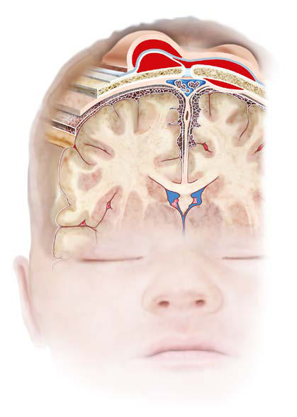

# Chapter 122: Nervous System Disorders
> **Course:** Vikkypaedia Pediatric Basic Course (*Nelson Textbook of Pediatrics, 22nd Edition (2025)*)  
> **Part X:** The Fetus and the Neonatal Infant  
> **Authors:** Susan S. Cohen, Alicia J. Sprecher, and Krishna K. Acharya  
> **Metrics:** 12,266 words · 11 tables/boxes · 1 figures · 0 genes · 8 flashcards · 5 MCQs  
> **Quick Navigation:** [🃏 Study 8 Flashcards](../flashcards/122_flashcards.md) · [📝 Take 5-Q MCQ Quiz](../mcqs/122_mcqs.md) · [📚 Part X Guide](../parts/Part_X.md) · [🧬 Syndrome & Genetics Atlas](../omim_gene_atlas.md) · [💊 Therapeutics Matrix](../therapies_matrix.md) · [🏠 Course Index](../../index.md)

## Key Chapter Topics & Subchapters
`122.1 The Cranium` · `122.2 Neonatal Traumatic Head Injuries` · `122.3 Intracranial-Intraventricular Hemorrhage and Periventricular Leukomalacia` · `122.4 Hypoxic-Ischemic Encephalopathy` · `122.5 Spine and Spinal Cord` · `122.6 Peripheral Nerve Injuries` · `121.4 Hypocalcemia Kathleen A. Gibbs and Eric C. Eichenwald` · `121.5 Hypermagnesemia Kathleen A. Gibbs and Eric C. Eichenwald` · `122.1 The Cranium Susan S. Cohen, Alicia J. Sprecher, and Krishna K. Acharya` · `122.2 Neonatal Traumatic Head Injuries Susan S. Cohen, Alicia J. Sprecher, and Krishna K. Acharya` · `122.4 Hypoxic-Ischemic Encephalopathy Susan S. Cohen, Alicia J. Sprecher, and Krishna K. Acharya` · `122.5 Spine and Spinal Cord Susan S. Cohen, Alicia J. Sprecher, and Krishna K. Acharya`

## ⚡ High-Yield Nelson Pediatric Board Pearls
- Hypermagnesemia is most often caused by maternal administration of magnesium in the perinatal period for treatment of conditions such as preeclampsia and preterm labor, and as prophylaxis to mitigate brain injury associated with preterm birth.
- Osteomyelitis of the skull is a rare complication of cephalohematoma; Escherichia coli and Staphylococcus aureus are common agents.
- Fractures of the skull may be caused by pressure in the setting of a forceps delivery, but they can occur rarely in uncomplicated vaginal deliveries.
- Linear fractures, the most common, cause no symptoms and require no treatment.
- Linear fractures should be followed up to dem onstrate healing and to detect the possible complication of a leptomen ingeal cyst.
- Surgical management of such an injury may not be neces sary due to the infants’ relatively thin and flexible skull bones rendering them amenable to remodeling, and intervention could be reserved for larger areas of depression.
- Patients with massive hemorrhage caused by tears of the tentorium or falx cerebri rapidly deteriorate and may die soon after birth.

---
## Full Chapter Text, Tables & Figures
# Chapter 122: Nervous System Disorders

*Susan S. Cohen, Alicia J. Sprecher, and Krishna K. Acharya*

<!-- p.1343 -->

## 121.4  Hypocalcemia Kathleen A. Gibbs and Eric C. Eichenwald

Hypocalcemia in a neonate can manifest as irritability, jitteriness, clonus, or seizures. Electrocardiography can show a prolonged QT interval. The cause may simply represent an exaggerated physiologic decrease in serum calcium levels within the first 24 hours of life or pathologic conditions such as genetic disorders (22q deletions), pre maturity, growth restriction, perinatal hypoxia, hypomagnesemia, or maternal diabetes. Hypocalcemia is more common in term infants receiving formula than in those exclusively receiving breast milk. Most infants remain asymptomatic and can be managed conserva tively with early nutrition and close monitoring, whereas symptom atic neonates should receive intravenous or oral calcium replacement.

*Visit Elsevier eBooks+ at eBooks.Health.Elsevier.com** for Bibliography.*

## 121.5  Hypermagnesemia Kathleen A. Gibbs and Eric C. Eichenwald

Hypermagnesemia is most often caused by maternal administration of magnesium in the perinatal period for treatment of conditions such as preeclampsia and preterm labor, and as prophylaxis to mitigate brain injury associated with preterm birth. Infants are usually present with signs at birth and improve over the next 24-48 hours. Symptoms include respiratory depression, hypotonia, lethargy, and feeding intol erance. No treatment is indicated other than supportive measures.

Central nervous system (CNS) disorders are important causes of neo natal mortality and both short-term and long-term morbidity. The CNS can be injured as a result of asphyxia, hemorrhage, trauma, infec tion, hypoglycemia, or direct cytotoxicity. The etiology of CNS injury is often multifactorial and includes perinatal complications, postnatal hemodynamic instability, and developmental abnormalities that may be genetic and/or environmental. Predisposing factors for brain injury include chronic and acute maternal illness resulting in uteroplacental dysfunction, intrauterine infection, macrosomia/dystocia, malpresen tation, prematurity, and intrauterine growth restriction. Acute and often unavoidable emergencies during the delivery process may result in mechanical and hypoxic-ischemic brain injury.

## 122.1  The Cranium Susan S. Cohen, Alicia J. Sprecher, and Krishna K. Acharya

Erythema, abrasions, ecchymoses, and subcutaneous fat necrosis of facial or scalp soft tissues may be noted after a normal delivery or after forceps or vacuum-assisted deliveries. The location depends on the area of con tact with the pelvic bones or application of the forceps. Traumatic hemor rhage may involve any layer of the scalp as well as intracranial contents (Fig. 122.1).

*Susan S. Cohen, Alicia J. Sprecher, and Krishna K. Acharya*

**Caput succedaneum** is a diffuse, sometimes ecchymotic, edem atous swelling of the soft tissues of the scalp due to the increased pressure of the vaginal and uterine walls on the fetal head during labor. The pressure causes a serosanguinous/edematous infiltration above the periosteum and below the skin or subcutaneous tissue. The edema is soft and extends across the midline of the skull, crossing suture lines and disappears within the first few days of life. Molding of the head and overriding of the parietal bones are frequently asso ciated with caput succedaneum and become more evident after the caput has receded; they disappear during the first few weeks of life. Rarely, a hemorrhagic caput may result in shock and require blood transfusion. Analogous swelling, discoloration, and distortion of the face are seen in face presentations. No specific treatment is needed, but if extensive ecchymoses are present, hyperbilirubinemia may develop.

**Cephalohematoma** is a unilateral subperiosteal hemorrhage that does not cross the suture lines as it usually occurs within a single cra nial plate (Fig. 122.2). Cephalohematomas occur in 1–2% of live births regardless of the mode of delivery. No discoloration of the overlying scalp occurs, and due to slow bleeding, the clinical presentation of swelling is delayed for several hours to days. The lesion becomes a firm, tense mass with a palpable rim localized over one area of the skull. Most cephalohematomas are resorbed within 3 to 4 weeks, depending on their size. They may begin to calcify by the end of the second week of life. A few remain for years as bony protuberances and are detect able on radiographs as widening of the diploic space; cystlike defects that may persist for months or years. An underlying skull fracture, usually linear and not depressed, may be associated with 10–25% of cases. A sensation of central depression suggesting but not indicative of an underlying fracture or bony defect is usually encountered on pal pation of the organized rim of a cephalohematoma. Osteomyelitis of the skull is a rare complication of cephalohematoma; *Escherichia coli* and *Staphylococcus aureus* are common agents. Cephalohematomas

Cephalhematoma

Skin Epicranial aponeurosis

Periosteum

Skull

Dura mater

Arachnoid

Pia mater

Subgaleal hemorrhage

Extradural hemorrhage

Caput

**Fig. 122.1** Sites of extracranial (and extradural) hemorrhages in the newborn. Schematic diagram of important tissue planes from skin to dura. (From Volpe JJ. Injuries of extracranial, cranial, intracranial, spinal cord, and peripheral nervous system structures. In: Volpe JJ, Inder TE, Darras BT, et al., eds. Volpe’s Neurology of the Newborn. 6th ed. Phila delphia: Elsevier; 2018: Fig. 36-1.)

<!-- p.1345 -->

<!-- p.1346 -->
require no treatment, although phototherapy may be necessary to treat hyperbilirubinemia.

A **subgaleal hemorrhage** is a collection of blood in the loose con nective tissue of the subgaleal space, located between the epicranial aponeurosis and the periosteum (see Fig. 122.1). There is often an association with vacuum-assisted delivery. A subgaleal hemorrhage manifests as a fluctuant mass that straddles cranial sutures or fontanels that increases in size after birth. The mechanism of injury is most likely secondary to rupture of emissary veins connecting the dural sinuses within the skull and the superficial veins of the scalp. Subgaleal hem orrhages are sometimes associated with skull fractures, suture dias tasis, and fragmentation of the superior margin of the parietal bone. Extensive subgaleal bleeding can result in sequestration of more than 40% of the newborn’s blood volume, which can potentially result in hemorrhagic shock. The mortality can be up to 14% due to hemor rhagic shock and is occasionally secondary to a hereditary coagulopa thy **(hemophilia)**. In some cases, patients can develop a consumptive coagulopathy from massive blood loss. Subgaleal hemorrhages can present clinically with the triad of tachycardia, decreased hematocrit, and increasing occipital frontal circumference. When subgaleal hem orrhage is suspected, hemoglobin measurements should be performed as soon as possible and should be monitored every 4 to 8 hours, as should coagulation studies. Although it is not necessary to make the clinical diagnosis, optimal imaging for subgaleal hemorrhage is by CT

or MRI. Radiographs of the skull can be done to identity accompanying fractures. These lesions typically resolve over 2 to 3 weeks.

**Fractures of the skull** may be caused by pressure in the setting of a forceps delivery, but they can occur rarely in uncomplicated vaginal deliveries. *Linear fractures,* the most common, cause no symptoms and require no treatment. Linear fractures should be followed up to dem onstrate healing and to detect the possible complication of a leptomen ingeal cyst. *Depressed fractures* often are referred to as “ping-pong” fractures because on x-ray they resemble an indented ping-pong ball. Affected infants may be asymptomatic unless they have associated intra cranial injury. Surgical management of such an injury may not be neces sary due to the infants’ relatively thin and flexible skull bones rendering them amenable to remodeling, and intervention could be reserved for larger areas of depression. When intervention is required, the obstet ric vacuum extractor is an ideal tool because it provides patent tubing unlikely to collapse during the application of suction. No traction is needed during the suction procedure, and the elevation of the depres sion can be ascertained by direct visualization, an audible “click” sound or a “give” sensation accompanied by an instantaneous pressure release. There is no clear recommendation for imaging in this population, but with newer techniques of low-dose CT imaging, current technology allows axial imaging to be constructed in the coronal and sagittal planes and into three-dimensional reformats, thus increasing the likelihood of detecting a fracture.

**Subconjunctival** and **retinal hemorrhages** are frequent; pete chiae of the skin of the head and neck are also common. All are probably secondary to a sudden increase in intrathoracic pressure during passage of the chest through the birth canal. Parents should be assured that these hemorrhages are temporary and the result of normal events of delivery. The lesions resolve rapidly within the first 2 weeks of life.

## 122.2  Neonatal Traumatic Head Injuries Susan S. Cohen, Alicia J. Sprecher, and Krishna K. Acharya

Neonatal traumatic head injuries are estimated to affect ∼3% of preg nancies and represent approximately 2% of neonatal deaths. Infre quently, these injuries occur during normal birth but the incidence rises in cases when the fetal head is large in proportion to the size of the mother’s pelvic outlet, with prolonged labor, in breech or pre cipitous deliveries, or as a result of mechanical assistance with deliv ery. Massive **subdural hemorrhage**, often associated with tears in the tentorium cerebelli or less frequently in the falx cerebri, is rare, but is encountered more often in full-term than in premature infants. Patients with massive hemorrhage caused by tears of the tentorium or falx cerebri rapidly deteriorate and may die soon after birth. Most subdural and epidural hemorrhages resolve without intervention. Consultation with a neurosurgeon is recommended. Asymptomatic subdural hemorrhage may be noted within 48 hours of birth after vaginal or cesarean delivery. These are typically small hemorrhages, especially common in the posterior fossa, discovered incidentally in term infants imaged in the neonatal period, and usually of no clini cal significance. The diagnosis of large subdural hemorrhage may be delayed until the chronic subdural fluid volume expands and produces macrocephaly, frontal bossing, a bulging fontanel, anemia, and some times seizures. CT scan and MRI are useful imaging techniques to confirm these diagnoses. Symptomatic subdural hemorrhage in term infants can be treated by a neurosurgical evacuation of the subdural fluid collection by a needle placed through the lateral margin of the anterior fontanel, or in severe cases an operative burr hole or crani otomy. In addition to birth trauma, **child abuse** must be suspected in all infants with subdural effusion after the immediate neonatal period. Most asymptomatic subdural hemorrhages following labor should resolve by 4 weeks of age.

**Subarachnoid hemorrhage** is often clinically silent in the neonate. Anastomoses between the penetrating leptomeningeal arteries or the

A

B

**Fig. 122.2** Parietal cephalhematoma. Clinical appearance of 10-day-old infant delivered with the aid of mid-forceps. A, Posterior view. B, Right lateral view. Note prominent swelling that extends medially to the sagittal suture, posteriorly to the lambdoid suture, and laterally to the squamosal suture. (From Volpe JJ. Injuries of extracranial, cranial, intracranial, spinal cord, and peripheral nervous system structures. In: Volpe JJ, Inder TE, Darras BT, et al. eds. Volpe’s Neurology of the Newborn. 6th ed. Philadelphia: Elsevier; 2018: Fig. 36-3.)

<!-- p.1347 -->
bridging veins are the most likely source of the bleeding. Most affected infants have no clinical symptoms, but the subarachnoid hemorrhage may be detected because of an elevated number of red blood cells in a lumbar puncture sample. Some infants experience short, benign seizures, which tend to occur on the second day of life. Rarely, an infant has a catastrophic hemorrhage and dies. There are usually no neurologic abnormalities during the acute episode or on follow-up. Significant neurologic findings should suggest an arteriovenous mal formation, which can best be detected on CT or MRI.

## 122.3  Intracranial-Intraventricular Hemorrhage and Periventricular Leukomalacia Susan S. Cohen, Alicia J. Sprecher, and Krishna K. Acharya

**Intracranial hemorrhage** in preterm infants usually develops sponta neously. Less frequently, it may be caused by trauma or asphyxia, and rarely, it occurs from a primary hemorrhagic disturbance or congeni tal cerebrovascular anomaly. The very low birthweight infant (VLBW; birthweight <1,500 g) is at high risk for intracranial hemorrhages, with the risk for severe hemorrhage inversely related to gestational age. Intracranial hemorrhage often involves the ventricles **(intraventricu lar hemorrhage [IVH])** of premature infants delivered spontaneously without apparent trauma. Primary hemorrhagic disturbances and vas cular malformations are rare and usually give rise to subarachnoid or intracerebral hemorrhage. In utero hemorrhage associated with mater nal idiopathic or, more often, fetal alloimmune thrombocytopenia may appear as severe cerebral hemorrhage or as a porencephalic cyst after resolution of a fetal cortical hemorrhage. Intracranial bleeding may be associated with disseminated intravascular coagulation, isoimmune thrombocytopenia, and neonatal vitamin K deficiency, especially in infants born to mothers receiving phenobarbital or phenytoin.

**Periventricular leukomalacia (PVL)** is a disorder of the periven tricular cerebral white matter that may be cystic or diffuse in nature. PVL may initially be observed during the first week of life in the VLBW infant as increased echogenicity of the periventricular white matter, sometime described as an echogenic “blush” or “flare.” These areas of white matter abnormalities may become cystic on ultrasonography within 2 to 5 weeks and/or lead to ventriculomegaly from white matter volume loss, which can be visible on repeat ultrasonography at term equivalent age. Clinical risk factors for PVL include gestational age at birth and prenatal/postnatal factors including inflammation, hypoxia, postnatal steroid exposure, and metabolic disturbances.

**EPIDEMIOLOGY** The overall incidence of IVH has decreased over the last few decades as a result of improved perinatal care, increased use of antenatal cor ticosteroids, surfactant to treat respiratory distress syndrome (RDS), and improved positive pressure mechanical ventilation strategies. The global incidence of IVH among preterm infants ranges from 14.7– 44.7% with considerable variation across gestational age groups, neona tal intensive care units (NICUs), and countries. The risk for severe IVH is associated with infants with a gestational age ≤30 weeks’ gestation, with the highest risk in infants born at ≤24 weeks’ gestation. Infants born at >30 weeks’ gestation have a low risk of severe IVH unless they have additional clinical risk factors such as low Apgar scores, metabolic acidosis, hypotension, or lack of antenatal steroids.

PVL can be described in three major pathologic forms: macroscopic cystic white matter injury, microscopic cystic white matter injury, and nonnecrotic diffuse white matter injury. Macroscopic cystic white matter injury represents the most severe form of PVL and fortunately affects <5% of very preterm infants born <32 weeks. With advances in neonatal care, there has been a shift from large cystic injury to small punctate injury. In microscopic cystic white matter injury, the necrotic areas are small and result in focal areas of gliosis, which ultrasonogra phy is not sensitive enough to detect. The most common form of PVL

in the preterm population is nonnecrotic diffuse PVL. Diffuse PVL is estimated to affect nearly a third of infants born <32 weeks and is best recognized on MRI.

**PATHOGENESIS** The major neuropathologic lesions associated with VLBW infants are IVH and PVL. IVH in premature infants occurs in the gelatinous subependymal **germinal matrix**. This periventricular area is the site of origin for embryonal neurons and fetal glial cells, which migrate outwardly to the cortex. Immature and fragile blood vessels in this highly vascular region of the developing brain combined with distur bances in cerebral blood flow and coagulation predispose premature infants to hemorrhage. The germinal matrix involutes as the infant approaches 34 to 36 weeks’ gestation, and the tissue’s vascular integrity improves; therefore IVH is much less common in the late preterm and term infant. The cerebellum also contains a germinal matrix and is sus ceptible to hemorrhagic injury. **Periventricular hemorrhagic infarc tion (PVHI)**, previously known as **grade IV IVH**, often develops after a large IVH because of venous congestion. PVHI is not an exten sion of the IVH into the parenchyma. Predisposing factors for IVH include prematurity, RDS, hypoxia-ischemia, exaggerated fluctuations in cerebral blood flow (hypotensive injury, hypervolemia, hyperten sion), reperfusion injury of damaged vessels, reduced vascular integ rity, increased venous pressure (pneumothorax, venous thrombus), or thrombocytopenia.

The pathogenesis of PVL appears to involve both intrauterine and postnatal events. A complex interaction exists between the develop ment of the cerebral vasculature and the regulation of cerebral blood flow (both of which depend on gestational age), disturbances in the oligodendrocyte precursors required for myelination, and maternal/ fetal infection and inflammation. Postnatal hypoxia or hypoten sion, necrotizing enterocolitis (NEC) with its resultant inflamma tion, and severe neonatal infection may all result in white matter injury. The risk for PVL increases in infants with severe IVH or ventriculomegaly.

**CLINICAL MANIFESTATIONS** Most infants with IVH, including some with moderate to severe hem orrhages, have no initial clinical signs **(silent IVH)**. Some premature infants with severe IVH may have an acute deterioration on the second or third day of life **(catastrophic IVH)**. Hypotension, apnea, pallor, stupor or coma, seizures, decreased muscle tone, metabolic acidosis, shock, and decreased hematocrit (or failure of hematocrit to increase after transfusion) may be the first clinical indications. A *saltatory pro gression* may occur over several hours to days and manifest as intermit tent or progressive alterations of levels of consciousness, abnormalities of tone and movement, respiratory signs, and eventually other features of the acute catastrophic IVH. Rarely, IVH may manifest at birth or even prenatally; the majority of cases of IVH in the preterm infant occur within the first 3 days of life. Of those, approximately 50% of hemorrhages occur within the first 5 hours, 70% occur within the first day of life, and by 7 days of life 95% of IVH will have occurred. A small percentage of infants have late hemorrhage, between days 14 and 30. IVH as a primary event is rare after the first month of life.

The severity of hemorrhage is defined by the location and degree of bleeding and ventricular dilation on cranial imaging. In a **grade I** hemor rhage, bleeding is isolated to the subependymal area. In **grade II** hemor rhage, there is bleeding within the ventricle *without* evidence of ventricular dilation. **Grade III** hemorrhage is IVH with ventricular dilation. In **PVHI** hemorrhage (formerly called **grade IV**, see previously), there is intra ventricular and parenchymal hemorrhage (Fig. 122.3). Another grading system describes three levels of increasing severity of IVH detected on ultrasound: In **grade I,** bleeding is confined to the germinal matrix–sub ependymal region or to <10% of the ventricle (approximately 35% of IVH cases); **grade II** is defined as intraventricular bleeding with 10–50% filling of the ventricle (40% of IVH cases); and in **grade III**, >50% of the ventricle is involved, with dilated ventricles (see Fig. 122.3).

One of the major complications resulting from IVH is the development of **posthemorrhagic ventricular dilation (PHVD)**. Following a large IVH, multiple small clots throughout the ventricular system may obstruct

<!-- p.1348 -->
cerebrospinal fluid (CSF) flow and resorption, all in the face of ongoing production of CSF in the choroid plexus in the lateral ventricles and the roof of the third ventricle. The progressive accumulation of CSF changes the shape of the lateral ventricles from a slit to a balloon. The expanding ventricles distort the developing brain and intracerebral pressure (ICP) eventually starts to rise. As the preterm skull is very compliant, the ven tricles can expand without pressure rising initially but eventually can result in increased ICP. PHVD develops in 30–50% of infants with severe IVH and is initially asymptomatic in most patients. *Therefore sequential cranial ultrasonography facilitates early detection*. The term ventriculomegaly is occasionally used for both infants with ventricular enlargement follow ing IVH as well as those without hemorrhage. In infants without IVH, ventricular enlargement is more likely due to *white matter loss* rather than an accumulation of CSF. Therefore it is preferable to use the term PHVD when ventricular enlargement follows IVH.

PVL is usually clinically asymptomatic until the neurologic sequelae of white matter damage become apparent in later infancy as spasticity and/or motor deficits. PVL may be present at birth but usually occurs later, when the echodense phase is seen on ultrasound (3 to 10 days of life), followed by the typical echolucent/cystic phase (14 to 20 days).

**DIAGNOSIS** Intracranial hemorrhage is suspected on the basis of history, clinical manifestations, and knowledge of the birthweight-specific risks for IVH. Associated clinical signs of IVH are typically nonspecific or absent. Neu roimaging recommendations that premature infants ≤30 weeks of gesta tion and selected infants with gestational age >30 weeks who are believed to be at increased risk for brain injury on the basis of identified risk fac tors should be screened for IVH with cranial ultrasonography. Standard ultrasonography screening includes views from the anterior and mastoid fontanelles. Additional posterior fontanelle and vascular imaging can be performed for additional information. Routine cranial ultrasonographic screening is recommended by 7 to 10 days of age, but earlier imaging may be warranted if clinical signs and symptoms are suggestive of signifi cant injury. Repeat cranial ultrasonography screening is recommended to be performed at 4 to 6 weeks of age and at term equivalent age or before hospital discharge. CT is not considered a part of routine imag ing techniques of the preterm brain. MRI for infants born ≤30 weeks gestational age is not indicated as a routine procedure, although could be offered to families of high-risk infants after a conversation about the

COR

LOGIQ

E9

LOGIQ

E9

LOGIQ

E9

LOGIQ

E9

LOGIQ

E9

LOGIQ

E9

LOGIQ

E9

LOGIQ

E9

SAG LT

SAG RIGHT

SAG RT

SAG RT

COR

COR

COR

A

B

C

D

**Fig. 122.3** Grading of the severity of germinal matrix–intraventricular hemorrhage (IVH): coronal (COR) and parasagittal (SAG) ultrasound scans. A, Germinal matrix hemorrhage, grade I. B, IVH (filling <50% of ventricular area), grade II. C, IVH with ventricular dilatation, grade III. D, Large IVH with associated parenchymal echogenicity (hemorrhagic infarct), grade IV. Note that the terminology has now changed for “grade IV” to periventricular hemorrhagic infarction (PVHI). (From Inder TE, Perlman JM, Volpe JJ. Preterm intraventricular hemorrhage/posthemorrhagic hydrocephalus. In: Volpe JJ, Inder TE, Darras BT, et al., eds. Volpe’s Neurology of the Newborn. 6th ed. Philadelphia: Elsevier; 2018: Fig. 24-2.)

<!-- p.1349 -->
Sequential ultrasonography appears to have the best yield for iden tifying lesions associated with cerebral palsy. In one study, 29% of low birthweight (LBW) infants who later experienced cerebral palsy *did not* have radiographic evidence of PVL until after 28 days of age. Ultra sound also detects the precystic and cystic symmetric lesions of PVL and the asymmetric intraparenchymal echogenic lesions of cortical hemorrhagic infarction (Fig. 122.4). Cranial ultrasonography may be useful in monitoring delayed development of cortical atrophy, poren cephaly, and the severity, progression, or regression of posthemor rhagic hydrocephalus (PHH).

PHH of prematurity is a common form of pediatric hydrocephalus, accounting for 20% of shunted hydrocephalus in the United States.

Under normal conditions, CSF is primarily secreted into the cerebral ventricles by the choroid plexus and moves via bulk flow through the ventricular system and subarachnoid space before being absorbed at the arachnoid villi/granulations, which are fully developed after 35 weeks. An increase in CSF production or reduction in CSF absorption may result in ventricular enlargement if the system cannot compen sate for the changes. Secondary white matter injury resulting from ventricular dilation is likely exacerbated by compression and ischemia from increased ICP of symptomatic PHH. Orbitofrontal head circum ference, fontanel fullness, and the splaying of sutures all show limited reliability; therefore serial neuroimaging is highly valuable for clinical decision-making for neurosurgical intervention.

**PROGNOSIS** The degree of IVH and presence of PVL are strongly linked to sur vival and neurodevelopmental impairment (Tables 122.1 and 122.2). For infants with birthweight <1,000 g, the incidence of severe neuro logic impairment (defined as Bayley Scales of Infant Development IV mental developmental index <70, psychomotor development index <70, cerebral palsy, blindness, or deafness) after IVH is highest with grade IV hemorrhage and lower birthweight. PVL, cystic PVL, and progressive hydrocephalus requiring shunt insertion are each inde pendently associated with a poorer prognosis (Table 122.3). The risk of a poor neurodevelopmental outcome is significantly higher when severe IVH is complicated with PHVD (40–60%) and more so for infants who eventually develop PHH (75–88%). In the pre-surfactant era, up to 82% of infants with PHH who survived developed significant neurologic impairments with cerebral palsy being the most common clinical sequelae (74%). The Drainage, Irrigation, Fibrinolytic Therapy (DRIFT) trial performed neurocognitive assessments at both 2 years and 10 years after birth and demonstrated improved cognitive abil ity when considering birthweight, IVH grade, and sex. Infants who received DRIFT were almost twice as likely to survive without severe cognitive disability than those who received standard treatment. The

**Fig. 122.4** Severe cystic periventricular leukomalacia. A, Parasagittal ultrasound image showing numerous large cysts superolateral to the lateral ventricle (arrow). B, Coronal T2 weighted MR image in which cysts are present superolateral to the lateral ventricles (arrow). (From Neil JJ, Volpe JJ. Encephalopathy of prematurity: clinical-neurological features, diagnosis, imaging, prog nosis, therapy. In: Volpe JJ, Inder TE, Darras BT, et al., eds. Volpe’s Neurology of the Newborn. 6th ed. Phila delphia: Elsevier; 2018: Fig. 16-1.)

A B

and Birthweight*

#### **Table 122.1** Short-Term Outcome of Germinal Matrix–Intraventricular Hemorrhage as a Function of Severity of Hemorrhage

| Category / Parameter | Clinical Details & Findings |
| --- | --- |
| **(n = 165)** | Grade I; 3/24 (12); 0/80 (0); 1/21 (5); 3/80 (4); Grade II; 5/21 (24); 1/44 (2); 1/16 (6); 6/43 (14); Grade III; 6/19 (32); 2/26 (8); 10/13 (77); 18/24 (75); Grade III and apparent |
| **PVHI** | 5/11 (45); 5/23 (22); 5/6 (83); 12/18 (66); *Values are n (%). Deaths occurring later in the neonatal period are not shown; the total mortality rates (early and late deaths) are approximately 50–100% greater for each grade of; hemorrhage and birthweight than those shown in the table for early deaths alone.; PVHI, Periventricular hemorrhagic infarction; PVD, progressive ventricular dilation.; Adapted from Inder TE, Perlman JM, Volpe JJ. Preterm intraventricular hemorrhage/posthemorrhagic hydrocephalus. In: Volpe JJ, Inder TE, Darras BT, et al., eds. Volpe’s Neurology; of the Newborn. 6th ed. Philadelphia: Elsevier; 2018. Table 24-15; with data from Murphy BP, Inder TE, Rooks V, Taylor GA, et al. Posthemorrhagic ventricular dilatation in the; premature infant: natural history and predictors of outcome. Arch Dis Child Fetal Neonatal Ed. 2002;87:F37–F41. |

Survivors with Germinal Matrix–Intraventricular Hemorrhage as a Function of Severity of Hemorrhage*

#### **Table 122.2** Long-Term Outcome: Neurologic Sequelae in

| Category / Parameter | Clinical Details & Findings |
| --- | --- |
| **NEUROLOGIC SEQUELAE† (%)** | Grade I; 15; Grade II; 25; Grade III; 50; Grade III and apparent PVHI; 75; *Data are derived from reports published since 2002 and include personal published; and unpublished cases. Mean values (to nearest 5%) and considerable variability; among studies was apparent, especially for the severe lesions.; †Definite neurologic sequelae included principally cerebral palsy or mental retardation,; or both.; PVHI, Periventricular hemorrhagic infarction.; Adapted From Inder TE, Perlman JM, Volpe JJ. Preterm intraventricular hemorrhage/; posthemorrhagic hydrocephalus. In: Volpe JJ, Inder TE, Darras BT, et al. eds. Volpe’s; Neurology of the Newborn. 6th ed. Philadelphia: Elsevier; 2018: Table 24-16. |

<!-- p.1350 -->
Early versus Late Ventricular Intervention Study (ELVIS) trial demon strated the effectiveness of intervention at a low threshold of ventricu lar dilation on the outcomes of death and severe neurodevelopmental disability in preterm infants with PHVD. Post hoc analysis of this study demonstrated that infants who went on to having a shunt had better neurodevelopmental outcome scores if interventions were done at a lower threshold.

**TREATMENT** No treatment is available for **IVH** once it has occurred, and the man agement is largely symptomatic. Seizures should be treated with anti convulsant drugs. Anemia and coagulopathy require transfusion with packed red blood cells or fresh-frozen plasma. Shock and acidosis are treated with fluid resuscitation.

Insertion of a **ventriculoperitoneal shunt** is the preferred method to treat progressive and symptomatic **PHH**. Some infants require tem porary CSF diversion before a permanent shunt can be safety inserted. Diuretics and acetazolamide are not effective. Ventricular access devices (reservoirs) and externalized ventricular drains are poten tial temporizing interventions, although there is an associated risk of

infection and *puncture porencephaly* from injury to the surrounding parenchyma. A **ventriculosubgaleal shunt** inserted from the ventricle into a surgically created subgaleal pocket provides a closed system for constant ventricular decompression without these additional risk fac tors. Decompression is regulated by the pressure gradient between the ventricle and the subgaleal pocket.

One approach to therapeutic interventions is based on the sever ity of ultrasonographic dimensions of ventricular size (Table 122.4 and Fig. 122.5)

**PREVENTION** Improved perinatal care is imperative to minimize traumatic brain injury and decrease the risk of preterm delivery. The incidence of traumatic intracranial hemorrhage may be reduced by judicious man agement of cephalopelvic disproportion and operative delivery. Fetal or neonatal hemorrhage caused by maternal idiopathic thrombocy topenic purpura or alloimmune thrombocytopenia may be reduced by maternal treatment with corticosteroids, intravenous immuno globulin (IVIG), fetal platelet transfusion, or cesarean birth. Meticu lous care of the VLBW infant’s respiratory status and fluid-electrolyte

≥2-3 months Deficient myelin formation; gliosis, often with

#### **Table 122.3** Ultrasound Diagnosis of Periventricular Leukomalacia

| Category / Parameter | Clinical Details & Findings |
| --- | --- |
| **NEUROPATHOLOGIC CORRELATION** | Echogenic foci, bilateral, posterior > anterior; First week; Necrosis with congestion and/or hemorrhage; (size >1 cm); Echolucent foci (“cysts”); 1-3 weeks; Cyst formation secondary to tissue dissolution; (size >3 mm); Ventricular enlargement, often with; disappearance of “cysts”; collapse of cyst; From Neil JJ, Volpe JJ. Encephalopathy of prematurity: Clinical-neurological features, diagnosis, imaging, prognosis, therapy. In: Volpe JJ, Inder TE, Darras BT, et al., eds. Volpe’s; Neurology of the Newborn. 6th ed. Philadelphia: Elsevier; 2018: Table 16-6. |

*Consider alterations in NIRS (i.e., decrease cerebral oxygenation) or Doppler US (i.e., increase in Resistive Index) as additional information that may suggest impairment in cerebral perfusion and more urgent need for intervention.*

**Green Zone Key criteria:** Ventricular size with the following • VI ≤97th percentile and • AHW ≤6 mm

And Absence of the following clinical criteria: • HC growth >2 cm per week • Separated sutures • Bulging fontanelles

**Management:** • Observation in NICU • cUS twice a week until stable for 2 weeks then every 1-2 weeks until 34 weeks PMA • MRI at term equivalent

**Yellow Zone Key criteria:** Ventricular size with the following • VI >97th percentile and • AHW >6 mm and/or TOD >25 mm

And Absence of the following clinical criteria: • HC growth >2 cm per week • Separated sutures • Bulging fontanelles

**Management:** • Referral to a regional center for neurosurgical review • Consider LP 2-3 times • cUS 2-3X a week until stable for 2 weeks then every 1-2 weeks until 34 weeks PMA • Neurosurgical intervention when no stabilization occurs • MRI at term equivalent

**Key criteria:** Ventricular size with the following • VI >97th percentile + 4mm and • AHW >10 mm and/or TOD >25 mm

Or Any of the following clinical criteria: • HC growth >2 cm per week • Separated sutures • Bulging fontanelles

**Management:** • Consider LP 2-3 times • Neurosurgical intervention including either temporizing measures or VP shunt • MRI at term equivalent

**Red Zone**

#### **Table 122.4** Proposed Risk Stratification and Management of Infants with PHVD

| Category / Parameter | Clinical Details & Findings |
| --- | --- |
| **General** | VI, ventricular index; AHW, anterior horn width; cUS, cranial ultrasound; TOD, thalamo-occipital distance; LP, lumbar puncture; HC, head circumference; NIRS, near-infrared spectroscopy;; NICU, neonatal intensive care unit; PMA, postmenstrual age.; From El-Dib M, Limbrick DD, Inder T, et al. Management of post-hemorrhagic ventricular dilation in the infant born preterm. J Pediatr. 2020;226:16–26. Fig. 5. |

<!-- p.1351 -->

<!-- p.1352 -->
management—avoidance of acidosis, hypocarbia, hypoxia, hypo tension, wide fluctuations in neonatal blood pressure or Pco2 (and secondarily fluctuation in cerebral perfusion pressure), and pneumo thorax—are important factors that may affect the risk for development of IVH and PVL.

*The most important protective factor against the development of IVH is antenatal administration of corticosteroids.* A single course of antena tal corticosteroids is recommended for pregnant people between 24 0/7 weeks and 36 6/7 weeks of gestation who are at risk for preterm delivery within 7 days. It also may be considered for pregnant people starting at 23 weeks of gestion who are at risk for preterm delivery within 7 days, based on the family’s decision regarding resuscitation. A rescue course of corticosteroids could be provided as early as 7 days from the prior dose, if indicated by the clinical scenario. Antenatal administration of magne sium sulfate was not associated with a reduction in the incidence of IVH, although it has been associated with a reduction in the risk of cerebral palsy. Prophylactic indomethacin showed a significant reduction in the incidence of severe IVH; however, this reduction in severe IVH was not associated with a reduction in severe neurosensory impairment.

*Visit Elsevier eBooks+ at eBooks.Health.Elsevier.com** for Bibliography.*

## 122.4  Hypoxic-Ischemic Encephalopathy Susan S. Cohen, Alicia J. Sprecher, and Krishna K. Acharya

**Hypoxemia**, a decreased arterial concentration of oxygen, frequently results in **hypoxia**, or decreased oxygenation to cells or organs. **Isch emia** refers to blood flow to cells or organs that is inadequate to main tain physiologic function. **Hypoxic-ischemic encephalopathy (HIE)** is a leading cause of neonatal brain injury, morbidity, and mortality glob ally. In the developed world, incidence is estimated at 1-8 per 1,000 live births, and in the developing world, estimates are as high as 26 per 1,000.

Approximately 20–30% of infants with HIE (depending on the sever ity) die in the neonatal period, and 33–50% of survivors are left with per manent neurodevelopmental abnormalities (cerebral palsy, decreased intelligence quotient [IQ], learning/cognitive impairment). The great est risk of adverse outcome is seen in infants with severe fetal acidosis (pH <6.7) (90% death/impairment) and a base deficit >25 mmol/L (72% mortality). Multiorgan failure and insult can occur (Table 122.5).

**ETIOLOGY** Neonatal encephalopathy and seizures, in the absence of major con genital malformations or metabolic or genetic syndromes, appear to be

caused by perinatal events. Brain MRI or autopsy findings in full-term neonates with encephalopathy demonstrate that 80% have acute inju ries, <1% have prenatal injuries, and 3% have non–hypoxic-ischemic diagnoses. Fetal hypoxia may be caused by various disorders in the mother, including (1) inadequate oxygenation of maternal blood from hypoventilation during anesthesia, cyanotic heart disease, respiratory failure, or carbon monoxide poisoning; (2) low maternal blood pres sure from acute blood loss, spinal anesthesia, or compression of the vena cava and aorta by the gravid uterus; (3) inadequate relaxation of the uterus to permit placental filling as a result of uterine tetany caused by the administration of excessive oxytocin; (4) premature separation of the placenta; (5) impedance to the circulation of blood through the umbilical cord as a result of compression or knotting of the cord; and (6) placental insufficiency from maternal infections, exposures, diabe tes, toxemia or postmaturity.

HW*

VI*

AHW

VA

*FHR = VI/HW

VH

TOD A B

**Fig. 122.5** Ventricular parameters measured in the (A) coronal and (B) sagittal planes by cranial ultrasonography. AHW, anterior horn width; FHR, frontal horn ratio; HW, hemispheric width; TOD, thalamo-occipital distance; VA, ventricular axis; VH, ventricular height; VI, ventricular index. (From Brouwer MJ, de Vries LS, Pistorius L, et al. Ultrasound measurements of the lateral ventricles in neonates: why, how, and when? A systematic review. Acta Paediatr. 2010;99:1298–306.)

#### **Table 122.5** Multiorgan Systemic Effects of Asphyxia

| Category / Parameter | Clinical Details & Findings |
| --- | --- |
| **EFFECTS** | Central nervous; Hypoxic-ischemic encephalopathy,; infarction, intracranial; hemorrhage, seizures, cerebral; edema, hypotonia, hypertonia; Cardiovascular; Myocardial ischemia, poor; contractility, cardiac stunning,; tricuspid insufficiency,; hypotension; Pulmonary; Pulmonary hypertension,; pulmonary hemorrhage,; respiratory distress syndrome; Renal; Acute tubular or cortical necrosis; Adrenal; Adrenal hemorrhage; Gastrointestinal; Perforation, ulceration with; hemorrhage, necrosis; Metabolic; Inappropriate secretion of; antidiuretic hormone,; hyponatremia, hypoglycemia,; hypocalcemia, myoglobinuria; Integumentary; Subcutaneous fat necrosis; Hematologic; Disseminated intravascular; coagulation |

<!-- p.1353 -->
Placental insufficiency often remains undetected on clinical assess ment. Intrauterine growth restriction may develop in chronically hypoxic fetuses without the traditional signs of fetal distress. Dop pler umbilical waveform velocimetry (demonstrating increased fetal vascular resistance) and cordocentesis (demonstrating fetal hypoxia and lactic acidosis) identify a chronically hypoxic infant (see Chapter 117). Uterine contractions may further reduce umbilical oxygenation, depressing the fetal cardiovascular system and CNS and resulting in low Apgar scores and respiratory depression at birth.

After birth, hypoxia may be caused by (1) failure of oxygenation as a result of severe forms of cyanotic congenital heart disease or severe pulmonary disease; (2) severe anemia (severe hemorrhage, hemolytic disease); (3) shock severe enough to interfere with the transport of oxy gen to vital organs from overwhelming sepsis, massive blood loss, and intracranial or adrenal hemorrhage; or (4) failure to breathe after birth because of in utero CNS injury or drug-induced suppression.

**PATHOPHYSIOLOGY AND PATHOLOGY** The topography of cerebral injury typically correlates with areas of decreased cerebral blood flow and areas of relatively higher metabolic demand, although regional vulnerabilities are impacted by gestational age and severity of insult (Table 122.6). After an episode of hypoxia and isch emia, anaerobic metabolism occurs and generates increased amounts of lactate and inorganic phosphates. Excitatory and toxic amino acids, par ticularly glutamatergic mechanism has a role in neurotoxicity. Whether this mechanism involves tissue accumulation of an abnormal amount of glutamate or altered sensitivity to the interaction between glutamate and its endogenous family of receptors (i.e., *N*-methyl-d-aspartate [NMDA], amino-3-hydroxy-5-methyl-4-isoxazole propionate [AMPA], and kainite) is unknown. However, receptor activation results in a cascade of events that leads to cell death by swelling (oncosis) or apoptosis. Along with these changes in the CNS, there are also potentially exacerbating bioenergetic changes as a result of the circulatory response with increased shunting through the ductus venosus, ductus arteriosus, and foramen ovale, at first trying to maintain perfusion of the brain, heart, and adrenal glands in preference to the lungs, liver, kidneys, and intestine.

The pathology of hypoxia-ischemia in tissues outside the CNS depends on the affected organ and the severity of the injury. Early congestion, fluid leak from increased capillary permeability, and endo thelial cell swelling may lead to signs of coagulation necrosis and cell death. Congestion and petechiae are seen in the pericardium, pleura, thymus, heart, adrenals, and meninges. Prolonged intrauterine hypoxia may result in inadequate perfusion of the periventricular white matter, resulting in PVL. Pulmonary arteriole smooth muscle hyperplasia may

develop, which predisposes the infant to pulmonary hypertension (see Chapter 130). If fetal distress produces gasping, amniotic fluid contents (i.e., meconium, desquamation products, lanugo) may be aspirated into the trachea or lungs with subsequent complications, including pulmonary hypertension and pneumothoraces.

**CLINICAL MANIFESTATIONS** At delivery, the presence of meconium-stained amniotic fluid indicates that fetal distress may have occurred. At birth, affected infants may have neurologic impairment and may fail to breathe spontaneously. Pallor, cyanosis, apnea, a slow heart rate, and unresponsiveness to stimulation are also nonspecific initial signs of potential HIE. During the ensuing hours, infants may be hypotonic, may change from a hypo tonic to a hypertonic state, or their tone may appear normal (Tables 122.7 and 122.8). Cerebral edema may develop during the next 24 hours and result in profound brainstem depression. During this time, seizure activity may occur; seizures may be severe and refractory to standard doses of anticonvulsants. Although most often a result of the HIE, seizures in asphyxiated newborns may also be caused by vascular events (hemorrhage, arterial ischemic stroke, or sinus venous throm bosis), metabolic derangements (hypocalcemia, hypoglycemia), CNS infection, and cerebral dysgenesis or genetic disorders (nonketotic hyperglycinemia, vitamin-dependent epilepsies, channelopathies). Congenital conditions that result in neuromuscular weakness and poor respiratory effort may also result secondarily in neonatal hypoxic brain injury and seizure. Such conditions might include congenital myopa thies, congenital myotonic dystrophy, or spinal muscular atrophy.

In addition to CNS dysfunction, systemic organ dysfunction is noted in up to 80% of affected neonates. Myocardial dysfunction and

#### **Table 122.6** Topography of Brain Injury in Term Infants with Hypoxic-Ischemic Encephalopathy and Clinical Correlates

| Category / Parameter | Clinical Details & Findings |
| --- | --- |
| **LONG-TERM SEQUELAE** | Selective neuronal necrosis; Entire neuraxis, deep cortical area,; brainstem and pontosubicular; • Stupor or coma; • Seizures; • Hypotonia; • Oculomotor abnormalities; • Suck/swallow abnormalities; • Cognitive delay; • Cerebral palsy; • Dystonia; • Seizure disorder; • Ataxia; • Bulbar and pseudobulbar palsy; Parasagittal injury; Cortex and subcortical white; matter; Parasagittal regions, especially; posterior; • Proximal-limb weakness; • Upper extremities affected; > lower extremities; • Spastic quadriparesis; • Cognitive delay; • Visual and auditory processing; difficulty; Focal ischemic necrosis; Cortex and subcortical white; matter; Vascular injury (usually middle; cerebral artery distribution); • Unilateral findings; • Seizures common and typically; focal; • Hemiparesis; • Seizures; • Cognitive delays; Periventricular injury; Injury to motor tracts, especially; lower extremity; • Bilateral and symmetric; weakness in lower extremities; • More common in preterm; infants; • Spastic diplegia; Adapted from Volpe JJ, ed. Neurology of the Newborn. 4th ed. Philadelphia: Saunders; 2001. |

After Hypoxic-Ischemic Encephalopathy

#### **Table 122.7** Poor Predictive Variables for Death/Disability

| Category / Parameter | Clinical Details & Findings |
| --- | --- |
| **General** | • Low (0-3) 10 min Apgar score; • Need for CPR in the delivery room; • Delayed onset (≥20 min) of spontaneous breathing; • Severe neurologic signs (coma, hypotonia, hypertonia); • Seizures onset ≤12 hr or difficult to treat; • Severe, prolonged (∼7 days) EEG findings including burst suppression; pattern; • Prominent MRI basal ganglia/thalamic lesions; • Oliguria/anuria >24 hr; • Abnormal neurologic exam ≥14 days; CPR, Cardiopulmonary resuscitation; EEG, electroencephalogram. |

<!-- p.1354 -->
cardiogenic shock, persistent pulmonary hypertension, RDS, gastro intestinal perforation, and acute kidney and liver injury are associated with perinatal asphyxia secondary to inadequate perfusion (see Table 122.5). The severity of neonatal encephalopathy depends on the duration and timing of injury. The need to define severity is rooted in the need to deter mine eligibility for *therapeutic hypothermia*, a treatment that decreases death and disability in moderate to severe HIE. A clinical grading score first proposed by Sarnat and colleagues continues to be a useful tool. Symptoms develop over hours and days, making it important to perform serial neu rologic examinations (see Tables 122.7 and 122.8). Infants with moderate to severe HIE are characterized by disturbed neurologic function, altered level of consciousness, depressed tone, abnormal reflexes, and difficulty maintaining spontaneous respirations, and seizures. An empirically vali dated definition of mild HIE within 6 hours uses two steps: the first step is screening for fetal acidosis and acute perinatal events, and the second step has an examiner use a modified Sarnat scoring, which is expanded to include mild in addition to moderate and severe abnormalities.

**DIAGNOSIS** MRI is the most sensitive imaging modality for detecting hypoxic brain injury in the neonate. Although such injury can be detected at various times and with varying pulse sequences, diffusion-weighted sequences obtained in the first 3-5 days following a presumed senti nel event are optimal for identifying acute injury (Figs. 122.6-122.9 and Table 122.9). Severe HIE is characterized on MRI by a central pattern injury that includes the thalamus, posterior limb of the inter nal capsule, and hippocampus with the most severe HIE resulting in involvement of the entire cortex. Magnetic resonance spectroscopy performed within first 24 hours after birth in a full-term infant is very sensitive to the severity of HIE-related brain injury. Elevated lactate/creatine ratio on day 1 of life is a predictor of adverse neuro logic outcome, whereas absence of lactate predicts a normal outcome. Where MRI is unavailable or prevented by clinical instability, brain CT scans may be helpful in ruling out focal hemorrhagic lesions or

large arterial ischemic strokes. Loss of gray-white differentiation and injury to the basal ganglia in more severe HIE can be detected on CT by experienced readers, but CT often misses more subtle forms of neonatal hypoxic brain injury and results in significant radiation exposure. Ultrasound has limited utility in evaluation of hypoxic injury in the term infant, but it too can be useful for excluding hem orrhagic lesions or hydrocephalus. Because of factors of size and clin ical stability, ultrasound is the initial preferred (and sometimes only feasible) modality in evaluation of the preterm infant.

#### **Table 122.8** Hypoxic-Ischemic Encephalopathy in Term Infants

| Category / Parameter | Clinical Details & Findings |
| --- | --- |
| **STAGE 3 (SEVERE)** | Level of consciousness; Hyperalert, responds to minimal; stimuli; Lethargic; Stuporous, coma; Spontaneous activity; Normal or decreased; Decreased; None; Posture; Mild flexion of distal joints; (fingers, wrist); Distal flexion or complete extension; Decerebrated; Tone; Normal; Hypotonia (focal or general) or; hypertonia; Flaccid or rigid |
| **3** | Suck; Weak or incomplete; Weak or bite; Absent; Moro reflex; Intact, low threshold; Incomplete; Absent |
| **3** | Pupils; Mydriasis; Miosis; Variable or nonreactive; Heart rate; Tachycardia; Bradycardia; Variable heart rate; Respirations; Hyperventilation; Periodic breathing; Apnea or requiring ventilation; Seizures; None; Common; Decerebration; Electroencephalographic findings; Normal; Low voltage changing to seizure; activity; Burst suppression to isoelectric; Duration; <24 hr if progresses; otherwise,; may remain normal; 24 hr to 14 days; Days to weeks; Outcome; Good; Variable; Death, severe deficits; Adapted from Chalak L, Latremouille S, Mir I, Sánchez PJ, Sant’Anna G. A review of the conundrum of mild hypoxic-ischemic encephalopathy: current challenges and moving; forward. Early Hum Dev. 2018;120:88–94. |

A B

**Fig. 122.6** MR images of selective neuronal injury. The infant experi enced intrapartum asphyxia and had seizures on the first postnatal day. MRI was performed on the fifth postnatal day. A, Axial, fluid-attenuated, inversion recovery image shows increased signal in the putamen bi laterally (arrows) but no definite abnormality in the cerebral cortex. B, By contrast, a diffusion-weighted image shows striking increased signal intensity (i.e., decreased diffusion) in the frontal cortex (in addition to a more pronounced basal ganglia abnormality). (From Volpe JJ, ed. Neu rology of the Newborn. 5th ed. Philadelphia: Saunders; 2008. p. 420.)

<!-- p.1355 -->
**Neurophysiology Studies** Monitoring the brain of the sick newborn infant in the NICU using either multichannel electroencephalography (EEG) or limited channel amplitude integrated EEG (aEEG) may help to determine which infants are at highest risk for developmental sequelae of neonatal brain injury (Tables 122.10 and 122.11)*.* Multichannel EEG with video is the gold standard for monitoring

newborn brain function; at least 24-hour monitoring is recommended for infants at risk for seizures. The neonatal EEG contains complex spatiotem poral information and can be difficult to interpret, requiring many years in neurophysiology training. As a result, in many NICUs, EEG signal pro cessing of a limited number of channels, with a more accessible method of data presentation, has been adopted (aEEG). Even in the absence of obvious seizures, a 24-hour multichannel EEG recording is recommended and, in infants undergoing hypothermia therapy, 72 hours is optimal to cover duration of intervention. It is known that EEG in HIE evolves follow ing the primary HIE injury and that EEG monitoring is essential to assess this evolution and recovery. Description of EEG background grades and seizures in HIE include normal trace, which is a normal amplitude with sleep–wake cycling; mildly abnormal trace, which is a period of low ampli tude and lack of sleep–wake cycling; moderately abnormal trace, which is periods of discontinuity <10 seconds; and severely abnormal trace with burst suppression pattern and discontinuity of activity for 10-60 seconds (Fig. 122.10). An aEEG is a good option if multichannel EEG is not avail able. The signal from biparietal electrodes is smoothed and the amplitude integrated and shows the baseline background electrical activity. A voltage classification scheme for aEEG use in HIE has been developed as follows: normal voltage (5-10 μV) and abnormal voltage (lower margin <5 μV and upper margin >10 μV).

**TREATMENT Therapeutic hypothermia**, whether head cooling or systemic cooling (by servo-control to a core rectal or esophageal temperature of 33.5°C [92.3°F] within the first 6 hours after birth and maintained for 72 hours) has been shown to reduce mortality and major neurodevelopmental impairment at 18 months of age. Infants treated with systemic hypo thermia have a lower incidence of cortical neuronal injury on MRI, suggesting systemic hypothermia may result in more uniform cooling of the brain and deeper CNS structures than selective head cooling. The therapeutic effect of hypothermia likely results from decreased secondary neuronal injury achieved by reducing rates of apoptosis and production of mediators related to neurotoxicity. There is also benefit in seizure reduction. The therapeutic benefit of hypothermia noted at 18-22 months of age is maintained later in childhood. Once estab lished, hypothermia may not alter the prognostic findings on MRI.

Numerous studies seeking ways to extend the benefits of therapeutic hypothermia have been attempted. The foundational clinical trials of therapeutic hypothermia had strict treatment protocols and excluded infants born before 35 or 36 weeks completed gestational weeks, those weighing <1,800 g, and infants with major congenital abnormality. Practice variation exists for offering therapeutic hypothermia to infants

**Fig. 122.8** MR image of a parasagittal cerebral injury. Coronal T1 weighted image, obtained on the fifth postnatal day in an asphyxiated term infant, shows striking triangular lesions in the parasagittal areas bi laterally; increased signal intensity is also apparent in the basal ganglia and thalamus bilaterally. (From Volpe JJ, ed. Neurology of the New born. 5th ed. Philadelphia: Saunders; 2008. p. 421.)

**Fig. 122.7** MR images of basal ganglia/thalamic (BG/T) injury and signal intensity. Top row, Axial T1 weighted MR images showing mild BG/T lesions (arrow) (A), moderate BG/T injury (arrows) (B), and severe BG/T abnormalities (circled) (C). Bottom row, Axial T1 weight ed MR images showing normal signal intensity (SI) in the posterior limb of the internal capsule (PLIC) (arrow) (A), equivocal, asymmetric, and slightly reduced SI in the PLIC (arrow) (B), and abnormal, absent SI in the PLIC (arrow) (C). (From Martinez-Biarge M, Diez-Sebastian J, Rutherford MA, Cowan FM. Outcomes after central grey matter injury in term perinatal hypoxic-ischaemic encephalopathy. Early Hum Dev. 2010;86:675–682.)

A B C

<!-- p.1356 -->

<!-- p.1357 -->
who do not meet the original study criteria, although debate for these practices also exist. A multicenter randomized clinical trial investi gating the benefit of use of therapeutic hypothermia beyond 6 hours after birth reported a modest and “nonconclusive” effect. Importantly, this study extended the duration of hypothermia from 72 to 96 hours based on preclinical data suggesting that a longer period of treatment was needed at later initiation times. Assessment of deeper or longer cooling failed to show benefit in short-term outcomes, and its use is

not supported by evidence nor clinically justifiable. Multicenter clini cal trials are underway to assess the use of therapeutic hypothermia in preterm infants born between 33 and 35 weeks’ gestation. The term “major congenital anomalies” in the original trials lead to the exclu sion of numerous conditions with a favorable prognosis for survival and neurodevelopment, including trisomy 21. Unless the identified anomaly specifically imparts a medical contraindication to therapeu tic hypothermia, the infant is moribund, or treatment does not align with the broader goals of care for the infant, categorical exclusion of the infant from therapeutic hypothermia solely based on the pres ence of one or more major congenital anomalies is likely not ethically justifiable. There have been few studies to investigate the use of thera peutic hypothermia in neonates who are beyond the perinatal period. Presently, clinical research on “targeted temperature management” in infants has been done in the pediatric intensive care setting and has little applicability to NICUs.

Complications of induced hypothermia include thrombocytope nia (usually without bleeding), reduced heart rate, and subcutaneous fat necrosis (sometimes with associated hypercalcemia) as well as the potential for overcooling and the **cold injury syndrome**. The latter is usually avoided with a servo-controlled cooling system. Therapeutic hypothermia may theoretically alter drug metabolism, prolong the QT interval, and affect the interpretation of blood gases. In clinical prac tice, these concerns have not been observed.

For treating seizures associated with HIE, phenobarbital continues to be used in many instances. It is typically given by intravenous load ing dose (20 mg/kg). Additional doses of 5-10 mg/kg (up to 40-50 mg/kg total) may be needed. Phenobarbital levels should be moni tored 24 hours after the loading dose has been given and maintenance therapy (5 mg/kg/24 hr) begun. Therapeutic phenobarbital levels are 20-40 μg/mL.

**Fig. 122.9** MR images of focal is chemic cerebral injury. MRI was per formed on the third postnatal day. A, Axial T2 weighted image shows a le sion in the distribution of the main branch of the left middle cerebral artery. B, Diffusion-weighted image demonstrates the lesion more strik ingly. (From Volpe JJ, ed. Neurology of the Newborn. 5th ed. Philadelphia: Saunders; 2008. p. 422.)

A B

100

10

0

aEEG

µV CNV DNV BS LV FT

**Fig. 122.10** Amplitude EEG patterns. Patterns are highlighted with pattern classification (continuous normal voltage [CNV], discontinu ous normal voltage [DNV], burst suppression [BS], low voltage [LV], flat tracings [FT]). (From Chalak L. New horizons in mild hypoxic-ischemic encephalopathy: A standardized algorithm to move past conundrum of care. Clin Perinatol. 2022;49:279–294. Fig. 3.)

Hypoxic-Ischemic Encephalopathy in the Term Infant

#### **Table 122.9** Major Aspects of MRI in Diagnosis of

| Category / Parameter | Clinical Details & Findings |
| --- | --- |
| **MAJOR CONVENTIONAL MR FINDINGS IN FIRST WEEK** | • Cerebral cortical gray-white differentiation lost (on T1W or T2W); • Cerebral cortical high signal (T1W and FLAIR), especially in; parasagittal peri-rolandic cortex; • Basal ganglia/thalamus, high signal (T1W and FLAIR), usually; associated with the cerebral cortical changes but possibly alone; with increased signal in brainstem tegmentum in cases of acute; severe insult; • Parasagittal cerebral cortex, subcortical white matter, high signal; (T1W and FLAIR); • Periventricular white matter, decreased signal (T1W) or increased; signal (T2W); • Posterior limb of internal capsule, decreased signal (T1W or |
| **FLAIR)** | • Cerebrum in a vascular distribution, decreased signal (T1W), but; much better visualized as decreased diffusion (increased signal); on diffusion-weighted MRI; • Diffusion-weighted MRI more sensitive than conventional sequences; in MRI, especially in first days after birth, when former shows; decreased diffusion (increased signal) in injured areas; FLAIR, Fluid-attenuated inversion recovery; T1W and T2W, T1 weighted and T2; weighted images.; From Volpe JJ, ed. Neurology of the Newborn. 5th ed. Philadelphia: Elsevier; 2008:; Table 9-16. |

Assessment of Asphyxiated Term Infants

#### **Table 122.10** Value of Electroencephalography in

| Category / Parameter | Clinical Details & Findings |
| --- | --- |
| **General** | • Detection of severe abnormalities (i.e., CLV, FT, BSP) in first hours; of life has a positive predictive value of an unfavorable outcome; of 80–90%.; • Severe abnormalities may improve within 24 hr (∼50% of BSP and; 10% of CLV/FT).; • Rapid recovery of severe abnormalities is associated with a; favorable outcome in 60% of cases.; • The combination of early neonatal neurologic examination and; early aEEG enhances the positive predictive value and specificity.; aEEG, Amplitude integrated encephalography; BSP, burst suppression pattern; CLV,; continuous low voltage; FT, flat trace.; From Inder TE, Volpe JJ. Hypoxic-ischemic injury in the term infant: clinical-neurological; features, diagnosis, imaging, prognosis, therapy. In: Volpe JJ, Inder TE, Darras BT, et al.,; eds. Volpe’s Neurology of the Newborn. 6th ed. Philadelphia: Elsevier; 2018: Table; 20-28. |

<!-- p.1358 -->
For refractory seizures, there is a high degree of variability regarding choice of a second agent. Historically, phenytoin (20 mg/kg loading dose) or lorazepam (0.1 mg/kg) have been preferred, but currently the use of levetiracetam is preferred (at times even as a first-line agent) as a second-line agent. Pharmacokinetic data suggest that due to the higher volume of distribution created by higher relative body water content in neonates, loading doses should be higher than in older chil dren or adults. Suggested appropriate loading doses may be closer to 60 mg/kg. In addition to levetiracetam and phenytoin, other second- or third-line agents commonly used include midazolam, topiramate, and lidocaine. Pyridoxine should also be attempted, particularly in ongo ing refractory seizures with highly abnormal EEG background. Status epilepticus, multifocal seizures, and need for multiple anticonvulsant medications during therapeutic hypothermia are associated with a poor prognosis.

Additional therapy for infants with HIE includes supportive care directed at management of organ system dysfunction. Hyperthermia has been associated with impaired neurodevelopment and should be prevented, particularly in the interval between initial resuscita tion and initiation of hypothermia. Careful attention to ventilatory status and adequate oxygenation, blood pressure, hemodynamic status, acid-base balance, and possible infection is important. Sec ondary hypoxia or hypotension from complications of HIE must be prevented. Aggressive treatment of seizures is critical and may necessitate continuous EEG monitoring. In addition, hyperoxia, hypocarbia, and hypoglycemia are associated with poor outcomes, so careful attention to resuscitation, ventilation, and blood glucose homeostasis is essential.

**PROGNOSIS** The outcome of HIE ranges from complete recovery to death. The prognosis varies depending on the severity of the insult and the treat ment. Infants with initial cord or initial (∼1 hour of age) blood pH <6.7 have a 90% risk for death or severe neurodevelopmental impair ment at 18 months of age. In addition, infants with Apgar scores of 0-3 at 5 minutes, high base deficit (>20-25 mmol/L), decerebrate posture, severe basal ganglia/thalamic (BG/T) lesions (Fig. 122.11; see also Fig. 122.7), persistence of severe HIE by clinical examination at 72 hours, and lack of spontaneous activity are also at increased risk for death or impairment. These predictor variables can be combined to determine a score that helps with prognosis (see Table 122.7). Infants with the

highest risk are likely to die or have severe disability despite aggres sive treatment, including hypothermia. Those with intermediate scores are likely to benefit from treatment. In general, severe encephalopa thy, characterized by flaccid coma, apnea, absence of oculocephalic reflexes, and refractory seizures, is associated with a poor prognosis (see Table 122.8). Apgar scores alone in patients with HIE can also be associated with subsequent risk of neurodevelopmental impairment. At 10 minutes, each point decrease in Apgar score increases odds of death or disability by 45%. Death or disability occurs in 76–82% of infants with HIE with Apgar scores of 0-2 at 10 minutes. Absence of spontaneous respirations at 20 minutes of age and persistence of abnor mal neurologic signs at 2 weeks of age also predict death or severe cog nitive and motor deficits.

The combined use of early multichannel EEG or aEEG and MRI offers additional insight in predicting outcome in term infants with HIE (see Table 122.11). EEG or aEEG background characteristics such as pattern, voltage, reactivity, state change, and evolution after acute injury are important predictors of outcome. MRI markers include loca tion of injury, identification of injury by certain pulse sequences, mea surement of diffusivity and/or fractional anisotropy, and presence of abnormal metabolite ratios on MR spectroscopy, and all have shown

Prognostic Significance in Asphyxiated Term Infants*

Severe BG/T

Look at the cortex

Look at the pons

Normal: 35% Moderate: 50% Severe: 90%

90% will have some feeding problems.

Gastrostomy

95% will have some speech problems, severe in most

50%–75% will have some grade of visual impairment, especially with moderate-severe white matter and brain stem injury

Children are in general difficult to assess because of their motor impairment at this age

Normal: 25%–30% Mild: 45%–50% Moderate: 60% Severe: 75%

Cerebral palsy 98% Mostly severe (95%)

Feeding Speech and language Vision DQ Seizures

#### **Table 122.11** Electroencephalographic Patterns of

| Category / Parameter | Clinical Details & Findings |
| --- | --- |
| **ASSOCIATED WITH FAVORABLE OUTCOME** | Mild depression (or less) on day 1; Normal background by day 7 |
| **ASSOCIATED WITH UNFAVORABLE OUTCOME** | Predominant interburst interval >20 sec on any day; Burst suppression pattern on any day; Isoelectric tracing on any day; Mild (or greater) depression after day 12; *Associations with favorable or unfavorable outcome are generally ≥90%, but the; clinical context must be considered.; From Inder TE, Volpe JJ. Hypoxic-ischemic injury in the term infant: clinical-neurological; features, diagnosis, imaging, prognosis, therapy. In: Volpe JJ, Inder TE, Darras BT, et al.,; eds. Volpe’s Neurology of the Newborn. 6th ed. Philadelphia: Elsevier; 2018: Table; 20-26. |

**Fig. 122.11** Flow chart showing patterns of outcome with severe basal ganglia/thalamic (BG/T) injury. DQ, Developmental quotient. (From Martinez-Biarge M, Diez-Sebastian J, Rutherford MA, Cowan FM. Outcomes after central grey matter injury in term perinatal hypoxic-ischaemic encephalopathy. Early Hum Dev. 2010;86:675–682.)

<!-- p.1359 -->

<!-- p.1360 -->
correlation with outcome. Severe BG/T lesions with abnormal signal in the posterior limb of the internal capsule are highly predictive of the poorest cognitive and motor prognosis (see Fig. 122.11). Normal MRI and EEG findings are associated with a good recovery.

Microcephaly and poor head growth during the first year of life also correlate with injury to the BG/T and white matter and adverse developmental outcome at 12 months. All survivors of moderate to severe encephalopathy require comprehensive high-risk medical and developmental follow-up. Early identification of neurodevelopmental problems allows prompt referral for developmental, rehabilitative, and neurologic early intervention services so that the best possible out comes can be achieved.

**Brain death** (death by neurologic criteria) after neonatal HIE is diagnosed from the clinical findings of coma unresponsive to pain, auditory, or visual stimulation; apnea with Pco2 rising from 40 to >60 mm Hg without ventilatory support; and absence of brainstem reflexes (pupillary, oculocephalic, oculovestibular, corneal, gag, sucking) (see Chapter 83). These findings must occur in the absence of hypother mia, hypotension, and elevations of depressant drugs (phenobarbital), which may take days to be metabolized and cleared completely from the blood. In the term infant, the national guideline for determination should be followed. There is no agreement on such criteria in the pre term infants. Consideration of withdrawal of life support must include discussions with the family and the healthcare team, and, if there is dis agreement, an ethics committee. The best interest of the infant involves judgments about the benefits and harm of continuing therapy or avoid ing ongoing futile therapy.

*Visit Elsevier eBooks+ at eBooks.Health.Elsevier.com** for Bibliography.*

## 122.5  Spine and Spinal Cord Susan S. Cohen, Alicia J. Sprecher, and Krishna K. Acharya

See also Chapter 751.

Injury to the spine/spinal cord during birth is rare but can be dev astating. Strong traction exerted when the spine is hyperextended or when the direction of pull is lateral, or forceful longitudinal traction on the trunk while the head is still firmly engaged in the pelvis, espe cially when combined with flexion and torsion of the vertical axis, may produce fracture and separation of the vertebrae. Such injuries are most likely to occur when difficulty is encountered in delivering the shoulders in cephalic presentations and the head in breech pre sentations. The injury occurs most often at the level of the 4th cervi cal vertebra with cephalic presentations and the lower cervical–upper thoracic vertebrae with breech presentations. Transection of the cord may occur *with or without* vertebral fractures; hemorrhage and edema may produce neurologic signs that are indistinguishable from those of transection, except that they may not be permanent. Areflexia, loss of sensation, and complete paralysis of voluntary motion occur below the level of injury, although the persistence of a withdrawal reflex mediated through spinal centers distal to the area of injury is frequently misin terpreted as representing voluntary motion.

If the injury is severe, the infant, who from birth may be in poor condi tion because of respiratory depression, shock, or hypothermia, may dete riorate rapidly to death within several hours before any neurologic signs are obvious. Alternatively, the course may be protracted, with symptoms and signs appearing at birth or later in the first week; Horner syndrome, immobility, flaccidity, and associated brachial plexus injuries may not be recognized for several days. Constipation may also be present. Some infants survive for prolonged periods, their initial flaccidity, immobil ity, and areflexia being replaced after several weeks or months by rigid flexion of the extremities, increased muscle tone, and spasms. Apnea on day 1 and poor motor recovery by 3 months are poor prognostic signs.

The **differential diagnosis** of neonatal spine/spinal cord injury includes amyotonia congenita and myelodysplasia associated with spina bifida occulta, spinal muscular atrophy (type 0), spinal vascular

or stroke), and congenital structural anomalies (syringomyelia, heman gioblastoma). Ultrasound or MRI confirms the diagnosis. Treatment of the survivors is supportive, including home ventilation; patients often remain permanently disabled. When a fracture or dislocation is caus ing spinal compression, the prognosis is related to the time elapsed before the compression is relieved.

*Visit Elsevier eBooks+ at eBooks.Health.Elsevier.com** for Bibliography.*

## 122.6  Peripheral Nerve Injuries Susan S. Cohen, Alicia J. Sprecher, and Krishna K. Acharya

See also Chapter 753.

**BRACHIAL PALSY** Brachial plexus injury is a common problem, with an incidence of 0.6- 4.6 per 1,000 live births. Injury to the brachial plexus may cause paraly sis of the upper part of the arm with or without paralysis of the forearm or hand or, more often, paralysis of the entire arm. These injuries occur in macrosomic infants and when lateral traction is exerted on the head and neck during delivery of the shoulder in a vertex presentation, when the arms are extended over the head in a breech presentation, or when excessive traction is placed on the shoulders. The primary risk factor for brachial plexus injuries are shoulder dystocia and macrosomia (birthweight >4,000 g).

**Erb-Duchenne paralysis** results from injury to the nerve roots of the 5th and 6th cervical nerves, with the 7th affected in 50% of instances. The infant loses the power to abduct the arm from the shoulder, rotate the arm externally, and supinate the forearm. The characteristic posi tion consists of adduction and internal rotation of the arm with prona tion of the forearm, often described as the “waiter’s tip hand.” Power to extend the forearm is retained, but the biceps reflex is absent; the Moro reflex is absent on the affected side (Fig. 122.12). The outer aspect of the arm may have some sensory impairment. Power in the forearm and hand grasps is preserved unless the lower part of the plexus is also injured; the presence of hand grasp is a favorable prognostic sign. When the injury includes the phrenic nerve (in about 5% of patients), alteration in diaphragmatic excursion may be observed with ultra sound, fluoroscopy, or as asymmetric elevation of the diaphragm on chest radiograph.

**Klumpke paralysis** is a rare form of brachial palsy in which injury to the 7th and 8th cervical nerves and the 1st thoracic nerve produces a paralyzed hand and ipsilateral ptosis and miosis **(Horner syndrome)** if the sympathetic fibers of the first thoracic root are also injured. The incidence is as low as 0.6%, and some suggest the reason for this is mod ern obstetric practice and a sharp decline in the vaginal breech deliver ies where there is a risk of hyperabduction of the arms. Mild cases may not be detected immediately after birth. Differentiation must be made from cerebral injury; from fracture, dislocation, or epiphyseal separa tion of the humerus; and from fracture of the clavicle. MRI demon strates nerve root rupture or avulsion.

Most patients have full recovery. If the paralysis was a result of edema and hemorrhage around the nerve fibers, function should return within a few months; if it resulted from laceration, permanent damage may result. Involvement of the deltoid is usually the most seri ous problem and may result in **shoulder drop** secondary to muscle atrophy. In general, paralysis of the upper part of the arm has a better prognosis than paralysis of the lower part.

Treatment for **peripheral nerve injuries** consists of initial conser vative management with monthly follow-up and a decision for sur gical intervention by 3 months if function has not improved. Partial immobilization and appropriate positioning are used to prevent the development of contractures. In upper arm paralysis, the arm should be abducted 90 degrees with external rotation at the shoulder, full supination of the forearm, and slight extension at the wrist with the palm turned toward the face. This position may be achieved with a brace or splint during the first 1-2 weeks. Immobilization should be

<!-- p.1361 -->
feedings. In lower arm or hand paralysis, the wrist should be splinted in a neutral position and padding placed in the fist. When the entire arm is paralyzed, the same treatment principles should be followed. Gentle massage and range-of-motion exercises may be started by 7-10 days of age. Infants should be closely monitored with active and passive corrective exercises. If the paralysis persists without improvement for 3 months, neuroplasty, neurolysis, end-to-end anastomosis, and nerve grafting offer hope for partial recovery.

The type of treatment and the prognosis depend on the mecha nism of injury and the number of nerve roots involved. The mildest injury to a peripheral nerve **(neurapraxia)** is caused by edema and heals spontaneously within a few weeks. **Axonotmesis** is more severe and is a consequence of nerve fiber disruption with an intact myelin sheath; function usually returns in a few months. Total disruption of nerves **(neurotmesis)** or root avulsion is the most severe, especially if it involves C5-T1; microsurgical repair may be indicated. Fortunately, most (75%) injuries are at the root level C5-C6, involve neurapraxia and axonotmesis, and should heal spontaneously. Botulism toxin may be used to treat biceps-triceps co-contractions.

**PHRENIC NERVE PARALYSIS** Phrenic nerve injury (3rd, 4th, 5th cervical nerves) with diaphragmatic paralysis must be considered when cyanosis and irregular and labored respirations develop. Such injuries, usually unilateral, are associated with ipsilateral upper brachial plexus palsies in 75% of cases. Because breathing is thoracic in type, the abdomen does not bulge with inspira tion. Breath sounds are diminished on the affected side. The thrust of the diaphragm, which may often be felt just under the costal margin on the normal side, is absent on the affected side. The diagnosis is estab lished by ultrasound or fluoroscopic examination, which reveals eleva tion of the diaphragm on the paralyzed side and seesaw movements of the two sides of the diaphragm during respiration. It may also be apparent on chest or abdominal radiograph.

introduced by continuous positive airway pressure (CPAP) to expand the paralyzed hemidiaphragm. In extreme cases, mechanical ventila tion may be needed. Initially, intravenous feedings may be needed; later, progressive gavage or oral feeding may be started, depending on the infant’s condition. Pulmonary infections are a serious complica tion. If the infant fails to demonstrate spontaneous recovery in 1-2 months, surgical plication of the diaphragm may be indicated.

**FACIAL NERVE PALSY** Facial palsy is usually a peripheral paralysis that results from pressure over the facial nerve in utero, during labor, or from forceps use during delivery. Rarely, it may result from nuclear agenesis of the facial nerve.

**Peripheral facial paralysis** is flaccid and, when complete, involves the entire side of the face, including the forehead. The main reported risk factors associated with traumatic facial paralysis are primigravida, birth weight >3,500 g, forceps usage, cesarean birth, and prematurity. When the infant cries, movement occurs only on the nonparalyzed side of the face, and the mouth is drawn to that side. On the affected side the fore head is smooth, the eye cannot be closed, the nasolabial fold is absent, and the corner of the mouth droops. **Central facial paralysis** spares the forehead (e.g., forehead wrinkles will still be apparent on the affected side) because the nucleus that innervates the upper face has overlapping dual innervation by corticobulbar fibers originating in bilateral cerebral hemispheres. The infant with central facial paralysis usually has other manifestations of intracranial injury, most often 6th nerve palsy from the proximity of the 6th and 7th cranial nerve nuclei in the brainstem. Prognosis depends on whether the nerve was injured by pressure or the nerve fibers were torn; improvement occurs within a few weeks in the former case. The majority of infants with traumatic facial nerve palsy will recover within the first 2 months of life. Care of the exposed eye is essen tial. Neuroplasty may be indicated when the paralysis is persistent. Facial palsy may be confused with absence of the depressor muscles of the mouth, which is a benign problem or with variants of Möbius syndrome.

**Fig. 122.12** Schematic representation of the brachial plexus with its terminal branches. The major sites of bra chial plexus injury are shown. (Courtesy Netter Images, Image ID 19943. www.netterimages.com.)

White ramus communicans (fibers to cervical sympathetic trunk)

**Injuries of upper brachial plexus or its nerve roots (C5, C6) cause Erb’s palsy**

**Injuries of lower brachial plexus or its nerve roots (C7, C8; T1) cause Klumpke’s palsy and often Horner’s syndrome**

**Injuries of C4 root may cause phrenic nerve paralysis and respiratory distress**

Infant with Erb’s palsy on right side. Muscles of shoulder and upper arm chiefly affected. Elbow extended and wrist flexed, but grasp normal

Musculocutaneous n.

Axillary n.

Radial n.

Median n.

Ulnar n.

Young girl with Klumpke’s palsy on right side. Muscles of forearm and hand chiefly affected. Grasp weak and affected limb small. Horner’s syndrome present, due to interruption of fibers to cervical sympathetic trunk

**phrenic nerve**

**C3**

**C4**

**C5**

**C6**

**C7**

**C8**

**T1**

<!-- p.1362 -->
