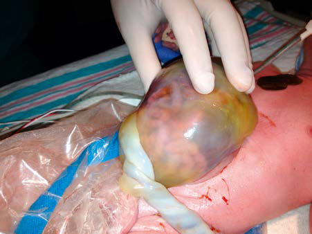
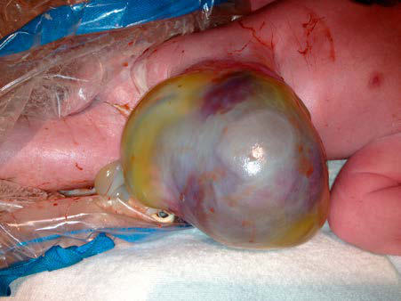

# Chapter 144: The Umbilicus
> **Course:** Vikkypaedia Pediatric Basic Course (*Nelson Textbook of Pediatrics, 22nd Edition (2025)*)  
> **Part X:** The Fetus and the Neonatal Infant  
> **Authors:** Eric C. Eichenwald  
> **Metrics:** 1,789 words · 0 tables/boxes · 2 figures · 0 genes · 8 flashcards · 5 MCQs  
> **Quick Navigation:** [🃏 Study 8 Flashcards](../flashcards/144_flashcards.md) · [📝 Take 5-Q MCQ Quiz](../mcqs/144_mcqs.md) · [📚 Part X Guide](../parts/Part_X.md) · [🧬 Syndrome & Genetics Atlas](../omim_gene_atlas.md) · [💊 Therapeutics Matrix](../therapies_matrix.md) · [🏠 Course Index](../../index.md)

## ⚡ High-Yield Nelson Pediatric Board Pearls
- The most common remnant of the OMD is a Meckel diverticu lum, whereas abnormalities that would become symp tomatic in the neonatal period include a sinus or fistula that would drain mucus or intestinal contents through the umbilicus.
- UMBILICAL HERNIA Often associated with diastasis recti, an umbilical hernia is caused by incomplete closure or weakness of the muscular umbilical ring.
- Omphalocele can be part of welldefined syndromes, including Beckwith-Wiedemann syndrome, characterized by omphalocele, macrosomia, and hypoglycemia.
- Non-immune hydrops fetalis: a short review of etiology and pathophysiology.

---
## Full Chapter Text, Tables & Figures
# Chapter 144: The Umbilicus

*Eric C. Eichenwald*

<!-- p.1446 -->
Various associated malformations

Chromosomal

syndrome

Cardiovascular

disorders

Renal disorders

Placental disorders

Twinning

Disturbed neurologic functioning

Hypotonia or hypomobility

decreased movements chest wall

Increased intrathoracic pressure

Obstruction venous flow

Possible Possible

**Increased interstitial**

**fluid accumulation**

**NIHF**

Increased

central venous pressure

Cystic adenomatoid

malformation Extralobar sequestration

Mediastinal teratoma

Skeletal dysplasia

Congestive heart failure

Volume overload

Fluid accumulation

Imbalance

interstitial

fluid production

Receptor

Hyperviscosity

reduced perfusion

Increased oxygen

extraction redistribution

blood flow increased cardiac

output

Liver failure

Possible

Lymphatic

dysplasia

Reduced

lymph

flow

Low plasma oncotic pressure

Protein-losing

enteropathy

Donor Anemia

Hematologic

disorders

Infections Inborn errors of metabolism

Gastrointestinal

disorders

Hypoxia

Cardiac failure increased umbilical

venous pressure

Decreased cardiac

output

Obstructed outflow diverted blood flow abnormal venous return abnormal ventricular filling

decreased inotropic force reversed blood flow in IVC

**Fig. 143.2** Impact of various etiologies for nonimmune hydrops on fluid homeostasis. IVC, Inferior vena cava; NIHF, nonimmune hydrops fe talis. (Adapted from Bellini C, Hennekam RCM. Non-immune hydrops fetalis: a short review of etiology and pathophysiology. Am J Med Genet. 2012;158A:597–605.)

The umbilical cord typically consists of two umbilical arteries, the umbili cal vein, and a gelatinous substance called Wharton jelly, all contained within a sheath derived from the amnion and coiled into a helical shape. The muscular umbilical arteries carry deoxygenated blood from the fetus to the placenta and are contiguous with the fetal internal iliac arteries. The umbilical vein carries oxygenated blood from the placenta back to the fetus, where it flows into the inferior vena cava by way of the ductus veno sus. The placenta contains an estimated 20 mL/kg of blood; current recom mendations are to delay clamping of the cord at delivery for 30-60 seconds in both term and preterm infants, to facilitate placental transfusion. At term, a normal umbilical cord is approximately 55 cm long. Abnormally short cords are associated with conditions causing decreased fetal move ment, including fetal hypotonia, oligohydramnios, and uterine constraint, and lead to increased risk for complications during labor and delivery for both mother and infant. Long cords (>70 cm) increase the risk for true knots, wrapping around the fetus, and/or prolapse. Straight uncoiled cords are associated with anomalies, fetal distress, and intrauterine fetal demise.

When the cord is cut after birth, portions of these structures remain in the base but gradually become obliterated. The blood vessels are function ally closed but anatomically patent for 10-20 days. The umbilical arteries become the lateral umbilical ligaments; the umbilical vein, the ligamentum teres; and the ductus venosus, the ligamentum venosum. The umbilical

cord stump usually sloughs within 2 weeks. Delayed separation of the cord, after more than 1 month, has been associated with neutrophil chemotactic defects and overwhelming bacterial infection (see Chapter 168).

A single umbilical artery is present in approximately 5-10/1,000 births; the frequency is higher (35-70/1,000) in twin births. It is estimated that 20–30% of infants with a single umbilical artery have other (and often mul tiple) congenital structural abnormalities. The presence of multiple anom alies is suggestive of an abnormal karyotype, including trisomies. Infants with an isolated single umbilical artery are not thought to be at increased risk of having a chromosomal anomaly, and no specific evaluation is indi cated for these infants aside from a thorough physical examination.

The **omphalomesenteric duct (OMD)** is an embryonic connection between the developing midgut and the primitive yolk sac. It typically involutes at 8-9 weeks’ gestation, but failure of this process can leave an abnormal connection between the umbilical cord and the gastrointestinal (GI) tract. The most common remnant of the OMD is a **Meckel diverticu lum** (see Chapter 377), whereas abnormalities that would become symp tomatic in the neonatal period include a **sinus** or **fistula** that would drain mucus or intestinal contents through the umbilicus. An umbilical **polyp** is one of the least common OMD remnants and represents exposed GI mucosa at the umbilical stump. The tissue of the polyp is bright red, firm, and has a mucoid secretion. Therapy for all OMD remnants is surgical excision of the anomaly.

A **persistent urachus** (urachal cyst, sinus, patent urachus, or diverticu lum) is a result of failure of closure of the allantoic duct and may be asso ciated with bladder outlet obstruction. Patency should be suspected if a clear, light-yellow, urine-like fluid is being discharged from the umbilicus. Symptoms include drainage, a mass or cyst, abdominal pain, local ery thema, and infection. Urachal anomalies should be investigated by ultra sonography and a cystogram. Therapy for a persistent urachus is surgical excision of the anomaly and correction of any bladder outlet obstruction if present.

*Eric C. Eichenwald*

<!-- p.1448 -->
**UMBILICAL HEMORRHAGE** Hemorrhage from the umbilical cord may be the result of trauma, inad equate ligation of the cord, or failure of normal thrombus formation. It may also indicate hemorrhagic disease of the newborn or other coagu lopathies (especially factor XIII deficiency), septicemia, or local infec tion. The infant should be observed frequently during the first few days of life so that if hemorrhage does occur, it will be detected promptly.

**UMBILICAL GRANULOMA** The umbilical cord stump usually dries and separates within 1-2 weeks after birth. The raw surface becomes covered by a thin layer of skin; scar tissue forms, and the wound is usually healed within 12-15 days. The pres ence of saprophytic organisms delays separation of the cord and increases the possibility of invasion by pathogenic organisms. Mild infection or incomplete epithelialization may result in a moist, granulating area at the base of the cord with a slight mucoid or mucopurulent discharge. Good results are usually obtained by cleansing with alcohol several times daily.

Persistence of granulation tissue at the base of the umbilicus is com mon. The tissue is soft, 3-10 mm in size, vascular and granular, colored dull red or pink, and may have a seropurulent discharge. Granulation tissue is treated by cauterization with silver nitrate, repeated at intervals of several days until the base is dry.

**UMBILICAL INFECTIONS** The devitalized umbilical cord provides an ideal medium for bacterial growth and a potential portal of entry for microbes. The term **omphalitis** refers to infection of the umbilical cord stump, navel, or the surrounding abdominal wall. Omphalitis must be distinguished from local irritation from the umbilical cord clamp. Erythema that extends to the abdominal wall, particularly tracking superiorly is concerning. Most term infants with mild localized omphalitis appear well and are afebrile. However, ∼10–15% are acutely ill and at risk for bacteremia, spreading cellu litis, necrotizing fasciitis, and extension into the portal vein and liver. **Necrotizing fasciitis** (which is often polymicrobial) is associated with a high mortality rate and is often associated wth neutropenia. Treatment of omphalitis includes prompt antibiotic therapy with agents effective against *Staphylococcus aureus* and *Escherichia coli*, such as an antistaphy lococcal penicillin or vancomycin in combination with an aminoglyco side. If abscess formation or necrotizing fasciitis has occurred, surgical consultation for incision and drainage or debridement may be required.

In community and primary care settings in developing countries, topical application of chlorhexidine to the umbilical cord has been shown to reduce omphalitis and neonatal mortality. In hospital settings in developed countries, there is no convincing evidence that application of antiseptics (including triple dye, alcohol, or chlorhexidine) is superior to *dry cord care* in minimizing the risk of omphalitis for infants in these settings, although these treatments do reduce bacterial colonization.

**UMBILICAL HERNIA** Often associated with **diastasis recti**, an umbilical hernia is caused by incomplete closure or weakness of the muscular umbilical ring. Predispos ing factors include Black race and low birthweight. The hernia appears as a soft swelling covered by skin that protrudes during crying, coughing, or straining and can be reduced easily through the fibrous ring at the umbi licus. The hernia consists of omentum or portions of the small intestine. The size of the defect varies from <1 cm in diameter to as much as 5 cm (2 inches), but larger defects are rare. Most umbilical hernias that appear before age 6 months disappear spontaneously by 1 year. Even large hernias (5-6 cm in all dimensions) have been known to disappear spontaneously by 5-6 years. Strangulation of intestinal contents is *extremely rare*. Surgery is not advised unless the hernia persists to age 4-5 years, causes symptoms, becomes strangulated, or becomes progressively larger after age 1-2 years. Defects exceeding 2 cm are less likely to close spontaneously.

**CONGENITAL OMPHALOCELE** An **omphalocele** is a herniation or protrusion of the abdominal contents into the base of the umbilical cord (Fig. 144.1). In con trast to the more common umbilical hernia, the sac is covered with peritoneum without overlying skin, and the insertion of the distal umbilical cord into the sac itself distinguishes this condition from other abdominal wall defects such as gastroschisis. The size of the

sac that lies outside the abdominal cavity depends on its contents. Herniation of intestines into the cord occurs in approximately 1/5,000 births, and herniation of liver and intestines in 1/10,000 births. The abdominal cavity may be proportionately small because of the lack of space-occupying viscera. Treatment for an omphalo cele consists of covering the sac with moist, sterile dressings, then initiating prompt surgical repair if the abdomen is able to accom modate the eviscerated organs. If the omphalocele is too large to allow immediate repair, continued dressings may temporize and encourage epithelialization of the sac. Occasionally, mesh or similar synthetic material may be used to cover the viscera if the sac has ruptured or if excessive mobilization of the tissues would be neces sary to cover the mass and its intact sac.

Many infants with omphalocele (50–70%) have associated mal formations, and about 30% have chromosomal abnormalities. The likelihood of an abnormal karyotype is increased when the liver is *intracorporeal* (not within the sac). Omphalocele can be part of welldefined syndromes, including **Beckwith-Wiedemann syndrome**, characterized by omphalocele, macrosomia, and hypoglycemia. The survival rate for affected infants is largely determined by the pres ence of associated malformations or chromosomal abnormalities. For patients with isolated omphalocele, the survival rate is >90%.

**UMBILICAL TUMORS** Tumors of the umbilicus are rare and include angioma, enterotera toma, dermoid cyst, myxosarcoma, and cysts of urachal or OMD remnants.

*Visit Elsevier eBooks+ at eBooks.Health.Elsevier.com** for Bibliography.*

A

B

**Fig. 144.1** A, Omphalocele with umbilical cord insertion into the sac and intestine visible. B, Omphalocele with sac containing liver. (Cour tesy Dr. Foong Lim, Cincinnati Fetal Center at Cincinnati Children’s Hos pital Medical Center.)

<!-- p.1449 -->
