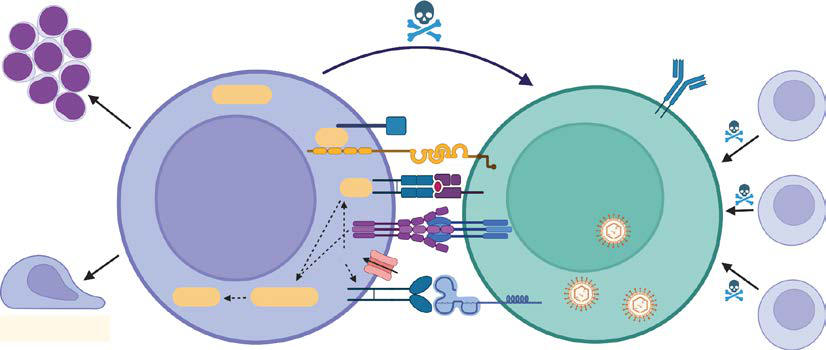

# Chapter 174: Immune Dysregulation
> **Course:** Vikkypaedia Pediatric Basic Course (*Nelson Textbook of Pediatrics, 22nd Edition (2025)*)  
> **Part XII:** Immunology  
> **Authors:** Danielle E. Arnold and Jennifer W. Leiding  
> **Metrics:** 6,251 words · 8 tables/boxes · 2 figures · 48 genes · 8 flashcards · 5 MCQs  
> **Quick Navigation:** [🃏 Study 8 Flashcards](../flashcards/174_flashcards.md) · [📝 Take 5-Q MCQ Quiz](../mcqs/174_mcqs.md) · [📚 Part XII Guide](../parts/Part_XII.md) · [🧬 Syndrome & Genetics Atlas](../omim_gene_atlas.md) · [💊 Therapeutics Matrix](../therapies_matrix.md) · [🏠 Course Index](../../index.md)

## Key Chapter Topics & Subchapters
`174.1 Tregopathies` · `174.2 Hemophagocytic Lymphohistiocytosis` · `174.3 Epstein-Barr Virus Susceptibility Disorders` · `174.4 Chronic Active Epstein-Barr Virus` · `174.5 Very Early Onset Inflammatory Bowel Disease` · `174.6 Autoimmune Cytopenias` · `174.7 Autoimmune Lymphoproliferative Syndrome` · `174.8 Nuclear Factor-κB Pathway Defects` · `174.1 Tregopathies Danielle E. Arnold and Jennifer W. Leiding` · `174.2 Hemophagocytic Lymphohistiocytosis Danielle E. Arnold and Jennifer W. Leiding` · `174.3 Epstein-Barr Virus Susceptibility Disorders Danielle E. Arnold and Jennifer W. Leiding` · `174.4 Chronic Active Epstein-Barr Virus Danielle E. Arnold and Jennifer W. Leiding`

## Key Genetic & Molecular Targets
`AICDA`, `AR`, `BACH2`, `BTK`, `CASP10`, `CD27`, `CD3`, `CD4`, `CD40LG`, `CD70`, `CD8`, `COL7A1`, `CORO1A`, `CTLA4`, `CTPS1`, `CYBB`

## ⚡ High-Yield Nelson Pediatric Board Pearls
- Diagnosis In a patient with early-onset, severe, or difficult to control autoim munity, endocrinopathy, colitis, or nonmalignant lymphoproliferative disease, a diagnosis of a Tregopathy should be considered.
- Next genera tion sequencing via a targeted panel and/or whole exome sequencing is necessary to establish a genetic diagnosis.
- Immune dysregulation, polyendocrinopathy, enteropathy, X-linked (IPEX) syndrome is caused by a pathogenic variant in the FOXP3 gene, which encodes a forkhead-winged helix transcription factor (scurfin) involved in the function and development of CD4+ CD25+ Tregs.
- Tregs are characterized by expression of the cell surface markers CD4+, CD25high and CD127low/−, and transcription factor FOXP3.
- Treatment Inhibition of T-cell activation by cyclosporine, tacrolimus, or sirolimus with corticosteroids is the treatment of choice, along with the specific care of the endocrinopathy and other manifestations of autoimmunity.
- Clinical, immunological, and molecular het erogeneity of 173 patients with the phenotype of immune dysregula tion, polyendocrinopathy, enteropa thy, X-linked (IPEX) syndrome.
- Clinical Manifestations, Diagnosis, and Treatment More than 50% of patients with EBV susceptibility disorders expe rience at least one episode of EBV lymphoproliferative disease.

---
## Full Chapter Text, Tables & Figures
# Chapter 174: Immune Dysregulation

*Danielle E. Arnold and Jennifer W. Leiding*

<!-- p.1703 -->
*Primary immune dysregulatory diseases (PIRDs)* are a recognized subset of primary immunodeficiencies that are characterized by hyperinflamma tion, organ-specific and systemic autoimmunity, endocrinopathy, enter opathy, and nonmalignant lymphoproliferation. Clinical manifestations of immune dysregulation should lead to a consideration of PIRD. Genetic testing can confirm a diagnosis. Targeted treatments are available for many PIRDs and hematopoietic cell transplant (HCT) is often curative.

## 174.1  Tregopathies Danielle E. Arnold and Jennifer W. Leiding

Tregopathies are a subset of primary immunodeficiency diseases recog nized by the International Union of Immunologic Societies. The clinical manifestations of these diseases are variable, but all involve some degree of immune dysregulation manifesting as autoimmunity, hyperinflamma tion, cancer predisposition, and/or lymphoproliferative disease.

**PATHOPHYSIOLOGY** T regulatory (Treg) cells are specialized T cells responsible for the maintenance and self-tolerance of immune responses (Fig. 174.1). These cells are responsible for suppressing production of proinflam matory cytokines and growth factors and suppressing T-cell prolifera tion. The transcription factor FOXP3 is essential for the regulatory function of Treg cells. Several subsets of Treg cells exist, each char acterized by unique features. Thymic-derived Treg cells (tTreg) (CD4+CD25+FOXP3+) account for ∼5% of total CD4+ T cells in the peripheral blood. FOXP3+ Treg cells can also differentiate outside of the thymus in peripheral tissues. These cells are known as peripher ally induced regulatory (pTreg) cells. A number of monogenic diseases (Table 174.1) of the immune system that affect the number and/or function of Treg cells have been described. By reducing the effect of Treg cells, T-cell activation and proliferation are unrestrained. This lack

of regulation or inhibition manifests as immune dysregulation. Clinical symptoms of these disorders include early onset multiorgan autoim munity, endocrinopathy, enteropathy, colitis, and lymphoproliferation.

**Diagnosis** In a patient with early-onset, severe, or difficult to control autoim munity, endocrinopathy, colitis, or nonmalignant lymphoproliferative disease, a diagnosis of a Tregopathy should be considered. Next genera tion sequencing via a targeted panel and/or whole exome sequencing is necessary to establish a genetic diagnosis.

**Treatment** Targeted treatment is available for several Tregopathies (see Table 174.1). Abatacept, a CTLA4-Ig fusion protein, has been used suc cessfully in the treatment of refractory cytopenias, interstitial lung disease, and lymphoproliferation in CTLA4 haploinsufficiency and lipopolysaccharide-responsive and beigelike anchor protein (LRBA) deficiency. Jakinibs are a class of medications that inhibit Janus kinase activation of certain STAT transcription factors. Jakinibs have been used successfully to treat immune dysregulatory and autoimmune symptoms in gain-of-function of STAT1 and STAT3 diseases. HCT can provide a curative option for many Tregopathies.

**IMMUNE DYSREGULATION POLYENDOCRINOPATHY, ENTEROPATHY, X-LINKED SYNDROME** This immune dysregulation syndrome is characterized by onset within the first few weeks or months of life with watery diarrhea (autoimmune enteropathy), an eczematous rash (erythroderma in neonates), insulindependent diabetes mellitus, hyperthyroidism or more often hypothyroid ism, severe allergies, and other autoimmune disorders (Coombs-positive hemolytic anemia, thrombocytopenia, neutropenia). Psoriasiform or ich thyosiform rashes and alopecia have also been reported.

Immune dysregulation, polyendocrinopathy, enteropathy, X-linked **(IPEX)** syndrome is caused by a pathogenic variant in the *FOXP3* gene, which encodes a forkhead-winged helix transcription factor *(scurfin)* involved in the function and development of CD4+ CD25+ Tregs. The absence of Tregs may predispose to abnormal activation of effector T cells. Variants in multiple other genes also produce an **IPEX-like syn drome** (see Table 174.1; Fig. 174.2).

**Clinical Manifestations** Watery diarrhea with intestinal villous atrophy leads to failure to thrive in most patients. Cutaneous lesions (usually eczema) and insulin-dependent diabetes begin in infancy. Lymphadenopathy and splenomegaly are also present. Serious bacterial infections (meningitis, sepsis, pneumonia, osteo myelitis) may be related to neutropenia, malnutrition, or immune dysreg ulation. Laboratory features reflect the associated autoimmune diseases, dehydration, and malnutrition. In addition, serum IgE levels are elevated,

*Danielle E. Arnold and Jennifer W. Leiding*

**Fig. 174.1** Immunosuppressive mechanisms underlying Treg-mediated immune suppression. Tregs are characterized by expression of the cell surface markers CD4+, CD25high and CD127low/−, and transcription factor FOXP3. Tregs modulate the immune system using their suppres sive molecules PD-1, CTLA-4, and CD39, and various surface receptors through inhibition of dendritic cell (DC) function and maturation, through the secretion of anti-inflammatory cytokines such as IL-10, TGF-β, and IL-35, and/or through direct inhibition of Teff via induction of cytolysis using granzyme and metabolic disruption. Moreover, Tregs can reduce Teff activation by limiting TCR-ligand binding. DC, dendritic cell; TCR, T cell receptor; Teff, effector T cell; Treg, regulatory T cell. (From Kempkes RWM, Joosten I, Koenen HJPM, He X. Metabolic pathways involved in regulatory T cell functionality. Front Immunol. 2019;10:2839. Fig. 1.) Metabolic disruption

Cytolysis with granzyme

Anti-inflammatory

cytokines

**DC**

**Teff**

TCR-mediated

activation

Function and maturation

CD73

CD39 CTLA-4 PD-1 CD25 CD4

**Treg**

FOXP3

Section **5 Immune Dysregulation**

<!-- p.1704 -->
with normal levels of IgM, IgG, and IgA. The diagnosis is initially made clinically and confirmed by genetic testing (exome or panels).

**Treatment** Inhibition of T-cell activation by cyclosporine, tacrolimus, or sirolimus with corticosteroids is the treatment of choice, along with the specific care of the endocrinopathy and other manifestations of autoimmunity. These agents are typically used as a bridge to transplant. HCT is the only possibility for curing IPEX. Janus kinase inhibitors have been used in patients with IPEX-like syndromes.

## 174.2  Hemophagocytic Lymphohistiocytosis Danielle E. Arnold and Jennifer W. Leiding

Hemophagocytic lymphohistiocytosis (HLH) is a severe systemic hyperinflammatory syndrome that can be aggressive and lifethreatening. Classic features include fever, cytopenia, hepatospleno megaly, coagulopathy, and elevations in inflammatory markers.

**Primary or genetic HLH** is due to pathogenic variants in genes that predispose patients to HLH by a variety of mechanisms and includes classic familial HLH due to pathogenic variants in *PRF1*, *UNC13D*, *STX11,* and *STXBP2*; certain pigmentary disorders; and other primary

#### **Table 174.1** Tregopathies

| Category / Parameter | Clinical Details & Findings |
| --- | --- |
| **FOXP3** | IPEX syndrome |
| **XL** | Enteropathy, type 1 diabetes, eczema,; FTT, autoimmune cytopenias,; thyroiditis, hepatitis; Tacrolimus, cyclosporine; Allogeneic HCT |
| **IL2RA** | CD25 deficiency |
| **AR** | Enteropathy, eczema,; lymphoproliferation, recurrent; infections; Allogeneic HCT |
| **ALPSV** | CTLA4 haploinsufficiency |
| **AD** | Enteropathy, type 1 diabetes,; autoimmune cytopenias, interstitial; lung disease; Sirolimus; Abatacept, belatacept; Allogeneic HCT |
| **LRBA** | LRBA deficiency |
| **AR** | Enteropathy, type 1 diabetes,; autoimmune cytopenias, interstitial; lung disease; Abatacept, belatacept; Allogeneic HCT |
| **BACH2** | BACH2 deficiency |
| **AD** | Enteropathy, lymphoproliferation,; recurrent respiratory tract infections,; infections; Allogeneic HCT |
| **AD, GOF** | Enteropathy, autoimmune cytopenias,; lymphoproliferation, type 1; diabetes, recurrent infections; Jakinibs; Allogeneic HCT |
| **AD, AR** | Eczema, growth hormone deficiency,; infections, enteropathy, JIA, ITP,; chronic lung disease; Symptom specific therapy, |
| **HCT** | IPEX, Immune dysregulation, polyendocrinopathy, enteropathy, X-linked; XL, X-linked; FTT, failure to thrive; HCT, hematopoietic cell transplant; AR, autosomal recessive; CTLA,; cytotoxic T-lymphocyte protein; ALPSV, autoimmune lymphoproliferative disease V; AD, autosomal dominant; LRBA, lipopolysaccharide-responsive and beigelike anchor protein;; BACH, broad complex-tramtrack-bric a brac and Cap’n’collar homology; STAT, signal transducer and activator of transcription; GOF, gain of function; JIA, juvenile idiopathic arthritis;; ITP, immune thrombocytopenic purpura. |

**Fig. 174.2** Clinical manifestations in the IPEX-like cohorts. (Modified from Gambineri E, Ciullini Man nurita S, Hagin D, et  al. Clinical, immunological, and molecular het erogeneity of 173 patients with the phenotype of immune dysregula tion, polyendocrinopathy, enteropa thy, X-linked (IPEX) syndrome. Front Immunol. 2018;9:2411. Fig. 5.)

Enteropathy

Skin disease

Endocrinopathy

Hematologic disease

Pulmonary

Cardiovascular

Renal

Hepatic

Lymphadenopathy

Arthritis/vasculitis

Neurologic

Serious infections

0% 10% 20% 30% 40% 50% 60% 70% 80% 90% 100%

IPEX-like IPEX

<!-- p.1705 -->

<!-- p.1706 -->
immunodeficiencies or immune regulatory disorders (see Chapter 556.2; Fig. 174.3). Primary HLH is seen most frequently in pediatric patients but may occur at all ages.

**Secondary HLH** occurs in the setting of a medical condition that results in intense immune activation such as severe infection, malignancy, or rheumatologic disease. Many primary immune deficiencies (PIDs) are also associated with an increased risk of HLH, usually in the setting of infection. HLH has been reported in patients with severe combined immune deficiency and chronic granulomatous disease, but secondary HLH has been seen in a wide variety of PID. Several inborn errors of metabolism can also present with secondary HLH.

Of note, patients with primary or genetic HLH often present with HLH triggered by or “secondary” to infection or other immune activating events.

For more details see Chapter 556.2.

*Visit Elsevier eBooks+ at eBooks.Health.Elsevier.com** for Bibliography.*

## 174.3  Epstein-Barr Virus Susceptibility Disorders Danielle E. Arnold and Jennifer W. Leiding

Epstein-Barr virus (EBV) is a gamma-herpes family virus with a marked tropism for B cells. Most individuals experience asymptomatic infection or infectious mononucleosis, a self-limiting lymphoproliferative disease that is particularly common in adolescents. EBV is also an oncogenic virus and may induce several types of neoplasms, including B-cell, T-cell, and natural killer (NK) cell lymphomas; nasopharyngeal and gastric carcinomas; and EBV-associated smooth muscle cell tumors.

During primary infection, EBV-infected B cells are eliminated by EBV-specific cytotoxic T cells as well as other innate cytotoxic lym phocytes such as NK cells, γδ T cells, and invariant natural killer T (iNKT) cells. However, some EBV-infected B cells escape the immune response, establishing a reservoir for EBV that may reactivate

anakinra IL-1

IL-18

IL-18 binding protein

Inflammasome

inflammasome

Macrophage

IL-6

Ferritin

Fever Inflammation Tissue damage

**Cytokine storm**

ruxolitinib

emapalumab IFN-γR

IFN-gamma

sIL-2R

Tissue

Infiltration

IL-6R

tocilizumab

perforin

granzyme

perforin pore

**XIAP**

**PRF1 UNC13D STX11 STXBP2 LYST RAB27A AP3B1**

Cell apoptosis

MHC1-TCR Complex

alemtuzumab CD52

IL-12R

IL-12

Cytotoxic T cell

Infected B cell

EBV

EBV EBV

**NLRC4**

**XIAP**

**Fig. 174.3** Hemophagocytic lymphohistiocytosis (HLH). HLH is a severe systemic inflammatory syndrome due to abnormal reciprocal macrophage and cytotoxic lymphocyte hyperactivation, resulting in cytokine storm, hemophagocytosis, and tissue infiltration by activated immune cells. Primary HLH genes associated with defective granule-mediated cytotoxicity or inflammasome dysregulation are shown in red. Common nonsteroidal immu nosuppressive agents frequently used to treat HLH are also shown. EBV, Epstein-Barr virus; IFN, interferon; IL, interleukin; MHC, major histocompat

<!-- p.1707 -->

<!-- p.1708 -->
throughout an individual’s life. These reactivations are typically asymptomatic in healthy individuals; however, in immunocompro mised persons, EBV reactivations and persistence and expansion of latently infected B lymphoblasts may result in symptomatic and often severe disease.

**PATHOPHYSIOLOGY** There are several primary combined immunodeficiencies charac terized by a very high predisposition to EBV infection, some of which are listed in Table 174.2. These disorders are due to defects in pathways involved in T- and B-cell interaction and crosstalk (Fig. 174.4). Disruption of these pathways results in aberrant cytotoxic T-cell activation, migration, proliferation, and/or cytolytic activity in response to antigenic stimulation and, thus, impaired immune surveillance of B cells by T cells. Marked decrease or absence of

iNKT cells, mucosal-associated invariant T (MAIT) cells, and/or NK cells and impaired NK cell function are also often observed.

**Clinical Manifestations, Diagnosis, and Treatment** More than 50% of patients with EBV susceptibility disorders expe rience at least one episode of EBV lymphoproliferative disease. Patients are also susceptible to other EBV-driven pathologies, including HLH and both Hodgkin and non-Hodgkin lymphoma. Other severe viral infections (e.g., other herpesviruses, human herpesvirus 6 [HHV-6]), bacterial infections, particularly recur rent pulmonary infections, and hypogammaglobulinemia and/ or dysgammaglobulinemia are also common. Diagnosis for these disorders is with a full immune evaluation and genetic testing. Treatment includes rituximab (anti-CD20 antibody) to eliminate EBV-infected B cells, treatment of infections, and immunoglobulin

#### **Table 174.2** Primary or Genetic EBV Susceptibility Disorders

| Category / Parameter | Clinical Details & Findings |
| --- | --- |
| **MAGT1** | XMEN (X-linked; immunodeficiency; w/Mg2+ defect,; EBV infection and; neoplasia); transporter; ↓ NKG2D; expression results in; defective cytotoxicity; Chronic EBV infection; rather than full-scale; HLH, viral infections, lung; infections, autoimmune; cytopenia, lymphoma; Allogeneic HCT |
| **ITK** | Lymphoproliferative; syndrome 1 |
| **AR** | Defective tyrosine kinase; function; defective; cytotoxic T-cell; expansion, and cytolytic; capacity; ↓ iNKT cells; Chronic EBV infection,; lung infections, PJP,; autoimmune cytopenia,; lymphoma; Allogeneic HCT |
| **CD27** | Lymphoproliferative; syndrome 2 |
| **AD** | CD27 is a co-stimulatory; molecule on T cells;; required for normal; T-cell proliferation and; cytotoxicity against EBV-; infected B cells;; ↓ iNKT cells; Chronic EBV infection,; lung infections, uveitis,; oral and anal ulcers,; hypogammaglobulinemia,; lymphoma; Allogeneic HCT |
| **CD70** | Lymphoproliferative; syndrome 3 |
| **AR** | CD70 expressed by EBV-; infected B cells interacts; with CD27 on T cells;; required for normal; expansion and cytotoxicity; of T cells; ↓ NKG2D and; 2B4 expression;; ↓ iNKT cells; Chronic EBV infection, lung; infections, lymphoma; Allogeneic HCT |
| **CTPS1** | CTPS1 deficiency |
| **AR** | Enzyme involved in de novo; synthesis of; cytidine nucleotide; triphosphate (CTP);; deficiency leads to; impaired T-cell; proliferation; ↓ iNKT cells; Chronic EBV infection,; viral infections, lung; infections, meningitis,; eczema, lymphoma; Allogeneic HCT |
| **CORO1A** | CORO1A deficiency |
| **AR** | Actin regulator;; T lymphopenia,; impaired immunologic; synapse formation and; intracellular signaling;; ↓ iNKT cells; Chronic EBV infection; rather than HLH,; viral infections, lung; infections, neurologic; involvement, lymphoma; Allogeneic HCT |
| **RASGRP1** | RASGRP1 deficiency |
| **AR** | Activates RAS, which; leads to MAPK pathway; activation; defects in; T-cell activation,; proliferation, and; migration;; ↓ iNKT cells; Chronic EBV infection,; viral infections, lung; infections, autoimmune; cytopenia, EBV negative; lymphoproliferative; disease, lymphoma; Allogeneic HCT; *Treatment should include HLH-directed therapy, treatment of infections and malignancy, and other supportive care measures as appropriate.; EBV, Epstein-Barr virus; AR, autosomal recessive; XL, X-linked; AD, autosomal dominant; TNF, tumor necrosis factor; iNKT, invariant NK T cell; CNS, central nervous system; HSM,; hepatosplenomegaly; PJP, Pneumocystis jiroveci pneumonia; HCT, hematopoietic cell transplantation. |

<!-- p.1709 -->
replacement when indicated. Allogeneic HCT is the only curative treatment available.

**Other Primary Immunodeficiencies Associated with Epstein-Barr Virus Lymphoproliferative Disease** Herpesvirus infections and EBV lymphoproliferative disease are also seen to a lesser extent in several other combined immunodeficien cies associated with T-cell defects, particularly those affecting T-cell survival and mobilization. Classic examples include Wiskott-Aldrich syndrome, DOCK8 deficiency, GATA2 haploinsufficiency, and acti vated PI3K-delta syndrome, among others. Severe EBV infections may also be seen in patients with hypomorphic or leaky severe combined immunodeficiency.

Any patient who presents with prolonged and/or severe EBV lym phoproliferative disease or EBV-positive lymphoma warrants evalua tion for an underlying primary immunodeficiency.

*Visit Elsevier eBooks+ at eBooks.Health.Elsevier.com** for Bibliography.*

## 174.4  Chronic Active Epstein-Barr Virus Danielle E. Arnold and Jennifer W. Leiding

Chronic active EBV (CAEBV) is a rare systemic EBV lymphoprolifera tive disorder characterized by fever, persistent lymphadenopathy, hepa tosplenomegaly, and hepatitis in the absence of an underlying primary or secondary immunodeficiency, malignancy, or autoimmune disorder.

**GENETIC PREDISPOSITION** CAEBV is seen primarily in persons of East Asian (Japan, Korea, China, and Taiwan) or Latin American (Indigenous people in Mexico and Central/South America) ancestry; in these patients, EBV is pre dominantly present in T cells or NK cells. Conversely, while rare, per sons of Western European descent typically have B-cell CAEBV. The uneven geographic distribution of CAEBV suggests that underlying genetic factors may contribute to the development of CAEBV; hetero zygous pathogenic variants in HLH predisposing genes (e.g., perforin) have been identified in patients with CAEBV. Causative genetic defects have not been identified in most cases.

**Pathophysiology** The mechanism of EBV entry into T cells or NK cells is unclear, but T cells and NK cells can express low levels of CD21, the EBV recep tor, during primary infection. The pathogenesis of CAEBV is less clear. Evidence suggests that EBV infection directly induces T-cell or NK cell survival via activation of several survival-promoting molecules

or pathways, including upregulation of co-stimulatory molecules that suppress apoptosis, activation of the NF-κB pathway, and upregulation of activation-induced cytidine deaminase, which acts as a genomic dis ruptor and has been shown to play a role in EBV-induced lymphoma genesis in B cells.

**Clinical Manifestations and Diagnosis** Clinical manifestations of CAEBV are heterogenous, ranging from a mild and indolent clinical course to a more aggressive and potentially fatal illness due to complications such as HLH, multisystem organ failure, and/or progression to leukemia or lymphoma. Clinical mani festations may by episodic, but patients typically have persistently and markedly elevated levels of EBV in the blood throughout their disease course. Infiltration of tissues by EBV-positive lymphocytes may result in organ failure (liver failure is commonly seen), and EBV-infected T cells and NK cells may undergo malignant transformation. The diagnostic criteria for CAEBV are listed in Table 174.3; CAEBV should be sus pected in any patient with sustained inflammation of unknown origin and chronically elevated EBV polymerase chain reaction (PCR) levels.

Evaluations to determine whether EBV is predominantly present in T cells or NK cells should be undertaken, if possible, in patients with CAEBV. One method is EBV PCR on peripheral blood mononuclear cells that have been sorted by flow cytometry, although this test is not widely available. Histologic examination of tissue that has been infil trated by EBV-infected lymphocytes by immune staining and in situ hybridization of EBV-encoded mRNA (EBER) is another approach.

## Treatment Treatment options in severe cases are limited, and clinical responses are mostly transient. Some therapeutic approaches include

T cell expansion

CD8+ T cell

T cell migration

SLAMF6

CD48

2B4

Mg

↑ CTP

MICA

Infected B cell

EBV

EBV

EBV

iNKT

NK cell

γδT cell

**CORO1A**

**SAP**

**ITK**

**CD27**

**RASGRP1 CTPS1**

**MAGT1**

**CD70**

NKG2D

**Fig. 174.4** Epstein-Barr virus (EBV) susceptibility disorders. Combined immunodeficiencies characterized by a very high predisposition to EBV lymphoproliferative disease are shown in red. These genes/proteins play essential roles in the recognition of EBV-infected B cells by T cells and in cytotoxic T-cell activation, migration, proliferation, and/or cytotoxic activity. As such, defects in any of these components allow for EBV-infected B-cell immune escape. Invariant natural killer T (iNKT) cell, NK cell, and γδT-cell numbers and/or function may also be low or aberrant, respectively.

Criteria

#### **Table 174.3** Chronic Active EBV (CAEBV) Diagnostic

| Category / Parameter | Clinical Details & Findings |
| --- | --- |
| **General** | All 4 criteria must be present:; 1.	 Sustained or recurrent infectious mononucleosis-like symptoms; persisting for >3 mo; 2.	 EBV PCR >102.5 copies/μg DNA in the peripheral blood or tissue; lesion; 3.	 Evidence of EBV infection of T or NK cells in the peripheral blood; or affected tissues; 4.	 Exclusion of other diagnoses: primary EBV infection, primary or; secondary immunodeficiency, malignancy, autoimmune disease; EBV, Epstein-Barr virus; NK, natural killer; PCR, polymerase chain reaction. |

<!-- p.1710 -->

<!-- p.1711 -->
immunomodulatory therapy, combination bortezomib and ganciclo vir, and EBV-specific T cells. Patients with HLH should receive HLHdirected therapy. Standard antiviral therapy is not effective. Cytotoxic chemotherapy is also used to reduce disease activity and burden of EBV-infected lymphocytes, primarily as a bridge to HCT. Allogeneic HCT is the only definitive therapy available with overall survival rates as high as 87% in some reports. Patients with progressive disease remain difficult to transplant. As such, some advocate rapidly proceed ing to HCT early in the disease process, although the timing of HCT remains controversial.

*Visit Elsevier eBooks+ at eBooks.Health.Elsevier.com** for Bibliography.*

## 174.5  Very Early Onset Inflammatory Bowel Disease Danielle E. Arnold and Jennifer W. Leiding

Inflammatory bowel disease that presents in children less than 6 years of age is known as very early onset inflammatory bowel disease (VEO- IBD). Monogenic defects involved in primary immunodeficiency and intestinal barrier processes are enriched in children with VEO-IBD (Fig. 174.5). Targeted therapies in children with VEO-IBD with a monogenic defect have been successful in treating disease manifesta tions (see Chapter 382.3).

**DISEASE CLASSIFICATION AND CLINICAL PRESENTATION** Children diagnosed with IBD <2 years of age are referred to as *infantile*-onset IBD and those 2-6 years as VEO-IBD. Children present

with classic symptoms of IBD including weight loss, failure to thrive, abdominal pain, fever, constipation, diarrhea, hematochezia. The phe notype is heterogenous with some children having mild disease and others presenting with or developing more severe disease over time. Approximately 40% have extensive pancolonic disease at presentation. Extent, location, and histology can progress or change over time.

For more details see Chapter 382.3.

*Visit Elsevier eBooks+ at eBooks.Health.Elsevier.com** for Bibliography.*

## 174.6  Autoimmune Cytopenias Danielle E. Arnold and Jennifer W. Leiding

Autoimmune cytopenias are a group of disorders in which there is immune destruction of differentiated hematopoietic cells. Immune destruction can be autoantibody mediated or non-autoantibody medi ated. Single lineage disease can affect red cells (autoimmune hemolytic anemia [AIHA]), platelets (idiopathic thrombocytopenia purpura [ITP]), or neutrophils (autoimmune neutropenia [AIN]). Bilineage or trilineage disease can affect any combination of these cell lines. **Evan disease** is a combination of AIHA and ITP.

**PATHOPHYSIOLOGY** The etiology of autoimmune cytopenias as a manifestation of an inborn error of immunity is often multifactorial with autoantibody-mediated destruction or cellular-mediated destruction of red blood cells, plate lets, or neutrophils as the major causes of hemolysis (Table 174.4). In disorders with intrinsic B-cell defects and disrupted T- and B-cell interactions, autoantibody production toward hematopoietic cells can

Environmental trigger Intestinal microbiota

**Epithelial barrier** ADAM17 IKBKG COL7A1 TTC7A

**Neutrophil defects** CYBA, CYBB, NCF1, NCF2, NCF4 SLC37A4 G6PC3 ITGB2

**Immune regulation** FOXP3 IL2RA, IL2RB IL10, IL10RA, IL10RB CTLA4, LRBA STAT1, STAT3, STAT5b IL21, IL21R IL-10, TGF-β

**Adaptive immune response** RAG1/2 WAS ICOS PIK3R1, PTEN CTLA4, LRBA BTK DCLRE1C CD40LG AICDA

IL-1, IL-18

**Hyperactive / autoinflammatory** STXBP2 LYST RAGB27a MVK PLCG2 HPS1, 4, 6 SH2D1A

**Inflammasome dysregulation** XIAP NLRC4 MEFV

**Treg**

**Fig. 174.5** Very early onset inflammatory bowel disease. Complex host interactions between the environment, intestinal microbiota, and immune- related genes maintain gut health. Mutations in genes involved in epithelial barrier, neutrophil function, control of inflammation, and T- and B-cell function can manifest as very early onset inflammatory bowel disease. IL, Interleukin; TGF, transforming growth factor; Treg, T regulatory cell.

<!-- p.1712 -->

<!-- p.1713 -->

<!-- p.1714 -->
occur. When B-cell maturation is impaired, vital steps in the induction of tolerance are omitted. In addition to the humoral B-cell defects that can lead to autoimmune cytopenias, intrinsic defects in T-cell effector function can lead to cellular autoimmunity. Impaired T-cell develop ment can cause a lack of functional effector cells against non-self or “dangerous” antigens while allowing production of autoreactive clones with T-cell receptors directed against self-antigens. Additionally, T-cell defects may lead to a reduction in FOXP3+ Treg cells.

**Clinical Manifestations and Diagnosis** The clinical presentation of AIHA commonly includes dizziness, fatigue, pallor, jaundice, and exertional dyspnea (see Chapter 513). Complete blood count will show anemia and reticulocytosis. Addi tional features of hemolysis include hyperbilirubinemia, elevated lactate dehydrogenase, and decreased haptoglobin levels. Direct anti globulin testing is most often positive. ITP typically presents with bleeding episodes that can range from mild bruising, petechiae, and epistaxis to oral purpura, hematuria, menorrhagia, gastrointestinal hemorrhage, or intracranial bleeding (see Chapter 533.1). Severe life-threatening bleeding is rare. Laboratory findings include acute thrombocytopenia. Mean platelet volume is elevated or variable indi cating that large new platelets are being generated to compensate for loss. Autoantibodies against platelet glycoproteins may be positive but are not helpful in elucidating immune thrombocytopenia as they are positive in less than 65% of patients with immune thrombocy topenia and are not predictive, specific, or prognostic. AIN pres ents with low absolute neutrophil count (see Chapter 171). Clinical manifestations include aphthous stomatitis, periodontal disease, and increased frequency of soft tissue infections. Invasive infections and sepsis are rare. Antigranulocyte antibodies can be present.

**Immunodeficiencies Associated with Autoimmune Cytopenias** Autoimmune cytopenias, especially those that include bilineages and trilineages, are often a presenting symptom of or associated with primary immunodysregulatory disorders. Other organ-specific immunodysregulatory and autoimmune conditions are often pres ent. Next generation sequencing via whole exome sequencing or panel-based sequencing can aid in establishing a diagnosis. When an inborn error of immunity is suspected with the presence of auto immune cytopenias, a general immune screen should be performed including serum quantities of IgG, IgM, IgA, and IgE. Quantities of T cell, B cell, and NK cells should also be measured. Additional labs that may be helpful in narrowing a diagnosis of immunodeficiency include quantification of αβ+double negative T cells (CD4−CD8−), CD27+IgD+ and CD27+IgD− memory B cells, serum ferritin, soluble interleukin (IL)-2 receptor, IL-18, soluble Fas ligand, vitamin B12, and folate.

**Treatment** Targeted treatment of the primary immunodysregulatory disorder can control or resolve autoimmune cytopenias. Standard treatment of autoimmune cytopenias with or without a primary immunodysregu latory disorder include corticosteroids, intravenous immunoglobulin (IVIG), and biologic therapies such as rituximab and daratumumab (monoclonal antibody against CD38 expressed on long-lived plasma cells). Control of symptoms is often more difficult and may increase the suspicion for an underlying primary immunodysregulatory disorder.

*Visit Elsevier eBooks+ at eBooks.Health.Elsevier.com** for Bibliography.*

#### **Table 174.4** Monogenic Causes of Autoimmune Cytopenias and Primary Immunodeficiency

| Category / Parameter | Clinical Details & Findings |
| --- | --- |
| **TREATMENT** | PIK3 defects; Activated PI3K-; delta syndrome |
| **AD** | Insulin resistance, short; stature, nodular lymphoid; hyperplasia, lymphoma,; bronchiectasis; High IgM, low IgG,; low CD4/CD45RA; Allogeneic HCT; *Leniolisib, sirolimus |
| **AD, GOF** | Enteropathy, autoimmune; cytopenias,; lymphoproliferation,; recurrent infections; Elevated DNTs; Variable decreases in; IgG, IgA, IgM, B- and; T-cell quantities; Jakinibs; Allogeneic HCT |
| **AD, GOF** | Chronic mucocutaneous; candidiasis, cerebral; aneurysms, interstitial; lung disease, enteropathy,; colitis; Variable decreases in; IgG, IgA, IgM, B- and; T-cell quantities; Jakinibs; Allogeneic HCT |
| **CTLA4** | haploinsufficiency |
| **AD** | Enteropathy, type 1; diabetes, autoimmune; cytopenias, interstitial; lung disease; Low IgG, low T-cell; quantities; Sirolimus; Abatacept,; belatacept; Allogeneic HCT |
| **LRBA** | LRBA deficiency |
| **AR** | Enteropathy, type 1; diabetes, autoimmune; cytopenias, interstitial; lung disease; Low IgG, low T-cell; quantities; Abatacept,; belatacept; Allogeneic HCT |
| **GOF** | Lymphadenopathy,; lymphoma; Elevated DNTs; Mycophenolate; mofetil; Sirolimus; PI3K, Phosphoinositide 3 kinase; AD, autosomal dominant; LOF, loss of function; AD, autosomal dominant; GOF, gain of function; HCT, hematopoietic cell transplant; STAT, signal; transducer and activator of transcription; CTLA, cytotoxic T-lymphocyte protein; LRBA, lipopolysaccharide-responsive and beigelike anchor protein; ALPS, autoimmune lymphopro; liferative syndrome; DNT, double negative T cell. |

<!-- p.1715 -->

<!-- p.1716 -->

## 174.7  Autoimmune Lymphoproliferative Syndrome Danielle E. Arnold and Jennifer W. Leiding

Autoimmune lymphoproliferative syndrome **(ALPS)**, also known as Canale-Smith syndrome, is a disorder of abnormal lymphocyte apop tosis leading to polyclonal populations of T cells (double-negative T cells), which express CD3 and α/β antigen receptors but do not have CD4 or CD8 co-receptors (CD3+ T-cell receptor α/β+, CD4−CD8−). These T cells respond poorly to antigens or mitogens and do not pro duce growth or survival factors (IL-2). The genetic deficit in most patients is a germline or somatic pathologic variant in the *FAS* gene, which produces a cell surface receptor of the tumor necrosis factor (TNF) receptor superfamily (TNFRSF6), which, when stimulated by its ligand, will produce programmed cell death (Table 174.5). Persis tent survival of these lymphocytes leads to immune dysregulation and autoimmunity. ALPS is also caused by other genes in the Fas pathway (*FASLG* and *CASP10*). In addition, ALPS-like disorders are associated with other mutations: RAS-associated autoimmune lymphoprolif erative disorder (RALD), caspase-8 deficiency, Fas-associated protein with death domain deficiency (FADD), and protein kinase C delta defi ciency (PRKCD). These disorders have varying degrees of immunode ficiency, autoimmunity, and lymphoproliferation.

**CLINICAL MANIFESTATIONS** ALPS is characterized by **autoimmunity, chronic persistent or recurrent lymphadenopathy**, splenomegaly, hepatomegaly (in 50%), and hypergammaglobulinemia (IgG, IgA). Many patients present in the first year of life, and most are symptomatic by age 5 years. Lymphadenopathy can be striking (Fig. 174.6). Splenomegaly

Lymphoproliferative Syndrome*

#### **Table 174.5** Revised Diagnostic Criteria for Autoimmune

| Category / Parameter | Clinical Details & Findings |
| --- | --- |
| **REQUIRED** | 1.	 Chronic (>6 mo), nonmalignant, noninfectious lymphadenopathy,; splenomegaly or both; 2.	 Elevated CD3+ TCRαβ+ CD4-CD8- DNT cells (≥1.5% of total; lymphocytes or 2.5% of CD3+ lymphocytes) in the setting of; normal or elevated lymphocyte counts |
| **Primary** | 1.	 Defective lymphocyte apoptosis (in two separate assays); 2.	 Somatic or germline pathogenic mutation in FAS, FASLG, or CASP10 |
| **Secondary** | 1.	 Elevated plasma sFasL levels (>200 pg/mL) OR elevated plasma; interleukin-10 levels (>20 pg/mL) OR elevated serum or plasma; vitamin B12 levels (>1500 ng/L) OR elevated plasma interleukin-18; levels >500 pg/mL; 2.	 Typical immunohistologic findings as reviewed by an experienced; hematopathologist; 3.	 Autoimmune cytopenias (hemolytic anemia, thrombocytopenia,; or neutropenia) AND elevated immunoglobulin G levels; (polyclonal hypergammaglobulinemia); 4.	 Family history of a nonmalignant/noninfectious lymphoproliferation; with or without autoimmunity; *A definitive diagnosis is based on the presence of both required criteria plus one; primary accessory criterion. A probable diagnosis is based on the presence of both; required criteria plus one secondary accessory criterion.; DNT, Double-negative T cell; TCR, T-cell receptor.; From Petty RE, Laxer RM, Lindsley CB, Wedderburn LR, eds. Textbook of Pediatric; Rheumatology. 7th ed. Philadelphia: Elsevier; 2016. Box 46-2. |

A B **CD3**

**CT scan: Lymph node CD3  T cells**

**CD4**

CD4 FITC

CD8 PE

102 101 104 103 100

102 101 104 103 100

**CD8**

**Fig. 174.6** Clinical, radiographic, immunologic, and histologic characteristics of the autoimmune lymphoproliferative syndrome. A, Front view of the National Institutes of Health patient. B, Top left, CT scan of the neck is shown demonstrating enlarged preauricular, cervical, and occipital lymph nodes. Arrowheads denote the most prominent lymph nodes. Top right, Flow cytometric analysis of peripheral blood T cells from a patient with autoimmune lymphoproliferative syndrome (ALPS), with CD8 expression on the vertical axis and CD4 on the horizontal axis. Lower left quadrant, Contains CD4−CD8− (double-negative) T cells, which are usually present at <1% of T cells expressing the αβ T-cell receptor. Bottom, CD3, CD4, and CD8 staining on serial sections of a lymph node biopsy specimen from a patient with ALPS. Large numbers of DNCD3+ CD4−CD8− (double-negative) T cells are present in the interfollicular areas of the lymph node. (Adapted from Siegel RM, Fleisher TA. The role of Fas and related death receptors in autoimmune and other disease states. J Allergy Clin Immunol. 1999;103[5 Pt 1]:729–738.)

<!-- p.1717 -->
may produce hypersplenism. Autoimmunity also produces ane mia (Coombs-positive hemolytic anemia) or thrombocytopenia or a mild neutropenia. The lymphoproliferative process (lymphade nopathy, splenomegaly) may regress over time, but autoimmunity does not regress and is characterized by frequent exacerbations and recurrences. Other autoimmune features include urticaria, uveitis, glomerulonephritis, hepatitis, vasculitis, panniculitis, arthritis, pre mature ovarian failure, thyroiditis, myocarditis, pancreatitis, and CNS involvement (seizures, headaches, encephalopathy, transverse myeli tis, Guillain-Barré syndrome, ataxia).

Malignancies are also more common in patients with ALPS and include Hodgkin and non-Hodgkin lymphomas and solid-tissue

tumors of thyroid, skin, heart, or lung. ALPS is one cause of Evan syn drome (immune thrombocytopenia and immune hemolytic anemia).

**Diagnosis** Laboratory abnormalities depend on the lymphoproliferative organ response (hypersplenism) or the degree of autoimmunity (anemia, thrombocytopenia). There may be lymphocytosis or lymphopenia. Table 174.5 lists the criteria for the diagnosis. Flow cytometry helps identify the lymphocyte type (see Fig. 174.6). Functional genetic analysis for the *TNFRSF6* gene often reveals a heterozygous muta tion. The differential diagnosis of ALP-related syndromes is noted in Table 174.6.

Genetically Distinct from ALPS or Meet Characteristics of ALPS with Undetermined Genetic Defects (ALPS-U)

#### **Table 174.6** Autoimmune Lymphoproliferative Syndrome (ALPS)-Related Syndromes That Are Potentially Similar to But

| Category / Parameter | Clinical Details & Findings |
| --- | --- |
| **THERAPIES** | Ras-associated; autoimmune; leukoproliferative; disorder |
| **RALD** | Germline or somatic; NRAS and KRAS; pathogenic variants; RAS markedly decreases; Bim protein; expression leading to; impaired lymphoid; withdrawal and T-cell; receptor (TCR)-induced; apoptosis; Primary immunodeficiency; disorder of defective; apoptosis leading to; lymphadenopathy, massive; splenomegaly, increased; circulating B cells,; hypergammaglobulinemia,; and autoimmunity; increased risk for; hematopoietic; malignancies; Persistent absolute; or relative; monocytosis,; hypergamma; globulinemia, B; lymphocytosis; Does not exhibit; elevated “double-; negative T cells”; (DNTs), vitamin B12; Activating somatic; mutations in KRAS or |
| **NRAS** | Mitogen-activated; pathway; kinase (MAPK); inhibitors; (for example,; trametinib),; mammalian; target of; rapamycin; (mTOR); inhibitors; (sirolimus,; everolimus); Dianzani; autoimmune; lymphoproliferative; disease |
| **DALD** | No causative genes; identified; Overexpression of the; cytokine osteopontin; Perforin; Exhibit autoimmunity,; lymphoproliferation,; splenomegaly, and; defective Fas without; expansion of DNT cells; Absent DNTs; FAS resistance but; without FAS or FASL; mutations; Caspase-8 deficiency; state |
| **CEDS** | Loss-of-function; pathogenic variants; in CASP8  thought to; play a dual role in the; induction of the nuclear; factor-kappa B (NF-κB); transcription factor; during lymphocyte; activation as well as in; apoptosis mediated by; the Fas death-inducing; signaling complex |
| **(DISC)** | Exhibits; lymphoproliferation; and apoptosis; defects observed in; ALPS, but manifests; immunodeficiency rather; than; autoimmunity;; recurrent sinopulmonary; infections; Increased risk for; malignancy; Serum Ig levels,; antibody function,; lymphocyte; activation; Defective activation of; T, B and natural killer; (NK) cells; CASP8 deficiency; Fas-associated; death domain; deficiency; FADD deficiency; Autosomal recessive; (AR) FADD deficiency; Characterized by severe; bacterial and viral; infections, congenital; heart; defects, and recurrent; episodes of fever, liver,; dysfunction, and seizures; FADD deficiency; Common variable; immunodeficiency 9; Protein kinase C; delta (PRKCD); deficiency; AR PRKCD primary; immunodeficiency; Characterized by; recurrent infections,; lymphadenopathy,; hepatosplenomegaly,; autoimmunity, and NK; cell dysfunction; IL-10 overexpression by; B cells |

<!-- p.1718 -->
Distinct from ALPS or Meet Characteristics of ALPS with Undetermined Genetic Defects (ALPS-U)—cont’d

#### **Table 174.6** Autoimmune Lymphoproliferative Syndrome (ALPS)-Related Syndromes That Are Potentially Similar to But Genetically

| Category / Parameter | Clinical Details & Findings |
| --- | --- |
| **THERAPIES** | Activated PI3K delta; syndrome; APDS, also; known as PASLI; Heterozygous; gain-of-function; pathogenic variants; in PI3KCD or PI3KR1; Recurrent respiratory; infections and; increased susceptibility; to viral infections with; both B- and T-cell; defects; Decreased naïve; T cells, low IgG,; IgA, and normal or; elevated IgM; mTOR inhibitors,; PI3K inhibitors; X-linked; immunodeficiency; with magnesium; defect, Epstein-; Barr virus (EBV); infection and; neoplasia; XMEN disease; Loss-of-function; pathogenic variants; in magnesium; transporter 1 (MAGT1);; X-linked; Chronic high-level EBV; with increased EBV-; infected B cells and; increased susceptibility; to EBV-associated; lymphomas; Mg deficiency; Magnesium; Gain-of-function; mutations in signal; transducer and; activator of; transcription 1; defect |
| **GOF STAT1** | defect; STAT1 gain-of-function; pathogenic variants; Chronic mucocutaneous; candidiasis, recurrent; Staphylococcus aureus; infections, cerebral; aneurysms, and multiple; autoimmune features; Decreased TH17; response |
| **JAK/STAT** | inhibitors; (for example,; ruxolitinib); Gain-of-function; mutations in signal; transducer and; activator of; transcription 3 |
| **GOF STAT3-** | mutations; STAT3-gain of function; pathogenic variants; Lymphoproliferation; and childhood-onset; autoimmunity thought to; result from dysregulated; cytokine signaling and; interstitial lung disease; Anti–IL-6R; monoclonal; antibody; (tocilizumab); Cytotoxic T; lymphocyte; antigen (CTLA4); haploinsufficiency; with autoimmune; infiltration |
| **CHAI** | Heterozygous loss-of-; function pathogenic; variants in CTLA4; Hypogammaglobulinemia; and autoantibody-; mediated cytopenias,; lymphadenopathy,; splenomegaly, organ-; specific; autoimmunity, and; lymphocytic infiltration of; nonlymphoid organs; CHAI more commonly; seen in older children or; young adults, whereas; disease onset in LATAIE is; typically earlier; CTLA4-Ig; fusion drug; (Abatacept); mTOR inhibitors; Common variable; immune deficiency; caused by defect in; lipopolysaccharide-; responsive and; beigelike anchor; protein; LRBA deficiency with; autoantibodies,; regulatory; T-cell defects,; autoimmune; infiltration, and; enteropathy; LRBA deficiency |
| **LATAIE** | LRBA encodes the; lipopolysaccharide-; responsive and; beigelike anchor; protein, thought to; regulate CTLA4; Antibody deficiency,; infection, autoimmunity,; and lymphoproliferation,; often linked with; enteropathy or; inflammatory bowel; disease; Lymphocyte infiltration; also seen in lungs and; brain; CTLA4-Ig; fusion drugs; Hydroxy; chloroquine or; chloroquine; mTOR inhibitors; Note: The majority of these syndromes have been defined based on the genomic defect with associated symptoms.; From Bride K, Teachey D. Autoimmune lymphoproliferative syndrome: more than a FAScinating disease. F1000Res. 2017;6:1928. Table 1. |

<!-- p.1719 -->
**Treatment** Rapamycin (sirolimus) will often control the adenopathy and autoim mune cytopenias. Malignancies can be treated with the usual proto cols used in patients unaffected by ALPS. Stem cell transplantation is another possible option in treating the autoimmune manifestations of ALPS.

## 174.8  Nuclear Factor-κB Pathway Defects Danielle E. Arnold and Jennifer W. Leiding

The NF-κB pathways consist of canonical (NF-κB1) and noncanon ical (NF-κB2) pathways. On cellular activation, both pathways lead

to activation and translocation of NF-κB proteins into the nucleus, where they initiate downstream inflammatory responses. Defects in many proteins in both pathways have been described. Table 174.7 describes immune defects of the NF-κB pathways that cause symp toms of immune dysregulation or autoimmunity. Treatment of NFκB defects includes prevention of infections and replacement of immunoglobulin and has included HSCT.

*Visit Elsevier eBooks+ at eBooks.Health.Elsevier.com** for Bibliography.*

#### **Table 174.7** Defects of Nuclear Factor-κB Pathways Associated with Immune Dysregulation

| Category / Parameter | Clinical Details & Findings |
| --- | --- |
| **XL** | Colitis; • Ectodermal dysplasia; • Osteopetrosis; • Lymphedema; • Bacterial infections; • Opportunistic infections; • DNA viral infections; • Hypogammaglobulinemia; • Hyper-IgM; • Hyper-IgA; • Hyper-IgD; • Poor antibody; responses; • Decreased NK cell; function; • Decreased TLR; responses; NF-κB1 |
| **AD** | • Pyoderma gangrenosum; • Lymphoproliferation; • Cytopenia; • Hypothyroidism; • Alopecia areata; • Enteritis |
| **• NRH** | • Atrophic gastritis; • Squamous cell; carcinoma; • Respiratory tract; infections; • Superficial skin; infections; • Lung adenocarcinoma; • Respiratory insufficiency; • Aortic stenosis; • Non-Hodgkin lymphoma; • Hypogammaglobulinemia; • IgA deficiency; NF-κB2 |
| **AD** | • Alopecia totalis; • Trachyonychia; • Vitiligo; • Autoantibodies: thyroid peroxidase,; glutamate decarboxylase,; thyroglobulin; • Central adrenal insufficiency; • Viral respiratory; infections; • Pneumonias; • Sinusitis; • Otitis media; • Recurrent herpes; • Asthma; • Type 1 Chiari; malformation; • Interstitial lung disease; • Early-onset hypogamma; globulinemia; • Low vaccine responses; • Variable B-cell counts; • Low switched memory B; cells (CD19+CD27+IgD−); • Low marginal zone B; cells (CD19+CD27+IgD+); XL, X-linked; AD, autosomal dominant; LIP, lymphocytic interstitial pneumonitis; NRH, nonregenerative hyperplasia; TLR, toll like receptor. |

<!-- p.1720 -->
